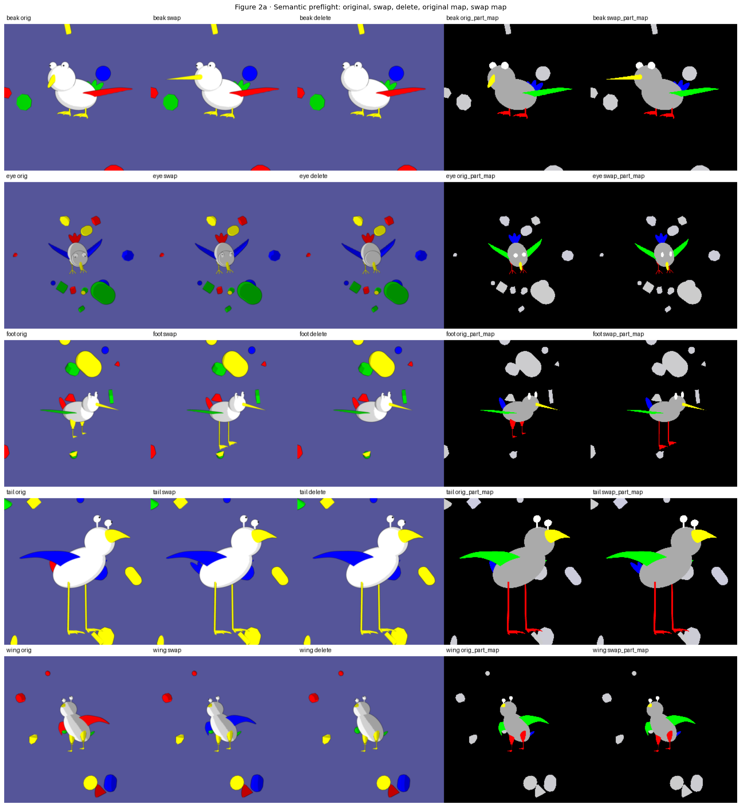
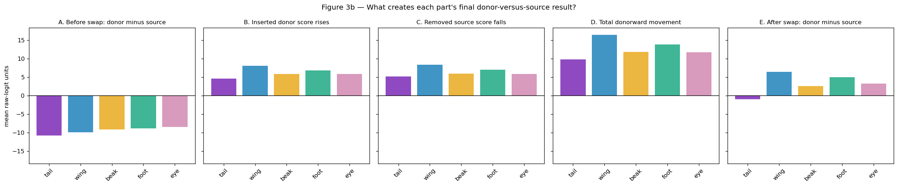
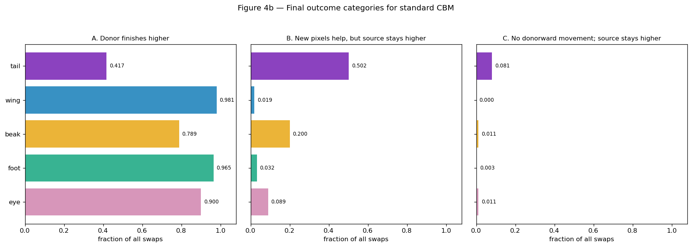
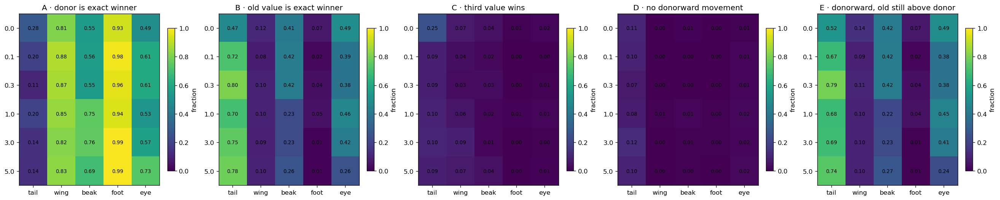
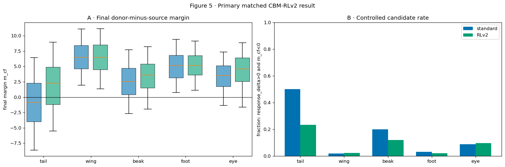
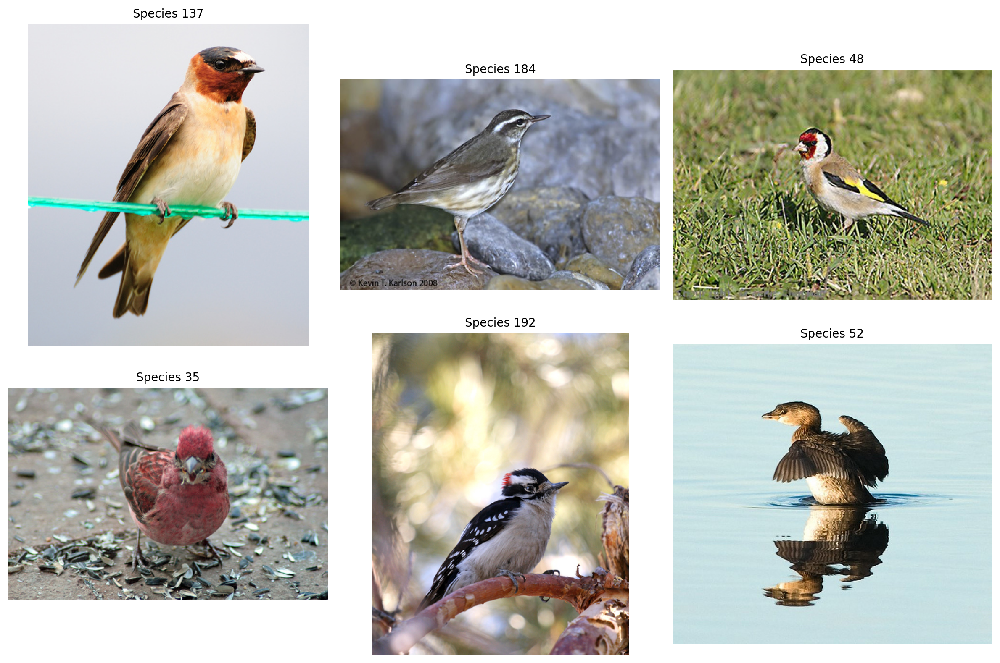

<h1 align="center">Concept Backwash in Concept Bottleneck Models</h1>

<p align="center">
  <b>Do interpretable vision models actually look where they claim to?</b><br>
  Controlled counterfactual swaps, information-bottleneck training, and visibility-aware relabeling on FunnyBirds and CUB.
</p>

<p align="center">
  
  
  
  
  
</p>

<p align="center">
  
  <br>
  <sub>The core instrument. A synthetic 3D renderer replaces exactly one bird part (beak, eye, foot, tail, wing) while holding pose, camera, lighting and background fixed. Everything downstream asks: did the model's concept score follow the pixels?</sub>
</p>

---

## TL;DR

**Concept Bottleneck Models (CBMs)** promise interpretability by forcing an image classifier to first predict human-readable concepts ("has red tail", "has hooked beak") and then classify from those concepts alone. This project asks a simple, uncomfortable question: **when you physically swap a bird's tail for a different tail, does the "tail" concept actually change?**

Often it does not. I call the failure mode **concept backwash**: the inserted part's score rises, but the removed part's score stays higher. The model is reading the concept off of *context* (species identity, other parts, pose), not off the part itself.

Key findings on FunnyBirds (1,000 controlled swaps per part, ResNet-50 backbone):

| Finding | Evidence |
|---|---|
| Backwash is **part-specific**, not global | Tail: 50% of swaps end with the old tail still winning. Wing: under 2%. Same model, same test accuracy of 99.2% species / 99.7% concept. |
| **Stronger minimality makes it worse** | Raising the information-bottleneck weight in a Minimal CBM (γ 0 → 5) pushes tail backwash from 52% to 74%, even as ordinary concept accuracy improves. |
| **Visibility-aware relabeling fixes most of it** | Re-deriving training labels from rendered part visibility flips the mean tail margin from −0.96 to +1.90 (Standard CBM) and from −5.46 to +1.03 (MCBM γ=5). Backwash at γ=5 drops from 74% to 35%. |
| Residual species information is **not** the culprit | A diagnostic classifier recovers extra species identity from both tail and wing scores, yet only tail fails. Removing it is not necessary for the fix. |

The full write-up with every table, figure and caveat lives in [`curated/report/`](curated/report/README.md).

---

## Why this matters

Interpretability methods are increasingly used to audit and debug deployed models. A CBM that reports "tail concept = yes" because the *species* usually has that tail is not interpretable, it is a confident, well-calibrated lie. Standard benchmarks cannot catch this: test accuracy is 99%+ for every model studied here. Only an **intervention** (change the pixels, watch the score) exposes the gap between what the model says it uses and what it actually uses.

This work builds the controlled intervention, measures the failure precisely, tests two proposed remedies, and begins extending the method from synthetic images to natural photographs.

---

## Method

### 1. Decompose the swap response

Every swap is scored by a **margin**: inserted-donor logit minus removed-source logit. Positive means the model now believes the new part. The final margin decomposes exactly as

```
final margin  =  original margin  +  donor-score increase  +  source-score decrease
```

<p align="center">
  
  <br>
  <sub>Standard CBM. Tail and wing start with similar source preference (panel A). Wing's response (D) is large enough to flip the sign (E); tail's is not.</sub>
</p>

### 2. Classify every swap into one of three outcomes

<p align="center">
  
  <br>
  <sub>The middle panel is concept backwash: new pixels helped, but not enough. Tail is the outlier at 50.2%.</sub>
</p>

### 3. Test remedy A: Minimal Concept Bottleneck Models

[MCBM](https://arxiv.org/abs/2506.04877) adds an information-bottleneck penalty (weight γ) that pushes internal concept coordinates toward their label targets, intended to remove "leaked" non-concept information. I sweep γ ∈ {0, 0.1, 0.3, 1, 3, 5} with everything else fixed.

<p align="center">
  
  <br>
  <sub>Rows are γ, columns are parts. Panel E (backwash) for tail climbs from 0.52 to 0.74 as γ increases. Foot improves. The penalty is not a uniform fix.</sub>
</p>

### 4. Test remedy B: visibility-aware relabeling (RLv2)

FunnyBirds ships *species-level* concept labels: every image of species X gets the same 26-bit vector regardless of whether the tail is visible from that camera angle. That is a perfect species↔concept confound. [`scripts/make_image_level_concept_labels.py`](scripts/make_image_level_concept_labels.py) renders a segmentation map for each of the 50,000 training images, counts part pixels, and zeroes the label when the part is effectively invisible. This changes 19.9% of positive tail labels and 0.03% of positive wing labels.

<p align="center">
  
  <br>
  <sub>Same architecture, same swap images, only the training labels differ. Tail median margin crosses zero and tail backwash halves.</sub>
</p>

### 5. Extend to natural images: CUB

<p align="center">
  
</p>

On a 70-species subset of [CUB-200-2011](https://www.vision.caltech.edu/datasets/cub_200_2011/) with 112 attribute concepts, there is no renderer. I instead use released anatomical part masks, Grad-CAM localization, visibility-conditioned logit gaps, and species-matched recall comparisons as observational proxies. Current status: the proxies do **not** calibrate cleanly against the FunnyBirds ground truth, and mask coverage is incomplete. I am adapting concept-guided segmentation ([Segments to Concepts](https://arxiv.org/abs/2510.04180)) to build mask-based donor replacements as a crude natural-image analogue of the swap. See [`curated/report/05_cub_cbm/review.md`](curated/report/05_cub_cbm/review.md).

---

## Engineering

This is a research codebase, but one built to be re-run.

- **Models** ([`models/`](models/), [`scripts/`](scripts/)): Koh-style joint CBM and Minimal CBM on a ResNet-50 backbone in PyTorch. Two-stage training (frozen backbone, then joint fine-tune), concept BCE + task CE + IB penalty, mixed-precision (AMP), cosine LR schedule, persistent data workers.
- **Datasets** ([`datasets/`](datasets/)): loaders and metadata builders for FunnyBirds (50 species, 26 one-hot part-variant concepts) and CUB-200-2011 (attribute concepts, part masks, species-level label preprocessing).
- **Interventions** ([`run_z_ordering_sweep.py`](run_z_ordering_sweep.py), `funnybird_notebooks/`): drives the FunnyBirds Node.js renderer over HTTP to produce swap, deletion and part-map images; parallel rendering with per-part checkpointing so multi-hour sweeps resume after preemption.
- **Relabeling pipeline** ([`scripts/make_image_level_concept_labels.py`](scripts/make_image_level_concept_labels.py)): headless rendering via Puppeteer, pixel counting, median-relative thresholding, drop-in label replacement.
- **Diagnostics** ([`src/probes/`](src/probes/), [`src/analysis/`](src/analysis/)): linear probes for species decodability from concept scores, frozen-head replay with within-label mean replacement, occlusion analysis, held-out contributor-omission audits.
- **Compute**: every experiment has a SLURM submission script (`run_*_adroit.sh`) for single-GPU CUDA 12.1 nodes. Environment pinned in [`environment.yml`](environment.yml) and [`requirements.txt`](requirements.txt).
- **Reproducible reporting** ([`curated/report/`](curated/report/)): each analysis notebook is frozen to HTML with a SHA-256 of the source, a figure manifest, and prose revised for a research audience.

---

## Repository layout

```
.
├── models/                 CBM and MCBM architectures (ResNet-50 backbone)
├── datasets/               FunnyBirds and CUB dataset classes + metadata
├── scripts/                Training, feature extraction, probing, relabeling
├── src/                    Probe utilities, occlusion analysis, CUB attributes
├── run_*.sh                SLURM job scripts for every experiment
├── run_z_ordering_sweep.py MCBM gamma sweep over controlled swaps
├── notebooks/              CUB analysis notebooks
├── funnybird_notebooks/    FunnyBirds swap, counterfactual and recall notebooks
├── results/probes/         Saved probe metrics (JSON)
├── curated/report/         Frozen, reviewed write-ups with figures  <-- start here
└── figures/
```

---

## Quick start

```bash
conda env create -f environment.yml
conda activate cubvision-gpu
```

Train the Standard CBM on FunnyBirds (expects the dataset under `data/FunnyBirds` and a pretrained backbone checkpoint):

```bash
python -m scripts.train_cbm_funnybirds \
    --funnybirds_root data/FunnyBirds \
    --checkpoint_dir  checkpoints_funnybirds \
    --backbone_ckpt   checkpoints_funnybirds/resnet50_funnybirds_best.pth \
    --epochs_stage1 12 --epochs_stage2 10 --batch_size 64 --lr 1e-3
```

Train an MCBM at a given bottleneck weight (γ = 0 recovers the Standard CBM):

```bash
python -m scripts.train_mcbm_funnybirds \
    --funnybirds_root data/FunnyBirds \
    --checkpoint_dir  checkpoints_funnybirds \
    --backbone_ckpt   checkpoints_funnybirds/resnet50_funnybirds_best.pth \
    --gamma 1.0
```

Generate visibility-aware labels (requires the FunnyBirds renderer running locally):

```bash
python -m scripts.make_image_level_concept_labels --help
```

On a SLURM cluster, each `run_*_adroit.sh` wraps one of the above with module loads, logging and checkpoint directories.

---

## Open questions and limitations

Stated plainly, because they are the next steps:

- The headline Standard-CBM comparison uses a single seed. Independent replication across seeds is needed.
- Early MCBM runs had uncontrolled initialization; the `_fix` checkpoints correct the loss but the historical sweep should be re-run.
- Relabeling helps tail but slightly hurts wing donor recognition (83% → 78% at γ=5). The improvement is part-specific.
- The visual cue the model actually uses to retain the old tail score is still unidentified.
- CUB lacks a validated swap, so every natural-image result is observational for now.

---

## References

- Koh et al., *Concept Bottleneck Models*, ICML 2020.
- Almudévar et al., *Minimal Concept Bottleneck Models*, [arXiv:2506.04877](https://arxiv.org/abs/2506.04877).
- Hesse, Schaub-Meyer, Roth, *FunnyBirds: A Synthetic Vision Dataset for a Part-Based Analysis of Explainable AI Methods*, ICCV 2023.
- Wah et al., *The Caltech-UCSD Birds-200-2011 Dataset*, 2011.
- Margeloiu et al., *Do Concept Bottleneck Models Learn as Intended?*, [arXiv:2105.04289](https://arxiv.org/abs/2105.04289).
- Havasi et al., *Addressing Leakage in Concept Bottleneck Models*, [arXiv:2211.03656](https://arxiv.org/abs/2211.03656).
- *From Segments to Concepts: Interpretable Image Classification via Concept-Guided Segmentation*, [arXiv:2510.04180](https://arxiv.org/abs/2510.04180).

---

<p align="center">
  <sub>Keywords: explainable AI · interpretability · concept bottleneck models · counterfactual interventions · causal evaluation · information bottleneck · computer vision · PyTorch · ResNet-50 · fine-grained classification · dataset bias · shortcut learning · synthetic benchmarks · SLURM / HPC</sub>
</p>
