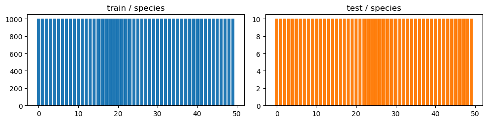
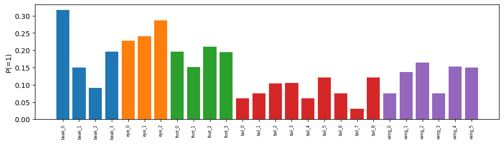
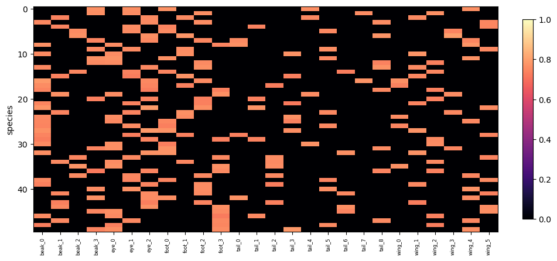
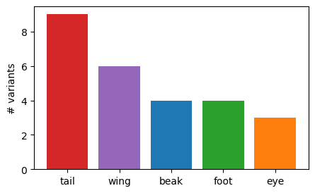

Editorial revision · 2 October 2026. Explanatory prose has been revised for a research audience. Figures and numerical output tables retain their source versions. This revision involved no model execution.


# FunnyBird: Dataset structure


Report provenance. Figures and numerical output tables were recovered from the named source HTML. The surrounding prose has been revised for a research audience. Artifact identifiers specify the source version and its execution status.


Contribution to the analysis: Species–concept co-occurrence defines the predictive information available in the data. Whether a trained model uses this information requires a separate model analysis.


Source: /Users/macloaner/.codex/worktrees/notebook05-reconstruction/CBM-Concept-Backwash/curated/notebooks/01_funnybirds_analysis.html
Source SHA256: 7153eb115443d18fe073ecb1193b8171549f8b8bc85c1e625d28a3da243d12a1


# FunnyBirds — Data Analysis


Dataset only (no model). Class balance · concept prevalence · class×concept matrix · species-constancy · candidate part features.


```text
train 50000 / test 500 imgs · 50 species · 26 concepts
```


## 1. Class balance


```text
train/species: 1000 - 1000 | test/species: 10 - 10
```





## 2. Concept prevalence (by part)


```text
rarest: ['tail_7', 'tail_0', 'tail_4', 'tail_1', 'tail_6']
```





## 3. Class × concept matrix


```text
cells exactly 0/1: 0.8077 (1.0 = clean species→concept lookup)
```


```text
<matplotlib.colorbar.Colorbar at 0x14c76f255840>
```





### 3b. Differences in concept constancy between training and test populations


The reported fraction of species–concept cells with constant labels is approximately 0.81 in training and 1.00 in the test population. The following analysis examines the population differences underlying these values.


The data-analysis implementation assigns image-level part-presence labels through params_to_concept_vector. Training images include removed parts, whereas the test population contains complete birds. This difference accounts for the within-species label variation reported here. These historical data results should be interpreted with their recorded label view; the matched label audit in notebook 02 establishes the supervision population for the accepted Standard CBM.


```text
train: 0.808 of (species,concept) cells are exactly 0/1 -> 19.2% vary within a species
count of varying (species,concept) cells, by part: {'beak': 50, 'eye': 50, 'foot': 50, 'tail': 50, 'wing': 50}
```


```text
test: 1.000 of cells have within-species std 0 (1.00 = every concept constant within species on the eval set)
```


## 4. Within-species concept-label variation in the test population


The within-species standard deviation quantifies concept-label variation in the test population. Values near zero indicate a species-constant label population. Recall comparisons must use the rule appropriate to that population: the all-positive-species branch is used when positive/negative matching within species is unavailable.


```text
(species,concept) with within-species std==0: 1.0000 | mean std 0 | test imgs/species 10
VERDICT: species-constant → recall gap = n=10 noise here; use deletion/swap
```


## 5. Part-level dataset properties


These part-level properties are candidate covariates for subsequent model analyses. The deletion results cited in this historical section require their own model and artifact provenance; the accepted controlled-swap analysis is presented in notebook 02.


|  | part | n_variants | mean_px | median_px | frac_visible |
| --- | --- | --- | --- | --- | --- |
| 3 | tail | 9 | 99.8 | 17.0 | 0.635 |
| 4 | wing | 6 | 689.7 | 567.0 | 0.756 |
| 0 | beak | 4 | 127.3 | 78.0 | 0.749 |
| 2 | foot | 4 | 283.2 | 232.0 | 0.757 |
| 1 | eye | 3 | 111.7 | 86.0 | 0.753 |


```text
Text(0, 0.5, '# variants')
```



