Editorial revision · 2 October 2026. Explanatory prose has been revised for a research audience. Figures and numerical output tables retain their source versions. This revision involved no model execution.


# FunnyBird Standard CBM: discovery and fingerprints


Report provenance. Figures and numerical output tables were recovered from the named source HTML. The surrounding prose has been revised for a research audience. Artifact identifiers specify the source version and its execution status.


**Contribution to the theory:** Read health and renderer validation first, then donor gain/source release and final margin. Visibility, label conflict, difficulty and frequency test alternative explanations. Species probes measure availability; fingerprint erasure measures saved-head use. Neither establishes the upstream visual cause by itself.


Source: /Users/macloaner/.codex/worktrees/notebook05-reconstruction/CBM-Concept-Backwash/curated/notebooks/02_funnybirds_cbm.html
Source SHA256: cee97ff63d6ee8caafb9b9c38d70e8887cb7c0f2f1fe64f2fb19611627ade7b5


# Chapter 1 · Standard FunnyBird CBM: Controlled part-replacement analysis


- **Question:** after replacing one named part while body, pose, camera,
and background stay fixed, does its concept score follow the new pixels?


- **Result:** the comparison moves toward the inserted part, yet the old
answer still wins in 50.2% of tail, 20.0% of beak, 8.9% of eye, 3.2% of
foot, and 1.9% of wing swaps.


- **Exact event:** `response_delta>0` and final margin `m_cf<0` on the same
validated swap.


- **Scope:** seed-1 Standard non-RL Koh Joint CBM. No MCBM or RLv2 result
is used to establish discovery, and one seed gives no seed-level
uncertainty.


- Scope: Controlled replacement measures the response to a specified pixel intervention. Subsequent analyses examine candidate contributors to that response. Their interpretation is restricted to the evaluated model and population.


## Model architecture, training objective, and notation


- Model: Seed-1 Koh Joint CBM with the approved ResNet-50 encoder substitution.


- Architecture: The image encoder produces 26 raw concept logits. A linear layer maps these logits to scores for 50 species.


- **Training loss:** `L_task + 0.01 * L_concept`. Joint means both stages were
trained together. ResNet-50 is the approved replacement for Koh's image
encoder; the Koh concept bottleneck, class head, and loss are preserved.


- L_task is the species-classification loss, and L_concept measures agreement with the supplied concept labels. The coefficient 0.01 scales the concept-loss term during optimization. The fitted contribution of concept supervision requires an empirical comparison.


- The species head operates directly on raw concept logits z through a linear transformation. The separate MCBM architecture, introduced in notebook 03, includes private nonlinear concept readers.


ResNet-50 provides the image encoder. Joint training updates the image-to-concept and concept-to-species components under the combined objective. Each species score is an affine function of the 26 concept logits.


```text
image x_i
   |
   v
ResNet-50 image encoder
   |
   v
26 raw concept logits z_i = (z_i1, ..., z_i26)
   |                         |
   |                         +--> sigmoid only for thresholded concept metrics
   |
   +--> one linear 26-to-50 species head --> species logits
```


| Symbol | Plain meaning | Use below |
| --- | --- | --- |
| x_i | image i | model input |
| y_i | species label | species-task health |
| c_ij | processed 0/1 label for exact concept j | concept supervision and health |
| z_ij | raw logit emitted for concept j | primary grounding quantity |
| p_ij = sigmoid(z_ij) | bounded probability | thresholded performance only |
| c_hat_ij = 1[z_ij>0] | predicted present/absent concept | recall and balanced accuracy |
| v_ig | whether renderer mask g is visible | visibility analysis |
| a_ig | number of visible pixels in part mask g | visibility-strength analysis |


For an exact concept j, z_j=4 yields a positive thresholded prediction and z_j=−4 yields a negative prediction under the rule c_hat_j=1[z_j>0]. Differences in z are reported in logit units.


The model uses the accelerated_v1 training protocol and its recorded convergence continuation. Accuracy and recall quantify agreement with the evaluation labels. Spatial dependence is assessed separately using controlled part replacement.


## Controlled part-replacement analysis


Each original rendered image is paired with an image in which one part variant is replaced by a variant associated with a donor species. The remaining scene parameters are held fixed. The indices s and d denote the source and donor exact concepts within the replaced part category.


Let z_s and z_d denote the corresponding raw concept logits. The pairwise margin is m=z_d−z_s; positive values indicate a higher donor logit. The response is response_delta=m_cf−m_orig, where orig and cf denote the original and replacement images. Recognition among all variants is evaluated separately using the largest logit within the part.


The operational criterion response_delta>0 and m_cf<0 identifies replacements with donorward movement and a retained source preference. These observations are termed backwash candidates. Contextual prediction, limited local evidence, and variant-specific recognition difficulty remain possible explanations that require further comparison.


Numerical illustration: Original logits z_d=−7 and z_s=3 give m_orig=−10. Replacement logits z_d=1 and z_s=2 give m_cf=−1 and response_delta=9. The donor logit increases by 8 and the source logit decreases by 1, leaving the source logit higher by 1. These hypothetical values illustrate the criterion.


Raw logits are unbounded model outputs. The transformation p = sigmoid(z) is used for explicitly thresholded performance measures; the replacement analysis uses z. Renderer masks identify the visible pixels assigned to each part, and mask area is measured in pixels.


### Additional definitions


| Term | Ordinary meaning | Small example |
| --- | --- | --- |
| rate/fraction | qualifying rows divided by eligible rows | 20 of 100 = 20% |
| median | middle value after sorting | median of 1,3,9 is 3 |
| percentile | declared location after sorting | Q95 is at or above 95% of rows |
| balanced accuracy | average of positive and negative recall | (90%+70%)/2 = 80% |
| visibility bin | rows grouped by inserted-part pixel count | 120 pixels enters the 100–199 bin |
| label/mask conflict | label says the concept is present while its renderer mask says its pixels are not visible | “red tail=1” but zero red-tail-region pixels |
| exact-value recognition | whether the inserted value receives the largest score among alternatives for that part | blue is highest among nine tail values |
| species support | Number of the 50 species whose unmodified definition contains the exact variant | support 4 for blue tail means four species normally have blue tails, even if the experiment renders many blue-tail swaps |
| species decoder | a separate diagnostic classifier trained after the CBM; it asks whether species can be guessed from concept numbers | 70% means 70 of 100 held-out species labels are guessed correctly |
| held-out | rows not used to fit the diagnostic being scored | fit on four folds; score the fifth |
| fold | one non-overlapping held-out subset | each of five subsets is tested once |
| RMSE / MAE | prediction error in margin units; RMSE penalizes large misses more | lower is better |
| residual | what remains after subtracting the comparison group's expected value | observed margin 5 minus expected margin 3 leaves residual +2 |
| association | two measurements vary together; the cause is not isolated | larger visible tails tend to have better margins |
| causal evidence | changing one thing while holding the relevant alternatives fixed changes the outcome | the renderer replaces one part in the same scene |
| grounding | the named concept score actually follows the pixels of that named part | blue-tail score follows replacement blue-tail pixels |
| model health | basic check that an output changes and agrees with ordinary labels | a constant score is unhealthy even if one class is common |
| collapsed output | a score that is effectively identical for every image | always returning z=2 cannot distinguish presence from absence |
| seed 1 | one trained model run | Independent training runs are required for replication uncertainty |
| RLv2 | matched model trained after invisible positive labels are set to zero | Matched supervision intervention evaluated in 02rl |


Figures 3–4 quantify the controlled replacement response. The subsequent visibility, frequency, and species analyses assess associations with this response; causal attribution requires additional interventions.


## Organization of the analysis


- **Validate:** model health and renderer operation (Figures 1–2).


- **Establish the event:** donorward response followed by an old-source
win (Figures 3–5).


- **Investigate contributors:** visibility, conflicting labels, exact
values/support, and unchanged source context (Figures 6–8).


- **Separate information from use:** what raw magnitudes reveal, what the
saved species head uses, and what happens when off-target evidence is
erased (Figures 8b–8d).


- **Measure prediction and downstream consequence:** grouped held-out
contributor audit and frozen-head species probability (Figures 9–10).


Subsequent chapters examine MCBM minimality, visibility-aware relabeling, CUB70, and Full CUB. The Standard CBM replacement analysis provides the initial reference for these comparisons.


## Dataset design and report population


The FunnyBird renderer specifies species, part variants, and scene parameters explicitly.


| Item | Value used here | Why it matters |
| --- | --- | --- |
| species | 50 | unchanged species/body appearance is the possible contextual signal |
| named parts | tail , wing , beak , foot , eye | these are the only five FunnyBird part names used below |
| exact concepts | 26 part values across the five parts | for example, tail::blue ; a part and its exact value are not interchangeable |
| held-out model-health population | 500 test images | used for Figure 1 and the species decoder |
| controlled swap population | accepted fixed-render seed-1 CSV | the same validated rendered images are reused across model comparisons |


Species and part variants are associated by construction. This creates predictive information about a concept outside its named region. Figures 2–4 assess the trained model’s response when that region is changed under a fixed scene.


```text
[MANIFEST VERIFIED] /scratch/network/cr7998/cv_emergence_project/curated_data/koh_joint_resnet_accelerated_converged_v1/funnybirds/standard/seed1/SUCCESS.json
[MANIFEST VERIFIED] /scratch/network/cr7998/cv_emergence_project/curated_data/swap_koh_joint_resnet_accelerated_converged_v1_seed1/SUCCESS.json
```


```text
[checked] funnybirds-cbm-rlv2matched-s1.csv: 5000 fixed renders; unique_cf_hashes=3040; unique_orig_hashes=250; changed_from_orig=0.983
[checked] funnybirds-cbm-s1.csv: 5000 fixed renders; unique_cf_hashes=3040; unique_orig_hashes=250; changed_from_orig=0.983
FIXED SWAP VALIDATION PASSED: 2 model CSVs, 5000 counterfactual RGB IDs, 250 original RGB IDs; hashes agree across models and each CSV passed diversity/intervention checks.
corrected visibility: /scratch/network/cr7998/cv_emergence_project/curated_data/funnybird_visibility_correction_v1/visibility.csv
```


|  | swaps | mean_legacy_pixels | mean_corrected_pixels | swaps_with_added_second_instance |
| --- | --- | --- | --- | --- |
| part |  |  |  |  |
| tail | 1000 | 110.16 | 110.16 | 0 |
| wing | 1000 | 397.43 | 810.47 | 940 |
| beak | 1000 | 161.61 | 161.61 | 0 |
| foot | 1000 | 158.57 | 329.50 | 995 |
| eye | 1000 | 72.46 | 144.97 | 958 |


```text
fixed-render input: /scratch/network/cr7998/cv_emergence_project/curated_data/swap_koh_joint_resnet_accelerated_converged_v1_seed1/funnybirds-cbm-s1.csv
rows: 5000 parts: ['beak', 'eye', 'foot', 'tail', 'wing']
framework: Koh Joint; backbone: ResNet-50; minimal_cbm: rejected
checkpoint: /scratch/network/cr7998/cv_emergence_project/curated_data/koh_joint_resnet_accelerated_converged_v1/funnybirds/standard/seed1/final_model_1.pth
evaluation: /scratch/network/cr7998/cv_emergence_project/curated_data/koh_joint_resnet_accelerated_converged_v1/funnybirds/standard/seed1/final_test.parquet images: 500 concepts: 26 species: 50
```


## 1 · Concept prediction performance and output variation


**Question.** Did training produce a usable, non-collapsed CBM?


**Variables and prediction.** For every exact concept `j`, measure raw-score spread, positive-versus-negative label separation, balanced accuracy, and positive recall. A usable slot has nonzero spread, positive label separation, and above-chance thresholded performance.


Method. All quantities are computed from held-out predictions of the accepted converged checkpoint. Recall measures agreement with positive concept labels; the subsequent replacement analysis assesses response to part pixels.


Numerical record. The accompanying table reports the quantities summarized in the figure, including denominators and exclusions for each part and exact value.


### Figure 1 · Concept prediction performance and output variation


How to read the figure. Each row is one exact concept, such as yellow tail . The four panels use the same rows. spread = Q95(z)-Q05(z) asks whether the output changes across test images; exactly zero means a constant output. label separation = median(z|c=1)-median(z|c=0) asks how far positive-labelled images sit above negative-labelled images; positive is the expected direction. balanced accuracy = (positive recall + negative recall)/2 gives positive and negative labels equal weight; 0.5 is chance for a binary concept. positive recall = P(z>0|c=1) is the fraction of labelled-positive images called positive. Example: positive recall 0.90 means 90 of 100 positive-labelled images have z>0 . Dot color identifies the FunnyBird part: purple tail, blue wing, orange beak, green foot, and pink eye. The solid zero line marks no label separation; the dashed 0.5 lines mark chance balanced accuracy and 50% positive recall. These measures quantify label agreement and output variation. Spatial dependence is evaluated through part replacement.


|  | images | species | task_accuracy | concept_accuracy |
| --- | --- | --- | --- | --- |
| 0 | 500 | 50 | 0.992 | 0.9968 |


|  | concept | part | spread | label_separation | balanced_accuracy | positive_recall | n_positive | n_negative |
| --- | --- | --- | --- | --- | --- | --- | --- | --- |
| 0 | beak_0 | beak | 10.054 | 8.069 | 0.994 | 0.990 | 210 | 290 |
| 1 | beak_1 | beak | 12.014 | 10.326 | 0.994 | 0.990 | 100 | 400 |
| 2 | beak_2 | beak | 13.487 | 11.214 | 0.999 | 1.000 | 60 | 440 |
| 3 | beak_3 | beak | 11.431 | 8.898 | 0.996 | 0.992 | 130 | 370 |
| 4 | eye_0 | eye | 11.156 | 9.241 | 0.989 | 0.987 | 150 | 350 |
| 5 | eye_1 | eye | 10.891 | 8.934 | 0.988 | 0.975 | 160 | 340 |
| 6 | eye_2 | eye | 10.699 | 8.428 | 0.985 | 0.979 | 190 | 310 |
| 7 | foot_0 | foot | 11.098 | 8.940 | 0.999 | 1.000 | 130 | 370 |
| 8 | foot_1 | foot | 11.551 | 9.560 | 0.995 | 0.990 | 100 | 400 |
| 9 | foot_2 | foot | 11.267 | 8.639 | 0.993 | 0.986 | 140 | 360 |
| 10 | foot_3 | foot | 11.026 | 8.596 | 0.995 | 0.992 | 130 | 370 |
| 11 | tail_0 | tail | 13.528 | 11.872 | 1.000 | 1.000 | 40 | 460 |
| 12 | tail_1 | tail | 13.152 | 11.078 | 0.969 | 0.940 | 50 | 450 |
| 13 | tail_2 | tail | 13.100 | 10.605 | 0.999 | 1.000 | 70 | 430 |
| 14 | tail_3 | tail | 13.254 | 11.034 | 1.000 | 1.000 | 70 | 430 |
| 15 | tail_4 | tail | 12.265 | 10.878 | 0.988 | 0.975 | 40 | 460 |
| 16 | tail_5 | tail | 13.036 | 10.256 | 0.993 | 0.988 | 80 | 420 |
| 17 | tail_6 | tail | 13.616 | 11.742 | 1.000 | 1.000 | 50 | 450 |
| 18 | tail_7 | tail | 5.907 | 12.483 | 1.000 | 1.000 | 20 | 480 |
| 19 | tail_8 | tail | 12.384 | 10.342 | 0.986 | 0.975 | 80 | 420 |
| 20 | wing_0 | wing | 13.371 | 11.684 | 1.000 | 1.000 | 50 | 450 |
| 21 | wing_1 | wing | 12.410 | 10.088 | 1.000 | 1.000 | 90 | 410 |
| 22 | wing_2 | wing | 11.227 | 9.239 | 1.000 | 1.000 | 110 | 390 |
| 23 | wing_3 | wing | 12.718 | 10.861 | 1.000 | 1.000 | 50 | 450 |
| 24 | wing_4 | wing | 11.393 | 9.322 | 0.995 | 0.990 | 100 | 400 |
| 25 | wing_5 | wing | 11.569 | 9.618 | 1.000 | 1.000 | 100 | 400 |


- Method: We computed four health statistics directly from the frozen CBM's 26 raw concept logits on 500 held-out images; no classifier or model was fitted.


```text
### Plain-language reference for Figure 1

**Plain caption.** All 26 concept outputs vary and classify their ordinary labels well, so the swap analysis is not being driven by a collapsed or unusable model.

**Terms and how to read it.** `spread` is the 95th minus 5th percentile of raw `z`; `label separation` is the positive-label median minus the negative-label median; balanced accuracy weights positive and negative recognition equally; positive recall uses positive-labelled images as its denominator.

**Literal values.** Across 500 held-out images, all 26 exact outputs vary: raw-z spread is 5.907-13.616, label separation is 8.069-12.483, balanced accuracy is 0.969-1.000, and positive recall is 0.940-1.000. Species accuracy is 0.992 and concept accuracy is 0.9968.

**Interpretation.** The model is not broken or stuck. Every concept score changes across images, and the model almost always agrees with the ordinary labels. That makes the later replacement test meaningful, but it still does not tell us which pixels the model used.
```


Alternative explanation. Species-correlated cues could support high label agreement. The present measures therefore establish prediction performance, with spatial dependence assessed in subsequent experiments.


```text
**Discriminating test.** Use the same-image controlled replacement in Figures 3-4.

**Verdict.** **KEEP**.

**Proof ledger.** `ACCEPTED FOR seed-1 standard-CBM model health; no exact output is collapsed.`

**Next question.** Is the fixed renderer intervention itself valid?
```


## 2 · Validation of the rendered intervention


Question. Does the rendered image pair satisfy the specified one-part intervention?


Variables and prediction. Inspect the semantic preflight and original/swap/delete/part-map examples for all five parts. For a visible replacement, the target part should change while the rest of the scene is preserved. Rows with identical original and replacement RGB values are identified separately in the visibility analysis.


**Method.** Use the accepted full-cache validation plus representative all-part examples before reading any model response.


Numerical record. The accompanying table reports the quantities summarized in the figure, including denominators and exclusions for each part and exact value.


### Figure 2 · Validation of the rendered intervention


How to read the figure. Figure 2a is the renderer's semantic preflight: for each part it shows the original, replacement, deletion, original part map, and replacement part map. In a visible example, the named part should change while body, pose, camera, and background remain fixed. Rows with identical original and replacement RGB values are retained and identified in the visibility analysis. This figure assesses the rendering operation.


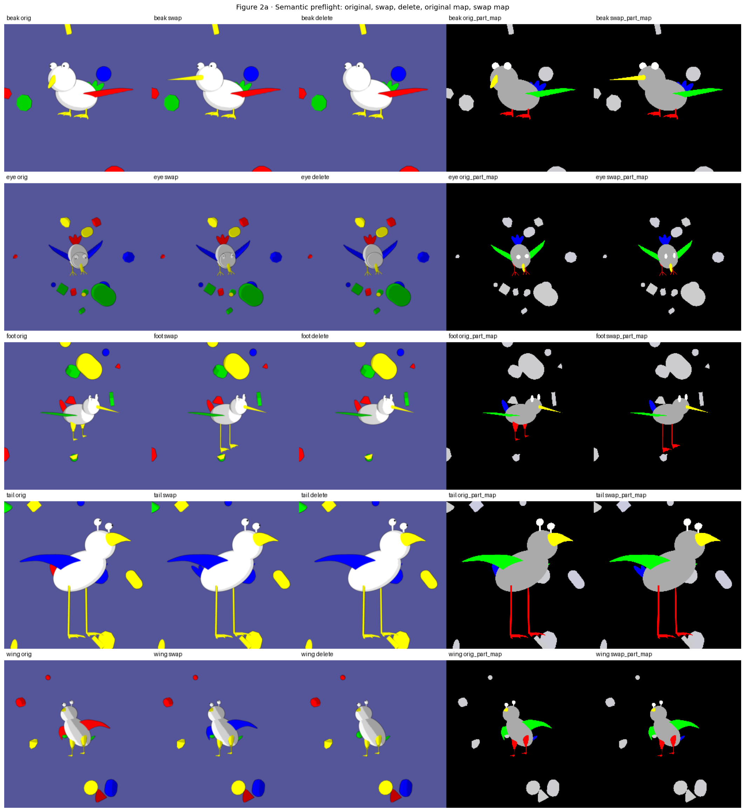


- Method: We displayed the renderer's saved original, one-part replacement, deletion, and part-mask outputs for all five parts; this is a pixel-operation audit with no model fitting.


Caption. This preflight sheet checks that the renderer can replace or remove one named part without intentionally changing the remaining bird, pose, camera, or background.


**How this image was obtained.** Before evaluating the CBM, the renderer
saved, for each part, the original image, the one-part replacement, the
deletion, the original part map, and the replacement part map. No model
score or fitted classifier appears in this figure.


Observation. The displayed examples contain the required image and mask roles, and the highlighted maps correspond to the specified parts. Figure 2b provides paired examples for further inspection.


Alternative explanation still open. Inspection of a montage covers the displayed rows. The full-file hash and intervention checks reported around Figure 2b address cache completeness and diversity, while visible target area is analyzed later.


Scope. The displayed examples support the semantic interpretation of the rendering operation. Cache-wide checks and model-response analyses are reported separately.


Subsequent analysis. Do representative stored outputs for all five parts show the same intended operation clearly enough to inspect row by row?


### Figure 2b · Paired intervention examples for each part


**Question.** Does the accepted swap output contain a visually inspectable
original, replacement, deletion, and replacement-part map for tail, wing,
beak, foot, and eye?


Variables and prediction. Each row represents a part, and each column represents an image or mask role. The specified part and its mask should change while the remaining scene is preserved. Across the cache, 98.3% of replacement images differ from their originals in RGB values. The remaining 1.7% are retained and identified in the visibility analysis. A panel labelled “Missing” indicates that the expected image or mask file was unavailable; that panel cannot be used to assess the intervention.


Method. The first stored audit example in filename order is displayed for each of the five parts. Selection is independent of the model’s predictions.


**How to read the figure.** Compare columns within a row, then compare the
visible changed pixels with the highlighted replacement-part map. No axis or
color encodes a model score.


- Method: We selected one accepted saved audit row per part and displayed its original, replacement, deletion, and isolated target mask; no result was estimated from these examples.


```text
### Plain-language reference for Figure 2b

**Plain caption.** The renderer targets the named part while preserving the rest of the bird and scene; 98.3% of cached replacements visibly change RGB pixels, while the remainder are retained for visibility analysis.

**Terms and how to read it.** Rows are named parts; columns are original, replacement, deletion, and part-map roles. The colors are image pixels or renderer masks, not model scores.

**Literal values.** For tail, wing, beak, foot, and eye, the displayed replacement and deletion alter the named part while the body, pose, camera, and background remain fixed; the target part map contains that region. Across the complete cache, 98.3% of replacement RGB images differ visibly from their originals. The remaining 1.7% are retained and identified by the later pixel-visibility measurement rather than described as visibly changed.

**Interpretation.** The pictures and full-file checks agree that the operation targets the named part rather than silently replacing the whole bird or scene. Most cached replacements visibly change RGB pixels; the small unchanged group is kept and measured later instead of being treated as a visible intervention.
```


Scope of visual validation. The five displayed pairs permit inspection of representative operations. Cache-wide validation uses the accompanying image and artifact checks.


```text
**Discriminating test.** Retain the semantic preflight plus the accepted fixed-render hash/diversity validation across all evaluated models and render IDs.

**Verdict.** **KEEP**.

**Proof ledger.** `ACCEPTED FOR the validated FunnyBird fixed-render intervention, with visibly unchanged rows retained explicitly for the visibility analysis.`

**Next question.** Do those inserted pixels move the raw concept comparison toward the donor?
```


## 3 · Change in the donor–source concept margin


**Question.** Did the inserted pixels move the comparison toward the donor?


**Variables and prediction.** `response_delta = (z_donor-z_source)_cf - (z_donor-z_source)_orig`. Legacy CSV columns named `z_*` contain these post-head raw logits. Values above zero mean that replacement pixels moved the model toward the donor concept.


**Method.** Plot the complete distribution for every part and report the positive-response rate.


Numerical record. The accompanying table reports the quantities summarized in the figure, including denominators and exclusions for each part and exact value.


### Figure 3 · Change in the donor–source concept margin


How to read the figure. Panel A puts part on the x-axis and response_delta in raw-logit units on the y-axis. The box spans the 25th--75th percentiles, the orange line is the median, and whiskers are the 5th--95th percentiles; outliers are omitted only from drawing. Zero means no donorward change and values above zero mean the donor gained relative to the old source. Panel B reports the fraction above zero, with n printed over each bar. Colors identify parts using the shared FunnyBird palette. Final donor–source ordering is evaluated separately using m_cf. Example: a margin change from -20 before replacement to -5 afterward gives response_delta=+15 , although the final margin remains negative.


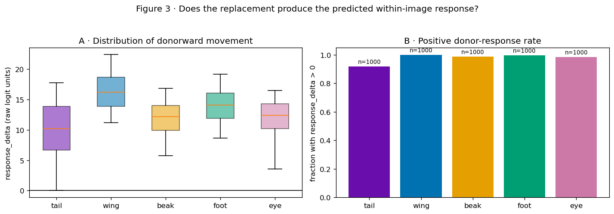


|  | eligible_swaps | positive_response_rate |
| --- | --- | --- |
| part |  |  |
| tail | 1000 | 0.919 |
| wing | 1000 | 1.000 |
| beak | 1000 | 0.989 |
| foot | 1000 | 0.997 |
| eye | 1000 | 0.986 |


- Method: For each of 5,000 paired swaps, we subtracted the original donor-minus-source margin from the counterfactual margin, then summarized those paired raw-logit changes by part; nothing was trained.


```text
### Plain-language reference for Figure 3

**Plain caption.** Inserted part pixels move the donor-versus-source comparison toward the donor for nearly every swap, although this does not yet say which concept wins.

**Terms and how to read it.** `response_delta=m_cf-m_orig` is measured in raw-logit units. Above zero means donorward movement. The box shows the middle 50%, whiskers show the 5th--95th percentiles, and each rate uses all 1,000 swaps for that part.

**Literal values.** The complete response distributions are donorward for nearly every swap. Positive-response rates are tail 0.919, wing 1.000, beak 0.989, foot 0.997, and eye 0.986, with 1,000 swaps per part.

**Interpretation.** The model nearly always notices the new part: its answer moves toward the inserted value in at least 91.9% of swaps for every part. The next question is whether that movement is large enough to change the final answer.
```


Interpretation. Positive response_delta indicates donorward movement. The final ordering of the two logits is determined separately by m_cf.


```text
**Discriminating test.** Inspect the final donor-minus-source margin jointly with response_delta.

**Verdict.** **KEEP**.

**Proof ledger.** `ACCEPTED FOR a causal within-image response of the controlled part-replacement intervention in all five part groups. This is a part-level statement: the observed positive-response rates are 0.919-1.000, not a claim that every individual row responded. Tail, beak, and eye have smaller typical movement than wing and foot; tail is not the mechanism and is not the only comparatively weak response.`

**Next question.** Did the parts start equally far behind, and did donor rise versus source release contribute differently?
```


## 3b · Decomposition of the donor–source margin


**Question.** Does a part finish poorly because its donor began far below
the source, because the donor rose too little, because the removed source
fell too little, or because several of these occurred together?


**Variables and exact identity.** For every swap:


`m_orig = z_donor,orig - z_source,orig`


`donor_gain = z_donor,cf - z_donor,orig`


`source_decrease = z_source,orig - z_source,cf`


`response_delta = donor_gain + source_decrease`


`m_cf = m_orig + response_delta`


Score scale. The plotted quantity is the raw concept logit z. The Standard CBM maps image features to these logits directly. Notebook 03 separately examines MCBM internal coordinates h and their private concept readers q_j.


m_orig measures the original-image donor–source preference and includes evidence from the original part and the remaining scene. Separate interventions are required to isolate these contributions.


Numerical illustration. If m_orig=−20, donor gain is 9, and source release is 6, then response_delta=15 and m_cf=−5. The replacement reduces the source advantage by 15 logit units.


**Method.** Average each raw-logit quantity over all 1,000 validated swaps
for each part, including both directions. Verify the exact row-wise
identity before displaying any mean.


### Figure 3b · Starting margin, donor gain, source release, and final margin


Figure interpretation. All panels use raw-logit units and a common part-color mapping. Panel A shows m_orig. Panels B and C show donor gain and source release, respectively; positive values contribute donorward movement. Panel D is their sum. Panel E shows m_cf, with positive values indicating a higher donor logit.


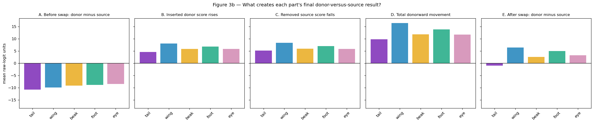


|  | m_orig | donor_gain | source_decrease | response_delta | m_cf |
| --- | --- | --- | --- | --- | --- |
| part |  |  |  |  |  |
| tail | -10.756 | 4.599 | 5.201 | 9.800 | -0.956 |
| wing | -9.914 | 8.029 | 8.361 | 16.390 | 6.476 |
| beak | -9.167 | 5.842 | 5.936 | 11.778 | 2.611 |
| foot | -8.847 | 6.804 | 7.027 | 13.831 | 4.984 |
| eye | -8.481 | 5.875 | 5.874 | 11.749 | 3.268 |


```text
maximum row-wise decomposition error: 1.7763568394002505e-15
```


- Method: We arithmetically decomposed every paired swap into starting margin, donor-score rise, source-score fall, total response, and final margin, verified the identity row by row, and averaged each term by part.


### Definitions for Figure 3b


Caption. The final donor-versus-source result combines a starting preference for the source with the donor's rise and the source's fall after replacement.


**Terms.** Starting margin is donor score minus source score before
replacement. Inserted donor score rises is the increase in the donor
concept's score. Removed source score falls is the decrease in the old
source concept's score. Total donorward movement is donor rise plus
source decrease. Final margin is starting margin plus total movement. A
negative final margin means the old source concept remains higher. All
five panels use mean raw-logit units over 1,000 swaps per part.


**Literal mean values.**


| Part | Starting margin | Donorward movement | Final margin |
| --- | --- | --- | --- |
| tail | -10.756 | +9.800 | -0.956 |
| wing | -9.914 | +16.390 | +6.476 |
| beak | -9.167 | +11.778 | +2.611 |
| foot | -8.847 | +13.831 | +4.984 |
| eye | -8.481 | +11.749 | +3.268 |


The row-wise arithmetic identity closes to numerical error below
`1.8e-15`. Tail's donor rise is `4.599` and old-source decrease is
`5.201`, both the smallest part means.


Interpretation. Each part has a negative mean starting margin. The mean correction exceeds this deficit for wing, beak, foot, and eye. For tail, the correction remains smaller than the deficit, leaving a negative mean final margin. The component analysis identifies a smaller total correction as a relevant feature of the tail result.


**Alternative.** Tail could be smaller, hidden more often, harder to
distinguish exactly, or more strongly associated with species context.
Means can also hide direction and exact-value asymmetry, and the original
margin still contains genuine source-part pixels.


Proposed follow-up. Separate direction, visibility, exact values, and source-species organization in the following figures.


**Verdict.** **KEEP**.


Evidence summary. The competition producing the final margin is separated arithmetically. The causes of the starting preference and unequal replacement response remain unresolved.


Subsequent analysis. How often does the donor actually finish higher?


## 4 · Final margin conditional on replacement response


**Question.** After responding, does the donor finish above the old source?


Variables and prediction. The final margin is m_cf=z_donor,cf-z_source,cf . The primary event is response_delta>0 with m_cf<0 . A lower-right quadrant point means the margin moves donorward and remains source-favoring.


**Method.** Show final-margin distributions and the joint response/margin plane for every part.


Numerical record. The accompanying table reports the quantities summarized in the figure, including denominators and exclusions for each part and exact value.


### Figure 4 · Final margin conditional on replacement response


How to read the figure. In the margin panel, zero separates donor wins ( m_cf>0 ) from old-source wins ( m_cf<0 ). In the quadrant panel, x is donorward movement and y is the final donor-minus-source score. The lower-right quadrant is the controlled backwash predicate response_delta>0 and m_cf<0 : the margin moves donorward and the source logit remains higher. Boxes and colors use the Figure 3 definitions; translucent points are individual swaps and the legend maps color to part. Example: m_cf=-5 means the old source finishes five raw-logit units above the donor.


|  | n | median_response | median_final_margin | positive_response_rate | responded_but_source_wins_rate |
| --- | --- | --- | --- | --- | --- |
| part |  |  |  |  |  |
| tail | 1000 | 10.226 | -0.819 | 0.919 | 0.502 |
| wing | 1000 | 16.183 | 6.483 | 1.000 | 0.019 |
| beak | 1000 | 12.170 | 2.551 | 0.989 | 0.200 |
| foot | 1000 | 14.058 | 5.158 | 0.997 | 0.032 |
| eye | 1000 | 12.388 | 3.511 | 0.986 | 0.089 |


- Method: We applied the predeclared row-level predicate response_delta>0 and m_cf<0 to all 1,000 validated swaps per part and plotted the two raw quantities jointly; no threshold was learned.


```text
### Plain-language reference for Figure 4

**Plain caption.** Controlled backwash is graded: the model responds to the new pixels but the old source answer still wins most often for tail and less often for every other part.

**Terms and how to read it.** `m_cf=z_donor,cf-z_source,cf`. A negative final margin means the old source remains higher. The controlled event requires both `response_delta>0` and `m_cf<0` on the same row.

**Literal values.** Median final margins are tail -0.819, wing 6.483, beak 2.551, foot 5.158, and eye 3.511 raw-logit units. On the same 1,000 swaps per part, the donorward-response-but-source-wins rates are 0.502, 0.019, 0.200, 0.032, and 0.089, respectively.

**Interpretation.** Yes, backwash occurs. Tail is the clearest case: in about half the tail replacements, the model reacts in the correct direction but still favors the tail value belonging to the original bird. The same event also occurs less often for beak, eye, foot, and wing.
```


Alternative explanation. Starting preference, swap direction, target visibility, exact value difficulty, and source species could organize the unequal rates.


```text
**Discriminating test.** Test those alternatives separately in Figures 5-9 without changing the event definition.

**Verdict.** **KEEP**.

**Proof ledger.** `ACCEPTED FOR the seed-1 controlled FunnyBird backwash predicate across a graded part ordering: strongest for tail, beak, and eye, with minority events also in wing and foot. This is not a tail-specific mechanism claim.`

**Next question.** Can swap direction create the pooled pattern?
```


## 4b · Distribution of replacement outcomes


Every validated swap is placed into exactly one outcome:


- `m_cf > 0`: the donor concept finishes higher;


- m_cf<=0 and response_delta>0: donorward movement with a non-positive final margin;


- m_cf<=0 and response_delta<=0: a non-positive final margin and non-positive response.


The three categories partition all swaps for each part. Figure 4b uses a non-positive margin category, whereas the strict criterion in Figure 4 uses m_cf<0; exact-zero cases should be retained explicitly when comparing the two summaries.


Numerical illustration. Of 100 swaps, 20 may have positive final margins, 50 may have positive responses with non-positive final margins, and 30 may have both quantities non-positive. The corresponding fractions are 0.20, 0.50, and 0.30.


### Figure 4b — Three mutually exclusive outcomes for every part


**How to read the figure.** Every panel contains all five parts and uses a
fraction from zero to one. Higher is desirable only in Panel A. Panel B
is the controlled backwash event. Panel C is a different failure: no
positive response. Both swap directions are included. Bar colors use the
shared part palette defined at the start of the notebook.


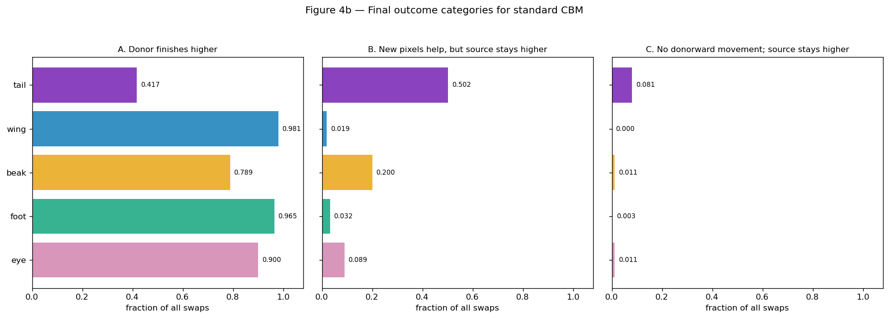


|  | donor_wins | helped_but_source_wins | no_donorward_move_and_source_wins |
| --- | --- | --- | --- |
| tail | 0.417 | 0.502 | 0.081 |
| wing | 0.981 | 0.019 | 0.000 |
| beak | 0.789 | 0.200 | 0.011 |
| foot | 0.965 | 0.032 | 0.003 |
| eye | 0.900 | 0.089 | 0.011 |


- Method: We assigned every swap to exactly one of three predeclared outcomes from the signs of m_cf and response_delta , then divided each count by all 1,000 swaps for that part.


### Definitions for Figure 4b


Caption. Every replacement is assigned to exactly one final outcome, separating successful donor wins from insufficient donorward corrections and from complete failures to move donorward.


Definitions and denominator. The three displayed categories are m_cf>0; response_delta>0 with m_cf<=0; and response_delta<=0 with m_cf<=0. Each fraction uses the 1,000 swaps for that part. Their sum is one. The middle category includes exact-zero final margins and should be distinguished from the strict m_cf<0 criterion.


Results. Positive-final-margin/positive-response-with-nonpositive-margin/nonpositive-response-and-margin fractions are tail 0.417/0.502/0.081 , wing 0.981/0.019/0.000 , beak 0.789/0.200/0.011 , foot 0.965/0.032/0.003 , and eye 0.900/0.089/0.011 .


Interpretation. Tail has a positive donorward response in 91.9% of swaps. In the displayed partition, 50.2% have positive response and a non-positive final margin. Thus a substantial fraction retains a source preference or tie despite donorward movement. Beak and eye show the same response category at lower rates.


**Alternative.** A positive response may be tiny, and pooled outcomes
may hide direction or exact-value asymmetry.


Proposed follow-up. Retain Figure 3b's response magnitudes and next separate directions and exact donor values.


**Verdict.** **KEEP**.


Evidence summary. Response and final ordering are evaluated jointly to distinguish retained source preference after donorward movement from a non-positive response.


Subsequent analysis. Does the pattern occur in both swap directions?


## 5 · Comparison between replacement directions


**Question.** Could opposite swap directions create the result?


Variables and prediction. Compare forward and backward rates of response_delta>0 and final margin<0 , together with median margins. Consistency between directions would support robustness of the pooled part comparison.


**Method.** Keep directions separate and show their denominators.


Numerical record. The accompanying table reports the quantities summarized in the figure, including denominators and exclusions for each part and exact value.


### Figure 5 · Comparison between replacement directions


**How to read the figure.** Each part has separate forward (`fwd`) and backward (`bwd`) replacement
estimates, shown as unconnected circles and squares. The rate is
the fraction of rows in the lower-right quadrant from Figure 4; the printed
denominator is the number of swaps. Similar values in both directions argue
against a pooled average hiding opposite effects. A rate of 0.60 means 60%
of swaps in that direction satisfy both `response_delta>0` and `m_cf<0`.


|  | part | direction | n | median_margin | responded_but_source_wins_rate |
| --- | --- | --- | --- | --- | --- |
| 0 | beak | bwd | 500 | 2.915 | 0.200 |
| 1 | beak | fwd | 500 | 2.252 | 0.200 |
| 2 | eye | bwd | 500 | 3.782 | 0.088 |
| 3 | eye | fwd | 500 | 3.256 | 0.090 |
| 4 | foot | bwd | 500 | 5.368 | 0.042 |
| 5 | foot | fwd | 500 | 4.948 | 0.022 |
| 6 | tail | bwd | 500 | -0.545 | 0.476 |
| 7 | tail | fwd | 500 | -0.992 | 0.528 |
| 8 | wing | bwd | 500 | 6.410 | 0.028 |
| 9 | wing | fwd | 500 | 6.561 | 0.010 |


- Method: We split each part's 1,000 fixed swaps into its 500 forward and 500 backward replacements and recomputed the same controlled-event rate and final-margin summary independently; nothing was fitted.


```text
### Plain-language reference for Figure 5

**Plain caption.** The part ordering appears in both replacement directions rather than being created by pooling one easy and one difficult direction.

**Terms and how to read it.** Forward and backward name the two replacement directions. Every displayed rate is controlled-event rows divided by the 500 swaps in that direction; markers are not connected because direction is categorical.

**Literal values.** Forward and backward results preserve the ordering. Tail rates are 0.528 and 0.476; beak is 0.200 in both; eye is 0.090 and 0.088; foot is 0.022 and 0.042; wing is 0.010 and 0.028. Each direction has 500 swaps.

**Interpretation.** The ordering is not created by averaging an easy direction with a hard direction. Replacing A with B and replacing B with A give similar part rankings, especially for tail, beak, and eye.
```


Alternative explanation. Individual source/donor value pairs can still be asymmetric even when pooled directions agree.


```text
**Discriminating test.** Inspect every exact inserted value and both direction-specific denominators.

**Verdict.** **KEEP**.

**Proof ledger.** `ACCEPTED FOR excluding opposite-direction cancellation as the main explanation.`

**Next question.** How does exact target visibility change the event?
```


## 6 · Association between visible target area and replacement outcome


**Question.** How much of the result is associated with target visibility?


**Variables and prediction.** Use `pixel_count_cf` from the exact swapped-part map and the same final-margin and `response_delta>0, margin<0` definition. If visibility is sufficient, highly visible replacements should remove the part gap; a remaining gap requires another explanation.


**Method.** Use declared bins and print the number of swap rows in every bin.


Numerical record. The accompanying table reports the quantities summarized in the figure, including denominators and exclusions for each part and exact value.


### Figure 6 · Association between visible target area and replacement outcome


How to read the figure. The x-axis bins swaps by the number of visible pixels in the inserted target part. Eye, wing, and foot sum both official left/right renderer-instance colors; beak and tail each use their single official color. The original single-instance counts are retained as provenance; the displayed analysis uses the combined counts. One panel shows median final raw-logit margin; the other shows the positive-response/source-retaining fraction. If visibility were the whole explanation, sufficiently large visible parts should make margins positive and drive that fraction near zero for every part. Point color identifies part; the table gives the exact denominator for every nonempty bin. The companion visible-only summary uses the same rule for all parts: pixel_count_cf > 0 . A median margin of +3 means the donor finishes three raw-logit units above the source. Example: a replacement with 120 target-part pixels enters the 100--199 bin; binning stratifies the existing rendered images by measured visible area.


|  | part | visibility_bin | n | median_margin | responded_but_source_wins_rate |
| --- | --- | --- | --- | --- | --- |
| 0 | beak | 0–19 | 123 | 0.493 | 0.423 |
| 1 | beak | 20–49 | 164 | 0.834 | 0.256 |
| 2 | beak | 50–99 | 192 | 3.036 | 0.198 |
| 3 | beak | 100–199 | 237 | 2.702 | 0.169 |
| 4 | beak | 200–499 | 227 | 3.442 | 0.097 |
| 5 | beak | 500+ | 57 | 3.889 | 0.105 |
| 6 | eye | 0–19 | 17 | -2.414 | 0.588 |
| 7 | eye | 20–49 | 136 | 1.680 | 0.228 |
| 8 | eye | 50–99 | 307 | 3.465 | 0.072 |
| 9 | eye | 100–199 | 285 | 3.979 | 0.046 |
| 10 | eye | 200–499 | 237 | 4.218 | 0.034 |
| 11 | eye | 500+ | 18 | 5.857 | 0.278 |
| 12 | foot | 0–19 | 4 | -3.230 | 0.750 |
| 13 | foot | 20–49 | 12 | 0.841 | 0.167 |
| 14 | foot | 50–99 | 92 | 3.386 | 0.076 |
| 15 | foot | 100–199 | 228 | 4.651 | 0.022 |
| 16 | foot | 200–499 | 489 | 5.469 | 0.027 |
| 17 | foot | 500+ | 175 | 5.788 | 0.011 |
| 18 | tail | 0–19 | 386 | -3.841 | 0.573 |
| 19 | tail | 20–49 | 130 | -1.212 | 0.623 |
| 20 | tail | 50–99 | 94 | -0.496 | 0.585 |
| 21 | tail | 100–199 | 187 | 2.095 | 0.294 |
| 22 | tail | 200–499 | 180 | 0.942 | 0.428 |
| 23 | tail | 500+ | 23 | -0.297 | 0.565 |
| 24 | wing | 20–49 | 1 | -0.922 | 1.000 |
| 25 | wing | 50–99 | 9 | 3.746 | 0.111 |
| 26 | wing | 100–199 | 65 | 5.396 | 0.108 |
| 27 | wing | 200–499 | 224 | 5.603 | 0.027 |
| 28 | wing | 500+ | 701 | 6.712 | 0.006 |


|  | n_visible_rows | median_margin | responded_but_source_wins_rate |
| --- | --- | --- | --- |
| part |  |  |  |
| tail | 813 | 0.057 | 0.496 |
| wing | 1000 | 6.483 | 0.019 |
| beak | 995 | 2.566 | 0.200 |
| foot | 999 | 5.161 | 0.032 |
| eye | 989 | 3.516 | 0.086 |


- Method: We grouped the same fixed swaps by the number of visible inserted-part mask pixels and recomputed median final margin and controlled-event fraction inside each declared bin; the images and CBM were unchanged.


```text
### Plain-language reference for Figure 6

**Plain caption.** Greater target-part visibility usually helps, but clearly visible replacements still leave controlled backwash events, especially for tail.

**Terms and how to read it.** The x-axis is visible target-mask pixels after replacement. The left outcome is median final margin; the right outcome is the controlled-event fraction. Every table row prints its own denominator.

**Literal values.** Visibility helps but is not sufficient. Tail's median margin changes from -0.819 over all rows to 0.057 for any visible target and 1.416 for targets with at least 100 pixels, while its event rate remains 0.372 in that clear-visibility population. Beak and eye rates generally fall with visibility; tail is non-monotone and its 500+ bin has only 23 rows.

**Interpretation.** Making the inserted part clearly visible helps, especially for tail, beak, and eye. It does not solve the problem: even among clearly visible tail replacements, roughly 37 of every 100 still react toward the donor but finish with the old source answer higher. The visibility bins contain different exact values and species, so small non-monotonic steps between neighboring bins are not evidence that extra pixels themselves hurt.
```


Alternative explanation. Pixel count covaries with pose, exact variants, and species. Consequently, comparisons between area bins estimate associations among these variables.


```text
**Discriminating test.** Hold exact values and species fixed, and test the visibility-aware label change later with matched RLv2 training.

**Verdict.** **KEEP**.

**Proof ledger.** `ACCEPTED FOR visibility as a contributor, not a sufficient explanation.`

**Next question.** Did ordinary training assign positive labels when the part was not visible?
```


## 6b · Positive-label changes under visibility-aware relabeling


**Question.** How often did the original training label conflict with visible part evidence?


Variables and prediction. Compare the standard and visibility-aware label views for every image used in final training (train plus validation); count positive concept labels changed to zero within each exact concept and part group. A large conflict count identifies a plausible training signal that can reward contextual prediction, with behavioral consequences evaluated in notebook 02rl.


Method. Ordered image and class records must match across the two label views; attribute_label is the permitted difference. The analysis counts changes in supervision for the shared images.


Numerical record. The accompanying table reports the quantities summarized in the figure, including denominators and exclusions for each part and exact value.


### Figure 6b · Positive-label changes under visibility-aware relabeling


How to read the figure. Each row is one exact concept. The x-axis is P(visibility-aware label=0 | original label=1) : the number of original positive training labels removed by the visibility rule divided by all original positive labels for that concept. A value of 0.25 means 25 of 100 positive labels conflict with visible part evidence. Color identifies part. This fraction quantifies a change in training supervision.


```text
Figure 6b denominators by split:
```


|  | split | images | positive_labels | positive_to_zero_conflicts |
| --- | --- | --- | --- | --- |
| 0 | train | 45000 | 169626 | 7346 |
| 1 | val | 5000 | 18835 | 838 |


```text
Figure 6b exact-concept and part totals:
```


|  | concept | part | n_positive | n_changed | conflict_rate |
| --- | --- | --- | --- | --- | --- |
| 0 | beak_0 | beak | 15819 | 210 | 0.013 |
| 1 | beak_1 | beak | 7476 | 49 | 0.007 |
| 2 | beak_2 | beak | 4555 | 83 | 0.018 |
| 3 | beak_3 | beak | 9767 | 25 | 0.003 |
| 4 | eye_0 | eye | 11384 | 67 | 0.006 |
| 5 | eye_1 | eye | 11994 | 97 | 0.008 |
| 6 | eye_2 | eye | 14348 | 104 | 0.007 |
| 7 | foot_0 | foot | 9829 | 2 | 0.000 |
| 8 | foot_1 | foot | 7584 | 21 | 0.003 |
| 9 | foot_2 | foot | 10552 | 14 | 0.001 |
| 10 | foot_3 | foot | 9758 | 11 | 0.001 |
| 11 | tail_0 | tail | 3033 | 658 | 0.217 |
| 12 | tail_1 | tail | 3745 | 1320 | 0.352 |
| 13 | tail_2 | tail | 5224 | 617 | 0.118 |
| 14 | tail_3 | tail | 5285 | 1012 | 0.191 |
| 15 | tail_4 | tail | 3043 | 1190 | 0.391 |
| 16 | tail_5 | tail | 6030 | 675 | 0.112 |
| 17 | tail_6 | tail | 3752 | 722 | 0.192 |
| 18 | tail_7 | tail | 1536 | 599 | 0.390 |
| 19 | tail_8 | tail | 6059 | 696 | 0.115 |
| 20 | wing_0 | wing | 3774 | 1 | 0.000 |
| 21 | wing_1 | wing | 6815 | 2 | 0.000 |
| 22 | wing_2 | wing | 8190 | 3 | 0.000 |
| 23 | wing_3 | wing | 3794 | 0 | 0.000 |
| 24 | wing_4 | wing | 7611 | 1 | 0.000 |
| 25 | wing_5 | wing | 7504 | 5 | 0.001 |


|  | n_positive | n_changed | conflict_rate |
| --- | --- | --- | --- |
| part |  |  |  |
| tail | 37707 | 7489 | 0.199 |
| wing | 37688 | 12 | 0.000 |
| beak | 37617 | 367 | 0.010 |
| foot | 37723 | 48 | 0.001 |
| eye | 37726 | 268 | 0.007 |


- Method: We joined the Standard and visibility-aware train-plus-validation label records image by image and counted only positive labels changed to zero by the visibility rule; the resulting counts quantify differences between the label views.


```text
### Plain-language reference for Figure 6b

**Plain caption.** Original supervision frequently marks a tail concept present when its renderer pixels are invisible, while this conflict is rare for wing and foot.

**Terms and how to read it.** The numerator is original positive labels changed to zero by the visibility rule; the denominator is all original positive labels for that concept or part. This is a data-conflict rate, not a model probability.

**Literal values.** Across the 45,000 training and 5,000 validation images, the visibility rule removes 8,184 of 188,461 positive labels. By part, it removes 7,489/37,707 tail labels (0.199), 367/37,617 beak (0.010), 268/37,726 eye (0.007), 48/37,723 foot (0.001), and 12/37,688 wing (less than 0.001).

**Interpretation.** The ordinary training labels often say a tail value is present when the tail pixels are not visible. This happens for about one tail label in five but is almost absent for wing and foot. Such supervision could teach the model to infer tail from the rest of the bird; notebook 02rl tests that causal proposal by changing the labels and retraining.
```


Scope. These counts quantify changes to the training targets. Their effect on model predictions is examined through matched retraining in notebook 02rl.


```text
**Discriminating test.** Compare otherwise matched standard and RLv2 checkpoints on the same fixed renders.

**Verdict.** **KEEP**.

**Proof ledger.** `ACCEPTED FOR a measured, part-specific label/visibility conflict. It is extremely large for tail, small but nonzero for beak/eye, and near zero for wing/foot. This can explain tail's excess severity but cannot by itself explain backwash in every part; causal credit remains deferred to notebook 02rl.`

**Next question.** Are some exact visual variants much harder than others?
```


## 6c · Does label conflict line up with the exact score movement it could weaken?


Figure 6b counted a training-data problem. This figure asks whether that
problem lines up with model behavior for the **same exact value**.


- `conflict_j = hidden positive training labels for j / all positive training labels for j`.


- Inserted-value gain is
`mean(z_donor,cf - z_donor,orig)` over swaps inserting value `j`.


- Removed-value fall is
`mean(z_source,orig - z_source,cf)` over swaps removing value `j`.


Example: if `tail_4` is positive 100 times during training and invisible
in 39, its conflict rate is 0.39. If its score rises by 3.4 logit units on
average when inserted, Panel A places it at `(0.39, 3.4)`. Larger circles
mean more FunnyBird species naturally carry that exact value. Tail values
are labelled because they occupy the high-conflict region.


Moving right means more contradictory positive supervision. Moving down means a weaker response to adding or removing the named pixels. The comparison estimates an exact-value association; part, visibility, frequency, and appearance can still differ. The matched RLv2 retraining in notebook 02rl is the causal label test.


### Figure 6c · Exact-value label conflict versus matching score response


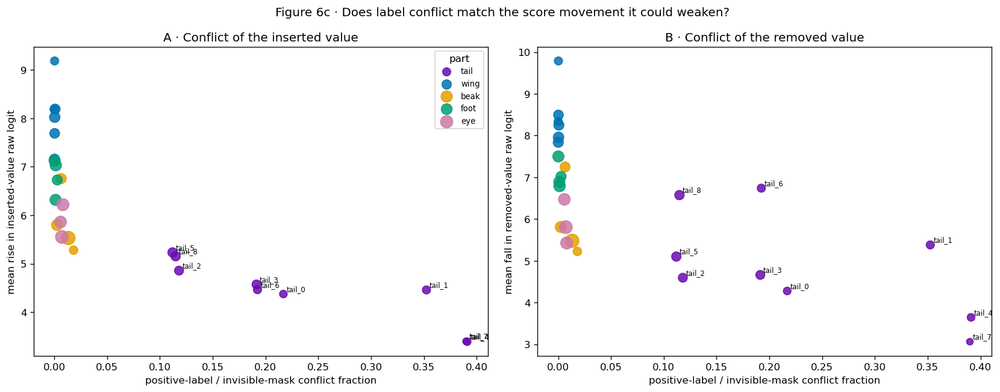


|  | concept_index | concept | part | value | positive_images | hidden_positive_images | conflict_rate | species_support | mean_donor_gain | mean_visible_pixels | donor_rows | mean_source_decrease | source_rows |
| --- | --- | --- | --- | --- | --- | --- | --- | --- | --- | --- | --- | --- | --- |
| 0 | 0 | beak_0 | beak | 0 | 15819 | 210 | 0.0133 | 21 | 5.5298 | 99.5449 | 345 | 5.4785 | 345 |
| 1 | 1 | beak_1 | beak | 1 | 7476 | 49 | 0.0066 | 10 | 6.7573 | 316.1306 | 245 | 7.2481 | 245 |
| 2 | 2 | beak_2 | beak | 2 | 4555 | 83 | 0.0182 | 6 | 5.2791 | 22.0526 | 190 | 5.2235 | 190 |
| 3 | 3 | beak_3 | beak | 3 | 9767 | 25 | 0.0026 | 13 | 5.7998 | 207.3773 | 220 | 5.8082 | 220 |
| 4 | 4 | eye_0 | eye | 0 | 11384 | 67 | 0.0059 | 15 | 5.8616 | 67.2067 | 300 | 6.4712 | 300 |
| 5 | 5 | eye_1 | eye | 1 | 11994 | 97 | 0.0081 | 16 | 6.2189 | 79.2928 | 345 | 5.4257 | 345 |
| 6 | 6 | eye_2 | eye | 2 | 14348 | 104 | 0.0072 | 19 | 5.5520 | 70.2620 | 355 | 5.8059 | 355 |
| 7 | 7 | foot_0 | foot | 0 | 9829 | 2 | 0.0002 | 13 | 7.1338 | 192.7364 | 220 | 7.4994 | 220 |
| 8 | 8 | foot_1 | foot | 1 | 7584 | 21 | 0.0028 | 10 | 6.7294 | 97.8042 | 240 | 7.0198 | 240 |
| 9 | 9 | foot_2 | foot | 2 | 10552 | 14 | 0.0013 | 14 | 7.0352 | 169.1552 | 290 | 6.7916 | 290 |
| 10 | 10 | foot_3 | foot | 3 | 9758 | 11 | 0.0011 | 13 | 6.3180 | 174.5440 | 250 | 6.8919 | 250 |
| 11 | 11 | tail_0 | tail | 0 | 3033 | 658 | 0.2169 | 4 | 4.3734 | 183.6800 | 75 | 4.2760 | 75 |
| 12 | 12 | tail_1 | tail | 1 | 3745 | 1320 | 0.3525 | 5 | 4.4579 | 115.2333 | 90 | 5.3794 | 90 |
| 13 | 13 | tail_2 | tail | 2 | 5224 | 617 | 0.1181 | 7 | 4.8566 | 83.2250 | 120 | 4.5933 | 120 |
| 14 | 14 | tail_3 | tail | 3 | 5285 | 1012 | 0.1915 | 7 | 4.5718 | 156.8545 | 110 | 4.6608 | 110 |
| 15 | 15 | tail_4 | tail | 4 | 3043 | 1190 | 0.3911 | 4 | 3.3887 | 99.7636 | 110 | 3.6440 | 110 |
| 16 | 16 | tail_5 | tail | 5 | 6030 | 675 | 0.1119 | 8 | 5.2328 | 69.1733 | 150 | 5.1008 | 150 |
| 17 | 17 | tail_6 | tail | 6 | 3752 | 722 | 0.1924 | 5 | 4.4626 | 152.8462 | 130 | 6.7392 | 130 |
| 18 | 18 | tail_7 | tail | 7 | 1536 | 599 | 0.3900 | 2 | 3.3962 | 106.6000 | 35 | 3.0609 | 35 |
| 19 | 19 | tail_8 | tail | 8 | 6059 | 696 | 0.1149 | 8 | 5.1535 | 76.7667 | 180 | 6.5735 | 180 |
| 20 | 20 | wing_0 | wing | 0 | 3774 | 1 | 0.0003 | 5 | 9.1871 | 388.9000 | 130 | 9.7883 | 130 |
| 21 | 21 | wing_1 | wing | 1 | 6815 | 2 | 0.0003 | 9 | 7.6914 | 357.4667 | 150 | 8.4944 | 150 |
| 22 | 22 | wing_2 | wing | 2 | 8190 | 3 | 0.0004 | 11 | 8.0250 | 483.9182 | 220 | 7.9594 | 220 |
| 23 | 23 | wing_3 | wing | 3 | 3794 | 0 | 0.0000 | 5 | 8.1916 | 363.8000 | 115 | 8.3381 | 115 |
| 24 | 24 | wing_4 | wing | 4 | 7611 | 1 | 0.0001 | 10 | 7.1593 | 403.3371 | 175 | 7.8375 | 175 |
| 25 | 25 | wing_5 | wing | 5 | 7504 | 5 | 0.0007 | 10 | 8.1918 | 354.1286 | 210 | 8.2514 | 210 |


- Method: We joined the 26 exact-value conflict rates from matched Standard/RLv2 training records to mean score movement for swaps inserting or removing the same value; no model was fitted or retrained.


### Definitions for Figure 6c


Caption. Exact values trained as present while their pixels were invisible tend to have weaker pixel-following responses, most clearly in the tail-versus-wing contrast.


Observation. High-conflict tail_4 and tail_7 each have conflict near 0.39 and mean inserted-score gains near 3.39 . Wing conflicts are at most 0.0007 , while wing inserted-score gains range from about 7.16 to 9.19 . The weaker ordering in the source-removal panel indicates that additional factors may contribute.


**Alternative.** These values also differ in visibility, appearance,
support, and part identity. The plot cannot assign an independent causal
share to label conflict.


**Limited conclusion.** Label conflict is aligned with the response
component it could plausibly weaken. Causality remains for the matched
Standard/RLv2 comparison.


## 7 · Recognition of exact source and donor variants


**Question.** Do exact source and donor values explain the failures?


**Variables and prediction.** For every part, compare the inserted donor value with the concept value that has the largest post-swap raw score. A clean diagonal means exact visual values are distinguished; recurring bright columns indicate default answers.


**Method.** Display all parts and all values with row-normalized counts.


Numerical record. The accompanying table reports the quantities summarized in the figure, including denominators and exclusions for each part and exact value.


### Figure 7 · Recognition of exact source and donor variants


How to read the figure. Each heatmap row is the value actually inserted and each column is the value with the largest post-swap raw logit. A bright diagonal means the model names the inserted value; bright off-diagonal cells show systematic confusion. Every FunnyBird part and every value is included. The lower row gives the final-margin distribution for the same inserted values, with the number of swaps printed above each box. The two summaries permit joint assessment of exact recognition and the retained-source margin. A diagonal value of 0.80 means the inserted value is highest in 80% of that row's swaps.


|  | diagonal_rate |
| --- | --- |
| tail | 0.395 |
| wing | 0.977 |
| beak | 0.780 |
| foot | 0.965 |
| eye | 0.900 |


|  | part | donor_value | n | median_margin | q25_margin | q75_margin | event_rate |
| --- | --- | --- | --- | --- | --- | --- | --- |
| 0 | tail | 0 | 75 | -2.150 | -3.892 | 0.873 | 0.640 |
| 1 | tail | 1 | 90 | -0.932 | -5.808 | 1.446 | 0.533 |
| 2 | tail | 2 | 120 | 0.163 | -3.022 | 2.348 | 0.408 |
| 3 | tail | 3 | 110 | -1.360 | -3.104 | 2.295 | 0.573 |
| 4 | tail | 4 | 110 | -3.283 | -6.689 | 1.349 | 0.518 |
| 5 | tail | 5 | 150 | 1.166 | -1.377 | 3.287 | 0.373 |
| 6 | tail | 6 | 130 | -1.289 | -4.784 | 1.151 | 0.515 |
| 7 | tail | 7 | 35 | -4.796 | -6.947 | -2.045 | 0.800 |
| 8 | tail | 8 | 180 | -0.378 | -3.255 | 3.067 | 0.478 |
| 9 | wing | 0 | 130 | 6.996 | 4.536 | 9.665 | 0.031 |
| 10 | wing | 1 | 150 | 5.101 | 3.752 | 7.002 | 0.027 |
| 11 | wing | 2 | 220 | 7.276 | 6.134 | 8.692 | 0.009 |
| 12 | wing | 3 | 115 | 5.350 | 4.265 | 7.512 | 0.017 |
| 13 | wing | 4 | 175 | 6.122 | 4.246 | 8.244 | 0.023 |
| 14 | wing | 5 | 210 | 6.607 | 4.618 | 8.628 | 0.014 |
| 15 | beak | 0 | 345 | 3.144 | 0.293 | 5.926 | 0.200 |
| 16 | beak | 1 | 245 | 3.960 | 1.845 | 5.517 | 0.098 |
| 17 | beak | 2 | 190 | 0.614 | -1.272 | 2.240 | 0.363 |
| 18 | beak | 3 | 220 | 2.426 | 1.294 | 3.626 | 0.173 |
| 19 | foot | 0 | 220 | 6.397 | 4.554 | 7.590 | 0.009 |
| 20 | foot | 1 | 240 | 4.330 | 2.898 | 5.350 | 0.038 |
| 21 | foot | 2 | 290 | 5.813 | 4.173 | 7.301 | 0.024 |
| 22 | foot | 3 | 250 | 3.879 | 1.731 | 6.078 | 0.056 |
| 23 | eye | 0 | 300 | 3.715 | 1.837 | 4.987 | 0.100 |
| 24 | eye | 1 | 345 | 4.247 | 2.873 | 5.443 | 0.072 |
| 25 | eye | 2 | 355 | 2.946 | 1.082 | 4.538 | 0.096 |


- Method: For each swapped part, we took the highest post-swap raw logit within that part block, cross-tabulated it against the inserted exact value, normalized each inserted-value row, and retained every swap.


```text
### Plain-language reference for Figure 7

**Plain caption.** Exact inserted-value recognition is weakest for tail and graded across the other parts, showing that value-level visual difficulty accompanies the swap failures.

**Terms and how to read it.** A heatmap row is the inserted exact value and a column is the highest-scoring value. Row-normalized color is the fraction of that inserted-value population. The lower boxes show final margins and print swap counts.

**Literal values.** Post-swap donor-value recognition is graded: diagonal rates are tail 0.395, wing 0.977, beak 0.780, foot 0.965, and eye 0.900. Tail value 7 has only 35 swaps, a median final margin of -4.796, and event rate 0.800; beak value 2 is the next conspicuous difficult value at rate 0.363.

**Interpretation.** After a tail is inserted, the model names the inserted tail value as its top tail answer only 39.5% of the time. It is much better for wing, foot, and eye. This establishes model-level difficulty choosing among tail's nine exact alternatives; it does not by itself establish that tails are visually ambiguous to a person. Visibility, label conflict, the number of alternatives, and source context remain separate candidate contributors.
```


Alternative explanation. Variant counts and support differ between parts and may contribute to differences in diagonal recognition rates.


```text
**Discriminating test.** Relate each donor value to species support and its part's alternative count.

**Verdict.** **KEEP**.

**Proof ledger.** `ACCEPTED FOR exact-value difficulty as an additional graded contributor across all five parts, not as a tail-only explanation.`

**Next question.** Do rarity or a larger choice set organize those value-level failures?
```


### Figure 7a · Rendered appearance of the nine tail variants


The confusion matrix records prediction errors; the corresponding rendered appearances are shown here. This compact visual audit shows one large, clearly visible accepted replacement for each of the nine inserted tail values. Only pixels inside the renderer's tail mask are retained, to restrict the displayed image support to the annotated part. The examples are selected mechanically by largest tail mask area, independently of model outcome.


The displayed variants have approximately repeated outlines in groups 0/3/6, 1/4/7, and 2/5/8, with color differences within each group. This visual assessment motivates comparison with within-group and between-group recognition errors. A quantitative similarity hypothesis would require a prespecified image measure or a targeted rendering intervention.


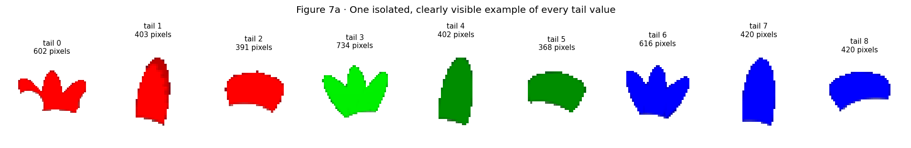


- Method: We selected the largest accepted tail mask for each exact inserted tail value and displayed only its masked RGB pixels; no score, classifier, or outcome was used for selection.


Caption. The nine masked crops show the rendered appearance of the exact tail variants.


Interpretation. Similarity in outline, area, or attachment geometry may motivate a recognition hypothesis. Evaluating that hypothesis requires an independently specified similarity measure or intervention and comparison with the errors in Figure 7.


Scope. The crops provide a visual description of the renderer variants.


## 7b · Species support and variant-level replacement outcomes


**Question.** Are difficult values simply rare or drawn from a larger alternative set?


**Variables and prediction.** For every exact donor value, compare its species support with all three mutually exclusive outcomes from Figure 4b; also report the total number of alternatives for its part. If rarity organizes the result, lower-support values should systematically win less or fail more. A mixed pattern rejects support as a sufficient explanation.


**Method.** Label every exact value, print its swap-row denominator, and verify that its three outcome fractions sum to one.


Numerical record. The accompanying table reports the quantities summarized in the figure, including denominators and exclusions for each part and exact value.


### Figure 7b · Species support and variant-level replacement outcomes


How to read the figure. Each labelled point is one exact donor value. The x-axis is its species support: the number of the 50 FunnyBird species that naturally carry that value in an unmodified bird. Its unit is species. The count comes from the renderer's species-to-part-value definition: if six species ordinarily have donor value 2, its support is 6 even when the swap table contains hundreds of value-2 rows. The three panels partition all swaps into donor wins, donorward movement that remains source-negative, and no donorward movement while source-negative. The three fractions sum to one within each value. A consistent relationship with support would make rarity a plausible organizer. The five-part design limits separate estimation of the contribution of alternative count.


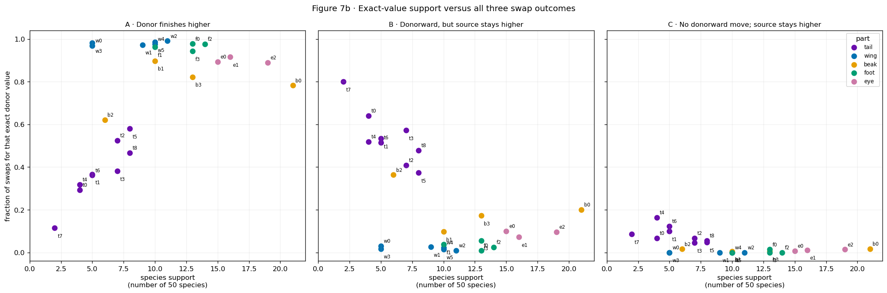


|  | part | var_donor | n_rows | species_support | donor_wins_rate | responded_but_source_wins_rate | no_donorward_move_rate | median_margin | alternatives_in_part |
| --- | --- | --- | --- | --- | --- | --- | --- | --- | --- |
| 0 | beak | 0 | 345 | 21 | 0.783 | 0.200 | 0.017 | 3.144 | 4 |
| 1 | beak | 1 | 245 | 10 | 0.898 | 0.098 | 0.004 | 3.960 | 4 |
| 2 | beak | 2 | 190 | 6 | 0.621 | 0.363 | 0.016 | 0.614 | 4 |
| 3 | beak | 3 | 220 | 13 | 0.823 | 0.173 | 0.005 | 2.426 | 4 |
| 4 | eye | 0 | 300 | 15 | 0.893 | 0.100 | 0.007 | 3.715 | 3 |
| 5 | eye | 1 | 345 | 16 | 0.916 | 0.072 | 0.012 | 4.247 | 3 |
| 6 | eye | 2 | 355 | 19 | 0.890 | 0.096 | 0.014 | 2.946 | 3 |
| 7 | foot | 0 | 220 | 13 | 0.977 | 0.009 | 0.014 | 6.397 | 4 |
| 8 | foot | 1 | 240 | 10 | 0.962 | 0.038 | 0.000 | 4.330 | 4 |
| 9 | foot | 2 | 290 | 14 | 0.976 | 0.024 | 0.000 | 5.813 | 4 |
| 10 | foot | 3 | 250 | 13 | 0.944 | 0.056 | 0.000 | 3.879 | 4 |
| 11 | tail | 0 | 75 | 4 | 0.293 | 0.640 | 0.067 | -2.150 | 9 |
| 12 | tail | 1 | 90 | 5 | 0.367 | 0.533 | 0.100 | -0.932 | 9 |
| 13 | tail | 2 | 120 | 7 | 0.525 | 0.408 | 0.067 | 0.163 | 9 |
| 14 | tail | 3 | 110 | 7 | 0.382 | 0.573 | 0.045 | -1.360 | 9 |
| 15 | tail | 4 | 110 | 4 | 0.318 | 0.518 | 0.164 | -3.283 | 9 |
| 16 | tail | 5 | 150 | 8 | 0.580 | 0.373 | 0.047 | 1.166 | 9 |
| 17 | tail | 6 | 130 | 5 | 0.362 | 0.515 | 0.123 | -1.289 | 9 |
| 18 | tail | 7 | 35 | 2 | 0.114 | 0.800 | 0.086 | -4.796 | 9 |
| 19 | tail | 8 | 180 | 8 | 0.467 | 0.478 | 0.056 | -0.378 | 9 |
| 20 | wing | 0 | 130 | 5 | 0.969 | 0.031 | 0.000 | 6.996 | 6 |
| 21 | wing | 1 | 150 | 9 | 0.973 | 0.027 | 0.000 | 5.101 | 6 |
| 22 | wing | 2 | 220 | 11 | 0.991 | 0.009 | 0.000 | 7.276 | 6 |
| 23 | wing | 3 | 115 | 5 | 0.983 | 0.017 | 0.000 | 5.350 | 6 |
| 24 | wing | 4 | 175 | 10 | 0.977 | 0.023 | 0.000 | 6.122 | 6 |
| 25 | wing | 5 | 210 | 10 | 0.986 | 0.014 | 0.000 | 6.607 | 6 |


```text
Within-part rank associations (descriptive; very few exact values per part):
```


|  | exact_values | support_vs_donor_wins_spearman | support_vs_controlled_event_spearman |
| --- | --- | --- | --- |
| part |  |  |  |
| tail | 9 | 0.949 | -0.780 |
| wing | 6 | 0.706 | -0.706 |
| beak | 4 | 0.200 | -0.200 |
| foot | 4 | 0.316 | -0.316 |
| eye | 3 | -0.500 | -0.500 |


- Method: We counted how many of the 50 species naturally carry each donor value, then grouped all swap rows for that value into the three exhaustive Figure 4b outcomes; no correlation model was fitted.


```text
### Plain-language reference for Figure 7b

**Plain caption.** Within tail, values carried by more species usually win more often; across parts, rarity is still bundled with part identity and does not determine the outcome by itself.

**Terms and how to read it.** Species support is the number of the 50 species naturally carrying an exact value. The three y-axes are mutually exclusive fractions with all swaps for that donor value as denominator; together they sum to one.

**Literal values.** All three outcome panels use every swap for each donor value and close to one. Within tail's nine values, support has a strong descriptive rank association with donor wins (Spearman about +0.95) and an inverse association with controlled failures (about -0.78). Tail value 7 has support from two species and controlled-event rate 0.800. The cross-part comparison is less identifiable because tail supplies nearly all low-support values, while values with overlapping support still differ sharply across parts.

**Interpretation.** The three clouds distinguish three possible rarity stories. A rare value can win less often, be noticed but fail to overcome the source, or fail to move donorward at all. Upper-left points support a rarity concern; upper-right and lower-left counterexamples show that support is not a complete rule. Tail remains worse than wing and foot at overlapping support, so another part-specific contributor is required.
```


Alternative explanation. The number of alternatives is constant within a part and therefore remains confounded with all other part-level differences.


```text
**Discriminating test.** Use more independent part families or a design that changes choice-set size while holding pixels and species fixed.

**Verdict.** **KEEP**.

**Proof ledger.** `VALID TEST WITH SUPPORT FOR A GRADED WITHIN-TAIL RARITY CONTRIBUTION, BUT NOT FOR SUPPORT OR ALTERNATIVE COUNT AS A SUFFICIENT CROSS-PART EXPLANATION.`

**Next question.** Does unchanged source species organize what remains after exact values?
```


## 7c · Species support and absent-concept logits


**Question.** Figure 7b showed that support alone cannot explain why tail
fails while similarly rare wing values usually succeed. It may still
explain a different link: the ordinary score scale learned by each head.


**Definitions.** `support_j` is the number of the 50 species naturally
carrying exact value `j`. `absent_mean_j` is the average raw score `z_j`
among the 500 ordinary held-out images whose official label is zero.
More negative means the head normally pushes that absent value farther
below the zero decision boundary.


**Worked example.** If only two species use `tail_7`, support is 2. If
three ordinary images without tail 7 score `-8,-6,-7`, the absent mean is
`(-8-6-7)/3=-7`. A donor swap must lift that deeply negative score farther
than a head whose absent mean is `-3`.


Prediction. If rarity contributes to the starting deficit, lower support should accompany a more negative absent mean. The observational comparison retains possible confounding by appearance, conflict, and part identity.


### Figure 7c · Species support versus ordinary absent raw score


Figure interpretation. Each point represents an exact variant. The horizontal axis gives species support; the vertical axis gives the mean logit among label-negative images. The least-squares line summarizes the observed association. Tables report all variants and rank correlations.


|  | part | concept | value | species_support | N_absent | absent_mean | absent_SD |
| --- | --- | --- | --- | --- | --- | --- | --- |
| 0 | beak | beak_0 | 0 | 21 | 290 | -3.652 | 0.831 |
| 1 | beak | beak_1 | 1 | 10 | 400 | -5.119 | 1.026 |
| 2 | beak | beak_2 | 2 | 6 | 440 | -5.939 | 1.201 |
| 3 | beak | beak_3 | 3 | 13 | 370 | -4.720 | 0.993 |
| 4 | eye | eye_0 | 0 | 15 | 350 | -4.209 | 1.061 |
| 5 | eye | eye_1 | 1 | 16 | 340 | -4.189 | 0.826 |
| 6 | eye | eye_2 | 2 | 19 | 310 | -4.239 | 1.056 |
| 7 | foot | foot_0 | 0 | 13 | 370 | -4.025 | 0.884 |
| 8 | foot | foot_1 | 1 | 10 | 400 | -5.043 | 0.844 |
| 9 | foot | foot_2 | 2 | 14 | 360 | -4.513 | 0.861 |
| 10 | foot | foot_3 | 3 | 13 | 370 | -4.500 | 0.875 |
| 11 | tail | tail_0 | 0 | 4 | 460 | -6.666 | 1.206 |
| 12 | tail | tail_1 | 1 | 5 | 450 | -6.145 | 1.455 |
| 13 | tail | tail_2 | 2 | 7 | 430 | -5.650 | 1.340 |
| 14 | tail | tail_3 | 3 | 7 | 430 | -5.656 | 1.329 |
| 15 | tail | tail_4 | 4 | 4 | 460 | -6.460 | 1.370 |
| 16 | tail | tail_5 | 5 | 8 | 420 | -5.275 | 1.391 |
| 17 | tail | tail_6 | 6 | 5 | 450 | -6.328 | 1.219 |
| 18 | tail | tail_7 | 7 | 2 | 480 | -7.784 | 1.439 |
| 19 | tail | tail_8 | 8 | 8 | 420 | -5.378 | 1.182 |
| 20 | wing | wing_0 | 0 | 5 | 450 | -6.216 | 0.975 |
| 21 | wing | wing_1 | 1 | 9 | 410 | -5.657 | 0.906 |
| 22 | wing | wing_2 | 2 | 11 | 390 | -4.516 | 0.772 |
| 23 | wing | wing_3 | 3 | 5 | 450 | -6.348 | 1.082 |
| 24 | wing | wing_4 | 4 | 10 | 400 | -4.854 | 0.936 |
| 25 | wing | wing_5 | 5 | 10 | 400 | -5.269 | 0.787 |


|  | population | n_values | Spearman_support_vs_absent_mean |
| --- | --- | --- | --- |
| 0 | all 26 exact values | 26 | 0.974 |
| 1 | nine tail values | 9 | 0.983 |


- Method: For each exact value we counted its natural species support and averaged the frozen Standard CBM raw logit only over ordinary held-out images where that value's official label is zero; the fitted line is descriptive.


### Definitions for Figure 7c


Interpretation. Species support is associated with absent-concept logits overall and within tail. Tail and wing variants with similar support can still have different replacement outcomes. Support also covaries with appearance, label conflict, and part identity. The matched-support comparisons and relabeling analysis provide additional tests of these explanations.


## 8 · Source-species variation after exact-pair centering


**Question.** If two birds receive the same exact replacement, do their
source species still accompany systematically different final margins?


**Why exact-pair centering is needed.** A species could appear resistant
merely because it happens to receive difficult replacements. We first
compare each row only with swaps having the same part, old exact value,
and inserted exact value. This removes that composition difference before
species are summarized.


**Complete procedure.**


```text
for each swap row:
    exact_pair = (part, source_value, donor_value)

for each exact_pair:
    pair_mean = average final margin across all its rows

for each row:
    row_residual = row final margin - its pair_mean

for each (part, source_species):
    species_residual = average row_residual

display species only when it has at least five rows
```


Numerical illustration. For a fixed source-to-donor transition, species A has margins −5 and −3 and species B has margins 1 and 3. The pooled mean is −1. Centered residuals are −4, −2, 2, and 4, giving species means −3 and 3. The centering retains species-associated differences within the transition.


Interpretation. Residual differences indicate an association with source species after exact-pair centering. Body shape, pose, visibility, and other species-associated renderer properties remain potential explanations.


Figure interpretation. Blue indicates a more source-favoring margin than the exact-transition mean; red indicates a more donor-favoring margin. The table reports starting margin, response, final margin, visible area, and residual for the selected cells. Exact-pair centering adjusts for transition composition. Body shape, pose, and mask geometry remain possible contributors to the species-associated residual.


### Figure 8 · Source-species residual after exact source/donor values


**How to read the figure.** Every row keeps one source-species identity
and every column keeps one replaced part. Blue cells are more
source-retaining than other swaps with the same exact source and donor
values; red cells are more donor-receptive; white is the exact-pair
average. Blank cells lack five eligible rows. Reading across one row asks
whether that unchanged bird context accompanies similar or different
residuals for several parts; no correlation threshold is imposed.


```text
/tmp/tmp.RRxsvXqp54/ipykernel_1626553/2722273414.py:22: FutureWarning: DataFrameGroupBy.apply operated on the grouping columns. This behavior is deprecated, and in a future version of pandas the grouping columns will be excluded from the operation. Either pass `include_groups=False` to exclude the groupings or explicitly select the grouping columns after groupby to silence this warning.
  .apply(lambda frame: pd.concat([
```


|  | min | median | max | std | count |
| --- | --- | --- | --- | --- | --- |
| part |  |  |  |  |  |
| tail | -4.173 | 0.245 | 8.259 | 2.043 | 50 |
| wing | -2.927 | 0.032 | 2.816 | 1.341 | 50 |
| beak | -4.736 | 0.252 | 5.401 | 1.733 | 50 |
| foot | -2.702 | -0.183 | 2.512 | 1.342 | 50 |
| eye | -3.685 | 0.019 | 2.229 | 1.466 | 50 |


```text
Most source-retaining and donor-receptive species/part cells, with before-to-after components:
```


|  | part | sid_src | n | mean_starting_margin | mean_donorward_movement | mean_final_margin | mean_visible_pixels | exact_pair_centered_residual |
| --- | --- | --- | --- | --- | --- | --- | --- | --- |
| 16 | beak | 16 | 5 | -9.696 | 8.864 | -0.832 | 271.600 | -4.736 |
| 24 | beak | 24 | 10 | -9.479 | 8.559 | -0.921 | 210.400 | -3.295 |
| 33 | beak | 33 | 25 | -9.859 | 15.796 | 5.937 | 387.920 | 2.743 |
| 36 | beak | 36 | 10 | -7.975 | 17.617 | 9.642 | 90.800 | 5.401 |
| 69 | eye | 19 | 25 | -8.421 | 8.489 | 0.068 | 92.800 | -3.685 |
| 93 | eye | 43 | 20 | -9.020 | 9.583 | 0.563 | 55.300 | -3.126 |
| 68 | eye | 18 | 25 | -5.926 | 11.605 | 5.679 | 160.280 | 2.035 |
| 65 | eye | 15 | 15 | -7.925 | 12.725 | 4.799 | 121.133 | 2.229 |
| 137 | foot | 37 | 20 | -8.445 | 10.976 | 2.531 | 369.000 | -2.702 |
| 119 | foot | 19 | 20 | -8.906 | 12.288 | 3.382 | 245.450 | -2.214 |
| 142 | foot | 42 | 30 | -8.434 | 16.227 | 7.793 | 270.000 | 2.334 |
| 122 | foot | 22 | 15 | -8.908 | 16.181 | 7.273 | 527.600 | 2.512 |
| 164 | tail | 14 | 20 | -10.047 | 6.233 | -3.814 | 87.050 | -4.173 |
| 193 | tail | 43 | 10 | -12.513 | 7.218 | -5.295 | 34.300 | -3.481 |
| 177 | tail | 27 | 5 | -11.064 | 13.271 | 2.207 | 118.800 | 4.540 |
| 189 | tail | 39 | 15 | -10.376 | 18.807 | 8.431 | 214.667 | 8.259 |
| 241 | wing | 41 | 10 | -10.522 | 13.719 | 3.197 | 655.400 | -2.927 |
| 242 | wing | 42 | 25 | -10.915 | 13.343 | 2.428 | 690.680 | -2.721 |
| 243 | wing | 43 | 5 | -8.320 | 15.618 | 7.298 | 890.600 | 2.323 |
| 247 | wing | 47 | 25 | -10.350 | 19.016 | 8.666 | 718.360 | 2.816 |


```text
Two strongest old-value to inserted-value transitions inside each printed extreme cell:
```


|  | part | sid_src | var_src | var_donor | n | mean_starting_margin | mean_donorward_movement | mean_final_margin | mean_visible_pixels | exact_pair_centered_residual |
| --- | --- | --- | --- | --- | --- | --- | --- | --- | --- | --- |
| 0 | beak | 16 | 0 | 1 | 5 | -9.696 | 8.864 | -0.832 | 271.6 | -4.736 |
| 1 | beak | 24 | 0 | 3 | 10 | -9.479 | 8.559 | -0.921 | 210.4 | -3.295 |
| 3 | beak | 33 | 2 | 3 | 10 | -10.102 | 14.551 | 4.449 | 255.2 | 3.234 |
| 2 | beak | 33 | 2 | 1 | 15 | -9.697 | 16.626 | 6.929 | 476.4 | 2.416 |
| 4 | beak | 36 | 3 | 0 | 10 | -7.975 | 17.617 | 9.642 | 90.8 | 5.401 |
| 6 | eye | 15 | 1 | 2 | 5 | -8.246 | 12.824 | 4.578 | 112.2 | 2.566 |
| 5 | eye | 15 | 1 | 0 | 10 | -7.765 | 12.675 | 4.910 | 125.6 | 2.060 |
| 7 | eye | 18 | 2 | 0 | 15 | -4.954 | 11.636 | 6.682 | 146.6 | 3.215 |
| 8 | eye | 18 | 2 | 1 | 10 | -7.384 | 11.560 | 4.176 | 180.8 | 0.264 |
| 9 | eye | 19 | 0 | 1 | 15 | -8.613 | 7.714 | -0.899 | 100.0 | -4.572 |
| 10 | eye | 19 | 0 | 2 | 10 | -8.132 | 9.652 | 1.520 | 82.0 | -2.354 |
| 11 | eye | 43 | 2 | 0 | 10 | -9.597 | 5.631 | -3.967 | 47.4 | -7.433 |
| 12 | eye | 43 | 2 | 1 | 10 | -8.443 | 13.536 | 5.093 | 63.2 | 1.181 |
| 15 | foot | 19 | 3 | 2 | 10 | -10.384 | 12.229 | 1.845 | 230.6 | -4.267 |
| 13 | foot | 19 | 3 | 0 | 5 | -7.307 | 11.409 | 4.103 | 364.8 | -2.081 |
| 17 | foot | 22 | 2 | 3 | 10 | -8.950 | 15.857 | 6.907 | 532.2 | 2.991 |
| 16 | foot | 22 | 2 | 0 | 5 | -8.823 | 16.828 | 8.005 | 518.4 | 1.552 |
| 19 | foot | 37 | 2 | 1 | 10 | -9.539 | 9.667 | 0.128 | 254.0 | -3.885 |
| 18 | foot | 37 | 2 | 0 | 10 | -7.351 | 12.284 | 4.933 | 484.0 | -1.519 |
| 20 | foot | 42 | 0 | 2 | 15 | -8.188 | 16.993 | 8.805 | 259.6 | 2.377 |
| 21 | foot | 42 | 0 | 3 | 15 | -8.681 | 15.461 | 6.780 | 280.4 | 2.290 |
| 23 | tail | 14 | 6 | 2 | 5 | -8.610 | 5.463 | -3.148 | 56.4 | -6.142 |
| 22 | tail | 14 | 6 | 1 | 5 | -11.454 | 6.409 | -5.045 | 69.4 | -4.333 |
| 25 | tail | 27 | 3 | 4 | 5 | -11.064 | 13.271 | 2.207 | 118.8 | 4.540 |
| 28 | tail | 39 | 2 | 8 | 5 | -9.429 | 19.740 | 10.311 | 130.8 | 9.951 |
| 27 | tail | 39 | 2 | 6 | 5 | -12.056 | 18.523 | 6.467 | 256.6 | 8.129 |
| 30 | tail | 43 | 2 | 3 | 5 | -12.841 | 7.960 | -4.881 | 42.6 | -6.698 |
| 29 | tail | 43 | 2 | 1 | 5 | -12.184 | 6.475 | -5.709 | 26.0 | -0.264 |
| 32 | wing | 41 | 5 | 4 | 5 | -9.530 | 11.571 | 2.041 | 655.4 | -3.467 |
| 31 | wing | 41 | 5 | 0 | 5 | -11.514 | 15.868 | 4.353 | 655.4 | -2.388 |
| 35 | wing | 42 | 4 | 3 | 5 | -11.818 | 14.453 | 2.635 | 667.8 | -4.021 |
| 36 | wing | 42 | 4 | 5 | 10 | -10.392 | 12.979 | 2.588 | 667.8 | -2.823 |
| 37 | wing | 43 | 1 | 4 | 5 | -8.320 | 15.618 | 7.298 | 890.6 | 2.323 |
| 38 | wing | 47 | 4 | 1 | 5 | -11.166 | 19.710 | 8.545 | 699.0 | 3.847 |
| 40 | wing | 47 | 4 | 3 | 5 | -10.480 | 20.667 | 10.187 | 699.0 | 3.531 |


```text
maximum absolute within-exact-pair residual mean: 1.0658141036401502e-15
```


- Method. For each ordered part/source-value/donor-value group, subtract its pooled mean margin. Average the resulting residuals by source species. The accompanying table reports starting margin, response, final margin, and visibility for selected extreme cells. This procedure estimates descriptive group differences.


```text
### Plain-language reference for Figure 8

**Plain caption.** After matching the exact source and donor values, source species still organize final margins descriptively, but the plot does not isolate a causal species effect.

**Terms and how to read it.** An exact pair is `(part, source value, donor value)`. A row residual is its final margin minus that pair's pooled mean. Species residual is the average of those row residuals for one source species; within-pair residuals average to zero, but within-species residuals need not.

**Literal values.** After centering each part/source-value/donor-value combination, source-species mean residuals remain nonzero in every part. Their standard deviations are tail 2.043, beak 1.733, eye 1.466, foot 1.342, and wing 1.341 raw-logit units; tail ranges from -4.173 to 8.259.

**Interpretation.** Even for the same source and donor values, some source species shift the margin upward and others downward. This says the unchanged bird background is associated with the answer, but this particular plot reuses the same rows to estimate and summarize the shift, so it is descriptive.
```


Alternative explanation. Species means may also reflect pose and the composition of repeated image measurements.


```text
**Discriminating test.** Check whether species is recoverable from held-out concept vectors and whether species improves held-out margin prediction.

**Verdict.** **KEEP**.

**Proof ledger.** `ACCEPTED FOR observational source-species variation beyond exact values. The common heatmap preserves identity across parts, but neither repeated nor part-specific color patterns establish a causal species effect.`

**Next question.** Is species information actually present in the learned concept representation?
```


## 8b · Species decoding from concept labels and logits


**Question.** How much species identity is recoverable from the learned concept vector?


Variables and prediction. After the CBM is finished, train three read-only diagnostic classifiers. Repeat the test once with the complete five-part recipe and once with each part alone. Grey receives official yes/no answers c; solid color receives model raw scores z; outline receives each raw score after subtracting the training-fold average for the same yes/no answer. Raw or residual accuracy above the known-label control means score magnitudes reveal species beyond the nominal concept pattern. Spatial dependence, saved-head use, and contribution to replacement failure require separate analyses.


**Method.** Use one fixed stratified 70/30 split of the held-out prediction population.


Numerical record. The accompanying table reports the quantities summarized in the figure, including denominators and exclusions for each part and exact value.


### Figure 8b · Species decoding from concept labels and logits


How to read the figure. The y-axis is held-out species-classification accuracy. For every block, grey uses processed 0/1 concept labels, color uses learned raw logits, and the outlined bar uses raw logits after the training-fold mean for the same 0/1 label has been removed. The grey bar is the structural control: with balanced FunnyBird species and K mutually exclusive values for one part, it is approximately K/50 (tail has 9 values, so 9/50=0.18), under this label-informed control. The residual bar asks whether score magnitudes still identify species after the nominal label bucket is removed. This diagnoses available information. Saved-classifier dependence and contribution to replacement failure require separate tests.


### Inputs and controls for the species-decoding analysis


The 26-dimensional vector c contains the binary concept labels. A value of 1 indicates a positive label and 0 a negative label. Mutually exclusive variants within a part encode its selected value; the complete vector describes the five-part configuration.


The 50 synthetic species have distinct combinations of part values. Several species can share an individual part value, while the complete five-part configuration identifies the species in this population. Consequently, a label-based species decoder has different attainable accuracy for the full vector and an individual part block.


We train separate diagnostic classifiers whose target is the species `y`:


- **grey bar:** input is the corresponding official yes/no answers `c`;


- **solid colored bar:** input is the corresponding learned raw scores `z`;


- **outlined bar:** input is `z` after subtracting the training-fold mean
for the same exact concept and 0/1 label. This asks whether magnitudes
still identify species *within* the official label buckets;


- **bar height:** held-out species accuracy of that diagnostic classifier.


Species decodability is the held-out performance of the fitted diagnostic classifier on the supplied representation. The saved CBM species head and dependence on image regions are evaluated with separate tests.


Numerical illustration. If five species share one tail variant, the tail label gives the same input for each of those species. Systematic differences in their nine-dimensional tail-logit vectors could support additional species discrimination by a fitted diagnostic.


**One three-bar numerical example.** Imagine all five species in that
purple-tail group have the same official tail answer:


- The label-based decoder receives the shared positive tail label and therefore has the same input for these five species.


- solid color sees the actual nine scores, for example
`[-4,-3,+6,-2,...]`, and may recognize a species-specific score pattern;


- outline first subtracts the average nine-score pattern of all
purple-tail training birds. If the remaining deviations still identify
species, the score magnitudes contain information beyond “purple=yes.”


The bars therefore mean **nominal answer**, **all learned numerical
detail**, and **numerical detail left after the nominal answer is removed**.


Each part block is supplied to a separate multinomial logistic-regression diagnostic. A nine-coordinate tail block provides nine input features for predicting 50 species. Subsequent analyses examine sensitivity of the saved species head and post-replacement source evidence.


The held-out probe split contains 150 of the 500 images, approximately three per species. Small accuracy differences can therefore correspond to a small number of test images. Replication and larger evaluation populations would be required for a precise ranking of parts.


Interpretation. Species information is recoverable from wing logits alongside a strong controlled replacement response. This observation limits explanations that predict poor grounding solely from the presence of decodable species information.


Relation to subsequent objectives. A minimality penalty is hypothesized to reduce within-label representation variation; notebook 03 evaluates this prediction. Replacing scores by label-conditioned means would separately measure downstream sensitivity. A further candidate objective could constrain changes in source, donor, and unrelated coordinates under validated renderer replacements. Its effectiveness would require experimental evaluation.


The grounding analyses use response_delta, m_cf, target visibility, label conflict, and exact donor recognition. Figure 8b separately measures species information recoverable by a diagnostic classifier.


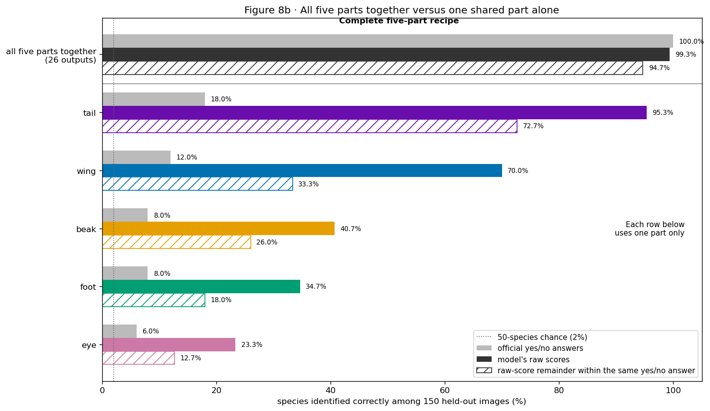


|  | block | raw_z_accuracy | within_label_residual_accuracy | processed_label_accuracy | label_patterns | dimensions |
| --- | --- | --- | --- | --- | --- | --- |
| 0 | all five parts together\n(26 outputs) | 0.993 | 0.947 | 1.00 | 50 | 26 |
| 1 | tail | 0.953 | 0.727 | 0.18 | 9 | 9 |
| 2 | wing | 0.700 | 0.333 | 0.12 | 6 | 6 |
| 3 | beak | 0.407 | 0.260 | 0.08 | 4 | 4 |
| 4 | foot | 0.347 | 0.180 | 0.08 | 4 | 4 |
| 5 | eye | 0.233 | 0.127 | 0.06 | 3 | 3 |


- Method: We fitted three new multinomial logistic-regression diagnostic classifiers per concept block on 70% of the frozen CBM's held-out images and tested them on the same remaining 30%: one used binary labels, one raw logits, and one within-label residual logits; the CBM remains frozen.


```text
### Plain-language reference for Figure 8b

**Plain caption.** The complete five-part recipe identifies species, while one part alone leaves several possible species. Raw concept-score magnitudes distinguish some species inside those shared-part groups; this is information availability, not yet use or grounding failure.

**Terms and how to read it.** Each row says whether the probe receives all five parts together or only one named part. Grey uses official yes/no answers; solid color uses model raw scores; outline uses the raw-score remainder after subtracting the average for the same yes/no answer. The x-axis is the percentage of 150 held-out images whose species is identified correctly.

**Literal values.** On the same held-out split, the complete five-part recipe identifies species at 1.000 from official labels and 0.993 from all 26 raw logits. This does not mean one part identifies every species: individual raw-z blocks greatly exceed their label controls: beak 0.407 versus 0.080, eye 0.233 versus 0.060, foot 0.347 versus 0.080, tail 0.953 versus 0.180, and wing 0.700 versus 0.120. Even after the training-fold mean for each 0/1 label bucket is removed, held-out accuracy remains 0.260 for beak, 0.127 for eye, 0.180 for foot, 0.727 for tail, 0.333 for wing, and 0.947 for all 26 scores.

**Interpretation.** The complete official five-part recipe already identifies the synthetic species, but one shared part alone does not. Within each one-part test, the model's score magnitudes reveal more species identity than that part's official answers. For example, tail scores identify species 95.3% of the time although the nine tail answers alone reach only 18.0%. This extra information is present, but presence alone does not prove it caused a replacement failure. Wing is the decisive control: its raw scores decode species well, yet its exact donor recognition and donorward movement are strong enough that backwash is rare. The emerging theory is competition between retained source-associated structure and local donor evidence.
```


Alternative explanation. A representation can preserve species information while responding to the specified part replacement, as observed for wing.


```text
**Discriminating test.** Judge grounding from response_delta and the final donor-minus-source margin, then relate those outcomes to visibility, conflict, and exact-value recognition.

**Verdict.** **KEEP**.

**Proof ledger.** `ACCEPTED FOR species-information availability beyond the official 0/1 label buckets. This is not a grounding test and does not show that leakage alone causes backwash.`

**Next question.** After a controlled replacement, do the replaced-part scores retain the unchanged source species?
```


### Comparison table 8b.1 · Species decoding and controlled replacement outcomes


The columns report species-decoding accuracy, donorward movement, exact donor recognition, and the joint response/final-margin criterion. Their comparison tests whether these distinct outcomes have similar part orderings.


|  | part | species_decoding_from_raw_scores | mean_donorward_movement | inserted_value_recognition | controlled_backwash_rate |
| --- | --- | --- | --- | --- | --- |
| 0 | tail | 0.953 | 9.800 | 0.395 | 0.502 |
| 1 | wing | 0.700 | 16.390 | 0.977 | 0.019 |
| 2 | beak | 0.407 | 11.778 | 0.780 | 0.200 |
| 3 | foot | 0.347 | 13.831 | 0.965 | 0.032 |
| 4 | eye | 0.233 | 11.749 | 0.900 | 0.089 |


Comparison. Wing has high species decodability, a large donorward response, high inserted-variant recognition, and a low backwash-candidate rate. These joint observations constrain a direct identification of species decodability with grounding failure.


- Method: We placed already-computed part summaries side by side without fitting a model, specifically to test whether species decoding, donorward response, exact-value recognition, and controlled backwash share the same part ordering.


## Definitions and interpretation of the comparative measurements


The aligned figures deliberately put anatomical groups in the same row order, and each panel retains its own estimand. FunnyBird has controlled part replacement; CUB has natural photographs and released masks. We therefore match the scientific question while naming the weaker CUB approximation.


| Scientific question | FunnyBird measurement | CUB measurement | Same operation? |
| --- | --- | --- | --- |
| Are labels present without visible part evidence? | renderer-derived label/visibility conflict | positive label with mapped mask absent | related; CUB masks are noisier |
| Is the concept output usable? | raw- z spread, balanced accuracy, positive recall | the same health checks | yes |
| Do named pixels affect the score? | controlled response_delta after donor insertion | visible-minus-hidden raw- z difference | no; CUB compares different photographs |
| Does context remain after local evidence is limited? | donorward response occurs but old source still wins | hidden positive-minus-negative raw- z gap | no; only FunnyBird has a donor/source margin |
| Does species still organize the score? | source-species residual after exact source/donor values | species residual after exact concept and mask state | related and observational |
| Is the exact inserted value recognized? | controlled post-swap value confusion | no clean equivalent | unavailable in CUB |


### Concept prediction performance


For exact concept `j`, the model predicts positive when `z_ij>0`. Balanced
accuracy gives positive and negative examples equal weight:


`balanced_accuracy = (positive recall + negative recall) / 2`.


If 70% of positive examples and 80% of negative examples are correct, balanced accuracy is (0.70+0.80)/2 = 0.75 ; the aligned summary plots ordinary concept error 1-0.75 = 0.25 . A larger error indicates poorer label agreement. Contextual prediction, limited local evidence, and annotation noise remain possible explanations.


The operational variation criterion is Q95(z)−Q05(z)<=1e−8. For illustration, an output equal to 2.1 on every image has positive recall 1, negative recall 0, and balanced accuracy 0.5. Such an output supplies no variation over the evaluated images and is excluded from positive grounding interpretations.


The CUB70 model has two exactly collapsed outputs:
`has_throat_color::grey` is constant-positive and
`has_wing_pattern::multi-colored` is constant-negative. They remain visible as
negative health results and are excluded from positive grounding summaries.


### Direction of each CUB panel


| Panel type | A larger value means | Interpretation |
| --- | --- | --- |
| Data check: positive label / mask absent | more positive labels lack a usable mapped mask | possible label/visibility conflict, but also possible missing annotation |
| Health check: ordinary concept error | worse positive/negative prediction | weak or difficult output; not automatically backwash |
| Local evidence: visible - hidden raw z | positive examples score higher when the region is visible | evidence that local pixels help; usually a good grounding sign |
| Context evidence: hidden positive - negative raw z | labels remain separated when the mapped mask is absent | context or unmeasured pixels remain informative |
| Species context: residual spread | species shift z after exact concept and mask state are centered | species-associated organization remains |


These quantities have distinct units and conditioning populations. They are reported separately. Consistent patterns across groups can motivate observational hypotheses for subsequent controlled testing.


## 8c · Residual species information and dependence of the fitted classifier


Figure 8b assesses species information recoverable by a newly fitted diagnostic. The following analysis tests the sensitivity of the saved CBM species head to within-label logit variation.


This section asks four connected questions:


- How much extra species information is present in each complete part
block at its natural width?


- Does the ordering persist when each diagnostic receives three concept coordinates?


- If image-specific magnitudes are removed while every official 0/1
concept answer is preserved, how much does the unchanged saved species
head `Wz+b` move?


- How does replacement of within-label variation affect class probabilities and the predicted species?


### Table 8c.1 · Label-conditioned reference distributions


For exact concept `j`, define


`mu_j0 = mean(z_ij among ordinary images with c_ij=0)` and
`mu_j1 = mean(z_ij among ordinary images with c_ij=1)`.


The table prints N , mean, and standard deviation for both populations for all 26 coordinates. Raw z is continuous. For example, two images can both have official label tail_4=1 while receiving raw scores +2 and +8 . The label records the answer; the magnitude records how strongly the model produced it.


### Figure 8c · Available species information versus actual saved-head use


**Panels A and B: information available.** Panel A supplies every score
in a part's natural block: tail 9, wing 6, beak/foot 4, and eye 3. Panel B
supplies exactly three scores per part. For one coordinate set
`S`, fit a labels-only species diagnostic and a labels-plus-residuals
diagnostic in five folds. The residual is


`r_ij = z_ij - mean_training(z_j | c_ij)`.


The plotted gain is


`G_gS = held-out log loss(labels only) - held-out log loss(labels + r)`.


Positive G_gS means the three magnitudes contain species information beyond their three yes/no answers. Tail has 84 possible groups of three; 40 are selected with a fixed seed. Wing uses all 20, beak and foot all 4, and eye its only group. The bar is the subset mean. The vertical line is the subset minimum-to-maximum range, across the evaluated coordinate subsets.


**Panels C and D: use by the saved head.** In each held-out fold, replace a score by
the training-fold mean for its own official label:


`z_tilde_ij = mean_training(z_j | c_ij)`.


Pass the altered vector through the unchanged saved head
`class_logit_ik = b_k + sum_j W_kj*z_ij`. No diagnostic classifier and no
CBM is fitted here. The y-axis is


`0.5 * sum_k |p_ik - p_tilde_ik|`,


averaged over 500 held-out images and shown as a percentage in Panel D. Panel C shows ordinary species accuracy before and after replacing all 26 scores. The probability movement in Panel D can detect a changed confidence even when Panel C's winning species is unchanged. Its unit is redistributed probability mass across the 50 species.


Numerical example. If tail_4=1 , its raw score is +8 , and the other positive training images average +5 , the intervention changes only that score from +8 to +5 . If probabilities change from [0.70,0.20,0.10] to [0.65,0.25,0.10] , the redistributed mass is 0.5*(0.05+0.05+0)=0.05 , or 5%.


Tail and wing are compared on both residual species information and sensitivity of the fitted species head to within-label magnitudes.


|  | concept | part | N_absent | absent_mean | absent_SD | N_present | present_mean | present_SD |
| --- | --- | --- | --- | --- | --- | --- | --- | --- |
| 0 | beak_0 | beak | 290 | -3.652 | 0.831 | 210 | 4.313 | 1.025 |
| 1 | beak_1 | beak | 400 | -5.119 | 1.026 | 100 | 4.869 | 1.107 |
| 2 | beak_2 | beak | 440 | -5.939 | 1.201 | 60 | 5.098 | 1.221 |
| 3 | beak_3 | beak | 370 | -4.720 | 0.993 | 130 | 4.262 | 1.157 |
| 4 | eye_0 | eye | 350 | -4.209 | 1.061 | 150 | 4.740 | 1.244 |
| 5 | eye_1 | eye | 340 | -4.189 | 0.826 | 160 | 4.488 | 1.349 |
| 6 | eye_2 | eye | 310 | -4.239 | 1.056 | 190 | 3.968 | 1.234 |
| 7 | foot_0 | foot | 370 | -4.025 | 0.884 | 130 | 4.968 | 0.943 |
| 8 | foot_1 | foot | 400 | -5.043 | 0.844 | 100 | 4.531 | 1.088 |
| 9 | foot_2 | foot | 360 | -4.513 | 0.861 | 140 | 4.151 | 1.389 |
| 10 | foot_3 | foot | 370 | -4.500 | 0.875 | 130 | 4.227 | 1.259 |
| 11 | tail_0 | tail | 460 | -6.666 | 1.206 | 40 | 4.860 | 1.514 |
| 12 | tail_1 | tail | 450 | -6.145 | 1.455 | 50 | 4.291 | 2.043 |
| 13 | tail_2 | tail | 430 | -5.650 | 1.340 | 70 | 4.672 | 1.478 |
| 14 | tail_3 | tail | 430 | -5.656 | 1.329 | 70 | 4.935 | 1.410 |
| 15 | tail_4 | tail | 460 | -6.460 | 1.370 | 40 | 4.212 | 1.531 |
| 16 | tail_5 | tail | 420 | -5.275 | 1.391 | 80 | 4.697 | 1.486 |
| 17 | tail_6 | tail | 450 | -6.328 | 1.219 | 50 | 5.058 | 1.338 |
| 18 | tail_7 | tail | 480 | -7.784 | 1.439 | 20 | 4.663 | 1.319 |
| 19 | tail_8 | tail | 420 | -5.378 | 1.182 | 80 | 4.443 | 1.611 |
| 20 | wing_0 | wing | 450 | -6.216 | 0.975 | 50 | 5.596 | 1.397 |
| 21 | wing_1 | wing | 410 | -5.657 | 0.906 | 90 | 4.632 | 1.120 |
| 22 | wing_2 | wing | 390 | -4.516 | 0.772 | 110 | 4.674 | 1.130 |
| 23 | wing_3 | wing | 450 | -6.348 | 1.082 | 50 | 4.299 | 1.134 |
| 24 | wing_4 | wing | 400 | -4.854 | 0.936 | 100 | 4.480 | 1.108 |
| 25 | wing_5 | wing | 400 | -5.269 | 0.787 | 100 | 4.377 | 1.360 |


|  | part | coordinates | conditional_logloss_gain |
| --- | --- | --- | --- |
| 0 | tail | 9 | 1.498 |
| 1 | wing | 6 | 1.242 |
| 2 | beak | 4 | 0.998 |
| 3 | foot | 4 | 0.713 |
| 4 | eye | 3 | 0.515 |


|  | part | coordinates_used | subsets_evaluated | mean_logloss_gain | minimum_subset_gain | maximum_subset_gain |
| --- | --- | --- | --- | --- | --- | --- |
| 0 | tail | 3 | 40 | 1.028 | 0.881 | 1.184 |
| 1 | wing | 3 | 20 | 0.771 | 0.581 | 0.954 |
| 2 | beak | 3 | 4 | 0.775 | 0.713 | 0.843 |
| 3 | foot | 3 | 4 | 0.545 | 0.506 | 0.597 |
| 4 | eye | 3 | 1 | 0.515 | 0.515 | 0.515 |


|  | replaced_block | coordinates_replaced | raw_accuracy | accuracy_after_replacement | top1_change_rate | mean_probability_mass_moved |
| --- | --- | --- | --- | --- | --- | --- |
| 0 | all 26 | 26 | 0.992 | 1.000 | 0.008 | 0.0117 |
| 1 | beak | 4 | 0.992 | 0.992 | 0.000 | 0.0020 |
| 2 | eye | 3 | 0.992 | 0.992 | 0.000 | 0.0019 |
| 3 | foot | 4 | 0.992 | 0.994 | 0.002 | 0.0030 |
| 4 | tail | 9 | 0.992 | 0.998 | 0.006 | 0.0090 |
| 5 | wing | 6 | 0.992 | 0.992 | 0.000 | 0.0009 |


- Method: Panels A/B fit held-out species diagnostics using full blocks or exactly three scores per part; Panels C/D fit nothing and pass label-mean-replaced scores through the unchanged saved Koh linear species head.


### Definitions for Figure 8c


Caption. Full part blocks expose species information beyond the official answers, and the equal-three-score control shows that tail retains additional species information under equal coordinate counts. The saved species head is more sensitive to tail than wing magnitudes, and top-one accuracy is preserved or increased under replacement of all within-label magnitudes in this evaluation.


Result. Full-block log-loss gains are {'tail': 1.498, 'wing': 1.242, 'beak': 0.998, 'foot': 0.713, 'eye': 0.515} . Equal-three-coordinate gains are {'tail': 1.028, 'wing': 0.771, 'beak': 0.775, 'foot': 0.545, 'eye': 0.515} . Panel B's black lines are coordinate-subset ranges, across coordinate subsets. Removing within-label magnitudes moves mean class-probability mass by these percentages: {'all 26': 1.165, 'beak': 0.198, 'eye': 0.195, 'foot': 0.298, 'tail': 0.903, 'wing': 0.087} . Across all 26 coordinates, accuracy changes from 0.992 to 1.000 and the top-one prediction changes for 0.008 of 500 images.


Interpretation. Removing within-label wing magnitudes redistributes an average 0.087% of class-probability mass; the corresponding tail value is 0.903%. Replacing all 26 within-label magnitudes changes top-one accuracy from 0.992 to 1.000. These results quantify classifier sensitivity under this intervention. In this evaluation population, the complete replacement is accompanied by a small increase in accuracy.


Limitations. The equal-width comparison controls coordinate count. Frequency, visibility, concept difficulty, and correlations can still differ. The intervened vectors may differ from those generated by a separately trained model.


Scope. Tail retains additional species information under the three-coordinate control, and the saved classifier is more sensitive to tail magnitudes under the ordinary-image intervention. Establishing a contribution to the upstream replacement margin requires a further experiment.


Subsequent analysis. After an actual part swap, do the other same-part scores create source-species evidence, and does erasing only those scores reduce the saved head's source preference?


**Verdict.** **KEEP as the separation between information available and
information used.**


## 8d · Off-target concept contributions to post-replacement species scores


Following Figure 8c, this analysis computes the saved classifier’s source-species evidence and measures its response when the specified off-target coordinates are replaced at the bottleneck.


**Concrete `tail_2 -> tail_7` example.** The CBM always outputs all nine
fixed tail scores. Its species head always reads all nine. For this
diagnostic only, define the seven off-target coordinates as


`J_off = {tail_0,...,tail_8} minus {tail_2,tail_7}`.


Concept-coordinate identities are fixed. The off-target subset varies with the source and donor variants of each swap.


For every off-target concept `j`, subtract its ordinary absent mean
`mu_j0`. Then use the actual saved source-minus-donor species weights:


`e_i = sum over j in J_off of (W_source,j - W_donor,j)*(z_cf,ij - mu_j0)`.


If an absent `tail_5` normally scores `-4`, scores `-1` after this swap,
and its source-minus-donor weight is `+0.5`, its contribution is
`(+0.5)*(-1-(-4)) = +1.5` source-over-donor class-logit units. Summing all
seven contributions gives `e_i`.


- `e_i > 0`: off-target scores push the saved head toward source species.


- `e_i < 0`: they push it toward donor species.


- Each e_i summarizes one complete swap.


**Panel A.** The distribution of `e_i` is compared across parts. All are in
the same class-logit units. Tail sums seven off-target coordinates, wing
four, beak and foot two, and eye one. The total is primary because it is the
head's actual total contribution; contribution per coordinate is printed
only as a descriptive scale check.


**Direct bottleneck intervention for Panel B.** Keep all 26 scores except
set only the off-target scores to their ordinary absent means:


`z_erased,ij = mu_j0 for j in J_off`.


The old `tail_2` and inserted `tail_7` scores remain untouched. Pass both
vectors through the same frozen `Wz+b` head. To compare only the source and
donor species without letting the other 48 species change the denominator,
define the source's two-species share as


`q_source = exp(class_logit_source) / (exp(class_logit_source) + exp(class_logit_donor))`.


This is equivalently sigmoid(class_logit_source-class_logit_donor) . Panel B plots q_source_before-q_source_after . Positive values mean that erasing the off-target fingerprint reduces the source's share in the direct source-versus-donor comparison. For example, a change from source/donor shares 0.70/0.30 to 0.60/0.40 is a 10-percentage-point reduction. This intervention measures the dependence of the saved species head on its concept-vector inputs. The upstream image-to-concept mechanism requires a separate test.


The accepted CSV stores the complete score block for the part being replaced; leaves the other four blocks blank on that row. Therefore the complete 26-score vector is obtained by replaying each unique accepted replacement image once through the frozen checkpoint on CUDA. Before the intervention, the replay is compared with every stored old/donor score. The accepted CSV remains authoritative for the original outcome labels; replayed sign categories are reported only as a numerical-sensitivity audit because tiny changes around exactly zero can flip a strict sign. This step recovers complete predictions on the existing image set using the frozen checkpoint.


### Figure 8d · Off-target source evidence and its frozen-head consequence


```text
Figure 8d matched-replay audit: {'device': 'cuda', 'unique_replacement_images': 3040, 'source_coordinate_median_absolute_difference': 0.00038355588912963867, 'source_coordinate_maximum_absolute_difference': 0.005271553993225098, 'donor_coordinate_median_absolute_difference': 0.0005632638931276635, 'donor_coordinate_maximum_absolute_difference': 0.011866092681884766, 'accepted_outcome_agreement': 0.9918, 'boundary_sensitive_rows': 41, 'changed_rows_median_distance_to_nearest_strict_boundary': 0.0, 'changed_rows_maximum_distance_to_nearest_strict_boundary': 0.0005756020545959}
```


```text
Figure 8d linear-erasure identity maximum absolute error: 1.2545520178264269e-14
```


```text
/tmp/tmp.RRxsvXqp54/ipykernel_1626553/2323245530.py:164: MatplotlibDeprecationWarning: The 'labels' parameter of boxplot() has been renamed 'tick_labels' since Matplotlib 3.9; support for the old name will be dropped in 3.11.
  boxes=axes[0].boxplot(evidence_data,labels=ORDER,showfliers=False,patch_artist=True)
/tmp/tmp.RRxsvXqp54/ipykernel_1626553/2323245530.py:172: MatplotlibDeprecationWarning: The 'labels' parameter of boxplot() has been renamed 'tick_labels' since Matplotlib 3.9; support for the old name will be dropped in 3.11.
  boxes=axes[1].boxplot(probability_data,labels=ORDER,showfliers=False,patch_artist=True)
/tmp/tmp.RRxsvXqp54/ipykernel_1626553/2323245530.py:180: MatplotlibDeprecationWarning: The 'labels' parameter of boxplot() has been renamed 'tick_labels' since Matplotlib 3.9; support for the old name will be dropped in 3.11.
  boxes=axes[2].boxplot(gap_data,labels=ORDER,showfliers=False,patch_artist=True)
```


|  | part | n_swaps | n_original_images | off_target_coordinates | mean_e | median_e | fraction_e_positive | mean_e_per_coordinate | median_source_minus_donor_logit_before | median_absolute_source_minus_donor_logit_before | median_absolute_e | median_absolute_e_fraction_of_gap | mean_pairwise_source_share_reduction | top1_change_rate | source_to_donor_pair_flip_rate |
| --- | --- | --- | --- | --- | --- | --- | --- | --- | --- | --- | --- | --- | --- | --- | --- |
| 0 | tail | 1000 | 250 | 7 | 0.2261 | 0.2042 | 0.699 | 0.0323 | 15.3748 | 15.3748 | 0.3180 | 0.0229 | 0.0003 | 0.099 | 0.002 |
| 1 | wing | 1000 | 250 | 4 | 0.0212 | 0.0187 | 0.534 | 0.0053 | 7.1129 | 7.3557 | 0.1428 | 0.0211 | 0.0002 | 0.034 | 0.004 |
| 2 | beak | 1000 | 250 | 2 | -0.0325 | -0.0143 | 0.438 | -0.0163 | 14.5976 | 14.5976 | 0.0854 | 0.0063 | -0.0007 | 0.027 | 0.000 |
| 3 | foot | 1000 | 250 | 2 | -0.0406 | -0.0259 | 0.369 | -0.0203 | 12.4407 | 12.4407 | 0.0566 | 0.0050 | -0.0002 | 0.021 | 0.001 |
| 4 | eye | 1000 | 250 | 1 | -0.0198 | -0.0067 | 0.411 | -0.0198 | 14.2733 | 14.2733 | 0.0306 | 0.0023 | -0.0002 | 0.007 | 0.000 |


- Method: We replayed each unique accepted replacement image once through the frozen checkpoint to recover its complete 26-score vector and compared every stored old/donor score under an explicit post-hoc 0.02-logit engineering tolerance. Strict-sign outcome differences are printed as numerical sensitivity; the accepted CSV remains authoritative. For every swap, we excluded the old and inserted coordinates, centered the remaining same-part logits at their ordinary absent means, applied the frozen source-minus-donor class weights, reset only those off-target scores, and reran the unchanged 26-to-50 head. The saved float32 scores and weights are evaluated in float64 for this read-only linear calculation to reduce cancellation error when subtracting large class logits. No model or diagnostic classifier was fitted.


### Definitions for Figure 8d


Caption. Panel A measures how much the other same-part scores push the frozen species head toward the unchanged source after the pixels are replaced. Panel B directly erases only that off-target pattern and measures how much the source's share falls when the source and donor species are compared directly. The denominator contains the source and donor species. Panel C shows how far apart the source and donor class logits already were. A real 0.2 -logit contribution can barely move a saturated probability when the existing source-minus-donor gap is, for example, +12 .


Result. Every part has 1,000 swaps and all 250 original images. The complete part summaries are {'tail': {'mean_e': 0.2261, 'median_e': 0.2042, 'fraction_e_positive': 0.699, 'mean_pairwise_source_share_reduction': 0.0003, 'top1_change_rate': 0.099, 'source_to_donor_pair_flip_rate': 0.002}, 'wing': {'mean_e': 0.0212, 'median_e': 0.0187, 'fraction_e_positive': 0.534, 'mean_pairwise_source_share_reduction': 0.0002, 'top1_change_rate': 0.034, 'source_to_donor_pair_flip_rate': 0.004}, 'beak': {'mean_e': -0.0325, 'median_e': -0.0143, 'fraction_e_positive': 0.438, 'mean_pairwise_source_share_reduction': -0.0007, 'top1_change_rate': 0.027, 'source_to_donor_pair_flip_rate': 0.0}, 'foot': {'mean_e': -0.0406, 'median_e': -0.0259, 'fraction_e_positive': 0.369, 'mean_pairwise_source_share_reduction': -0.0002, 'top1_change_rate': 0.021, 'source_to_donor_pair_flip_rate': 0.001}, 'eye': {'mean_e': -0.0198, 'median_e': -0.0067, 'fraction_e_positive': 0.411, 'mean_pairwise_source_share_reduction': -0.0002, 'top1_change_rate': 0.007, 'source_to_donor_pair_flip_rate': 0.0}} . Boxes show the middle 50% of swap rows and their median; whiskers use the standard 1.5-IQR rule; individual outliers are suppressed visually and retained in every summary. These rows are repeated measurements from one trained model; between-model uncertainty requires independent runs.


Replay audit. The full-vector replay used 3040 unique accepted replacement images. Maximum absolute differences from the stored source and donor coordinates were 0.005272 and 0.011866 raw- logit units. 41 of 5,000 strict- sign outcome labels changed under replay. The accepted outcomes retain the original labels. The discrepancy count quantifies threshold sensitivity near zero.


How to read the sign. In Panel A, positive is source-species evidence. In Panel B, positive means erasing that evidence reduces source-over-donor pairwise probability. This pairwise share is used because subtracting two probabilities from the full 50-class softmax can move in the opposite direction when the other 48 class probabilities change. Tail and wing must be compared using both panels: Figure 8c and the present intervention quantify availability and classifier dependence separately.


**Worked scale example.** Pairwise source share equals
`sigmoid(L_source-L_donor)`. With a gap of `+12`, the share is about
`0.999994`; erasing `e=+0.2` changes the gap to `+11.8` and the share only
to about `0.999992`. With a starting gap of `+0.2`, the same erasure moves
the share from about `0.55` to `0.50`. Panel C and the printed ratio of
`|e|` to the existing `|gap|` prevent saturation from being mistaken for
zero saved-head use.


Scale caveat. Tail sums seven off-target coordinates while eye has one. The total e_i is nevertheless the primary quantity because it is the actual total class-logit contribution received by the saved head. The table prints mean contribution per coordinate only to show how much block width participates; its role is a descriptive comparison of block width.


Scope. ACCEPTED FOR a larger tail than wing off-target contribution to the frozen head’s pairwise source preference. The intervention establishes a downstream response to selected bottleneck values. The image-to-concept computation precedes the species head, so the source of the upstream margin remains a separate question.


**Alternative.** Resetting scores to separate ordinary absent means creates
an artificial bottleneck vector. Body, pose, visibility, and source species
remain bundled in the original representation.


Subsequent analysis. Do visibility, label conflict, exact-value difficulty, support, and source identity jointly predict held-out swap outcomes, and how much remains unexplained?


Conclusion. ACCEPTED FOR a larger tail than wing off-target contribution to the frozen head’s pairwise source preference under the specified intervention.


## 9 · Held-out prediction of replacement outcomes


A five-fold diagnostic predicts two outcomes while every swap from one
original image stays in one held-out fold:


- final margin `m_cf`, scored by `RMSE = sqrt(mean((observed-predicted)^2))`;


- controlled event `1[response_delta>0 and m_cf<0]`, scored by Brier error
`mean((observed 0/1 - predicted probability)^2)`.


Lower error is better. The full diagnostic receives part, starting margin, visible pixels, source/donor support, source/donor label conflict, ordinary exact-value recognition, and source species. One family is then removed at a time while all others remain. A positive bar means held-out error increased without that family, indicating incremental predictive value conditional on the remaining fields. Zero or a negative value gives it no unique credit in this diagnostic.


Numerical illustration. If full-model RMSE is 2.94 and omission of visibility raises it to 3.14, the omission difference is 0.20 logit units. Correlated covariates can substitute for one another, so this estimate depends on the included predictor set.


### Figure 9 · Held-out predictive value of each measured contributor family


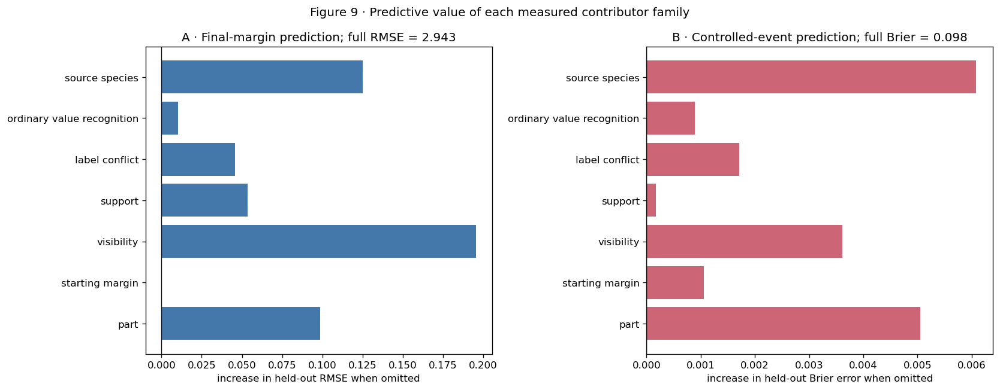


|  | model | numeric_features | categorical_features | margin_RMSE | margin_MAE | event_Brier |
| --- | --- | --- | --- | --- | --- | --- |
| 0 | full measured set | m_orig, log_visible_pixels, donor_support, sou... | part, sid_src | 2.9432 | 2.2861 | 0.0979 |
| 1 | full minus part | m_orig, log_visible_pixels, donor_support, sou... | sid_src | 3.0417 | 2.3698 | 0.1030 |
| 2 | full minus starting margin | log_visible_pixels, donor_support, source_supp... | part, sid_src | 2.9432 | 2.2863 | 0.0990 |
| 3 | full minus visibility | m_orig, donor_support, source_support, donor_c... | part, sid_src | 3.1389 | 2.4166 | 0.1015 |
| 4 | full minus support | m_orig, log_visible_pixels, donor_conflict, so... | part, sid_src | 2.9966 | 2.3177 | 0.0981 |
| 5 | full minus label conflict | m_orig, log_visible_pixels, donor_support, sou... | part, sid_src | 2.9888 | 2.3140 | 0.0996 |
| 6 | full minus ordinary value recognition | m_orig, log_visible_pixels, donor_support, sou... | part, sid_src | 2.9535 | 2.2884 | 0.0988 |
| 7 | full minus source species | m_orig, log_visible_pixels, donor_support, sou... | part | 3.0682 | 2.3888 | 0.1040 |


```text
Stress test: predict each inserted exact value after withholding every row that inserts it
```


|  | held_out_part | held_out_donor_value | n_rows | n_originals | RMSE | MAE |
| --- | --- | --- | --- | --- | --- | --- |
| 0 | beak | 0 | 345 | 120 | 3.2856 | 2.7133 |
| 1 | beak | 1 | 245 | 145 | 2.9799 | 2.3228 |
| 2 | beak | 2 | 190 | 125 | 3.0489 | 2.2933 |
| 3 | beak | 3 | 220 | 135 | 2.5517 | 1.9469 |
| 4 | eye | 0 | 300 | 160 | 3.0136 | 2.3578 |
| 5 | eye | 1 | 345 | 155 | 2.6665 | 2.0149 |
| 6 | eye | 2 | 355 | 150 | 3.0236 | 2.4922 |
| 7 | foot | 0 | 220 | 145 | 2.6750 | 2.1305 |
| 8 | foot | 1 | 240 | 160 | 2.2861 | 1.7187 |
| 9 | foot | 2 | 290 | 155 | 2.6261 | 2.0692 |
| 10 | foot | 3 | 250 | 135 | 3.4243 | 2.7140 |
| 11 | tail | 0 | 75 | 70 | 3.4805 | 2.8088 |
| 12 | tail | 1 | 90 | 85 | 4.2162 | 3.4707 |
| 13 | tail | 2 | 120 | 90 | 3.4120 | 2.7907 |
| 14 | tail | 3 | 110 | 85 | 4.2666 | 3.2244 |
| 15 | tail | 4 | 110 | 90 | 3.6683 | 3.0669 |
| 16 | tail | 5 | 150 | 120 | 2.9664 | 2.4260 |
| 17 | tail | 6 | 130 | 100 | 3.9303 | 3.2651 |
| 18 | tail | 7 | 35 | 35 | 3.1794 | 2.5076 |
| 19 | tail | 8 | 180 | 110 | 4.5284 | 3.4755 |
| 20 | wing | 0 | 130 | 115 | 3.8511 | 3.0246 |
| 21 | wing | 1 | 150 | 100 | 3.1577 | 2.6893 |
| 22 | wing | 2 | 220 | 140 | 3.1433 | 2.3272 |
| 23 | wing | 3 | 115 | 95 | 2.5785 | 2.0936 |
| 24 | wing | 4 | 175 | 135 | 3.0514 | 2.4120 |
| 25 | wing | 5 | 210 | 150 | 3.1182 | 2.5066 |


- Method: A predeclared ridge margin model and logistic event model used five source-image-grouped folds; each bar removes one feature family from the full model, and the exact-value holdout table tests transfer to wholly unseen inserted values.


### Definitions for Figure 9


Result. The full model has margin RMSE 2.943 and event Brier error 0.098 . Visibility has the largest unique margin contribution ( +0.196 RMSE when omitted). Source species has the largest unique event contribution ( +0.0061 Brier), followed by part ( +0.0051 ) and visibility ( +0.0036 ). Starting margin adds essentially no unique margin accuracy once the other measured fields are present. Exact-value holdout RMSE ranges from 2.286 to 4.528 , so transfer to a never-seen inserted value is uneven.


Interpretation. Several predictor families improve held-out performance. Visibility gives the largest unique improvement for margin prediction in this model, while source species and part give the largest improvements for the strict event indicator.


Alternative. Correlated features can stand in for one another, and source species can memorize recurring species categories even though new original images are held out. The estimate concerns held-out images from observed species. Transfer to unseen species and causal attribution require additional designs.


Scope. Measured contributor families improve held-out prediction, with substantial residual error and variation in transfer across exact values. Their causal contributions remain unresolved.


## 9b · Comparison of part-level outcome and contributor summaries


Question. How does the part ordering compare across the controlled outcome and measured contributor summaries?


Variables and prediction. Place four separately defined part-level quantities in aligned panels: the controlled backwash-candidate rate, the same rate among swaps with at least 100 target pixels, the training label/mask conflict rate, and one minus exact donor-value recognition. Tail should be high across several contributor panels while wing and foot should be low if the proposed explanation matches the controlled outcome. Each panel retains its distinct units and estimand.


**Method.** Use the same five-part order in every panel and print the exact table.


Numerical record. The accompanying table reports the quantities summarized in the figure, including denominators and exclusions for each part and exact value.


### Figure 9b · Comparison of part-level outcome and contributor summaries


How to read the figure. All four panels use the same y-axis part order. Panel A is the fraction of all swaps satisfying response_delta>0 and m_cf<0 . Panel B repeats that fraction only when the inserted target occupies at least 100 pixels. Panel C is the fraction of original positive training labels removed by the matched visibility rule. Panel D is one minus the post-swap inserted-value recognition rate. Larger is worse in every panel, with a separate denominator and interpretation for each panel. The shared ordering asks whether the proposed contributors align with the controlled outcome.


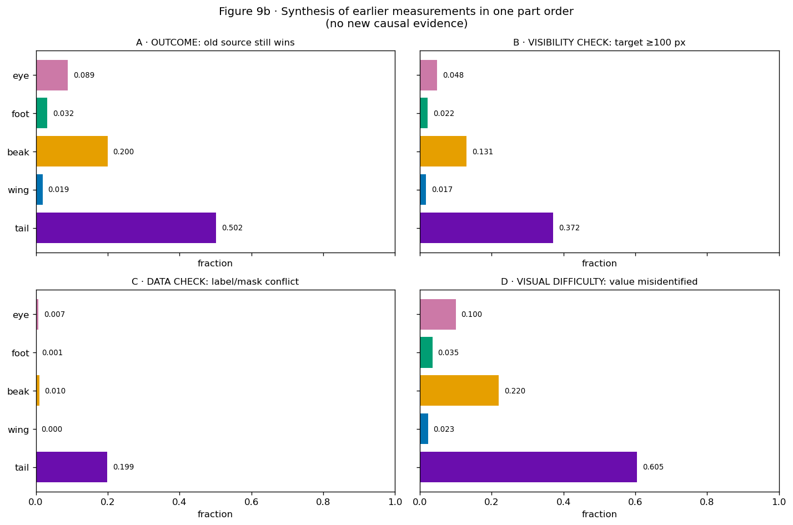


|  | controlled_backwash_rate | clear_visible_backwash_rate | label_mask_conflict_rate | donor_value_error_rate |
| --- | --- | --- | --- | --- |
| part |  |  |  |  |
| tail | 0.502 | 0.372 | 0.199 | 0.605 |
| wing | 0.019 | 0.017 | 0.000 | 0.023 |
| beak | 0.200 | 0.131 | 0.010 | 0.220 |
| foot | 0.032 | 0.022 | 0.001 | 0.035 |
| eye | 0.089 | 0.048 | 0.007 | 0.100 |


- Method. Four previously calculated summaries are aligned by part. Each retains its own definition and denominator.


### Definitions for Figure 9b


Caption. The panels compare part ordering across replacement outcomes, visible-target subsets, label conflict, and exact-variant recognition error.


Terms and denominators. Panel A uses all 1,000 swaps per part. Panel B uses only swaps with at least 100 inserted-part pixels. Panel C divides removed positive training labels by all original positives. Panel D is one minus the inserted-value recognition rate. Every panel is a fraction; the populations and questions differ.


Selection of summary panels. The figure presents the full replacement outcome, its visibility-restricted counterpart, the training-label conflict fraction, and exact-recognition error. Support is defined per exact variant; species residuals and off-target evidence are logit-valued distributions; ordinary-image sensitivity uses its own intervention. Those analyses remain in Figures 7b–8d and retain their separate estimands.


Results. Controlled event rates are tail 0.502 , beak 0.200 , eye 0.089 , foot 0.032 , and wing 0.019 . With target area at least 100 pixels they remain 0.372 , 0.131 , 0.052 , 0.017 , and 0.010 . Label/mask conflict rates are 0.199 , 0.010 , 0.007 , 0.001 , and less than 0.001 ; donor-value error rates are 0.605 , 0.220 , 0.100 , 0.035 , and 0.023 in the same part order.


Interpretation. Tail has high rates of retained-source outcomes, label conflict, and exact-value error. The agreement is consistent with several proposed contributors. The five part-level observations and their correlations limit attribution to individual mechanisms.


**Alternative.** Alignment can arise from correlated part properties,
and there are only five anatomical units.


Proposed follow-up. Use the same-source-image held-out prediction in Figure 9 and the matched RLv2 intervention for label-conflict causality.


**Verdict.** **KEEP**.


Evidence summary. Visibility-restricted outcomes, label conflict, and recognition error have related part orderings. Their separate contributions require additional experimental comparisons.


Subsequent analysis. Does the concept-layer behavior have a meaningful downstream species-prediction consequence?


## 10 · Association between concept margin and donor-species probability


**Question.** Is final concept margin associated with donor-species probability?


Variables and prediction. Relate final concept margin to the model's donor-species probability, which is a different downstream quantity; the analysis estimates their association. A small downstream change would limit the harm to explanation reliability within the evaluated class-prediction outcomes.


**Method.** Use independent final-margin bins and print bin counts.


Numerical record. The accompanying table reports the quantities summarized in the figure, including denominators and exclusions for each part and exact value.


### Figure 10 · Association between concept margin and donor-species probability


How to read the figure. Swaps are divided into ten non-overlapping, approximately equal-count bins by final donor-minus-source concept margin on the x-axis. The y-axis is the model's mean probability for the donor species, with the number of rows printed per bin. This asks whether concept grounding failure is associated with a downstream class quantity; the dependent variable is class probability.


Definitions. The concept margin compares logits for the inserted and removed variants. Donor-species probability refers to the complete donor species under the species head. Because the remaining parts and scene are retained from the source image, a positive concept margin can coexist with a low donor-species probability. The figure estimates their association.


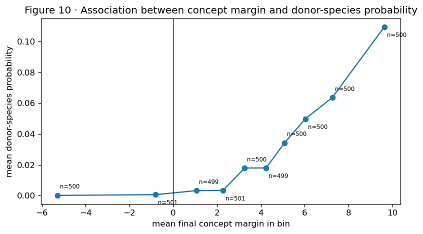


|  | margin_bin | n | mean_margin | mean_donor_species_prob |
| --- | --- | --- | --- | --- |
| 0 | (-13.01, -2.175] | 500 | -5.284 | 0.000 |
| 1 | (-2.175, 0.231] | 501 | -0.805 | 0.001 |
| 2 | (0.231, 1.715] | 499 | 1.052 | 0.003 |
| 3 | (1.715, 2.802] | 501 | 2.271 | 0.003 |
| 4 | (2.802, 3.777] | 500 | 3.266 | 0.018 |
| 5 | (3.777, 4.674] | 499 | 4.241 | 0.018 |
| 6 | (4.674, 5.519] | 500 | 5.089 | 0.034 |
| 7 | (5.519, 6.562] | 500 | 6.037 | 0.050 |
| 8 | (6.562, 8.086] | 500 | 7.265 | 0.064 |
| 9 | (8.086, 13.957] | 500 | 9.644 | 0.110 |


- Method: We divided all swaps into ten disjoint equal-count bins by final concept margin and averaged the frozen CBM's saved donor-species probability within each bin; no regression or new classifier was fitted.


```text
### Plain-language reference for Figure 10

**Plain caption.** A more donor-positive concept margin is associated with a modestly larger saved donor-species probability; this binned analysis does not intervene on the margin.

**Terms and how to read it.** The x-axis is mean final concept margin inside one of ten disjoint bins. The y-axis is the saved model's mean donor-species probability. This is the only main figure using class probability rather than raw concept `z`.

**Literal values.** Mean donor-species probability rises monotonically from approximately zero in negative-margin bins to 0.110 in the most donor-positive bin, with 499-501 rows per bin.

**Interpretation.** When the donor concept finishes farther ahead, the model becomes more willing to predict the donor species. The probability still reaches only 11% in the strongest bin because the other four parts and the body still belong to the source bird.
```


Alternative explanation. The donor species can retain a low probability because the unchanged body and other parts still belong to the source. The ten bins also pool all five parts, so easier parts may occur more often in high-margin bins; within-part slopes require separate estimation.


```text
**Discriminating test.** Replicate across seeds and compare part-stratified class-logit changes, not only the pooled final probability.

**Verdict.** **KEEP**.

**Proof ledger.** `ACCEPTED FOR a monotone but modest single-swap downstream association; the primary harm here is explanation fidelity.`

**Next question.** Does minimality change the accepted standard-CBM quantities?
```


## 11 · Summary of evidence from the Standard CBM


| Predicate or explanation | Direct measurement | Status after review |
| --- | --- | --- |
| model outputs are usable | Figure 1 | ACCEPTED FOR SEED-1 MODEL HEALTH |
| interventions are valid | Figure 2 | ACCEPTED FOR CONTROLLED ONE-PART REPLACEMENT |
| controlled part replacement causes donorward movement | Figure 3 | ACCEPTED FOR part-level positive-response rates of 0.919-1.000 |
| starting preference versus donor rise/source release | Figure 3b | ACCEPTED ARITHMETIC DECOMPOSITION |
| old source can remain stronger after that movement | Figure 4 | ACCEPTED FOR GRADED CONTROLLED BACKWASH |
| donor wins versus two distinct failure states | Figure 4b | ACCEPTED OUTCOME PARTITION |
| direction artifact excluded | Figure 5 | ACCEPTED; ORDERING HOLDS BOTH DIRECTIONS |
| visibility contribution | Figure 6 | ACCEPTED FOR an association with the measured response; additional contributors remain possible |
| training label/mask conflict measured | Figure 6b | ACCEPTED DATA ASSOCIATION; CAUSAL TEST IS 02RL |
| exact-value conflict aligned with matching score movement | Figure 6c | ACCEPTED DESCRIPTIVE ASSOCIATION; CAUSAL TEST IS 02RL |
| exact-value difficulty | Figure 7 | ACCEPTED AS GRADED ASSOCIATION/CANDIDATE CONTRIBUTOR |
| frequency/alternative-count explanation | Figure 7b | MIXED; NO SUFFICIENT MONOTONE EXPLANATION |
| source-species residual | Figure 8 | DESCRIPTIVE ASSOCIATION ONLY |
| species information beyond concept-label buckets | Figure 8b | ACCEPTED FOR recoverable species information |
| equal-width information and saved-head magnitude sensitivity | Figure 8c | ACCEPTED FOR AVAILABILITY AND ORDINARY-IMAGE HEAD SENSITIVITY; MAGNITUDE REMOVAL DOES NOT REDUCE TOP-1 ACCURACY |
| post-swap off-target source evidence and pairwise direct erasure | Figure 8d | READ-ONLY DOWNSTREAM INTERVENTION ON THE SAVED HEAD; DOES NOT CAUSE THE UPSTREAM CONCEPT MARGIN |
| grouped held-out contributor predictor | Figure 9 | MULTIPLE FAMILIES ADD PREDICTIVE VALUE; ERROR REMAINS AND VALUE TRANSFER VARIES |
| aligned contributor view | Figure 9b | ACCEPTED DESCRIPTIVELY; NOT ADDITIVE OR CAUSAL |
| downstream class association | Figure 10 | ACCEPTED FOR a modest monotone association between the measured quantities |


### Limited conclusion


Scope. The seed-1 Standard CBM has swaps satisfying response_delta>0 and m_cf<0. Event frequency differs by part. In the renderer cache, 98.3% of replacement images have changed RGB values; the remaining 1.7% are retained for visibility analysis. Positive-response fractions range from 91.9% to 100% across parts. The joint criterion identifies the subset with donorward movement and retained source preference.


Interpretation. Visibility, label conflict, exact-variant error, support, and source species are examined as candidate contributors. Their Standard-model associations leave confounding unresolved. Species decoding measures recoverable information; label-conditioned replacement measures ordinary-image classifier sensitivity; off-target erasure measures the frozen head’s response after a physical swap. The source–donor probability uses the two corresponding species scores. Attribution of the upstream concept response requires further image-level or training interventions.


### Relation to MCBM representation targets


Relation to the MCBM objective. The MCBM target is −3 for a negative concept and +3 for a positive concept. Under an ideal coordinate exchange, the donor change of +6 and source decrease of 6 yield a +12 margin change. A hypothetical ±5 target gives +20. These target values constrain representation geometry. Whether target changes follow the intended image region remains an empirical question for the replacement analysis.


### Relation to subsequent dataset analyses


| Requested follow-up | Where it belongs | What it must establish |
| --- | --- | --- |
| Standard MCBM gamma sweep | notebook 03 | whether compression removes within-label species information and reduces the same fixed-swap event while health remains usable |
| relabelled CBM | notebook 02rl | causal effect of changing positive labels when the named part is invisible |
| relabelled MCBM | notebook 03rl | whether minimality and relabelling address distinct or overlapping routes |
| CUB70 Standard CBM/MCBM | notebooks 05/06 | whether FunnyBird-calibrated visibility, conflict, exact-value, support, and species signatures recur observationally in photographs |
| Full CUB | final 200-species stage | whether supported CUB70 signatures survive realistic scale and which matched questions lose adequate support |
| segmentation or spatial routing | later method decision | only pursue if the accepted evidence requires an explicit named-pixel path constraint |


The controlled FunnyBird swap remains the definition-quality base case and calibration laboratory. CUB70 is the natural-image bridge: it can repeat scientific questions using natural visibility, mask conflict, exact-concept difficulty, support, and species-conditioned raw scores, using observational estimands defined for these photographs. Full CUB then asks whether the surviving signatures remain detectable with 200 species and weaker matched support. Each stage states the estimand and identification limits permitted by its data.


Subsequent analysis. Notebook 03 compares the Standard CBM reference with MCBM results across minimality weights.


```text
    # Reference appendix · complete study map and predeclared boundaries

    The opening intentionally gives the shortest route to the result. This
    appendix retains the complete cross-notebook plan, contributor
    hypotheses, predictions, evidence ladder, and literature relationship so
    shortening the introduction does not remove scientific information.
```


## Position within the research sequence


This report series deliberately moves from a setting with unusually complete
counterfactual information to settings where less can be known:


- **FunnyBird Standard CBM (this chapter):** use the renderer to establish a
precise controlled event and learn which observable warning signs accompany
it.


- **FunnyBird MCBM:** test whether compressing unnecessary information in the
concept representation changes the same fixed-render outcome.


- **FunnyBird RLv2 and relabelled MCBM:** test whether positive labels attached
to invisible parts are a causal contributor and whether relabelling and
minimality address different routes.


- CUB70: carry only the FunnyBird-calibrated questions into natural bird photographs. Released masks permit visibility and context comparisons; there is no same-image donor-part replacement.


- **Full CUB:** test whether the CUB70 observations survive 200 species and
weaker matched support, and report which mechanisms are no longer
identifiable from the available data.


FunnyBird provides a controlled rendering setting. CUB70 and Full CUB extend the investigation to natural photographs, where the available mask and visibility analyses support observational comparisons. Dataset-specific operations determine the scope of each conclusion.


### Intervention hypotheses for subsequent analyses


| FunnyBird warning sign | Proposed correction | Later test |
| --- | --- | --- |
| positive concepts remain labelled when their part is invisible | visibility-aware RLv2 labels | matched Standard/RLv2 fixed swaps |
| raw-score magnitudes contain species information beyond the named labels | MCBM minimality/compression | gamma-dependent compression and fixed-swap response |
| both routes operate | combine relabelling and minimality | relabelled MCBM comparison |
| a residual remains after both | direct spatial or swap-consistency supervision may be needed | Proposed method requiring experimental evaluation |


No later model is allowed to replace the Standard-CBM discovery below. Each
later chapter inherits a question from this one and must state which operation
its own dataset actually permits.


## Operational criterion and hypotheses


We begin without assuming that backwash exists. A FunnyBird replacement will
count as a **backwash event** only if both of the following occur on the *same
controlled replacement*:


- the donor part moves the raw concept comparison toward the donor
(`response_delta > 0`); and


- after that movement, the old source concept is still higher
(`m_cf < 0`).


Numerical illustration. A replacement that increases the donor–source margin by 24 units while leaving m_cf=−6 satisfies the operational criterion. Figure 4 evaluates the frequency of this response pattern in the accepted data.


Candidate mechanisms include contextual prediction, visibility-related supervision, exact-variant recognition difficulty, and variant support. These may affect the starting margin and response differently across parts. Their contributions require separate tests; each dataset’s part ordering is evaluated empirically.


The investigation stops or changes direction if an earlier gate fails. It asks:


| Step | Needed fact | Figure(s) | Why it is needed |
| --- | --- | --- | --- |
| 1 | the trained concept outputs are usable | 1 | a constant or broken output cannot support grounding analysis |
| 2 | the renderer really changed only the named part | 2 | otherwise a score change cannot be assigned to that part |
| 3 | the inserted pixels cause donorward movement | 3 | proves the model saw some evidence in the new part |
| 4 | starting preference, donor rise, and old-source decrease are separated | 3b | distinguishes starting context from response magnitude |
| 5 | the old source can still win after that movement | 4, 4b | this is the controlled backwash predicate and its complementary outcomes |
| 6 | The outcome pattern is present in the direction-specific comparisons | 5 | checks forward and reverse replacements separately |
| 7 | test proposed contributors | 6–8 | visibility/occlusion, conflicting labels, exact-value difficulty, support/alternatives, and source species |
| 8 | separate species-information availability, saved-head use, and swap-time consequence | 8b–8d | prevents calling decodable leakage a causal mechanism and directly tests what off-target scores do downstream |
| 9 | measure what those contributors predict and what remains | 9 | prevents claiming that a plausible story explains all rows |
| 10 | measure downstream class impact | 10 | separates explanation failure from species-classification harm |


### The three contributor hypotheses carried into both reports


The linked comparison tests the same three proposed reasons in the same order:


- **visibility/occlusion:** the named pixels may be absent or too small;


- **label–visibility conflict:** training may call a concept positive when its
mapped region is not visible; and


- **exact-value difficulty:** some variants may be intrinsically harder, rarer,
or drawn from a larger alternative set.


Source-species associations are examined after the measured contributors. Remaining associations may reflect unmeasured context variables and correlated predictors.


The mechanistic follow-up distinguishes three estimands:


- species can be decoded from the raw concept scores (**information is
available**);


- the unchanged saved CBM species head changes when within-label magnitudes are
removed (**the trained head actually uses some of that information**);


- after a physical swap, the off-target same-part scores contribute
source-over-donor evidence, and erasing only those scores changes the frozen
species prediction (**a direct downstream consequence**).


The third analysis intervenes on the bottleneck inputs to the species head. Its scope is downstream classifier dependence. Identifying the image features responsible for concept logits requires an image-level intervention; species remains associated with body shape and pose.


The implementation retains the complete renderer audit, all exact values,
species residuals, recall/model-health controls, and provenance inherited from
the earlier curated report and the original renderer-swap and recall notebooks.


### Dataset capabilities and limitations


FunnyBird supplies an exact renderer mask and a clean donor-part replacement: body, pose, camera, and background can remain unchanged while one part changes. That makes Figures 3–4 causal tests of the changed part pixels. Visibility, training-label conflict, exact value, support, and species are then investigated as possible contributors. Except for the later matched RLv2 retraining, those contributor analyses estimate observational associations, with causal attribution reserved for the relevant interventions.


### Predictions


- If the concept is locally grounded, replacement should produce
`response_delta > 0` and usually `m_cf > 0`.


- If backwash occurs, a nontrivial set should have response_delta > 0 and m_cf < 0 .


- If visibility/occlusion is sufficient, the event should disappear for large,
clearly visible inserted parts.


- If label–visibility conflict contributes, parts with more positive labels on
invisible parts should later improve most under matched RLv2 training.


- If exact-value difficulty or species context contributes, matched rows should
retain systematic value- or species-linked differences.


- None of these predictions requires the measured contributors to reduce the
remaining error to zero.


### Analysis sequence


The shortest main path is Figures **1 -> 2 -> 3 -> 4 -> 6 -> 7 -> 8 -> 8b ->
8c -> 8d -> 9 -> 10**. Figure 8b establishes ordinary-image information
availability, Figure 8c separates equal-width availability from actual
saved-head use, and Figure 8d measures swap-time source evidence and directly
erases it before rerunning the frozen species head.
MCBM compression, RLv2 relabelling, and their combination are separate later
chapters and cannot replace the Standard-CBM discovery chain.


| Evidence level | Operation or quantity | Strongest permitted conclusion |
| --- | --- | --- |
| controlled grounding test | replace one named part in the same rendered scene; measure response_delta and final m_cf | the inserted pixels moved the named comparison, yet the old source sometimes remained higher: controlled FunnyBird backwash |
| contributor test | compare visibility, label/mask conflict, exact-value difficulty, support, and source fingerprint | a factor organizes or predicts failures; it is not automatically an isolated cause |
| matched causal follow-up | retrain the matched RLv2 model after changing only the declared visibility-aware labels | whether that label intervention changes the same fixed-swap outcome |
| CUB/CUB70 approximation | compare natural visible/hidden raw logits, mask conflict, exact-value error, matched species effects, and residuals | Recurrence of observational associations in natural photographs, with image-level confounding retained |
| future source constraint | add swap-consistency or explicit spatial routing only if the accepted results require it | whether forcing the score to follow the named region reduces the controlled event |


### Relation to existing CBM intervention and leakage work


The original [Concept Bottleneck Models paper](https://proceedings.mlr.press/v119/koh20a.html) intervenes by editing a predicted concept value before the task head. That tests whether changing the bottleneck changes the final task output; spatial dependence in the image-to-concept mapping requires a separate test. Work on [whether CBMs learn concepts from the intended input features](https://arxiv.org/abs/2105.04289) motivates the named-pixel grounding test. Work on [information leakage in soft CBMs](https://arxiv.org/abs/2211.03656) motivates the label-versus-raw-score control because soft scores can contain information beyond their nominal concepts. Spatially aware CBMs explicitly introduce local concept maps and region editing, illustrating why a spatial constraint is a different method from merely compressing a scalar bottleneck ( [Benou et al., 2025](https://openaccess.thecvf.com/content/CVPR2025/html/Benou_Show_and_Tell_Visually_Explainable_Deep_Neural_Nets_via_Spatially-Aware_CVPR_2025_paper.html) ).


Our renderer swap therefore supplies a distinct base-case intervention: it
changes the named pixels first and observes the concept score afterward. The
leakage tests are supporting mechanism diagnostics and cannot replace that
controlled grounding test.


## Appendix A · Secondary check: does more off-target source evidence accompany a worse concept margin?


This secondary analysis examines the association between e_i and the concept margin. The main analysis quantifies e_i across parts and measures the response of the frozen classifier to off-target erasure.


Here the two quantities belong to different stages of the model:


- `e_i` is the source-minus-donor species evidence created by the
off-target same-part scores under the saved species head;


- `m_cf = z_donor,cf - z_source,cf` is the direct old-versus-inserted
concept comparison before the species head.


To prevent a common old-to-new pair from determining both numbers, center
each quantity within the same `(part, old value, inserted value)` group:


`e_within_i = e_i - mean(e for the same exact pair)`


`m_within_i = m_cf_i - mean(m_cf for the same exact pair)`.


Example: if the tail_2 -> tail_7 swaps have mean e=+3 , then swaps with e=+1 and e=+5 receive within-pair values -2 and +2 . This removes the average behavior of that exact replacement; species-specific and image-specific residual means may remain nonzero.


Spearman correlation estimates whether within-pair deviations in e covary inversely with m_cf. A negative value is consistent with this prediction. Species-information availability, mean classifier dependence, and upstream causation are assessed with separate estimands.


### Appendix table A1 · Within-pair correlation and evidence fifths


|  | part | n_swaps | n_original_images | within_pair_spearman_rho |
| --- | --- | --- | --- | --- |
| 0 | tail | 1000 | 250 | -0.1798 |
| 1 | wing | 1000 | 250 | -0.0767 |
| 2 | beak | 1000 | 250 | -0.0617 |
| 3 | foot | 1000 | 250 | -0.0771 |
| 4 | eye | 1000 | 250 | -0.0963 |


|  | part | evidence_fifth | n_swaps | n_original_images | mean_e_within_pair | mean_margin_within_pair | controlled_event_rate |
| --- | --- | --- | --- | --- | --- | --- | --- |
| 0 | tail | 1 | 200 | 121 | -0.5429 | 1.1901 | 0.375 |
| 1 | tail | 2 | 200 | 133 | -0.1973 | 0.1921 | 0.525 |
| 2 | tail | 3 | 200 | 130 | 0.0017 | 0.3921 | 0.530 |
| 3 | tail | 4 | 200 | 134 | 0.1888 | -0.8997 | 0.565 |
| 4 | tail | 5 | 200 | 102 | 0.5498 | -0.8746 | 0.515 |
| 5 | wing | 1 | 200 | 123 | -0.3417 | 0.1913 | 0.015 |
| 6 | wing | 2 | 200 | 134 | -0.0957 | 0.0534 | 0.005 |
| 7 | wing | 3 | 200 | 129 | 0.0036 | 0.2685 | 0.020 |
| 8 | wing | 4 | 200 | 133 | 0.1050 | -0.2555 | 0.025 |
| 9 | wing | 5 | 200 | 128 | 0.3287 | -0.2577 | 0.030 |
| 10 | beak | 1 | 200 | 119 | -0.2537 | 0.2925 | 0.150 |
| 11 | beak | 2 | 200 | 120 | -0.0586 | 0.1250 | 0.155 |
| 12 | beak | 3 | 200 | 120 | 0.0058 | -0.1579 | 0.210 |
| 13 | beak | 4 | 200 | 120 | 0.0655 | -0.1131 | 0.260 |
| 14 | beak | 5 | 200 | 108 | 0.2410 | -0.1465 | 0.225 |
| 15 | foot | 1 | 200 | 125 | -0.1533 | 0.4874 | 0.020 |
| 16 | foot | 2 | 200 | 131 | -0.0420 | -0.1812 | 0.035 |
| 17 | foot | 3 | 200 | 137 | 0.0099 | 0.1022 | 0.025 |
| 18 | foot | 4 | 200 | 127 | 0.0533 | -0.0486 | 0.030 |
| 19 | foot | 5 | 200 | 119 | 0.1320 | -0.3598 | 0.050 |
| 20 | eye | 1 | 200 | 110 | -0.1176 | 0.2472 | 0.045 |
| 21 | eye | 2 | 200 | 133 | -0.0169 | 0.1980 | 0.100 |
| 22 | eye | 3 | 200 | 118 | 0.0083 | 0.6165 | 0.055 |
| 23 | eye | 4 | 200 | 124 | 0.0297 | -0.4881 | 0.105 |
| 24 | eye | 5 | 200 | 116 | 0.0965 | -0.5736 | 0.140 |


Result. The within-pair rank correlations are {'tail': -0.18, 'wing': -0.077, 'beak': -0.062, 'foot': -0.077, 'eye': -0.096} . Each part contains 1,000 swaps from 250 original images. Fifth 1 contains the lowest within-pair e ; fifth 5 contains the highest. The complete table prints the mean centered margin and controlled-event fraction in every fifth.


Interpretation. Between-part differences in mean evidence and within-part associations are distinct features of the data. A large tail–wing difference can coexist with a weak correlation among tail swaps.


Scope. This is a secondary association analysis. Figure 8d reports the corresponding intervention on the frozen classifier.


# Methods appendix: Calibration of supplementary measurements


The reciprocal mask-deletion and randomized-patch experiments are retained
as method-development history. They did not reproduce the clean FunnyBird
control sufficiently to transfer their causal interpretation to CUB.


- reciprocal mask deletion: `METHOD NOT CALIBRATED FOR CROSS-DATASET CAUSAL COMPARISON`;


- randomized patch V1/V2: local pixel response was measurable in selected examples, with insufficient calibration across parts and inadequate wing coverage;


- none of these outcomes invalidates the validated renderer swap above.


Artifacts and scripts are preserved under analysis/paired_mask_deletion.py, analysis/randomized_patch_masking.py, and their output directories. The present report uses their recorded results.


# Provenance appendix


The provenance table records the Git commit, input paths, SHA-256 hashes, row counts, seed, and fixed-render root associated with the report. These identifiers specify the evidence version represented by the HTML.


|  | role | path | sha256 |
| --- | --- | --- | --- |
| 0 | fixed-render swap CSV | /scratch/network/cr7998/cv_emergence_project/c... | ad3229c059f6d13d960af41fb595fa76ada790a1ea623b... |
| 1 | prediction export | /scratch/network/cr7998/cv_emergence_project/c... | 2594466992eeb9c3df0eae2308633a0c9d4462c403483e... |
| 2 | model checkpoint | /scratch/network/cr7998/cv_emergence_project/c... | 12559285506c179526fad4dd3c244f61a24635cadbe80b... |


|  | git_commit | seed | swap_rows | prediction_images | exact_concepts | excluded_swap_rows | accepted_render_root |
| --- | --- | --- | --- | --- | --- | --- | --- |
| 0 | 1b7ae4eb922347a8563086a66579ab4ef0415af7 | 1 | 5000 | 500 | 26 | 0 | /scratch/network/cr7998/cv_emergence_project/c... |
