Editorial revision · 2 October 2026. Explanatory prose has been revised for a research audience. Figures and numerical output tables retain their source versions. This revision involved no model execution.


# FunnyBird relabeling: a matched supervision intervention


Report provenance. Figures and numerical output tables were recovered from the named source HTML. The surrounding prose has been revised for a research audience. Artifact identifiers specify the source version and its execution status.


Contribution to the analysis: Compare changed supervision and verify identical replacement images, then estimate differences in donor gain, source release, final margin, and paired outcomes. Species-information and classifier-sensitivity analyses assess separate consequences of relabeling.


Source: /Users/macloaner/.codex/worktrees/notebook05-reconstruction/CBM-Concept-Backwash/curated/notebooks/02rl_funnybirds_cbm_relabeled.html
Source SHA256: 1c0ec8682fc33ca15b7981a7b7492e3cbe9d1e6c7c147ea9304caf32537706e0


# 02rl · FunnyBird CBM: matched visibility-aware relabeling test


**Report question.** Did positive concept labels attached to invisible parts
cause some of the controlled backwash established for the standard FunnyBird
CBM in notebook 02?


Population. The comparison uses the accepted seed-1 converged Standard and visibility-aware relabeled Koh Joint CBMs, each with a ResNet-50 encoder. RLv2 denotes the visibility-aware relabeling condition.


Design requirements. The comparison requires matching image identities, class labels, architecture, optimizer, schedule, and fixed-render evaluation. Training records may differ in attribute_label. Both models follow the same convergence rule; their stopping epochs are recorded separately. Attribution to the label intervention depends on verifying these conditions.


## Objectives and hypotheses


Notebook 02 documents the Standard CBM replacement response. The present analysis evaluates how that response changes under a specified intervention on training labels.


| Step | Needed fact | Why it is needed |
| --- | --- | --- |
| 1 | reproduce the accepted standard-CBM motivation | prevents RLv2 from replacing the discovery story |
| 2 | define and count the label changes | identifies the manipulated training signal |
| 3 | prove record, configuration, checkpoint, and render parity | makes the comparison causal with respect to labels |
| 4 | verify both models are usable | excludes collapse or failed training |
| 5 | compare the controlled event on identical swaps | primary causal result |
| 6 | count resolved, remaining, and introduced events | distinguishes improvement from merely moving averages |
| 7 | decompose original donor/source scores, donor rise, source release, total response, and final margin | identifies where the numerical change occurs without calling the starting margin pure context |
| 8 | repeat direction, visibility, exact-value, species, and downstream checks | tests alternative explanations and the remainder |
| 9 | align the standard and RLv2 summaries | states exactly what changed and what did not |


Every result follows: **question → variables/prediction → method → figure →
literal observation → alternative → discriminating test → limited conclusion →
next question**. No result is accepted until its figure is shown in chat.


Tail has the largest measured relabeling fraction and therefore the strongest predicted change under the label-conflict hypothesis. All five parts are evaluated. Retraining the shared encoder may also change outputs for parts with few modified labels.


## Standard-figure replication checklist


The rule is mechanical. If adding RLv2 requires only another bar, line, or row,
the regimes share one figure. If it changes the construction, the exact
Standard figure is shown first and the same calculation with the RLv2 model is
shown directly below it. Input-only renderer pictures are shown once because
the hash audit proves that both models saw the identical pixels.


| Standard notebook figure | RLv2 location | Display rule |
| --- | --- | --- |
| 1 model health | Figure 3 | simple paired rows/panels |
| 2 and 2b renderer operation | Figure 4 | input-only; identical pixels shown once |
| 3 response | Figure 8 | simple second distribution/rate |
| 3b score decomposition | Figures 7 and 7b | same quantities plus paired difference |
| 4 and 4b final outcome | Figures 5, 5b, and 6 | paired primary rate; exact Standard 4b then matching RLv2 5b; transitions remain additional |
| 5 direction | Figure 9 | simple second line |
| 6 visibility | Figure 10 | simple second line |
| 6b label/mask conflict | Figure 1 | intervention itself |
| 6c conflict versus response | Figure 13a | Standard image, then same RLv2 calculation |
| 7 exact-value confusion | Figure 11 | two identical heatmap rows |
| 7a tail appearance | motivation panel above Figure 1 | input-only; unchanged renders |
| 7b support versus outcomes | Figure 13b | two identical rows of three panels |
| 7c support versus absent score | Figure 13c | same axes side by side |
| 8 source-species residual | Figure 12 | simple second marker series |
| 8b basic species decoding | Figure 13 | simple paired panels |
| 8c conditional information/saved-head use | Figure 13d | exact Standard output, then exact RLv2 output |
| 8d off-target frozen-head erasure | Figure 13e | exact Standard output, then exact RLv2 output |
| 9 contributor-family omission | Figure 14 | exact Standard output, then exact RLv2 output |
| 9b synthesis | Figure 16 | simple second bar |
| 10 donor-species probability | Figure 15 | simple second bar |


## The two CBMs and the notation


Both models implement the same computation:


```text
x_i → ResNet-50 encoder → 26 raw concept logits z_i
                              ↓
                    one linear layer Wz_i+b
                              ↓
                       50 species logits
```


Both models use Koh Joint’s normalized task-plus-0.01-concept objective. The linear species head receives 26 raw concept logits. The grounding analysis uses these logits z; thresholded performance is evaluated separately.


Both models have unbounded raw concept logits. The representation-target penalty introduced in notebook 03 is specific to the MCBM experiments.


| Symbol | Meaning |
| --- | --- |
| c_standard[i,j] | original processed 0/1 concept label |
| v[i,g(j)] | whether the renderer says the mapped part is visible |
| c_RLv2[i,j] = c_standard[i,j] × v[i,g(j)] | visibility-aware concept label |
| S_orig , D_orig | source and donor concept logits on the original image |
| S_cf , D_cf | source and donor concept logits after replacement |
| m_orig = D_orig-S_orig | donor-minus-source margin before replacement |
| m_cf = D_cf-S_cf | final donor-minus-source margin |
| response_delta = m_cf-m_orig | donorward movement caused by replacement |


The controlled candidate event remains exactly the notebook-02 definition:


`response_delta > 0 and m_cf < 0`.


RLv2 is predicted to lower S_cf most directly. It may raise D_cf , with uncertainty because the positive training population also changes. Because RLv2 can also change m_orig , stronger response_delta is secondary; the primary endpoint is the final event on the identical replacement.


## 0 · Accepted standard-CBM evidence that motivated RLv2


The following seven figures reproduce the executed Standard CBM analysis in notebook 02 and serve as the reference condition.


### Notebook-02 Figure 2 · The validated one-part renderer operation


This is the exact Standard input audit. RLv2 uses the same accepted render hashes, so recomputing it would produce no model-dependent result.


### Notebook-02 Figure 2b · Saved examples for every replaced part


These saved original/replacement examples are shared inputs. The later parity table proves that Standard and RLv2 are evaluated on these identical pixels.


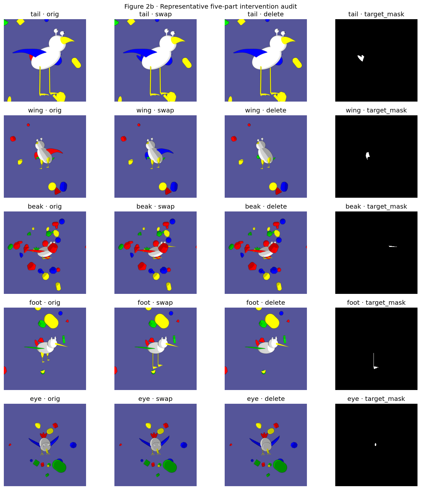


### Notebook-02 Figure 4 · Controlled standard-CBM backwash predicate


The Standard CBM generally shows donorward movement after replacement. A retained source preference is frequent for tail and less frequent for beak and eye.


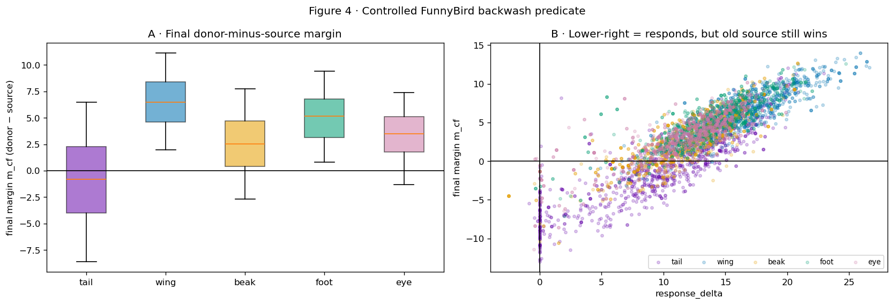


### Notebook-02 Figure 6 · Visibility-stratified replacement outcomes


Larger visible target areas are associated with improved final margins. Backwash candidates remain in the visible-target subsets, motivating additional explanatory variables.


### Notebook-02 Figure 6b · Positive labels can conflict with visible evidence


The label audit identifies positive targets with no visible pixels assigned to their named part. This quantifies a potential supervision discrepancy. Model consequences are evaluated below.


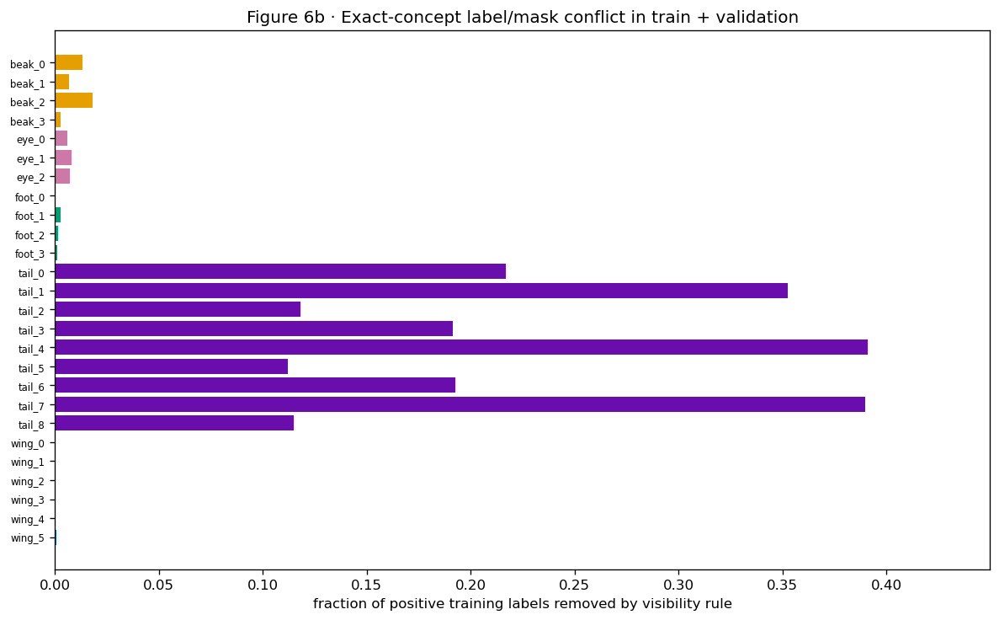


### Notebook-02 Figure 9b · Outcome and proposed contributors in one part order


Tail has relatively high values in the replacement-outcome, visibility-restricted, label-conflict, and donor-recognition-error panels. Each panel retains its own denominator and interpretation.


### Notebook-02 Figure 7a · The unchanged nine-value tail input inventory


The renderer crops describe shared inputs. Both label conditions use the same tail variants and replacement images, as checked by the image audit.


## Predictions fixed before reading RLv2 behavior


- Tail should show the largest reduction in candidate events because it has
the largest training-label conflict.


- Beak and eye may improve modestly.


- Foot and wing should change little.


- The most direct mechanism is a lower removed-source score `S_cf`.


- The final margin `m_cf=D_cf-S_cf` should move right.


- response_delta may change by a different amount because RLv2 intentionally changes low-visibility original images too.


- Exact-value and source-species associations may remain after relabeling because variant inventories and source scenes are retained.


```text
[MANIFEST VERIFIED] /scratch/network/cr7998/cv_emergence_project/curated_data/koh_joint_resnet_accelerated_converged_v1/funnybirds/standard/seed1/SUCCESS.json
```


```text
[MANIFEST VERIFIED] /scratch/network/cr7998/cv_emergence_project/curated_data/koh_joint_resnet_accelerated_converged_v1/funnybirds/rlv2/seed1/SUCCESS.json
[MANIFEST VERIFIED] /scratch/network/cr7998/cv_emergence_project/curated_data/swap_koh_joint_resnet_accelerated_converged_v1_seed1/SUCCESS.json
```


```text
[checked] funnybirds-cbm-rlv2matched-s1.csv: 5000 fixed renders; unique_cf_hashes=3040; unique_orig_hashes=250; changed_from_orig=0.983
[checked] funnybirds-cbm-s1.csv: 5000 fixed renders; unique_cf_hashes=3040; unique_orig_hashes=250; changed_from_orig=0.983
FIXED SWAP VALIDATION PASSED: 2 model CSVs, 5000 counterfactual RGB IDs, 250 original RGB IDs; hashes agree across models and each CSV passed diversity/intervention checks.
```


```text
validated fixed-render root: /scratch/network/cr7998/cv_emergence_project/curated_data/swap_koh_joint_resnet_accelerated_converged_v1_seed1
paired rows: 5000 parts: ['beak', 'eye', 'foot', 'tail', 'wing']
```


|  | swaps | mean_legacy_pixels | mean_corrected_pixels | swaps_with_added_second_instance |
| --- | --- | --- | --- | --- |
| part |  |  |  |  |
| tail | 1000 | 110.16 | 110.16 | 0 |
| wing | 1000 | 397.43 | 810.47 | 940 |
| beak | 1000 | 161.61 | 161.61 | 0 |
| foot | 1000 | 158.57 | 329.50 | 995 |
| eye | 1000 | 72.46 | 144.97 | 958 |


## 1 · Changes in training supervision


**Question.** What training supervision changed?


**Variables and prediction.** For every exact concept, count original positive labels and labels changed from 1 to 0 by RLv2. The part-level conflict rate is changed labels divided by original positive labels. If the proposed cause is correctly targeted, tail should receive the largest intervention, followed far behind by beak and eye.


**Method.** Compare the matched training pickle records in their original order, allow only `attribute_label` to differ, and show one changed record per part.


Numerical record. The code cell prints the complete table used to draw the figure, including the per-part or per-value denominator. The figure summarizes those tabulated values. Standard and RLv2 always use the same row identities, part order, definitions, bins, and axes unless the section explicitly says otherwise.


### Figure 1 · Changes in training supervision


How to read the figure. Panel A shows the exact-concept conflict fraction. Panel B shows changed record counts by part on a log scale. The example table prints one real changed image/concept record for every part. These counts quantify the size of the supervision intervention.


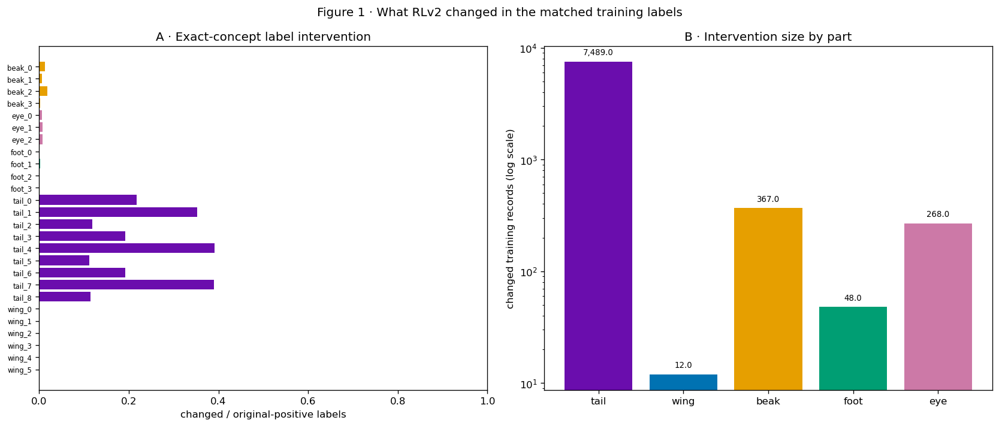


|  | concept | part | n_positive | n_changed | conflict_rate |
| --- | --- | --- | --- | --- | --- |
| 0 | beak_0 | beak | 15819 | 210 | 0.013 |
| 1 | beak_1 | beak | 7476 | 49 | 0.007 |
| 2 | beak_2 | beak | 4555 | 83 | 0.018 |
| 3 | beak_3 | beak | 9767 | 25 | 0.003 |
| 4 | eye_0 | eye | 11384 | 67 | 0.006 |
| 5 | eye_1 | eye | 11994 | 97 | 0.008 |
| 6 | eye_2 | eye | 14348 | 104 | 0.007 |
| 7 | foot_0 | foot | 9829 | 2 | 0.000 |
| 8 | foot_1 | foot | 7584 | 21 | 0.003 |
| 9 | foot_2 | foot | 10552 | 14 | 0.001 |
| 10 | foot_3 | foot | 9758 | 11 | 0.001 |
| 11 | tail_0 | tail | 3033 | 658 | 0.217 |
| 12 | tail_1 | tail | 3745 | 1320 | 0.352 |
| 13 | tail_2 | tail | 5224 | 617 | 0.118 |
| 14 | tail_3 | tail | 5285 | 1012 | 0.191 |
| 15 | tail_4 | tail | 3043 | 1190 | 0.391 |
| 16 | tail_5 | tail | 6030 | 675 | 0.112 |
| 17 | tail_6 | tail | 3752 | 722 | 0.192 |
| 18 | tail_7 | tail | 1536 | 599 | 0.390 |
| 19 | tail_8 | tail | 6059 | 696 | 0.115 |
| 20 | wing_0 | wing | 3774 | 1 | 0.000 |
| 21 | wing_1 | wing | 6815 | 2 | 0.000 |
| 22 | wing_2 | wing | 8190 | 3 | 0.000 |
| 23 | wing_3 | wing | 3794 | 0 | 0.000 |
| 24 | wing_4 | wing | 7611 | 1 | 0.000 |
| 25 | wing_5 | wing | 7504 | 5 | 0.001 |


|  | n_positive | n_changed | conflict_rate |
| --- | --- | --- | --- |
| part |  |  |  |
| tail | 37707 | 7489 | 0.199 |
| wing | 37688 | 12 | 0.000 |
| beak | 37617 | 367 | 0.010 |
| foot | 37723 | 48 | 0.001 |
| eye | 37726 | 268 | 0.007 |


|  | record_index | image | concept | standard_label | RLv2_label |
| --- | --- | --- | --- | --- | --- |
| tail | 1 | train/0/000001.png | tail_4 | 1 | 0 |
| eye | 7 | train/0/000008.png | eye_1 | 1 | 0 |
| beak | 162 | train/0/000184.png | beak_3 | 1 | 0 |
| foot | 1406 | train/1/001558.png | foot_2 | 1 | 0 |
| wing | 2007 | train/2/002233.png | wing_1 | 1 | 0 |


### Interpretation of Figure 1


- Observation. The executed table reports per-part and per-value results for the supplied model and label artifacts.


- Alternative explanation. The number of relabeled examples describes the intervention size. Behavioral improvement requires evaluation of the trained model. Tail conflict fractions also vary by exact variant, from 0.111 to 0.391.


- Proposed follow-up: Figure 2 checks every permitted training difference; Figures 3–6 then check model health, identical renders, and behavior.


- Scope: ACCEPTED FOR identifying the modified supervision. Subsequent figures evaluate its association with model-response changes.


- Subsequent analysis: Did anything besides the concept labels differ between training regimes?


## 2 · Verification of matched training conditions


Question. Which model and training fields are matched between the two conditions?


**Variables and prediction.** Compare the accepted Koh manifests and every non-label pickle-record field. Permitted manifest differences identify the label view, output path, and independently reached stopping checkpoint; within records, only `attribute_label` may differ. A causal label claim requires identical ordered images, record IDs, class labels, train/validation membership, and all model/training settings.


**Method.** Fail closed on the first unexpected difference and print explicit train/validation denominators.


Numerical record. The code cell prints the complete table used to draw the figure, including the per-part or per-value denominator. The figure summarizes those tabulated values. Standard and RLv2 always use the same row identities, part order, definitions, bins, and axes unless the section explicitly says otherwise.


### Figure 2 · Verification of matched training conditions


How to read the figure. The table has one row for configuration parity and one row for each split. Every Boolean must be true. The table records verification of the matched design.


|  | check | n_standard | n_RLv2 | same_ordered_image_class_id | same_all_non_label_fields | first_unexpected_difference |
| --- | --- | --- | --- | --- | --- | --- |
| 0 | accepted manifest protocol | NaN | NaN | True | True | {} |
| 1 | train | 45000.0 | 45000.0 | True | True | [] |
| 2 | val | 5000.0 | 5000.0 | True | True | [] |
| 3 | test | 500.0 | 500.0 | True | True | [] |


```text
ACCEPTED FOR matched training/configuration parity
```


### Interpretation of Figure 2


- Observation. The executed table reports per-part and per-value results for the supplied model and label artifacts.


- Alternative explanation: A matched input audit cannot exclude training randomness or a failed checkpoint.


- Proposed follow-up: Figures 3–4 check both trained models and prove that their evaluation pixels are identical.


- **Limited conclusion:** ACCEPTED FOR matched seed-1 training/configuration parity. Seed replication remains separate.


- Subsequent analysis: Concept prediction performance and output variation in both models.


## 3 · Model performance under both label conditions


**Question.** Did both trainings produce usable CBMs?


**Variables and prediction.** For every exact concept and each regime, calculate raw-z spread, label separation against that regime's saved target, balanced accuracy, and positive recall. Also report species-task accuracy. Both models must have non-collapsed outputs and above-chance health; otherwise a change in swap behavior could reflect failed training.


**Method.** Read each accepted Koh final-test export, reconstruct its 500-by-26 raw-logit and label matrices, and verify that sigmoid(raw z) reproduces the exported probabilities.


Numerical record. The code cell prints the complete table used to draw the figure, including the per-part or per-value denominator. The figure summarizes those tabulated values. Standard and RLv2 always use the same row identities, part order, definitions, bins, and axes unless the section explicitly says otherwise.


### Figure 3 · Model performance under both label conditions


How to read the figure. Rows are exact concepts and columns are the same four health measures as notebook 02. Standard and RLv2 are shown separately. These measures quantify ordinary-image prediction performance and output variation.


|  | regime | images | task_accuracy | sigmoid_replay_error |
| --- | --- | --- | --- | --- |
| 0 | standard | 500 | 0.992 | 0.0 |
| 1 | RLv2 | 500 | 0.988 | 0.0 |


|  | regime | concept | part | spread | label_separation | balanced_accuracy | positive_recall |
| --- | --- | --- | --- | --- | --- | --- | --- |
| 0 | standard | beak_0 | beak | 10.054 | 8.069 | 0.994 | 0.990 |
| 1 | standard | beak_1 | beak | 12.014 | 10.326 | 0.994 | 0.990 |
| 2 | standard | beak_2 | beak | 13.487 | 11.214 | 0.999 | 1.000 |
| 3 | standard | beak_3 | beak | 11.431 | 8.898 | 0.996 | 0.992 |
| 4 | standard | eye_0 | eye | 11.156 | 9.241 | 0.989 | 0.987 |
| 5 | standard | eye_1 | eye | 10.891 | 8.934 | 0.988 | 0.975 |
| 6 | standard | eye_2 | eye | 10.699 | 8.428 | 0.985 | 0.979 |
| 7 | standard | foot_0 | foot | 11.098 | 8.940 | 0.999 | 1.000 |
| 8 | standard | foot_1 | foot | 11.551 | 9.560 | 0.995 | 0.990 |
| 9 | standard | foot_2 | foot | 11.267 | 8.639 | 0.993 | 0.986 |
| 10 | standard | foot_3 | foot | 11.026 | 8.596 | 0.995 | 0.992 |
| 11 | standard | tail_0 | tail | 13.528 | 11.872 | 1.000 | 1.000 |
| 12 | standard | tail_1 | tail | 13.152 | 11.078 | 0.969 | 0.940 |
| 13 | standard | tail_2 | tail | 13.100 | 10.605 | 0.999 | 1.000 |
| 14 | standard | tail_3 | tail | 13.254 | 11.034 | 1.000 | 1.000 |
| 15 | standard | tail_4 | tail | 12.265 | 10.878 | 0.988 | 0.975 |
| 16 | standard | tail_5 | tail | 13.036 | 10.256 | 0.993 | 0.988 |
| 17 | standard | tail_6 | tail | 13.616 | 11.742 | 1.000 | 1.000 |
| 18 | standard | tail_7 | tail | 5.907 | 12.483 | 1.000 | 1.000 |
| 19 | standard | tail_8 | tail | 12.384 | 10.342 | 0.986 | 0.975 |
| 20 | standard | wing_0 | wing | 13.371 | 11.684 | 1.000 | 1.000 |
| 21 | standard | wing_1 | wing | 12.410 | 10.088 | 1.000 | 1.000 |
| 22 | standard | wing_2 | wing | 11.227 | 9.239 | 1.000 | 1.000 |
| 23 | standard | wing_3 | wing | 12.718 | 10.861 | 1.000 | 1.000 |
| 24 | standard | wing_4 | wing | 11.393 | 9.322 | 0.995 | 0.990 |
| 25 | standard | wing_5 | wing | 11.569 | 9.618 | 1.000 | 1.000 |
| 26 | RLv2 | beak_0 | beak | 10.490 | 8.469 | 0.988 | 0.985 |
| 27 | RLv2 | beak_1 | beak | 12.317 | 10.198 | 0.995 | 0.990 |
| 28 | RLv2 | beak_2 | beak | 13.312 | 11.118 | 1.000 | 1.000 |
| 29 | RLv2 | beak_3 | beak | 12.178 | 9.419 | 1.000 | 1.000 |
| 30 | RLv2 | eye_0 | eye | 12.144 | 9.588 | 0.987 | 0.980 |
| 31 | RLv2 | eye_1 | eye | 12.212 | 9.567 | 0.986 | 0.981 |
| 32 | RLv2 | eye_2 | eye | 11.750 | 9.346 | 0.985 | 0.979 |
| 33 | RLv2 | foot_0 | foot | 10.829 | 8.753 | 0.999 | 1.000 |
| 34 | RLv2 | foot_1 | foot | 11.651 | 9.866 | 1.000 | 1.000 |
| 35 | RLv2 | foot_2 | foot | 10.918 | 8.590 | 0.982 | 0.964 |
| 36 | RLv2 | foot_3 | foot | 10.820 | 8.634 | 0.995 | 0.992 |
| 37 | RLv2 | tail_0 | tail | 13.909 | 12.802 | 0.984 | 0.968 |
| 38 | RLv2 | tail_1 | tail | 13.151 | 12.378 | 0.984 | 0.971 |
| 39 | RLv2 | tail_2 | tail | 13.022 | 10.347 | 0.981 | 0.967 |
| 40 | RLv2 | tail_3 | tail | 13.466 | 11.121 | 0.967 | 0.949 |
| 41 | RLv2 | tail_4 | tail | 6.694 | 12.856 | 0.976 | 0.955 |
| 42 | RLv2 | tail_5 | tail | 12.842 | 9.989 | 0.987 | 0.986 |
| 43 | RLv2 | tail_6 | tail | 13.627 | 11.962 | 1.000 | 1.000 |
| 44 | RLv2 | tail_7 | tail | 4.832 | 14.263 | 0.950 | 0.900 |
| 45 | RLv2 | tail_8 | tail | 12.542 | 10.289 | 0.985 | 0.972 |
| 46 | RLv2 | wing_0 | wing | 13.290 | 11.624 | 0.990 | 0.980 |
| 47 | RLv2 | wing_1 | wing | 12.391 | 10.275 | 0.999 | 1.000 |
| 48 | RLv2 | wing_2 | wing | 11.152 | 9.279 | 1.000 | 1.000 |
| 49 | RLv2 | wing_3 | wing | 12.931 | 10.998 | 1.000 | 1.000 |
| 50 | RLv2 | wing_4 | wing | 11.976 | 9.309 | 0.999 | 1.000 |
| 51 | RLv2 | wing_5 | wing | 11.812 | 9.964 | 0.995 | 0.990 |


### Interpretation of Figure 3


- Observation. The executed table reports per-part and per-value results for the supplied model and label artifacts.


- Alternative explanation: The relabeling can still change raw-logit scale or individual variants even though neither model collapsed.


- Proposed follow-up: Figures 5–11 use sign-based controlled events, paired component scores, and exact-value recognition on identical renders.


- Scope: ACCEPTED FOR model performance and output variation. The part-specific replacement responses are evaluated separately.


- Subsequent analysis: Were the two models evaluated on exactly the same valid rendered images?


## 4 · Identity of the fixed-render evaluation images


**Question.** Are the fixed-render comparisons pixel-identical?


**Variables and prediction.** Check one-to-one render IDs, original hashes, counterfactual hashes, part, direction, source/donor identities, exact values, and visible-pixel counts. Every identity must match before a score difference is attributed to training labels.


**Method.** Display the accepted renderer preflight and print the full paired-image audit.


Numerical record. The code cell prints the complete table used to draw the figure, including the per-part or per-value denominator. The figure summarizes those tabulated values. Standard and RLv2 always use the same row identities, part order, definitions, bins, and axes unless the section explicitly says otherwise.


### Figure 4 · Identity of the fixed-render evaluation images


How to read the figure. The image shows original, replacement, deletion, and part maps for all parts. The table reports 5,000 paired rows and Boolean identity checks. The table verifies the rendering comparison.


|  | paired_rows | unique_render_ids | unique_counterfactual_hashes | all_counterfactual_hashes_match | all_original_hashes_match | parts | directions |
| --- | --- | --- | --- | --- | --- | --- | --- |
| 0 | 5000 | 5000 | 3040 | True | True | beak,eye,foot,tail,wing | bwd,fwd |


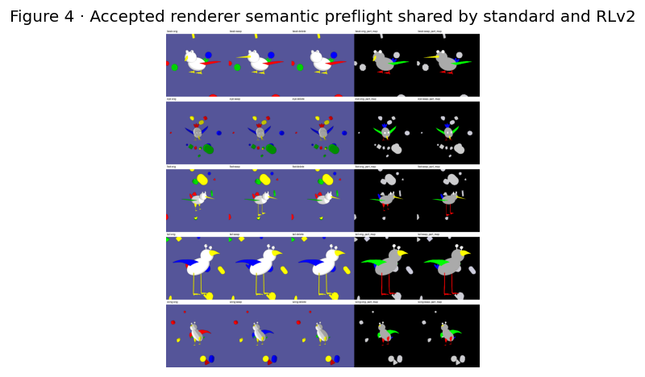


### Interpretation of Figure 4


- Observation. The executed table reports per-part and per-value results for the supplied model and label artifacts.


- Scope of validation: Renderer checks establish the shared intervention. Its behavioral consequences require the paired model comparison.


- Proposed follow-up: Figure 5 evaluates both models on these identical pixels.


- **Limited conclusion:** ACCEPTED FOR fixed-render evaluation parity and the limited one-part replacement claim.


- Subsequent analysis: Did changing only the labels reduce the controlled candidate event?


## 5 · Paired replacement outcomes after relabeling


**Question.** Did RLv2 reduce controlled backwash on identical swaps?


**Variables and prediction.** For each part and regime, plot final margin `m_cf` and the rate satisfying both `response_delta>0` and `m_cf<0`. Tail should improve most; beak and eye may improve modestly; foot and wing should remain similar.


**Method.** Use the exact same 1,000 swaps per part and pair rows by render ID and image hash.


Numerical record. The code cell prints the complete table used to draw the figure, including the per-part or per-value denominator. The figure summarizes those tabulated values. Standard and RLv2 always use the same row identities, part order, definitions, bins, and axes unless the section explicitly says otherwise.


### Figure 5 · Paired replacement outcomes after relabeling


**How to read the figure.** Panel A shows final-margin distributions; values right of zero favor the donor. Panel B shows the complete candidate rate. A lower RLv2 bar means fewer identical swaps responded to donor pixels yet still preferred the removed source.


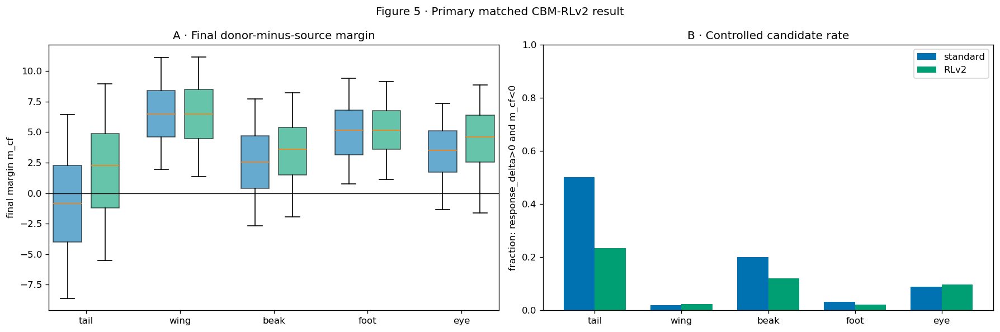


|  | standard | RLv2 | n |
| --- | --- | --- | --- |
| part |  |  |  |
| tail | 0.502 | 0.234 | 1000 |
| wing | 0.019 | 0.023 | 1000 |
| beak | 0.200 | 0.120 | 1000 |
| foot | 0.032 | 0.022 | 1000 |
| eye | 0.089 | 0.098 | 1000 |


### Interpretation of Figure 5


- Observation. The executed table reports per-part and per-value results for the supplied model and label artifacts.


- Alternative explanation: A lower aggregate rate could hide many newly introduced cases or reciprocal-direction cancellation.


- Proposed follow-up: Figure 6 counts every transition; Figures 9–10 separate direction and inserted-part pixel count.


- **Limited conclusion:** Use the paired table to distinguish large changes from small ones. Tail and beak are the preregistered primary comparisons; small wing, foot, or eye differences remain unresolved training-seed variation until matched seeds exist.


- Subsequent analysis: Which standard candidate events were resolved, remained, or were newly introduced?


### Notebook-02 Figure 4b · Standard model's three mutually exclusive outcomes


The Standard figure is retained exactly because a transition plot answers a different question. The next figure repeats this same three-outcome construction for RLv2 before examining Standard-to-RLv2 transitions.


## 5b · Distribution of replacement outcomes under RLv2


**Question.** What are the same three complete outcome fractions under RLv2?


Variables and prediction. Place every RLv2 swap into exactly one category: donor finishes higher; donorward movement occurs and source stays higher; or no donorward movement occurs and source stays higher. If the relabeling improves grounding, the donor-win fraction should rise and one or both source-retaining fractions should fall.


**Method.** Apply the exact Figure-4b sign rules to the same 1,000 swaps per part, changing only the model's saved margins.


Numerical record. The code cell prints the complete table used to draw the figure, including the per-part or per-value denominator. The figure summarizes those tabulated values. Standard and RLv2 always use the same row identities, part order, definitions, bins, and axes unless the section explicitly says otherwise.


### Figure 5b · Distribution of replacement outcomes under RLv2


**How to read the figure.** This is the RLv2 counterpart to the exact Standard image immediately above. Each panel uses all 1,000 swaps per part, and its three values sum to one.


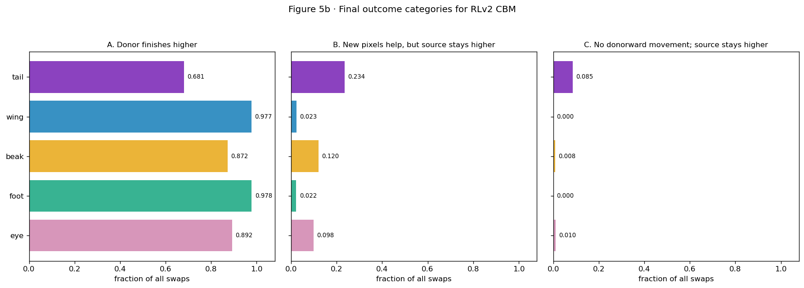


|  | donor_wins | helped_but_source_wins | no_donorward_move_and_source_wins |
| --- | --- | --- | --- |
| tail | 0.681 | 0.234 | 0.085 |
| wing | 0.977 | 0.023 | 0.000 |
| beak | 0.872 | 0.120 | 0.008 |
| foot | 0.978 | 0.022 | 0.000 |
| eye | 0.892 | 0.098 | 0.010 |


### Interpretation of Figure 5b


- Observation. The executed table reports per-part and per-value results for the supplied model and label artifacts.


- Alternative explanation: A part-average change can hide which identical rows improved, remained candidates, or became new candidates.


- Proposed follow-up: Figure 6 follows with the row-paired transition partition.


- Scope: This is the RLv2 counterpart to Standard Figure 4b. The three categories jointly describe the distribution of replacement outcomes.


- Subsequent analysis: Which identical rows moved between the Standard and RLv2 outcome definitions?


## 6 · Transitions in individual replacement outcomes


**Question.** Which individual swap outcomes changed?


**Variables and prediction.** Classify every paired row as resolved, remaining, introduced, or never a candidate using the unchanged candidate predicate. A useful intervention should resolve more standard events than it introduces, especially for tail.


**Method.** Count transitions on identical render IDs and report both all-row rates and the conditional resolution rate among standard candidates.


Numerical record. The code cell prints the complete table used to draw the figure, including the per-part or per-value denominator. The figure summarizes those tabulated values. Standard and RLv2 always use the same row identities, part order, definitions, bins, and axes unless the section explicitly says otherwise.


### Figure 6 · Transitions in individual replacement outcomes


**How to read the figure.** Each bar partitions all swaps for a part into four mutually exclusive states. `Resolved` means standard was a candidate and RLv2 was not; `introduced` is the reverse. The table prints the exact denominators.


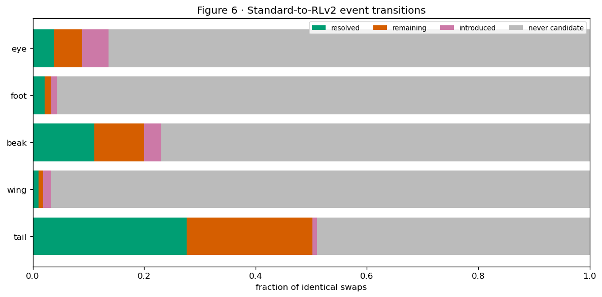


| transition | resolved | remaining | introduced | never candidate | standard_candidates | resolution_rate_among_standard_candidates | net_candidate_change |
| --- | --- | --- | --- | --- | --- | --- | --- |
| part |  |  |  |  |  |  |  |
| tail | 276 | 226 | 8 | 490 | 502 | 0.549801 | -268 |
| wing | 10 | 9 | 14 | 967 | 19 | 0.526316 | 4 |
| beak | 111 | 89 | 31 | 769 | 200 | 0.555000 | -80 |
| foot | 21 | 11 | 11 | 957 | 32 | 0.656250 | -10 |
| eye | 38 | 51 | 47 | 864 | 89 | 0.426966 | 9 |


### Interpretation of Figure 6


- Observation. The executed table reports per-part and per-value results for the supplied model and label artifacts.


- Alternative explanation: The standard-to-RLv2 contrast is one training seed; small net changes may reflect retraining variability or shared-encoder spillover.


- Proposed follow-up: Figures 7–11 test the score mechanism and robustness within seed 1; matched seeds 2–3 are still required for reproducibility.


- Interpretation: Some Standard candidates cease to satisfy the criterion after relabeling, some persist, and additional candidates occur. The paired counts quantify each category.


- Subsequent analysis: Did RLv2 work by suppressing the removed source, raising the donor, or both?


## 7 · Changes in donor and source logits


**Question.** Which raw concept score changed?


**Variables and prediction.** For every paired swap compute `ΔD_cf=D_cf_RLv2-D_cf_standard`, `ΔS_cf=S_cf_RLv2-S_cf_standard`, and `Δm_cf=m_cf_RLv2-m_cf_standard`. The proposed mechanism predicts a negative `ΔS_cf` and positive `Δm_cf`, strongest for tail. `ΔD_cf` is less certain.


**Method.** Average paired changes by part and retain the row-level distributions in the table.


Numerical record. The code cell prints the complete table used to draw the figure, including the per-part or per-value denominator. The figure summarizes those tabulated values. Standard and RLv2 always use the same row identities, part order, definitions, bins, and axes unless the section explicitly says otherwise.


### Figure 7 · Changes in donor and source logits


**How to read the figure.** Negative removed-source change means RLv2 turned off the concept that was removed. Positive donor change means it strengthened the inserted concept. Positive margin change means the donor gained relative to the source.


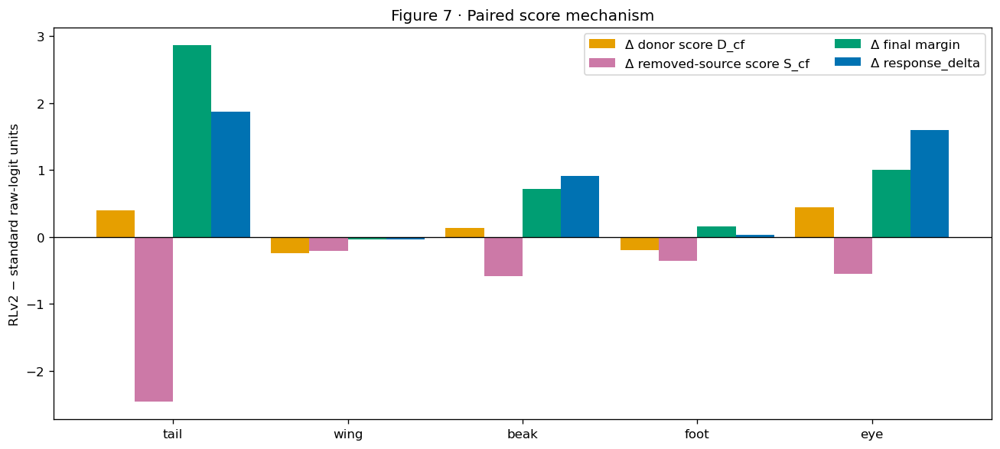


|  | delta_donor_cf | delta_source_cf | delta_final_margin | delta_response |
| --- | --- | --- | --- | --- |
| part |  |  |  |  |
| tail | 0.401 | -2.459 | 2.859 | 1.869 |
| wing | -0.247 | -0.213 | -0.034 | -0.038 |
| beak | 0.133 | -0.587 | 0.720 | 0.908 |
| foot | -0.202 | -0.360 | 0.158 | 0.033 |
| eye | 0.446 | -0.553 | 0.999 | 1.598 |


### Interpretation of Figure 7


- Observation. The executed table reports per-part and per-value results for the supplied model and label artifacts.


- Alternative explanation: Raw-logit magnitudes from separately trained models can also reflect scale recalibration, and response_delta includes an RLv2-shifted original margin.


- Proposed follow-up: Figure 8 checks within-model donorward response and Figure 11 checks sign-free exact donor-value recognition.


- Scope: The measured tail changes are consistent with increased donor scores and decreased source scores. Corresponding directional changes are reported for beak and eye. Their magnitude and consistency vary by part.


- Subsequent analysis: Did RLv2 change the complete original-to-swap response, or mainly the final preference?


### Notebook-02 Figure 3b · Standard starting preference and swap-response decomposition


The exact Standard figure is shown before the denser matched decomposition because the matched heatmap changes the construction substantially. The following RLv2 section retains every Standard quantity and adds a second regime row.


## 7b · Changes in the margin decomposition after relabeling


**Question.** Which part of the starting preference and swap response did RLv2 change?


Variables and prediction. For each regime, decompose m_cf = m_orig + donor_gain + source_decrease , while also showing D_orig and S_orig separately. All quantities are defined using raw concept logits z. If visibility-inconsistent labels help preserve a removed concept, RLv2 should increase source_decrease and improve m_cf most where the manipulated conflict was largest. It may also change D_orig , S_orig , and donor gain because the complete shared encoder is retrained.


**Method.** Use the same 5,000 paired render IDs for both models, average each component by part, verify the decomposition row by row, and print `RLv2-standard` changes.


Numerical record. The code cell prints the complete table used to draw the figure, including the per-part or per-value denominator. The figure summarizes those tabulated values. Standard and RLv2 always use the same row identities, part order, definitions, bins, and axes unless the section explicitly says otherwise.


### Figure 7b · Changes in the margin decomposition after relabeling


**How to read the figure.** Rows are standard and RLv2; columns are the same five parts. Panels A-B show the two original-image scores, Panel C their starting margin, Panels D-E the two swap-response components, Panel F their sum, and Panel G the final margin. Blue means negative and red means positive within the shared raw-logit scale. The table below the figure prints the exact means and paired regime differences.


```text
/tmp/tmp.Hs29m9YPc8/ipykernel_2363314/3938580946.py:43: UserWarning: This figure includes Axes that are not compatible with tight_layout, so results might be incorrect.
  plt.tight_layout();plt.show()
```


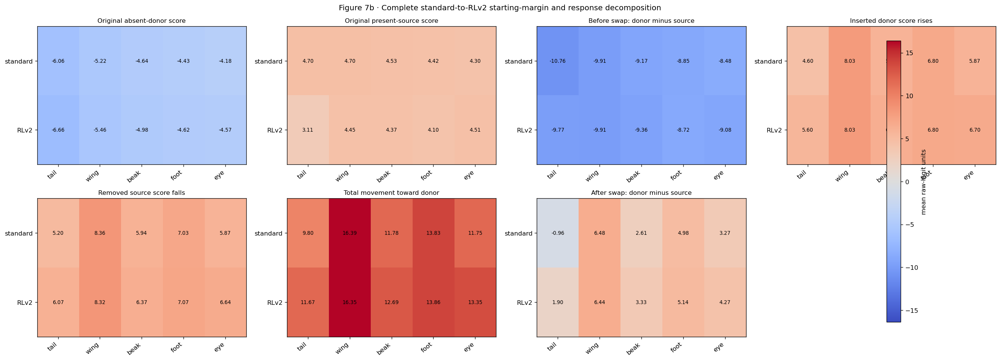


|  |  | tail | wing | beak | foot | eye |
| --- | --- | --- | --- | --- | --- | --- |
| component | regime |  |  |  |  |  |
| D_orig | standard | -6.057 | -5.217 | -4.640 | -4.429 | -4.184 |
| RLv2 | -6.656 | -5.463 | -4.983 | -4.623 | -4.565 |  |
| S_orig | standard | 4.699 | 4.697 | 4.527 | 4.418 | 4.297 |
| RLv2 | 3.109 | 4.446 | 4.372 | 4.099 | 4.515 |  |
| m_orig | standard | -10.756 | -9.914 | -9.167 | -8.847 | -8.481 |
| RLv2 | -9.766 | -9.909 | -9.355 | -8.722 | -9.080 |  |
| donor_gain | standard | 4.599 | 8.029 | 5.842 | 6.804 | 5.875 |
| RLv2 | 5.599 | 8.028 | 6.318 | 6.796 | 6.702 |  |
| source_decrease | standard | 5.201 | 8.361 | 5.936 | 7.027 | 5.874 |
| RLv2 | 6.070 | 8.323 | 6.368 | 7.068 | 6.645 |  |
| response_delta | standard | 9.800 | 16.390 | 11.778 | 13.831 | 11.749 |
| RLv2 | 11.669 | 16.351 | 12.686 | 13.864 | 13.347 |  |
| m_cf | standard | -0.956 | 6.476 | 2.611 | 4.984 | 3.268 |
| RLv2 | 1.903 | 6.442 | 3.331 | 5.142 | 4.267 |  |


**RLv2 minus standard (positive and negative retain each component's defined direction):**


|  | tail | wing | beak | foot | eye |
| --- | --- | --- | --- | --- | --- |
| D_orig | -0.599 | -0.246 | -0.343 | -0.194 | -0.381 |
| S_orig | -1.590 | -0.251 | -0.155 | -0.319 | 0.217 |
| m_orig | 0.990 | 0.005 | -0.188 | 0.125 | -0.599 |
| donor_gain | 1.000 | -0.000 | 0.476 | -0.008 | 0.827 |
| source_decrease | 0.869 | -0.038 | 0.432 | 0.041 | 0.770 |
| response_delta | 1.869 | -0.038 | 0.908 | 0.033 | 1.598 |
| m_cf | 2.859 | -0.034 | 0.720 | 0.158 | 0.999 |


### Interpretation of Figure 7b


- Observation: INCOMPLETE UNTIL THE EXECUTED FIGURE IS DISPLAYED IN CHAT.


- Alternative explanation: INCOMPLETE UNTIL THE FIGURE IS INSPECTED.


- Proposed follow-up: INCOMPLETE UNTIL THE OBSERVATION IS FIXED.


- Review status: INCOMPLETE. The recorded review requires inspection of the figure and its input population before accepting its interpretation.


- Subsequent analysis: Do the sign-based final outcomes confirm the raw-logit decomposition?


### Interpretation of the response decomposition


| Proposed factor | Component it could affect | Test in this notebook | Causal status |
| --- | --- | --- | --- |
| visibility-inconsistent training labels | any component after retraining; predicted most directly to improve removed-source release | matched RLv2 versus standard on identical renders | causal for the complete relabeling package at seed 1; not isolated to one part because the encoder is shared |
| inserted-part visibility/area | mainly donor gain, possibly source release | Figure 10, same rows stratified by exact target pixels | association within validated swaps; area itself was not randomized |
| exact source/donor value | starting margin and both response components | Figure 11 and value-matched residuals | Description of the controlled population; frequency is observed |
| unchanged source species/body | especially removed-source persistence and final margin | Figures 12 and 14 | observational; source species is not independently manipulated |
| retraining randomness | every component | matched seeds 2-3 | currently incomplete |


Figure 7b locates changes in the algebraic components of the final margin. The matched training comparison evaluates the complete label intervention, including its effects through the shared encoder. Isolating the contribution of one part’s modified labels requires a more selective intervention.


## 8 · Changes in donorward response


**Question.** Did original-to-swap donorward movement change?


Variables and prediction. Compare standard and RLv2 response_delta=m_cf-m_orig distributions and positive-response rates. RLv2 may strengthen donorward movement; this is secondary because the original-image margin is also intentionally changed.


**Method.** Use identical rows and show every part.


Numerical record. The code cell prints the complete table used to draw the figure, including the per-part or per-value denominator. The figure summarizes those tabulated values. Standard and RLv2 always use the same row identities, part order, definitions, bins, and axes unless the section explicitly says otherwise.


### Figure 8 · Changes in donorward response


How to read the figure. The boxes show response_delta; above zero means the replacement moved the comparison toward the donor. The bars show the fraction above zero. The final ordering is evaluated separately with m_cf.


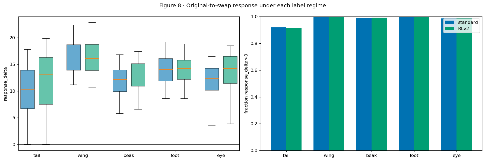


|  | standard | RLv2 |
| --- | --- | --- |
| part |  |  |
| tail | 0.919 | 0.914 |
| wing | 1.000 | 1.000 |
| beak | 0.989 | 0.992 |
| foot | 0.997 | 1.000 |
| eye | 0.986 | 0.990 |


### Interpretation of Figure 8


- Observation. The executed table reports per-part and per-value results for the supplied model and label artifacts.


- Alternative explanation: Because RLv2 changes the original-image margin as well as the counterfactual margin, response_delta and the final-preference difference may have different magnitudes or directions.


- Follow-up comparison: Evaluate paired final margins and outcome transitions alongside response_delta. The response statistic quantifies movement induced by the replacement.


- Interpretation: The effects of relabeling should be evaluated jointly through starting margins, donorward response, and final margins. The largest reported changes in final preference occur for tail.


- Subsequent analysis: Does the primary result hold in both replacement directions?


## 9 · Sensitivity to replacement direction


**Question.** Could one swap direction create the RLv2 result?


Variables and prediction. Calculate the unchanged candidate predicate separately for forward and backward replacements under each regime. Agreement between directions would support robustness of the part-level comparison.


**Method.** Keep direction and regime separate and print 500-row denominators.


Numerical record. The code cell prints the complete table used to draw the figure, including the per-part or per-value denominator. The figure summarizes those tabulated values. Standard and RLv2 always use the same row identities, part order, definitions, bins, and axes unless the section explicitly says otherwise.


### Figure 9 · Sensitivity to replacement direction


**How to read the figure.** Circles and squares distinguish standard and RLv2; solid and dashed lines distinguish forward and backward swaps. Lower candidate rates are better.


|  | part | direction | n | standard | RLv2 |
| --- | --- | --- | --- | --- | --- |
| 0 | beak | bwd | 500 | 0.200 | 0.108 |
| 1 | beak | fwd | 500 | 0.200 | 0.132 |
| 2 | eye | bwd | 500 | 0.088 | 0.080 |
| 3 | eye | fwd | 500 | 0.090 | 0.116 |
| 4 | foot | bwd | 500 | 0.042 | 0.024 |
| 5 | foot | fwd | 500 | 0.022 | 0.020 |
| 6 | tail | bwd | 500 | 0.476 | 0.248 |
| 7 | tail | fwd | 500 | 0.528 | 0.220 |
| 8 | wing | bwd | 500 | 0.028 | 0.026 |
| 9 | wing | fwd | 500 | 0.010 | 0.020 |


### Interpretation of Figure 9


- Observation. The executed table reports per-part and per-value results for the supplied model and label artifacts.


- Alternative explanation: Different exact variants within a direction could still respond unequally.


- Proposed follow-up: Figures 10–11 stratify by visible pixel count and exact inserted value.


- **Limited conclusion:** ACCEPTED FOR ruling out opposite-direction cancellation as the aggregate explanation.


- Subsequent analysis: Is any improvement confined to swaps where the inserted part has little or no visible area?


## 10 · Relabeling effects stratified by visible target area


**Question.** How does exact inserted-part visibility change the RLv2 result?


**Variables and prediction.** Within the same declared pixel-count bins as notebook 02, compare standard and RLv2 candidate rates. If RLv2 only changes zero-pixel cases, it did not improve recognition of visible donor evidence. Improvement among clearly visible rows supports a broader label-training effect.


**Method.** Use exact counterfactual part-map pixel counts and print row denominators for every bin.


Numerical record. The code cell prints the complete table used to draw the figure, including the per-part or per-value denominator. The figure summarizes those tabulated values. Standard and RLv2 always use the same row identities, part order, definitions, bins, and axes unless the section explicitly says otherwise.


### Figure 10 · Relabeling effects stratified by visible target area


**How to read the figure.** Each panel is one part. The x-axis is visible inserted-part pixels and the y-axis is the complete candidate rate. Standard and RLv2 share the same rows in every bin.


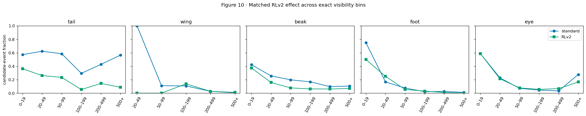


|  | part | visibility_bin | n | standard | RLv2 |
| --- | --- | --- | --- | --- | --- |
| 0 | beak | 0–19 | 123 | 0.423 | 0.374 |
| 1 | beak | 20–49 | 164 | 0.256 | 0.159 |
| 2 | beak | 50–99 | 192 | 0.198 | 0.078 |
| 3 | beak | 100–199 | 237 | 0.169 | 0.063 |
| 4 | beak | 200–499 | 227 | 0.097 | 0.062 |
| 5 | beak | 500+ | 57 | 0.105 | 0.070 |
| 6 | eye | 0–19 | 17 | 0.588 | 0.588 |
| 7 | eye | 20–49 | 136 | 0.228 | 0.213 |
| 8 | eye | 50–99 | 307 | 0.072 | 0.078 |
| 9 | eye | 100–199 | 285 | 0.046 | 0.056 |
| 10 | eye | 200–499 | 237 | 0.034 | 0.068 |
| 11 | eye | 500+ | 18 | 0.278 | 0.167 |
| 12 | foot | 0–19 | 4 | 0.750 | 0.500 |
| 13 | foot | 20–49 | 12 | 0.167 | 0.250 |
| 14 | foot | 50–99 | 92 | 0.076 | 0.054 |
| 15 | foot | 100–199 | 228 | 0.022 | 0.031 |
| 16 | foot | 200–499 | 489 | 0.027 | 0.010 |
| 17 | foot | 500+ | 175 | 0.011 | 0.000 |
| 18 | tail | 0–19 | 386 | 0.573 | 0.363 |
| 19 | tail | 20–49 | 130 | 0.623 | 0.262 |
| 20 | tail | 50–99 | 94 | 0.585 | 0.234 |
| 21 | tail | 100–199 | 187 | 0.294 | 0.053 |
| 22 | tail | 200–499 | 180 | 0.428 | 0.144 |
| 23 | tail | 500+ | 23 | 0.565 | 0.087 |
| 24 | wing | 20–49 | 1 | 1.000 | 0.000 |
| 25 | wing | 50–99 | 9 | 0.111 | 0.000 |
| 26 | wing | 100–199 | 65 | 0.108 | 0.138 |
| 27 | wing | 200–499 | 224 | 0.027 | 0.027 |
| 28 | wing | 500+ | 701 | 0.006 | 0.011 |


### Interpretation of Figure 10


- Observation. The executed table reports per-part and per-value results for the supplied model and label artifacts.


- Alternative explanation: Sparse extreme bins and exact-value composition can make individual bin estimates unstable.


- Proposed follow-up: Figure 11 compares exact donor values directly; seed-level replication is required for uncertainty.


- Scope: Tail and beak improvements extend to visible-target subsets. The corresponding patterns differ across parts.


- Subsequent analysis: Did RLv2 improve exact donor-value recognition, or do particular variants remain difficult?


## 11 · Exact donor-variant recognition after relabeling


**Question.** Did exact inserted-value recognition improve?


Variables and prediction. For every part and regime, compare the inserted donor value with the highest post-swap raw concept logit. If relabeling improves aggregate tail recognition while visual-variant difficulty persists, individual rows may retain elevated errors.


**Method.** Display all exact values in two aligned rows: standard and RLv2.


Numerical record. The code cell prints the complete table used to draw the figure, including the per-part or per-value denominator. The figure summarizes those tabulated values. Standard and RLv2 always use the same row identities, part order, definitions, bins, and axes unless the section explicitly says otherwise.


### Figure 11 · Exact donor-variant recognition after relabeling


**How to read the figure.** Each heatmap row is the inserted value and each column is the highest-scoring value. A brighter diagonal means better exact donor recognition. The title prints the full diagonal rate.


|  | regime | part | donor_value | n | recognition_rate | candidate_rate |
| --- | --- | --- | --- | --- | --- | --- |
| 0 | standard | tail | 0 | 75 | 0.240 | 0.640 |
| 1 | standard | tail | 1 | 90 | 0.344 | 0.533 |
| 2 | standard | tail | 2 | 120 | 0.492 | 0.408 |
| 3 | standard | tail | 3 | 110 | 0.355 | 0.573 |
| 4 | standard | tail | 4 | 110 | 0.282 | 0.518 |
| 5 | standard | tail | 5 | 150 | 0.553 | 0.373 |
| 6 | standard | tail | 6 | 130 | 0.354 | 0.515 |
| 7 | standard | tail | 7 | 35 | 0.114 | 0.800 |
| 8 | standard | tail | 8 | 180 | 0.467 | 0.478 |
| 9 | standard | wing | 0 | 130 | 0.954 | 0.031 |
| 10 | standard | wing | 1 | 150 | 0.973 | 0.027 |
| 11 | standard | wing | 2 | 220 | 0.982 | 0.009 |
| 12 | standard | wing | 3 | 115 | 0.983 | 0.017 |
| 13 | standard | wing | 4 | 175 | 0.977 | 0.023 |
| 14 | standard | wing | 5 | 210 | 0.986 | 0.014 |
| 15 | standard | beak | 0 | 345 | 0.771 | 0.200 |
| 16 | standard | beak | 1 | 245 | 0.898 | 0.098 |
| 17 | standard | beak | 2 | 190 | 0.595 | 0.363 |
| 18 | standard | beak | 3 | 220 | 0.823 | 0.173 |
| 19 | standard | foot | 0 | 220 | 0.977 | 0.009 |
| 20 | standard | foot | 1 | 240 | 0.962 | 0.038 |
| 21 | standard | foot | 2 | 290 | 0.976 | 0.024 |
| 22 | standard | foot | 3 | 250 | 0.944 | 0.056 |
| 23 | standard | eye | 0 | 300 | 0.893 | 0.100 |
| 24 | standard | eye | 1 | 345 | 0.916 | 0.072 |
| 25 | standard | eye | 2 | 355 | 0.890 | 0.096 |
| 26 | RLv2 | tail | 0 | 75 | 0.453 | 0.453 |
| 27 | RLv2 | tail | 1 | 90 | 0.511 | 0.367 |
| 28 | RLv2 | tail | 2 | 120 | 0.825 | 0.117 |
| 29 | RLv2 | tail | 3 | 110 | 0.664 | 0.200 |
| 30 | RLv2 | tail | 4 | 110 | 0.482 | 0.355 |
| 31 | RLv2 | tail | 5 | 150 | 0.840 | 0.107 |
| 32 | RLv2 | tail | 6 | 130 | 0.631 | 0.238 |
| 33 | RLv2 | tail | 7 | 35 | 0.400 | 0.486 |
| 34 | RLv2 | tail | 8 | 180 | 0.778 | 0.156 |
| 35 | RLv2 | wing | 0 | 130 | 0.946 | 0.015 |
| 36 | RLv2 | wing | 1 | 150 | 0.933 | 0.060 |
| 37 | RLv2 | wing | 2 | 220 | 1.000 | 0.000 |
| 38 | RLv2 | wing | 3 | 115 | 0.974 | 0.009 |
| 39 | RLv2 | wing | 4 | 175 | 0.971 | 0.023 |
| 40 | RLv2 | wing | 5 | 210 | 0.957 | 0.033 |
| 41 | RLv2 | beak | 0 | 345 | 0.910 | 0.061 |
| 42 | RLv2 | beak | 1 | 245 | 0.906 | 0.090 |
| 43 | RLv2 | beak | 2 | 190 | 0.679 | 0.289 |
| 44 | RLv2 | beak | 3 | 220 | 0.895 | 0.100 |
| 45 | RLv2 | foot | 0 | 220 | 0.986 | 0.000 |
| 46 | RLv2 | foot | 1 | 240 | 0.962 | 0.033 |
| 47 | RLv2 | foot | 2 | 290 | 0.972 | 0.021 |
| 48 | RLv2 | foot | 3 | 250 | 0.968 | 0.032 |
| 49 | RLv2 | eye | 0 | 300 | 0.907 | 0.083 |
| 50 | RLv2 | eye | 1 | 345 | 0.948 | 0.049 |
| 51 | RLv2 | eye | 2 | 355 | 0.825 | 0.158 |


### Interpretation of Figure 11


- Observation. The executed table reports per-part and per-value results for the supplied model and label artifacts.


- Alternative explanation: Highest-logit recognition ignores the size of the winning margin and can hide value-specific heterogeneity.


- Proposed follow-up: Retain the per-value matrices and compare them with final-margin and source-species residual results.


- Interpretation: The largest donor-recognition improvements occur for tail and beak. Errors remain for individual exact variants.


- Subsequent analysis: After exact values, direction, and visibility are controlled, does source species still organize the margin?


## 12 · Source-species associations after relabeling


**Question.** Does source species still organize the remaining margin?


Variables and prediction. For each regime, subtract the mean margin within (part, source value, donor value, direction, visibility bin) and average the residual by source species. Persistent source-species associations would appear as residual spread after relabeling, potentially with a smaller magnitude for tail.


**Method.** Require at least five rows per displayed source-species estimate and use identical control strata.


Numerical record. The code cell prints the complete table used to draw the figure, including the per-part or per-value denominator. The figure summarizes those tabulated values. Standard and RLv2 always use the same row identities, part order, definitions, bins, and axes unless the section explicitly says otherwise.


### Figure 12 · Source-species associations after relabeling


**How to read the figure.** Each panel is a part. Source species are ordered by the standard residual; blue is standard and green is RLv2 for the same species. Zero means that species matches its controlled-stratum average.


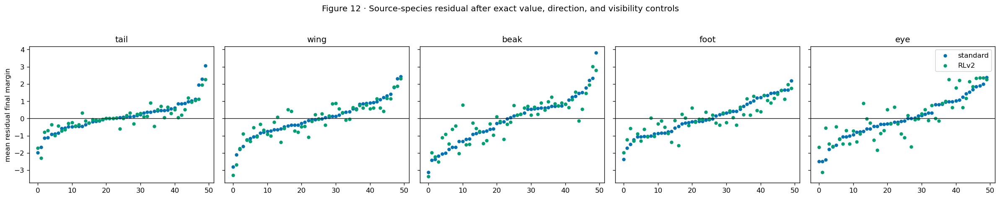


| regime | RLv2 | standard |
| --- | --- | --- |
| part |  |  |
| tail | 0.777 | 0.894 |
| wing | 1.071 | 1.054 |
| beak | 1.306 | 1.394 |
| foot | 0.919 | 1.037 |
| eye | 1.338 | 1.181 |


### Interpretation of Figure 12


- Observation. The executed table reports per-part and per-value results for the supplied model and label artifacts.


- Alternative explanation: Residuals may reflect unmeasured body or renderer properties and sparse conditioning groups. Their interpretation is observational.


- Proposed follow-up: Figure 14 asks whether source species improves prediction on held-out renders after the same measured controls.


- Scope: ACCEPTED FOR a remaining source-species association in the evaluated population, with the largest reported reduction for tail. Causal interpretation requires additional controls.


- Subsequent analysis: Did RLv2 reduce species information in the learned concept representation?


## 13 · Species decoding after relabeling


**Question.** Did species decodability change inside the concept vector?


Variables and prediction. For each regime, train the same held-out diagnostic classifier on known labels c and learned raw logits z , using the same image split. If RLv2 reduces contextual coding, raw-z species accuracy may decrease most for tail. This analysis evaluates species information in the representation.


**Method.** Use one fixed stratified 70/30 split and identical logistic-regression settings.


Numerical record. The code cell prints the complete table used to draw the figure, including the per-part or per-value denominator. The figure summarizes those tabulated values. Standard and RLv2 always use the same row identities, part order, definitions, bins, and axes unless the section explicitly says otherwise.


### Figure 13 · Species decoding after relabeling


How to read the figure. Each panel is one regime. Grey bars use known labels and colored bars use learned raw z. Bar height is the held-out species accuracy of the separately fitted diagnostic.


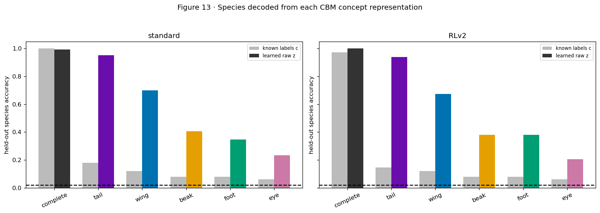


|  | regime | block | source | species_accuracy | dimensions |
| --- | --- | --- | --- | --- | --- |
| 0 | standard | complete | known labels c | 1.000 | 26 |
| 1 | standard | complete | learned raw z | 0.993 | 26 |
| 2 | standard | beak | known labels c | 0.080 | 4 |
| 3 | standard | beak | learned raw z | 0.407 | 4 |
| 4 | standard | eye | known labels c | 0.060 | 3 |
| 5 | standard | eye | learned raw z | 0.233 | 3 |
| 6 | standard | foot | known labels c | 0.080 | 4 |
| 7 | standard | foot | learned raw z | 0.347 | 4 |
| 8 | standard | tail | known labels c | 0.180 | 9 |
| 9 | standard | tail | learned raw z | 0.953 | 9 |
| 10 | standard | wing | known labels c | 0.120 | 6 |
| 11 | standard | wing | learned raw z | 0.700 | 6 |
| 12 | RLv2 | complete | known labels c | 0.973 | 26 |
| 13 | RLv2 | complete | learned raw z | 1.000 | 26 |
| 14 | RLv2 | beak | known labels c | 0.080 | 4 |
| 15 | RLv2 | beak | learned raw z | 0.380 | 4 |
| 16 | RLv2 | eye | known labels c | 0.060 | 3 |
| 17 | RLv2 | eye | learned raw z | 0.207 | 3 |
| 18 | RLv2 | foot | known labels c | 0.080 | 4 |
| 19 | RLv2 | foot | learned raw z | 0.380 | 4 |
| 20 | RLv2 | tail | known labels c | 0.147 | 9 |
| 21 | RLv2 | tail | learned raw z | 0.940 | 9 |
| 22 | RLv2 | wing | known labels c | 0.120 | 6 |
| 23 | RLv2 | wing | learned raw z | 0.673 | 6 |


### Interpretation of Figure 13


- Observation. The executed table reports per-part and per-value results for the supplied model and label artifacts.


- Limitations: The result uses one diagnostic split. Spatial dependence requires a separate image-level test.


- Proposed follow-up: Grounding conclusions must continue to come from Figures 5–11; multiple training seeds/splits are needed before treating small decoder changes as stable.


- **Limited conclusion:** VALID DIAGNOSTIC, HETEROGENEOUS CHANGE. Species information remains abundant and is neither necessary nor sufficient for poor grounding.


- Subsequent analysis: Do visibility, exact values, or source species predict the remaining margin on held-out render IDs?


## 13a · Label conflict and exact-variant score responses


**Question.** Does label conflict align with the score component it could weaken?


Variables and prediction. For each exact value, x is the fraction of originally positive training labels whose part was invisible. The two y quantities are the mean inserted-value rise and removed-value fall on swaps involving that same value. Values with more contradictory supervision may show weaker donor rise or weaker source release. This estimates an exact-value association alongside the matched relabeling comparison.


**Method.** Run the same diagnostic program twice. The first run reads the Standard checkpoint and Standard swap CSV. The second changes only `--regime rlv2`, which selects the RLv2 checkpoint and matched RLv2 CSV.


Numerical record. The code cell prints the complete table used to draw the figure, including the per-part or per-value denominator. The figure summarizes those tabulated values. Standard and RLv2 always use the same row identities, part order, definitions, bins, and axes unless the section explicitly says otherwise.


### Figure 13a · Label conflict and exact-variant score responses


**How to read the figure.** The Standard image appears first and the RLv2 image second because merging them would substantially change the labelled scatterplot.


```text
STANDARD — same calculation
```


|  | concept_index | concept | part | value | positive_images | hidden_positive_images | conflict_rate | species_support | mean_donor_gain | mean_visible_pixels | donor_rows | mean_source_decrease | source_rows |
| --- | --- | --- | --- | --- | --- | --- | --- | --- | --- | --- | --- | --- | --- |
| 0 | 0 | beak_0 | beak | 0 | 15819 | 210 | 0.0133 | 21 | 5.5298 | 99.5449 | 345 | 5.4785 | 345 |
| 1 | 1 | beak_1 | beak | 1 | 7476 | 49 | 0.0066 | 10 | 6.7573 | 316.1306 | 245 | 7.2481 | 245 |
| 2 | 2 | beak_2 | beak | 2 | 4555 | 83 | 0.0182 | 6 | 5.2791 | 22.0526 | 190 | 5.2235 | 190 |
| 3 | 3 | beak_3 | beak | 3 | 9767 | 25 | 0.0026 | 13 | 5.7998 | 207.3773 | 220 | 5.8082 | 220 |
| 4 | 4 | eye_0 | eye | 0 | 11384 | 67 | 0.0059 | 15 | 5.8616 | 67.2067 | 300 | 6.4712 | 300 |
| 5 | 5 | eye_1 | eye | 1 | 11994 | 97 | 0.0081 | 16 | 6.2189 | 79.2928 | 345 | 5.4257 | 345 |
| 6 | 6 | eye_2 | eye | 2 | 14348 | 104 | 0.0072 | 19 | 5.5520 | 70.2620 | 355 | 5.8059 | 355 |
| 7 | 7 | foot_0 | foot | 0 | 9829 | 2 | 0.0002 | 13 | 7.1338 | 192.7364 | 220 | 7.4994 | 220 |
| 8 | 8 | foot_1 | foot | 1 | 7584 | 21 | 0.0028 | 10 | 6.7294 | 97.8042 | 240 | 7.0198 | 240 |
| 9 | 9 | foot_2 | foot | 2 | 10552 | 14 | 0.0013 | 14 | 7.0352 | 169.1552 | 290 | 6.7916 | 290 |
| 10 | 10 | foot_3 | foot | 3 | 9758 | 11 | 0.0011 | 13 | 6.3180 | 174.5440 | 250 | 6.8919 | 250 |
| 11 | 11 | tail_0 | tail | 0 | 3033 | 658 | 0.2169 | 4 | 4.3734 | 183.6800 | 75 | 4.2760 | 75 |
| 12 | 12 | tail_1 | tail | 1 | 3745 | 1320 | 0.3525 | 5 | 4.4579 | 115.2333 | 90 | 5.3794 | 90 |
| 13 | 13 | tail_2 | tail | 2 | 5224 | 617 | 0.1181 | 7 | 4.8566 | 83.2250 | 120 | 4.5933 | 120 |
| 14 | 14 | tail_3 | tail | 3 | 5285 | 1012 | 0.1915 | 7 | 4.5718 | 156.8545 | 110 | 4.6608 | 110 |
| 15 | 15 | tail_4 | tail | 4 | 3043 | 1190 | 0.3911 | 4 | 3.3887 | 99.7636 | 110 | 3.6440 | 110 |
| 16 | 16 | tail_5 | tail | 5 | 6030 | 675 | 0.1119 | 8 | 5.2328 | 69.1733 | 150 | 5.1008 | 150 |
| 17 | 17 | tail_6 | tail | 6 | 3752 | 722 | 0.1924 | 5 | 4.4626 | 152.8462 | 130 | 6.7392 | 130 |
| 18 | 18 | tail_7 | tail | 7 | 1536 | 599 | 0.3900 | 2 | 3.3962 | 106.6000 | 35 | 3.0609 | 35 |
| 19 | 19 | tail_8 | tail | 8 | 6059 | 696 | 0.1149 | 8 | 5.1535 | 76.7667 | 180 | 6.5735 | 180 |
| 20 | 20 | wing_0 | wing | 0 | 3774 | 1 | 0.0003 | 5 | 9.1871 | 388.9000 | 130 | 9.7883 | 130 |
| 21 | 21 | wing_1 | wing | 1 | 6815 | 2 | 0.0003 | 9 | 7.6914 | 357.4667 | 150 | 8.4944 | 150 |
| 22 | 22 | wing_2 | wing | 2 | 8190 | 3 | 0.0004 | 11 | 8.0250 | 483.9182 | 220 | 7.9594 | 220 |
| 23 | 23 | wing_3 | wing | 3 | 3794 | 0 | 0.0000 | 5 | 8.1916 | 363.8000 | 115 | 8.3381 | 115 |
| 24 | 24 | wing_4 | wing | 4 | 7611 | 1 | 0.0001 | 10 | 7.1593 | 403.3371 | 175 | 7.8375 | 175 |
| 25 | 25 | wing_5 | wing | 5 | 7504 | 5 | 0.0007 | 10 | 8.1918 | 354.1286 | 210 | 8.2514 | 210 |


```text
RLV2 — same calculation
```


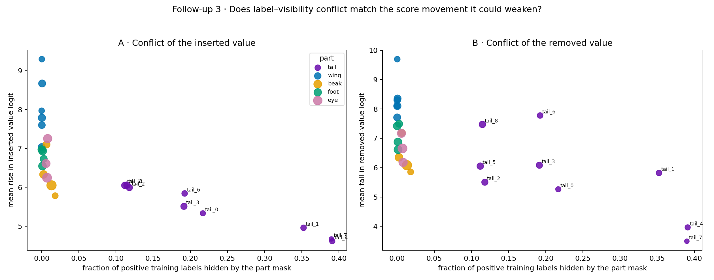


|  | concept_index | concept | part | value | positive_images | hidden_positive_images | conflict_rate | species_support | mean_donor_gain | mean_visible_pixels | donor_rows | mean_source_decrease | source_rows |
| --- | --- | --- | --- | --- | --- | --- | --- | --- | --- | --- | --- | --- | --- |
| 0 | 0 | beak_0 | beak | 0 | 15819 | 210 | 0.0133 | 21 | 6.0504 | 99.5449 | 345 | 6.0819 | 345 |
| 1 | 1 | beak_1 | beak | 1 | 7476 | 49 | 0.0066 | 10 | 7.1006 | 316.1306 | 245 | 7.1848 | 245 |
| 2 | 2 | beak_2 | beak | 2 | 4555 | 83 | 0.0182 | 6 | 5.7832 | 22.0526 | 190 | 5.8530 | 190 |
| 3 | 3 | beak_3 | beak | 3 | 9767 | 25 | 0.0026 | 13 | 6.3298 | 207.3773 | 220 | 6.3509 | 220 |
| 4 | 4 | eye_0 | eye | 0 | 11384 | 67 | 0.0059 | 15 | 6.6102 | 67.2067 | 300 | 7.1691 | 300 |
| 5 | 5 | eye_1 | eye | 1 | 11994 | 97 | 0.0081 | 16 | 7.2513 | 79.2928 | 345 | 6.1787 | 345 |
| 6 | 6 | eye_2 | eye | 2 | 14348 | 104 | 0.0072 | 19 | 6.2466 | 70.2620 | 355 | 6.6541 | 355 |
| 7 | 7 | foot_0 | foot | 0 | 9829 | 2 | 0.0002 | 13 | 6.9710 | 192.7364 | 220 | 7.4208 | 220 |
| 8 | 8 | foot_1 | foot | 1 | 7584 | 21 | 0.0028 | 10 | 6.7307 | 97.8042 | 240 | 7.4960 | 240 |
| 9 | 9 | foot_2 | foot | 2 | 10552 | 14 | 0.0013 | 14 | 6.9339 | 169.1552 | 290 | 6.6120 | 290 |
| 10 | 10 | foot_3 | foot | 3 | 9758 | 11 | 0.0011 | 13 | 6.5452 | 174.5440 | 250 | 6.8753 | 250 |
| 11 | 11 | tail_0 | tail | 0 | 3033 | 658 | 0.2169 | 4 | 5.3315 | 183.6800 | 75 | 5.2625 | 75 |
| 12 | 12 | tail_1 | tail | 1 | 3745 | 1320 | 0.3525 | 5 | 4.9590 | 115.2333 | 90 | 5.8202 | 90 |
| 13 | 13 | tail_2 | tail | 2 | 5224 | 617 | 0.1181 | 7 | 5.9914 | 83.2250 | 120 | 5.5037 | 120 |
| 14 | 14 | tail_3 | tail | 3 | 5285 | 1012 | 0.1915 | 7 | 5.5105 | 156.8545 | 110 | 6.0819 | 110 |
| 15 | 15 | tail_4 | tail | 4 | 3043 | 1190 | 0.3911 | 4 | 4.6135 | 99.7636 | 110 | 3.9645 | 110 |
| 16 | 16 | tail_5 | tail | 5 | 6030 | 675 | 0.1119 | 8 | 6.0484 | 69.1733 | 150 | 6.0520 | 150 |
| 17 | 17 | tail_6 | tail | 6 | 3752 | 722 | 0.1924 | 5 | 5.8418 | 152.8462 | 130 | 7.7764 | 130 |
| 18 | 18 | tail_7 | tail | 7 | 1536 | 599 | 0.3900 | 2 | 4.6715 | 106.6000 | 35 | 3.4929 | 35 |
| 19 | 19 | tail_8 | tail | 8 | 6059 | 696 | 0.1149 | 8 | 6.0568 | 76.7667 | 180 | 7.4723 | 180 |
| 20 | 20 | wing_0 | wing | 0 | 3774 | 1 | 0.0003 | 5 | 9.2938 | 388.9000 | 130 | 9.6958 | 130 |
| 21 | 21 | wing_1 | wing | 1 | 6815 | 2 | 0.0003 | 9 | 7.5986 | 357.4667 | 150 | 8.2991 | 150 |
| 22 | 22 | wing_2 | wing | 2 | 8190 | 3 | 0.0004 | 11 | 7.7867 | 483.9182 | 220 | 8.1013 | 220 |
| 23 | 23 | wing_3 | wing | 3 | 3794 | 0 | 0.0000 | 5 | 7.9674 | 363.8000 | 115 | 8.0987 | 115 |
| 24 | 24 | wing_4 | wing | 4 | 7611 | 1 | 0.0001 | 10 | 7.0329 | 403.3371 | 175 | 7.7108 | 175 |
| 25 | 25 | wing_5 | wing | 5 | 7504 | 5 | 0.0007 | 10 | 8.6687 | 354.1286 | 210 | 8.3555 | 210 |


### Interpretation of Figure 13a


- Observation. The executed table reports per-part and per-value results for the supplied model and label artifacts.


- Alternative explanation: Conflict, visibility, species support, and exact-value difficulty are correlated properties of this generated dataset.


- Follow-up comparison: Compare matched exact variants and score components between Standard and RLv2. The part-level association provides a separate descriptive summary.


- Scope: The scatter estimates an exact-value association. The matched retraining comparison evaluates the specified supervision intervention.


- Subsequent analysis: After holding the intervention size visible, how do rarity and all three exact-value outcomes change?


## 13b · Species support and replacement outcomes after relabeling


**Question.** Did RLv2 change the relationship between species support and swap outcomes?


Variables and prediction. Species support is the number of the 50 species that naturally carry an exact donor value. The three mutually exclusive outcomes are donor wins, donorward movement and source remains higher, and no donorward movement while source remains higher. If relabeling repairs one contributor without changing the dataset's rarity structure, points should move vertically while their support values remain fixed.


**Method.** Apply the exact Figure-7b grouping separately to Standard and RLv2 and place the same three panels in two rows. Every row is still one of the same 5,000 fixed swaps.


Numerical record. The code cell prints the complete table used to draw the figure, including the per-part or per-value denominator. The figure summarizes those tabulated values. Standard and RLv2 always use the same row identities, part order, definitions, bins, and axes unless the section explicitly says otherwise.


### Figure 13b · Species support and replacement outcomes after relabeling


**How to read the figure.** The top row is Standard and the bottom row is RLv2. Within each column, the axes, labels, colors, support values, and outcome definitions are identical.


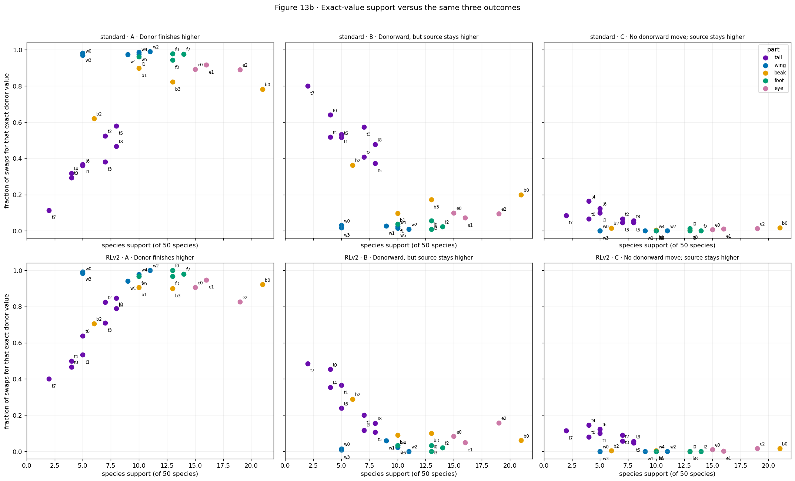


|  | part | var_donor | n_rows | species_support | donor_wins_rate | donorward_source_wins_rate | no_donorward_source_wins_rate | regime |
| --- | --- | --- | --- | --- | --- | --- | --- | --- |
| 0 | beak | 0 | 345 | 21 | 0.783 | 0.200 | 0.017 | standard |
| 1 | beak | 1 | 245 | 10 | 0.898 | 0.098 | 0.004 | standard |
| 2 | beak | 2 | 190 | 6 | 0.621 | 0.363 | 0.016 | standard |
| 3 | beak | 3 | 220 | 13 | 0.823 | 0.173 | 0.005 | standard |
| 4 | eye | 0 | 300 | 15 | 0.893 | 0.100 | 0.007 | standard |
| 5 | eye | 1 | 345 | 16 | 0.916 | 0.072 | 0.012 | standard |
| 6 | eye | 2 | 355 | 19 | 0.890 | 0.096 | 0.014 | standard |
| 7 | foot | 0 | 220 | 13 | 0.977 | 0.009 | 0.014 | standard |
| 8 | foot | 1 | 240 | 10 | 0.962 | 0.038 | 0.000 | standard |
| 9 | foot | 2 | 290 | 14 | 0.976 | 0.024 | 0.000 | standard |
| 10 | foot | 3 | 250 | 13 | 0.944 | 0.056 | 0.000 | standard |
| 11 | tail | 0 | 75 | 4 | 0.293 | 0.640 | 0.067 | standard |
| 12 | tail | 1 | 90 | 5 | 0.367 | 0.533 | 0.100 | standard |
| 13 | tail | 2 | 120 | 7 | 0.525 | 0.408 | 0.067 | standard |
| 14 | tail | 3 | 110 | 7 | 0.382 | 0.573 | 0.045 | standard |
| 15 | tail | 4 | 110 | 4 | 0.318 | 0.518 | 0.164 | standard |
| 16 | tail | 5 | 150 | 8 | 0.580 | 0.373 | 0.047 | standard |
| 17 | tail | 6 | 130 | 5 | 0.362 | 0.515 | 0.123 | standard |
| 18 | tail | 7 | 35 | 2 | 0.114 | 0.800 | 0.086 | standard |
| 19 | tail | 8 | 180 | 8 | 0.467 | 0.478 | 0.056 | standard |
| 20 | wing | 0 | 130 | 5 | 0.969 | 0.031 | 0.000 | standard |
| 21 | wing | 1 | 150 | 9 | 0.973 | 0.027 | 0.000 | standard |
| 22 | wing | 2 | 220 | 11 | 0.991 | 0.009 | 0.000 | standard |
| 23 | wing | 3 | 115 | 5 | 0.983 | 0.017 | 0.000 | standard |
| 24 | wing | 4 | 175 | 10 | 0.977 | 0.023 | 0.000 | standard |
| 25 | wing | 5 | 210 | 10 | 0.986 | 0.014 | 0.000 | standard |
| 26 | beak | 0 | 345 | 21 | 0.922 | 0.061 | 0.017 | RLv2 |
| 27 | beak | 1 | 245 | 10 | 0.906 | 0.090 | 0.004 | RLv2 |
| 28 | beak | 2 | 190 | 6 | 0.705 | 0.289 | 0.005 | RLv2 |
| 29 | beak | 3 | 220 | 13 | 0.900 | 0.100 | 0.000 | RLv2 |
| 30 | eye | 0 | 300 | 15 | 0.907 | 0.083 | 0.010 | RLv2 |
| 31 | eye | 1 | 345 | 16 | 0.948 | 0.049 | 0.003 | RLv2 |
| 32 | eye | 2 | 355 | 19 | 0.825 | 0.158 | 0.017 | RLv2 |
| 33 | foot | 0 | 220 | 13 | 1.000 | 0.000 | 0.000 | RLv2 |
| 34 | foot | 1 | 240 | 10 | 0.967 | 0.033 | 0.000 | RLv2 |
| 35 | foot | 2 | 290 | 14 | 0.979 | 0.021 | 0.000 | RLv2 |
| 36 | foot | 3 | 250 | 13 | 0.968 | 0.032 | 0.000 | RLv2 |
| 37 | tail | 0 | 75 | 4 | 0.467 | 0.453 | 0.080 | RLv2 |
| 38 | tail | 1 | 90 | 5 | 0.533 | 0.367 | 0.100 | RLv2 |
| 39 | tail | 2 | 120 | 7 | 0.825 | 0.117 | 0.058 | RLv2 |
| 40 | tail | 3 | 110 | 7 | 0.709 | 0.200 | 0.091 | RLv2 |
| 41 | tail | 4 | 110 | 4 | 0.500 | 0.355 | 0.145 | RLv2 |
| 42 | tail | 5 | 150 | 8 | 0.847 | 0.107 | 0.047 | RLv2 |
| 43 | tail | 6 | 130 | 5 | 0.638 | 0.238 | 0.123 | RLv2 |
| 44 | tail | 7 | 35 | 2 | 0.400 | 0.486 | 0.114 | RLv2 |
| 45 | tail | 8 | 180 | 8 | 0.789 | 0.156 | 0.056 | RLv2 |
| 46 | wing | 0 | 130 | 5 | 0.985 | 0.015 | 0.000 | RLv2 |
| 47 | wing | 1 | 150 | 9 | 0.940 | 0.060 | 0.000 | RLv2 |
| 48 | wing | 2 | 220 | 11 | 1.000 | 0.000 | 0.000 | RLv2 |
| 49 | wing | 3 | 115 | 5 | 0.991 | 0.009 | 0.000 | RLv2 |
| 50 | wing | 4 | 175 | 10 | 0.977 | 0.023 | 0.000 | RLv2 |
| 51 | wing | 5 | 210 | 10 | 0.967 | 0.033 | 0.000 | RLv2 |


### Interpretation of Figure 13b


- Observation. The executed table reports per-part and per-value results for the supplied model and label artifacts.


- Alternative explanation: Low support can coincide with tail identity, visibility, or label conflict, so a roughly ordered tail pattern may be specific to the evaluated part.


- Proposed follow-up: Use matched-support cross-part contrasts and compare whether RLv2 moves outcomes vertically while support remains fixed.


- Interpretation: Similar species support can accompany different replacement outcomes. Support may contribute alongside other variant and part properties.


- Subsequent analysis: Did relabeling alter the ordinary absent-score baseline associated with rare values?


## 13c · Species support and absent-concept scores after relabeling


**Question.** Did RLv2 change the relationship between support and ordinary absent scores?


**Variables and prediction.** For each exact value, x is unchanged species support. y is that model's mean raw score on ordinary test images whose evaluation label says the value is absent. If RLv2 changes score calibration, the same exact value can move vertically even though its species support cannot change.


**Method.** Run the Figure-7c calculation once on Standard ordinary scores and once on RLv2 ordinary scores, using the corresponding saved evaluation labels.


Numerical record. The code cell prints the complete table used to draw the figure, including the per-part or per-value denominator. The figure summarizes those tabulated values. Standard and RLv2 always use the same row identities, part order, definitions, bins, and axes unless the section explicitly says otherwise.


### Figure 13c · Species support and absent-concept scores after relabeling


How to read the figure. The two panels have identical limits and labels. Each point represents one exact value.


|  | regime | part | concept | value | species_support | N_absent | absent_mean | absent_SD |
| --- | --- | --- | --- | --- | --- | --- | --- | --- |
| 0 | standard | beak | beak_0 | 0 | 21 | 290 | -3.652 | 0.831 |
| 1 | standard | beak | beak_1 | 1 | 10 | 400 | -5.119 | 1.026 |
| 2 | standard | beak | beak_2 | 2 | 6 | 440 | -5.939 | 1.201 |
| 3 | standard | beak | beak_3 | 3 | 13 | 370 | -4.720 | 0.993 |
| 4 | standard | eye | eye_0 | 0 | 15 | 350 | -4.209 | 1.061 |
| 5 | standard | eye | eye_1 | 1 | 16 | 340 | -4.189 | 0.826 |
| 6 | standard | eye | eye_2 | 2 | 19 | 310 | -4.239 | 1.056 |
| 7 | standard | foot | foot_0 | 0 | 13 | 370 | -4.025 | 0.884 |
| 8 | standard | foot | foot_1 | 1 | 10 | 400 | -5.043 | 0.844 |
| 9 | standard | foot | foot_2 | 2 | 14 | 360 | -4.513 | 0.861 |
| 10 | standard | foot | foot_3 | 3 | 13 | 370 | -4.500 | 0.875 |
| 11 | standard | tail | tail_0 | 0 | 4 | 460 | -6.666 | 1.206 |
| 12 | standard | tail | tail_1 | 1 | 5 | 450 | -6.145 | 1.455 |
| 13 | standard | tail | tail_2 | 2 | 7 | 430 | -5.650 | 1.340 |
| 14 | standard | tail | tail_3 | 3 | 7 | 430 | -5.656 | 1.329 |
| 15 | standard | tail | tail_4 | 4 | 4 | 460 | -6.460 | 1.370 |
| 16 | standard | tail | tail_5 | 5 | 8 | 420 | -5.275 | 1.391 |
| 17 | standard | tail | tail_6 | 6 | 5 | 450 | -6.328 | 1.219 |
| 18 | standard | tail | tail_7 | 7 | 2 | 480 | -7.784 | 1.439 |
| 19 | standard | tail | tail_8 | 8 | 8 | 420 | -5.378 | 1.182 |
| 20 | standard | wing | wing_0 | 0 | 5 | 450 | -6.216 | 0.975 |
| 21 | standard | wing | wing_1 | 1 | 9 | 410 | -5.657 | 0.906 |
| 22 | standard | wing | wing_2 | 2 | 11 | 390 | -4.516 | 0.772 |
| 23 | standard | wing | wing_3 | 3 | 5 | 450 | -6.348 | 1.082 |
| 24 | standard | wing | wing_4 | 4 | 10 | 400 | -4.854 | 0.936 |
| 25 | standard | wing | wing_5 | 5 | 10 | 400 | -5.269 | 0.787 |
| 26 | RLv2 | beak | beak_0 | 0 | 21 | 294 | -4.089 | 1.063 |
| 27 | RLv2 | beak | beak_1 | 1 | 10 | 400 | -5.456 | 1.065 |
| 28 | RLv2 | beak | beak_2 | 2 | 6 | 440 | -6.446 | 1.257 |
| 29 | RLv2 | beak | beak_3 | 3 | 13 | 371 | -4.650 | 1.152 |
| 30 | RLv2 | eye | eye_0 | 0 | 15 | 352 | -4.450 | 1.241 |
| 31 | RLv2 | eye | eye_1 | 1 | 16 | 342 | -4.385 | 1.141 |
| 32 | RLv2 | eye | eye_2 | 2 | 19 | 312 | -4.797 | 1.224 |
| 33 | RLv2 | foot | foot_0 | 0 | 13 | 370 | -3.798 | 0.950 |
| 34 | RLv2 | foot | foot_1 | 1 | 10 | 400 | -5.149 | 0.830 |
| 35 | RLv2 | foot | foot_2 | 2 | 14 | 360 | -5.020 | 0.893 |
| 36 | RLv2 | foot | foot_3 | 3 | 13 | 371 | -4.853 | 0.946 |
| 37 | RLv2 | tail | tail_0 | 0 | 4 | 469 | -7.297 | 1.349 |
| 38 | RLv2 | tail | tail_1 | 1 | 5 | 466 | -6.946 | 1.536 |
| 39 | RLv2 | tail | tail_2 | 2 | 7 | 439 | -6.187 | 1.488 |
| 40 | RLv2 | tail | tail_3 | 3 | 7 | 441 | -6.138 | 1.571 |
| 41 | RLv2 | tail | tail_4 | 4 | 4 | 478 | -6.358 | 1.460 |
| 42 | RLv2 | tail | tail_5 | 5 | 8 | 426 | -5.638 | 1.628 |
| 43 | RLv2 | tail | tail_6 | 6 | 5 | 457 | -7.122 | 1.432 |
| 44 | RLv2 | tail | tail_7 | 7 | 2 | 490 | -8.742 | 1.410 |
| 45 | RLv2 | tail | tail_8 | 8 | 8 | 428 | -6.097 | 1.300 |
| 46 | RLv2 | wing | wing_0 | 0 | 5 | 450 | -6.754 | 1.024 |
| 47 | RLv2 | wing | wing_1 | 1 | 9 | 410 | -5.996 | 0.949 |
| 48 | RLv2 | wing | wing_2 | 2 | 11 | 390 | -4.737 | 0.799 |
| 49 | RLv2 | wing | wing_3 | 3 | 5 | 450 | -6.682 | 1.133 |
| 50 | RLv2 | wing | wing_4 | 4 | 10 | 401 | -4.745 | 1.113 |
| 51 | RLv2 | wing | wing_5 | 5 | 10 | 400 | -5.670 | 0.813 |


### Interpretation of Figure 13c


- Observation. The executed table reports per-part and per-value results for the supplied model and label artifacts.


- Alternative explanation: Raw-logit scale can change between separately trained models without changing thresholded concept decisions.


- Follow-up comparison: Interpret absent-score calibration jointly with exact-variant recognition, final margins, and classifier sensitivity.


- Scope: The absent-score baseline characterizes each concept’s label-negative logit distribution.


- Subsequent analysis: Did the extra species information and its use by each model's own saved head change?


## 13d · Residual species information and classifier sensitivity after relabeling


**Question.** Did RLv2 change species information beyond labels or saved-head magnitude use?


**Variables and prediction.** Panels A/B measure held-out species information available after binary labels are known. Panels C/D keep each model's own saved `Wz+b` head fixed and replace raw magnitudes by training-fold means for the same 0/1 label. Backwash can fall without erasing decodable species information. The important comparison is therefore both information available and actual sensitivity of the saved head.


**Method.** Execute the same five-fold functions for each regime. Only the accepted model root, its ordinary raw scores/labels, and its matched swap CSV differ.


Numerical record. The code cell prints the complete table used to draw the figure, including the per-part or per-value denominator. The figure summarizes those tabulated values. Standard and RLv2 always use the same row identities, part order, definitions, bins, and axes unless the section explicitly says otherwise.


### Figure 13d · Residual species information and classifier sensitivity after relabeling


Figure organization. The complete Standard output is followed by the corresponding RLv2 output with the same four-panel structure.


```text
STANDARD — identical four-panel calculation
```


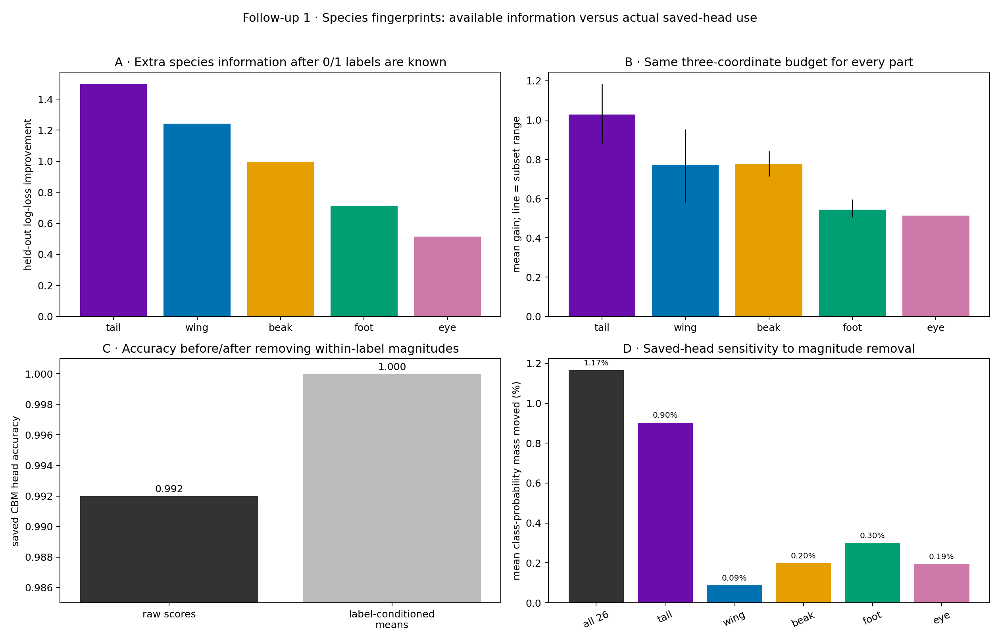


|  | part | coordinates | conditional_logloss_gain | gain_per_coordinate_descriptive |
| --- | --- | --- | --- | --- |
| 0 | beak | 4 | 0.9981 | 0.2495 |
| 1 | eye | 3 | 0.5145 | 0.1715 |
| 2 | foot | 4 | 0.7134 | 0.1784 |
| 3 | tail | 9 | 1.4977 | 0.1664 |
| 4 | wing | 6 | 1.2424 | 0.2071 |


|  | part | three_coordinate_subsets | mean_conditional_gain | min_conditional_gain | max_conditional_gain |
| --- | --- | --- | --- | --- | --- |
| 0 | beak | 4 | 0.7751 | 0.7129 | 0.8426 |
| 1 | eye | 1 | 0.5145 | 0.5145 | 0.5145 |
| 2 | foot | 4 | 0.5448 | 0.5064 | 0.5973 |
| 3 | tail | 40 | 1.0279 | 0.8812 | 1.1840 |
| 4 | wing | 20 | 0.7710 | 0.5812 | 0.9544 |


|  | replaced_block | coordinates_replaced | raw_accuracy | accuracy_after_replacement | top1_change_rate | mean_probability_mass_moved |
| --- | --- | --- | --- | --- | --- | --- |
| 0 | all 26 | 26 | 0.992 | 1.000 | 0.008 | 0.0117 |
| 1 | beak | 4 | 0.992 | 0.992 | 0.000 | 0.0020 |
| 2 | eye | 3 | 0.992 | 0.992 | 0.000 | 0.0019 |
| 3 | foot | 4 | 0.992 | 0.994 | 0.002 | 0.0030 |
| 4 | tail | 9 | 0.992 | 0.998 | 0.006 | 0.0090 |
| 5 | wing | 6 | 0.992 | 0.992 | 0.000 | 0.0009 |


```text
RLV2 — identical four-panel calculation
```


|  | part | coordinates | conditional_logloss_gain | gain_per_coordinate_descriptive |
| --- | --- | --- | --- | --- |
| 0 | beak | 4 | 0.7652 | 0.1913 |
| 1 | eye | 3 | 0.2069 | 0.0690 |
| 2 | foot | 4 | 0.7187 | 0.1797 |
| 3 | tail | 9 | 1.5174 | 0.1686 |
| 4 | wing | 6 | 1.1184 | 0.1864 |


|  | part | three_coordinate_subsets | mean_conditional_gain | min_conditional_gain | max_conditional_gain |
| --- | --- | --- | --- | --- | --- |
| 0 | beak | 4 | 0.6096 | 0.5514 | 0.6805 |
| 1 | eye | 1 | 0.2069 | 0.2069 | 0.2069 |
| 2 | foot | 4 | 0.5461 | 0.5248 | 0.5670 |
| 3 | tail | 40 | 0.8641 | 0.7142 | 1.0564 |
| 4 | wing | 20 | 0.6524 | 0.4034 | 0.8721 |


|  | replaced_block | coordinates_replaced | raw_accuracy | accuracy_after_replacement | top1_change_rate | mean_probability_mass_moved |
| --- | --- | --- | --- | --- | --- | --- |
| 0 | all 26 | 26 | 0.988 | 0.986 | 0.024 | 0.0226 |
| 1 | beak | 4 | 0.988 | 0.986 | 0.004 | 0.0020 |
| 2 | eye | 3 | 0.988 | 0.990 | 0.004 | 0.0048 |
| 3 | foot | 4 | 0.988 | 0.990 | 0.002 | 0.0045 |
| 4 | tail | 9 | 0.988 | 0.982 | 0.020 | 0.0185 |
| 5 | wing | 6 | 0.988 | 0.990 | 0.002 | 0.0027 |


### Interpretation of Figure 13d


- Observation. The executed table reports per-part and per-value results for the supplied model and label artifacts.


- Alternative explanation: A newly fitted species probe measures information that is available, whereas the frozen CBM head may ignore most of it.


- Proposed follow-up: Panels C/D test each model's own unchanged saved head; Figure 13e then performs the stronger post-swap off-target erasure.


- **Limited conclusion:** Keep information availability separate from actual saved-head use. Neither quantity alone is the controlled concept-backwash endpoint.


- Subsequent analysis: After a swap, does erasing only off-target same-part scores change each saved head's source preference?


## 13e · Off-target classifier dependence after relabeling


**Question.** Did RLv2 change actual saved-head use of the post-swap off-target fingerprint?


**Variables and prediction.** For a tail_2 to tail_7 swap, keep tail_2 and tail_7 unchanged. Replace only the other seven tail scores by their ordinary absent means, rerun the same saved species head, and measure the source-minus-donor class-logit and pairwise-probability change. If RLv2 specifically reduces downstream use of the tail fingerprint, its tail evidence and frozen-head consequence should be smaller than Standard under the identical erasure.


**Method.** Replay all accepted counterfactual images through each accepted checkpoint on CUDA, verify the replayed old/donor coordinates against the saved CSV, and perform only the read-only score replacement described above.


Numerical record. The code cell prints the complete table used to draw the figure, including the per-part or per-value denominator. The figure summarizes those tabulated values. Standard and RLv2 always use the same row identities, part order, definitions, bins, and axes unless the section explicitly says otherwise.


### Figure 13e · Off-target classifier dependence after relabeling


**How to read the figure.** The construction is too dense for an extra color series. Show the Standard three-panel output first and the RLv2 output directly below it.


```text
STANDARD — identical off-target erasure
```


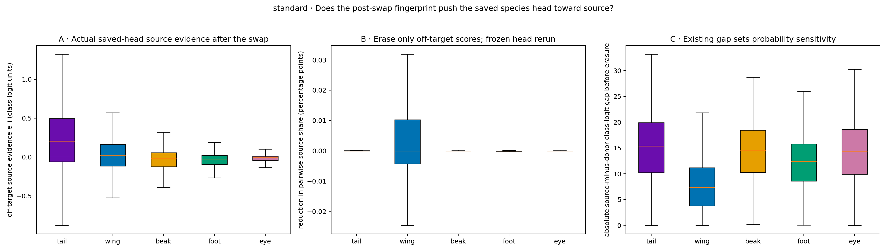


|  | part | n_swaps | n_original_images | off_target_coordinates | mean_e | median_e | fraction_e_positive | median_absolute_e | median_absolute_source_minus_donor_gap | mean_pairwise_source_share_reduction | top1_change_rate | source_to_donor_pair_flip_rate |
| --- | --- | --- | --- | --- | --- | --- | --- | --- | --- | --- | --- | --- |
| 0 | tail | 1000 | 250 | 7 | 0.2261 | 0.2042 | 0.699 | 0.3180 | 15.3748 | 0.0003 | 0.099 | 0.002 |
| 1 | wing | 1000 | 250 | 4 | 0.0212 | 0.0187 | 0.534 | 0.1428 | 7.3557 | 0.0002 | 0.034 | 0.004 |
| 2 | beak | 1000 | 250 | 2 | -0.0325 | -0.0143 | 0.438 | 0.0854 | 14.5976 | -0.0007 | 0.027 | 0.000 |
| 3 | foot | 1000 | 250 | 2 | -0.0406 | -0.0259 | 0.369 | 0.0566 | 12.4407 | -0.0002 | 0.021 | 0.001 |
| 4 | eye | 1000 | 250 | 1 | -0.0198 | -0.0067 | 0.411 | 0.0306 | 14.2733 | -0.0002 | 0.007 | 0.000 |


```text
RLV2 — identical off-target erasure
```


|  | part | n_swaps | n_original_images | off_target_coordinates | mean_e | median_e | fraction_e_positive | median_absolute_e | median_absolute_source_minus_donor_gap | mean_pairwise_source_share_reduction | top1_change_rate | source_to_donor_pair_flip_rate |
| --- | --- | --- | --- | --- | --- | --- | --- | --- | --- | --- | --- | --- |
| 0 | tail | 1000 | 250 | 7 | 0.0982 | 0.0692 | 0.570 | 0.2531 | 13.8831 | 0.0005 | 0.065 | 0.004 |
| 1 | wing | 1000 | 250 | 4 | 0.0111 | 0.0050 | 0.513 | 0.1239 | 8.0957 | 0.0005 | 0.032 | 0.001 |
| 2 | beak | 1000 | 250 | 2 | -0.0343 | -0.0188 | 0.429 | 0.0889 | 14.7241 | -0.0003 | 0.025 | 0.000 |
| 3 | foot | 1000 | 250 | 2 | -0.0383 | -0.0241 | 0.375 | 0.0578 | 13.2839 | -0.0002 | 0.021 | 0.000 |
| 4 | eye | 1000 | 250 | 1 | -0.0151 | -0.0049 | 0.434 | 0.0311 | 14.1149 | -0.0001 | 0.004 | 0.000 |


### Interpretation of Figure 13e


- Observation. The executed table reports per-part and per-value results for the supplied model and label artifacts.


- Alternative explanation: Changing downstream species logits cannot establish that the species head caused the upstream concept-score error.


- Proposed follow-up: Compare Standard and RLv2 under identical replay while holding the old and inserted concept coordinates fixed.


- Scope: ACCEPTED FOR dependence of the frozen source-versus-donor species decision on the specified post-swap off-target coordinates. The origin of the upstream concept margin requires a separate intervention.


- Subsequent analysis: Which measured contributor families improve held-out prediction in each regime?


## 14 · Held-out prediction of replacement outcomes by label condition


**Question.** What measured structure predicts each regime's margin on held-out renders?


Variables and prediction. For Standard and RLv2 separately, predict final margin and the 0/1 controlled event from the same measured families: part, starting margin, visibility, support, label conflict, ordinary value recognition, and source species. If one family adds incremental predictive information, held-out error should rise when that family is removed. These differences quantify conditional predictive value within the specified feature set.


**Method.** Use the exact same source-image-grouped five-fold ridge/logistic analysis for each regime. Every swap from one original image stays in one fold.


Numerical record. The code cell prints the complete table used to draw the figure, including the per-part or per-value denominator. The figure summarizes those tabulated values. Standard and RLv2 always use the same row identities, part order, definitions, bins, and axes unless the section explicitly says otherwise.


### Figure 14 · Held-out prediction of replacement outcomes by label condition


**How to read the figure.** The four-panel construction is dense, so the complete Standard output is printed first and the complete RLv2 output immediately below. Lower RMSE/Brier is better; positive omission bars mean the omitted family had unique predictive value.


```text
STANDARD — identical grouped omission audit
```


|  | model | numeric_features | categorical_features | margin_RMSE | margin_MAE | event_Brier |
| --- | --- | --- | --- | --- | --- | --- |
| 0 | overall mean only | none | none | 4.1629 | 3.2014 | 0.1402 |
| 1 | part only | none | part | 3.3273 | 2.5514 | 0.1087 |
| 2 | full measured set | m_orig, log_visible_pixels, donor_support, sou... | part, sid_src | 2.9432 | 2.2861 | 0.0979 |
| 3 | full minus part | m_orig, log_visible_pixels, donor_support, sou... | sid_src | 3.0417 | 2.3698 | 0.1030 |
| 4 | full minus starting margin | log_visible_pixels, donor_support, source_supp... | part, sid_src | 2.9432 | 2.2863 | 0.0990 |
| 5 | full minus visibility | m_orig, donor_support, source_support, donor_c... | part, sid_src | 3.1389 | 2.4166 | 0.1015 |
| 6 | full minus support | m_orig, log_visible_pixels, donor_conflict, so... | part, sid_src | 2.9966 | 2.3177 | 0.0981 |
| 7 | full minus label conflict | m_orig, log_visible_pixels, donor_support, sou... | part, sid_src | 2.9888 | 2.3140 | 0.0996 |
| 8 | full minus ordinary value recognition | m_orig, log_visible_pixels, donor_support, sou... | part, sid_src | 2.9535 | 2.2884 | 0.0988 |
| 9 | full minus source species | m_orig, log_visible_pixels, donor_support, sou... | part | 3.0682 | 2.3888 | 0.1040 |


```text
Exact-value holdout stress test
```


|  | held_out_part | held_out_donor_value | n_rows | n_originals | RMSE | MAE |
| --- | --- | --- | --- | --- | --- | --- |
| 0 | beak | 0 | 345 | 120 | 3.2856 | 2.7133 |
| 1 | beak | 1 | 245 | 145 | 2.9799 | 2.3228 |
| 2 | beak | 2 | 190 | 125 | 3.0489 | 2.2933 |
| 3 | beak | 3 | 220 | 135 | 2.5517 | 1.9469 |
| 4 | eye | 0 | 300 | 160 | 3.0136 | 2.3578 |
| 5 | eye | 1 | 345 | 155 | 2.6665 | 2.0149 |
| 6 | eye | 2 | 355 | 150 | 3.0236 | 2.4922 |
| 7 | foot | 0 | 220 | 145 | 2.6750 | 2.1305 |
| 8 | foot | 1 | 240 | 160 | 2.2861 | 1.7187 |
| 9 | foot | 2 | 290 | 155 | 2.6261 | 2.0692 |
| 10 | foot | 3 | 250 | 135 | 3.4243 | 2.7140 |
| 11 | tail | 0 | 75 | 70 | 3.4805 | 2.8088 |
| 12 | tail | 1 | 90 | 85 | 4.2162 | 3.4707 |
| 13 | tail | 2 | 120 | 90 | 3.4120 | 2.7907 |
| 14 | tail | 3 | 110 | 85 | 4.2666 | 3.2244 |
| 15 | tail | 4 | 110 | 90 | 3.6683 | 3.0669 |
| 16 | tail | 5 | 150 | 120 | 2.9664 | 2.4260 |
| 17 | tail | 6 | 130 | 100 | 3.9303 | 3.2651 |
| 18 | tail | 7 | 35 | 35 | 3.1794 | 2.5076 |
| 19 | tail | 8 | 180 | 110 | 4.5284 | 3.4755 |
| 20 | wing | 0 | 130 | 115 | 3.8511 | 3.0246 |
| 21 | wing | 1 | 150 | 100 | 3.1577 | 2.6893 |
| 22 | wing | 2 | 220 | 140 | 3.1433 | 2.3272 |
| 23 | wing | 3 | 115 | 95 | 2.5785 | 2.0936 |
| 24 | wing | 4 | 175 | 135 | 3.0514 | 2.4120 |
| 25 | wing | 5 | 210 | 150 | 3.1182 | 2.5066 |


```text
RLV2 — identical grouped omission audit
```


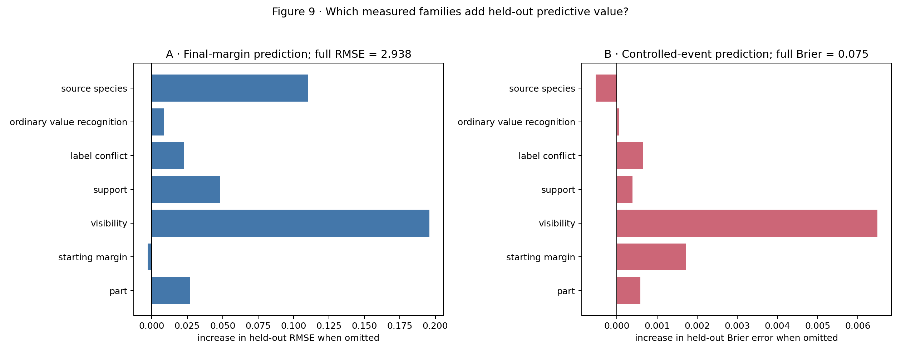


|  | model | numeric_features | categorical_features | margin_RMSE | margin_MAE | event_Brier |
| --- | --- | --- | --- | --- | --- | --- |
| 0 | overall mean only | none | none | 3.6395 | 2.7886 | 0.0896 |
| 1 | part only | none | part | 3.3002 | 2.5426 | 0.0838 |
| 2 | full measured set | m_orig, log_visible_pixels, donor_support, sou... | part, sid_src | 2.9375 | 2.2575 | 0.0752 |
| 3 | full minus part | m_orig, log_visible_pixels, donor_support, sou... | sid_src | 2.9643 | 2.2845 | 0.0758 |
| 4 | full minus starting margin | log_visible_pixels, donor_support, source_supp... | part, sid_src | 2.9348 | 2.2546 | 0.0769 |
| 5 | full minus visibility | m_orig, donor_support, source_support, donor_c... | part, sid_src | 3.1333 | 2.3976 | 0.0817 |
| 6 | full minus support | m_orig, log_visible_pixels, donor_conflict, so... | part, sid_src | 2.9859 | 2.2939 | 0.0756 |
| 7 | full minus label conflict | m_orig, log_visible_pixels, donor_support, sou... | part, sid_src | 2.9603 | 2.2815 | 0.0759 |
| 8 | full minus ordinary value recognition | m_orig, log_visible_pixels, donor_support, sou... | part, sid_src | 2.9462 | 2.2644 | 0.0753 |
| 9 | full minus source species | m_orig, log_visible_pixels, donor_support, sou... | part | 3.0478 | 2.3509 | 0.0747 |


```text
Exact-value holdout stress test
```


|  | held_out_part | held_out_donor_value | n_rows | n_originals | RMSE | MAE |
| --- | --- | --- | --- | --- | --- | --- |
| 0 | beak | 0 | 345 | 120 | 3.0940 | 2.4690 |
| 1 | beak | 1 | 245 | 145 | 2.9771 | 2.2186 |
| 2 | beak | 2 | 190 | 125 | 3.3818 | 2.5886 |
| 3 | beak | 3 | 220 | 135 | 2.5957 | 1.8833 |
| 4 | eye | 0 | 300 | 160 | 2.7532 | 2.0904 |
| 5 | eye | 1 | 345 | 155 | 3.2022 | 2.5067 |
| 6 | eye | 2 | 355 | 150 | 3.4651 | 2.7811 |
| 7 | foot | 0 | 220 | 145 | 3.2202 | 2.6919 |
| 8 | foot | 1 | 240 | 160 | 2.3666 | 1.8452 |
| 9 | foot | 2 | 290 | 155 | 2.8195 | 2.2408 |
| 10 | foot | 3 | 250 | 135 | 2.7784 | 2.0961 |
| 11 | tail | 0 | 75 | 70 | 3.7736 | 3.2456 |
| 12 | tail | 1 | 90 | 85 | 3.4176 | 2.8386 |
| 13 | tail | 2 | 120 | 90 | 2.9165 | 2.4183 |
| 14 | tail | 3 | 110 | 85 | 3.6808 | 2.8285 |
| 15 | tail | 4 | 110 | 90 | 4.2705 | 3.2210 |
| 16 | tail | 5 | 150 | 120 | 2.9888 | 2.5404 |
| 17 | tail | 6 | 130 | 100 | 3.4701 | 2.7791 |
| 18 | tail | 7 | 35 | 35 | 3.8841 | 2.9975 |
| 19 | tail | 8 | 180 | 110 | 3.8111 | 2.8094 |
| 20 | wing | 0 | 130 | 115 | 3.9323 | 3.0554 |
| 21 | wing | 1 | 150 | 100 | 3.8156 | 3.0531 |
| 22 | wing | 2 | 220 | 140 | 2.9237 | 2.2614 |
| 23 | wing | 3 | 115 | 95 | 2.5071 | 2.0593 |
| 24 | wing | 4 | 175 | 135 | 3.3192 | 2.4890 |
| 25 | wing | 5 | 210 | 150 | 3.2448 | 2.5485 |


### Interpretation of Figure 14


- Observation. The executed table reports per-part and per-value results for the supplied model and label artifacts.


- Alternative explanation: Correlated predictor families can substitute for one another. A small omission penalty may therefore coexist with a substantial association or causal contribution.


- Proposed follow-up: Compare the identical Standard and RLv2 omission audits, then use the exact-value holdout table to check whether any apparent rule transfers to donor values excluded from fitting.


- Scope: ACCEPTED FOR held-out predictive performance. Omission penalties depend on the included predictor set and require further intervention-based analysis for causal attribution.


- Subsequent analysis: Did the concept-layer change materially alter donor-species prediction?


## 15 · Donor-species probability after relabeling


**Question.** Did RLv2 change the downstream donor-species probability?


Variables and prediction. Compare the mean donor-species probability after each identical swap. Better concept ordering may modestly increase donor-species probability, while the retained source body may continue to support the source-species prediction.


**Method.** Use the saved post-swap donor-species probability and every part.


Numerical record. The code cell prints the complete table used to draw the figure, including the per-part or per-value denominator. The figure summarizes those tabulated values. Standard and RLv2 always use the same row identities, part order, definitions, bins, and axes unless the section explicitly says otherwise.


### Figure 15 · Donor-species probability after relabeling


How to read the figure. Bars show the mean probability assigned to the donor species after a one-part replacement. The dependent variable is class probability.


|  | standard | RLv2 | paired_change |
| --- | --- | --- | --- |
| part |  |  |  |
| tail | 0.0127 | 0.0175 | 0.0047 |
| wing | 0.0666 | 0.0550 | -0.0116 |
| beak | 0.0192 | 0.0190 | -0.0002 |
| foot | 0.0270 | 0.0295 | 0.0025 |
| eye | 0.0247 | 0.0225 | -0.0022 |


### Interpretation of Figure 15


- Observation. The executed table reports per-part and per-value results for the supplied model and label artifacts.


- Alternative explanation: The class head reads the full latent vector and one replaced part may have little class-level leverage even when concept grounding improves.


- Follow-up comparison: Report donor-species probability alongside the concept-margin outcomes, retaining the distinct interpretation of each.


- Scope: VALID TEST, NO SUPPORT for a uniform increase in donor-species probability following improved concept ordering. Part-specific results remain informative.


- Subsequent analysis: How do the outcome, intervention, visual difficulty, and residual context line up in one final view?


## 16 · Summary of changes and remaining responses


**Question.** What did RLv2 resolve, and what remains?


**Variables and prediction.** Align candidate rate, clearly-visible candidate rate, original label-conflict burden, donor-value error, and source-species residual spread in the same part order. A causal label contribution predicts the largest standard-to-RLv2 improvement where label conflict was greatest, while value error or species residuals may remain.


Method. Report each panel separately with its specified units and conditioning population.


Numerical record. The code cell prints the complete table used to draw the figure, including the per-part or per-value denominator. The figure summarizes those tabulated values. Standard and RLv2 always use the same row identities, part order, definitions, bins, and axes unless the section explicitly says otherwise.


### Figure 16 · Summary of changes and remaining responses


How to read the figure. Blue and green bars compare standard and RLv2 model outcomes where both exist. The label-conflict panel shows the manipulated training burden: blue is the original conflict and green is the fraction of those original conflicts left positive by RLv2. Higher values indicate greater error or conflict within each panel’s own definition.


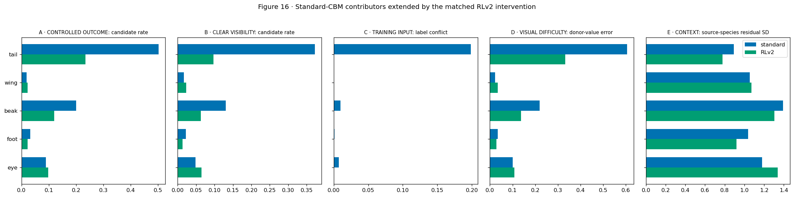


|  | candidate_standard | candidate_RLv2 | clear_standard | clear_RLv2 | label_conflict_standard | label_conflict_left_by_RLv2 | value_error_standard | value_error_RLv2 | species_residual_standard | species_residual_RLv2 |
| --- | --- | --- | --- | --- | --- | --- | --- | --- | --- | --- |
| part |  |  |  |  |  |  |  |  |  |  |
| tail | 0.502 | 0.234 | 0.372 | 0.097 | 0.199 | 0.0 | 0.605 | 0.333 | 0.894 | 0.777 |
| wing | 0.019 | 0.023 | 0.017 | 0.023 | 0.000 | 0.0 | 0.023 | 0.034 | 1.054 | 1.071 |
| beak | 0.200 | 0.120 | 0.131 | 0.063 | 0.010 | 0.0 | 0.220 | 0.138 | 1.394 | 1.306 |
| foot | 0.032 | 0.022 | 0.022 | 0.013 | 0.001 | 0.0 | 0.035 | 0.028 | 1.037 | 0.919 |
| eye | 0.089 | 0.098 | 0.048 | 0.065 | 0.007 | 0.0 | 0.100 | 0.108 | 1.181 | 1.338 |


### Interpretation of Figure 16


- Observation. The executed table reports per-part and per-value results for the supplied model and label artifacts.


- Alternative explanation: RLv2 changes the complete label vector and retrains a shared encoder, so part-specific improvements cannot be attributed only to that part's own changed labels; one seed cannot separate stable effects from retraining variability.


- Proposed follow-up: Rerun matched CBM-RLv2 seeds 2–3 and replay the same fixed renders before making a seed-general claim.


- **Limited conclusion:** ACCEPTED FOR the executed seed-1 effect of the complete visibility-aware label intervention on the matched controlled swaps. Part-specific direction and size must be read from the table; seed-general claims remain INCOMPLETE.


- Subsequent analysis: Which causal claims are now accepted, provisional, unsupported, or still observational?


## 17 · Summary of evidence from the relabeled CBM


Review requirement. Acceptance of each table entry depends on inspection of its corresponding figure and input provenance.


| Claim | Required figure | Status |
| --- | --- | --- |
| only the visibility-aware concept labels changed | 1–2 | ACCEPTED FOR matched seed-1 training/configuration parity |
| both models and fixed renders are valid | 3–4 | ACCEPTED FOR model health and identical fixed-render evaluation |
| RLv2 reduced the controlled CBM candidate event | 5–6 | ACCEPTED FOR tail and beak at seed 1; foot changed little; small wing/eye differences are unresolved without seed replication |
| the change followed the predicted raw-score mechanism | 7–8 | ACCEPTED FOR tail; directional support for beak/eye; not universal |
| complete starting-margin and response decomposition | 7b | ACCEPTED FOR numerical localization at seed 1; the components are not independent causal interventions |
| the result survives direction and visibility checks | 9–10 | ACCEPTED FOR tail/beak and mostly eye within seed 1; sparse extreme bins retained |
| exact-value difficulty after RLv2 | 11 | ACCEPTED FOR partial tail/beak/eye improvement; substantial difficulty remains |
| remaining source-species association | 12 | ACCEPTED FOR descriptive association only; causal/predictive explanation not accepted |
| species decodability changed | 13 | VALID DIAGNOSTIC, HETEROGENEOUS CHANGE; not grounding evidence |
| conflict/rarity and matched score behavior | 13a–13c | PENDING EXECUTION AND VISUAL REVIEW |
| conditional species information and saved-head magnitude use | 13d | PENDING EXECUTION AND VISUAL REVIEW |
| direct off-target fingerprint erasure | 13e | PENDING EXECUTION AND VISUAL REVIEW |
| proposed blocks predict held-out residuals | 14 | INCOMPLETE: matched execution and visual review pending; the planned estimand is predictive performance |
| downstream class consequence | 15 | VALID TEST, NO UNIFORM SUPPORT |
| integrated causal conclusion | 16 | ACCEPTED FOR provisional seed-1 RLv2 label-package effect; seed reproducibility INCOMPLETE |


The verified seed-1 comparison supports a model-specific intervention result. Replication across independent training runs remains INCOMPLETE. Within-run image resampling estimates a different source of variability.


# Methods appendix: Additional methodological limitations


- No MCBM or gamma result appears here.


- Earlier deletion and patch methods remain uncalibrated for the intended causal interpretation.


- Training-seed variability requires independent trained models; image-level and pair-level resampling quantify within-model variability.


- Source-species residuals are observational because body and species covary in the evaluated images.


- Notebook 03rl separately evaluates the MCBM architecture under visibility-aware relabeling.


# Provenance appendix


The provenance table records the Git commit, checkpoints, training records, fixed CSV files, hashes, row counts, seed, and stopping epoch represented in this report.


|  | role | path | sha256 |
| --- | --- | --- | --- |
| 0 | standard fixed CSV | /scratch/network/cr7998/cv_emergence_project/c... | ad3229c059f6d13d960af41fb595fa76ada790a1ea623b... |
| 1 | RLv2 fixed CSV | /scratch/network/cr7998/cv_emergence_project/c... | 05443415b08d38c28f74b1ecf6ea9de4377d3ba5d3c275... |
| 2 | standard prediction | /scratch/network/cr7998/cv_emergence_project/c... | 2594466992eeb9c3df0eae2308633a0c9d4462c403483e... |
| 3 | RLv2 prediction | /scratch/network/cr7998/cv_emergence_project/c... | c878d66729381f0830410a0ca5a3bdd3103793d23b6587... |
| 4 | standard checkpoint | /scratch/network/cr7998/cv_emergence_project/c... | 12559285506c179526fad4dd3c244f61a24635cadbe80b... |
| 5 | RLv2 checkpoint | /scratch/network/cr7998/cv_emergence_project/c... | 430b13e0043344462ea8bfffda04643d98ac5e0fb55e2b... |
| 6 | standard train records | /scratch/network/cr7998/cv_emergence_project/c... | 0f7ef91e30fb1ee348348fb113c7189a1936ed11ae5868... |
| 7 | RLv2 train records | /scratch/network/cr7998/cv_emergence_project/c... | 6009ff209f60211da90ca655b9d6e7fe555f8c713e1b6c... |


|  | git_commit | seed | training_state | paired_swaps | parts | exact_concepts | fixed_render_root |
| --- | --- | --- | --- | --- | --- | --- | --- |
| 0 | f1f9a1bba828109e3285b2e5e7a1a2128caf6bc2 | 1 | accepted converged checkpoints | 5000 | 5 | 26 | /scratch/network/cr7998/cv_emergence_project/c... |
