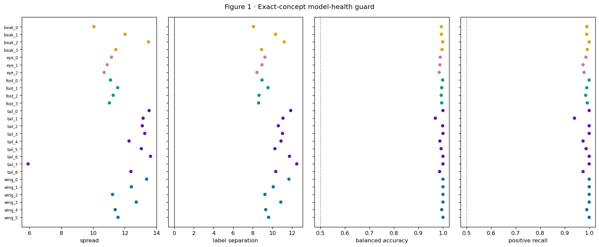
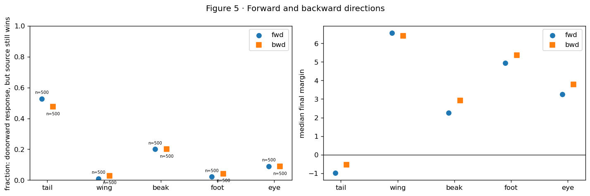
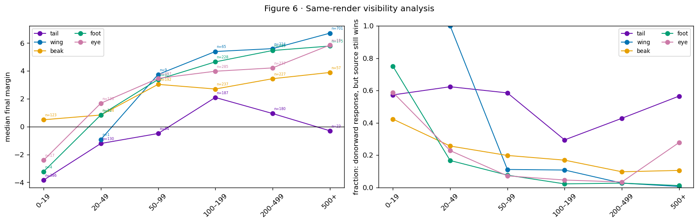
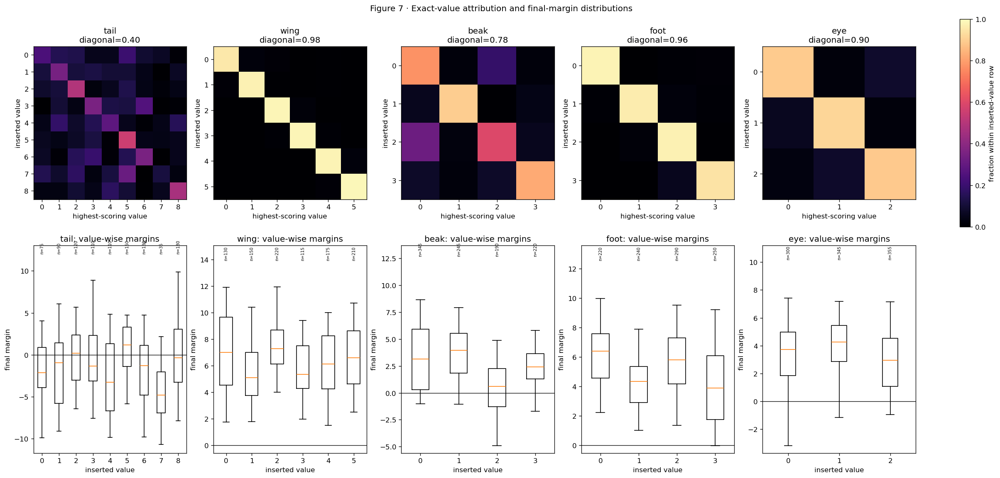
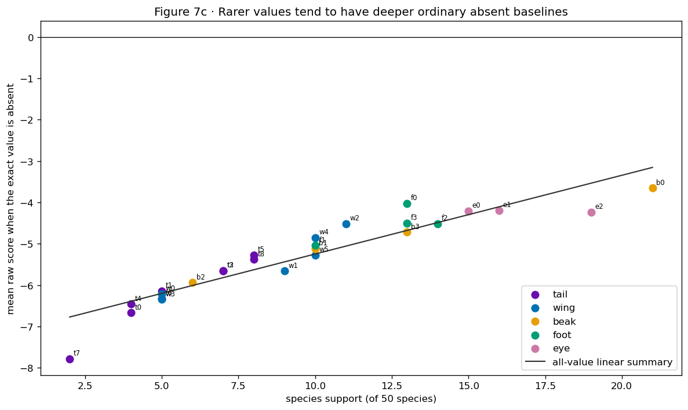
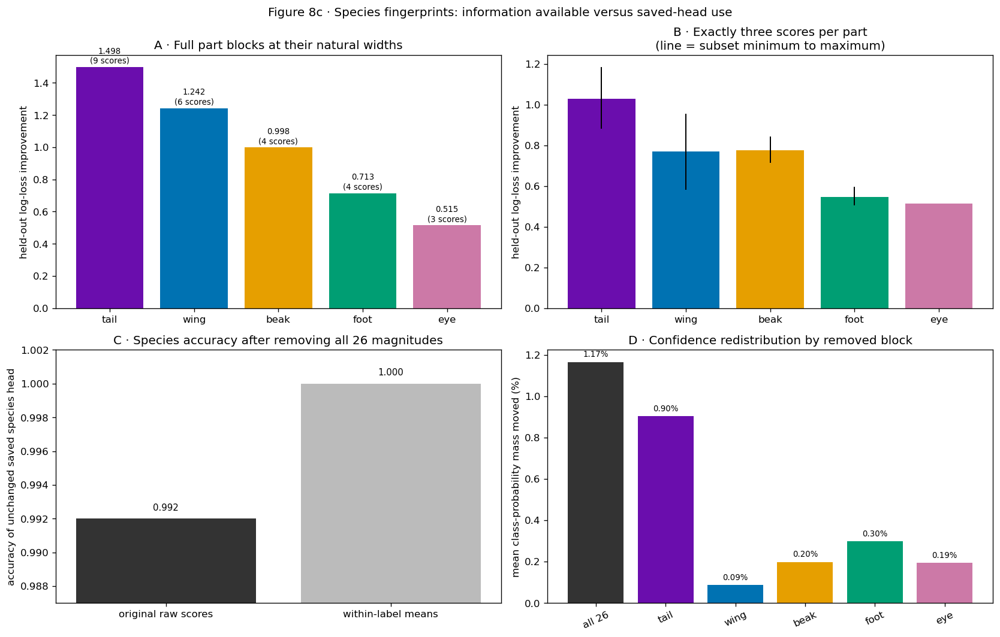
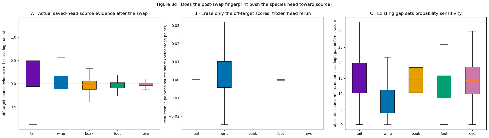
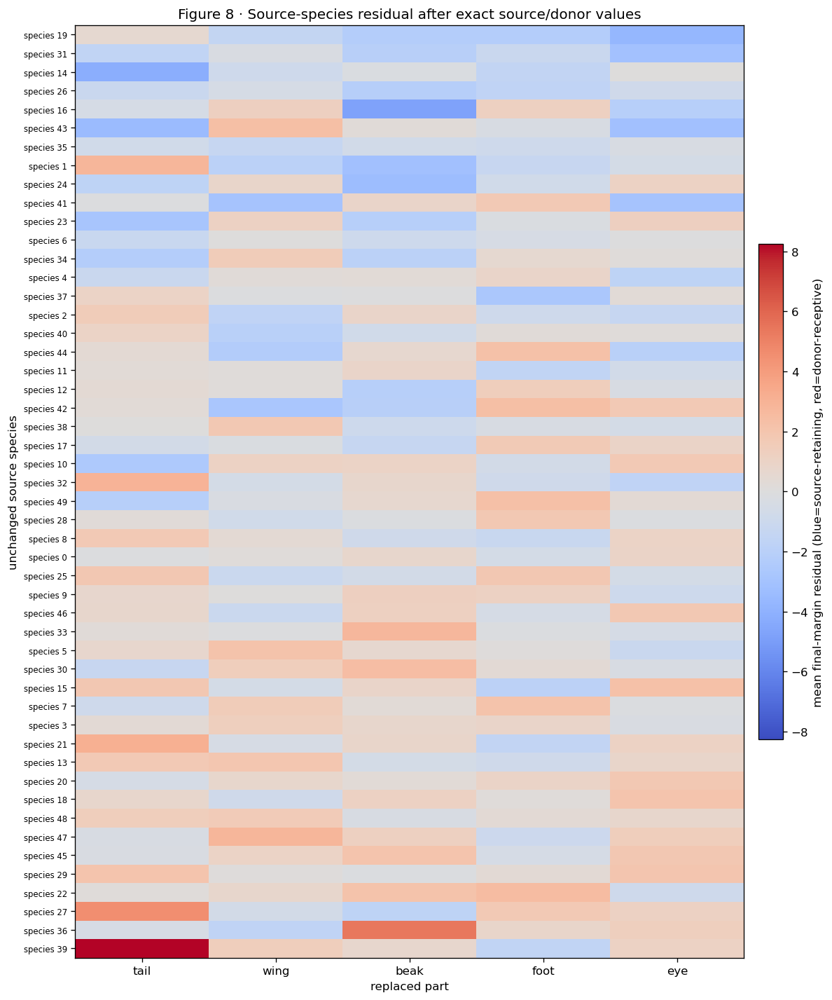
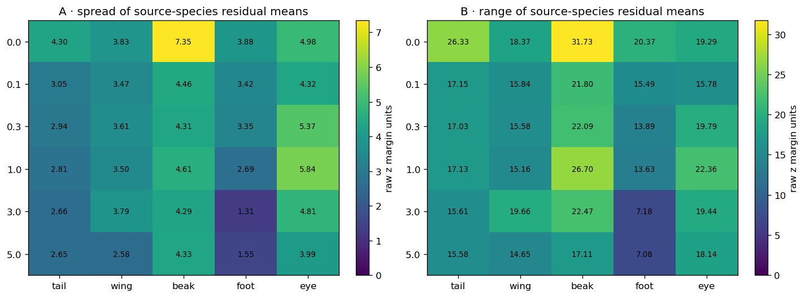
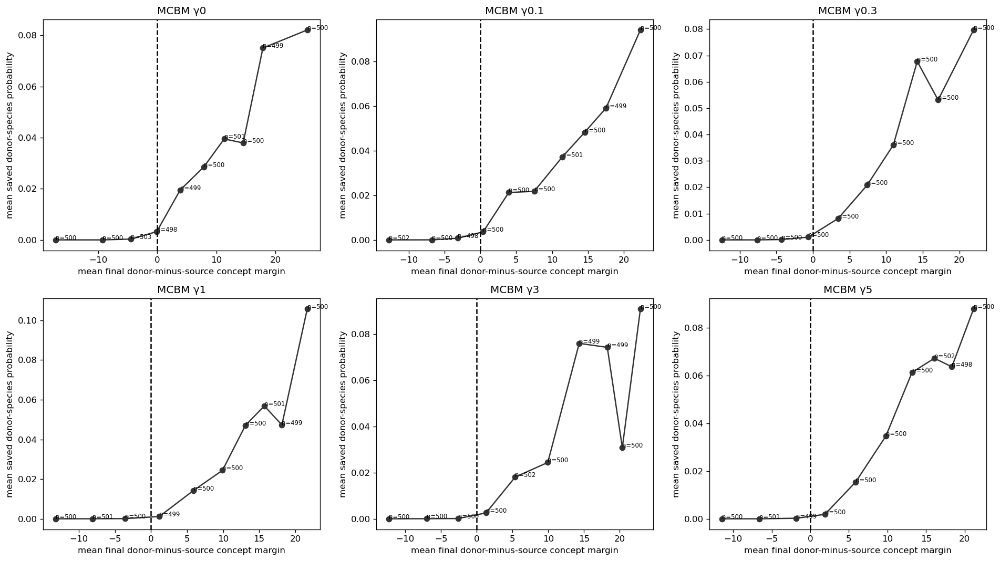

Editorial revision · 2 October 2026. Explanatory prose has been revised for a research audience. Figures and numerical output tables retain their source versions. This revision involved no model execution.


# FunnyBird MCBM: minimality and the h-to-q pathway


Report provenance. Figures and numerical output tables were recovered from the named source HTML. The surrounding prose has been revised for a research audience. Artifact identifiers specify the source version and its execution status.


Contribution to the analysis: Compare Koh with MCBM γ=0, then evaluate the within-MCBM γ sweep. Examine target compression, replacement outcomes, and the relation between calibrated h and q(h) to locate observed response differences.


Source: /Users/macloaner/.codex/worktrees/notebook05-reconstruction/CBM-Concept-Backwash/curated/notebooks/03_funnybirds_mcbm.html
Source SHA256: 2aa0943188bd1dade599aeb03d1c5428b0b411be1a87de4739e22e9b0e5009af


# Chapter 03 · Minimality and part-specific replacement responses


The chapter addresses two comparisons:


- **Koh Standard → MCBM gamma 0:** what changes when we replace the whole
model and training recipe, even before the minimality penalty is active?


- **MCBM gamma 0 → positive gamma:** what changes as the *same MCBM
architecture* is increasingly pushed toward its label-defined target?


The analysis measures representation compression and replacement responses, then examines where response differences appear in the model computation. These observations motivate specific hypotheses for subsequent interventions.


The reported results concern the runs labelled seed 1. Historical MCBM initialization was uncontrolled, so independent repetitions are required to estimate between-initialization variability.


## Models, symbols, and losses


### Koh Joint Standard CBM


The ResNet-50 image encoder emits features.  Twenty-six scalar concept heads
produce raw concept logits `z`.  A single saved linear layer reads all 26
logits and predicts one of 50 species.  Training minimizes the normalized
species loss plus `0.01 ×` concept loss.


### MCBM


The ResNet-50 encoder and a shared projector produce a 26-number internal
vector called `h` in this report.  The official MCBM source calls this vector
`z`; we rename it only to avoid confusing it with Koh's raw concept logits.
Each coordinate has a small learned reader `q_j`, giving the concept logit


`z_j = q_j(h_j)`.


The species classifier receives the complete internal vector h. Its loss is


`L = L_species + beta L_concept + gamma L_min`,


with `beta=1`.  For binary label `c_j`, the MCBM target is


`t_j = 6 c_j - 3`, so a negative label targets `-3` and a positive label
targets `+3`.  The implemented minimality term is


`L_min = 0.2 Σ_j mean[(h_j - t_j)^2]`.


The penalty encourages h_j toward the label-dependent target −3 or +3, while allowing deviations. At γ=0 the penalty has zero weight and the MCBM architecture and training recipe remain in place. Within-MCBM comparisons use γ=0 as their reference; the Koh comparison also changes architecture and training components.


### Controlled-swap quantities


For a source bird whose old value is replaced with a donor value:


- `m_orig = z_donor,orig - z_source,orig`;


- `donor_gain = z_donor,cf - z_donor,orig`;


- `source_decrease = z_source,orig - z_source,cf`;


- `response_delta = donor_gain + source_decrease`;


- `m_cf = m_orig + response_delta`.


Numerical illustration. With m_orig=−10, donor gain 6, and source release 3, response_delta=9 and m_cf=−1. This satisfies the operational criterion. Exact donor recognition additionally requires the donor logit to exceed every other variant logit within the part.


## Evidence plan and Notebook 02 parity


Each listed Standard analysis is retained, combined, or replaced for a
stated reason.  “Combined” means the metric and denominator are unchanged;
only model/gamma is added as a color, row, or column.  Complex Standard
figures are shown exactly as rendered in Notebook 02 and followed by a
separately constructed MCBM figure.


| Notebook 02 evidence | Treatment here | Reason |
| --- | --- | --- |
| exact concept health (1) | exact Standard, then MCBM heatmaps | different internal architecture; do not fake one scale |
| semantic and one-swap checks (2a/2b) | exact Standard once | identical accepted rendered inputs |
| response/decomposition/event/outcomes (3/3b/4/4b) | exact Standard, then combined all-gamma MCBM tables | same swap definitions; MCBM also needs h→q(h) localization |
| direction, visibility, conflict (5/6/6b/6c) | Standard reference plus all-gamma summaries | Candidate explanatory variables requiring separate evaluation |
| exact values/gallery/support (7/7a/7b/7c) | Standard reference plus per-value MCBM table | part averages can hide opposite value behavior |
| source residuals (8) | Standard reference plus gamma/value residual audit | asks what remains after exact transition is controlled |
| species information/head use (8b/8c/8d) | Standard reference plus MCBM information and direct frozen-head intervention | decoding, use, and causal head sensitivity are different questions |
| predictive accounting (9) | Standard reference plus MCBM measured-contributor table | prediction is not causal decomposition |
| descriptive synthesis (9b) | retired | selected four fractions arbitrarily; the final all-fronts table is complete |
| downstream species association (10) | Standard reference plus model/gamma table | separates concept grounding from species-head consequences |
| within-part evidence correlation | appendix only | weak secondary question; it does not rank parts |


```text
Loaded 5,000 Koh rows and 30,000 MCBM rows; no training.
```


## 1. Validation of the shared rendering intervention


**Question and prediction.** Are Koh and all six MCBMs evaluated on the same
one-part replacements? They must be; otherwise a model comparison could be
an image comparison.


**Inputs and method.** The accepted fixed-render CSVs contain the identical
5,000 rows: 1,000 per part.  The following are the exact Notebook 02 semantic
preflight and representative-swap outputs.  No diagnostic is trained and no
model result is inferred here.


Scope. These checks establish intervention identity. Model recognition of the inserted variant is evaluated in the subsequent analysis.


**Exact executed Koh Standard block — Notebook 02 `f2a`**


- Method: We displayed the renderer's saved original, one-part replacement, deletion, and part-mask outputs for all five parts; this is a pixel-operation audit with no model fitting.


Caption. This preflight sheet checks that the renderer can replace or remove one named part without intentionally changing the remaining bird, pose, camera, or background.


**How this image was obtained.** Before evaluating the CBM, the renderer
saved, for each part, the original image, the one-part replacement, the
deletion, the original part map, and the replacement part map. No model
score or fitted classifier appears in this figure.


Observation. The displayed examples contain the required image and mask roles, and the highlighted maps correspond to the specified parts. Figure 2b provides paired examples for further inspection.


Alternative explanation still open. Inspection of a montage covers the displayed rows. The full-file hash and intervention checks reported around Figure 2b address cache completeness and diversity, while visible target area is analyzed later.


Scope. The displayed examples support the semantic interpretation of the rendering operation. Cache-wide checks and model-response analyses are reported separately.


Subsequent analysis. Do representative stored outputs for all five parts show the same intended operation clearly enough to inspect row by row?


**Exact executed Koh Standard block — Notebook 02 `f2b`**


- Method: We selected one accepted saved audit row per part and displayed its original, replacement, deletion, and isolated target mask; no result was estimated from these examples.


```text
### Plain-language reference for Figure 2b

**Plain caption.** The renderer targets the named part while preserving the rest of the bird and scene; 98.3% of cached replacements visibly change RGB pixels, while the remainder are retained for visibility analysis.

**Terms and how to read it.** Rows are named parts; columns are original, replacement, deletion, and part-map roles. The colors are image pixels or renderer masks, not model scores.

**Literal values.** For tail, wing, beak, foot, and eye, the displayed replacement and deletion alter the named part while the body, pose, camera, and background remain fixed; the target part map contains that region. Across the complete cache, 98.3% of replacement RGB images differ visibly from their originals. The remaining 1.7% are retained and identified by the later pixel-visibility measurement rather than described as visibly changed.

**Interpretation.** The pictures and full-file checks agree that the operation targets the named part rather than silently replacing the whole bird or scene. Most cached replacements visibly change RGB pixels; the small unchanged group is kept and measured later instead of being treated as a visible intervention.
```


Scope of visual validation. The five displayed pairs permit inspection of representative operations. Cache-wide validation uses the accompanying image and artifact checks.


```text
**Discriminating test.** Retain the semantic preflight plus the accepted fixed-render hash/diversity validation across all evaluated models and render IDs.

**Verdict.** **KEEP**.

**Proof ledger.** `ACCEPTED FOR the validated FunnyBird fixed-render intervention, with visibly unchanged rows retained explicitly for the visibility analysis.`

**Next question.** Do those inserted pixels move the raw concept comparison toward the donor?
```


Result. The same render IDs were also asserted when the CSVs were loaded above. Thus later differences come from model outputs on matched pixels. Subsequent analysis: were the ordinary concept outputs healthy before examining swaps?


## 2. Ordinary-image performance and output variation


**Question and prediction.** A swap failure is uninterpretable if the concept
coordinate is numerically collapsed or cannot separate its ordinary 0/1
labels.  Healthy models should have nonzero raw-score spread and above-chance
balanced accuracy.


**Standard baseline.** Figure 1 below is copied exactly from executed
Notebook 02.  Its definitions and per-concept denominators remain unchanged.
The MCBM panel then evaluates every gamma on its saved ordinary export.


MCBM quantities. For each concept j , raw-logit spread is Q95(z_j)-Q05(z_j) . Balanced accuracy is one half of positive recall plus negative recall after thresholding z_j at zero. h target RMSE is sqrt(mean((h_j-(6c_j-3))^2)) . Lower target RMSE means compression toward the label target; replacement outcomes are evaluated separately.


**Exact executed Koh Standard block — Notebook 02 `f1`**


|  | images | species | task_accuracy | concept_accuracy |
| --- | --- | --- | --- | --- |
| 0 | 500 | 50 | 0.992 | 0.9968 |


|  | concept | part | spread | label_separation | balanced_accuracy | positive_recall | n_positive | n_negative |
| --- | --- | --- | --- | --- | --- | --- | --- | --- |
| 0 | beak_0 | beak | 10.054 | 8.069 | 0.994 | 0.990 | 210 | 290 |
| 1 | beak_1 | beak | 12.014 | 10.326 | 0.994 | 0.990 | 100 | 400 |
| 2 | beak_2 | beak | 13.487 | 11.214 | 0.999 | 1.000 | 60 | 440 |
| 3 | beak_3 | beak | 11.431 | 8.898 | 0.996 | 0.992 | 130 | 370 |
| 4 | eye_0 | eye | 11.156 | 9.241 | 0.989 | 0.987 | 150 | 350 |
| 5 | eye_1 | eye | 10.891 | 8.934 | 0.988 | 0.975 | 160 | 340 |
| 6 | eye_2 | eye | 10.699 | 8.428 | 0.985 | 0.979 | 190 | 310 |
| 7 | foot_0 | foot | 11.098 | 8.940 | 0.999 | 1.000 | 130 | 370 |
| 8 | foot_1 | foot | 11.551 | 9.560 | 0.995 | 0.990 | 100 | 400 |
| 9 | foot_2 | foot | 11.267 | 8.639 | 0.993 | 0.986 | 140 | 360 |
| 10 | foot_3 | foot | 11.026 | 8.596 | 0.995 | 0.992 | 130 | 370 |
| 11 | tail_0 | tail | 13.528 | 11.872 | 1.000 | 1.000 | 40 | 460 |
| 12 | tail_1 | tail | 13.152 | 11.078 | 0.969 | 0.940 | 50 | 450 |
| 13 | tail_2 | tail | 13.100 | 10.605 | 0.999 | 1.000 | 70 | 430 |
| 14 | tail_3 | tail | 13.254 | 11.034 | 1.000 | 1.000 | 70 | 430 |
| 15 | tail_4 | tail | 12.265 | 10.878 | 0.988 | 0.975 | 40 | 460 |
| 16 | tail_5 | tail | 13.036 | 10.256 | 0.993 | 0.988 | 80 | 420 |
| 17 | tail_6 | tail | 13.616 | 11.742 | 1.000 | 1.000 | 50 | 450 |
| 18 | tail_7 | tail | 5.907 | 12.483 | 1.000 | 1.000 | 20 | 480 |
| 19 | tail_8 | tail | 12.384 | 10.342 | 0.986 | 0.975 | 80 | 420 |
| 20 | wing_0 | wing | 13.371 | 11.684 | 1.000 | 1.000 | 50 | 450 |
| 21 | wing_1 | wing | 12.410 | 10.088 | 1.000 | 1.000 | 90 | 410 |
| 22 | wing_2 | wing | 11.227 | 9.239 | 1.000 | 1.000 | 110 | 390 |
| 23 | wing_3 | wing | 12.718 | 10.861 | 1.000 | 1.000 | 50 | 450 |
| 24 | wing_4 | wing | 11.393 | 9.322 | 0.995 | 0.990 | 100 | 400 |
| 25 | wing_5 | wing | 11.569 | 9.618 | 1.000 | 1.000 | 100 | 400 |





- Method: We computed four health statistics directly from the frozen CBM's 26 raw concept logits on 500 held-out images; no classifier or model was fitted.


```text
### Plain-language reference for Figure 1

**Plain caption.** All 26 concept outputs vary and classify their ordinary labels well, so the swap analysis is not being driven by a collapsed or unusable model.

**Terms and how to read it.** `spread` is the 95th minus 5th percentile of raw `z`; `label separation` is the positive-label median minus the negative-label median; balanced accuracy weights positive and negative recognition equally; positive recall uses positive-labelled images as its denominator.

**Literal values.** Across 500 held-out images, all 26 exact outputs vary: raw-z spread is 5.907-13.616, label separation is 8.069-12.483, balanced accuracy is 0.969-1.000, and positive recall is 0.940-1.000. Species accuracy is 0.992 and concept accuracy is 0.9968.

**Interpretation.** The model is not broken or stuck. Every concept score changes across images, and the model almost always agrees with the ordinary labels. That makes the later replacement test meaningful, but it still does not tell us which pixels the model used.
```


Alternative explanation. Species-correlated cues could support high label agreement. The present measures therefore establish prediction performance, with spatial dependence assessed in subsequent experiments.


```text
**Discriminating test.** Use the same-image controlled replacement in Figures 3-4.

**Verdict.** **KEEP**.

**Proof ledger.** `ACCEPTED FOR seed-1 standard-CBM model health; no exact output is collapsed.`

**Next question.** Is the fixed renderer intervention itself valid?
```


**Table — ordinary MCBM health values behind the three panels.** `balanced_accuracy` is a 0–1 classification rate; `median_z_spread` is the middle concept coordinate’s 95th-minus-5th percentile in raw-logit units; `h_target_RMSE` is the typical distance, in internal-h units, from the requested label target −3 or +3. Rows are gamma/part pairs.


|  | gamma | part | balanced_accuracy | median_z_spread | h_target_RMSE |
| --- | --- | --- | --- | --- | --- |
| 0 | 0.0 | tail | 0.9592 | 17.8793 | 24.3984 |
| 1 | 0.0 | wing | 0.9991 | 27.3485 | 14.9701 |
| 2 | 0.0 | beak | 0.9946 | 34.1220 | 19.4420 |
| 3 | 0.0 | foot | 0.9985 | 30.2515 | 12.3800 |
| 4 | 0.0 | eye | 0.9757 | 37.6843 | 20.0627 |
| 5 | 0.1 | tail | 0.9813 | 17.2324 | 1.4667 |
| 6 | 0.1 | wing | 0.9993 | 25.6214 | 2.0694 |
| 7 | 0.1 | beak | 0.9960 | 21.6238 | 0.6150 |
| 8 | 0.1 | foot | 0.9991 | 26.6428 | 0.5399 |
| 9 | 0.1 | eye | 0.9964 | 19.2201 | 0.6970 |
| 10 | 0.3 | tail | 0.9804 | 14.4973 | 0.7191 |
| 11 | 0.3 | wing | 0.9988 | 23.1273 | 0.3377 |
| 12 | 0.3 | beak | 0.9961 | 19.3409 | 0.4089 |
| 13 | 0.3 | foot | 0.9990 | 24.9580 | 0.3524 |
| 14 | 0.3 | eye | 0.9969 | 19.0092 | 0.4468 |
| 15 | 1.0 | tail | 0.9771 | 12.8049 | 0.5964 |
| 16 | 1.0 | wing | 0.9994 | 22.6805 | 0.2644 |
| 17 | 1.0 | beak | 0.9966 | 17.0781 | 0.3485 |
| 18 | 1.0 | foot | 0.9979 | 20.9791 | 0.2597 |
| 19 | 1.0 | eye | 0.9963 | 16.9999 | 0.3852 |
| 20 | 3.0 | tail | 0.9793 | 11.8929 | 0.5215 |
| 21 | 3.0 | wing | 0.9992 | 22.1130 | 0.1809 |
| 22 | 3.0 | beak | 0.9958 | 16.2058 | 0.3207 |
| 23 | 3.0 | foot | 0.9994 | 22.0393 | 0.1522 |
| 24 | 3.0 | eye | 0.9968 | 16.9522 | 0.3536 |
| 25 | 5.0 | tail | 0.9763 | 11.9079 | 0.5400 |
| 26 | 5.0 | wing | 0.9982 | 20.4261 | 0.1915 |
| 27 | 5.0 | beak | 0.9955 | 16.5777 | 0.3294 |
| 28 | 5.0 | foot | 0.9987 | 20.0563 | 0.1935 |
| 29 | 5.0 | eye | 0.9943 | 15.5570 | 0.3924 |


Result. Every MCBM part remains healthy on ordinary images: balanced accuracy is at least 0.959 . Gamma strongly compresses h . From gamma 0 to gamma 5, target RMSE changes as follows: tail 24.40→0.54 , wing 14.97→0.19 , beak 19.44→0.33 , foot 12.38→0.19 , and eye 20.06→0.39 . The final concept logits retain variation: median gamma-5 raw- z spreads remain 11.91, 20.43, 16.58, 20.06, 15.56 for tail, wing, beak, foot, eye. The combination of reduced h variation and substantial z variation is consistent with amplification by the learned q_j readers.


Figure interpretation. Panel A reports concept-label agreement, Panel B reports raw-logit variation, and Panel C reports internal-coordinate distance to the target. Comparing these with replacement outcomes tests whether closer target fit is accompanied by improved response to the named pixels.


Alternative explanation. Species-correlated cues can support ordinary-image accuracy. Controlled replacement provides a separate test of part response. The following section compares Koh with MCBM γ=0.


## 3. Transition A — Koh Standard to MCBM gamma 0


This transition changes architecture and recipe together: shared projector,
private `q_j` readers, injected training noise, nonlinear species head,
preprocessing, optimizer details, and uncontrolled initialization.  Gamma is
zero, so the minimality penalty cannot explain this transition.


**Question.** Which part of the swap computation changes first?


Prediction. A discrepancy introduced by q_j would appear as correct donor recognition in calibrated h followed by an incorrect maximum in z. Errors already present in calibrated h motivate investigation of the upstream representation.


Reference figures. The following figures reproduce notebook 02’s donorward response, margin decomposition, strict backwash criterion, and three-category outcome summary.


**Exact executed Koh Standard block — Notebook 02 `f3`**


|  | eligible_swaps | positive_response_rate |
| --- | --- | --- |
| part |  |  |
| tail | 1000 | 0.919 |
| wing | 1000 | 1.000 |
| beak | 1000 | 0.989 |
| foot | 1000 | 0.997 |
| eye | 1000 | 0.986 |


- Method: For each of 5,000 paired swaps, we subtracted the original donor-minus-source margin from the counterfactual margin, then summarized those paired raw-logit changes by part; nothing was trained.


```text
### Plain-language reference for Figure 3

**Plain caption.** Inserted part pixels move the donor-versus-source comparison toward the donor for nearly every swap, although this does not yet say which concept wins.

**Terms and how to read it.** `response_delta=m_cf-m_orig` is measured in raw-logit units. Above zero means donorward movement. The box shows the middle 50%, whiskers show the 5th--95th percentiles, and each rate uses all 1,000 swaps for that part.

**Literal values.** The complete response distributions are donorward for nearly every swap. Positive-response rates are tail 0.919, wing 1.000, beak 0.989, foot 0.997, and eye 0.986, with 1,000 swaps per part.

**Interpretation.** The model nearly always notices the new part: its answer moves toward the inserted value in at least 91.9% of swaps for every part. The next question is whether that movement is large enough to change the final answer.
```


Interpretation. Positive response_delta indicates donorward movement. The final ordering of the two logits is determined separately by m_cf.


```text
**Discriminating test.** Inspect the final donor-minus-source margin jointly with response_delta.

**Verdict.** **KEEP**.

**Proof ledger.** `ACCEPTED FOR a causal within-image response of the controlled part-replacement intervention in all five part groups. This is a part-level statement: the observed positive-response rates are 0.919-1.000, not a claim that every individual row responded. Tail, beak, and eye have smaller typical movement than wing and foot; tail is not the mechanism and is not the only comparatively weak response.`

**Next question.** Did the parts start equally far behind, and did donor rise versus source release contribute differently?
```


**Exact executed Koh Standard block — Notebook 02 `f3b`**


|  | m_orig | donor_gain | source_decrease | response_delta | m_cf |
| --- | --- | --- | --- | --- | --- |
| part |  |  |  |  |  |
| tail | -10.756 | 4.599 | 5.201 | 9.800 | -0.956 |
| wing | -9.914 | 8.029 | 8.361 | 16.390 | 6.476 |
| beak | -9.167 | 5.842 | 5.936 | 11.778 | 2.611 |
| foot | -8.847 | 6.804 | 7.027 | 13.831 | 4.984 |
| eye | -8.481 | 5.875 | 5.874 | 11.749 | 3.268 |


```text
maximum row-wise decomposition error: 1.7763568394002505e-15
```


- Method: We arithmetically decomposed every paired swap into starting margin, donor-score rise, source-score fall, total response, and final margin, verified the identity row by row, and averaged each term by part.


### Definitions for Figure 3b


Caption. The final donor-versus-source result combines a starting preference for the source with the donor's rise and the source's fall after replacement.


**Terms.** Starting margin is donor score minus source score before
replacement. Inserted donor score rises is the increase in the donor
concept's score. Removed source score falls is the decrease in the old
source concept's score. Total donorward movement is donor rise plus
source decrease. Final margin is starting margin plus total movement. A
negative final margin means the old source concept remains higher. All
five panels use mean raw-logit units over 1,000 swaps per part.


**Literal mean values.**


| Part | Starting margin | Donorward movement | Final margin |
| --- | --- | --- | --- |
| tail | -10.756 | +9.800 | -0.956 |
| wing | -9.914 | +16.390 | +6.476 |
| beak | -9.167 | +11.778 | +2.611 |
| foot | -8.847 | +13.831 | +4.984 |
| eye | -8.481 | +11.749 | +3.268 |


The row-wise arithmetic identity closes to numerical error below
`1.8e-15`. Tail's donor rise is `4.599` and old-source decrease is
`5.201`, both the smallest part means.


Interpretation. Each part has a negative mean starting margin. The mean correction exceeds this deficit for wing, beak, foot, and eye. For tail, the correction remains smaller than the deficit, leaving a negative mean final margin. The component analysis identifies a smaller total correction as a relevant feature of the tail result.


**Alternative.** Tail could be smaller, hidden more often, harder to
distinguish exactly, or more strongly associated with species context.
Means can also hide direction and exact-value asymmetry, and the original
margin still contains genuine source-part pixels.


Proposed follow-up. Separate direction, visibility, exact values, and source-species organization in the following figures.


**Verdict.** **KEEP**.


Evidence summary. The competition producing the final margin is separated arithmetically. The causes of the starting preference and unequal replacement response remain unresolved.


Subsequent analysis. How often does the donor actually finish higher?


**Exact executed Koh Standard block — Notebook 02 `f4`**


|  | n | median_response | median_final_margin | positive_response_rate | responded_but_source_wins_rate |
| --- | --- | --- | --- | --- | --- |
| part |  |  |  |  |  |
| tail | 1000 | 10.226 | -0.819 | 0.919 | 0.502 |
| wing | 1000 | 16.183 | 6.483 | 1.000 | 0.019 |
| beak | 1000 | 12.170 | 2.551 | 0.989 | 0.200 |
| foot | 1000 | 14.058 | 5.158 | 0.997 | 0.032 |
| eye | 1000 | 12.388 | 3.511 | 0.986 | 0.089 |


- Method: We applied the predeclared row-level predicate response_delta>0 and m_cf<0 to all 1,000 validated swaps per part and plotted the two raw quantities jointly; no threshold was learned.


```text
### Plain-language reference for Figure 4

**Plain caption.** Controlled backwash is graded: the model responds to the new pixels but the old source answer still wins most often for tail and less often for every other part.

**Terms and how to read it.** `m_cf=z_donor,cf-z_source,cf`. A negative final margin means the old source remains higher. The controlled event requires both `response_delta>0` and `m_cf<0` on the same row.

**Literal values.** Median final margins are tail -0.819, wing 6.483, beak 2.551, foot 5.158, and eye 3.511 raw-logit units. On the same 1,000 swaps per part, the donorward-response-but-source-wins rates are 0.502, 0.019, 0.200, 0.032, and 0.089, respectively.

**Interpretation.** Yes, backwash occurs. Tail is the clearest case: in about half the tail replacements, the model reacts in the correct direction but still favors the tail value belonging to the original bird. The same event also occurs less often for beak, eye, foot, and wing.
```


Alternative explanation. Starting preference, swap direction, target visibility, exact value difficulty, and source species could organize the unequal rates.


```text
**Discriminating test.** Test those alternatives separately in Figures 5-9 without changing the event definition.

**Verdict.** **KEEP**.

**Proof ledger.** `ACCEPTED FOR the seed-1 controlled FunnyBird backwash predicate across a graded part ordering: strongest for tail, beak, and eye, with minority events also in wing and foot. This is not a tail-specific mechanism claim.`

**Next question.** Can swap direction create the pooled pattern?
```


**Exact executed Koh Standard block — Notebook 02 `f4b`**


|  | donor_wins | helped_but_source_wins | no_donorward_move_and_source_wins |
| --- | --- | --- | --- |
| tail | 0.417 | 0.502 | 0.081 |
| wing | 0.981 | 0.019 | 0.000 |
| beak | 0.789 | 0.200 | 0.011 |
| foot | 0.965 | 0.032 | 0.003 |
| eye | 0.900 | 0.089 | 0.011 |


- Method: We assigned every swap to exactly one of three predeclared outcomes from the signs of m_cf and response_delta , then divided each count by all 1,000 swaps for that part.


### Definitions for Figure 4b


Caption. Every replacement is assigned to exactly one final outcome, separating successful donor wins from insufficient donorward corrections and from complete failures to move donorward.


Definitions and denominator. The three displayed categories are m_cf>0; response_delta>0 with m_cf<=0; and response_delta<=0 with m_cf<=0. Each fraction uses the 1,000 swaps for that part. Their sum is one. The middle category includes exact-zero final margins and should be distinguished from the strict m_cf<0 criterion.


Results. Positive-final-margin/positive-response-with-nonpositive-margin/nonpositive-response-and-margin fractions are tail 0.417/0.502/0.081 , wing 0.981/0.019/0.000 , beak 0.789/0.200/0.011 , foot 0.965/0.032/0.003 , and eye 0.900/0.089/0.011 .


Interpretation. Tail has a positive donorward response in 91.9% of swaps. In the displayed partition, 50.2% have positive response and a non-positive final margin. Thus a substantial fraction retains a source preference or tie despite donorward movement. Beak and eye show the same response category at lower rates.


**Alternative.** A positive response may be tiny, and pooled outcomes
may hide direction or exact-value asymmetry.


Proposed follow-up. Retain Figure 3b's response magnitudes and next separate directions and exact donor values.


**Verdict.** **KEEP**.


Evidence summary. Response and final ordering are evaluated jointly to distinguish retained source preference after donorward movement from a non-positive response.


Subsequent analysis. Does the pattern occur in both swap directions?


### Response-field accounting


**Table — historical response-column audit.** For each accepted file, this compares its stored response with the declared recalculation `m_cf-m_orig`. `positive_sign_disagreements` counts rows whose direction changes; `controlled_event_disagreements` counts rows whose backwash classification changes.


|  | model | historical_column_present | n_rows | maximum_absolute_difference | positive_sign_disagreements | controlled_event_disagreements |
| --- | --- | --- | --- | --- | --- | --- |
| 0 | Koh Standard | True | 5000 | 0.0 | 6 | 6 |
| 1 | MCBM γ0 | True | 5000 | 0.0 | 18 | 18 |
| 2 | MCBM γ0.1 | True | 5000 | 0.0 | 6 | 6 |
| 3 | MCBM γ0.3 | True | 5000 | 0.0 | 10 | 10 |
| 4 | MCBM γ1 | True | 5000 | 0.0 | 5 | 5 |
| 5 | MCBM γ3 | True | 5000 | 0.0 | 17 | 17 |
| 6 | MCBM γ5 | True | 5000 | 0.0 | 7 | 7 |


The declared quantity used below is always computed as response_delta = m_cf - m_orig . The table compares that formula with any historical response_delta column carried in the accepted CSV. There are 69 row-level controlled-event disagreements across all seven files. These differences arise when calculating outcomes from the stored response fields; the formula-derived columns drive every new comparison in this chapter.


### Matched MCBM outcome accounting


Rows are gamma and columns are parts. Every cell uses all 1,000 swaps for that gamma/part. Panel A asks whether the donor is largest among every exact value. B asks whether the old value is largest. C records a third value. D is response_delta<=0 . E is the controlled backwash predicate response_delta>0 and m_cf<0 . Exact-winner panels partition all rows; D/E are pairwise diagnostics and overlap with the exact categories, and are reported separately from A/B/C.


Table — complete exact-outcome fractions behind Panels A–E. Each row contains 1,000 swaps for one gamma and part. The first three fractions partition exact-value winners. The final two are separate pairwise predicates with overlapping populations relative to the exact-winner categories.


|  | gamma | part | n | exact_donor | exact_source | exact_third | no_donorward_move | backwash |
| --- | --- | --- | --- | --- | --- | --- | --- | --- |
| 0 | 0.0 | beak | 1000 | 0.550 | 0.405 | 0.045 | 0.010 | 0.416 |
| 1 | 0.0 | eye | 1000 | 0.495 | 0.489 | 0.016 | 0.006 | 0.494 |
| 2 | 0.0 | foot | 1000 | 0.926 | 0.069 | 0.005 | 0.001 | 0.070 |
| 3 | 0.0 | tail | 1000 | 0.278 | 0.470 | 0.252 | 0.106 | 0.522 |
| 4 | 0.0 | wing | 1000 | 0.811 | 0.116 | 0.073 | 0.000 | 0.143 |
| 5 | 0.1 | beak | 1000 | 0.562 | 0.418 | 0.020 | 0.002 | 0.418 |
| 6 | 0.1 | eye | 1000 | 0.609 | 0.390 | 0.001 | 0.013 | 0.378 |
| 7 | 0.1 | foot | 1000 | 0.978 | 0.021 | 0.001 | 0.003 | 0.019 |
| 8 | 0.1 | tail | 1000 | 0.195 | 0.716 | 0.089 | 0.097 | 0.672 |
| 9 | 0.1 | wing | 1000 | 0.881 | 0.082 | 0.037 | 0.001 | 0.092 |
| 10 | 0.3 | beak | 1000 | 0.550 | 0.418 | 0.032 | 0.002 | 0.421 |
| 11 | 0.3 | eye | 1000 | 0.609 | 0.384 | 0.007 | 0.014 | 0.380 |
| 12 | 0.3 | foot | 1000 | 0.958 | 0.041 | 0.001 | 0.000 | 0.041 |
| 13 | 0.3 | tail | 1000 | 0.109 | 0.804 | 0.087 | 0.073 | 0.790 |
| 14 | 0.3 | wing | 1000 | 0.870 | 0.099 | 0.031 | 0.000 | 0.108 |
| 15 | 1.0 | beak | 1000 | 0.750 | 0.232 | 0.018 | 0.015 | 0.220 |
| 16 | 1.0 | eye | 1000 | 0.527 | 0.461 | 0.012 | 0.020 | 0.449 |
| 17 | 1.0 | foot | 1000 | 0.942 | 0.047 | 0.011 | 0.004 | 0.045 |
| 18 | 1.0 | tail | 1000 | 0.202 | 0.702 | 0.096 | 0.077 | 0.682 |
| 19 | 1.0 | wing | 1000 | 0.846 | 0.097 | 0.057 | 0.006 | 0.100 |
| 20 | 3.0 | beak | 1000 | 0.756 | 0.229 | 0.015 | 0.005 | 0.228 |
| 21 | 3.0 | eye | 1000 | 0.572 | 0.424 | 0.004 | 0.019 | 0.408 |
| 22 | 3.0 | foot | 1000 | 0.990 | 0.009 | 0.001 | 0.004 | 0.006 |
| 23 | 3.0 | tail | 1000 | 0.142 | 0.753 | 0.105 | 0.125 | 0.689 |
| 24 | 3.0 | wing | 1000 | 0.819 | 0.093 | 0.088 | 0.003 | 0.101 |
| 25 | 5.0 | beak | 1000 | 0.694 | 0.262 | 0.044 | 0.004 | 0.270 |
| 26 | 5.0 | eye | 1000 | 0.735 | 0.255 | 0.010 | 0.024 | 0.239 |
| 27 | 5.0 | foot | 1000 | 0.991 | 0.008 | 0.001 | 0.003 | 0.005 |
| 28 | 5.0 | tail | 1000 | 0.135 | 0.779 | 0.086 | 0.097 | 0.739 |
| 29 | 5.0 | wing | 1000 | 0.832 | 0.095 | 0.073 | 0.002 | 0.097 |


Result. Exact donor recognition for (Koh, gamma 0, gamma 0.1, gamma 0.3, gamma 1, gamma 3, gamma 5) is:


- tail: `(39.5, 27.8, 19.5, 10.9, 20.2, 14.2, 13.5)%`;


- wing: `(97.7, 81.1, 88.1, 87.0, 84.6, 81.9, 83.2)%`;


- beak: `(78.0, 55.0, 56.2, 55.0, 75.0, 75.6, 69.4)%`;


- foot: `(96.5, 92.6, 97.8, 95.8, 94.2, 99.0, 99.1)%`;


- eye: `(90.0, 49.5, 60.9, 60.9, 52.7, 57.2, 73.5)%`.


Thus gamma 0 is worse than Koh for every part. Positive gamma then has
different effects: tail worsens further; wing only partly recovers; beak
recovers around gamma 1--3; foot reaches or exceeds Koh at several settings;
and eye partly recovers, most strongly at gamma 5. The third-value panel is
essential for tail: 8.6--10.5% of high-gamma tail swaps are won by neither
the old nor inserted tail.


Interpretation. The outcome comparison identifies part-specific differences. Starting-margin changes, donor gain, source release, and private-reader behavior are examined next as possible components of those differences.


### Localization of response differences


The first five panels average the exact equations defined at the chapter start. The last three use the v3 replay audit. “Calibrated h response” first orients each internal coordinate using ordinary absent/present examples, so positive always means movement toward the inserted label even if a learned reader reverses sign. “q breaks h” means the donor is the maximum in calibrated h and another variant is the maximum in z=q(h); “q repairs h” is the reverse.


No new diagnostic classifier is trained. The accepted frozen MCBM checkpoint
is replayed, and the existing `q_j` readers are reused.


Reader scale. Each q_j maps an internal scalar to a concept logit. Its slope and range determine the change in z associated with a given change in calibrated h. For example, an internal-coordinate change of 1.0 could correspond to 30 logit units in one model and 18 in another. Joint reporting of calibrated-h and raw-z responses separates these measured scales.


**Table — swap pathway values behind the ten panels.** `mean_z_*` columns are in final raw-logit units. `mean_calibrated_h_response` is in absent-to-present internal units: +1 means the internal donor/source contrast moved by one ordinary-label separation. The two `q_*` columns are fractions of all swaps.


|  | gamma | part | mean_z_original_margin | mean_z_donor_gain | mean_z_source_decrease | mean_z_response | mean_z_final_margin | z_response_positive_rate | z_exact_donor_recognition | mean_calibrated_h_response | q_breaks_h_success_rate | q_repairs_h_failure_rate |
| --- | --- | --- | --- | --- | --- | --- | --- | --- | --- | --- | --- | --- |
| 0 | 0.0 | beak | -26.2761 | 15.6628 | 14.3051 | 29.9679 | 3.6913 | 0.9890 | 0.5500 | 1.6694 | 0.157 | 0.143 |
| 1 | 0.0 | eye | -27.7016 | 15.5603 | 12.0325 | 27.5928 | -0.1089 | 0.9930 | 0.4950 | 1.1258 | 0.072 | 0.062 |
| 2 | 0.0 | foot | -27.3011 | 19.2414 | 21.1727 | 40.4141 | 13.1119 | 0.9990 | 0.9260 | 1.5296 | 0.010 | 0.008 |
| 3 | 0.0 | tail | -21.2911 | 6.5583 | 11.6452 | 18.2035 | -3.0875 | 0.8780 | 0.2780 | 0.7978 | 0.054 | 0.113 |
| 4 | 0.0 | wing | -27.7178 | 16.7892 | 22.1926 | 38.9818 | 11.2639 | 1.0000 | 0.8110 | 1.4721 | 0.013 | 0.007 |
| 5 | 0.1 | beak | -19.0454 | 10.0847 | 10.5177 | 20.6024 | 1.5570 | 0.9980 | 0.5620 | 1.0731 | 0.018 | 0.007 |
| 6 | 0.1 | eye | -17.4695 | 8.8220 | 11.0055 | 19.8274 | 2.3580 | 0.9870 | 0.6090 | 1.1049 | 0.020 | 0.007 |
| 7 | 0.1 | foot | -24.8221 | 19.2119 | 21.7348 | 40.9467 | 16.1246 | 0.9970 | 0.9780 | 1.5739 | 0.000 | 0.000 |
| 8 | 0.1 | tail | -15.4800 | 4.3278 | 6.0593 | 10.3871 | -5.0928 | 0.8960 | 0.1950 | 0.7175 | 0.011 | 0.009 |
| 9 | 0.1 | wing | -23.5205 | 15.9987 | 20.0923 | 36.0909 | 12.5707 | 0.9990 | 0.8810 | 1.4894 | 0.013 | 0.006 |
| 10 | 0.3 | beak | -18.4562 | 10.5245 | 9.8027 | 20.3272 | 1.8712 | 0.9980 | 0.5500 | 1.0988 | 0.014 | 0.009 |
| 11 | 0.3 | eye | -16.5254 | 9.6587 | 9.3968 | 19.0554 | 2.5301 | 0.9860 | 0.6090 | 1.1203 | 0.005 | 0.005 |
| 12 | 0.3 | foot | -23.7720 | 17.7256 | 21.5503 | 39.2759 | 15.5040 | 1.0000 | 0.9580 | 1.5795 | 0.000 | 0.000 |
| 13 | 0.3 | tail | -14.0996 | 2.6940 | 5.0158 | 7.7098 | -6.3899 | 0.9170 | 0.1090 | 0.6026 | 0.003 | 0.008 |
| 14 | 0.3 | wing | -22.9600 | 16.4822 | 18.0984 | 34.5806 | 11.6207 | 1.0000 | 0.8700 | 1.4508 | 0.000 | 0.003 |
| 15 | 1.0 | beak | -16.3939 | 10.2733 | 11.6800 | 21.9533 | 5.5594 | 0.9850 | 0.7500 | 1.2956 | 0.014 | 0.004 |
| 16 | 1.0 | eye | -15.7388 | 7.7037 | 8.9145 | 16.6182 | 0.8792 | 0.9800 | 0.5270 | 1.0526 | 0.002 | 0.003 |
| 17 | 1.0 | foot | -20.3204 | 17.6330 | 18.1752 | 35.8082 | 15.4878 | 0.9960 | 0.9420 | 1.7087 | 0.003 | 0.000 |
| 18 | 1.0 | tail | -12.7580 | 2.8446 | 5.5164 | 8.3611 | -4.3968 | 0.9160 | 0.2020 | 0.7297 | 0.003 | 0.003 |
| 19 | 1.0 | wing | -22.5123 | 15.8419 | 19.4857 | 35.3276 | 12.8152 | 0.9940 | 0.8460 | 1.5519 | 0.000 | 0.003 |
| 20 | 3.0 | beak | -15.4492 | 9.2795 | 11.7594 | 21.0388 | 5.5809 | 0.9870 | 0.7568 | 1.2951 | 0.003 | 0.008 |
| 21 | 3.0 | eye | -16.5404 | 6.8661 | 11.0504 | 17.9165 | 1.3762 | 0.9790 | 0.5720 | 1.0660 | 0.015 | 0.008 |
| 22 | 3.0 | foot | -21.7110 | 21.0364 | 21.1198 | 42.1562 | 20.4450 | 0.9960 | 0.9900 | 1.9263 | 0.000 | 0.000 |
| 23 | 3.0 | tail | -11.7821 | 1.4226 | 5.3830 | 6.8055 | -4.9765 | 0.8730 | 0.1420 | 0.6282 | 0.001 | 0.004 |
| 24 | 3.0 | wing | -21.5626 | 15.4137 | 18.9733 | 34.3870 | 12.8241 | 0.9970 | 0.8190 | 1.5785 | 0.002 | 0.005 |
| 25 | 5.0 | beak | -16.1050 | 8.4941 | 12.2357 | 20.7298 | 4.6148 | 0.9960 | 0.6947 | 1.2615 | 0.012 | 0.004 |
| 26 | 5.0 | eye | -14.7152 | 8.3278 | 10.3922 | 18.7200 | 3.9705 | 0.9759 | 0.7372 | 1.2352 | 0.007 | 0.000 |
| 27 | 5.0 | foot | -18.5898 | 17.3191 | 17.9815 | 35.3006 | 16.7108 | 0.9970 | 0.9910 | 1.8446 | 0.000 | 0.000 |
| 28 | 5.0 | tail | -11.7315 | 1.4496 | 4.8224 | 6.2719 | -5.4599 | 0.8950 | 0.1350 | 0.6005 | 0.003 | 0.015 |
| 29 | 5.0 | wing | -20.3061 | 15.2728 | 18.3899 | 33.6627 | 13.3567 | 0.9980 | 0.8320 | 1.6384 | 0.002 | 0.000 |


**Table — ordinary source-image species health for the matched replay population.** This checks that pathway comparisons are not artifacts of a different set of original images. Accuracy is a 0–1 fraction; `n_originals` is its denominator.


|  | gamma | n_images | species_accuracy | mean_true_species_probability |
| --- | --- | --- | --- | --- |
| 0 | 0.0 | 250 | 0.992 | 0.9917 |
| 1 | 0.1 | 250 | 0.988 | 0.9877 |
| 2 | 0.3 | 250 | 0.988 | 0.9890 |
| 3 | 1.0 | 250 | 1.000 | 0.9975 |
| 4 | 3.0 | 250 | 0.996 | 0.9941 |
| 5 | 5.0 | 250 | 0.984 | 0.9851 |


Result. The tail raw-logit response falls from 18.20 at gamma 0 to 10.39, 7.71, 8.36, 6.81, 6.27 as gamma increases. Its calibrated h response likewise remains the smallest: 0.80 at gamma 0 and roughly 0.60--0.73 afterward. Wing remains near 34--36 raw-logit units and 1.45--1.64 calibrated- h units; foot remains strongest at roughly 35--42 and 1.57--1.93 . Beak and eye lose response at low positive gamma, then their exact recognition recovers without a comparable return to the gamma-0 raw response. The printed starting and final margins show whether the recovery coincides with a less severe starting disadvantage.


q changes some gamma-0 decisions—most visibly beak ( 15.7% broken and 14.3% repaired); break/repair rates are mostly below 2% once gamma is positive. Tail errors at high γ are already evident in calibrated h, motivating investigation of the upstream representation.


Comparison of scales. From γ=0 to γ=5, calibrated internal responses for eye, foot, and wing change from 1.13 to 1.24, 1.53 to 1.84, and 1.47 to 1.64. Their raw-logit responses change from 27.59 to 18.72, 40.41 to 35.30, and 38.98 to 33.66. The private readers therefore express a comparable or larger calibrated movement on a smaller logit scale. Tail has decreases in both calibrated response (0.80 to 0.60) and raw-logit response (18.20 to 6.27).


Interpretation. A donor-recognition error already present in calibrated h locates an earlier discrepancy than an error introduced by q. Reader break and repair rates quantify changes between these stages. The ordinary-image audit specifies the population used for the comparison.


Limitations. The Koh-to-MCBM comparison changes multiple components, including the projector, training noise, optimization, and initialization. Localization within the stored computation narrows the follow-up question. Attribution to an individual component requires matched ablations.


## 4. Transition B — MCBM gamma 0 to positive gamma


Now architecture and stored recipe are nominally shared, and gamma controls the added squared-error pressure toward h=-3/+3 . Initialization was uncontrolled in these historical runs, so non-monotonic differences can still be run-to-run variation. Replicated comparisons would help distinguish γ dependence from run-to-run variability.


**Question.** Does stronger compression improve inserted-pixel response, or
merely make ordinary `h` values more label-like?


**Prediction.** If the loss removes harmful within-label context while
preserving pixel response, target RMSE and within-label spread should fall
while donor gain and exact donor recognition rise. If response falls while
target RMSE improves, the loss is compressing information useful for the
controlled intervention, or consolidating a contextual shortcut.


Frozen-gradient diagnostic: Relative magnitudes of loss terms within the MCBM implementation


Table — frozen loss-gradient magnitudes. Every row is one gamma/part at the saved checkpoint. RMS columns measure the size of each weighted loss gradient with respect to h ; cosine columns measure whether task and concept gradients point together. These diagnostics describe gradients evaluated at the saved checkpoint.


|  | gamma | part | N | coordinates | task_gradient_RMS | concept_gradient_RMS | weighted_compression_gradient_RMS | task_concept_cosine_mean | task_concept_opposed_fraction | cosine_eligible_images |
| --- | --- | --- | --- | --- | --- | --- | --- | --- | --- | --- |
| 0 | 0.0 | beak | 5000 | 4 | 0.02547 | 0.15785 | 0.00000 | 0.08419 | 0.42837 | 2883 |
| 1 | 0.0 | eye | 5000 | 3 | 0.04857 | 0.20346 | 0.00000 | 0.17882 | 0.36447 | 2955 |
| 2 | 0.0 | foot | 5000 | 4 | 0.02317 | 0.09116 | 0.00000 | -0.02962 | 0.52939 | 2586 |
| 3 | 0.0 | tail | 5000 | 9 | 0.02863 | 0.27810 | 0.00000 | 0.22719 | 0.30861 | 2764 |
| 4 | 0.0 | wing | 5000 | 6 | 0.02406 | 0.10421 | 0.00000 | 0.03963 | 0.47952 | 2857 |
| 5 | 0.1 | beak | 5000 | 4 | 0.04308 | 0.57842 | 0.02460 | 0.17719 | 0.37172 | 4837 |
| 6 | 0.1 | eye | 5000 | 3 | 0.04899 | 0.29755 | 0.02788 | 0.25788 | 0.31862 | 4802 |
| 7 | 0.1 | foot | 5000 | 4 | 0.04696 | 0.31712 | 0.02160 | -0.00470 | 0.53629 | 4781 |
| 8 | 0.1 | tail | 5000 | 9 | 0.07082 | 1.31414 | 0.05867 | 0.30754 | 0.23893 | 4855 |
| 9 | 0.1 | wing | 5000 | 6 | 0.04352 | 0.63975 | 0.08278 | 0.11390 | 0.43268 | 4835 |
| 10 | 0.3 | beak | 5000 | 4 | 0.05537 | 0.61866 | 0.04907 | 0.10405 | 0.43924 | 4872 |
| 11 | 0.3 | eye | 5000 | 3 | 0.04971 | 0.32005 | 0.05362 | 0.13630 | 0.39963 | 4867 |
| 12 | 0.3 | foot | 5000 | 4 | 0.04756 | 0.39087 | 0.04229 | 0.06201 | 0.48598 | 4778 |
| 13 | 0.3 | tail | 5000 | 9 | 0.07572 | 1.34896 | 0.08630 | 0.34960 | 0.20237 | 4902 |
| 14 | 0.3 | wing | 5000 | 6 | 0.03383 | 0.70871 | 0.04052 | 0.05283 | 0.51574 | 4859 |
| 15 | 1.0 | beak | 5000 | 4 | 0.05782 | 0.47378 | 0.13940 | 0.16296 | 0.37216 | 4842 |
| 16 | 1.0 | eye | 5000 | 3 | 0.05623 | 0.33577 | 0.15409 | 0.14837 | 0.37201 | 4844 |
| 17 | 1.0 | foot | 5000 | 4 | 0.06356 | 0.51040 | 0.10386 | 0.12412 | 0.43053 | 4822 |
| 18 | 1.0 | tail | 5000 | 9 | 0.08040 | 1.36941 | 0.23857 | 0.33594 | 0.19881 | 4864 |
| 19 | 1.0 | wing | 5000 | 6 | 0.04707 | 0.59387 | 0.10578 | 0.08348 | 0.45406 | 4821 |
| 20 | 3.0 | beak | 5000 | 4 | 0.05485 | 0.56407 | 0.38489 | 0.10185 | 0.39621 | 4856 |
| 21 | 3.0 | eye | 5000 | 3 | 0.05923 | 0.31406 | 0.42432 | 0.28545 | 0.32279 | 4142 |
| 22 | 3.0 | foot | 5000 | 4 | 0.05676 | 0.46856 | 0.18263 | 0.08169 | 0.45171 | 4835 |
| 23 | 3.0 | tail | 5000 | 9 | 0.07721 | 1.17019 | 0.62584 | 0.27367 | 0.23987 | 4886 |
| 24 | 3.0 | wing | 5000 | 6 | 0.04276 | 0.77078 | 0.21704 | 0.06479 | 0.46101 | 4848 |
| 25 | 5.0 | beak | 5000 | 4 | 0.06623 | 0.67957 | 0.65890 | 0.14066 | 0.38550 | 4843 |
| 26 | 5.0 | eye | 5000 | 3 | 0.06531 | 0.35634 | 0.78476 | 0.11320 | 0.39859 | 4837 |
| 27 | 5.0 | foot | 5000 | 4 | 0.05425 | 0.37883 | 0.38707 | 0.10318 | 0.39261 | 4819 |
| 28 | 5.0 | tail | 5000 | 9 | 0.07976 | 1.22728 | 1.07998 | 0.26096 | 0.23178 | 4858 |
| 29 | 5.0 | wing | 5000 | 6 | 0.05206 | 0.63461 | 0.38299 | 0.10665 | 0.41771 | 4812 |


Result. At gamma 5, the final-checkpoint compression-to-concept gradient ratios are tail=0.88 , wing=0.60 , beak=0.97 , foot=1.02 , eye=2.20 . Compression is therefore comparable to the concept gradient for tail, beak, foot, and eye, and smaller for wing. These ratios characterize the final checkpoint. Attribution of a replacement outcome to a particular loss term requires training-time analysis or a controlled objective ablation.


### Direction, visibility, label conflict, and exact values


Each comparison evaluates a distinct candidate contributor. Direction asks whether forward/backward swaps differ. Visibility is the corrected total mask area of the inserted bilateral part. Conflict rate is a data rate: among positive training labels for an exact value, the fraction whose named region is hidden. Support is the number of 50 species naturally carrying that exact value.


The Standard reference figures precede the MCBM comparisons. Shared input-label and rendered-appearance summaries are displayed once.


**Exact executed Koh Standard block — Notebook 02 `f5`**





|  | part | direction | n | median_margin | responded_but_source_wins_rate |
| --- | --- | --- | --- | --- | --- |
| 0 | beak | bwd | 500 | 2.915 | 0.200 |
| 1 | beak | fwd | 500 | 2.252 | 0.200 |
| 2 | eye | bwd | 500 | 3.782 | 0.088 |
| 3 | eye | fwd | 500 | 3.256 | 0.090 |
| 4 | foot | bwd | 500 | 5.368 | 0.042 |
| 5 | foot | fwd | 500 | 4.948 | 0.022 |
| 6 | tail | bwd | 500 | -0.545 | 0.476 |
| 7 | tail | fwd | 500 | -0.992 | 0.528 |
| 8 | wing | bwd | 500 | 6.410 | 0.028 |
| 9 | wing | fwd | 500 | 6.561 | 0.010 |


- Method: We split each part's 1,000 fixed swaps into its 500 forward and 500 backward replacements and recomputed the same controlled-event rate and final-margin summary independently; nothing was fitted.


```text
### Plain-language reference for Figure 5

**Plain caption.** The part ordering appears in both replacement directions rather than being created by pooling one easy and one difficult direction.

**Terms and how to read it.** Forward and backward name the two replacement directions. Every displayed rate is controlled-event rows divided by the 500 swaps in that direction; markers are not connected because direction is categorical.

**Literal values.** Forward and backward results preserve the ordering. Tail rates are 0.528 and 0.476; beak is 0.200 in both; eye is 0.090 and 0.088; foot is 0.022 and 0.042; wing is 0.010 and 0.028. Each direction has 500 swaps.

**Interpretation.** The ordering is not created by averaging an easy direction with a hard direction. Replacing A with B and replacing B with A give similar part rankings, especially for tail, beak, and eye.
```


Alternative explanation. Individual source/donor value pairs can still be asymmetric even when pooled directions agree.


```text
**Discriminating test.** Inspect every exact inserted value and both direction-specific denominators.

**Verdict.** **KEEP**.

**Proof ledger.** `ACCEPTED FOR excluding opposite-direction cancellation as the main explanation.`

**Next question.** How does exact target visibility change the event?
```


**Exact executed Koh Standard block — Notebook 02 `f6`**





|  | part | visibility_bin | n | median_margin | responded_but_source_wins_rate |
| --- | --- | --- | --- | --- | --- |
| 0 | beak | 0–19 | 123 | 0.493 | 0.423 |
| 1 | beak | 20–49 | 164 | 0.834 | 0.256 |
| 2 | beak | 50–99 | 192 | 3.036 | 0.198 |
| 3 | beak | 100–199 | 237 | 2.702 | 0.169 |
| 4 | beak | 200–499 | 227 | 3.442 | 0.097 |
| 5 | beak | 500+ | 57 | 3.889 | 0.105 |
| 6 | eye | 0–19 | 17 | -2.414 | 0.588 |
| 7 | eye | 20–49 | 136 | 1.680 | 0.228 |
| 8 | eye | 50–99 | 307 | 3.465 | 0.072 |
| 9 | eye | 100–199 | 285 | 3.979 | 0.046 |
| 10 | eye | 200–499 | 237 | 4.218 | 0.034 |
| 11 | eye | 500+ | 18 | 5.857 | 0.278 |
| 12 | foot | 0–19 | 4 | -3.230 | 0.750 |
| 13 | foot | 20–49 | 12 | 0.841 | 0.167 |
| 14 | foot | 50–99 | 92 | 3.386 | 0.076 |
| 15 | foot | 100–199 | 228 | 4.651 | 0.022 |
| 16 | foot | 200–499 | 489 | 5.469 | 0.027 |
| 17 | foot | 500+ | 175 | 5.788 | 0.011 |
| 18 | tail | 0–19 | 386 | -3.841 | 0.573 |
| 19 | tail | 20–49 | 130 | -1.212 | 0.623 |
| 20 | tail | 50–99 | 94 | -0.496 | 0.585 |
| 21 | tail | 100–199 | 187 | 2.095 | 0.294 |
| 22 | tail | 200–499 | 180 | 0.942 | 0.428 |
| 23 | tail | 500+ | 23 | -0.297 | 0.565 |
| 24 | wing | 20–49 | 1 | -0.922 | 1.000 |
| 25 | wing | 50–99 | 9 | 3.746 | 0.111 |
| 26 | wing | 100–199 | 65 | 5.396 | 0.108 |
| 27 | wing | 200–499 | 224 | 5.603 | 0.027 |
| 28 | wing | 500+ | 701 | 6.712 | 0.006 |


|  | n_visible_rows | median_margin | responded_but_source_wins_rate |
| --- | --- | --- | --- |
| part |  |  |  |
| tail | 813 | 0.057 | 0.496 |
| wing | 1000 | 6.483 | 0.019 |
| beak | 995 | 2.566 | 0.200 |
| foot | 999 | 5.161 | 0.032 |
| eye | 989 | 3.516 | 0.086 |


- Method: We grouped the same fixed swaps by the number of visible inserted-part mask pixels and recomputed median final margin and controlled-event fraction inside each declared bin; the images and CBM were unchanged.


```text
### Plain-language reference for Figure 6

**Plain caption.** Greater target-part visibility usually helps, but clearly visible replacements still leave controlled backwash events, especially for tail.

**Terms and how to read it.** The x-axis is visible target-mask pixels after replacement. The left outcome is median final margin; the right outcome is the controlled-event fraction. Every table row prints its own denominator.

**Literal values.** Visibility helps but is not sufficient. Tail's median margin changes from -0.819 over all rows to 0.057 for any visible target and 1.416 for targets with at least 100 pixels, while its event rate remains 0.372 in that clear-visibility population. Beak and eye rates generally fall with visibility; tail is non-monotone and its 500+ bin has only 23 rows.

**Interpretation.** Making the inserted part clearly visible helps, especially for tail, beak, and eye. It does not solve the problem: even among clearly visible tail replacements, roughly 37 of every 100 still react toward the donor but finish with the old source answer higher. The visibility bins contain different exact values and species, so small non-monotonic steps between neighboring bins are not evidence that extra pixels themselves hurt.
```


Alternative explanation. Pixel count covaries with pose, exact variants, and species. Consequently, comparisons between area bins estimate associations among these variables.


```text
**Discriminating test.** Hold exact values and species fixed, and test the visibility-aware label change later with matched RLv2 training.

**Verdict.** **KEEP**.

**Proof ledger.** `ACCEPTED FOR visibility as a contributor, not a sufficient explanation.`

**Next question.** Did ordinary training assign positive labels when the part was not visible?
```


**Exact executed Koh Standard block — Notebook 02 `f6b`**


```text
Figure 6b denominators by split:
```


|  | split | images | positive_labels | positive_to_zero_conflicts |
| --- | --- | --- | --- | --- |
| 0 | train | 45000 | 169626 | 7346 |
| 1 | val | 5000 | 18835 | 838 |


```text
Figure 6b exact-concept and part totals:
```


|  | concept | part | n_positive | n_changed | conflict_rate |
| --- | --- | --- | --- | --- | --- |
| 0 | beak_0 | beak | 15819 | 210 | 0.013 |
| 1 | beak_1 | beak | 7476 | 49 | 0.007 |
| 2 | beak_2 | beak | 4555 | 83 | 0.018 |
| 3 | beak_3 | beak | 9767 | 25 | 0.003 |
| 4 | eye_0 | eye | 11384 | 67 | 0.006 |
| 5 | eye_1 | eye | 11994 | 97 | 0.008 |
| 6 | eye_2 | eye | 14348 | 104 | 0.007 |
| 7 | foot_0 | foot | 9829 | 2 | 0.000 |
| 8 | foot_1 | foot | 7584 | 21 | 0.003 |
| 9 | foot_2 | foot | 10552 | 14 | 0.001 |
| 10 | foot_3 | foot | 9758 | 11 | 0.001 |
| 11 | tail_0 | tail | 3033 | 658 | 0.217 |
| 12 | tail_1 | tail | 3745 | 1320 | 0.352 |
| 13 | tail_2 | tail | 5224 | 617 | 0.118 |
| 14 | tail_3 | tail | 5285 | 1012 | 0.191 |
| 15 | tail_4 | tail | 3043 | 1190 | 0.391 |
| 16 | tail_5 | tail | 6030 | 675 | 0.112 |
| 17 | tail_6 | tail | 3752 | 722 | 0.192 |
| 18 | tail_7 | tail | 1536 | 599 | 0.390 |
| 19 | tail_8 | tail | 6059 | 696 | 0.115 |
| 20 | wing_0 | wing | 3774 | 1 | 0.000 |
| 21 | wing_1 | wing | 6815 | 2 | 0.000 |
| 22 | wing_2 | wing | 8190 | 3 | 0.000 |
| 23 | wing_3 | wing | 3794 | 0 | 0.000 |
| 24 | wing_4 | wing | 7611 | 1 | 0.000 |
| 25 | wing_5 | wing | 7504 | 5 | 0.001 |


|  | n_positive | n_changed | conflict_rate |
| --- | --- | --- | --- |
| part |  |  |  |
| tail | 37707 | 7489 | 0.199 |
| wing | 37688 | 12 | 0.000 |
| beak | 37617 | 367 | 0.010 |
| foot | 37723 | 48 | 0.001 |
| eye | 37726 | 268 | 0.007 |


- Method: We joined the Standard and visibility-aware train-plus-validation label records image by image and counted only positive labels changed to zero by the visibility rule; the resulting counts quantify differences between the label views.


```text
### Plain-language reference for Figure 6b

**Plain caption.** Original supervision frequently marks a tail concept present when its renderer pixels are invisible, while this conflict is rare for wing and foot.

**Terms and how to read it.** The numerator is original positive labels changed to zero by the visibility rule; the denominator is all original positive labels for that concept or part. This is a data-conflict rate, not a model probability.

**Literal values.** Across the 45,000 training and 5,000 validation images, the visibility rule removes 8,184 of 188,461 positive labels. By part, it removes 7,489/37,707 tail labels (0.199), 367/37,617 beak (0.010), 268/37,726 eye (0.007), 48/37,723 foot (0.001), and 12/37,688 wing (less than 0.001).

**Interpretation.** The ordinary training labels often say a tail value is present when the tail pixels are not visible. This happens for about one tail label in five but is almost absent for wing and foot. Such supervision could teach the model to infer tail from the rest of the bird; notebook 02rl tests that causal proposal by changing the labels and retraining.
```


Scope. These counts quantify changes to the training targets. Their effect on model predictions is examined through matched retraining in notebook 02rl.


```text
**Discriminating test.** Compare otherwise matched standard and RLv2 checkpoints on the same fixed renders.

**Verdict.** **KEEP**.

**Proof ledger.** `ACCEPTED FOR a measured, part-specific label/visibility conflict. It is extremely large for tail, small but nonzero for beak/eye, and near zero for wing/foot. This can explain tail's excess severity but cannot by itself explain backwash in every part; causal credit remains deferred to notebook 02rl.`

**Next question.** Are some exact visual variants much harder than others?
```


**Exact executed Koh Standard block — Notebook 02 `f6c`**


|  | concept_index | concept | part | value | positive_images | hidden_positive_images | conflict_rate | species_support | mean_donor_gain | mean_visible_pixels | donor_rows | mean_source_decrease | source_rows |
| --- | --- | --- | --- | --- | --- | --- | --- | --- | --- | --- | --- | --- | --- |
| 0 | 0 | beak_0 | beak | 0 | 15819 | 210 | 0.0133 | 21 | 5.5298 | 99.5449 | 345 | 5.4785 | 345 |
| 1 | 1 | beak_1 | beak | 1 | 7476 | 49 | 0.0066 | 10 | 6.7573 | 316.1306 | 245 | 7.2481 | 245 |
| 2 | 2 | beak_2 | beak | 2 | 4555 | 83 | 0.0182 | 6 | 5.2791 | 22.0526 | 190 | 5.2235 | 190 |
| 3 | 3 | beak_3 | beak | 3 | 9767 | 25 | 0.0026 | 13 | 5.7998 | 207.3773 | 220 | 5.8082 | 220 |
| 4 | 4 | eye_0 | eye | 0 | 11384 | 67 | 0.0059 | 15 | 5.8616 | 67.2067 | 300 | 6.4712 | 300 |
| 5 | 5 | eye_1 | eye | 1 | 11994 | 97 | 0.0081 | 16 | 6.2189 | 79.2928 | 345 | 5.4257 | 345 |
| 6 | 6 | eye_2 | eye | 2 | 14348 | 104 | 0.0072 | 19 | 5.5520 | 70.2620 | 355 | 5.8059 | 355 |
| 7 | 7 | foot_0 | foot | 0 | 9829 | 2 | 0.0002 | 13 | 7.1338 | 192.7364 | 220 | 7.4994 | 220 |
| 8 | 8 | foot_1 | foot | 1 | 7584 | 21 | 0.0028 | 10 | 6.7294 | 97.8042 | 240 | 7.0198 | 240 |
| 9 | 9 | foot_2 | foot | 2 | 10552 | 14 | 0.0013 | 14 | 7.0352 | 169.1552 | 290 | 6.7916 | 290 |
| 10 | 10 | foot_3 | foot | 3 | 9758 | 11 | 0.0011 | 13 | 6.3180 | 174.5440 | 250 | 6.8919 | 250 |
| 11 | 11 | tail_0 | tail | 0 | 3033 | 658 | 0.2169 | 4 | 4.3734 | 183.6800 | 75 | 4.2760 | 75 |
| 12 | 12 | tail_1 | tail | 1 | 3745 | 1320 | 0.3525 | 5 | 4.4579 | 115.2333 | 90 | 5.3794 | 90 |
| 13 | 13 | tail_2 | tail | 2 | 5224 | 617 | 0.1181 | 7 | 4.8566 | 83.2250 | 120 | 4.5933 | 120 |
| 14 | 14 | tail_3 | tail | 3 | 5285 | 1012 | 0.1915 | 7 | 4.5718 | 156.8545 | 110 | 4.6608 | 110 |
| 15 | 15 | tail_4 | tail | 4 | 3043 | 1190 | 0.3911 | 4 | 3.3887 | 99.7636 | 110 | 3.6440 | 110 |
| 16 | 16 | tail_5 | tail | 5 | 6030 | 675 | 0.1119 | 8 | 5.2328 | 69.1733 | 150 | 5.1008 | 150 |
| 17 | 17 | tail_6 | tail | 6 | 3752 | 722 | 0.1924 | 5 | 4.4626 | 152.8462 | 130 | 6.7392 | 130 |
| 18 | 18 | tail_7 | tail | 7 | 1536 | 599 | 0.3900 | 2 | 3.3962 | 106.6000 | 35 | 3.0609 | 35 |
| 19 | 19 | tail_8 | tail | 8 | 6059 | 696 | 0.1149 | 8 | 5.1535 | 76.7667 | 180 | 6.5735 | 180 |
| 20 | 20 | wing_0 | wing | 0 | 3774 | 1 | 0.0003 | 5 | 9.1871 | 388.9000 | 130 | 9.7883 | 130 |
| 21 | 21 | wing_1 | wing | 1 | 6815 | 2 | 0.0003 | 9 | 7.6914 | 357.4667 | 150 | 8.4944 | 150 |
| 22 | 22 | wing_2 | wing | 2 | 8190 | 3 | 0.0004 | 11 | 8.0250 | 483.9182 | 220 | 7.9594 | 220 |
| 23 | 23 | wing_3 | wing | 3 | 3794 | 0 | 0.0000 | 5 | 8.1916 | 363.8000 | 115 | 8.3381 | 115 |
| 24 | 24 | wing_4 | wing | 4 | 7611 | 1 | 0.0001 | 10 | 7.1593 | 403.3371 | 175 | 7.8375 | 175 |
| 25 | 25 | wing_5 | wing | 5 | 7504 | 5 | 0.0007 | 10 | 8.1918 | 354.1286 | 210 | 8.2514 | 210 |


- Method: We joined the 26 exact-value conflict rates from matched Standard/RLv2 training records to mean score movement for swaps inserting or removing the same value; no model was fitted or retrained.


### Definitions for Figure 6c


Caption. Exact values trained as present while their pixels were invisible tend to have weaker pixel-following responses, most clearly in the tail-versus-wing contrast.


Observation. High-conflict tail_4 and tail_7 each have conflict near 0.39 and mean inserted-score gains near 3.39 . Wing conflicts are at most 0.0007 , while wing inserted-score gains range from about 7.16 to 9.19 . The weaker ordering in the source-removal panel indicates that additional factors may contribute.


**Alternative.** These values also differ in visibility, appearance,
support, and part identity. The plot cannot assign an independent causal
share to label conflict.


**Limited conclusion.** Label conflict is aligned with the response
component it could plausibly weaken. Causality remains for the matched
Standard/RLv2 comparison.


**Exact executed Koh Standard block — Notebook 02 `f7`**





|  | diagonal_rate |
| --- | --- |
| tail | 0.395 |
| wing | 0.977 |
| beak | 0.780 |
| foot | 0.965 |
| eye | 0.900 |


|  | part | donor_value | n | median_margin | q25_margin | q75_margin | event_rate |
| --- | --- | --- | --- | --- | --- | --- | --- |
| 0 | tail | 0 | 75 | -2.150 | -3.892 | 0.873 | 0.640 |
| 1 | tail | 1 | 90 | -0.932 | -5.808 | 1.446 | 0.533 |
| 2 | tail | 2 | 120 | 0.163 | -3.022 | 2.348 | 0.408 |
| 3 | tail | 3 | 110 | -1.360 | -3.104 | 2.295 | 0.573 |
| 4 | tail | 4 | 110 | -3.283 | -6.689 | 1.349 | 0.518 |
| 5 | tail | 5 | 150 | 1.166 | -1.377 | 3.287 | 0.373 |
| 6 | tail | 6 | 130 | -1.289 | -4.784 | 1.151 | 0.515 |
| 7 | tail | 7 | 35 | -4.796 | -6.947 | -2.045 | 0.800 |
| 8 | tail | 8 | 180 | -0.378 | -3.255 | 3.067 | 0.478 |
| 9 | wing | 0 | 130 | 6.996 | 4.536 | 9.665 | 0.031 |
| 10 | wing | 1 | 150 | 5.101 | 3.752 | 7.002 | 0.027 |
| 11 | wing | 2 | 220 | 7.276 | 6.134 | 8.692 | 0.009 |
| 12 | wing | 3 | 115 | 5.350 | 4.265 | 7.512 | 0.017 |
| 13 | wing | 4 | 175 | 6.122 | 4.246 | 8.244 | 0.023 |
| 14 | wing | 5 | 210 | 6.607 | 4.618 | 8.628 | 0.014 |
| 15 | beak | 0 | 345 | 3.144 | 0.293 | 5.926 | 0.200 |
| 16 | beak | 1 | 245 | 3.960 | 1.845 | 5.517 | 0.098 |
| 17 | beak | 2 | 190 | 0.614 | -1.272 | 2.240 | 0.363 |
| 18 | beak | 3 | 220 | 2.426 | 1.294 | 3.626 | 0.173 |
| 19 | foot | 0 | 220 | 6.397 | 4.554 | 7.590 | 0.009 |
| 20 | foot | 1 | 240 | 4.330 | 2.898 | 5.350 | 0.038 |
| 21 | foot | 2 | 290 | 5.813 | 4.173 | 7.301 | 0.024 |
| 22 | foot | 3 | 250 | 3.879 | 1.731 | 6.078 | 0.056 |
| 23 | eye | 0 | 300 | 3.715 | 1.837 | 4.987 | 0.100 |
| 24 | eye | 1 | 345 | 4.247 | 2.873 | 5.443 | 0.072 |
| 25 | eye | 2 | 355 | 2.946 | 1.082 | 4.538 | 0.096 |


- Method: For each swapped part, we took the highest post-swap raw logit within that part block, cross-tabulated it against the inserted exact value, normalized each inserted-value row, and retained every swap.


```text
### Plain-language reference for Figure 7

**Plain caption.** Exact inserted-value recognition is weakest for tail and graded across the other parts, showing that value-level visual difficulty accompanies the swap failures.

**Terms and how to read it.** A heatmap row is the inserted exact value and a column is the highest-scoring value. Row-normalized color is the fraction of that inserted-value population. The lower boxes show final margins and print swap counts.

**Literal values.** Post-swap donor-value recognition is graded: diagonal rates are tail 0.395, wing 0.977, beak 0.780, foot 0.965, and eye 0.900. Tail value 7 has only 35 swaps, a median final margin of -4.796, and event rate 0.800; beak value 2 is the next conspicuous difficult value at rate 0.363.

**Interpretation.** After a tail is inserted, the model names the inserted tail value as its top tail answer only 39.5% of the time. It is much better for wing, foot, and eye. This establishes model-level difficulty choosing among tail's nine exact alternatives; it does not by itself establish that tails are visually ambiguous to a person. Visibility, label conflict, the number of alternatives, and source context remain separate candidate contributors.
```


Alternative explanation. Variant counts and support differ between parts and may contribute to differences in diagonal recognition rates.


```text
**Discriminating test.** Relate each donor value to species support and its part's alternative count.

**Verdict.** **KEEP**.

**Proof ledger.** `ACCEPTED FOR exact-value difficulty as an additional graded contributor across all five parts, not as a tail-only explanation.`

**Next question.** Do rarity or a larger choice set organize those value-level failures?
```


**Exact executed Koh Standard block — Notebook 02 `f7a`**


- Method: We selected the largest accepted tail mask for each exact inserted tail value and displayed only its masked RGB pixels; no score, classifier, or outcome was used for selection.


Caption. The nine masked crops show the rendered appearance of the exact tail variants.


Interpretation. Similarity in outline, area, or attachment geometry may motivate a recognition hypothesis. Evaluating that hypothesis requires an independently specified similarity measure or intervention and comparison with the errors in Figure 7.


Scope. The crops provide a visual description of the renderer variants.


**Exact executed Koh Standard block — Notebook 02 `f7b`**


|  | part | var_donor | n_rows | species_support | donor_wins_rate | responded_but_source_wins_rate | no_donorward_move_rate | median_margin | alternatives_in_part |
| --- | --- | --- | --- | --- | --- | --- | --- | --- | --- |
| 0 | beak | 0 | 345 | 21 | 0.783 | 0.200 | 0.017 | 3.144 | 4 |
| 1 | beak | 1 | 245 | 10 | 0.898 | 0.098 | 0.004 | 3.960 | 4 |
| 2 | beak | 2 | 190 | 6 | 0.621 | 0.363 | 0.016 | 0.614 | 4 |
| 3 | beak | 3 | 220 | 13 | 0.823 | 0.173 | 0.005 | 2.426 | 4 |
| 4 | eye | 0 | 300 | 15 | 0.893 | 0.100 | 0.007 | 3.715 | 3 |
| 5 | eye | 1 | 345 | 16 | 0.916 | 0.072 | 0.012 | 4.247 | 3 |
| 6 | eye | 2 | 355 | 19 | 0.890 | 0.096 | 0.014 | 2.946 | 3 |
| 7 | foot | 0 | 220 | 13 | 0.977 | 0.009 | 0.014 | 6.397 | 4 |
| 8 | foot | 1 | 240 | 10 | 0.962 | 0.038 | 0.000 | 4.330 | 4 |
| 9 | foot | 2 | 290 | 14 | 0.976 | 0.024 | 0.000 | 5.813 | 4 |
| 10 | foot | 3 | 250 | 13 | 0.944 | 0.056 | 0.000 | 3.879 | 4 |
| 11 | tail | 0 | 75 | 4 | 0.293 | 0.640 | 0.067 | -2.150 | 9 |
| 12 | tail | 1 | 90 | 5 | 0.367 | 0.533 | 0.100 | -0.932 | 9 |
| 13 | tail | 2 | 120 | 7 | 0.525 | 0.408 | 0.067 | 0.163 | 9 |
| 14 | tail | 3 | 110 | 7 | 0.382 | 0.573 | 0.045 | -1.360 | 9 |
| 15 | tail | 4 | 110 | 4 | 0.318 | 0.518 | 0.164 | -3.283 | 9 |
| 16 | tail | 5 | 150 | 8 | 0.580 | 0.373 | 0.047 | 1.166 | 9 |
| 17 | tail | 6 | 130 | 5 | 0.362 | 0.515 | 0.123 | -1.289 | 9 |
| 18 | tail | 7 | 35 | 2 | 0.114 | 0.800 | 0.086 | -4.796 | 9 |
| 19 | tail | 8 | 180 | 8 | 0.467 | 0.478 | 0.056 | -0.378 | 9 |
| 20 | wing | 0 | 130 | 5 | 0.969 | 0.031 | 0.000 | 6.996 | 6 |
| 21 | wing | 1 | 150 | 9 | 0.973 | 0.027 | 0.000 | 5.101 | 6 |
| 22 | wing | 2 | 220 | 11 | 0.991 | 0.009 | 0.000 | 7.276 | 6 |
| 23 | wing | 3 | 115 | 5 | 0.983 | 0.017 | 0.000 | 5.350 | 6 |
| 24 | wing | 4 | 175 | 10 | 0.977 | 0.023 | 0.000 | 6.122 | 6 |
| 25 | wing | 5 | 210 | 10 | 0.986 | 0.014 | 0.000 | 6.607 | 6 |


```text
Within-part rank associations (descriptive; very few exact values per part):
```


|  | exact_values | support_vs_donor_wins_spearman | support_vs_controlled_event_spearman |
| --- | --- | --- | --- |
| part |  |  |  |
| tail | 9 | 0.949 | -0.780 |
| wing | 6 | 0.706 | -0.706 |
| beak | 4 | 0.200 | -0.200 |
| foot | 4 | 0.316 | -0.316 |
| eye | 3 | -0.500 | -0.500 |


- Method: We counted how many of the 50 species naturally carry each donor value, then grouped all swap rows for that value into the three exhaustive Figure 4b outcomes; no correlation model was fitted.


```text
### Plain-language reference for Figure 7b

**Plain caption.** Within tail, values carried by more species usually win more often; across parts, rarity is still bundled with part identity and does not determine the outcome by itself.

**Terms and how to read it.** Species support is the number of the 50 species naturally carrying an exact value. The three y-axes are mutually exclusive fractions with all swaps for that donor value as denominator; together they sum to one.

**Literal values.** All three outcome panels use every swap for each donor value and close to one. Within tail's nine values, support has a strong descriptive rank association with donor wins (Spearman about +0.95) and an inverse association with controlled failures (about -0.78). Tail value 7 has support from two species and controlled-event rate 0.800. The cross-part comparison is less identifiable because tail supplies nearly all low-support values, while values with overlapping support still differ sharply across parts.

**Interpretation.** The three clouds distinguish three possible rarity stories. A rare value can win less often, be noticed but fail to overcome the source, or fail to move donorward at all. Upper-left points support a rarity concern; upper-right and lower-left counterexamples show that support is not a complete rule. Tail remains worse than wing and foot at overlapping support, so another part-specific contributor is required.
```


Alternative explanation. The number of alternatives is constant within a part and therefore remains confounded with all other part-level differences.


```text
**Discriminating test.** Use more independent part families or a design that changes choice-set size while holding pixels and species fixed.

**Verdict.** **KEEP**.

**Proof ledger.** `VALID TEST WITH SUPPORT FOR A GRADED WITHIN-TAIL RARITY CONTRIBUTION, BUT NOT FOR SUPPORT OR ALTERNATIVE COUNT AS A SUFFICIENT CROSS-PART EXPLANATION.`

**Next question.** Does unchanged source species organize what remains after exact values?
```


**Exact executed Koh Standard block — Notebook 02 `f7c`**





|  | part | concept | value | species_support | N_absent | absent_mean | absent_SD |
| --- | --- | --- | --- | --- | --- | --- | --- |
| 0 | beak | beak_0 | 0 | 21 | 290 | -3.652 | 0.831 |
| 1 | beak | beak_1 | 1 | 10 | 400 | -5.119 | 1.026 |
| 2 | beak | beak_2 | 2 | 6 | 440 | -5.939 | 1.201 |
| 3 | beak | beak_3 | 3 | 13 | 370 | -4.720 | 0.993 |
| 4 | eye | eye_0 | 0 | 15 | 350 | -4.209 | 1.061 |
| 5 | eye | eye_1 | 1 | 16 | 340 | -4.189 | 0.826 |
| 6 | eye | eye_2 | 2 | 19 | 310 | -4.239 | 1.056 |
| 7 | foot | foot_0 | 0 | 13 | 370 | -4.025 | 0.884 |
| 8 | foot | foot_1 | 1 | 10 | 400 | -5.043 | 0.844 |
| 9 | foot | foot_2 | 2 | 14 | 360 | -4.513 | 0.861 |
| 10 | foot | foot_3 | 3 | 13 | 370 | -4.500 | 0.875 |
| 11 | tail | tail_0 | 0 | 4 | 460 | -6.666 | 1.206 |
| 12 | tail | tail_1 | 1 | 5 | 450 | -6.145 | 1.455 |
| 13 | tail | tail_2 | 2 | 7 | 430 | -5.650 | 1.340 |
| 14 | tail | tail_3 | 3 | 7 | 430 | -5.656 | 1.329 |
| 15 | tail | tail_4 | 4 | 4 | 460 | -6.460 | 1.370 |
| 16 | tail | tail_5 | 5 | 8 | 420 | -5.275 | 1.391 |
| 17 | tail | tail_6 | 6 | 5 | 450 | -6.328 | 1.219 |
| 18 | tail | tail_7 | 7 | 2 | 480 | -7.784 | 1.439 |
| 19 | tail | tail_8 | 8 | 8 | 420 | -5.378 | 1.182 |
| 20 | wing | wing_0 | 0 | 5 | 450 | -6.216 | 0.975 |
| 21 | wing | wing_1 | 1 | 9 | 410 | -5.657 | 0.906 |
| 22 | wing | wing_2 | 2 | 11 | 390 | -4.516 | 0.772 |
| 23 | wing | wing_3 | 3 | 5 | 450 | -6.348 | 1.082 |
| 24 | wing | wing_4 | 4 | 10 | 400 | -4.854 | 0.936 |
| 25 | wing | wing_5 | 5 | 10 | 400 | -5.269 | 0.787 |


|  | population | n_values | Spearman_support_vs_absent_mean |
| --- | --- | --- | --- |
| 0 | all 26 exact values | 26 | 0.974 |
| 1 | nine tail values | 9 | 0.983 |


- Method: For each exact value we counted its natural species support and averaged the frozen Standard CBM raw logit only over ordinary held-out images where that value's official label is zero; the fitted line is descriptive.


### Definitions for Figure 7c


Interpretation. Species support is associated with absent-concept logits overall and within tail. Tail and wing variants with similar support can still have different replacement outcomes. Support also covaries with appearance, label conflict, and part identity. The matched-support comparisons and relabeling analysis provide additional tests of these explanations.


### MCBM per-value audit


Every row below is one donor value at one gamma. It reports its row count,
original-image count, support, label/mask conflict, corrected visible pixels,
donor gain, source decrease, total response, final margin, and exact outcome.
This is the correct level for questions such as “why did foot improve while
wing worsened?”: a part average cannot reveal whether one value dominates.


The heatmaps summarize the complete exact-value table by part. They provide descriptive comparisons.


**Table — complete donor-value audit before averaging by part.** One row is one gamma, part, and inserted exact value. Counts state the denominators. Pixel area, label/mask conflict, species support, donor gain, source decrease, final margin, and exact recognition are kept separate so a part mean cannot hide a difficult value.


|  | gamma | part | donor_value | n_rows | n_originals | donor_species_support | donor_positive_training_records | donor_conflict_rate | mean_corrected_visible_pixels | mean_z_original_margin | mean_z_donor_gain | mean_z_source_decrease | mean_z_response | median_z_final_margin | no_donorward_movement_rate | responded_but_source_above_donor_rate | exact_donor_recognition | exact_source_winner_rate | exact_third_winner_rate | h_exact_valid_rate | h_calibrated_exact_donor_recognition |
| --- | --- | --- | --- | --- | --- | --- | --- | --- | --- | --- | --- | --- | --- | --- | --- | --- | --- | --- | --- | --- | --- |
| 0 | 0.0 | beak | 3 | 220 | 135 | 13 | 9767 | 0.0026 | 207.3773 | -25.8294 | 11.9193 | 15.0781 | 26.9975 | -1.1313 | 0.0273 | 0.5409 | 0.4136 | 0.5091 | 0.0773 | 1.0 | 0.7091 |
| 1 | 0.0 | beak | 0 | 345 | 120 | 21 | 15819 | 0.0133 | 99.5449 | -32.6196 | 18.3194 | 14.4421 | 32.7615 | -0.1666 | 0.0000 | 0.5159 | 0.4522 | 0.5072 | 0.0406 | 1.0 | 0.5246 |
| 2 | 0.0 | beak | 2 | 190 | 125 | 6 | 4555 | 0.0182 | 22.0526 | -16.2412 | 9.0811 | 10.4350 | 19.5160 | 2.0059 | 0.0211 | 0.4474 | 0.5105 | 0.4526 | 0.0368 | 1.0 | 0.4526 |
| 3 | 0.0 | beak | 1 | 245 | 145 | 10 | 7476 | 0.0066 | 316.1306 | -25.5281 | 20.3876 | 16.4192 | 36.8067 | 9.7463 | 0.0041 | 0.1347 | 0.8408 | 0.1306 | 0.0286 | 1.0 | 0.5755 |
| 4 | 0.0 | eye | 2 | 355 | 150 | 19 | 14348 | 0.0072 | 137.9887 | -27.8271 | 14.1224 | 12.0004 | 26.1228 | -1.0347 | 0.0141 | 0.5577 | 0.4282 | 0.5718 | 0.0000 | 1.0 | 0.4845 |
| 5 | 0.0 | eye | 0 | 300 | 160 | 15 | 11384 | 0.0059 | 136.0067 | -30.9679 | 12.9614 | 9.8902 | 22.8516 | -8.0416 | 0.0033 | 0.7800 | 0.2033 | 0.7567 | 0.0400 | 1.0 | 0.3367 |
| 6 | 0.0 | eye | 1 | 345 | 155 | 16 | 11994 | 0.0081 | 159.9391 | -24.7329 | 19.2999 | 13.9284 | 33.2282 | 9.0024 | 0.0029 | 0.1768 | 0.8174 | 0.1710 | 0.0116 | 1.0 | 0.6725 |
| 7 | 0.0 | foot | 0 | 220 | 145 | 13 | 9829 | 0.0002 | 389.4409 | -29.0482 | 24.5792 | 21.9282 | 46.5074 | 18.4176 | 0.0000 | 0.0273 | 0.9727 | 0.0182 | 0.0091 | 1.0 | 0.9500 |
| 8 | 0.0 | foot | 2 | 290 | 155 | 14 | 10552 | 0.0013 | 351.6241 | -35.7251 | 23.0633 | 23.9659 | 47.0292 | 14.2060 | 0.0000 | 0.0655 | 0.9345 | 0.0655 | 0.0000 | 1.0 | 0.9621 |
| 9 | 0.0 | foot | 1 | 240 | 160 | 10 | 7584 | 0.0028 | 208.2625 | -20.4365 | 14.8511 | 18.9911 | 33.8422 | 13.1422 | 0.0000 | 0.0708 | 0.9292 | 0.0708 | 0.0000 | 1.0 | 0.9167 |
| 10 | 0.0 | foot | 3 | 250 | 135 | 13 | 9758 | 0.0011 | 367.4920 | -22.5843 | 14.3254 | 19.3622 | 33.6876 | 11.6077 | 0.0040 | 0.1120 | 0.8720 | 0.1160 | 0.0120 | 1.0 | 0.8800 |
| 11 | 0.0 | tail | 6 | 130 | 100 | 5 | 3752 | 0.1924 | 152.8462 | -17.7572 | 2.9880 | 12.0626 | 15.0506 | -3.8822 | 0.1538 | 0.4692 | 0.1846 | 0.4385 | 0.3769 | 1.0 | 0.2154 |
| 12 | 0.0 | tail | 1 | 90 | 85 | 5 | 3745 | 0.3525 | 115.2333 | -19.3902 | 2.9178 | 12.0935 | 15.0113 | -5.7050 | 0.1444 | 0.5778 | 0.1444 | 0.4556 | 0.4000 | 1.0 | 0.1333 |
| 13 | 0.0 | tail | 8 | 180 | 110 | 8 | 6059 | 0.1149 | 76.7667 | -18.9375 | 4.9237 | 12.3142 | 17.2378 | -1.9127 | 0.0889 | 0.4889 | 0.3222 | 0.4833 | 0.1944 | 1.0 | 0.3222 |
| 14 | 0.0 | tail | 4 | 110 | 90 | 4 | 3043 | 0.3911 | 99.7636 | -17.1955 | 2.1795 | 10.3862 | 12.5658 | -6.7797 | 0.2182 | 0.5091 | 0.1273 | 0.5636 | 0.3091 | 1.0 | 0.1909 |
| 15 | 0.0 | tail | 3 | 110 | 85 | 7 | 5285 | 0.1915 | 156.8545 | -31.6653 | 14.1281 | 12.7446 | 26.8727 | -4.9561 | 0.0727 | 0.5273 | 0.3727 | 0.4182 | 0.2091 | 1.0 | 0.2727 |
| 16 | 0.0 | tail | 2 | 120 | 90 | 7 | 5224 | 0.1181 | 83.2250 | -33.4244 | 16.2715 | 12.6172 | 28.8888 | -6.5788 | 0.0667 | 0.6000 | 0.3167 | 0.4750 | 0.2083 | 1.0 | 0.3167 |
| 17 | 0.0 | tail | 5 | 150 | 120 | 8 | 6030 | 0.1119 | 69.1733 | -17.1442 | 7.7149 | 9.6221 | 17.3370 | 0.4463 | 0.1000 | 0.3733 | 0.4467 | 0.3933 | 0.1600 | 1.0 | 0.1200 |
| 18 | 0.0 | tail | 0 | 75 | 70 | 4 | 3033 | 0.2169 | 183.6800 | -18.7195 | 1.5641 | 10.3811 | 11.9451 | -6.9875 | 0.1867 | 0.6667 | 0.0667 | 0.5867 | 0.3467 | 1.0 | 0.0667 |
| 19 | 0.0 | tail | 7 | 35 | 35 | 2 | 1536 | 0.3900 | 106.6000 | -13.3666 | 0.0000 | 14.0498 | 14.0498 | 2.6741 | 0.1143 | 0.3714 | 0.5143 | 0.4857 | 0.0000 | 1.0 | 0.2571 |
| 20 | 0.0 | wing | 5 | 210 | 150 | 10 | 7504 | 0.0007 | 758.6333 | -23.6973 | 12.4290 | 21.1022 | 33.5312 | 12.0724 | 0.0000 | 0.1619 | 0.8048 | 0.1571 | 0.0381 | 1.0 | 0.8095 |
| 21 | 0.0 | wing | 1 | 150 | 100 | 9 | 6815 | 0.0003 | 740.4467 | -24.8854 | 12.1204 | 23.5641 | 35.6845 | 10.7412 | 0.0000 | 0.1200 | 0.8133 | 0.1000 | 0.0867 | 1.0 | 0.8333 |
| 22 | 0.0 | wing | 0 | 130 | 115 | 5 | 3774 | 0.0003 | 764.8923 | -24.0243 | 18.7146 | 22.6199 | 41.3345 | 16.8841 | 0.0000 | 0.0923 | 0.8923 | 0.0692 | 0.0385 | 1.0 | 0.8846 |
| 23 | 0.0 | wing | 3 | 115 | 95 | 5 | 3794 | 0.0000 | 769.7478 | -22.8529 | 12.1026 | 19.8986 | 32.0012 | 10.8740 | 0.0000 | 0.2435 | 0.6783 | 0.1478 | 0.1739 | 1.0 | 0.6522 |
| 24 | 0.0 | wing | 2 | 220 | 140 | 11 | 8190 | 0.0004 | 937.6273 | -32.3737 | 20.3451 | 24.9233 | 45.2683 | 13.7799 | 0.0000 | 0.0818 | 0.8864 | 0.0682 | 0.0455 | 1.0 | 0.9227 |
| 25 | 0.0 | wing | 4 | 175 | 135 | 10 | 7611 | 0.0001 | 833.4629 | -35.0584 | 23.2025 | 20.0829 | 43.2854 | 8.9783 | 0.0000 | 0.1886 | 0.7486 | 0.1543 | 0.0971 | 1.0 | 0.7371 |
| 26 | 0.1 | beak | 3 | 220 | 135 | 13 | 9767 | 0.0026 | 207.3773 | -18.5167 | 10.4875 | 11.3640 | 21.8515 | 3.3135 | 0.0000 | 0.3409 | 0.6545 | 0.3409 | 0.0045 | 1.0 | 0.7091 |
| 27 | 0.1 | beak | 0 | 345 | 120 | 21 | 15819 | 0.0133 | 99.5449 | -18.3429 | 10.0687 | 11.1607 | 21.2294 | 4.0296 | 0.0000 | 0.3594 | 0.6319 | 0.3536 | 0.0145 | 1.0 | 0.6435 |
| 28 | 0.1 | beak | 2 | 190 | 125 | 6 | 4555 | 0.0182 | 22.0526 | -18.1678 | 7.1523 | 8.7015 | 15.8539 | -4.0116 | 0.0053 | 0.6105 | 0.3105 | 0.6158 | 0.0737 | 1.0 | 0.2737 |
| 29 | 0.1 | beak | 1 | 245 | 145 | 10 | 7476 | 0.0066 | 316.1306 | -21.1899 | 12.0197 | 10.2607 | 22.2805 | 0.7869 | 0.0041 | 0.4204 | 0.5755 | 0.4245 | 0.0000 | 1.0 | 0.5837 |
| 30 | 0.1 | eye | 2 | 355 | 150 | 19 | 14348 | 0.0072 | 137.9887 | -18.9389 | 8.8681 | 10.3756 | 19.2437 | -0.3961 | 0.0254 | 0.5070 | 0.4676 | 0.5324 | 0.0000 | 1.0 | 0.5239 |
| 31 | 0.1 | eye | 0 | 300 | 160 | 15 | 11384 | 0.0059 | 136.0067 | -17.1456 | 7.4478 | 10.5573 | 18.0050 | 1.0185 | 0.0100 | 0.4667 | 0.5233 | 0.4767 | 0.0000 | 1.0 | 0.5067 |
| 32 | 0.1 | eye | 1 | 345 | 155 | 16 | 11994 | 0.0081 | 159.9391 | -16.2390 | 9.9695 | 12.0433 | 22.0128 | 6.3492 | 0.0029 | 0.1681 | 0.8290 | 0.1681 | 0.0029 | 1.0 | 0.8232 |
| 33 | 0.1 | foot | 0 | 220 | 145 | 13 | 9829 | 0.0002 | 389.4409 | -25.2225 | 21.3343 | 21.8662 | 43.2005 | 18.4285 | 0.0136 | 0.0091 | 0.9773 | 0.0227 | 0.0000 | 1.0 | 0.9773 |
| 34 | 0.1 | foot | 2 | 290 | 155 | 14 | 10552 | 0.0013 | 351.6241 | -26.9308 | 20.2422 | 22.3618 | 42.6040 | 15.7635 | 0.0000 | 0.0241 | 0.9759 | 0.0207 | 0.0034 | 1.0 | 0.9759 |
| 35 | 0.1 | foot | 1 | 240 | 160 | 10 | 7584 | 0.0028 | 208.2625 | -20.6751 | 17.5842 | 20.7796 | 38.3638 | 19.1215 | 0.0000 | 0.0083 | 0.9917 | 0.0083 | 0.0000 | 1.0 | 0.9917 |
| 36 | 0.1 | foot | 3 | 250 | 135 | 13 | 9758 | 0.0011 | 367.4920 | -26.0045 | 17.7116 | 21.8089 | 39.5205 | 13.6807 | 0.0000 | 0.0320 | 0.9680 | 0.0320 | 0.0000 | 1.0 | 0.9680 |
| 37 | 0.1 | tail | 6 | 130 | 100 | 5 | 3752 | 0.1924 | 152.8462 | -16.7452 | 3.4473 | 5.0935 | 8.5408 | -7.3011 | 0.1385 | 0.7769 | 0.0615 | 0.8846 | 0.0538 | 1.0 | 0.0692 |
| 38 | 0.1 | tail | 1 | 90 | 85 | 5 | 3745 | 0.3525 | 115.2333 | -15.1939 | 2.7387 | 6.5249 | 9.2636 | -6.8957 | 0.1111 | 0.7444 | 0.0889 | 0.7222 | 0.1889 | 1.0 | 0.1111 |
| 39 | 0.1 | tail | 8 | 180 | 110 | 8 | 6059 | 0.1149 | 76.7667 | -15.5133 | 6.3557 | 6.0496 | 12.4054 | -4.1911 | 0.0889 | 0.6222 | 0.2889 | 0.6944 | 0.0167 | 1.0 | 0.2889 |
| 40 | 0.1 | tail | 4 | 110 | 90 | 4 | 3043 | 0.3911 | 99.7636 | -13.6869 | 1.9375 | 6.0321 | 7.9696 | -5.4716 | 0.2000 | 0.6091 | 0.0909 | 0.7364 | 0.1727 | 1.0 | 0.0818 |
| 41 | 0.1 | tail | 3 | 110 | 85 | 7 | 5285 | 0.1915 | 156.8545 | -16.6338 | 5.6761 | 5.8259 | 11.5020 | -5.7311 | 0.0727 | 0.7182 | 0.1909 | 0.6727 | 0.1364 | 1.0 | 0.1909 |
| 42 | 0.1 | tail | 2 | 120 | 90 | 7 | 5224 | 0.1181 | 83.2250 | -13.2795 | 3.7466 | 6.5378 | 10.2844 | -4.6494 | 0.0833 | 0.5583 | 0.3583 | 0.6417 | 0.0000 | 1.0 | 0.3167 |
| 43 | 0.1 | tail | 5 | 150 | 120 | 8 | 6030 | 0.1119 | 69.1733 | -15.7587 | 5.8904 | 6.6774 | 12.5678 | -4.0346 | 0.0733 | 0.5533 | 0.3133 | 0.5867 | 0.1000 | 1.0 | 0.3467 |
| 44 | 0.1 | tail | 0 | 75 | 70 | 4 | 3033 | 0.2169 | 183.6800 | -17.1910 | 3.4878 | 5.3462 | 8.8339 | -8.9460 | 0.0800 | 0.7867 | 0.0533 | 0.8267 | 0.1200 | 1.0 | 0.0533 |
| 45 | 0.1 | tail | 7 | 35 | 35 | 2 | 1536 | 0.3900 | 106.6000 | -16.0355 | 1.6271 | 6.5563 | 8.1834 | -7.4371 | 0.0857 | 0.8571 | 0.0571 | 0.8286 | 0.1143 | 1.0 | 0.0571 |
| 46 | 0.1 | wing | 5 | 210 | 150 | 10 | 7504 | 0.0007 | 758.6333 | -19.6356 | 15.8701 | 18.8529 | 34.7230 | 17.4350 | 0.0048 | 0.0762 | 0.9190 | 0.0714 | 0.0095 | 1.0 | 0.9000 |
| 47 | 0.1 | wing | 1 | 150 | 100 | 9 | 6815 | 0.0003 | 740.4467 | -21.8682 | 12.9474 | 21.6960 | 34.6434 | 14.1190 | 0.0000 | 0.0933 | 0.8600 | 0.0933 | 0.0467 | 1.0 | 0.8467 |
| 48 | 0.1 | wing | 0 | 130 | 115 | 5 | 3774 | 0.0003 | 764.8923 | -21.4146 | 13.3178 | 20.2904 | 33.6081 | 12.7451 | 0.0000 | 0.0846 | 0.8615 | 0.0846 | 0.0538 | 1.0 | 0.8846 |
| 49 | 0.1 | wing | 3 | 115 | 95 | 5 | 3794 | 0.0000 | 769.7478 | -27.3564 | 17.3414 | 19.2514 | 36.5928 | 11.5688 | 0.0000 | 0.1565 | 0.8174 | 0.0957 | 0.0870 | 1.0 | 0.8174 |
| 50 | 0.1 | wing | 2 | 220 | 140 | 11 | 8190 | 0.0004 | 937.6273 | -25.0553 | 18.2404 | 20.5788 | 38.8191 | 14.4127 | 0.0000 | 0.0364 | 0.9500 | 0.0364 | 0.0136 | 1.0 | 0.9500 |
| 51 | 0.1 | wing | 4 | 175 | 135 | 10 | 7611 | 0.0001 | 833.4629 | -26.7125 | 17.0594 | 19.9987 | 37.0581 | 12.2739 | 0.0000 | 0.1429 | 0.8229 | 0.1314 | 0.0457 | 1.0 | 0.8800 |
| 52 | 0.3 | beak | 3 | 220 | 135 | 13 | 9767 | 0.0026 | 207.3773 | -15.9933 | 9.2495 | 10.6685 | 19.9180 | 2.5580 | 0.0000 | 0.3455 | 0.6000 | 0.3409 | 0.0591 | 1.0 | 0.6000 |
| 53 | 0.3 | beak | 0 | 345 | 120 | 21 | 15819 | 0.0133 | 99.5449 | -19.4315 | 11.0200 | 9.9153 | 20.9353 | 0.8184 | 0.0000 | 0.4464 | 0.5333 | 0.4406 | 0.0261 | 1.0 | 0.5246 |
| 54 | 0.3 | beak | 2 | 190 | 125 | 6 | 4555 | 0.0182 | 22.0526 | -15.7245 | 5.8945 | 7.6600 | 13.5545 | -3.3941 | 0.0053 | 0.6579 | 0.3000 | 0.6632 | 0.0368 | 1.0 | 0.3000 |
| 55 | 0.3 | beak | 1 | 245 | 145 | 10 | 7476 | 0.0066 | 316.1306 | -21.4123 | 14.5624 | 10.5283 | 25.0908 | 2.9066 | 0.0041 | 0.2694 | 0.7224 | 0.2653 | 0.0122 | 1.0 | 0.7551 |
| 56 | 0.3 | eye | 2 | 355 | 150 | 19 | 14348 | 0.0072 | 137.9887 | -17.2274 | 8.8491 | 9.5308 | 18.3799 | 0.9409 | 0.0225 | 0.4394 | 0.5380 | 0.4535 | 0.0085 | 1.0 | 0.5324 |
| 57 | 0.3 | eye | 0 | 300 | 160 | 15 | 11384 | 0.0059 | 136.0067 | -16.6506 | 8.6188 | 8.3260 | 16.9448 | -1.6341 | 0.0033 | 0.5667 | 0.4300 | 0.5600 | 0.0100 | 1.0 | 0.4300 |
| 58 | 0.3 | eye | 1 | 345 | 155 | 16 | 11994 | 0.0081 | 159.9391 | -15.6941 | 11.3960 | 10.1899 | 21.5859 | 6.3915 | 0.0145 | 0.1565 | 0.8377 | 0.1594 | 0.0029 | 1.0 | 0.8435 |
| 59 | 0.3 | foot | 0 | 220 | 145 | 13 | 9829 | 0.0002 | 389.4409 | -27.5918 | 20.9848 | 21.5205 | 42.5053 | 16.3559 | 0.0000 | 0.0273 | 0.9727 | 0.0273 | 0.0000 | 1.0 | 0.9727 |
| 60 | 0.3 | foot | 2 | 290 | 155 | 14 | 10552 | 0.0013 | 351.6241 | -21.6136 | 16.9099 | 22.0863 | 38.9962 | 17.3376 | 0.0000 | 0.0207 | 0.9759 | 0.0207 | 0.0034 | 1.0 | 0.9759 |
| 61 | 0.3 | foot | 1 | 240 | 160 | 10 | 7584 | 0.0028 | 208.2625 | -20.7602 | 18.2075 | 21.0593 | 39.2669 | 18.6972 | 0.0000 | 0.0167 | 0.9833 | 0.0167 | 0.0000 | 1.0 | 0.9833 |
| 62 | 0.3 | foot | 3 | 250 | 135 | 13 | 9758 | 0.0011 | 367.4920 | -25.8053 | 15.3409 | 21.4262 | 36.7671 | 13.1048 | 0.0000 | 0.1000 | 0.9000 | 0.1000 | 0.0000 | 1.0 | 0.9000 |
| 63 | 0.3 | tail | 6 | 130 | 100 | 5 | 3752 | 0.1924 | 152.8462 | -13.9082 | 1.7751 | 4.3541 | 6.1291 | -8.2986 | 0.1231 | 0.7846 | 0.0615 | 0.8538 | 0.0846 | 1.0 | 0.0538 |
| 64 | 0.3 | tail | 1 | 90 | 85 | 5 | 3745 | 0.3525 | 115.2333 | -13.5432 | 2.5897 | 6.3589 | 8.9487 | -4.9874 | 0.1000 | 0.6889 | 0.1556 | 0.7444 | 0.1000 | 1.0 | 0.1222 |
| 65 | 0.3 | tail | 8 | 180 | 110 | 8 | 6059 | 0.1149 | 76.7667 | -13.6336 | 4.1537 | 4.6830 | 8.8368 | -6.5875 | 0.0722 | 0.7500 | 0.1778 | 0.7833 | 0.0389 | 1.0 | 0.1611 |
| 66 | 0.3 | tail | 4 | 110 | 90 | 4 | 3043 | 0.3911 | 99.7636 | -14.3906 | 1.6766 | 5.5440 | 7.2207 | -7.8179 | 0.1455 | 0.7182 | 0.0727 | 0.8000 | 0.1273 | 1.0 | 0.0727 |
| 67 | 0.3 | tail | 3 | 110 | 85 | 7 | 5285 | 0.1915 | 156.8545 | -15.5128 | 3.9558 | 5.4207 | 9.3766 | -7.2358 | 0.0455 | 0.7727 | 0.1818 | 0.7091 | 0.1091 | 1.0 | 0.1818 |
| 68 | 0.3 | tail | 2 | 120 | 90 | 7 | 5224 | 0.1181 | 83.2250 | -14.2061 | 2.5481 | 4.9041 | 7.4522 | -7.8835 | 0.0583 | 0.8333 | 0.0750 | 0.8333 | 0.0917 | 1.0 | 0.0833 |
| 69 | 0.3 | tail | 5 | 150 | 120 | 8 | 6030 | 0.1119 | 69.1733 | -13.7812 | 2.3336 | 4.6644 | 6.9980 | -7.6762 | 0.0533 | 0.8333 | 0.0867 | 0.8333 | 0.0800 | 1.0 | 0.0933 |
| 70 | 0.3 | tail | 0 | 75 | 70 | 4 | 3033 | 0.2169 | 183.6800 | -14.3451 | 2.2143 | 4.5466 | 6.7610 | -8.4524 | 0.0800 | 0.8400 | 0.0267 | 0.8533 | 0.1200 | 1.0 | 0.0267 |
| 71 | 0.3 | tail | 7 | 35 | 35 | 2 | 1536 | 0.3900 | 106.6000 | -13.7558 | 1.1711 | 5.6939 | 6.8650 | -8.5554 | 0.0857 | 0.8286 | 0.0857 | 0.8571 | 0.0571 | 1.0 | 0.0857 |
| 72 | 0.3 | wing | 5 | 210 | 150 | 10 | 7504 | 0.0007 | 758.6333 | -26.1881 | 21.4690 | 18.5645 | 40.0335 | 16.6569 | 0.0000 | 0.1000 | 0.8952 | 0.0952 | 0.0095 | 1.0 | 0.8857 |
| 73 | 0.3 | wing | 1 | 150 | 100 | 9 | 6815 | 0.0003 | 740.4467 | -20.0993 | 13.0476 | 17.6386 | 30.6862 | 11.2365 | 0.0000 | 0.1267 | 0.8200 | 0.1200 | 0.0600 | 1.0 | 0.8200 |
| 74 | 0.3 | wing | 0 | 130 | 115 | 5 | 3774 | 0.0003 | 764.8923 | -26.0344 | 18.7416 | 19.4756 | 38.2172 | 12.4489 | 0.0000 | 0.0462 | 0.9538 | 0.0462 | 0.0000 | 1.0 | 0.9538 |
| 75 | 0.3 | wing | 3 | 115 | 95 | 5 | 3794 | 0.0000 | 769.7478 | -18.1757 | 9.9140 | 16.3933 | 26.3073 | 9.0226 | 0.0000 | 0.2174 | 0.7043 | 0.1565 | 0.1391 | 1.0 | 0.6957 |
| 76 | 0.3 | wing | 2 | 220 | 140 | 11 | 8190 | 0.0004 | 937.6273 | -23.6921 | 18.0991 | 18.4792 | 36.5783 | 13.5586 | 0.0000 | 0.0318 | 0.9636 | 0.0318 | 0.0045 | 1.0 | 0.9636 |
| 77 | 0.3 | wing | 4 | 175 | 135 | 10 | 7611 | 0.0001 | 833.4629 | -21.4781 | 14.0473 | 17.5518 | 31.5991 | 12.2792 | 0.0000 | 0.1714 | 0.8114 | 0.1714 | 0.0171 | 1.0 | 0.8114 |
| 78 | 1.0 | beak | 3 | 220 | 135 | 13 | 9767 | 0.0026 | 207.3773 | -16.2734 | 11.2557 | 13.0035 | 24.2593 | 9.6903 | 0.0000 | 0.0909 | 0.9045 | 0.0909 | 0.0045 | 1.0 | 0.9318 |
| 79 | 1.0 | beak | 0 | 345 | 120 | 21 | 15819 | 0.0133 | 99.5449 | -14.8445 | 7.6929 | 9.4190 | 17.1119 | 3.8490 | 0.0261 | 0.3884 | 0.5536 | 0.4116 | 0.0348 | 1.0 | 0.5739 |
| 80 | 1.0 | beak | 2 | 190 | 125 | 6 | 4555 | 0.0182 | 22.0526 | -16.2742 | 8.8246 | 12.6769 | 21.5015 | 5.4377 | 0.0158 | 0.2684 | 0.7000 | 0.2737 | 0.0263 | 1.0 | 0.6842 |
| 81 | 1.0 | beak | 1 | 245 | 145 | 10 | 7476 | 0.0066 | 316.1306 | -18.7769 | 14.1480 | 12.9024 | 27.0505 | 10.5926 | 0.0122 | 0.0612 | 0.9265 | 0.0735 | 0.0000 | 1.0 | 0.9265 |
| 82 | 1.0 | eye | 2 | 355 | 150 | 19 | 14348 | 0.0072 | 137.9887 | -16.0349 | 7.3924 | 9.0296 | 16.4220 | 0.1766 | 0.0310 | 0.4676 | 0.5014 | 0.4986 | 0.0000 | 1.0 | 0.5070 |
| 83 | 1.0 | eye | 0 | 300 | 160 | 15 | 11384 | 0.0059 | 136.0067 | -16.7180 | 6.6307 | 7.9856 | 14.6164 | -2.4307 | 0.0133 | 0.5700 | 0.4033 | 0.5700 | 0.0267 | 1.0 | 0.4033 |
| 84 | 1.0 | eye | 1 | 345 | 155 | 16 | 11994 | 0.0081 | 159.9391 | -14.5827 | 8.9569 | 9.6038 | 18.5607 | 5.5046 | 0.0145 | 0.3246 | 0.6609 | 0.3275 | 0.0116 | 1.0 | 0.6522 |
| 85 | 1.0 | foot | 0 | 220 | 145 | 13 | 9829 | 0.0002 | 389.4409 | -21.3114 | 20.8770 | 19.3606 | 40.2376 | 18.5816 | 0.0000 | 0.0000 | 1.0000 | 0.0000 | 0.0000 | 1.0 | 1.0000 |
| 86 | 1.0 | foot | 2 | 290 | 155 | 14 | 10552 | 0.0013 | 351.6241 | -19.1078 | 14.8561 | 17.0285 | 31.8846 | 16.5498 | 0.0069 | 0.1207 | 0.8414 | 0.1207 | 0.0379 | 1.0 | 0.8517 |
| 87 | 1.0 | foot | 1 | 240 | 160 | 10 | 7584 | 0.0028 | 208.2625 | -24.3963 | 18.7687 | 18.5582 | 37.3269 | 14.7397 | 0.0042 | 0.0417 | 0.9542 | 0.0458 | 0.0000 | 1.0 | 0.9542 |
| 88 | 1.0 | foot | 3 | 250 | 135 | 13 | 9758 | 0.0011 | 367.4920 | -16.9419 | 16.9093 | 18.0944 | 35.0037 | 19.1621 | 0.0040 | 0.0000 | 0.9960 | 0.0040 | 0.0000 | 1.0 | 0.9960 |
| 89 | 1.0 | tail | 6 | 130 | 100 | 5 | 3752 | 0.1924 | 152.8462 | -13.3711 | 3.0350 | 5.7390 | 8.7740 | -5.3898 | 0.1231 | 0.6000 | 0.2692 | 0.6462 | 0.0846 | 1.0 | 0.2692 |
| 90 | 1.0 | tail | 1 | 90 | 85 | 5 | 3745 | 0.3525 | 115.2333 | -11.6549 | 1.8395 | 6.1404 | 7.9799 | -4.8142 | 0.1000 | 0.6556 | 0.1667 | 0.7111 | 0.1222 | 1.0 | 0.1444 |
| 91 | 1.0 | tail | 8 | 180 | 110 | 8 | 6059 | 0.1149 | 76.7667 | -12.6289 | 3.4422 | 5.2681 | 8.7103 | -4.9960 | 0.0556 | 0.7056 | 0.2333 | 0.7500 | 0.0167 | 1.0 | 0.2389 |
| 92 | 1.0 | tail | 4 | 110 | 90 | 4 | 3043 | 0.3911 | 99.7636 | -12.1054 | 1.5401 | 5.4083 | 6.9484 | -5.8061 | 0.1455 | 0.6273 | 0.0909 | 0.7091 | 0.2000 | 1.0 | 0.0818 |
| 93 | 1.0 | tail | 3 | 110 | 85 | 7 | 5285 | 0.1915 | 156.8545 | -12.6161 | 4.5971 | 6.1776 | 10.7747 | -3.5420 | 0.0727 | 0.5636 | 0.3091 | 0.5636 | 0.1273 | 1.0 | 0.3091 |
| 94 | 1.0 | tail | 2 | 120 | 90 | 7 | 5224 | 0.1181 | 83.2250 | -12.4126 | 3.1494 | 5.2909 | 8.4402 | -7.9611 | 0.0667 | 0.6083 | 0.3000 | 0.6583 | 0.0417 | 1.0 | 0.3000 |
| 95 | 1.0 | tail | 5 | 150 | 120 | 8 | 6030 | 0.1119 | 69.1733 | -13.8905 | 2.8507 | 4.9673 | 7.8179 | -7.3517 | 0.0533 | 0.8200 | 0.1267 | 0.7867 | 0.0867 | 1.0 | 0.1400 |
| 96 | 1.0 | tail | 0 | 75 | 70 | 4 | 3033 | 0.2169 | 183.6800 | -12.9651 | 2.0996 | 5.4013 | 7.5009 | -7.2427 | 0.0667 | 0.7733 | 0.1067 | 0.7333 | 0.1600 | 1.0 | 0.1067 |
| 97 | 1.0 | tail | 7 | 35 | 35 | 2 | 1536 | 0.3900 | 106.6000 | -12.3679 | 0.7670 | 5.9983 | 6.7653 | -6.7630 | 0.1143 | 0.7429 | 0.0857 | 0.7714 | 0.1429 | 1.0 | 0.0857 |
| 98 | 1.0 | wing | 5 | 210 | 150 | 10 | 7504 | 0.0007 | 758.6333 | -24.4858 | 15.7954 | 18.1495 | 33.9449 | 14.6936 | 0.0286 | 0.1333 | 0.7714 | 0.1619 | 0.0667 | 1.0 | 0.7714 |
| 99 | 1.0 | wing | 1 | 150 | 100 | 9 | 6815 | 0.0003 | 740.4467 | -22.4496 | 15.3452 | 20.7744 | 36.1197 | 15.7844 | 0.0000 | 0.0667 | 0.8800 | 0.0667 | 0.0533 | 1.0 | 0.8800 |
| 100 | 1.0 | wing | 0 | 130 | 115 | 5 | 3774 | 0.0003 | 764.8923 | -20.1980 | 13.0483 | 20.4203 | 33.4686 | 16.4617 | 0.0000 | 0.1000 | 0.8692 | 0.0692 | 0.0615 | 1.0 | 0.8462 |
| 101 | 1.0 | wing | 3 | 115 | 95 | 5 | 3794 | 0.0000 | 769.7478 | -19.9756 | 10.7070 | 16.9611 | 27.6681 | 11.4077 | 0.0000 | 0.2261 | 0.6261 | 0.1826 | 0.1913 | 1.0 | 0.6261 |
| 102 | 1.0 | wing | 2 | 220 | 140 | 11 | 8190 | 0.0004 | 937.6273 | -25.4044 | 20.7440 | 20.3958 | 41.1397 | 17.4523 | 0.0000 | 0.0409 | 0.9591 | 0.0409 | 0.0000 | 1.0 | 0.9591 |
| 103 | 1.0 | wing | 4 | 175 | 135 | 10 | 7611 | 0.0001 | 833.4629 | -19.9486 | 15.6104 | 19.8053 | 35.4157 | 17.6835 | 0.0000 | 0.0800 | 0.8914 | 0.0800 | 0.0286 | 1.0 | 0.8914 |
| 104 | 3.0 | beak | 3 | 220 | 135 | 13 | 9767 | 0.0026 | 207.3773 | -16.1868 | 9.7285 | 12.9845 | 22.7129 | 7.3834 | 0.0091 | 0.1000 | 0.8727 | 0.1091 | 0.0182 | 1.0 | 0.8864 |
| 105 | 3.0 | beak | 0 | 345 | 120 | 21 | 15819 | 0.0133 | 99.5449 | -16.6545 | 8.4195 | 11.9740 | 20.3935 | 3.0388 | 0.0000 | 0.3768 | 0.6174 | 0.3710 | 0.0116 | 1.0 | 0.6174 |
| 106 | 3.0 | beak | 2 | 190 | 125 | 6 | 4555 | 0.0182 | 22.0526 | -14.1979 | 6.6113 | 9.0404 | 15.6516 | 1.1456 | 0.0421 | 0.3526 | 0.5789 | 0.3842 | 0.0368 | 1.0 | 0.5368 |
| 107 | 3.0 | beak | 1 | 245 | 145 | 10 | 7476 | 0.0066 | 316.1306 | -14.0591 | 12.1419 | 12.4420 | 24.5839 | 10.3141 | 0.0122 | 0.0041 | 0.9837 | 0.0163 | 0.0000 | 1.0 | 0.9837 |
| 108 | 3.0 | eye | 2 | 355 | 150 | 19 | 14348 | 0.0072 | 137.9887 | -16.6371 | 6.1099 | 10.9154 | 17.0253 | 1.6217 | 0.0366 | 0.4169 | 0.5465 | 0.4451 | 0.0085 | 1.0 | 0.5634 |
| 109 | 3.0 | eye | 0 | 300 | 160 | 15 | 11384 | 0.0059 | 136.0067 | -16.7735 | 5.1733 | 9.6353 | 14.8086 | -4.2707 | 0.0233 | 0.6033 | 0.3733 | 0.6267 | 0.0000 | 1.0 | 0.3467 |
| 110 | 3.0 | eye | 1 | 345 | 155 | 16 | 11994 | 0.0081 | 159.9391 | -16.2383 | 9.1161 | 12.4199 | 21.5360 | 5.2026 | 0.0029 | 0.2232 | 0.7710 | 0.2261 | 0.0029 | 1.0 | 0.7971 |
| 111 | 3.0 | foot | 0 | 220 | 145 | 13 | 9829 | 0.0002 | 389.4409 | -22.7337 | 21.4158 | 21.1388 | 42.5546 | 20.7454 | 0.0136 | 0.0000 | 0.9864 | 0.0136 | 0.0000 | 1.0 | 0.9864 |
| 112 | 3.0 | foot | 2 | 290 | 155 | 14 | 10552 | 0.0013 | 351.6241 | -22.9607 | 20.7248 | 21.5170 | 42.2419 | 19.6239 | 0.0000 | 0.0103 | 0.9897 | 0.0069 | 0.0034 | 1.0 | 0.9897 |
| 113 | 3.0 | foot | 1 | 240 | 160 | 10 | 7584 | 0.0028 | 208.2625 | -21.9597 | 20.5345 | 21.1756 | 41.7100 | 20.7746 | 0.0000 | 0.0125 | 0.9875 | 0.0125 | 0.0000 | 1.0 | 0.9875 |
| 114 | 3.0 | foot | 3 | 250 | 135 | 13 | 9758 | 0.0011 | 367.4920 | -19.1233 | 21.5457 | 20.5888 | 42.1345 | 23.3846 | 0.0040 | 0.0000 | 0.9960 | 0.0040 | 0.0000 | 1.0 | 0.9960 |
| 115 | 3.0 | tail | 6 | 130 | 100 | 5 | 3752 | 0.1924 | 152.8462 | -12.1328 | 0.5846 | 4.9981 | 5.5827 | -7.0709 | 0.1923 | 0.7308 | 0.0385 | 0.8923 | 0.0692 | 1.0 | 0.0385 |
| 116 | 3.0 | tail | 1 | 90 | 85 | 5 | 3745 | 0.3525 | 115.2333 | -11.0134 | 1.2322 | 6.3241 | 7.5563 | -4.2934 | 0.1111 | 0.6111 | 0.1778 | 0.6444 | 0.1778 | 1.0 | 0.1333 |
| 117 | 3.0 | tail | 8 | 180 | 110 | 8 | 6059 | 0.1149 | 76.7667 | -11.5165 | 2.1200 | 5.3423 | 7.4622 | -5.4502 | 0.0778 | 0.6944 | 0.2111 | 0.7667 | 0.0222 | 1.0 | 0.2167 |
| 118 | 3.0 | tail | 4 | 110 | 90 | 4 | 3043 | 0.3911 | 99.7636 | -10.9068 | 0.5302 | 4.8025 | 5.3327 | -6.2808 | 0.2091 | 0.6182 | 0.0364 | 0.7636 | 0.2000 | 1.0 | 0.0364 |
| 119 | 3.0 | tail | 3 | 110 | 85 | 7 | 5285 | 0.1915 | 156.8545 | -12.5479 | 3.0623 | 5.7525 | 8.8149 | -4.4794 | 0.1455 | 0.5545 | 0.3000 | 0.6182 | 0.0818 | 1.0 | 0.3000 |
| 120 | 3.0 | tail | 2 | 120 | 90 | 7 | 5224 | 0.1181 | 83.2250 | -12.2739 | 1.4340 | 4.2857 | 5.7197 | -7.5036 | 0.1000 | 0.7500 | 0.1250 | 0.7667 | 0.1083 | 1.0 | 0.1250 |
| 121 | 3.0 | tail | 5 | 150 | 120 | 8 | 6030 | 0.1119 | 69.1733 | -11.8923 | 1.5508 | 6.2169 | 7.7677 | -4.2229 | 0.1000 | 0.6800 | 0.1733 | 0.7333 | 0.0933 | 1.0 | 0.1733 |
| 122 | 3.0 | tail | 0 | 75 | 70 | 4 | 3033 | 0.2169 | 183.6800 | -11.9598 | 0.4720 | 4.8282 | 5.3002 | -7.3781 | 0.1067 | 0.8400 | 0.0267 | 0.8133 | 0.1600 | 1.0 | 0.0267 |
| 123 | 3.0 | tail | 7 | 35 | 35 | 2 | 1536 | 0.3900 | 106.6000 | -11.6249 | 0.5373 | 6.6414 | 7.1787 | -4.7650 | 0.1143 | 0.8000 | 0.0857 | 0.7429 | 0.1714 | 1.0 | 0.0857 |
| 124 | 3.0 | wing | 5 | 210 | 150 | 10 | 7504 | 0.0007 | 758.6333 | -23.4074 | 17.1044 | 18.7598 | 35.8642 | 16.6741 | 0.0048 | 0.0952 | 0.8952 | 0.1000 | 0.0048 | 1.0 | 0.8952 |
| 125 | 3.0 | wing | 1 | 150 | 100 | 9 | 6815 | 0.0003 | 740.4467 | -19.2315 | 15.4368 | 19.6137 | 35.0505 | 18.8078 | 0.0133 | 0.0400 | 0.9200 | 0.0533 | 0.0267 | 1.0 | 0.9200 |
| 126 | 3.0 | wing | 0 | 130 | 115 | 5 | 3774 | 0.0003 | 764.8923 | -19.5145 | 13.9895 | 19.7179 | 33.7074 | 17.7296 | 0.0000 | 0.0615 | 0.8154 | 0.0538 | 0.1308 | 1.0 | 0.8231 |
| 127 | 3.0 | wing | 3 | 115 | 95 | 5 | 3794 | 0.0000 | 769.7478 | -21.8069 | 11.7478 | 17.7831 | 29.5308 | 11.4410 | 0.0000 | 0.2000 | 0.6174 | 0.1565 | 0.2261 | 1.0 | 0.5739 |
| 128 | 3.0 | wing | 2 | 220 | 140 | 11 | 8190 | 0.0004 | 937.6273 | -22.0546 | 18.2280 | 20.1739 | 38.4019 | 18.0374 | 0.0000 | 0.0455 | 0.9500 | 0.0455 | 0.0045 | 1.0 | 0.9545 |
| 129 | 3.0 | wing | 4 | 175 | 135 | 10 | 7611 | 0.0001 | 833.4629 | -22.0893 | 13.2939 | 17.4003 | 30.6942 | 12.1691 | 0.0000 | 0.1943 | 0.6114 | 0.1657 | 0.2229 | 1.0 | 0.6114 |
| 130 | 5.0 | beak | 3 | 220 | 135 | 13 | 9767 | 0.0026 | 207.3773 | -14.7402 | 7.0770 | 12.1539 | 19.2309 | 1.4409 | 0.0091 | 0.3909 | 0.5136 | 0.3636 | 0.1227 | 1.0 | 0.5273 |
| 131 | 5.0 | beak | 0 | 345 | 120 | 21 | 15819 | 0.0133 | 99.5449 | -19.2260 | 9.5358 | 12.4882 | 22.0240 | 3.9757 | 0.0000 | 0.3594 | 0.6319 | 0.3478 | 0.0203 | 1.0 | 0.6493 |
| 132 | 5.0 | beak | 2 | 190 | 125 | 6 | 4555 | 0.0182 | 22.0526 | -14.0735 | 5.0771 | 10.8527 | 15.9298 | 2.2619 | 0.0053 | 0.2684 | 0.6737 | 0.2737 | 0.0526 | 1.0 | 0.6789 |
| 133 | 5.0 | beak | 1 | 245 | 145 | 10 | 7476 | 0.0066 | 316.1306 | -14.5102 | 10.9287 | 13.0052 | 23.9339 | 9.0440 | 0.0041 | 0.0367 | 0.9592 | 0.0408 | 0.0000 | 1.0 | 0.9510 |
| 134 | 5.0 | eye | 2 | 355 | 150 | 19 | 14348 | 0.0072 | 137.9887 | -13.9400 | 7.9821 | 9.5832 | 17.5653 | 4.4411 | 0.0366 | 0.2676 | 0.6958 | 0.3042 | 0.0000 | 1.0 | 0.7155 |
| 135 | 5.0 | eye | 0 | 300 | 160 | 15 | 11384 | 0.0059 | 136.0067 | -16.1777 | 7.8671 | 10.4633 | 18.3304 | 2.8585 | 0.0333 | 0.3067 | 0.6600 | 0.3133 | 0.0267 | 1.0 | 0.6600 |
| 136 | 5.0 | eye | 1 | 345 | 155 | 16 | 11994 | 0.0081 | 159.9391 | -14.2412 | 9.0342 | 11.1141 | 20.1483 | 6.7097 | 0.0029 | 0.1507 | 0.8406 | 0.1536 | 0.0058 | 1.0 | 0.8406 |
| 137 | 5.0 | foot | 0 | 220 | 145 | 13 | 9829 | 0.0002 | 389.4409 | -19.5938 | 21.0914 | 17.1692 | 38.2606 | 18.9326 | 0.0136 | 0.0045 | 0.9818 | 0.0182 | 0.0000 | 1.0 | 0.9818 |
| 138 | 5.0 | foot | 2 | 290 | 155 | 14 | 10552 | 0.0013 | 351.6241 | -19.4953 | 18.0629 | 18.1417 | 36.2046 | 16.7620 | 0.0000 | 0.0069 | 0.9897 | 0.0069 | 0.0034 | 1.0 | 0.9897 |
| 139 | 5.0 | foot | 1 | 240 | 160 | 10 | 7584 | 0.0028 | 208.2625 | -16.4083 | 18.0461 | 17.3916 | 35.4378 | 19.4768 | 0.0000 | 0.0042 | 0.9958 | 0.0042 | 0.0000 | 1.0 | 0.9958 |
| 140 | 5.0 | foot | 3 | 250 | 135 | 13 | 9758 | 0.0011 | 367.4920 | -18.7499 | 12.4387 | 19.0767 | 31.5154 | 14.0735 | 0.0000 | 0.0040 | 0.9960 | 0.0040 | 0.0000 | 1.0 | 0.9960 |
| 141 | 5.0 | tail | 6 | 130 | 100 | 5 | 3752 | 0.1924 | 152.8462 | -11.8610 | 1.0536 | 4.4680 | 5.5216 | -7.1727 | 0.1308 | 0.7462 | 0.1077 | 0.8385 | 0.0538 | 1.0 | 0.1077 |
| 142 | 5.0 | tail | 1 | 90 | 85 | 5 | 3745 | 0.3525 | 115.2333 | -10.9322 | 1.3416 | 5.5824 | 6.9240 | -4.2562 | 0.1000 | 0.7000 | 0.1556 | 0.7778 | 0.0667 | 1.0 | 0.1333 |
| 143 | 5.0 | tail | 8 | 180 | 110 | 8 | 6059 | 0.1149 | 76.7667 | -11.8153 | 2.8705 | 5.0089 | 7.8794 | -5.0482 | 0.1000 | 0.6444 | 0.2444 | 0.7278 | 0.0278 | 1.0 | 0.1833 |
| 144 | 5.0 | tail | 4 | 110 | 90 | 4 | 3043 | 0.3911 | 99.7636 | -11.0462 | 0.8020 | 4.3463 | 5.1483 | -6.2563 | 0.1727 | 0.7182 | 0.0273 | 0.7727 | 0.2000 | 1.0 | 0.0182 |
| 145 | 5.0 | tail | 3 | 110 | 85 | 7 | 5285 | 0.1915 | 156.8545 | -11.8225 | 1.5600 | 5.5492 | 7.1092 | -6.1765 | 0.0455 | 0.7455 | 0.1909 | 0.6818 | 0.1273 | 1.0 | 0.2091 |
| 146 | 5.0 | tail | 2 | 120 | 90 | 7 | 5224 | 0.1181 | 83.2250 | -12.3759 | 1.8778 | 4.5937 | 6.4715 | -7.8652 | 0.1000 | 0.7000 | 0.1750 | 0.7583 | 0.0667 | 1.0 | 0.1750 |
| 147 | 5.0 | tail | 5 | 150 | 120 | 8 | 6030 | 0.1119 | 69.1733 | -11.9291 | 0.8273 | 4.5227 | 5.3500 | -6.9571 | 0.0867 | 0.8400 | 0.0533 | 0.8533 | 0.0933 | 1.0 | 0.0533 |
| 148 | 5.0 | tail | 0 | 75 | 70 | 4 | 3033 | 0.2169 | 183.6800 | -11.9492 | 0.6016 | 4.7363 | 5.3379 | -7.9658 | 0.1067 | 0.7600 | 0.0933 | 0.8133 | 0.0933 | 1.0 | 0.0933 |
| 149 | 5.0 | tail | 7 | 35 | 35 | 2 | 1536 | 0.3900 | 106.6000 | -11.2212 | 0.5942 | 4.6896 | 5.2838 | -5.9449 | 0.1143 | 0.7714 | 0.0857 | 0.8286 | 0.0857 | 1.0 | 0.0857 |
| 150 | 5.0 | wing | 5 | 210 | 150 | 10 | 7504 | 0.0007 | 758.6333 | -17.9490 | 13.0717 | 16.6891 | 29.7608 | 16.6312 | 0.0048 | 0.1905 | 0.7571 | 0.1952 | 0.0476 | 1.0 | 0.7571 |
| 151 | 5.0 | wing | 1 | 150 | 100 | 9 | 6815 | 0.0003 | 740.4467 | -24.7471 | 15.7949 | 19.0458 | 34.8407 | 13.9375 | 0.0000 | 0.1000 | 0.7533 | 0.0733 | 0.1733 | 1.0 | 0.7667 |
| 152 | 5.0 | wing | 0 | 130 | 115 | 5 | 3774 | 0.0003 | 764.8923 | -17.8356 | 17.9833 | 19.7131 | 37.6964 | 20.1307 | 0.0000 | 0.0000 | 0.9923 | 0.0000 | 0.0077 | 1.0 | 0.9923 |
| 153 | 5.0 | wing | 3 | 115 | 95 | 5 | 3794 | 0.0000 | 769.7478 | -18.3668 | 8.3163 | 16.7277 | 25.0440 | 10.8296 | 0.0000 | 0.1739 | 0.6087 | 0.1739 | 0.2174 | 1.0 | 0.6087 |
| 154 | 5.0 | wing | 2 | 220 | 140 | 11 | 8190 | 0.0004 | 937.6273 | -21.1540 | 18.8764 | 19.9607 | 38.8371 | 17.6896 | 0.0000 | 0.0227 | 0.9727 | 0.0227 | 0.0045 | 1.0 | 0.9727 |
| 155 | 5.0 | wing | 4 | 175 | 135 | 10 | 7611 | 0.0001 | 833.4629 | -21.3711 | 15.4941 | 18.0035 | 33.4976 | 15.3486 | 0.0057 | 0.0971 | 0.8400 | 0.1029 | 0.0571 | 1.0 | 0.8400 |


Table — part means plotted in the seven heatmaps. Each exact donor value receives equal weight within a part. Visibility, conflict, and support repeat across gamma because the physical data are unchanged; response columns come from each model.


|  | gamma | part | mean_corrected_visible_pixels | donor_conflict_rate | donor_species_support | mean_z_donor_gain | mean_z_source_decrease | mean_z_response | exact_donor_recognition |
| --- | --- | --- | --- | --- | --- | --- | --- | --- | --- |
| 0 | 0.0 | beak | 161.2764 | 0.0102 | 12.5000 | 14.9268 | 14.0936 | 29.0204 | 0.5543 |
| 1 | 0.0 | eye | 144.6448 | 0.0071 | 16.6667 | 15.4612 | 11.9397 | 27.4009 | 0.4830 |
| 2 | 0.0 | foot | 329.2049 | 0.0014 | 12.5000 | 19.2048 | 21.0618 | 40.2666 | 0.9271 |
| 3 | 0.0 | tail | 116.0159 | 0.2310 | 5.5556 | 5.8542 | 11.8079 | 17.6621 | 0.2773 |
| 4 | 0.0 | wing | 800.8017 | 0.0003 | 8.3333 | 16.4857 | 22.0318 | 38.5175 | 0.8039 |
| 5 | 0.1 | beak | 161.2764 | 0.0102 | 12.5000 | 9.9321 | 10.3717 | 20.3038 | 0.5431 |
| 6 | 0.1 | eye | 144.6448 | 0.0071 | 16.6667 | 8.7618 | 10.9921 | 19.7538 | 0.6066 |
| 7 | 0.1 | foot | 329.2049 | 0.0014 | 12.5000 | 19.2181 | 21.7041 | 40.9222 | 0.9782 |
| 8 | 0.1 | tail | 116.0159 | 0.2310 | 5.5556 | 3.8786 | 6.0715 | 9.9501 | 0.1670 |
| 9 | 0.1 | wing | 800.8017 | 0.0003 | 8.3333 | 15.7961 | 20.1114 | 35.9074 | 0.8718 |
| 10 | 0.3 | beak | 161.2764 | 0.0102 | 12.5000 | 10.1816 | 9.6930 | 19.8746 | 0.5389 |
| 11 | 0.3 | eye | 144.6448 | 0.0071 | 16.6667 | 9.6213 | 9.3489 | 18.9702 | 0.6019 |
| 12 | 0.3 | foot | 329.2049 | 0.0014 | 12.5000 | 17.8608 | 21.5231 | 39.3839 | 0.9580 |
| 13 | 0.3 | tail | 116.0159 | 0.2310 | 5.5556 | 2.4909 | 5.1300 | 7.6209 | 0.1026 |
| 14 | 0.3 | wing | 800.8017 | 0.0003 | 8.3333 | 15.8864 | 18.0172 | 33.9036 | 0.8581 |
| 15 | 1.0 | beak | 161.2764 | 0.0102 | 12.5000 | 10.4803 | 12.0004 | 22.4808 | 0.7712 |
| 16 | 1.0 | eye | 144.6448 | 0.0071 | 16.6667 | 7.6600 | 8.8730 | 16.5330 | 0.5219 |
| 17 | 1.0 | foot | 329.2049 | 0.0014 | 12.5000 | 17.8528 | 18.2604 | 36.1132 | 0.9479 |
| 18 | 1.0 | tail | 116.0159 | 0.2310 | 5.5556 | 2.5912 | 5.5990 | 8.1902 | 0.1876 |
| 19 | 1.0 | wing | 800.8017 | 0.0003 | 8.3333 | 15.2084 | 19.4177 | 34.6261 | 0.8329 |
| 20 | 3.0 | beak | 161.2764 | 0.0102 | 12.5000 | 9.2253 | 11.6102 | 20.8355 | 0.7632 |
| 21 | 3.0 | eye | 144.6448 | 0.0071 | 16.6667 | 6.7998 | 10.9902 | 17.7900 | 0.5636 |
| 22 | 3.0 | foot | 329.2049 | 0.0014 | 12.5000 | 21.0552 | 21.1050 | 42.1603 | 0.9899 |
| 23 | 3.0 | tail | 116.0159 | 0.2310 | 5.5556 | 1.2804 | 5.4657 | 6.7461 | 0.1305 |
| 24 | 3.0 | wing | 800.8017 | 0.0003 | 8.3333 | 14.9667 | 18.9081 | 33.8748 | 0.8016 |
| 25 | 5.0 | beak | 161.2764 | 0.0102 | 12.5000 | 8.1546 | 12.1250 | 20.2796 | 0.6946 |
| 26 | 5.0 | eye | 144.6448 | 0.0071 | 16.6667 | 8.2945 | 10.3869 | 18.6814 | 0.7321 |
| 27 | 5.0 | foot | 329.2049 | 0.0014 | 12.5000 | 17.4098 | 17.9448 | 35.3546 | 0.9908 |
| 28 | 5.0 | tail | 116.0159 | 0.2310 | 5.5556 | 1.2810 | 4.8330 | 6.1140 | 0.1259 |
| 29 | 5.0 | wing | 800.8017 | 0.0003 | 8.3333 | 14.9228 | 18.3566 | 33.2794 | 0.8207 |


Result. Visibility, conflict, and support are fixed properties of the evaluated data, so their repeated γ rows align the unchanged data summaries with model-specific outcomes. Tail has by far the largest label/mask conflict ( ≈0.23 in this equal-value summary); positive gamma makes its donor gain fall from 6.56 to about 1.45 . Wing has essentially zero conflict and keeps donor gain near 15--16 . Foot also has essentially zero conflict and reaches its best exact donor recognition ( ≈0.99 ) at gamma 3--5. Eye and beak show that conflict alone is insufficient: their conflict is low; gamma 0 damages both and later gamma only partly repairs them.


Interpretation. Contributor hypotheses are evaluated through matched-support and matched-visibility comparisons, γ trends, and changes in the relevant response component. A single extreme part mean provides limited discrimination among correlated explanations.


Alternative explanations include source-body compatibility, within-value species diversity, and initialization. Follow-up tests include grouped prediction and replicated one-factor ablations. The following section evaluates specified species-information pathways.


## 5. Species information and dependence of the fitted classifier


**Question.** Does MCBM reduce species information in concept magnitudes, and
does its saved species head actually depend on that information?


**Three separate tests.** (1) A new held-out logistic diagnostic measures how
much species prediction improves from raw magnitudes after the 0/1 labels are
known. (2) The unchanged saved species head is rerun after within-label
magnitudes are replaced by training-fold label means. (3) On swaps, off-target
same-part `h` coordinates are restored to their exact original-image values,
while the source and donor coordinates remain fixed; the unchanged saved
species head is rerun. Test 3 is the direct intervention.


The Standard decoding and head-intervention results provide the reference. The corresponding MCBM analyses use its own nonlinear species head.


**Exact executed Koh Standard block — Notebook 02 `f8b`**


|  | block | raw_z_accuracy | within_label_residual_accuracy | processed_label_accuracy | label_patterns | dimensions |
| --- | --- | --- | --- | --- | --- | --- |
| 0 | all five parts together\n(26 outputs) | 0.993 | 0.947 | 1.00 | 50 | 26 |
| 1 | tail | 0.953 | 0.727 | 0.18 | 9 | 9 |
| 2 | wing | 0.700 | 0.333 | 0.12 | 6 | 6 |
| 3 | beak | 0.407 | 0.260 | 0.08 | 4 | 4 |
| 4 | foot | 0.347 | 0.180 | 0.08 | 4 | 4 |
| 5 | eye | 0.233 | 0.127 | 0.06 | 3 | 3 |


- Method: We fitted three new multinomial logistic-regression diagnostic classifiers per concept block on 70% of the frozen CBM's held-out images and tested them on the same remaining 30%: one used binary labels, one raw logits, and one within-label residual logits; the CBM remains frozen.


```text
### Plain-language reference for Figure 8b

**Plain caption.** The complete five-part recipe identifies species, while one part alone leaves several possible species. Raw concept-score magnitudes distinguish some species inside those shared-part groups; this is information availability, not yet use or grounding failure.

**Terms and how to read it.** Each row says whether the probe receives all five parts together or only one named part. Grey uses official yes/no answers; solid color uses model raw scores; outline uses the raw-score remainder after subtracting the average for the same yes/no answer. The x-axis is the percentage of 150 held-out images whose species is identified correctly.

**Literal values.** On the same held-out split, the complete five-part recipe identifies species at 1.000 from official labels and 0.993 from all 26 raw logits. This does not mean one part identifies every species: individual raw-z blocks greatly exceed their label controls: beak 0.407 versus 0.080, eye 0.233 versus 0.060, foot 0.347 versus 0.080, tail 0.953 versus 0.180, and wing 0.700 versus 0.120. Even after the training-fold mean for each 0/1 label bucket is removed, held-out accuracy remains 0.260 for beak, 0.127 for eye, 0.180 for foot, 0.727 for tail, 0.333 for wing, and 0.947 for all 26 scores.

**Interpretation.** The complete official five-part recipe already identifies the synthetic species, but one shared part alone does not. Within each one-part test, the model's score magnitudes reveal more species identity than that part's official answers. For example, tail scores identify species 95.3% of the time although the nine tail answers alone reach only 18.0%. This extra information is present, but presence alone does not prove it caused a replacement failure. Wing is the decisive control: its raw scores decode species well, yet its exact donor recognition and donorward movement are strong enough that backwash is rare. The emerging theory is competition between retained source-associated structure and local donor evidence.
```


Alternative explanation. A representation can preserve species information while responding to the specified part replacement, as observed for wing.


```text
**Discriminating test.** Judge grounding from response_delta and the final donor-minus-source margin, then relate those outcomes to visibility, conflict, and exact-value recognition.

**Verdict.** **KEEP**.

**Proof ledger.** `ACCEPTED FOR species-information availability beyond the official 0/1 label buckets. This is not a grounding test and does not show that leakage alone causes backwash.`

**Next question.** After a controlled replacement, do the replaced-part scores retain the unchanged source species?
```


### Comparison table 8b.1 · Species decoding and controlled replacement outcomes


The columns report species-decoding accuracy, donorward movement, exact donor recognition, and the joint response/final-margin criterion. Their comparison tests whether these distinct outcomes have similar part orderings.


|  | part | species_decoding_from_raw_scores | mean_donorward_movement | inserted_value_recognition | controlled_backwash_rate |
| --- | --- | --- | --- | --- | --- |
| 0 | tail | 0.953 | 9.800 | 0.395 | 0.502 |
| 1 | wing | 0.700 | 16.390 | 0.977 | 0.019 |
| 2 | beak | 0.407 | 11.778 | 0.780 | 0.200 |
| 3 | foot | 0.347 | 13.831 | 0.965 | 0.032 |
| 4 | eye | 0.233 | 11.749 | 0.900 | 0.089 |


Comparison. Wing has high species decodability, a large donorward response, high inserted-variant recognition, and a low backwash-candidate rate. These joint observations constrain a direct identification of species decodability with grounding failure.


- Method: We placed already-computed part summaries side by side without fitting a model, specifically to test whether species decoding, donorward response, exact-value recognition, and controlled backwash share the same part ordering.


## Definitions and interpretation of the comparative measurements


The aligned figures deliberately put anatomical groups in the same row order, and each panel retains its own estimand. FunnyBird has controlled part replacement; CUB has natural photographs and released masks. We therefore match the scientific question while naming the weaker CUB approximation.


| Scientific question | FunnyBird measurement | CUB measurement | Same operation? |
| --- | --- | --- | --- |
| Are labels present without visible part evidence? | renderer-derived label/visibility conflict | positive label with mapped mask absent | related; CUB masks are noisier |
| Is the concept output usable? | raw- z spread, balanced accuracy, positive recall | the same health checks | yes |
| Do named pixels affect the score? | controlled response_delta after donor insertion | visible-minus-hidden raw- z difference | no; CUB compares different photographs |
| Does context remain after local evidence is limited? | donorward response occurs but old source still wins | hidden positive-minus-negative raw- z gap | no; only FunnyBird has a donor/source margin |
| Does species still organize the score? | source-species residual after exact source/donor values | species residual after exact concept and mask state | related and observational |
| Is the exact inserted value recognized? | controlled post-swap value confusion | no clean equivalent | unavailable in CUB |


### Concept prediction performance


For exact concept `j`, the model predicts positive when `z_ij>0`. Balanced
accuracy gives positive and negative examples equal weight:


`balanced_accuracy = (positive recall + negative recall) / 2`.


If 70% of positive examples and 80% of negative examples are correct, balanced accuracy is (0.70+0.80)/2 = 0.75 ; the aligned summary plots ordinary concept error 1-0.75 = 0.25 . A larger error indicates poorer label agreement. Contextual prediction, limited local evidence, and annotation noise remain possible explanations.


The operational variation criterion is Q95(z)−Q05(z)<=1e−8. For illustration, an output equal to 2.1 on every image has positive recall 1, negative recall 0, and balanced accuracy 0.5. Such an output supplies no variation over the evaluated images and is excluded from positive grounding interpretations.


The CUB70 model has two exactly collapsed outputs:
`has_throat_color::grey` is constant-positive and
`has_wing_pattern::multi-colored` is constant-negative. They remain visible as
negative health results and are excluded from positive grounding summaries.


### Direction of each CUB panel


| Panel type | A larger value means | Interpretation |
| --- | --- | --- |
| Data check: positive label / mask absent | more positive labels lack a usable mapped mask | possible label/visibility conflict, but also possible missing annotation |
| Health check: ordinary concept error | worse positive/negative prediction | weak or difficult output; not automatically backwash |
| Local evidence: visible - hidden raw z | positive examples score higher when the region is visible | evidence that local pixels help; usually a good grounding sign |
| Context evidence: hidden positive - negative raw z | labels remain separated when the mapped mask is absent | context or unmeasured pixels remain informative |
| Species context: residual spread | species shift z after exact concept and mask state are centered | species-associated organization remains |


These quantities have distinct units and conditioning populations. They are reported separately. Consistent patterns across groups can motivate observational hypotheses for subsequent controlled testing.


**Exact executed Koh Standard block — Notebook 02 `f8c-source`**


|  | concept | part | N_absent | absent_mean | absent_SD | N_present | present_mean | present_SD |
| --- | --- | --- | --- | --- | --- | --- | --- | --- |
| 0 | beak_0 | beak | 290 | -3.652 | 0.831 | 210 | 4.313 | 1.025 |
| 1 | beak_1 | beak | 400 | -5.119 | 1.026 | 100 | 4.869 | 1.107 |
| 2 | beak_2 | beak | 440 | -5.939 | 1.201 | 60 | 5.098 | 1.221 |
| 3 | beak_3 | beak | 370 | -4.720 | 0.993 | 130 | 4.262 | 1.157 |
| 4 | eye_0 | eye | 350 | -4.209 | 1.061 | 150 | 4.740 | 1.244 |
| 5 | eye_1 | eye | 340 | -4.189 | 0.826 | 160 | 4.488 | 1.349 |
| 6 | eye_2 | eye | 310 | -4.239 | 1.056 | 190 | 3.968 | 1.234 |
| 7 | foot_0 | foot | 370 | -4.025 | 0.884 | 130 | 4.968 | 0.943 |
| 8 | foot_1 | foot | 400 | -5.043 | 0.844 | 100 | 4.531 | 1.088 |
| 9 | foot_2 | foot | 360 | -4.513 | 0.861 | 140 | 4.151 | 1.389 |
| 10 | foot_3 | foot | 370 | -4.500 | 0.875 | 130 | 4.227 | 1.259 |
| 11 | tail_0 | tail | 460 | -6.666 | 1.206 | 40 | 4.860 | 1.514 |
| 12 | tail_1 | tail | 450 | -6.145 | 1.455 | 50 | 4.291 | 2.043 |
| 13 | tail_2 | tail | 430 | -5.650 | 1.340 | 70 | 4.672 | 1.478 |
| 14 | tail_3 | tail | 430 | -5.656 | 1.329 | 70 | 4.935 | 1.410 |
| 15 | tail_4 | tail | 460 | -6.460 | 1.370 | 40 | 4.212 | 1.531 |
| 16 | tail_5 | tail | 420 | -5.275 | 1.391 | 80 | 4.697 | 1.486 |
| 17 | tail_6 | tail | 450 | -6.328 | 1.219 | 50 | 5.058 | 1.338 |
| 18 | tail_7 | tail | 480 | -7.784 | 1.439 | 20 | 4.663 | 1.319 |
| 19 | tail_8 | tail | 420 | -5.378 | 1.182 | 80 | 4.443 | 1.611 |
| 20 | wing_0 | wing | 450 | -6.216 | 0.975 | 50 | 5.596 | 1.397 |
| 21 | wing_1 | wing | 410 | -5.657 | 0.906 | 90 | 4.632 | 1.120 |
| 22 | wing_2 | wing | 390 | -4.516 | 0.772 | 110 | 4.674 | 1.130 |
| 23 | wing_3 | wing | 450 | -6.348 | 1.082 | 50 | 4.299 | 1.134 |
| 24 | wing_4 | wing | 400 | -4.854 | 0.936 | 100 | 4.480 | 1.108 |
| 25 | wing_5 | wing | 400 | -5.269 | 0.787 | 100 | 4.377 | 1.360 |





|  | part | coordinates | conditional_logloss_gain |
| --- | --- | --- | --- |
| 0 | tail | 9 | 1.498 |
| 1 | wing | 6 | 1.242 |
| 2 | beak | 4 | 0.998 |
| 3 | foot | 4 | 0.713 |
| 4 | eye | 3 | 0.515 |


|  | part | coordinates_used | subsets_evaluated | mean_logloss_gain | minimum_subset_gain | maximum_subset_gain |
| --- | --- | --- | --- | --- | --- | --- |
| 0 | tail | 3 | 40 | 1.028 | 0.881 | 1.184 |
| 1 | wing | 3 | 20 | 0.771 | 0.581 | 0.954 |
| 2 | beak | 3 | 4 | 0.775 | 0.713 | 0.843 |
| 3 | foot | 3 | 4 | 0.545 | 0.506 | 0.597 |
| 4 | eye | 3 | 1 | 0.515 | 0.515 | 0.515 |


|  | replaced_block | coordinates_replaced | raw_accuracy | accuracy_after_replacement | top1_change_rate | mean_probability_mass_moved |
| --- | --- | --- | --- | --- | --- | --- |
| 0 | all 26 | 26 | 0.992 | 1.000 | 0.008 | 0.0117 |
| 1 | beak | 4 | 0.992 | 0.992 | 0.000 | 0.0020 |
| 2 | eye | 3 | 0.992 | 0.992 | 0.000 | 0.0019 |
| 3 | foot | 4 | 0.992 | 0.994 | 0.002 | 0.0030 |
| 4 | tail | 9 | 0.992 | 0.998 | 0.006 | 0.0090 |
| 5 | wing | 6 | 0.992 | 0.992 | 0.000 | 0.0009 |


- Method: Panels A/B fit held-out species diagnostics using full blocks or exactly three scores per part; Panels C/D fit nothing and pass label-mean-replaced scores through the unchanged saved Koh linear species head.


### Definitions for Figure 8c


Caption. Full part blocks expose species information beyond the official answers, and the equal-three-score control shows that tail retains additional species information under equal coordinate counts. The saved species head is more sensitive to tail than wing magnitudes, and top-one accuracy is preserved or increased under replacement of all within-label magnitudes in this evaluation.


Result. Full-block log-loss gains are {'tail': 1.498, 'wing': 1.242, 'beak': 0.998, 'foot': 0.713, 'eye': 0.515} . Equal-three-coordinate gains are {'tail': 1.028, 'wing': 0.771, 'beak': 0.775, 'foot': 0.545, 'eye': 0.515} . Panel B's black lines are coordinate-subset ranges, across coordinate subsets. Removing within-label magnitudes moves mean class-probability mass by these percentages: {'all 26': 1.165, 'beak': 0.198, 'eye': 0.195, 'foot': 0.298, 'tail': 0.903, 'wing': 0.087} . Across all 26 coordinates, accuracy changes from 0.992 to 1.000 and the top-one prediction changes for 0.008 of 500 images.


Interpretation. Removing within-label wing magnitudes redistributes an average 0.087% of class-probability mass; the corresponding tail value is 0.903%. Replacing all 26 within-label magnitudes changes top-one accuracy from 0.992 to 1.000. These results quantify classifier sensitivity under this intervention. In this evaluation population, the complete replacement is accompanied by a small increase in accuracy.


Limitations. The equal-width comparison controls coordinate count. Frequency, visibility, concept difficulty, and correlations can still differ. The intervened vectors may differ from those generated by a separately trained model.


Scope. Tail retains additional species information under the three-coordinate control, and the saved classifier is more sensitive to tail magnitudes under the ordinary-image intervention. Establishing a contribution to the upstream replacement margin requires a further experiment.


Subsequent analysis. After an actual part swap, do the other same-part scores create source-species evidence, and does erasing only those scores reduce the saved head's source preference?


**Verdict.** **KEEP as the separation between information available and
information used.**


**Exact executed Koh Standard block — Notebook 02 `f8d-source`**


```text
Figure 8d matched-replay audit: {'device': 'cuda', 'unique_replacement_images': 3040, 'source_coordinate_median_absolute_difference': 0.00038355588912963867, 'source_coordinate_maximum_absolute_difference': 0.005271553993225098, 'donor_coordinate_median_absolute_difference': 0.0005632638931276635, 'donor_coordinate_maximum_absolute_difference': 0.011866092681884766, 'accepted_outcome_agreement': 0.9918, 'boundary_sensitive_rows': 41, 'changed_rows_median_distance_to_nearest_strict_boundary': 0.0, 'changed_rows_maximum_distance_to_nearest_strict_boundary': 0.0005756020545959}
Figure 8d linear-erasure identity maximum absolute error: 1.2545520178264269e-14
/tmp/tmp.RRxsvXqp54/ipykernel_1626553/2323245530.py:164: MatplotlibDeprecationWarning: The 'labels' parameter of boxplot() has been renamed 'tick_labels' since Matplotlib 3.9; support for the old name will be dropped in 3.11.
  boxes=axes[0].boxplot(evidence_data,labels=ORDER,showfliers=False,patch_artist=True)
/tmp/tmp.RRxsvXqp54/ipykernel_1626553/2323245530.py:172: MatplotlibDeprecationWarning: The 'labels' parameter of boxplot() has been renamed 'tick_labels' since Matplotlib 3.9; support for the old name will be dropped in 3.11.
  boxes=axes[1].boxplot(probability_data,labels=ORDER,showfliers=False,patch_artist=True)
/tmp/tmp.RRxsvXqp54/ipykernel_1626553/2323245530.py:180: MatplotlibDeprecationWarning: The 'labels' parameter of boxplot() has been renamed 'tick_labels' since Matplotlib 3.9; support for the old name will be dropped in 3.11.
  boxes=axes[2].boxplot(gap_data,labels=ORDER,showfliers=False,patch_artist=True)
```





|  | part | n_swaps | n_original_images | off_target_coordinates | mean_e | median_e | fraction_e_positive | mean_e_per_coordinate | median_source_minus_donor_logit_before | median_absolute_source_minus_donor_logit_before | median_absolute_e | median_absolute_e_fraction_of_gap | mean_pairwise_source_share_reduction | top1_change_rate | source_to_donor_pair_flip_rate |
| --- | --- | --- | --- | --- | --- | --- | --- | --- | --- | --- | --- | --- | --- | --- | --- |
| 0 | tail | 1000 | 250 | 7 | 0.2261 | 0.2042 | 0.699 | 0.0323 | 15.3748 | 15.3748 | 0.3180 | 0.0229 | 0.0003 | 0.099 | 0.002 |
| 1 | wing | 1000 | 250 | 4 | 0.0212 | 0.0187 | 0.534 | 0.0053 | 7.1129 | 7.3557 | 0.1428 | 0.0211 | 0.0002 | 0.034 | 0.004 |
| 2 | beak | 1000 | 250 | 2 | -0.0325 | -0.0143 | 0.438 | -0.0163 | 14.5976 | 14.5976 | 0.0854 | 0.0063 | -0.0007 | 0.027 | 0.000 |
| 3 | foot | 1000 | 250 | 2 | -0.0406 | -0.0259 | 0.369 | -0.0203 | 12.4407 | 12.4407 | 0.0566 | 0.0050 | -0.0002 | 0.021 | 0.001 |
| 4 | eye | 1000 | 250 | 1 | -0.0198 | -0.0067 | 0.411 | -0.0198 | 14.2733 | 14.2733 | 0.0306 | 0.0023 | -0.0002 | 0.007 | 0.000 |


- Method: We replayed each unique accepted replacement image once through the frozen checkpoint to recover its complete 26-score vector and compared every stored old/donor score under an explicit post-hoc 0.02-logit engineering tolerance. Strict-sign outcome differences are printed as numerical sensitivity; the accepted CSV remains authoritative. For every swap, we excluded the old and inserted coordinates, centered the remaining same-part logits at their ordinary absent means, applied the frozen source-minus-donor class weights, reset only those off-target scores, and reran the unchanged 26-to-50 head. The saved float32 scores and weights are evaluated in float64 for this read-only linear calculation to reduce cancellation error when subtracting large class logits. No model or diagnostic classifier was fitted.


### Definitions for Figure 8d


Caption. Panel A measures how much the other same-part scores push the frozen species head toward the unchanged source after the pixels are replaced. Panel B directly erases only that off-target pattern and measures how much the source's share falls when the source and donor species are compared directly. The denominator contains the source and donor species. Panel C shows how far apart the source and donor class logits already were. A real 0.2 -logit contribution can barely move a saturated probability when the existing source-minus-donor gap is, for example, +12 .


Result. Every part has 1,000 swaps and all 250 original images. The complete part summaries are {'tail': {'mean_e': 0.2261, 'median_e': 0.2042, 'fraction_e_positive': 0.699, 'mean_pairwise_source_share_reduction': 0.0003, 'top1_change_rate': 0.099, 'source_to_donor_pair_flip_rate': 0.002}, 'wing': {'mean_e': 0.0212, 'median_e': 0.0187, 'fraction_e_positive': 0.534, 'mean_pairwise_source_share_reduction': 0.0002, 'top1_change_rate': 0.034, 'source_to_donor_pair_flip_rate': 0.004}, 'beak': {'mean_e': -0.0325, 'median_e': -0.0143, 'fraction_e_positive': 0.438, 'mean_pairwise_source_share_reduction': -0.0007, 'top1_change_rate': 0.027, 'source_to_donor_pair_flip_rate': 0.0}, 'foot': {'mean_e': -0.0406, 'median_e': -0.0259, 'fraction_e_positive': 0.369, 'mean_pairwise_source_share_reduction': -0.0002, 'top1_change_rate': 0.021, 'source_to_donor_pair_flip_rate': 0.001}, 'eye': {'mean_e': -0.0198, 'median_e': -0.0067, 'fraction_e_positive': 0.411, 'mean_pairwise_source_share_reduction': -0.0002, 'top1_change_rate': 0.007, 'source_to_donor_pair_flip_rate': 0.0}} . Boxes show the middle 50% of swap rows and their median; whiskers use the standard 1.5-IQR rule; individual outliers are suppressed visually and retained in every summary. These rows are repeated measurements from one trained model; between-model uncertainty requires independent runs.


Replay audit. The full-vector replay used 3040 unique accepted replacement images. Maximum absolute differences from the stored source and donor coordinates were 0.005272 and 0.011866 raw- logit units. 41 of 5,000 strict- sign outcome labels changed under replay. The accepted outcomes retain the original labels. The discrepancy count quantifies threshold sensitivity near zero.


How to read the sign. In Panel A, positive is source-species evidence. In Panel B, positive means erasing that evidence reduces source-over-donor pairwise probability. This pairwise share is used because subtracting two probabilities from the full 50-class softmax can move in the opposite direction when the other 48 class probabilities change. Tail and wing must be compared using both panels: Figure 8c and the present intervention quantify availability and classifier dependence separately.


**Worked scale example.** Pairwise source share equals
`sigmoid(L_source-L_donor)`. With a gap of `+12`, the share is about
`0.999994`; erasing `e=+0.2` changes the gap to `+11.8` and the share only
to about `0.999992`. With a starting gap of `+0.2`, the same erasure moves
the share from about `0.55` to `0.50`. Panel C and the printed ratio of
`|e|` to the existing `|gap|` prevent saturation from being mistaken for
zero saved-head use.


Scale caveat. Tail sums seven off-target coordinates while eye has one. The total e_i is nevertheless the primary quantity because it is the actual total class-logit contribution received by the saved head. The table prints mean contribution per coordinate only to show how much block width participates; its role is a descriptive comparison of block width.


Scope. ACCEPTED FOR a larger tail than wing off-target contribution to the frozen head’s pairwise source preference. The intervention establishes a downstream response to selected bottleneck values. The image-to-concept computation precedes the species head, so the source of the upstream margin remains a separate question.


**Alternative.** Resetting scores to separate ordinary absent means creates
an artificial bottleneck vector. Body, pose, visibility, and source species
remain bundled in the original representation.


Subsequent analysis. Do visibility, label conflict, exact-value difficulty, support, and source identity jointly predict held-out swap outcomes, and how much remains unexplained?


Conclusion. ACCEPTED FOR a larger tail than wing off-target contribution to the frozen head’s pairwise source preference under the specified intervention.


Table — species information after the yes/no labels are already known. conditional_logloss_gain is the held-out species log-loss improvement when raw magnitudes are added to the matching 0/1 labels. Larger is more extra species information; a small negative value indicates worse held-out performance for the augmented diagnostic.


|  | part | coordinates | conditional_logloss_gain | gain_per_coordinate_descriptive | gamma |
| --- | --- | --- | --- | --- | --- |
| 0 | beak | 4 | 0.4817 | 0.1204 | 0.0 |
| 1 | eye | 3 | 0.3182 | 0.1061 | 0.0 |
| 2 | foot | 4 | 0.2644 | 0.0661 | 0.0 |
| 3 | tail | 9 | 0.3455 | 0.0384 | 0.0 |
| 4 | wing | 6 | 0.3491 | 0.0582 | 0.0 |
| 5 | beak | 4 | 0.1810 | 0.0453 | 0.1 |
| 6 | eye | 3 | 0.0565 | 0.0188 | 0.1 |
| 7 | foot | 4 | 0.2106 | 0.0527 | 0.1 |
| 8 | tail | 9 | 0.1194 | 0.0133 | 0.1 |
| 9 | wing | 6 | 0.2083 | 0.0347 | 0.1 |
| 10 | beak | 4 | 0.1505 | 0.0376 | 0.3 |
| 11 | eye | 3 | 0.0552 | 0.0184 | 0.3 |
| 12 | foot | 4 | 0.2015 | 0.0504 | 0.3 |
| 13 | tail | 9 | 0.1230 | 0.0137 | 0.3 |
| 14 | wing | 6 | 0.2258 | 0.0376 | 0.3 |
| 15 | beak | 4 | 0.0165 | 0.0041 | 1.0 |
| 16 | eye | 3 | 0.0673 | 0.0224 | 1.0 |
| 17 | foot | 4 | 0.1247 | 0.0312 | 1.0 |
| 18 | tail | 9 | 0.1030 | 0.0114 | 1.0 |
| 19 | wing | 6 | 0.1097 | 0.0183 | 1.0 |
| 20 | beak | 4 | -0.0220 | -0.0055 | 3.0 |
| 21 | eye | 3 | -0.0024 | -0.0008 | 3.0 |
| 22 | foot | 4 | 0.1149 | 0.0287 | 3.0 |
| 23 | tail | 9 | 0.0609 | 0.0068 | 3.0 |
| 24 | wing | 6 | 0.1835 | 0.0306 | 3.0 |
| 25 | beak | 4 | 0.0199 | 0.0050 | 5.0 |
| 26 | eye | 3 | -0.0057 | -0.0019 | 5.0 |
| 27 | foot | 4 | 0.0113 | 0.0028 | 5.0 |
| 28 | tail | 9 | 0.0736 | 0.0082 | 5.0 |
| 29 | wing | 6 | 0.0524 | 0.0087 | 5.0 |


Table — same three-coordinate information budget for every part. Each subset contains exactly three coordinates. mean_conditional_gain averages all such subsets; min/max describe variation across coordinate subsets.


|  | part | three_coordinate_subsets | mean_conditional_gain | min_conditional_gain | max_conditional_gain | gamma |
| --- | --- | --- | --- | --- | --- | --- |
| 0 | beak | 4 | 0.3796 | 0.2579 | 0.4995 | 0.0 |
| 1 | eye | 1 | 0.3182 | 0.3182 | 0.3182 | 0.0 |
| 2 | foot | 4 | 0.2108 | 0.1373 | 0.2699 | 0.0 |
| 3 | tail | 40 | 0.1331 | 0.0446 | 0.3621 | 0.0 |
| 4 | wing | 20 | 0.1909 | 0.0237 | 0.3737 | 0.0 |
| 5 | beak | 4 | 0.1552 | 0.1248 | 0.1776 | 0.1 |
| 6 | eye | 1 | 0.0565 | 0.0565 | 0.0565 | 0.1 |
| 7 | foot | 4 | 0.1724 | 0.1448 | 0.1962 | 0.1 |
| 8 | tail | 40 | 0.0674 | 0.0484 | 0.0953 | 0.1 |
| 9 | wing | 20 | 0.1301 | 0.0762 | 0.1875 | 0.1 |
| 10 | beak | 4 | 0.1238 | 0.1126 | 0.1528 | 0.3 |
| 11 | eye | 1 | 0.0552 | 0.0552 | 0.0552 | 0.3 |
| 12 | foot | 4 | 0.1667 | 0.1232 | 0.2110 | 0.3 |
| 13 | tail | 40 | 0.0713 | 0.0389 | 0.0965 | 0.3 |
| 14 | wing | 20 | 0.1362 | 0.0986 | 0.1744 | 0.3 |
| 15 | beak | 4 | 0.0153 | 0.0095 | 0.0237 | 1.0 |
| 16 | eye | 1 | 0.0673 | 0.0673 | 0.0673 | 1.0 |
| 17 | foot | 4 | 0.0887 | 0.0772 | 0.0965 | 1.0 |
| 18 | tail | 40 | 0.0584 | 0.0181 | 0.0964 | 1.0 |
| 19 | wing | 20 | 0.0685 | 0.0021 | 0.1136 | 1.0 |
| 20 | beak | 4 | -0.0112 | -0.0271 | 0.0056 | 3.0 |
| 21 | eye | 1 | -0.0024 | -0.0024 | -0.0024 | 3.0 |
| 22 | foot | 4 | 0.0908 | 0.0661 | 0.1148 | 3.0 |
| 23 | tail | 40 | 0.0328 | 0.0121 | 0.0472 | 3.0 |
| 24 | wing | 20 | 0.1090 | 0.0529 | 0.1658 | 3.0 |
| 25 | beak | 4 | 0.0203 | -0.0004 | 0.0300 | 5.0 |
| 26 | eye | 1 | -0.0057 | -0.0057 | -0.0057 | 5.0 |
| 27 | foot | 4 | 0.0310 | 0.0158 | 0.0492 | 5.0 |
| 28 | tail | 40 | 0.0384 | 0.0164 | 0.0584 | 5.0 |
| 29 | wing | 20 | 0.0313 | -0.0012 | 0.0605 | 5.0 |


**Table — actual sensitivity of the unchanged saved MCBM species head.** Within each held-out fold, selected `h` magnitudes are replaced by the training-fold mean for the same 0/1 label. `mean_probability_mass_moved` is half the total absolute change across all 50 species probabilities; `top1_change_rate` is the fraction whose most likely species changes.


|  | replaced_block | coordinates_replaced | raw_accuracy | accuracy_after_replacement | top1_change_rate | mean_probability_mass_moved | gamma |
| --- | --- | --- | --- | --- | --- | --- | --- |
| 0 | all 26 | 26 | 0.7342 | 0.7670 | 0.1564 | 0.1080 | 0.0 |
| 1 | beak | 4 | 0.7342 | 0.7358 | 0.0844 | 0.0429 | 0.0 |
| 2 | eye | 3 | 0.7342 | 0.7500 | 0.0614 | 0.0383 | 0.0 |
| 3 | foot | 4 | 0.7342 | 0.7354 | 0.0336 | 0.0147 | 0.0 |
| 4 | tail | 9 | 0.7342 | 0.7552 | 0.0916 | 0.0704 | 0.0 |
| 5 | wing | 6 | 0.7342 | 0.7324 | 0.0450 | 0.0215 | 0.0 |
| 6 | all 26 | 26 | 0.7544 | 0.7790 | 0.0938 | 0.0515 | 0.1 |
| 7 | beak | 4 | 0.7544 | 0.7544 | 0.0172 | 0.0065 | 0.1 |
| 8 | eye | 3 | 0.7544 | 0.7554 | 0.0142 | 0.0057 | 0.1 |
| 9 | foot | 4 | 0.7544 | 0.7542 | 0.0082 | 0.0032 | 0.1 |
| 10 | tail | 9 | 0.7544 | 0.7774 | 0.0884 | 0.0456 | 0.1 |
| 11 | wing | 6 | 0.7544 | 0.7550 | 0.0112 | 0.0036 | 0.1 |
| 12 | all 26 | 26 | 0.7520 | 0.7768 | 0.0844 | 0.0517 | 0.3 |
| 13 | beak | 4 | 0.7520 | 0.7536 | 0.0112 | 0.0061 | 0.3 |
| 14 | eye | 3 | 0.7520 | 0.7546 | 0.0092 | 0.0052 | 0.3 |
| 15 | foot | 4 | 0.7520 | 0.7524 | 0.0050 | 0.0026 | 0.3 |
| 16 | tail | 9 | 0.7520 | 0.7732 | 0.0774 | 0.0459 | 0.3 |
| 17 | wing | 6 | 0.7520 | 0.7532 | 0.0056 | 0.0034 | 0.3 |
| 18 | all 26 | 26 | 0.7442 | 0.7770 | 0.0760 | 0.0510 | 1.0 |
| 19 | beak | 4 | 0.7442 | 0.7474 | 0.0082 | 0.0052 | 1.0 |
| 20 | eye | 3 | 0.7442 | 0.7474 | 0.0088 | 0.0049 | 1.0 |
| 21 | foot | 4 | 0.7442 | 0.7460 | 0.0048 | 0.0033 | 1.0 |
| 22 | tail | 9 | 0.7442 | 0.7726 | 0.0632 | 0.0433 | 1.0 |
| 23 | wing | 6 | 0.7442 | 0.7450 | 0.0044 | 0.0023 | 1.0 |
| 24 | all 26 | 26 | 0.7490 | 0.7768 | 0.0574 | 0.0446 | 3.0 |
| 25 | beak | 4 | 0.7490 | 0.7518 | 0.0062 | 0.0055 | 3.0 |
| 26 | eye | 3 | 0.7490 | 0.7496 | 0.0050 | 0.0039 | 3.0 |
| 27 | foot | 4 | 0.7490 | 0.7492 | 0.0020 | 0.0012 | 3.0 |
| 28 | tail | 9 | 0.7490 | 0.7740 | 0.0500 | 0.0384 | 3.0 |
| 29 | wing | 6 | 0.7490 | 0.7494 | 0.0022 | 0.0022 | 3.0 |
| 30 | all 26 | 26 | 0.7478 | 0.7780 | 0.0614 | 0.0519 | 5.0 |
| 31 | beak | 4 | 0.7478 | 0.7506 | 0.0074 | 0.0061 | 5.0 |
| 32 | eye | 3 | 0.7478 | 0.7508 | 0.0068 | 0.0057 | 5.0 |
| 33 | foot | 4 | 0.7478 | 0.7482 | 0.0026 | 0.0015 | 5.0 |
| 34 | tail | 9 | 0.7478 | 0.7754 | 0.0548 | 0.0443 | 5.0 |
| 35 | wing | 6 | 0.7478 | 0.7494 | 0.0036 | 0.0031 | 5.0 |


Result. MCBM gamma 0 already carries much less species-decodable information in final z than Koh Standard: for example, full tail falls from 1.498 to 0.346 held-out log-loss gain and wing from 1.242 to 0.349 . Positive gamma reduces it further; by gamma 5 the gains are tail 0.074 , wing 0.052 , beak 0.020 , foot 0.011 , and eye -0.006 . A small negative held-out gain means this particular fitted diagnostic generalized slightly worse than the labels-only baseline; it describes a difference in fitted predictive performance.


At γ=0, the equal-three-coordinate gains are beak 0.380, eye 0.318, foot 0.211, wing 0.191, and tail 0.133. The change in ordering relative to full blocks indicates sensitivity to coordinate count. Tail’s low equal-width gain and poor replacement outcomes motivate explanations beyond full-block information quantity.


The saved MCBM classifier is most sensitive to tail magnitudes under label-conditioned replacement. At γ=0, replacing tail h coordinates by same-label fold means moves 0.070 probability mass on average and changes the top prediction in 9.2% of images. At γ=5, the values are 0.044 and 5.5%; other individual parts move at most approximately 0.006 mass. Ordinary accuracy increases under replacement in this evaluation. This establishes sensitivity under the specified intervention; the role of the removed variation in generalization requires further testing.


Population caveat. Koh's displayed diagnostic uses its 500-image accepted ordinary export; the historical MCBM diagnostic uses 5,000 ordinary exported rows. These population differences limit causal interpretation of the cross-architecture magnitude comparison. Gamma-to-gamma MCBM comparisons reuse the same population. Next: directly alter only swap-induced off-target coordinates.


### Direct frozen-head intervention on swapped images


Example for `tail_2 → tail_7`: MCBM always has nine tail coordinates. Keep
the counterfactual `tail_2` and `tail_7` values exactly unchanged. Replace
the other seven tail coordinates with their values from the matching
original image. Rerun the same saved species head.


`source evidence = (source logit - donor logit)_before - (source logit - donor logit)_after`.


Positive means the swap-induced off-target changes had been helping the old source species; negative means they had been helping the donor. Panel C's pairwise flip rate asks the narrow decision-relevant question. Panel D measures redistribution across all species, including classes outside the source–donor pair.


**Table — direct off-target intervention behind Panels A–D.** For each swap, old and donor coordinates stay fixed while every other coordinate of that part is restored to the matching original image. Positive source evidence means those swap-induced off-target changes had favored the source species. The pair-flip rate and all-species probability movement are different outcomes.


|  | gamma | part | n_rows | n_originals | mean_swap_induced_offtarget_source_evidence | median_swap_induced_offtarget_source_evidence | fraction_source_evidence_positive | pairwise_source_to_donor_flip_rate | top1_change_rate | mean_probability_mass_moved |
| --- | --- | --- | --- | --- | --- | --- | --- | --- | --- | --- |
| 0 | 0.0 | beak | 1000 | 250 | -0.25242 | -0.13346 | 0.422 | 0.000 | 0.033 | 0.03459 |
| 1 | 0.0 | eye | 1000 | 250 | -0.11838 | 0.00913 | 0.520 | 0.003 | 0.020 | 0.02012 |
| 2 | 0.0 | foot | 1000 | 250 | -0.21270 | -0.10614 | 0.391 | 0.002 | 0.042 | 0.03614 |
| 3 | 0.0 | tail | 1000 | 250 | 0.32987 | 0.00000 | 0.492 | 0.003 | 0.082 | 0.07865 |
| 4 | 0.0 | wing | 1000 | 250 | -0.66357 | -0.35713 | 0.389 | 0.002 | 0.103 | 0.09141 |
| 5 | 0.1 | beak | 1000 | 250 | 0.03360 | 0.02398 | 0.627 | 0.000 | 0.026 | 0.01317 |
| 6 | 0.1 | eye | 1000 | 250 | 0.01268 | 0.00494 | 0.575 | 0.000 | 0.011 | 0.00375 |
| 7 | 0.1 | foot | 1000 | 250 | 0.04242 | 0.02367 | 0.660 | 0.001 | 0.007 | 0.00992 |
| 8 | 0.1 | tail | 1000 | 250 | -0.20777 | -0.12334 | 0.243 | 0.001 | 0.086 | 0.04159 |
| 9 | 0.1 | wing | 1000 | 250 | 0.00156 | 0.00666 | 0.505 | 0.003 | 0.046 | 0.03472 |
| 10 | 0.3 | beak | 1000 | 250 | 0.01052 | 0.00546 | 0.549 | 0.000 | 0.009 | 0.01146 |
| 11 | 0.3 | eye | 1000 | 250 | -0.00126 | 0.00118 | 0.541 | 0.000 | 0.000 | 0.00300 |
| 12 | 0.3 | foot | 1000 | 250 | 0.02350 | 0.01274 | 0.647 | 0.000 | 0.006 | 0.00512 |
| 13 | 0.3 | tail | 1000 | 250 | -0.19843 | -0.14620 | 0.204 | 0.000 | 0.067 | 0.03912 |
| 14 | 0.3 | wing | 1000 | 250 | 0.01021 | 0.00443 | 0.516 | 0.000 | 0.031 | 0.01973 |
| 15 | 1.0 | beak | 1000 | 250 | -0.00042 | -0.00287 | 0.465 | 0.000 | 0.010 | 0.00654 |
| 16 | 1.0 | eye | 1000 | 250 | 0.00138 | 0.00103 | 0.536 | 0.000 | 0.000 | 0.00310 |
| 17 | 1.0 | foot | 1000 | 250 | -0.00946 | 0.00263 | 0.524 | 0.000 | 0.003 | 0.00434 |
| 18 | 1.0 | tail | 1000 | 250 | -0.08306 | -0.04931 | 0.267 | 0.000 | 0.035 | 0.03247 |
| 19 | 1.0 | wing | 1000 | 250 | -0.07579 | -0.02161 | 0.378 | 0.002 | 0.025 | 0.02625 |
| 20 | 3.0 | beak | 1000 | 250 | -0.00543 | 0.00195 | 0.523 | 0.000 | 0.029 | 0.00974 |
| 21 | 3.0 | eye | 1000 | 250 | 0.00144 | 0.00069 | 0.539 | 0.000 | 0.002 | 0.00262 |
| 22 | 3.0 | foot | 1000 | 250 | 0.00857 | 0.00831 | 0.677 | 0.000 | 0.002 | 0.00195 |
| 23 | 3.0 | tail | 1000 | 250 | -0.04461 | -0.04015 | 0.238 | 0.000 | 0.044 | 0.03424 |
| 24 | 3.0 | wing | 1000 | 250 | -0.15421 | -0.02700 | 0.320 | 0.000 | 0.052 | 0.03889 |
| 25 | 5.0 | beak | 1000 | 250 | -0.00987 | 0.00065 | 0.510 | 0.000 | 0.023 | 0.00831 |
| 26 | 5.0 | eye | 1000 | 250 | 0.00806 | 0.00167 | 0.544 | 0.000 | 0.005 | 0.00231 |
| 27 | 5.0 | foot | 1000 | 250 | 0.03046 | 0.00935 | 0.691 | 0.001 | 0.002 | 0.00403 |
| 28 | 5.0 | tail | 1000 | 250 | -0.01248 | -0.01252 | 0.349 | 0.000 | 0.057 | 0.02993 |
| 29 | 5.0 | wing | 1000 | 250 | -0.18146 | -0.04438 | 0.247 | 0.000 | 0.062 | 0.04684 |


Observation. Restoring swap-induced off-target coordinates changes the pairwise source-versus-donor species decision in at most 0.3% of swaps across the 30 γ/part cells. Tail mean source evidence is +0.330 at γ=0 and negative at γ=0.1–5, while tail backwash increases. Wing evidence is −0.664 at γ=0 and remains mildly donor-favoring at high γ. These results provide limited support for the specific hypothesis that swap-induced off-target coordinates sustain the source-species decision in these cases.


Interpretation. Decoding measures recoverable species information. Label-conditioned replacement measures classifier sensitivity on ordinary images. Restoring original off-target coordinates measures the contribution of their swap-induced changes to the source–donor species comparison.


Scope. The species head operates downstream of the concept representation. The measured intervention therefore concerns classifier dependence. Contextual information may remain in the protected source and donor coordinates, which this intervention leaves unchanged.


Alternative explanations include contextual prediction within source or donor coordinates and exact-variant recognition errors. Follow-up experiments could manipulate those coordinates or impose a specified spatial objective. The following analyses quantify residual associations and predictive performance.


## 6. Residual associations and predictive performance


The exact Standard source-species residual and grouped predictive audit are shown first. The residual subtracts the training-fold mean for the identical (part, old value, donor value) transition; centering is performed within exact transitions. Therefore transition residuals average to zero overall, while one source species can remain systematically positive or negative.


Numerical illustration. Transition margins [−5,−3,1,3] have mean −1 and centered residuals [−4,−2,2,4]. The overall mean residual is zero, while species subsets can have different means.


A predictive model may show that measured pre-outcome variables are useful;
it cannot divide backwash into additive causal percentages.


**Exact executed Koh Standard block — Notebook 02 `f8`**


```text
/tmp/tmp.RRxsvXqp54/ipykernel_1626553/2722273414.py:22: FutureWarning: DataFrameGroupBy.apply operated on the grouping columns. This behavior is deprecated, and in a future version of pandas the grouping columns will be excluded from the operation. Either pass `include_groups=False` to exclude the groupings or explicitly select the grouping columns after groupby to silence this warning.
  .apply(lambda frame: pd.concat([
```





|  | min | median | max | std | count |
| --- | --- | --- | --- | --- | --- |
| part |  |  |  |  |  |
| tail | -4.173 | 0.245 | 8.259 | 2.043 | 50 |
| wing | -2.927 | 0.032 | 2.816 | 1.341 | 50 |
| beak | -4.736 | 0.252 | 5.401 | 1.733 | 50 |
| foot | -2.702 | -0.183 | 2.512 | 1.342 | 50 |
| eye | -3.685 | 0.019 | 2.229 | 1.466 | 50 |


```text
Most source-retaining and donor-receptive species/part cells, with before-to-after components:
```


|  | part | sid_src | n | mean_starting_margin | mean_donorward_movement | mean_final_margin | mean_visible_pixels | exact_pair_centered_residual |
| --- | --- | --- | --- | --- | --- | --- | --- | --- |
| 16 | beak | 16 | 5 | -9.696 | 8.864 | -0.832 | 271.600 | -4.736 |
| 24 | beak | 24 | 10 | -9.479 | 8.559 | -0.921 | 210.400 | -3.295 |
| 33 | beak | 33 | 25 | -9.859 | 15.796 | 5.937 | 387.920 | 2.743 |
| 36 | beak | 36 | 10 | -7.975 | 17.617 | 9.642 | 90.800 | 5.401 |
| 69 | eye | 19 | 25 | -8.421 | 8.489 | 0.068 | 92.800 | -3.685 |
| 93 | eye | 43 | 20 | -9.020 | 9.583 | 0.563 | 55.300 | -3.126 |
| 68 | eye | 18 | 25 | -5.926 | 11.605 | 5.679 | 160.280 | 2.035 |
| 65 | eye | 15 | 15 | -7.925 | 12.725 | 4.799 | 121.133 | 2.229 |
| 137 | foot | 37 | 20 | -8.445 | 10.976 | 2.531 | 369.000 | -2.702 |
| 119 | foot | 19 | 20 | -8.906 | 12.288 | 3.382 | 245.450 | -2.214 |
| 142 | foot | 42 | 30 | -8.434 | 16.227 | 7.793 | 270.000 | 2.334 |
| 122 | foot | 22 | 15 | -8.908 | 16.181 | 7.273 | 527.600 | 2.512 |
| 164 | tail | 14 | 20 | -10.047 | 6.233 | -3.814 | 87.050 | -4.173 |
| 193 | tail | 43 | 10 | -12.513 | 7.218 | -5.295 | 34.300 | -3.481 |
| 177 | tail | 27 | 5 | -11.064 | 13.271 | 2.207 | 118.800 | 4.540 |
| 189 | tail | 39 | 15 | -10.376 | 18.807 | 8.431 | 214.667 | 8.259 |
| 241 | wing | 41 | 10 | -10.522 | 13.719 | 3.197 | 655.400 | -2.927 |
| 242 | wing | 42 | 25 | -10.915 | 13.343 | 2.428 | 690.680 | -2.721 |
| 243 | wing | 43 | 5 | -8.320 | 15.618 | 7.298 | 890.600 | 2.323 |
| 247 | wing | 47 | 25 | -10.350 | 19.016 | 8.666 | 718.360 | 2.816 |


```text
Two strongest old-value to inserted-value transitions inside each printed extreme cell:
```


|  | part | sid_src | var_src | var_donor | n | mean_starting_margin | mean_donorward_movement | mean_final_margin | mean_visible_pixels | exact_pair_centered_residual |
| --- | --- | --- | --- | --- | --- | --- | --- | --- | --- | --- |
| 0 | beak | 16 | 0 | 1 | 5 | -9.696 | 8.864 | -0.832 | 271.6 | -4.736 |
| 1 | beak | 24 | 0 | 3 | 10 | -9.479 | 8.559 | -0.921 | 210.4 | -3.295 |
| 3 | beak | 33 | 2 | 3 | 10 | -10.102 | 14.551 | 4.449 | 255.2 | 3.234 |
| 2 | beak | 33 | 2 | 1 | 15 | -9.697 | 16.626 | 6.929 | 476.4 | 2.416 |
| 4 | beak | 36 | 3 | 0 | 10 | -7.975 | 17.617 | 9.642 | 90.8 | 5.401 |
| 6 | eye | 15 | 1 | 2 | 5 | -8.246 | 12.824 | 4.578 | 112.2 | 2.566 |
| 5 | eye | 15 | 1 | 0 | 10 | -7.765 | 12.675 | 4.910 | 125.6 | 2.060 |
| 7 | eye | 18 | 2 | 0 | 15 | -4.954 | 11.636 | 6.682 | 146.6 | 3.215 |
| 8 | eye | 18 | 2 | 1 | 10 | -7.384 | 11.560 | 4.176 | 180.8 | 0.264 |
| 9 | eye | 19 | 0 | 1 | 15 | -8.613 | 7.714 | -0.899 | 100.0 | -4.572 |
| 10 | eye | 19 | 0 | 2 | 10 | -8.132 | 9.652 | 1.520 | 82.0 | -2.354 |
| 11 | eye | 43 | 2 | 0 | 10 | -9.597 | 5.631 | -3.967 | 47.4 | -7.433 |
| 12 | eye | 43 | 2 | 1 | 10 | -8.443 | 13.536 | 5.093 | 63.2 | 1.181 |
| 15 | foot | 19 | 3 | 2 | 10 | -10.384 | 12.229 | 1.845 | 230.6 | -4.267 |
| 13 | foot | 19 | 3 | 0 | 5 | -7.307 | 11.409 | 4.103 | 364.8 | -2.081 |
| 17 | foot | 22 | 2 | 3 | 10 | -8.950 | 15.857 | 6.907 | 532.2 | 2.991 |
| 16 | foot | 22 | 2 | 0 | 5 | -8.823 | 16.828 | 8.005 | 518.4 | 1.552 |
| 19 | foot | 37 | 2 | 1 | 10 | -9.539 | 9.667 | 0.128 | 254.0 | -3.885 |
| 18 | foot | 37 | 2 | 0 | 10 | -7.351 | 12.284 | 4.933 | 484.0 | -1.519 |
| 20 | foot | 42 | 0 | 2 | 15 | -8.188 | 16.993 | 8.805 | 259.6 | 2.377 |
| 21 | foot | 42 | 0 | 3 | 15 | -8.681 | 15.461 | 6.780 | 280.4 | 2.290 |
| 23 | tail | 14 | 6 | 2 | 5 | -8.610 | 5.463 | -3.148 | 56.4 | -6.142 |
| 22 | tail | 14 | 6 | 1 | 5 | -11.454 | 6.409 | -5.045 | 69.4 | -4.333 |
| 25 | tail | 27 | 3 | 4 | 5 | -11.064 | 13.271 | 2.207 | 118.8 | 4.540 |
| 28 | tail | 39 | 2 | 8 | 5 | -9.429 | 19.740 | 10.311 | 130.8 | 9.951 |
| 27 | tail | 39 | 2 | 6 | 5 | -12.056 | 18.523 | 6.467 | 256.6 | 8.129 |
| 30 | tail | 43 | 2 | 3 | 5 | -12.841 | 7.960 | -4.881 | 42.6 | -6.698 |
| 29 | tail | 43 | 2 | 1 | 5 | -12.184 | 6.475 | -5.709 | 26.0 | -0.264 |
| 32 | wing | 41 | 5 | 4 | 5 | -9.530 | 11.571 | 2.041 | 655.4 | -3.467 |
| 31 | wing | 41 | 5 | 0 | 5 | -11.514 | 15.868 | 4.353 | 655.4 | -2.388 |
| 35 | wing | 42 | 4 | 3 | 5 | -11.818 | 14.453 | 2.635 | 667.8 | -4.021 |
| 36 | wing | 42 | 4 | 5 | 10 | -10.392 | 12.979 | 2.588 | 667.8 | -2.823 |
| 37 | wing | 43 | 1 | 4 | 5 | -8.320 | 15.618 | 7.298 | 890.6 | 2.323 |
| 38 | wing | 47 | 4 | 1 | 5 | -11.166 | 19.710 | 8.545 | 699.0 | 3.847 |
| 40 | wing | 47 | 4 | 3 | 5 | -10.480 | 20.667 | 10.187 | 699.0 | 3.531 |


```text
maximum absolute within-exact-pair residual mean: 1.0658141036401502e-15
```


- Method. For each ordered part/source-value/donor-value group, subtract its pooled mean margin. Average the resulting residuals by source species. The accompanying table reports starting margin, response, final margin, and visibility for selected extreme cells. This procedure estimates descriptive group differences.


```text
### Plain-language reference for Figure 8

**Plain caption.** After matching the exact source and donor values, source species still organize final margins descriptively, but the plot does not isolate a causal species effect.

**Terms and how to read it.** An exact pair is `(part, source value, donor value)`. A row residual is its final margin minus that pair's pooled mean. Species residual is the average of those row residuals for one source species; within-pair residuals average to zero, but within-species residuals need not.

**Literal values.** After centering each part/source-value/donor-value combination, source-species mean residuals remain nonzero in every part. Their standard deviations are tail 2.043, beak 1.733, eye 1.466, foot 1.342, and wing 1.341 raw-logit units; tail ranges from -4.173 to 8.259.

**Interpretation.** Even for the same source and donor values, some source species shift the margin upward and others downward. This says the unchanged bird background is associated with the answer, but this particular plot reuses the same rows to estimate and summarize the shift, so it is descriptive.
```


Alternative explanation. Species means may also reflect pose and the composition of repeated image measurements.


```text
**Discriminating test.** Check whether species is recoverable from held-out concept vectors and whether species improves held-out margin prediction.

**Verdict.** **KEEP**.

**Proof ledger.** `ACCEPTED FOR observational source-species variation beyond exact values. The common heatmap preserves identity across parts, but neither repeated nor part-specific color patterns establish a causal species effect.`

**Next question.** Is species information actually present in the learned concept representation?
```


**Exact executed Koh Standard block — Notebook 02 `f9-new`**


|  | model | numeric_features | categorical_features | margin_RMSE | margin_MAE | event_Brier |
| --- | --- | --- | --- | --- | --- | --- |
| 0 | full measured set | m_orig, log_visible_pixels, donor_support, sou... | part, sid_src | 2.9432 | 2.2861 | 0.0979 |
| 1 | full minus part | m_orig, log_visible_pixels, donor_support, sou... | sid_src | 3.0417 | 2.3698 | 0.1030 |
| 2 | full minus starting margin | log_visible_pixels, donor_support, source_supp... | part, sid_src | 2.9432 | 2.2863 | 0.0990 |
| 3 | full minus visibility | m_orig, donor_support, source_support, donor_c... | part, sid_src | 3.1389 | 2.4166 | 0.1015 |
| 4 | full minus support | m_orig, log_visible_pixels, donor_conflict, so... | part, sid_src | 2.9966 | 2.3177 | 0.0981 |
| 5 | full minus label conflict | m_orig, log_visible_pixels, donor_support, sou... | part, sid_src | 2.9888 | 2.3140 | 0.0996 |
| 6 | full minus ordinary value recognition | m_orig, log_visible_pixels, donor_support, sou... | part, sid_src | 2.9535 | 2.2884 | 0.0988 |
| 7 | full minus source species | m_orig, log_visible_pixels, donor_support, sou... | part | 3.0682 | 2.3888 | 0.1040 |


```text
Stress test: predict each inserted exact value after withholding every row that inserts it
```


|  | held_out_part | held_out_donor_value | n_rows | n_originals | RMSE | MAE |
| --- | --- | --- | --- | --- | --- | --- |
| 0 | beak | 0 | 345 | 120 | 3.2856 | 2.7133 |
| 1 | beak | 1 | 245 | 145 | 2.9799 | 2.3228 |
| 2 | beak | 2 | 190 | 125 | 3.0489 | 2.2933 |
| 3 | beak | 3 | 220 | 135 | 2.5517 | 1.9469 |
| 4 | eye | 0 | 300 | 160 | 3.0136 | 2.3578 |
| 5 | eye | 1 | 345 | 155 | 2.6665 | 2.0149 |
| 6 | eye | 2 | 355 | 150 | 3.0236 | 2.4922 |
| 7 | foot | 0 | 220 | 145 | 2.6750 | 2.1305 |
| 8 | foot | 1 | 240 | 160 | 2.2861 | 1.7187 |
| 9 | foot | 2 | 290 | 155 | 2.6261 | 2.0692 |
| 10 | foot | 3 | 250 | 135 | 3.4243 | 2.7140 |
| 11 | tail | 0 | 75 | 70 | 3.4805 | 2.8088 |
| 12 | tail | 1 | 90 | 85 | 4.2162 | 3.4707 |
| 13 | tail | 2 | 120 | 90 | 3.4120 | 2.7907 |
| 14 | tail | 3 | 110 | 85 | 4.2666 | 3.2244 |
| 15 | tail | 4 | 110 | 90 | 3.6683 | 3.0669 |
| 16 | tail | 5 | 150 | 120 | 2.9664 | 2.4260 |
| 17 | tail | 6 | 130 | 100 | 3.9303 | 3.2651 |
| 18 | tail | 7 | 35 | 35 | 3.1794 | 2.5076 |
| 19 | tail | 8 | 180 | 110 | 4.5284 | 3.4755 |
| 20 | wing | 0 | 130 | 115 | 3.8511 | 3.0246 |
| 21 | wing | 1 | 150 | 100 | 3.1577 | 2.6893 |
| 22 | wing | 2 | 220 | 140 | 3.1433 | 2.3272 |
| 23 | wing | 3 | 115 | 95 | 2.5785 | 2.0936 |
| 24 | wing | 4 | 175 | 135 | 3.0514 | 2.4120 |
| 25 | wing | 5 | 210 | 150 | 3.1182 | 2.5066 |


- Method: A predeclared ridge margin model and logistic event model used five source-image-grouped folds; each bar removes one feature family from the full model, and the exact-value holdout table tests transfer to wholly unseen inserted values.


### Definitions for Figure 9


Result. The full model has margin RMSE 2.943 and event Brier error 0.098 . Visibility has the largest unique margin contribution ( +0.196 RMSE when omitted). Source species has the largest unique event contribution ( +0.0061 Brier), followed by part ( +0.0051 ) and visibility ( +0.0036 ). Starting margin adds essentially no unique margin accuracy once the other measured fields are present. Exact-value holdout RMSE ranges from 2.286 to 4.528 , so transfer to a never-seen inserted value is uneven.


Interpretation. Several predictor families improve held-out performance. Visibility gives the largest unique improvement for margin prediction in this model, while source species and part give the largest improvements for the strict event indicator.


Alternative. Correlated features can stand in for one another, and source species can memorize recurring species categories even though new original images are held out. The estimate concerns held-out images from observed species. Transfer to unseen species and causal attribution require additional designs.


Scope. Measured contributor families improve held-out prediction, with substantial residual error and variation in transfer across exact values. Their causal contributions remain unresolved.





**Table — source-species residual spread behind Panels A–B.** First subtract the mean final margin for the same part, old value, and donor value. Then average the remaining residual by source species. SD and range are in raw donor-minus-source concept-logit units.


|  | gamma | part | n_rows | n_species | species_residual_SD | species_residual_range |
| --- | --- | --- | --- | --- | --- | --- |
| 0 | 0.0 | beak | 1000 | 50 | 7.3472 | 31.7267 |
| 1 | 0.0 | eye | 1000 | 50 | 4.9793 | 19.2857 |
| 2 | 0.0 | foot | 1000 | 50 | 3.8839 | 20.3724 |
| 3 | 0.0 | tail | 1000 | 50 | 4.2974 | 26.3278 |
| 4 | 0.0 | wing | 1000 | 50 | 3.8349 | 18.3698 |
| 5 | 0.1 | beak | 1000 | 50 | 4.4564 | 21.8042 |
| 6 | 0.1 | eye | 1000 | 50 | 4.3171 | 15.7831 |
| 7 | 0.1 | foot | 1000 | 50 | 3.4167 | 15.4855 |
| 8 | 0.1 | tail | 1000 | 50 | 3.0542 | 17.1472 |
| 9 | 0.1 | wing | 1000 | 50 | 3.4681 | 15.8363 |
| 10 | 0.3 | beak | 1000 | 50 | 4.3108 | 22.0858 |
| 11 | 0.3 | eye | 1000 | 50 | 5.3735 | 19.7864 |
| 12 | 0.3 | foot | 1000 | 50 | 3.3549 | 13.8950 |
| 13 | 0.3 | tail | 1000 | 50 | 2.9384 | 17.0275 |
| 14 | 0.3 | wing | 1000 | 50 | 3.6061 | 15.5758 |
| 15 | 1.0 | beak | 1000 | 50 | 4.6121 | 26.6952 |
| 16 | 1.0 | eye | 1000 | 50 | 5.8430 | 22.3647 |
| 17 | 1.0 | foot | 1000 | 50 | 2.6917 | 13.6259 |
| 18 | 1.0 | tail | 1000 | 50 | 2.8105 | 17.1267 |
| 19 | 1.0 | wing | 1000 | 50 | 3.5014 | 15.1603 |
| 20 | 3.0 | beak | 1000 | 50 | 4.2944 | 22.4741 |
| 21 | 3.0 | eye | 1000 | 50 | 4.8078 | 19.4389 |
| 22 | 3.0 | foot | 1000 | 50 | 1.3113 | 7.1754 |
| 23 | 3.0 | tail | 1000 | 50 | 2.6632 | 15.6097 |
| 24 | 3.0 | wing | 1000 | 50 | 3.7911 | 19.6597 |
| 25 | 5.0 | beak | 1000 | 50 | 4.3258 | 17.1113 |
| 26 | 5.0 | eye | 1000 | 50 | 3.9949 | 18.1441 |
| 27 | 5.0 | foot | 1000 | 50 | 1.5472 | 7.0833 |
| 28 | 5.0 | tail | 1000 | 50 | 2.6455 | 15.5797 |
| 29 | 5.0 | wing | 1000 | 50 | 2.5836 | 14.6538 |


**Grouped held-out measured-contributor models**


**Table — grouped held-out measured-contributor models.** RMSE and MAE are prediction errors for the final raw concept margin; lower is better. Event Brier is squared probability error for the controlled backwash predicate; lower is better. Original images remain together across folds.


|  | model | numeric_features | categorical_features | margin_RMSE | margin_MAE | event_Brier | gamma |
| --- | --- | --- | --- | --- | --- | --- | --- |
| 0 | overall mean only | none | none | 12.5775 | 10.4255 | 0.2196 | 0.0 |
| 1 | part only | none | part | 10.9135 | 8.6328 | 0.1868 | 0.0 |
| 2 | full measured set | m_orig, log_visible_pixels, donor_support, sou... | part, sid_src | 9.6602 | 7.6140 | 0.1643 | 0.0 |
| 3 | full minus part | m_orig, log_visible_pixels, donor_support, sou... | sid_src | 9.8949 | 7.8676 | 0.1729 | 0.0 |
| 4 | full minus starting margin | log_visible_pixels, donor_support, source_supp... | part, sid_src | 9.8029 | 7.6655 | 0.1665 | 0.0 |
| 5 | full minus visibility | m_orig, donor_support, source_support, donor_c... | part, sid_src | 10.1720 | 8.0267 | 0.1664 | 0.0 |
| 6 | full minus support | m_orig, log_visible_pixels, donor_conflict, so... | part, sid_src | 9.6970 | 7.6264 | 0.1654 | 0.0 |
| 7 | full minus label conflict | m_orig, log_visible_pixels, donor_support, sou... | part, sid_src | 9.7051 | 7.6483 | 0.1649 | 0.0 |
| 8 | full minus ordinary value recognition | m_orig, log_visible_pixels, donor_support, sou... | part, sid_src | 9.8263 | 7.7495 | 0.1704 | 0.0 |
| 9 | full minus source species | m_orig, log_visible_pixels, donor_support, sou... | part | 10.0076 | 7.9221 | 0.1740 | 0.0 |
| 10 | overall mean only | none | none | 10.7553 | 9.1598 | 0.2157 | 0.1 |
| 11 | part only | none | part | 7.4675 | 5.8316 | 0.1612 | 0.1 |
| 12 | full measured set | m_orig, log_visible_pixels, donor_support, sou... | part, sid_src | 6.8229 | 5.2899 | 0.1483 | 0.1 |
| 13 | full minus part | m_orig, log_visible_pixels, donor_support, sou... | sid_src | 7.7815 | 6.0989 | 0.1610 | 0.1 |
| 14 | full minus starting margin | log_visible_pixels, donor_support, source_supp... | part, sid_src | 6.8690 | 5.3259 | 0.1493 | 0.1 |
| 15 | full minus visibility | m_orig, donor_support, source_support, donor_c... | part, sid_src | 7.1148 | 5.4878 | 0.1489 | 0.1 |
| 16 | full minus support | m_orig, log_visible_pixels, donor_conflict, so... | part, sid_src | 6.8815 | 5.3384 | 0.1506 | 0.1 |
| 17 | full minus label conflict | m_orig, log_visible_pixels, donor_support, sou... | part, sid_src | 6.8901 | 5.3580 | 0.1504 | 0.1 |
| 18 | full minus ordinary value recognition | m_orig, log_visible_pixels, donor_support, sou... | part, sid_src | 6.8552 | 5.3082 | 0.1484 | 0.1 |
| 19 | full minus source species | m_orig, log_visible_pixels, donor_support, sou... | part | 7.0617 | 5.4864 | 0.1567 | 0.1 |
| 20 | overall mean only | none | none | 10.7992 | 9.3260 | 0.2264 | 0.3 |
| 21 | part only | none | part | 7.5373 | 5.8873 | 0.1577 | 0.3 |
| 22 | full measured set | m_orig, log_visible_pixels, donor_support, sou... | part, sid_src | 6.9507 | 5.4042 | 0.1421 | 0.3 |
| 23 | full minus part | m_orig, log_visible_pixels, donor_support, sou... | sid_src | 7.7938 | 6.1898 | 0.1539 | 0.3 |
| 24 | full minus starting margin | log_visible_pixels, donor_support, source_supp... | part, sid_src | 6.9654 | 5.4094 | 0.1423 | 0.3 |
| 25 | full minus visibility | m_orig, donor_support, source_support, donor_c... | part, sid_src | 7.1700 | 5.5900 | 0.1435 | 0.3 |
| 26 | full minus support | m_orig, log_visible_pixels, donor_conflict, so... | part, sid_src | 7.0115 | 5.4634 | 0.1451 | 0.3 |
| 27 | full minus label conflict | m_orig, log_visible_pixels, donor_support, sou... | part, sid_src | 7.0186 | 5.4722 | 0.1450 | 0.3 |
| 28 | full minus ordinary value recognition | m_orig, log_visible_pixels, donor_support, sou... | part, sid_src | 6.9763 | 5.4274 | 0.1438 | 0.3 |
| 29 | full minus source species | m_orig, log_visible_pixels, donor_support, sou... | part | 7.3131 | 5.6934 | 0.1551 | 0.3 |
| 30 | overall mean only | none | none | 11.2056 | 9.7369 | 0.2094 | 1.0 |
| 31 | part only | none | part | 8.4597 | 6.5551 | 0.1550 | 1.0 |
| 32 | full measured set | m_orig, log_visible_pixels, donor_support, sou... | part, sid_src | 7.7672 | 5.9511 | 0.1427 | 1.0 |
| 33 | full minus part | m_orig, log_visible_pixels, donor_support, sou... | sid_src | 8.4594 | 6.6091 | 0.1509 | 1.0 |
| 34 | full minus starting margin | log_visible_pixels, donor_support, source_supp... | part, sid_src | 7.8126 | 6.0052 | 0.1430 | 1.0 |
| 35 | full minus visibility | m_orig, donor_support, source_support, donor_c... | part, sid_src | 8.0359 | 6.2146 | 0.1427 | 1.0 |
| 36 | full minus support | m_orig, log_visible_pixels, donor_conflict, so... | part, sid_src | 7.7889 | 5.9584 | 0.1438 | 1.0 |
| 37 | full minus label conflict | m_orig, log_visible_pixels, donor_support, sou... | part, sid_src | 7.8127 | 6.0022 | 0.1436 | 1.0 |
| 38 | full minus ordinary value recognition | m_orig, log_visible_pixels, donor_support, sou... | part, sid_src | 7.7680 | 5.9449 | 0.1425 | 1.0 |
| 39 | full minus source species | m_orig, log_visible_pixels, donor_support, sou... | part | 8.1151 | 6.2538 | 0.1516 | 1.0 |
| 40 | overall mean only | none | none | 11.5446 | 10.1076 | 0.2030 | 3.0 |
| 41 | part only | none | part | 7.4236 | 5.4728 | 0.1458 | 3.0 |
| 42 | full measured set | m_orig, log_visible_pixels, donor_support, sou... | part, sid_src | 6.8111 | 4.9879 | 0.1343 | 3.0 |
| 43 | full minus part | m_orig, log_visible_pixels, donor_support, sou... | sid_src | 8.1397 | 6.2402 | 0.1439 | 3.0 |
| 44 | full minus starting margin | log_visible_pixels, donor_support, source_supp... | part, sid_src | 6.8062 | 5.0026 | 0.1352 | 3.0 |
| 45 | full minus visibility | m_orig, donor_support, source_support, donor_c... | part, sid_src | 7.1431 | 5.2412 | 0.1339 | 3.0 |
| 46 | full minus support | m_orig, log_visible_pixels, donor_conflict, so... | part, sid_src | 6.8315 | 4.9958 | 0.1368 | 3.0 |
| 47 | full minus label conflict | m_orig, log_visible_pixels, donor_support, sou... | part, sid_src | 6.8812 | 5.0609 | 0.1348 | 3.0 |
| 48 | full minus ordinary value recognition | m_orig, log_visible_pixels, donor_support, sou... | part, sid_src | 6.8307 | 4.9986 | 0.1341 | 3.0 |
| 49 | full minus source species | m_orig, log_visible_pixels, donor_support, sou... | part | 7.0662 | 5.1397 | 0.1451 | 3.0 |
| 50 | overall mean only | none | none | 10.5006 | 9.1064 | 0.1965 | 5.0 |
| 51 | part only | none | part | 7.0363 | 5.2843 | 0.1338 | 5.0 |
| 52 | full measured set | m_orig, log_visible_pixels, donor_support, sou... | part, sid_src | 6.4679 | 4.7997 | 0.1209 | 5.0 |
| 53 | full minus part | m_orig, log_visible_pixels, donor_support, sou... | sid_src | 7.1915 | 5.6059 | 0.1278 | 5.0 |
| 54 | full minus starting margin | log_visible_pixels, donor_support, source_supp... | part, sid_src | 6.4738 | 4.7961 | 0.1210 | 5.0 |
| 55 | full minus visibility | m_orig, donor_support, source_support, donor_c... | part, sid_src | 6.6798 | 4.9641 | 0.1204 | 5.0 |
| 56 | full minus support | m_orig, log_visible_pixels, donor_conflict, so... | part, sid_src | 6.4873 | 4.8054 | 0.1227 | 5.0 |
| 57 | full minus label conflict | m_orig, log_visible_pixels, donor_support, sou... | part, sid_src | 6.5416 | 4.8986 | 0.1221 | 5.0 |
| 58 | full minus ordinary value recognition | m_orig, log_visible_pixels, donor_support, sou... | part, sid_src | 6.4759 | 4.8052 | 0.1207 | 5.0 |
| 59 | full minus source species | m_orig, log_visible_pixels, donor_support, sou... | part | 6.7846 | 5.0936 | 0.1333 | 5.0 |


**Leave-one-donor-value-out stress test**


Table — leave-one-inserted-value-out stress test. The model is fitted without one donor value and tested only on that unseen value. RMSE and MAE are final-margin errors in raw-logit units. This evaluates transfer to a held-out donor value.


|  | held_out_part | held_out_donor_value | n_rows | n_originals | RMSE | MAE | gamma |
| --- | --- | --- | --- | --- | --- | --- | --- |
| 0 | beak | 0 | 345 | 120 | 11.5352 | 9.0825 | 0.0 |
| 1 | beak | 1 | 245 | 145 | 12.0474 | 9.4549 | 0.0 |
| 2 | beak | 2 | 190 | 125 | 12.2067 | 10.3593 | 0.0 |
| 3 | beak | 3 | 220 | 135 | 11.9332 | 10.4869 | 0.0 |
| 4 | eye | 0 | 300 | 160 | 13.7928 | 11.4516 | 0.0 |
| 5 | eye | 1 | 345 | 155 | 12.9808 | 10.7033 | 0.0 |
| 6 | eye | 2 | 355 | 150 | 11.4845 | 9.4389 | 0.0 |
| 7 | foot | 0 | 220 | 145 | 9.2700 | 7.9003 | 0.0 |
| 8 | foot | 1 | 240 | 160 | 9.1197 | 7.4490 | 0.0 |
| 9 | foot | 2 | 290 | 155 | 5.9908 | 4.7399 | 0.0 |
| 10 | foot | 3 | 250 | 135 | 10.8016 | 8.4663 | 0.0 |
| 11 | tail | 0 | 75 | 70 | 10.7366 | 9.2260 | 0.0 |
| 12 | tail | 1 | 90 | 85 | 9.3999 | 6.7116 | 0.0 |
| 13 | tail | 2 | 120 | 90 | 10.4927 | 8.8950 | 0.0 |
| 14 | tail | 3 | 110 | 85 | 10.2110 | 8.4160 | 0.0 |
| 15 | tail | 4 | 110 | 90 | 8.1584 | 6.7340 | 0.0 |
| 16 | tail | 5 | 150 | 120 | 8.8641 | 7.1378 | 0.0 |
| 17 | tail | 6 | 130 | 100 | 7.8177 | 6.3370 | 0.0 |
| 18 | tail | 7 | 35 | 35 | 8.5548 | 6.9654 | 0.0 |
| 19 | tail | 8 | 180 | 110 | 12.6106 | 9.5822 | 0.0 |
| 20 | wing | 0 | 130 | 115 | 12.5995 | 9.9628 | 0.0 |
| 21 | wing | 1 | 150 | 100 | 8.7712 | 6.8115 | 0.0 |
| 22 | wing | 2 | 220 | 140 | 8.5026 | 7.0003 | 0.0 |
| 23 | wing | 3 | 115 | 95 | 12.8529 | 10.0815 | 0.0 |
| 24 | wing | 4 | 175 | 135 | 10.1486 | 7.9903 | 0.0 |
| 25 | wing | 5 | 210 | 150 | 10.9428 | 8.0937 | 0.0 |
| 26 | beak | 0 | 345 | 120 | 7.3980 | 5.9909 | 0.1 |
| 27 | beak | 1 | 245 | 145 | 7.2545 | 5.8765 | 0.1 |
| 28 | beak | 2 | 190 | 125 | 7.9276 | 6.8728 | 0.1 |
| 29 | beak | 3 | 220 | 135 | 7.0511 | 5.6751 | 0.1 |
| 30 | eye | 0 | 300 | 160 | 7.6965 | 6.2760 | 0.1 |
| 31 | eye | 1 | 345 | 155 | 7.4070 | 6.1641 | 0.1 |
| 32 | eye | 2 | 355 | 150 | 7.7804 | 6.3106 | 0.1 |
| 33 | foot | 0 | 220 | 145 | 6.1995 | 4.2186 | 0.1 |
| 34 | foot | 1 | 240 | 160 | 6.6828 | 5.6591 | 0.1 |
| 35 | foot | 2 | 290 | 155 | 6.4094 | 4.7898 | 0.1 |
| 36 | foot | 3 | 250 | 135 | 6.6714 | 4.5382 | 0.1 |
| 37 | tail | 0 | 75 | 70 | 6.2778 | 5.6565 | 0.1 |
| 38 | tail | 1 | 90 | 85 | 6.6140 | 4.2757 | 0.1 |
| 39 | tail | 2 | 120 | 90 | 5.4171 | 4.5418 | 0.1 |
| 40 | tail | 3 | 110 | 85 | 6.9645 | 5.6589 | 0.1 |
| 41 | tail | 4 | 110 | 90 | 6.1953 | 4.7151 | 0.1 |
| 42 | tail | 5 | 150 | 120 | 6.3815 | 5.2018 | 0.1 |
| 43 | tail | 6 | 130 | 100 | 5.8215 | 5.1019 | 0.1 |
| 44 | tail | 7 | 35 | 35 | 5.4331 | 4.3625 | 0.1 |
| 45 | tail | 8 | 180 | 110 | 8.1800 | 5.9826 | 0.1 |
| 46 | wing | 0 | 130 | 115 | 8.4250 | 6.6139 | 0.1 |
| 47 | wing | 1 | 150 | 100 | 8.8278 | 6.0400 | 0.1 |
| 48 | wing | 2 | 220 | 140 | 5.5777 | 4.1646 | 0.1 |
| 49 | wing | 3 | 115 | 95 | 8.3187 | 6.8517 | 0.1 |
| 50 | wing | 4 | 175 | 135 | 9.2196 | 7.3470 | 0.1 |
| 51 | wing | 5 | 210 | 150 | 9.0736 | 7.3111 | 0.1 |
| 52 | beak | 0 | 345 | 120 | 8.4697 | 7.1183 | 0.3 |
| 53 | beak | 1 | 245 | 145 | 7.6347 | 5.9646 | 0.3 |
| 54 | beak | 2 | 190 | 125 | 7.6155 | 6.4580 | 0.3 |
| 55 | beak | 3 | 220 | 135 | 8.1239 | 6.8729 | 0.3 |
| 56 | eye | 0 | 300 | 160 | 8.4163 | 7.3669 | 0.3 |
| 57 | eye | 1 | 345 | 155 | 7.0579 | 5.9982 | 0.3 |
| 58 | eye | 2 | 355 | 150 | 8.0742 | 6.7908 | 0.3 |
| 59 | foot | 0 | 220 | 145 | 5.1680 | 3.7604 | 0.3 |
| 60 | foot | 1 | 240 | 160 | 7.3074 | 5.6793 | 0.3 |
| 61 | foot | 2 | 290 | 155 | 7.1306 | 5.4525 | 0.3 |
| 62 | foot | 3 | 250 | 135 | 9.5522 | 6.3412 | 0.3 |
| 63 | tail | 0 | 75 | 70 | 4.3837 | 3.5560 | 0.3 |
| 64 | tail | 1 | 90 | 85 | 5.8805 | 4.2769 | 0.3 |
| 65 | tail | 2 | 120 | 90 | 4.2717 | 3.3446 | 0.3 |
| 66 | tail | 3 | 110 | 85 | 7.6473 | 6.2684 | 0.3 |
| 67 | tail | 4 | 110 | 90 | 4.8687 | 3.8780 | 0.3 |
| 68 | tail | 5 | 150 | 120 | 4.8294 | 3.9705 | 0.3 |
| 69 | tail | 6 | 130 | 100 | 4.8759 | 4.0248 | 0.3 |
| 70 | tail | 7 | 35 | 35 | 5.1275 | 3.7818 | 0.3 |
| 71 | tail | 8 | 180 | 110 | 7.5738 | 5.1953 | 0.3 |
| 72 | wing | 0 | 130 | 115 | 6.1095 | 4.8879 | 0.3 |
| 73 | wing | 1 | 150 | 100 | 9.3483 | 6.7155 | 0.3 |
| 74 | wing | 2 | 220 | 140 | 6.3708 | 5.2485 | 0.3 |
| 75 | wing | 3 | 115 | 95 | 10.7799 | 8.7266 | 0.3 |
| 76 | wing | 4 | 175 | 135 | 10.4232 | 8.4713 | 0.3 |
| 77 | wing | 5 | 210 | 150 | 9.2772 | 8.3769 | 0.3 |
| 78 | beak | 0 | 345 | 120 | 13.6367 | 10.6684 | 1.0 |
| 79 | beak | 1 | 245 | 145 | 5.9828 | 5.1504 | 1.0 |
| 80 | beak | 2 | 190 | 125 | 7.2879 | 6.1570 | 1.0 |
| 81 | beak | 3 | 220 | 135 | 6.0051 | 4.9492 | 1.0 |
| 82 | eye | 0 | 300 | 160 | 9.9302 | 8.4787 | 1.0 |
| 83 | eye | 1 | 345 | 155 | 8.4788 | 7.3641 | 1.0 |
| 84 | eye | 2 | 355 | 150 | 8.4142 | 7.3649 | 1.0 |
| 85 | foot | 0 | 220 | 145 | 5.0270 | 4.6772 | 1.0 |
| 86 | foot | 1 | 240 | 160 | 6.3009 | 3.5573 | 1.0 |
| 87 | foot | 2 | 290 | 155 | 9.4449 | 6.0429 | 1.0 |
| 88 | foot | 3 | 250 | 135 | 5.1882 | 3.9442 | 1.0 |
| 89 | tail | 0 | 75 | 70 | 5.9244 | 5.0843 | 1.0 |
| 90 | tail | 1 | 90 | 85 | 6.8541 | 4.9617 | 1.0 |
| 91 | tail | 2 | 120 | 90 | 6.7646 | 6.0224 | 1.0 |
| 92 | tail | 3 | 110 | 85 | 7.1672 | 5.5766 | 1.0 |
| 93 | tail | 4 | 110 | 90 | 5.3895 | 4.5165 | 1.0 |
| 94 | tail | 5 | 150 | 120 | 6.5141 | 5.4381 | 1.0 |
| 95 | tail | 6 | 130 | 100 | 5.5387 | 4.6613 | 1.0 |
| 96 | tail | 7 | 35 | 35 | 5.8902 | 5.1322 | 1.0 |
| 97 | tail | 8 | 180 | 110 | 7.6576 | 5.5969 | 1.0 |
| 98 | wing | 0 | 130 | 115 | 9.6051 | 7.0950 | 1.0 |
| 99 | wing | 1 | 150 | 100 | 8.7300 | 6.7747 | 1.0 |
| 100 | wing | 2 | 220 | 140 | 8.9688 | 8.1533 | 1.0 |
| 101 | wing | 3 | 115 | 95 | 15.2712 | 11.4078 | 1.0 |
| 102 | wing | 4 | 175 | 135 | 10.4251 | 8.2713 | 1.0 |
| 103 | wing | 5 | 210 | 150 | 12.6133 | 8.8410 | 1.0 |
| 104 | beak | 0 | 345 | 120 | 9.5490 | 7.8847 | 3.0 |
| 105 | beak | 1 | 245 | 145 | 6.5145 | 5.4537 | 3.0 |
| 106 | beak | 2 | 190 | 125 | 8.5091 | 6.9759 | 3.0 |
| 107 | beak | 3 | 220 | 135 | 5.9706 | 4.5741 | 3.0 |
| 108 | eye | 0 | 300 | 160 | 9.8539 | 8.5048 | 3.0 |
| 109 | eye | 1 | 345 | 155 | 8.3836 | 6.8431 | 3.0 |
| 110 | eye | 2 | 355 | 150 | 7.5049 | 5.9557 | 3.0 |
| 111 | foot | 0 | 220 | 145 | 4.8308 | 1.5795 | 3.0 |
| 112 | foot | 1 | 240 | 160 | 3.9829 | 2.0278 | 3.0 |
| 113 | foot | 2 | 290 | 155 | 3.0349 | 1.7360 | 3.0 |
| 114 | foot | 3 | 250 | 135 | 4.5714 | 3.4686 | 3.0 |
| 115 | tail | 0 | 75 | 70 | 5.1366 | 4.2473 | 3.0 |
| 116 | tail | 1 | 90 | 85 | 6.2605 | 4.6965 | 3.0 |
| 117 | tail | 2 | 120 | 90 | 4.3746 | 3.6493 | 3.0 |
| 118 | tail | 3 | 110 | 85 | 5.7357 | 4.6473 | 3.0 |
| 119 | tail | 4 | 110 | 90 | 5.2152 | 4.3748 | 3.0 |
| 120 | tail | 5 | 150 | 120 | 5.1472 | 3.8958 | 3.0 |
| 121 | tail | 6 | 130 | 100 | 4.8108 | 4.0079 | 3.0 |
| 122 | tail | 7 | 35 | 35 | 5.1932 | 4.4000 | 3.0 |
| 123 | tail | 8 | 180 | 110 | 7.0821 | 4.9666 | 3.0 |
| 124 | wing | 0 | 130 | 115 | 9.6221 | 7.8737 | 3.0 |
| 125 | wing | 1 | 150 | 100 | 9.8677 | 8.1754 | 3.0 |
| 126 | wing | 2 | 220 | 140 | 7.5733 | 6.6745 | 3.0 |
| 127 | wing | 3 | 115 | 95 | 11.8506 | 8.7889 | 3.0 |
| 128 | wing | 4 | 175 | 135 | 12.4008 | 9.4768 | 3.0 |
| 129 | wing | 5 | 210 | 150 | 9.9860 | 6.9855 | 3.0 |
| 130 | beak | 0 | 345 | 120 | 8.3252 | 6.8467 | 5.0 |
| 131 | beak | 1 | 245 | 145 | 7.0227 | 5.7749 | 5.0 |
| 132 | beak | 2 | 190 | 125 | 6.5362 | 5.0578 | 5.0 |
| 133 | beak | 3 | 220 | 135 | 8.4725 | 7.7467 | 5.0 |
| 134 | eye | 0 | 300 | 160 | 7.5377 | 5.9185 | 5.0 |
| 135 | eye | 1 | 345 | 155 | 6.1411 | 5.1493 | 5.0 |
| 136 | eye | 2 | 355 | 150 | 7.1739 | 5.7936 | 5.0 |
| 137 | foot | 0 | 220 | 145 | 5.3728 | 3.7843 | 5.0 |
| 138 | foot | 1 | 240 | 160 | 4.9020 | 4.1427 | 5.0 |
| 139 | foot | 2 | 290 | 155 | 3.3244 | 2.4772 | 5.0 |
| 140 | foot | 3 | 250 | 135 | 7.0756 | 5.4090 | 5.0 |
| 141 | tail | 0 | 75 | 70 | 4.8576 | 4.0944 | 5.0 |
| 142 | tail | 1 | 90 | 85 | 5.7587 | 3.8681 | 5.0 |
| 143 | tail | 2 | 120 | 90 | 4.8176 | 4.0726 | 5.0 |
| 144 | tail | 3 | 110 | 85 | 5.1459 | 3.9726 | 5.0 |
| 145 | tail | 4 | 110 | 90 | 4.5146 | 3.3964 | 5.0 |
| 146 | tail | 5 | 150 | 120 | 3.8676 | 3.1746 | 5.0 |
| 147 | tail | 6 | 130 | 100 | 4.5898 | 3.9001 | 5.0 |
| 148 | tail | 7 | 35 | 35 | 5.1973 | 4.5868 | 5.0 |
| 149 | tail | 8 | 180 | 110 | 7.0369 | 4.8548 | 5.0 |
| 150 | wing | 0 | 130 | 115 | 7.8595 | 7.4550 | 5.0 |
| 151 | wing | 1 | 150 | 100 | 8.4401 | 5.2642 | 5.0 |
| 152 | wing | 2 | 220 | 140 | 7.2669 | 6.7959 | 5.0 |
| 153 | wing | 3 | 115 | 95 | 13.5568 | 9.6406 | 5.0 |
| 154 | wing | 4 | 175 | 135 | 9.7921 | 7.0641 | 5.0 |
| 155 | wing | 5 | 210 | 150 | 11.0293 | 8.2877 | 5.0 |


Result. MCBM gamma 0 has much larger source-species residual spread than Koh for every part: standard deviations are tail 4.30 , wing 3.83 , beak 7.35 , foot 3.88 , eye 4.98 , versus Koh's 2.04, 1.34, 1.73, 1.34, 1.47 . By gamma 5, tail falls to 2.65 , wing to 2.58 , beak to 4.33 , foot to 1.55 , and eye to 3.99 . Compression removes some source-organized variation—especially foot; considerable beak/eye structure remains.


The grouped predictor improves over a part-only baseline at every γ. Errors remain large when a donor value is held out, indicating limited transfer to previously unseen variants under this design.


Interpretation. Source-species residual variation remains after exact-transition adjustment. Body, pose, prevalence, and influential images are possible contributors. Repeated training runs and grouped held-out comparisons would assess reproducibility and predictive transfer.


## 7. Downstream species consequence


**Question.** When the inserted concept value becomes more favored, does the
frozen classifier assign more probability to the donor species?


**Quantity.** Swaps are divided into ten approximately equal-count bins by
final raw concept margin `m_cf`. For each bin, x is mean `m_cf`; y is mean
saved donor-species probability. This reuses each model's original saved
classifier. No new classifier is trained.


The Standard Figure 10 appears first. MCBM is then plotted with the same
construction. This is an association downstream of concept scores; it cannot
establish that the species head caused backwash.


**Exact executed Koh Standard block — Notebook 02 `f10`**


|  | margin_bin | n | mean_margin | mean_donor_species_prob |
| --- | --- | --- | --- | --- |
| 0 | (-13.01, -2.175] | 500 | -5.284 | 0.000 |
| 1 | (-2.175, 0.231] | 501 | -0.805 | 0.001 |
| 2 | (0.231, 1.715] | 499 | 1.052 | 0.003 |
| 3 | (1.715, 2.802] | 501 | 2.271 | 0.003 |
| 4 | (2.802, 3.777] | 500 | 3.266 | 0.018 |
| 5 | (3.777, 4.674] | 499 | 4.241 | 0.018 |
| 6 | (4.674, 5.519] | 500 | 5.089 | 0.034 |
| 7 | (5.519, 6.562] | 500 | 6.037 | 0.050 |
| 8 | (6.562, 8.086] | 500 | 7.265 | 0.064 |
| 9 | (8.086, 13.957] | 500 | 9.644 | 0.110 |


- Method: We divided all swaps into ten disjoint equal-count bins by final concept margin and averaged the frozen CBM's saved donor-species probability within each bin; no regression or new classifier was fitted.


```text
### Plain-language reference for Figure 10

**Plain caption.** A more donor-positive concept margin is associated with a modestly larger saved donor-species probability; this binned analysis does not intervene on the margin.

**Terms and how to read it.** The x-axis is mean final concept margin inside one of ten disjoint bins. The y-axis is the saved model's mean donor-species probability. This is the only main figure using class probability rather than raw concept `z`.

**Literal values.** Mean donor-species probability rises monotonically from approximately zero in negative-margin bins to 0.110 in the most donor-positive bin, with 499-501 rows per bin.

**Interpretation.** When the donor concept finishes farther ahead, the model becomes more willing to predict the donor species. The probability still reaches only 11% in the strongest bin because the other four parts and the body still belong to the source bird.
```


Alternative explanation. The donor species can retain a low probability because the unchanged body and other parts still belong to the source. The ten bins also pool all five parts, so easier parts may occur more often in high-margin bins; within-part slopes require separate estimation.


```text
**Discriminating test.** Replicate across seeds and compare part-stratified class-logit changes, not only the pooled final probability.

**Verdict.** **KEEP**.

**Proof ledger.** `ACCEPTED FOR a monotone but modest single-swap downstream association; the primary harm here is explanation fidelity.`

**Next question.** Does minimality change the accepted standard-CBM quantities?
```


## 11 · Summary of evidence from the Standard CBM


| Predicate or explanation | Direct measurement | Status after review |
| --- | --- | --- |
| model outputs are usable | Figure 1 | ACCEPTED FOR SEED-1 MODEL HEALTH |
| interventions are valid | Figure 2 | ACCEPTED FOR CONTROLLED ONE-PART REPLACEMENT |
| controlled part replacement causes donorward movement | Figure 3 | ACCEPTED FOR part-level positive-response rates of 0.919-1.000 |
| starting preference versus donor rise/source release | Figure 3b | ACCEPTED ARITHMETIC DECOMPOSITION |
| old source can remain stronger after that movement | Figure 4 | ACCEPTED FOR GRADED CONTROLLED BACKWASH |
| donor wins versus two distinct failure states | Figure 4b | ACCEPTED OUTCOME PARTITION |
| direction artifact excluded | Figure 5 | ACCEPTED; ORDERING HOLDS BOTH DIRECTIONS |
| visibility contribution | Figure 6 | ACCEPTED FOR an association with the measured response; additional contributors remain possible |
| training label/mask conflict measured | Figure 6b | ACCEPTED DATA ASSOCIATION; CAUSAL TEST IS 02RL |
| exact-value conflict aligned with matching score movement | Figure 6c | ACCEPTED DESCRIPTIVE ASSOCIATION; CAUSAL TEST IS 02RL |
| exact-value difficulty | Figure 7 | ACCEPTED AS GRADED ASSOCIATION/CANDIDATE CONTRIBUTOR |
| frequency/alternative-count explanation | Figure 7b | MIXED; NO SUFFICIENT MONOTONE EXPLANATION |
| source-species residual | Figure 8 | DESCRIPTIVE ASSOCIATION ONLY |
| species information beyond concept-label buckets | Figure 8b | ACCEPTED FOR recoverable species information |
| equal-width information and saved-head magnitude sensitivity | Figure 8c | ACCEPTED FOR AVAILABILITY AND ORDINARY-IMAGE HEAD SENSITIVITY; MAGNITUDE REMOVAL DOES NOT REDUCE TOP-1 ACCURACY |
| post-swap off-target source evidence and pairwise direct erasure | Figure 8d | READ-ONLY DOWNSTREAM INTERVENTION ON THE SAVED HEAD; DOES NOT CAUSE THE UPSTREAM CONCEPT MARGIN |
| grouped held-out contributor predictor | Figure 9 | MULTIPLE FAMILIES ADD PREDICTIVE VALUE; ERROR REMAINS AND VALUE TRANSFER VARIES |
| aligned contributor view | Figure 9b | ACCEPTED DESCRIPTIVELY; NOT ADDITIVE OR CAUSAL |
| downstream class association | Figure 10 | ACCEPTED FOR a modest monotone association between the measured quantities |


### Limited conclusion


Scope. The seed-1 Standard CBM has swaps satisfying response_delta>0 and m_cf<0. Event frequency differs by part. In the renderer cache, 98.3% of replacement images have changed RGB values; the remaining 1.7% are retained for visibility analysis. Positive-response fractions range from 91.9% to 100% across parts. The joint criterion identifies the subset with donorward movement and retained source preference.


Interpretation. Visibility, label conflict, exact-variant error, support, and source species are examined as candidate contributors. Their Standard-model associations leave confounding unresolved. Species decoding measures recoverable information; label-conditioned replacement measures ordinary-image classifier sensitivity; off-target erasure measures the frozen head’s response after a physical swap. The source–donor probability uses the two corresponding species scores. Attribution of the upstream concept response requires further image-level or training interventions.


### Relation to MCBM representation targets


Relation to the MCBM objective. The MCBM target is −3 for a negative concept and +3 for a positive concept. Under an ideal coordinate exchange, the donor change of +6 and source decrease of 6 yield a +12 margin change. A hypothetical ±5 target gives +20. These target values constrain representation geometry. Whether target changes follow the intended image region remains an empirical question for the replacement analysis.


### Relation to subsequent dataset analyses


| Requested follow-up | Where it belongs | What it must establish |
| --- | --- | --- |
| Standard MCBM gamma sweep | notebook 03 | whether compression removes within-label species information and reduces the same fixed-swap event while health remains usable |
| relabelled CBM | notebook 02rl | causal effect of changing positive labels when the named part is invisible |
| relabelled MCBM | notebook 03rl | whether minimality and relabelling address distinct or overlapping routes |
| CUB70 Standard CBM/MCBM | notebooks 05/06 | whether FunnyBird-calibrated visibility, conflict, exact-value, support, and species signatures recur observationally in photographs |
| Full CUB | final 200-species stage | whether supported CUB70 signatures survive realistic scale and which matched questions lose adequate support |
| segmentation or spatial routing | later method decision | only pursue if the accepted evidence requires an explicit named-pixel path constraint |


The controlled FunnyBird swap remains the definition-quality base case and calibration laboratory. CUB70 is the natural-image bridge: it can repeat scientific questions using natural visibility, mask conflict, exact-concept difficulty, support, and species-conditioned raw scores, using observational estimands defined for these photographs. Full CUB then asks whether the surviving signatures remain detectable with 200 species and weaker matched support. Each stage states the estimand and identification limits permitted by its data.


Subsequent analysis. Notebook 03 compares the Standard CBM reference with MCBM results across minimality weights.


```text
    # Reference appendix · complete study map and predeclared boundaries

    The opening intentionally gives the shortest route to the result. This
    appendix retains the complete cross-notebook plan, contributor
    hypotheses, predictions, evidence ladder, and literature relationship so
    shortening the introduction does not remove scientific information.
```


## Position within the research sequence


This report series deliberately moves from a setting with unusually complete
counterfactual information to settings where less can be known:


- **FunnyBird Standard CBM (this chapter):** use the renderer to establish a
precise controlled event and learn which observable warning signs accompany
it.


- **FunnyBird MCBM:** test whether compressing unnecessary information in the
concept representation changes the same fixed-render outcome.


- **FunnyBird RLv2 and relabelled MCBM:** test whether positive labels attached
to invisible parts are a causal contributor and whether relabelling and
minimality address different routes.


- CUB70: carry only the FunnyBird-calibrated questions into natural bird photographs. Released masks permit visibility and context comparisons; there is no same-image donor-part replacement.


- **Full CUB:** test whether the CUB70 observations survive 200 species and
weaker matched support, and report which mechanisms are no longer
identifiable from the available data.


FunnyBird provides a controlled rendering setting. CUB70 and Full CUB extend the investigation to natural photographs, where the available mask and visibility analyses support observational comparisons. Dataset-specific operations determine the scope of each conclusion.


### Intervention hypotheses for subsequent analyses


| FunnyBird warning sign | Proposed correction | Later test |
| --- | --- | --- |
| positive concepts remain labelled when their part is invisible | visibility-aware RLv2 labels | matched Standard/RLv2 fixed swaps |
| raw-score magnitudes contain species information beyond the named labels | MCBM minimality/compression | gamma-dependent compression and fixed-swap response |
| both routes operate | combine relabelling and minimality | relabelled MCBM comparison |
| a residual remains after both | direct spatial or swap-consistency supervision may be needed | Proposed method requiring experimental evaluation |


No later model is allowed to replace the Standard-CBM discovery below. Each
later chapter inherits a question from this one and must state which operation
its own dataset actually permits.


## Operational criterion and hypotheses


We begin without assuming that backwash exists. A FunnyBird replacement will
count as a **backwash event** only if both of the following occur on the *same
controlled replacement*:


- the donor part moves the raw concept comparison toward the donor
(`response_delta > 0`); and


- after that movement, the old source concept is still higher
(`m_cf < 0`).


Numerical illustration. A replacement that increases the donor–source margin by 24 units while leaving m_cf=−6 satisfies the operational criterion. Figure 4 evaluates the frequency of this response pattern in the accepted data.


Candidate mechanisms include contextual prediction, visibility-related supervision, exact-variant recognition difficulty, and variant support. These may affect the starting margin and response differently across parts. Their contributions require separate tests; each dataset’s part ordering is evaluated empirically.


The investigation stops or changes direction if an earlier gate fails. It asks:


| Step | Needed fact | Figure(s) | Why it is needed |
| --- | --- | --- | --- |
| 1 | the trained concept outputs are usable | 1 | a constant or broken output cannot support grounding analysis |
| 2 | the renderer really changed only the named part | 2 | otherwise a score change cannot be assigned to that part |
| 3 | the inserted pixels cause donorward movement | 3 | proves the model saw some evidence in the new part |
| 4 | starting preference, donor rise, and old-source decrease are separated | 3b | distinguishes starting context from response magnitude |
| 5 | the old source can still win after that movement | 4, 4b | this is the controlled backwash predicate and its complementary outcomes |
| 6 | The outcome pattern is present in the direction-specific comparisons | 5 | checks forward and reverse replacements separately |
| 7 | test proposed contributors | 6–8 | visibility/occlusion, conflicting labels, exact-value difficulty, support/alternatives, and source species |
| 8 | separate species-information availability, saved-head use, and swap-time consequence | 8b–8d | prevents calling decodable leakage a causal mechanism and directly tests what off-target scores do downstream |
| 9 | measure what those contributors predict and what remains | 9 | prevents claiming that a plausible story explains all rows |
| 10 | measure downstream class impact | 10 | separates explanation failure from species-classification harm |


### The three contributor hypotheses carried into both reports


The linked comparison tests the same three proposed reasons in the same order:


- **visibility/occlusion:** the named pixels may be absent or too small;


- **label–visibility conflict:** training may call a concept positive when its
mapped region is not visible; and


- **exact-value difficulty:** some variants may be intrinsically harder, rarer,
or drawn from a larger alternative set.


Source-species associations are examined after the measured contributors. Remaining associations may reflect unmeasured context variables and correlated predictors.


The mechanistic follow-up distinguishes three estimands:


- species can be decoded from the raw concept scores (**information is
available**);


- the unchanged saved CBM species head changes when within-label magnitudes are
removed (**the trained head actually uses some of that information**);


- after a physical swap, the off-target same-part scores contribute
source-over-donor evidence, and erasing only those scores changes the frozen
species prediction (**a direct downstream consequence**).


The third analysis intervenes on the bottleneck inputs to the species head. Its scope is downstream classifier dependence. Identifying the image features responsible for concept logits requires an image-level intervention; species remains associated with body shape and pose.


The implementation retains the complete renderer audit, all exact values,
species residuals, recall/model-health controls, and provenance inherited from
the earlier curated report and the original renderer-swap and recall notebooks.


### Dataset capabilities and limitations


FunnyBird supplies an exact renderer mask and a clean donor-part replacement: body, pose, camera, and background can remain unchanged while one part changes. That makes Figures 3–4 causal tests of the changed part pixels. Visibility, training-label conflict, exact value, support, and species are then investigated as possible contributors. Except for the later matched RLv2 retraining, those contributor analyses estimate observational associations, with causal attribution reserved for the relevant interventions.


### Predictions


- If the concept is locally grounded, replacement should produce
`response_delta > 0` and usually `m_cf > 0`.


- If backwash occurs, a nontrivial set should have response_delta > 0 and m_cf < 0 .


- If visibility/occlusion is sufficient, the event should disappear for large,
clearly visible inserted parts.


- If label–visibility conflict contributes, parts with more positive labels on
invisible parts should later improve most under matched RLv2 training.


- If exact-value difficulty or species context contributes, matched rows should
retain systematic value- or species-linked differences.


- None of these predictions requires the measured contributors to reduce the
remaining error to zero.


### Analysis sequence


The shortest main path is Figures **1 -> 2 -> 3 -> 4 -> 6 -> 7 -> 8 -> 8b ->
8c -> 8d -> 9 -> 10**. Figure 8b establishes ordinary-image information
availability, Figure 8c separates equal-width availability from actual
saved-head use, and Figure 8d measures swap-time source evidence and directly
erases it before rerunning the frozen species head.
MCBM compression, RLv2 relabelling, and their combination are separate later
chapters and cannot replace the Standard-CBM discovery chain.


| Evidence level | Operation or quantity | Strongest permitted conclusion |
| --- | --- | --- |
| controlled grounding test | replace one named part in the same rendered scene; measure response_delta and final m_cf | the inserted pixels moved the named comparison, yet the old source sometimes remained higher: controlled FunnyBird backwash |
| contributor test | compare visibility, label/mask conflict, exact-value difficulty, support, and source fingerprint | a factor organizes or predicts failures; it is not automatically an isolated cause |
| matched causal follow-up | retrain the matched RLv2 model after changing only the declared visibility-aware labels | whether that label intervention changes the same fixed-swap outcome |
| CUB/CUB70 approximation | compare natural visible/hidden raw logits, mask conflict, exact-value error, matched species effects, and residuals | Recurrence of observational associations in natural photographs, with image-level confounding retained |
| future source constraint | add swap-consistency or explicit spatial routing only if the accepted results require it | whether forcing the score to follow the named region reduces the controlled event |


### Relation to existing CBM intervention and leakage work


The original [Concept Bottleneck Models paper](https://proceedings.mlr.press/v119/koh20a.html) intervenes by editing a predicted concept value before the task head. That tests whether changing the bottleneck changes the final task output; spatial dependence in the image-to-concept mapping requires a separate test. Work on [whether CBMs learn concepts from the intended input features](https://arxiv.org/abs/2105.04289) motivates the named-pixel grounding test. Work on [information leakage in soft CBMs](https://arxiv.org/abs/2211.03656) motivates the label-versus-raw-score control because soft scores can contain information beyond their nominal concepts. Spatially aware CBMs explicitly introduce local concept maps and region editing, illustrating why a spatial constraint is a different method from merely compressing a scalar bottleneck ( [Benou et al., 2025](https://openaccess.thecvf.com/content/CVPR2025/html/Benou_Show_and_Tell_Visually_Explainable_Deep_Neural_Nets_via_Spatially-Aware_CVPR_2025_paper.html) ).


Our renderer swap therefore supplies a distinct base-case intervention: it
changes the named pixels first and observes the concept score afterward. The
leakage tests are supporting mechanism diagnostics and cannot replace that
controlled grounding test.


## Appendix A · Secondary check: does more off-target source evidence accompany a worse concept margin?


This secondary analysis examines the association between e_i and the concept margin. The main analysis quantifies e_i across parts and measures the response of the frozen classifier to off-target erasure.


Here the two quantities belong to different stages of the model:


- `e_i` is the source-minus-donor species evidence created by the
off-target same-part scores under the saved species head;


- `m_cf = z_donor,cf - z_source,cf` is the direct old-versus-inserted
concept comparison before the species head.


To prevent a common old-to-new pair from determining both numbers, center
each quantity within the same `(part, old value, inserted value)` group:


`e_within_i = e_i - mean(e for the same exact pair)`


`m_within_i = m_cf_i - mean(m_cf for the same exact pair)`.


Example: if the tail_2 -> tail_7 swaps have mean e=+3 , then swaps with e=+1 and e=+5 receive within-pair values -2 and +2 . This removes the average behavior of that exact replacement; species-specific and image-specific residual means may remain nonzero.


Spearman correlation estimates whether within-pair deviations in e covary inversely with m_cf. A negative value is consistent with this prediction. Species-information availability, mean classifier dependence, and upstream causation are assessed with separate estimands.


### Appendix table A1 · Within-pair correlation and evidence fifths


|  | part | n_swaps | n_original_images | within_pair_spearman_rho |
| --- | --- | --- | --- | --- |
| 0 | tail | 1000 | 250 | -0.1798 |
| 1 | wing | 1000 | 250 | -0.0767 |
| 2 | beak | 1000 | 250 | -0.0617 |
| 3 | foot | 1000 | 250 | -0.0771 |
| 4 | eye | 1000 | 250 | -0.0963 |


|  | part | evidence_fifth | n_swaps | n_original_images | mean_e_within_pair | mean_margin_within_pair | controlled_event_rate |
| --- | --- | --- | --- | --- | --- | --- | --- |
| 0 | tail | 1 | 200 | 121 | -0.5429 | 1.1901 | 0.375 |
| 1 | tail | 2 | 200 | 133 | -0.1973 | 0.1921 | 0.525 |
| 2 | tail | 3 | 200 | 130 | 0.0017 | 0.3921 | 0.530 |
| 3 | tail | 4 | 200 | 134 | 0.1888 | -0.8997 | 0.565 |
| 4 | tail | 5 | 200 | 102 | 0.5498 | -0.8746 | 0.515 |
| 5 | wing | 1 | 200 | 123 | -0.3417 | 0.1913 | 0.015 |
| 6 | wing | 2 | 200 | 134 | -0.0957 | 0.0534 | 0.005 |
| 7 | wing | 3 | 200 | 129 | 0.0036 | 0.2685 | 0.020 |
| 8 | wing | 4 | 200 | 133 | 0.1050 | -0.2555 | 0.025 |
| 9 | wing | 5 | 200 | 128 | 0.3287 | -0.2577 | 0.030 |
| 10 | beak | 1 | 200 | 119 | -0.2537 | 0.2925 | 0.150 |
| 11 | beak | 2 | 200 | 120 | -0.0586 | 0.1250 | 0.155 |
| 12 | beak | 3 | 200 | 120 | 0.0058 | -0.1579 | 0.210 |
| 13 | beak | 4 | 200 | 120 | 0.0655 | -0.1131 | 0.260 |
| 14 | beak | 5 | 200 | 108 | 0.2410 | -0.1465 | 0.225 |
| 15 | foot | 1 | 200 | 125 | -0.1533 | 0.4874 | 0.020 |
| 16 | foot | 2 | 200 | 131 | -0.0420 | -0.1812 | 0.035 |
| 17 | foot | 3 | 200 | 137 | 0.0099 | 0.1022 | 0.025 |
| 18 | foot | 4 | 200 | 127 | 0.0533 | -0.0486 | 0.030 |
| 19 | foot | 5 | 200 | 119 | 0.1320 | -0.3598 | 0.050 |
| 20 | eye | 1 | 200 | 110 | -0.1176 | 0.2472 | 0.045 |
| 21 | eye | 2 | 200 | 133 | -0.0169 | 0.1980 | 0.100 |
| 22 | eye | 3 | 200 | 118 | 0.0083 | 0.6165 | 0.055 |
| 23 | eye | 4 | 200 | 124 | 0.0297 | -0.4881 | 0.105 |
| 24 | eye | 5 | 200 | 116 | 0.0965 | -0.5736 | 0.140 |


Result. The within-pair rank correlations are {'tail': -0.18, 'wing': -0.077, 'beak': -0.062, 'foot': -0.077, 'eye': -0.096} . Each part contains 1,000 swaps from 250 original images. Fifth 1 contains the lowest within-pair e ; fifth 5 contains the highest. The complete table prints the mean centered margin and controlled-event fraction in every fifth.


Interpretation. Between-part differences in mean evidence and within-part associations are distinct features of the data. A large tail–wing difference can coexist with a weak correlation among tail swaps.


Scope. This is a secondary association analysis. Figure 8d reports the corresponding intervention on the frozen classifier.


# Methods appendix: Calibration of supplementary measurements


The reciprocal mask-deletion and randomized-patch experiments are retained
as method-development history. They did not reproduce the clean FunnyBird
control sufficiently to transfer their causal interpretation to CUB.


- reciprocal mask deletion: `METHOD NOT CALIBRATED FOR CROSS-DATASET CAUSAL COMPARISON`;


- randomized patch V1/V2: local pixel response was measurable in selected examples, with insufficient calibration across parts and inadequate wing coverage;


- none of these outcomes invalidates the validated renderer swap above.


Artifacts and scripts are preserved under analysis/paired_mask_deletion.py, analysis/randomized_patch_masking.py, and their output directories. The present report uses their recorded results.


# Provenance appendix


The provenance table records the Git commit, input paths, SHA-256 hashes, row counts, seed, and fixed-render root associated with the report. These identifiers specify the evidence version represented by the HTML.


|  | role | path | sha256 |
| --- | --- | --- | --- |
| 0 | fixed-render swap CSV | /scratch/network/cr7998/cv_emergence_project/c... | ad3229c059f6d13d960af41fb595fa76ada790a1ea623b... |
| 1 | prediction export | /scratch/network/cr7998/cv_emergence_project/c... | 2594466992eeb9c3df0eae2308633a0c9d4462c403483e... |
| 2 | model checkpoint | /scratch/network/cr7998/cv_emergence_project/c... | 12559285506c179526fad4dd3c244f61a24635cadbe80b... |


|  | git_commit | seed | swap_rows | prediction_images | exact_concepts | excluded_swap_rows | accepted_render_root |
| --- | --- | --- | --- | --- | --- | --- | --- |
| 0 | 1b7ae4eb922347a8563086a66579ab4ef0415af7 | 1 | 5000 | 500 | 26 | 0 | /scratch/network/cr7998/cv_emergence_project/c... |





**Table — ten-bin downstream values behind the six panels.** Rows are approximately equal-count final-margin bins. `mean_margin` is the mean inserted-minus-old concept logit; `mean_donor_probability` is the unchanged saved species head’s probability for the exact donor species.


|  | n | mean_margin | mean_donor_probability | gamma |
| --- | --- | --- | --- | --- |
| 0 | 500 | -17.15323 | 0.00000 | 0.0 |
| 1 | 500 | -9.30134 | 0.00000 | 0.0 |
| 2 | 503 | -4.43607 | 0.00032 | 0.0 |
| 3 | 498 | -0.09306 | 0.00323 | 0.0 |
| 4 | 499 | 3.86243 | 0.01951 | 0.0 |
| 5 | 500 | 7.85834 | 0.02853 | 0.0 |
| 6 | 501 | 11.31595 | 0.03950 | 0.0 |
| 7 | 500 | 14.51981 | 0.03793 | 0.0 |
| 8 | 499 | 17.85564 | 0.07505 | 0.0 |
| 9 | 500 | 25.35996 | 0.08214 | 0.0 |
| 10 | 502 | -12.72663 | 0.00000 | 0.1 |
| 11 | 500 | -6.74966 | 0.00002 | 0.1 |
| 12 | 498 | -3.12071 | 0.00076 | 0.1 |
| 13 | 500 | 0.39628 | 0.00362 | 0.1 |
| 14 | 500 | 3.96845 | 0.02127 | 0.1 |
| 15 | 500 | 7.50933 | 0.02179 | 0.1 |
| 16 | 501 | 11.40226 | 0.03712 | 0.1 |
| 17 | 500 | 14.54878 | 0.04828 | 0.1 |
| 18 | 499 | 17.52990 | 0.05921 | 0.1 |
| 19 | 500 | 22.32759 | 0.09426 | 0.1 |
| 20 | 500 | -12.38933 | 0.00000 | 0.3 |
| 21 | 500 | -7.61830 | 0.00001 | 0.3 |
| 22 | 500 | -4.29013 | 0.00014 | 0.3 |
| 23 | 500 | -0.61902 | 0.00105 | 0.3 |
| 24 | 500 | 3.47237 | 0.00818 | 0.3 |
| 25 | 500 | 7.41592 | 0.02080 | 0.3 |
| 26 | 500 | 10.98698 | 0.03601 | 0.3 |
| 27 | 500 | 14.25459 | 0.06773 | 0.3 |
| 28 | 500 | 17.10610 | 0.05309 | 0.3 |
| 29 | 500 | 21.95304 | 0.07969 | 0.3 |
| 30 | 500 | -13.17681 | 0.00002 | 1.0 |
| 31 | 501 | -8.12317 | 0.00006 | 1.0 |
| 32 | 500 | -3.56394 | 0.00013 | 1.0 |
| 33 | 499 | 1.15359 | 0.00117 | 1.0 |
| 34 | 500 | 5.88262 | 0.01426 | 1.0 |
| 35 | 500 | 9.91275 | 0.02444 | 1.0 |
| 36 | 500 | 13.10496 | 0.04716 | 1.0 |
| 37 | 501 | 15.71684 | 0.05686 | 1.0 |
| 38 | 499 | 18.14348 | 0.04729 | 1.0 |
| 39 | 500 | 21.66261 | 0.10577 | 1.0 |
| 40 | 500 | -12.27165 | 0.00001 | 3.0 |
| 41 | 500 | -6.97315 | 0.00007 | 3.0 |
| 42 | 500 | -2.62461 | 0.00014 | 3.0 |
| 43 | 500 | 1.28720 | 0.00255 | 3.0 |
| 44 | 502 | 5.37416 | 0.01811 | 3.0 |
| 45 | 500 | 9.93042 | 0.02443 | 3.0 |
| 46 | 499 | 14.32392 | 0.07602 | 3.0 |
| 47 | 499 | 18.25305 | 0.07429 | 3.0 |
| 48 | 500 | 20.35672 | 0.03085 | 3.0 |
| 49 | 500 | 22.88690 | 0.09097 | 3.0 |
| 50 | 500 | -11.42243 | 0.00000 | 5.0 |
| 51 | 501 | -6.60309 | 0.00002 | 5.0 |
| 52 | 499 | -1.87150 | 0.00024 | 5.0 |
| 53 | 500 | 1.88462 | 0.00187 | 5.0 |
| 54 | 500 | 5.86621 | 0.01537 | 5.0 |
| 55 | 500 | 9.78771 | 0.03459 | 5.0 |
| 56 | 500 | 13.18149 | 0.06124 | 5.0 |
| 57 | 502 | 16.07673 | 0.06716 | 5.0 |
| 58 | 498 | 18.34611 | 0.06359 | 5.0 |
| 59 | 500 | 21.15872 | 0.08783 | 5.0 |


Result. Every gamma has the same broad downstream pattern: bins with larger donor-over-source concept margins receive larger donor-species probability. The highest bins reach only about 0.08--0.11 , similar to Koh's 0.110 . Several adjacent MCBM bins reverse locally, so the binned association includes local reversals. The donor species generally retains a relatively low predicted probability after this partial replacement.


Interpretation. Larger donor-favoring concept margins are associated with higher donor-species probabilities. The retained source body and other parts remain relevant to the species classifier, so the absolute donor probability must be interpreted in the context of this partial replacement.


Alternative explanation. Both quantities may respond to shared image features. A frozen-head coordinate intervention would assess the downstream contribution of the selected representation components.


## 8. Summary of part-specific results and proposed follow-up objectives


For each model and part, the table reports starting margin, donor gain, source release, total response, final margin, exact donor/source/third-variant outcome rates, non-positive-response rate, and the strict backwash rate. MCBM rows additionally report calibrated-h response, reader break/repair rates, ordinary performance, and the off-target intervention.


Read it in this order for each part:


- Did Koh→gamma 0 change the behavior before any minimality pressure?


- Is gamma's dose trend smooth, non-monotonic, or flat?


- Is the changed outcome explained by starting deficit, donor rise, source
fall, or a third exact value?


- Is the loss already present in calibrated `h`, or introduced by `q`?


- Do visibility/conflict/support track the matching component?


- Does the saved-head intervention causally move the source/donor species
decision enough to explain it?


**Table — Complete result rows — tail.** `m_orig` is the starting donor-minus-old margin; donor gain plus source decrease equals response; adding response to `m_orig` gives `m_cf`. Rates use all 1,000 matched swaps per model/part. The later columns localize movement in calibrated `h`, reader break/repair, health, and the frozen-head off-target intervention.


|  | model | part | n | m_orig | donor_gain | source_decrease | response | m_cf | exact_donor | exact_source | exact_third | no_move | backwash | gamma | mean_calibrated_h_response | q_breaks_h_success_rate | q_repairs_h_failure_rate | balanced_accuracy | h_target_RMSE | mean_swap_induced_offtarget_source_evidence | pairwise_source_to_donor_flip_rate |
| --- | --- | --- | --- | --- | --- | --- | --- | --- | --- | --- | --- | --- | --- | --- | --- | --- | --- | --- | --- | --- | --- |
| 3 | Koh Standard | tail | 1000 | -10.7561 | 4.5992 | 5.2012 | 9.8004 | -0.9557 | 0.395 | 0.538 | 0.067 | 0.075 | 0.508 | NaN | NaN | NaN | NaN | NaN | NaN | NaN | NaN |
| 8 | MCBM γ0 | tail | 1000 | -21.2911 | 6.5584 | 11.6452 | 18.2036 | -3.0875 | 0.278 | 0.470 | 0.252 | 0.106 | 0.522 | 0.0 | 0.7978 | 0.054 | 0.113 | 0.9592 | 24.3984 | 0.3299 | 0.003 |
| 13 | MCBM γ0.1 | tail | 1000 | -15.4800 | 4.3278 | 6.0593 | 10.3871 | -5.0928 | 0.195 | 0.716 | 0.089 | 0.097 | 0.672 | 0.1 | 0.7175 | 0.011 | 0.009 | 0.9813 | 1.4667 | -0.2078 | 0.001 |
| 18 | MCBM γ0.3 | tail | 1000 | -14.0996 | 2.6939 | 5.0158 | 7.7097 | -6.3899 | 0.109 | 0.804 | 0.087 | 0.073 | 0.790 | 0.3 | 0.6026 | 0.003 | 0.008 | 0.9804 | 0.7191 | -0.1984 | 0.000 |
| 23 | MCBM γ1 | tail | 1000 | -12.7580 | 2.8447 | 5.5165 | 8.3612 | -4.3968 | 0.202 | 0.702 | 0.096 | 0.077 | 0.682 | 1.0 | 0.7297 | 0.003 | 0.003 | 0.9771 | 0.5964 | -0.0831 | 0.000 |
| 28 | MCBM γ3 | tail | 1000 | -11.7821 | 1.4226 | 5.3830 | 6.8056 | -4.9765 | 0.142 | 0.753 | 0.105 | 0.125 | 0.689 | 3.0 | 0.6282 | 0.001 | 0.004 | 0.9793 | 0.5215 | -0.0446 | 0.000 |
| 33 | MCBM γ5 | tail | 1000 | -11.7315 | 1.4495 | 4.8222 | 6.2717 | -5.4599 | 0.135 | 0.779 | 0.086 | 0.097 | 0.739 | 5.0 | 0.6005 | 0.003 | 0.015 | 0.9763 | 0.5400 | -0.0125 | 0.000 |


**Table — Complete result rows — wing.** `m_orig` is the starting donor-minus-old margin; donor gain plus source decrease equals response; adding response to `m_orig` gives `m_cf`. Rates use all 1,000 matched swaps per model/part. The later columns localize movement in calibrated `h`, reader break/repair, health, and the frozen-head off-target intervention.


|  | model | part | n | m_orig | donor_gain | source_decrease | response | m_cf | exact_donor | exact_source | exact_third | no_move | backwash | gamma | mean_calibrated_h_response | q_breaks_h_success_rate | q_repairs_h_failure_rate | balanced_accuracy | h_target_RMSE | mean_swap_induced_offtarget_source_evidence | pairwise_source_to_donor_flip_rate |
| --- | --- | --- | --- | --- | --- | --- | --- | --- | --- | --- | --- | --- | --- | --- | --- | --- | --- | --- | --- | --- | --- |
| 4 | Koh Standard | wing | 1000 | -9.9140 | 8.0287 | 8.3609 | 16.3897 | 6.4757 | 0.977 | 0.016 | 0.007 | 0.000 | 0.019 | NaN | NaN | NaN | NaN | NaN | NaN | NaN | NaN |
| 9 | MCBM γ0 | wing | 1000 | -27.7178 | 16.7892 | 22.1925 | 38.9817 | 11.2639 | 0.811 | 0.116 | 0.073 | 0.000 | 0.143 | 0.0 | 1.4721 | 0.013 | 0.007 | 0.9991 | 14.9701 | -0.6636 | 0.002 |
| 14 | MCBM γ0.1 | wing | 1000 | -23.5205 | 15.9988 | 20.0924 | 36.0912 | 12.5707 | 0.881 | 0.082 | 0.037 | 0.001 | 0.092 | 0.1 | 1.4894 | 0.013 | 0.006 | 0.9993 | 2.0694 | 0.0016 | 0.003 |
| 19 | MCBM γ0.3 | wing | 1000 | -22.9600 | 16.4823 | 18.0984 | 34.5807 | 11.6207 | 0.870 | 0.099 | 0.031 | 0.000 | 0.108 | 0.3 | 1.4508 | 0.000 | 0.003 | 0.9988 | 0.3377 | 0.0102 | 0.000 |
| 24 | MCBM γ1 | wing | 1000 | -22.5123 | 15.8419 | 19.4856 | 35.3274 | 12.8152 | 0.846 | 0.097 | 0.057 | 0.006 | 0.100 | 1.0 | 1.5519 | 0.000 | 0.003 | 0.9994 | 0.2644 | -0.0758 | 0.002 |
| 29 | MCBM γ3 | wing | 1000 | -21.5626 | 15.4134 | 18.9733 | 34.3867 | 12.8241 | 0.819 | 0.093 | 0.088 | 0.003 | 0.101 | 3.0 | 1.5785 | 0.002 | 0.005 | 0.9992 | 0.1809 | -0.1542 | 0.000 |
| 34 | MCBM γ5 | wing | 1000 | -20.3061 | 15.2728 | 18.3901 | 33.6629 | 13.3567 | 0.832 | 0.095 | 0.073 | 0.002 | 0.097 | 5.0 | 1.6384 | 0.002 | 0.000 | 0.9982 | 0.1915 | -0.1815 | 0.000 |


**Table — Complete result rows — beak.** `m_orig` is the starting donor-minus-old margin; donor gain plus source decrease equals response; adding response to `m_orig` gives `m_cf`. Rates use all 1,000 matched swaps per model/part. The later columns localize movement in calibrated `h`, reader break/repair, health, and the frozen-head off-target intervention.


|  | model | part | n | m_orig | donor_gain | source_decrease | response | m_cf | exact_donor | exact_source | exact_third | no_move | backwash | gamma | mean_calibrated_h_response | q_breaks_h_success_rate | q_repairs_h_failure_rate | balanced_accuracy | h_target_RMSE | mean_swap_induced_offtarget_source_evidence | pairwise_source_to_donor_flip_rate |
| --- | --- | --- | --- | --- | --- | --- | --- | --- | --- | --- | --- | --- | --- | --- | --- | --- | --- | --- | --- | --- | --- |
| 0 | Koh Standard | beak | 1000 | -9.1671 | 5.8423 | 5.9361 | 11.7784 | 2.6114 | 0.780 | 0.203 | 0.017 | 0.011 | 0.200 | NaN | NaN | NaN | NaN | NaN | NaN | NaN | NaN |
| 5 | MCBM γ0 | beak | 1000 | -26.2761 | 15.6625 | 14.3049 | 29.9675 | 3.6913 | 0.550 | 0.405 | 0.045 | 0.010 | 0.416 | 0.0 | 1.6694 | 0.157 | 0.143 | 0.9946 | 19.4420 | -0.2524 | 0.0 |
| 10 | MCBM γ0.1 | beak | 1000 | -19.0454 | 10.0847 | 10.5177 | 20.6024 | 1.5570 | 0.562 | 0.418 | 0.020 | 0.002 | 0.418 | 0.1 | 1.0731 | 0.018 | 0.007 | 0.9960 | 0.6150 | 0.0336 | 0.0 |
| 15 | MCBM γ0.3 | beak | 1000 | -18.4562 | 10.5246 | 9.8027 | 20.3273 | 1.8712 | 0.550 | 0.418 | 0.032 | 0.002 | 0.421 | 0.3 | 1.0988 | 0.014 | 0.009 | 0.9961 | 0.4089 | 0.0105 | 0.0 |
| 20 | MCBM γ1 | beak | 1000 | -16.3939 | 10.2733 | 11.6800 | 21.9533 | 5.5594 | 0.750 | 0.232 | 0.018 | 0.015 | 0.220 | 1.0 | 1.2956 | 0.014 | 0.004 | 0.9966 | 0.3485 | -0.0004 | 0.0 |
| 25 | MCBM γ3 | beak | 1000 | -15.4492 | 9.2762 | 11.7540 | 21.0301 | 5.5809 | 0.756 | 0.229 | 0.015 | 0.005 | 0.228 | 3.0 | 1.2951 | 0.003 | 0.008 | 0.9958 | 0.3207 | -0.0054 | 0.0 |
| 30 | MCBM γ5 | beak | 1000 | -16.1050 | 8.4892 | 12.2307 | 20.7199 | 4.6148 | 0.694 | 0.262 | 0.044 | 0.004 | 0.270 | 5.0 | 1.2615 | 0.012 | 0.004 | 0.9955 | 0.3294 | -0.0099 | 0.0 |


**Table — Complete result rows — foot.** `m_orig` is the starting donor-minus-old margin; donor gain plus source decrease equals response; adding response to `m_orig` gives `m_cf`. Rates use all 1,000 matched swaps per model/part. The later columns localize movement in calibrated `h`, reader break/repair, health, and the frozen-head off-target intervention.


|  | model | part | n | m_orig | donor_gain | source_decrease | response | m_cf | exact_donor | exact_source | exact_third | no_move | backwash | gamma | mean_calibrated_h_response | q_breaks_h_success_rate | q_repairs_h_failure_rate | balanced_accuracy | h_target_RMSE | mean_swap_induced_offtarget_source_evidence | pairwise_source_to_donor_flip_rate |
| --- | --- | --- | --- | --- | --- | --- | --- | --- | --- | --- | --- | --- | --- | --- | --- | --- | --- | --- | --- | --- | --- |
| 2 | Koh Standard | foot | 1000 | -8.8470 | 6.8042 | 7.0272 | 13.8314 | 4.9843 | 0.965 | 0.033 | 0.002 | 0.003 | 0.032 | NaN | NaN | NaN | NaN | NaN | NaN | NaN | NaN |
| 7 | MCBM γ0 | foot | 1000 | -27.3011 | 19.2409 | 21.1721 | 40.4130 | 13.1119 | 0.926 | 0.069 | 0.005 | 0.001 | 0.070 | 0.0 | 1.5296 | 0.010 | 0.008 | 0.9985 | 12.3800 | -0.2127 | 0.002 |
| 12 | MCBM γ0.1 | foot | 1000 | -24.8221 | 19.2119 | 21.7348 | 40.9467 | 16.1246 | 0.978 | 0.021 | 0.001 | 0.003 | 0.019 | 0.1 | 1.5739 | 0.000 | 0.000 | 0.9991 | 0.5399 | 0.0424 | 0.001 |
| 17 | MCBM γ0.3 | foot | 1000 | -23.7720 | 17.7256 | 21.5504 | 39.2760 | 15.5040 | 0.958 | 0.041 | 0.001 | 0.000 | 0.041 | 0.3 | 1.5795 | 0.000 | 0.000 | 0.9990 | 0.3524 | 0.0235 | 0.000 |
| 22 | MCBM γ1 | foot | 1000 | -20.3204 | 17.6330 | 18.1752 | 35.8082 | 15.4878 | 0.942 | 0.047 | 0.011 | 0.004 | 0.045 | 1.0 | 1.7087 | 0.003 | 0.000 | 0.9979 | 0.2597 | -0.0095 | 0.000 |
| 27 | MCBM γ3 | foot | 1000 | -21.7110 | 21.0363 | 21.1197 | 42.1560 | 20.4450 | 0.990 | 0.009 | 0.001 | 0.004 | 0.006 | 3.0 | 1.9263 | 0.000 | 0.000 | 0.9994 | 0.1522 | 0.0086 | 0.000 |
| 32 | MCBM γ5 | foot | 1000 | -18.5898 | 17.3191 | 17.9815 | 35.3006 | 16.7108 | 0.991 | 0.008 | 0.001 | 0.003 | 0.005 | 5.0 | 1.8446 | 0.000 | 0.000 | 0.9987 | 0.1935 | 0.0305 | 0.001 |


**Table — Complete result rows — eye.** `m_orig` is the starting donor-minus-old margin; donor gain plus source decrease equals response; adding response to `m_orig` gives `m_cf`. Rates use all 1,000 matched swaps per model/part. The later columns localize movement in calibrated `h`, reader break/repair, health, and the frozen-head off-target intervention.


|  | model | part | n | m_orig | donor_gain | source_decrease | response | m_cf | exact_donor | exact_source | exact_third | no_move | backwash | gamma | mean_calibrated_h_response | q_breaks_h_success_rate | q_repairs_h_failure_rate | balanced_accuracy | h_target_RMSE | mean_swap_induced_offtarget_source_evidence | pairwise_source_to_donor_flip_rate |
| --- | --- | --- | --- | --- | --- | --- | --- | --- | --- | --- | --- | --- | --- | --- | --- | --- | --- | --- | --- | --- | --- |
| 1 | Koh Standard | eye | 1000 | -8.4811 | 5.8750 | 5.8743 | 11.7493 | 3.2682 | 0.900 | 0.090 | 0.010 | 0.014 | 0.089 | NaN | NaN | NaN | NaN | NaN | NaN | NaN | NaN |
| 6 | MCBM γ0 | eye | 1000 | -27.7016 | 15.5602 | 12.0324 | 27.5927 | -0.1089 | 0.495 | 0.489 | 0.016 | 0.006 | 0.494 | 0.0 | 1.1258 | 0.072 | 0.062 | 0.9757 | 20.0627 | -0.1184 | 0.003 |
| 11 | MCBM γ0.1 | eye | 1000 | -17.4695 | 8.8220 | 11.0055 | 19.8275 | 2.3580 | 0.609 | 0.390 | 0.001 | 0.013 | 0.378 | 0.1 | 1.1049 | 0.020 | 0.007 | 0.9964 | 0.6970 | 0.0127 | 0.000 |
| 16 | MCBM γ0.3 | eye | 1000 | -16.5254 | 9.6587 | 9.3969 | 19.0556 | 2.5301 | 0.609 | 0.384 | 0.007 | 0.014 | 0.380 | 0.3 | 1.1203 | 0.005 | 0.005 | 0.9969 | 0.4468 | -0.0013 | 0.000 |
| 21 | MCBM γ1 | eye | 1000 | -15.7388 | 7.7036 | 8.9144 | 16.6180 | 0.8792 | 0.527 | 0.461 | 0.012 | 0.020 | 0.449 | 1.0 | 1.0526 | 0.002 | 0.003 | 0.9963 | 0.3852 | 0.0014 | 0.000 |
| 26 | MCBM γ3 | eye | 1000 | -16.5404 | 6.8662 | 11.0504 | 17.9166 | 1.3762 | 0.572 | 0.424 | 0.004 | 0.019 | 0.408 | 3.0 | 1.0660 | 0.015 | 0.008 | 0.9968 | 0.3536 | 0.0014 | 0.000 |
| 31 | MCBM γ5 | eye | 1000 | -14.7152 | 8.3105 | 10.3751 | 18.6857 | 3.9705 | 0.735 | 0.255 | 0.010 | 0.024 | 0.239 | 5.0 | 1.2352 | 0.007 | 0.000 | 0.9943 | 0.3924 | 0.0081 | 0.000 |


### Part-specific findings


| Part | Koh → MCBM gamma 0 | Gamma 0 → positive gamma | Earliest measured location and current explanation |
| --- | --- | --- | --- |
| tail | exact donor recognition falls 39.5→27.8% | falls further to 10.9--20.2% ; gamma 5 is 13.5% | donor response is already smallest in calibrated h and shrinks with gamma; q and off-target species-head use are too small to explain it. Compression toward label prototypes is removing or failing to preserve intervention-relevant variation. Which training component created gamma-0's initial deficit remains unresolved. |
| wing | 97.7→81.1% | partly recovers to 81.9--88.1% , never to Koh | Calibrated h response remains large and q changes few decisions. Remaining errors include third-variant maxima and may depend on the exact variant and source-image combination. The off-target classifier intervention provides limited support for the tested species-evidence pathway. |
| beak | 78.0→55.0% | gamma 1--3 recovers to 75.0--75.6% ; gamma 5 slips to 69.4% | gamma-0 q both breaks and repairs many h outcomes, so the reader matters there but has little net explanatory power. At positive gamma, q becomes stable and the starting/final-margin panels distinguish easier initial competition from raw response size. |
| foot | 96.5→92.6% | gamma 0.1 reaches 97.8% ; gamma 3--5 reaches 99.0--99.1% | strong calibrated- h and raw- z response is preserved, q is nearly inert, and source-species residual spread contracts strongly. This is the clearest part where compression and grounding improve together. |
| eye | 90.0→49.5% | uneven partial recovery, reaching 73.5% at gamma 5 | gamma-0 damage is mostly already present in h ; q changes a smaller set in both directions. Positive gamma improves exact recognition without restoring Koh, while the off-target species intervention remains negligible. The bundled gamma-0 architecture/recipe change is still the main unidentified cause. |


Increasing γ reduces internal-coordinate target error and much of the measured residual species information. Replacement outcomes vary by part: foot improves at several settings, beak and eye recover partly relative to γ=0, wing remains below the Koh reference, and tail deteriorates. The off-target classifier intervention provides limited support for that specific pathway as an explanation of the part ordering.


### Interpretation and proposed follow-up objectives


The rendered numbers decide the detailed part-by-part conclusions. The
admissible mechanism claims are:


- Koh-to-MCBM γ=0 comparison: Locate the earliest observed response difference, then use separate ablations to distinguish the architecture and training components that change together.


- Minimality-weight comparison: Evaluate target error and spread alongside donor response and exact recognition. Each measures a distinct consequence of changing γ.


- Private readers: Break and repair rates quantify whether exact recognition changes between calibrated h and q(h). Errors present at both stages motivate investigation of the upstream representation.


- Species-related analyses: Decoding measures availability, ordinary-image replacement measures classifier sensitivity, and restoration of original off-target coordinates measures their swap-induced contribution.


- **Measured contributors:** visibility, conflict, support, and source species
may predict rows without summing to a causal decomposition.


If stronger minimality reduces target error while weakening donor response, a candidate follow-up objective can explicitly constrain responses to controlled pixel changes. Such an objective could increase the inserted coordinate, decrease the removed coordinate, and preserve unrelated coordinates. One proposed form for a matched original/replacement pair is


`L_ground = max(0, margin_required - calibrated_h_response_changed_part)           + lambda_off ||h_cf,offtarget - h_orig,offtarget||²`.


The proposed objective targets responses verifiable with the renderer and remains to be evaluated. A discrepancy localized to q(h) would motivate a reader-specific intervention. Replicated component ablations are needed to resolve differences arising in the broader Koh-to-MCBM comparison.


### Hypotheses for visibility-aware relabeling


The matched relabeling comparison evaluates whether removing hidden-positive targets changes calibrated-h responses or exact donor recognition for the affected variants. Ordinary accuracy is evaluated alongside these intervention outcomes.


## Appendix — secondary Standard evidence and completion ledger


The supplementary correlation analysis asks whether off-target source evidence covaries with concept margins within a part. Its estimand differs from the mean level of evidence or the classifier’s response to erasure.


**Table — Notebook 02 parity ledger.** Every authoritative Standard figure
tag appears exactly once with its treatment in this chapter. `shared exact`
means the physical input is identical and is therefore shown once; no model
result is silently dropped.


|  | standard_tag | treatment |
| --- | --- | --- |
| 0 | f1 | exact Standard + MCBM health |
| 1 | f2a | shared exact |
| 2 | f2b | shared exact |
| 3 | f3 | exact Standard + all-gamma response |
| 4 | f3b | exact Standard + all-gamma decomposition |
| 5 | f4 | exact Standard + all-gamma event |
| 6 | f4b | exact Standard + exact winners |
| 7 | f5 | exact Standard + per-value MCBM |
| 8 | f6 | exact Standard + corrected visibility |
| 9 | f6b | shared exact |
| 10 | f6c | exact Standard + per-value conflict |
| 11 | f7 | exact Standard + per-value MCBM |
| 12 | f7a | shared exact |
| 13 | f7b | exact Standard + per-value support |
| 14 | f7c | exact Standard + per-value support |
| 15 | f8 | exact Standard + MCBM residual spread |
| 16 | f8b | exact Standard + MCBM information |
| 17 | r8b-compare | exact Standard comparison |
| 18 | f8c-source | exact Standard + MCBM saved-head use |
| 19 | f8d-source | exact Standard + MCBM direct intervention |
| 20 | f9-new | exact Standard + stored MCBM predictive tables |
| 21 | f9b | retired; replaced by complete all-fronts table |
| 22 | f10 | exact Standard + same MCBM binned association |
| 23 | app-evidence-correlation-code | appendix exact Standard |


```text
NOTEBOOK 03 COMPLETION PASS: every Standard tag accounted; no training; no Slurm.
```
