Editorial revision · 2 October 2026. Explanatory prose has been revised for a research audience. Figures and numerical output tables retain their source versions. This revision involved no model execution.


# Relabeled MCBM: interaction of supervision and minimality


Report provenance. Figures and numerical output tables were recovered from the named source HTML. The surrounding prose has been revised for a research audience. Artifact identifiers specify the source version and its execution status.


**Contribution to the theory:** The report intentionally repeats Standard panels before their RLv2 counterparts. Compare the same gamma and part. Improvement over gamma zero is different from improvement over Koh. Compare h and q(h), health, third-value errors and head interventions before claiming a remedy.


Source: /Users/macloaner/.codex/worktrees/notebook05-reconstruction/CBM-Concept-Backwash/curated/notebooks/03rl_funnybirds_mcbm_relabeled.html
Source SHA256: e81b15f14bf288e2f85831c8b719788eec52d546e1f028d6b9cf61796ac9ad29


# Chapter 03rl — The same MCBM loss experiment after visibility-aware relabeling


This is an analysis-parity copy of Chapter 03. It asks whether RLv2 changes
the MCBM gamma story. Every RLv2 calculation uses the same formula, panel
layout, denominator, exclusion, and gamma order as Standard MCBM. Before
each RLv2 result, the exact executed Standard-MCBM output is displayed.


The RLv2 analysis uses the corresponding funnybirds-mcbm-rlv2matched-* runs, matched fixed-swap CSV files, and RLv2 ordinary-image labels and checkpoints. Results are calculated from stored artifacts.


## Models, symbols, and losses


### Koh Joint Standard CBM


The ResNet-50 image encoder emits features.  Twenty-six scalar concept heads
produce raw concept logits `z`.  A single saved linear layer reads all 26
logits and predicts one of 50 species.  Training minimizes the normalized
species loss plus `0.01 ×` concept loss.


### MCBM


The ResNet-50 encoder and a shared projector produce a 26-number internal
vector called `h` in this report.  The official MCBM source calls this vector
`z`; we rename it only to avoid confusing it with Koh's raw concept logits.
Each coordinate has a small learned reader `q_j`, giving the concept logit


`z_j = q_j(h_j)`.


The species classifier receives the complete internal vector h. Its loss is


`L = L_species + beta L_concept + gamma L_min`,


with `beta=1`.  For binary label `c_j`, the MCBM target is


`t_j = 6 c_j - 3`, so a negative label targets `-3` and a positive label
targets `+3`.  The implemented minimality term is


`L_min = 0.2 Σ_j mean[(h_j - t_j)^2]`.


The penalty encourages h_j toward the label-dependent target −3 or +3, while allowing deviations. At γ=0 the penalty has zero weight and the MCBM architecture and training recipe remain in place. Within-MCBM comparisons use γ=0 as their reference; the Koh comparison also changes architecture and training components.


### Controlled-swap quantities


For a source bird whose old value is replaced with a donor value:


- `m_orig = z_donor,orig - z_source,orig`;


- `donor_gain = z_donor,cf - z_donor,orig`;


- `source_decrease = z_source,orig - z_source,cf`;


- `response_delta = donor_gain + source_decrease`;


- `m_cf = m_orig + response_delta`.


Numerical illustration. With m_orig=−10, donor gain 6, and source release 3, response_delta=9 and m_cf=−1. This satisfies the operational criterion. Exact donor recognition additionally requires the donor logit to exceed every other variant logit within the part.


## Evidence plan and Notebook 02 parity


Each listed Standard analysis is retained, combined, or replaced for a
stated reason.  “Combined” means the metric and denominator are unchanged;
only model/gamma is added as a color, row, or column.  Complex Standard
figures are shown exactly as rendered in Notebook 02 and followed by a
separately constructed MCBM figure.


| Notebook 02 evidence | Treatment here | Reason |
| --- | --- | --- |
| exact concept health (1) | exact Standard, then MCBM heatmaps | different internal architecture; do not fake one scale |
| semantic and one-swap checks (2a/2b) | exact Standard once | identical accepted rendered inputs |
| response/decomposition/event/outcomes (3/3b/4/4b) | exact Standard, then combined all-gamma MCBM tables | same swap definitions; MCBM also needs h→q(h) localization |
| direction, visibility, conflict (5/6/6b/6c) | Standard reference plus all-gamma summaries | Candidate explanatory variables requiring separate evaluation |
| exact values/gallery/support (7/7a/7b/7c) | Standard reference plus per-value MCBM table | part averages can hide opposite value behavior |
| source residuals (8) | Standard reference plus gamma/value residual audit | asks what remains after exact transition is controlled |
| species information/head use (8b/8c/8d) | Standard reference plus MCBM information and direct frozen-head intervention | decoding, use, and causal head sensitivity are different questions |
| predictive accounting (9) | Standard reference plus MCBM measured-contributor table | prediction is not causal decomposition |
| descriptive synthesis (9b) | retired | selected four fractions arbitrarily; the final all-fronts table is complete |
| downstream species association (10) | Standard reference plus model/gamma table | separates concept grounding from species-head consequences |
| within-part evidence correlation | appendix only | weak secondary question; it does not rank parts |


```text
Loaded 5,000 Koh rows and 30,000 MCBM rows; no training.
```


## 1. Validation of the shared rendering intervention


**Question and prediction.** Are Koh and all six MCBMs evaluated on the same
one-part replacements? They must be; otherwise a model comparison could be
an image comparison.


**Inputs and method.** The accepted fixed-render CSVs contain the identical
5,000 rows: 1,000 per part.  The following are the exact Notebook 02 semantic
preflight and representative-swap outputs.  No diagnostic is trained and no
model result is inferred here.


Scope. These checks establish intervention identity. Model recognition of the inserted variant is evaluated in the subsequent analysis.


**Exact executed Koh Standard/RLv2 comparison — Notebook 02rl `02rl-f4-`**


|  | paired_rows | unique_render_ids | unique_counterfactual_hashes | all_counterfactual_hashes_match | all_original_hashes_match | parts | directions |
| --- | --- | --- | --- | --- | --- | --- | --- |
| 0 | 5000 | 5000 | 3040 | True | True | beak,eye,foot,tail,wing | bwd,fwd |


Result. The same render IDs were also asserted when the CSVs were loaded above. Thus later differences come from model outputs on matched pixels. Subsequent analysis: were the ordinary concept outputs healthy before examining swaps?


## 2. Ordinary-image performance and output variation


**Question and prediction.** A swap failure is uninterpretable if the concept
coordinate is numerically collapsed or cannot separate its ordinary 0/1
labels.  Healthy models should have nonzero raw-score spread and above-chance
balanced accuracy.


**Standard baseline.** Figure 1 below is copied exactly from executed
Notebook 02.  Its definitions and per-concept denominators remain unchanged.
The MCBM panel then evaluates every gamma on its saved ordinary export.


MCBM quantities. For each concept j , raw-logit spread is Q95(z_j)-Q05(z_j) . Balanced accuracy is one half of positive recall plus negative recall after thresholding z_j at zero. h target RMSE is sqrt(mean((h_j-(6c_j-3))^2)) . Lower target RMSE means compression toward the label target; replacement outcomes are evaluated separately.


**Exact executed Koh Standard/RLv2 comparison — Notebook 02rl `02rl-f3-`**


|  | regime | images | task_accuracy | sigmoid_replay_error |
| --- | --- | --- | --- | --- |
| 0 | standard | 500 | 0.992 | 0.0 |
| 1 | RLv2 | 500 | 0.988 | 0.0 |


|  | regime | concept | part | spread | label_separation | balanced_accuracy | positive_recall |
| --- | --- | --- | --- | --- | --- | --- | --- |
| 0 | standard | beak_0 | beak | 10.054 | 8.069 | 0.994 | 0.990 |
| 1 | standard | beak_1 | beak | 12.014 | 10.326 | 0.994 | 0.990 |
| 2 | standard | beak_2 | beak | 13.487 | 11.214 | 0.999 | 1.000 |
| 3 | standard | beak_3 | beak | 11.431 | 8.898 | 0.996 | 0.992 |
| 4 | standard | eye_0 | eye | 11.156 | 9.241 | 0.989 | 0.987 |
| 5 | standard | eye_1 | eye | 10.891 | 8.934 | 0.988 | 0.975 |
| 6 | standard | eye_2 | eye | 10.699 | 8.428 | 0.985 | 0.979 |
| 7 | standard | foot_0 | foot | 11.098 | 8.940 | 0.999 | 1.000 |
| 8 | standard | foot_1 | foot | 11.551 | 9.560 | 0.995 | 0.990 |
| 9 | standard | foot_2 | foot | 11.267 | 8.639 | 0.993 | 0.986 |
| 10 | standard | foot_3 | foot | 11.026 | 8.596 | 0.995 | 0.992 |
| 11 | standard | tail_0 | tail | 13.528 | 11.872 | 1.000 | 1.000 |
| 12 | standard | tail_1 | tail | 13.152 | 11.078 | 0.969 | 0.940 |
| 13 | standard | tail_2 | tail | 13.100 | 10.605 | 0.999 | 1.000 |
| 14 | standard | tail_3 | tail | 13.254 | 11.034 | 1.000 | 1.000 |
| 15 | standard | tail_4 | tail | 12.265 | 10.878 | 0.988 | 0.975 |
| 16 | standard | tail_5 | tail | 13.036 | 10.256 | 0.993 | 0.988 |
| 17 | standard | tail_6 | tail | 13.616 | 11.742 | 1.000 | 1.000 |
| 18 | standard | tail_7 | tail | 5.907 | 12.483 | 1.000 | 1.000 |
| 19 | standard | tail_8 | tail | 12.384 | 10.342 | 0.986 | 0.975 |
| 20 | standard | wing_0 | wing | 13.371 | 11.684 | 1.000 | 1.000 |
| 21 | standard | wing_1 | wing | 12.410 | 10.088 | 1.000 | 1.000 |
| 22 | standard | wing_2 | wing | 11.227 | 9.239 | 1.000 | 1.000 |
| 23 | standard | wing_3 | wing | 12.718 | 10.861 | 1.000 | 1.000 |
| 24 | standard | wing_4 | wing | 11.393 | 9.322 | 0.995 | 0.990 |
| 25 | standard | wing_5 | wing | 11.569 | 9.618 | 1.000 | 1.000 |
| 26 | RLv2 | beak_0 | beak | 10.490 | 8.469 | 0.988 | 0.985 |
| 27 | RLv2 | beak_1 | beak | 12.317 | 10.198 | 0.995 | 0.990 |
| 28 | RLv2 | beak_2 | beak | 13.312 | 11.118 | 1.000 | 1.000 |
| 29 | RLv2 | beak_3 | beak | 12.178 | 9.419 | 1.000 | 1.000 |
| 30 | RLv2 | eye_0 | eye | 12.144 | 9.588 | 0.987 | 0.980 |
| 31 | RLv2 | eye_1 | eye | 12.212 | 9.567 | 0.986 | 0.981 |
| 32 | RLv2 | eye_2 | eye | 11.750 | 9.346 | 0.985 | 0.979 |
| 33 | RLv2 | foot_0 | foot | 10.829 | 8.753 | 0.999 | 1.000 |
| 34 | RLv2 | foot_1 | foot | 11.651 | 9.866 | 1.000 | 1.000 |
| 35 | RLv2 | foot_2 | foot | 10.918 | 8.590 | 0.982 | 0.964 |
| 36 | RLv2 | foot_3 | foot | 10.820 | 8.634 | 0.995 | 0.992 |
| 37 | RLv2 | tail_0 | tail | 13.909 | 12.802 | 0.984 | 0.968 |
| 38 | RLv2 | tail_1 | tail | 13.151 | 12.378 | 0.984 | 0.971 |
| 39 | RLv2 | tail_2 | tail | 13.022 | 10.347 | 0.981 | 0.967 |
| 40 | RLv2 | tail_3 | tail | 13.466 | 11.121 | 0.967 | 0.949 |
| 41 | RLv2 | tail_4 | tail | 6.694 | 12.856 | 0.976 | 0.955 |
| 42 | RLv2 | tail_5 | tail | 12.842 | 9.989 | 0.987 | 0.986 |
| 43 | RLv2 | tail_6 | tail | 13.627 | 11.962 | 1.000 | 1.000 |
| 44 | RLv2 | tail_7 | tail | 4.832 | 14.263 | 0.950 | 0.900 |
| 45 | RLv2 | tail_8 | tail | 12.542 | 10.289 | 0.985 | 0.972 |
| 46 | RLv2 | wing_0 | wing | 13.290 | 11.624 | 0.990 | 0.980 |
| 47 | RLv2 | wing_1 | wing | 12.391 | 10.275 | 0.999 | 1.000 |
| 48 | RLv2 | wing_2 | wing | 11.152 | 9.279 | 1.000 | 1.000 |
| 49 | RLv2 | wing_3 | wing | 12.931 | 10.998 | 1.000 | 1.000 |
| 50 | RLv2 | wing_4 | wing | 11.976 | 9.309 | 0.999 | 1.000 |
| 51 | RLv2 | wing_5 | wing | 11.812 | 9.964 | 0.995 | 0.990 |


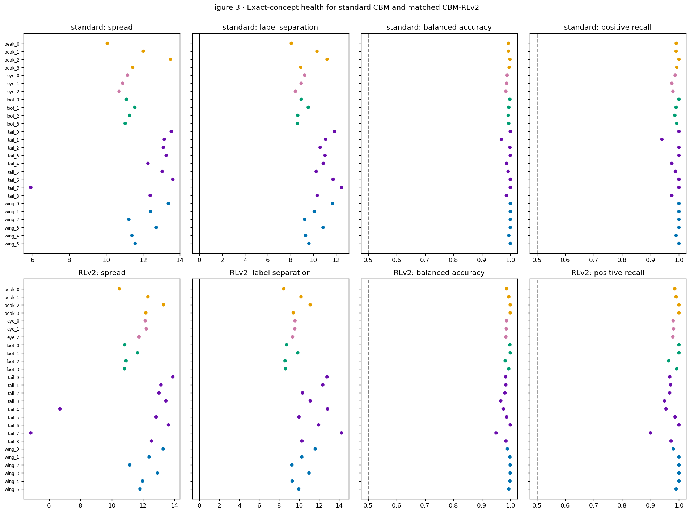


### Executed Standard-MCBM result — health-mcbm


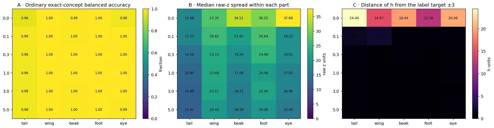


**Table — ordinary MCBM health values behind the three panels.** `balanced_accuracy` is a 0–1 classification rate; `median_z_spread` is the middle concept coordinate’s 95th-minus-5th percentile in raw-logit units; `h_target_RMSE` is the typical distance, in internal-h units, from the requested label target −3 or +3. Rows are gamma/part pairs.


|  | gamma | part | balanced_accuracy | median_z_spread | h_target_RMSE |
| --- | --- | --- | --- | --- | --- |
| 0 | 0.0 | tail | 0.9592 | 17.8793 | 24.3984 |
| 1 | 0.0 | wing | 0.9991 | 27.3485 | 14.9701 |
| 2 | 0.0 | beak | 0.9946 | 34.1220 | 19.4420 |
| 3 | 0.0 | foot | 0.9985 | 30.2515 | 12.3800 |
| 4 | 0.0 | eye | 0.9757 | 37.6843 | 20.0627 |
| 5 | 0.1 | tail | 0.9813 | 17.2324 | 1.4667 |
| 6 | 0.1 | wing | 0.9993 | 25.6214 | 2.0694 |
| 7 | 0.1 | beak | 0.9960 | 21.6238 | 0.6150 |
| 8 | 0.1 | foot | 0.9991 | 26.6428 | 0.5399 |
| 9 | 0.1 | eye | 0.9964 | 19.2201 | 0.6970 |
| 10 | 0.3 | tail | 0.9804 | 14.4973 | 0.7191 |
| 11 | 0.3 | wing | 0.9988 | 23.1273 | 0.3377 |
| 12 | 0.3 | beak | 0.9961 | 19.3409 | 0.4089 |
| 13 | 0.3 | foot | 0.9990 | 24.9580 | 0.3524 |
| 14 | 0.3 | eye | 0.9969 | 19.0092 | 0.4468 |
| 15 | 1.0 | tail | 0.9771 | 12.8049 | 0.5964 |
| 16 | 1.0 | wing | 0.9994 | 22.6805 | 0.2644 |
| 17 | 1.0 | beak | 0.9966 | 17.0781 | 0.3485 |
| 18 | 1.0 | foot | 0.9979 | 20.9791 | 0.2597 |
| 19 | 1.0 | eye | 0.9963 | 16.9999 | 0.3852 |
| 20 | 3.0 | tail | 0.9793 | 11.8929 | 0.5215 |
| 21 | 3.0 | wing | 0.9992 | 22.1130 | 0.1809 |
| 22 | 3.0 | beak | 0.9958 | 16.2058 | 0.3207 |
| 23 | 3.0 | foot | 0.9994 | 22.0393 | 0.1522 |
| 24 | 3.0 | eye | 0.9968 | 16.9522 | 0.3536 |
| 25 | 5.0 | tail | 0.9763 | 11.9079 | 0.5400 |
| 26 | 5.0 | wing | 0.9982 | 20.4261 | 0.1915 |
| 27 | 5.0 | beak | 0.9955 | 16.5777 | 0.3294 |
| 28 | 5.0 | foot | 0.9987 | 20.0563 | 0.1935 |
| 29 | 5.0 | eye | 0.9943 | 15.5570 | 0.3924 |


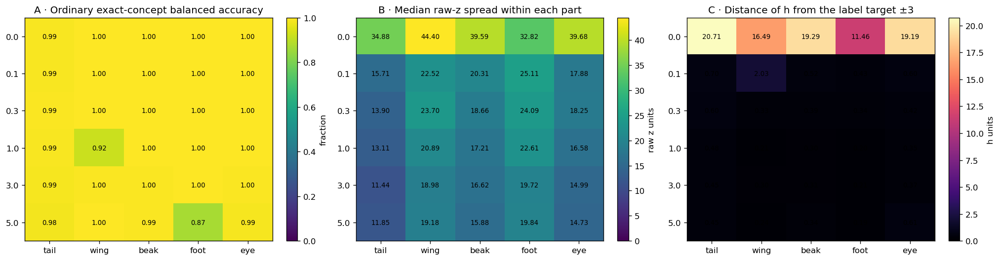


**Table — ordinary MCBM health values behind the three panels.** `balanced_accuracy` is a 0–1 classification rate; `median_z_spread` is the middle concept coordinate’s 95th-minus-5th percentile in raw-logit units; `h_target_RMSE` is the typical distance, in internal-h units, from the requested label target −3 or +3. Rows are gamma/part pairs.


|  | gamma | part | balanced_accuracy | median_z_spread | h_target_RMSE |
| --- | --- | --- | --- | --- | --- |
| 0 | 0.0 | tail | 0.9921 | 34.8795 | 20.7115 |
| 1 | 0.0 | wing | 0.9993 | 44.4025 | 16.4860 |
| 2 | 0.0 | beak | 0.9971 | 39.5879 | 19.2867 |
| 3 | 0.0 | foot | 0.9995 | 32.8189 | 11.4628 |
| 4 | 0.0 | eye | 0.9968 | 39.6789 | 19.1899 |
| 5 | 0.1 | tail | 0.9916 | 15.7054 | 0.7004 |
| 6 | 0.1 | wing | 0.9994 | 22.5220 | 2.0304 |
| 7 | 0.1 | beak | 0.9966 | 20.3104 | 0.5168 |
| 8 | 0.1 | foot | 0.9992 | 25.1055 | 0.4329 |
| 9 | 0.1 | eye | 0.9973 | 17.8834 | 0.6000 |
| 10 | 0.3 | tail | 0.9926 | 13.9014 | 0.6042 |
| 11 | 0.3 | wing | 0.9992 | 23.6994 | 0.3291 |
| 12 | 0.3 | beak | 0.9974 | 18.6575 | 0.3944 |
| 13 | 0.3 | foot | 0.9982 | 24.0931 | 0.3391 |
| 14 | 0.3 | eye | 0.9972 | 18.2453 | 0.4199 |
| 15 | 1.0 | tail | 0.9902 | 13.1075 | 0.4836 |
| 16 | 1.0 | wing | 0.9183 | 20.8921 | 0.2115 |
| 17 | 1.0 | beak | 0.9976 | 17.2084 | 0.2983 |
| 18 | 1.0 | foot | 0.9993 | 22.6104 | 0.2022 |
| 19 | 1.0 | eye | 0.9967 | 16.5754 | 0.3483 |
| 20 | 3.0 | tail | 0.9863 | 11.4395 | 0.4528 |
| 21 | 3.0 | wing | 0.9957 | 18.9808 | 0.2994 |
| 22 | 3.0 | beak | 0.9956 | 16.6224 | 0.3092 |
| 23 | 3.0 | foot | 0.9978 | 19.7206 | 0.2085 |
| 24 | 3.0 | eye | 0.9955 | 14.9874 | 0.3749 |
| 25 | 5.0 | tail | 0.9822 | 11.8524 | 0.4485 |
| 26 | 5.0 | wing | 0.9971 | 19.1834 | 0.2372 |
| 27 | 5.0 | beak | 0.9943 | 15.8766 | 0.3417 |
| 28 | 5.0 | foot | 0.8685 | 19.8408 | 0.1941 |
| 29 | 5.0 | eye | 0.9867 | 14.7250 | 0.6078 |


**How to read the executed RLv2 result.** The figure and fully
captioned source table immediately above are the result; no expected
observation was written into the notebook before execution.


Comparison requirements. Interpretation of Standard–RLv2 differences requires matching γ, formulas, physical image pairs, and denominators. The seed-1 comparison is specific to the evaluated runs; between-initialization variability requires replication.


Subsequent analysis. Continue to the next identical analysis stage, then use the final matched-difference table to decide which part and pathway actually changed.


## 3. Transition A — Koh Standard to MCBM gamma 0


This transition changes architecture and recipe together: shared projector,
private `q_j` readers, injected training noise, nonlinear species head,
preprocessing, optimizer details, and uncontrolled initialization.  Gamma is
zero, so the minimality penalty cannot explain this transition.


**Question.** Which part of the swap computation changes first?


Prediction. A discrepancy introduced by q_j would appear as correct donor recognition in calibrated h followed by an incorrect maximum in z. Errors already present in calibrated h motivate investigation of the upstream representation.


Reference figures. The following figures reproduce notebook 02’s donorward response, margin decomposition, strict backwash criterion, and three-category outcome summary.


**Exact executed Koh Standard/RLv2 comparison — Notebook 02rl `02rl-f7b-`**


```text
/tmp/tmp.Hs29m9YPc8/ipykernel_2363314/3938580946.py:43: UserWarning: This figure includes Axes that are not compatible with tight_layout, so results might be incorrect.
  plt.tight_layout();plt.show()
```


|  |  | tail | wing | beak | foot | eye |
| --- | --- | --- | --- | --- | --- | --- |
| component | regime |  |  |  |  |  |
| D_orig | standard | -6.057 | -5.217 | -4.640 | -4.429 | -4.184 |
| RLv2 | -6.656 | -5.463 | -4.983 | -4.623 | -4.565 |  |
| S_orig | standard | 4.699 | 4.697 | 4.527 | 4.418 | 4.297 |
| RLv2 | 3.109 | 4.446 | 4.372 | 4.099 | 4.515 |  |
| m_orig | standard | -10.756 | -9.914 | -9.167 | -8.847 | -8.481 |
| RLv2 | -9.766 | -9.909 | -9.355 | -8.722 | -9.080 |  |
| donor_gain | standard | 4.599 | 8.029 | 5.842 | 6.804 | 5.875 |
| RLv2 | 5.599 | 8.028 | 6.318 | 6.796 | 6.702 |  |
| source_decrease | standard | 5.201 | 8.361 | 5.936 | 7.027 | 5.874 |
| RLv2 | 6.070 | 8.323 | 6.368 | 7.068 | 6.645 |  |
| response_delta | standard | 9.800 | 16.390 | 11.778 | 13.831 | 11.749 |
| RLv2 | 11.669 | 16.351 | 12.686 | 13.864 | 13.347 |  |
| m_cf | standard | -0.956 | 6.476 | 2.611 | 4.984 | 3.268 |
| RLv2 | 1.903 | 6.442 | 3.331 | 5.142 | 4.267 |  |


**RLv2 minus standard (positive and negative retain each component's defined direction):**


|  | tail | wing | beak | foot | eye |
| --- | --- | --- | --- | --- | --- |
| D_orig | -0.599 | -0.246 | -0.343 | -0.194 | -0.381 |
| S_orig | -1.590 | -0.251 | -0.155 | -0.319 | 0.217 |
| m_orig | 0.990 | 0.005 | -0.188 | 0.125 | -0.599 |
| donor_gain | 1.000 | -0.000 | 0.476 | -0.008 | 0.827 |
| source_decrease | 0.869 | -0.038 | 0.432 | 0.041 | 0.770 |
| response_delta | 1.869 | -0.038 | 0.908 | 0.033 | 1.598 |
| m_cf | 2.859 | -0.034 | 0.720 | 0.158 | 0.999 |


**Exact executed Koh Standard/RLv2 comparison — Notebook 02rl `02rl-f5-`**


|  | standard | RLv2 | n |
| --- | --- | --- | --- |
| part |  |  |  |
| tail | 0.502 | 0.234 | 1000 |
| wing | 0.019 | 0.023 | 1000 |
| beak | 0.200 | 0.120 | 1000 |
| foot | 0.032 | 0.022 | 1000 |
| eye | 0.089 | 0.098 | 1000 |


**Exact executed Koh Standard/RLv2 comparison — Notebook 02rl `02rl-f5b-`**


|  | donor_wins | helped_but_source_wins | no_donorward_move_and_source_wins |
| --- | --- | --- | --- |
| tail | 0.681 | 0.234 | 0.085 |
| wing | 0.977 | 0.023 | 0.000 |
| beak | 0.872 | 0.120 | 0.008 |
| foot | 0.978 | 0.022 | 0.000 |
| eye | 0.892 | 0.098 | 0.010 |


### Executed Standard-MCBM result — response-audit


### Response-field accounting


**Table — historical response-column audit.** For each accepted file, this compares its stored response with the declared recalculation `m_cf-m_orig`. `positive_sign_disagreements` counts rows whose direction changes; `controlled_event_disagreements` counts rows whose backwash classification changes.


|  | model | historical_column_present | n_rows | maximum_absolute_difference | positive_sign_disagreements | controlled_event_disagreements |
| --- | --- | --- | --- | --- | --- | --- |
| 0 | Koh Standard | True | 5000 | 0.0 | 6 | 6 |
| 1 | MCBM γ0 | True | 5000 | 0.0 | 18 | 18 |
| 2 | MCBM γ0.1 | True | 5000 | 0.0 | 6 | 6 |
| 3 | MCBM γ0.3 | True | 5000 | 0.0 | 10 | 10 |
| 4 | MCBM γ1 | True | 5000 | 0.0 | 5 | 5 |
| 5 | MCBM γ3 | True | 5000 | 0.0 | 17 | 17 |
| 6 | MCBM γ5 | True | 5000 | 0.0 | 7 | 7 |


The declared quantity used below is always computed as response_delta = m_cf - m_orig . The table compares that formula with any historical response_delta column carried in the accepted CSV. There are 69 row-level controlled-event disagreements across all seven files. These differences arise when calculating outcomes from the stored response fields; the formula-derived columns drive every new comparison in this chapter.


### Response-field accounting


**Table — historical response-column audit.** For each accepted file, this compares its stored response with the declared recalculation `m_cf-m_orig`. `positive_sign_disagreements` counts rows whose direction changes; `controlled_event_disagreements` counts rows whose backwash classification changes.


|  | model | historical_column_present | n_rows | maximum_absolute_difference | positive_sign_disagreements | controlled_event_disagreements |
| --- | --- | --- | --- | --- | --- | --- |
| 0 | Koh RLv2 | True | 5000 | 0.0 | 9 | 9 |
| 1 | RLv2 MCBM γ0 | True | 5000 | 0.0 | 18 | 17 |
| 2 | RLv2 RLv2 MCBM γ0.1 | True | 5000 | 0.0 | 19 | 13 |
| 3 | RLv2 RLv2 MCBM γ0.3 | True | 5000 | 0.0 | 10 | 10 |
| 4 | RLv2 MCBM γ1 | True | 5000 | 0.0 | 18 | 17 |
| 5 | RLv2 MCBM γ3 | True | 5000 | 0.0 | 13 | 13 |
| 6 | RLv2 MCBM γ5 | True | 5000 | 0.0 | 18 | 10 |


The declared quantity used below is always computed as response_delta = m_cf - m_orig . The table compares that formula with any historical response_delta column carried in the accepted CSV. There are 89 row-level controlled-event disagreements across all seven files. These differences arise when calculating outcomes from the stored response fields; the formula-derived columns drive every new comparison in this chapter.


### Matched MCBM outcome accounting


Rows are gamma and columns are parts. Every cell uses all 1,000 swaps for that gamma/part. Panel A asks whether the donor is largest among every exact value. B asks whether the old value is largest. C records a third value. D is response_delta<=0 . E is the controlled backwash predicate response_delta>0 and m_cf<0 . Exact-winner panels partition all rows; D/E are pairwise diagnostics and overlap with the exact categories, and are reported separately from A/B/C.


### Executed Standard-MCBM result — outcomes


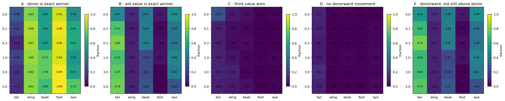


Table — complete exact-outcome fractions behind Panels A–E. Each row contains 1,000 swaps for one gamma and part. The first three fractions partition exact-value winners. The final two are separate pairwise predicates with overlapping populations relative to the exact-winner categories.


|  | gamma | part | n | exact_donor | exact_source | exact_third | no_donorward_move | backwash |
| --- | --- | --- | --- | --- | --- | --- | --- | --- |
| 0 | 0.0 | beak | 1000 | 0.550 | 0.405 | 0.045 | 0.010 | 0.416 |
| 1 | 0.0 | eye | 1000 | 0.495 | 0.489 | 0.016 | 0.006 | 0.494 |
| 2 | 0.0 | foot | 1000 | 0.926 | 0.069 | 0.005 | 0.001 | 0.070 |
| 3 | 0.0 | tail | 1000 | 0.278 | 0.470 | 0.252 | 0.106 | 0.522 |
| 4 | 0.0 | wing | 1000 | 0.811 | 0.116 | 0.073 | 0.000 | 0.143 |
| 5 | 0.1 | beak | 1000 | 0.562 | 0.418 | 0.020 | 0.002 | 0.418 |
| 6 | 0.1 | eye | 1000 | 0.609 | 0.390 | 0.001 | 0.013 | 0.378 |
| 7 | 0.1 | foot | 1000 | 0.978 | 0.021 | 0.001 | 0.003 | 0.019 |
| 8 | 0.1 | tail | 1000 | 0.195 | 0.716 | 0.089 | 0.097 | 0.672 |
| 9 | 0.1 | wing | 1000 | 0.881 | 0.082 | 0.037 | 0.001 | 0.092 |
| 10 | 0.3 | beak | 1000 | 0.550 | 0.418 | 0.032 | 0.002 | 0.421 |
| 11 | 0.3 | eye | 1000 | 0.609 | 0.384 | 0.007 | 0.014 | 0.380 |
| 12 | 0.3 | foot | 1000 | 0.958 | 0.041 | 0.001 | 0.000 | 0.041 |
| 13 | 0.3 | tail | 1000 | 0.109 | 0.804 | 0.087 | 0.073 | 0.790 |
| 14 | 0.3 | wing | 1000 | 0.870 | 0.099 | 0.031 | 0.000 | 0.108 |
| 15 | 1.0 | beak | 1000 | 0.750 | 0.232 | 0.018 | 0.015 | 0.220 |
| 16 | 1.0 | eye | 1000 | 0.527 | 0.461 | 0.012 | 0.020 | 0.449 |
| 17 | 1.0 | foot | 1000 | 0.942 | 0.047 | 0.011 | 0.004 | 0.045 |
| 18 | 1.0 | tail | 1000 | 0.202 | 0.702 | 0.096 | 0.077 | 0.682 |
| 19 | 1.0 | wing | 1000 | 0.846 | 0.097 | 0.057 | 0.006 | 0.100 |
| 20 | 3.0 | beak | 1000 | 0.756 | 0.229 | 0.015 | 0.005 | 0.228 |
| 21 | 3.0 | eye | 1000 | 0.572 | 0.424 | 0.004 | 0.019 | 0.408 |
| 22 | 3.0 | foot | 1000 | 0.990 | 0.009 | 0.001 | 0.004 | 0.006 |
| 23 | 3.0 | tail | 1000 | 0.142 | 0.753 | 0.105 | 0.125 | 0.689 |
| 24 | 3.0 | wing | 1000 | 0.819 | 0.093 | 0.088 | 0.003 | 0.101 |
| 25 | 5.0 | beak | 1000 | 0.694 | 0.262 | 0.044 | 0.004 | 0.270 |
| 26 | 5.0 | eye | 1000 | 0.735 | 0.255 | 0.010 | 0.024 | 0.239 |
| 27 | 5.0 | foot | 1000 | 0.991 | 0.008 | 0.001 | 0.003 | 0.005 |
| 28 | 5.0 | tail | 1000 | 0.135 | 0.779 | 0.086 | 0.097 | 0.739 |
| 29 | 5.0 | wing | 1000 | 0.832 | 0.095 | 0.073 | 0.002 | 0.097 |


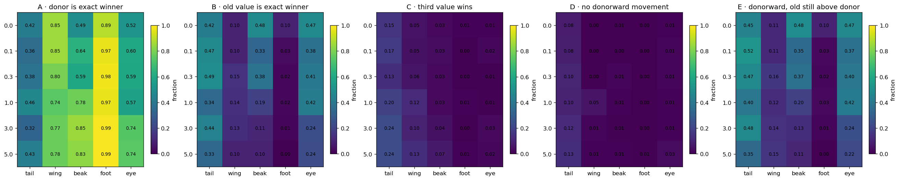


Table — complete exact-outcome fractions behind Panels A–E. Each row contains 1,000 swaps for one gamma and part. The first three fractions partition exact-value winners. The final two are separate pairwise predicates with overlapping populations relative to the exact-winner categories.


|  | gamma | part | n | exact_donor | exact_source | exact_third | no_donorward_move | backwash |
| --- | --- | --- | --- | --- | --- | --- | --- | --- |
| 0 | 0.0 | beak | 1000 | 0.495 | 0.479 | 0.026 | 0.006 | 0.485 |
| 1 | 0.0 | eye | 1000 | 0.516 | 0.473 | 0.011 | 0.010 | 0.471 |
| 2 | 0.0 | foot | 1000 | 0.890 | 0.099 | 0.011 | 0.003 | 0.098 |
| 3 | 0.0 | tail | 1000 | 0.425 | 0.425 | 0.150 | 0.078 | 0.448 |
| 4 | 0.0 | wing | 1000 | 0.853 | 0.099 | 0.048 | 0.000 | 0.110 |
| 5 | 0.1 | beak | 1000 | 0.639 | 0.328 | 0.033 | 0.001 | 0.351 |
| 6 | 0.1 | eye | 1000 | 0.601 | 0.378 | 0.021 | 0.013 | 0.374 |
| 7 | 0.1 | foot | 1000 | 0.967 | 0.030 | 0.003 | 0.003 | 0.027 |
| 8 | 0.1 | tail | 1000 | 0.356 | 0.474 | 0.170 | 0.084 | 0.521 |
| 9 | 0.1 | wing | 1000 | 0.854 | 0.100 | 0.046 | 0.000 | 0.110 |
| 10 | 0.3 | beak | 1000 | 0.593 | 0.381 | 0.026 | 0.013 | 0.370 |
| 11 | 0.3 | eye | 1000 | 0.587 | 0.406 | 0.007 | 0.015 | 0.397 |
| 12 | 0.3 | foot | 1000 | 0.977 | 0.021 | 0.002 | 0.000 | 0.021 |
| 13 | 0.3 | tail | 1000 | 0.380 | 0.488 | 0.132 | 0.104 | 0.475 |
| 14 | 0.3 | wing | 1000 | 0.796 | 0.147 | 0.057 | 0.001 | 0.162 |
| 15 | 1.0 | beak | 1000 | 0.781 | 0.193 | 0.026 | 0.010 | 0.195 |
| 16 | 1.0 | eye | 1000 | 0.571 | 0.424 | 0.005 | 0.010 | 0.416 |
| 17 | 1.0 | foot | 1000 | 0.967 | 0.023 | 0.010 | 0.000 | 0.026 |
| 18 | 1.0 | tail | 1000 | 0.463 | 0.340 | 0.197 | 0.096 | 0.396 |
| 19 | 1.0 | wing | 1000 | 0.744 | 0.136 | 0.120 | 0.054 | 0.125 |
| 20 | 3.0 | beak | 1000 | 0.849 | 0.107 | 0.044 | 0.007 | 0.132 |
| 21 | 3.0 | eye | 1000 | 0.736 | 0.239 | 0.025 | 0.011 | 0.243 |
| 22 | 3.0 | foot | 1000 | 0.986 | 0.013 | 0.001 | 0.000 | 0.013 |
| 23 | 3.0 | tail | 1000 | 0.323 | 0.439 | 0.238 | 0.122 | 0.480 |
| 24 | 3.0 | wing | 1000 | 0.774 | 0.130 | 0.096 | 0.012 | 0.141 |
| 25 | 5.0 | beak | 1000 | 0.832 | 0.096 | 0.072 | 0.008 | 0.106 |
| 26 | 5.0 | eye | 1000 | 0.743 | 0.236 | 0.021 | 0.028 | 0.221 |
| 27 | 5.0 | foot | 1000 | 0.989 | 0.003 | 0.008 | 0.007 | 0.002 |
| 28 | 5.0 | tail | 1000 | 0.428 | 0.334 | 0.238 | 0.130 | 0.347 |
| 29 | 5.0 | wing | 1000 | 0.776 | 0.095 | 0.129 | 0.011 | 0.154 |


**How to read the executed RLv2 result.** The figure and fully
captioned source table immediately above are the result; no expected
observation was written into the notebook before execution.


Comparison requirements. Interpretation of Standard–RLv2 differences requires matching γ, formulas, physical image pairs, and denominators. The seed-1 comparison is specific to the evaluated runs; between-initialization variability requires replication.


Subsequent analysis. Continue to the next identical analysis stage, then use the final matched-difference table to decide which part and pathway actually changed.


### Localization of response differences


The first five panels average the exact equations defined at the chapter start. The last three use the v3 replay audit. “Calibrated h response” first orients each internal coordinate using ordinary absent/present examples, so positive always means movement toward the inserted label even if a learned reader reverses sign. “q breaks h” means the donor is the maximum in calibrated h and another variant is the maximum in z=q(h); “q repairs h” is the reverse.


No new diagnostic classifier is trained. The accepted frozen MCBM checkpoint
is replayed, and the existing `q_j` readers are reused.


Reader scale. Each q_j maps an internal scalar to a concept logit. Its slope and range determine the change in z associated with a given change in calibrated h. For example, an internal-coordinate change of 1.0 could correspond to 30 logit units in one model and 18 in another. Joint reporting of calibrated-h and raw-z responses separates these measured scales.


### Executed Standard-MCBM result — decomp


**Table — swap pathway values behind the ten panels.** `mean_z_*` columns are in final raw-logit units. `mean_calibrated_h_response` is in absent-to-present internal units: +1 means the internal donor/source contrast moved by one ordinary-label separation. The two `q_*` columns are fractions of all swaps.


|  | gamma | part | mean_z_original_margin | mean_z_donor_gain | mean_z_source_decrease | mean_z_response | mean_z_final_margin | z_response_positive_rate | z_exact_donor_recognition | mean_calibrated_h_response | q_breaks_h_success_rate | q_repairs_h_failure_rate |
| --- | --- | --- | --- | --- | --- | --- | --- | --- | --- | --- | --- | --- |
| 0 | 0.0 | beak | -26.2761 | 15.6628 | 14.3051 | 29.9679 | 3.6913 | 0.9890 | 0.5500 | 1.6694 | 0.157 | 0.143 |
| 1 | 0.0 | eye | -27.7016 | 15.5603 | 12.0325 | 27.5928 | -0.1089 | 0.9930 | 0.4950 | 1.1258 | 0.072 | 0.062 |
| 2 | 0.0 | foot | -27.3011 | 19.2414 | 21.1727 | 40.4141 | 13.1119 | 0.9990 | 0.9260 | 1.5296 | 0.010 | 0.008 |
| 3 | 0.0 | tail | -21.2911 | 6.5583 | 11.6452 | 18.2035 | -3.0875 | 0.8780 | 0.2780 | 0.7978 | 0.054 | 0.113 |
| 4 | 0.0 | wing | -27.7178 | 16.7892 | 22.1926 | 38.9818 | 11.2639 | 1.0000 | 0.8110 | 1.4721 | 0.013 | 0.007 |
| 5 | 0.1 | beak | -19.0454 | 10.0847 | 10.5177 | 20.6024 | 1.5570 | 0.9980 | 0.5620 | 1.0731 | 0.018 | 0.007 |
| 6 | 0.1 | eye | -17.4695 | 8.8220 | 11.0055 | 19.8274 | 2.3580 | 0.9870 | 0.6090 | 1.1049 | 0.020 | 0.007 |
| 7 | 0.1 | foot | -24.8221 | 19.2119 | 21.7348 | 40.9467 | 16.1246 | 0.9970 | 0.9780 | 1.5739 | 0.000 | 0.000 |
| 8 | 0.1 | tail | -15.4800 | 4.3278 | 6.0593 | 10.3871 | -5.0928 | 0.8960 | 0.1950 | 0.7175 | 0.011 | 0.009 |
| 9 | 0.1 | wing | -23.5205 | 15.9987 | 20.0923 | 36.0909 | 12.5707 | 0.9990 | 0.8810 | 1.4894 | 0.013 | 0.006 |
| 10 | 0.3 | beak | -18.4562 | 10.5245 | 9.8027 | 20.3272 | 1.8712 | 0.9980 | 0.5500 | 1.0988 | 0.014 | 0.009 |
| 11 | 0.3 | eye | -16.5254 | 9.6587 | 9.3968 | 19.0554 | 2.5301 | 0.9860 | 0.6090 | 1.1203 | 0.005 | 0.005 |
| 12 | 0.3 | foot | -23.7720 | 17.7256 | 21.5503 | 39.2759 | 15.5040 | 1.0000 | 0.9580 | 1.5795 | 0.000 | 0.000 |
| 13 | 0.3 | tail | -14.0996 | 2.6940 | 5.0158 | 7.7098 | -6.3899 | 0.9170 | 0.1090 | 0.6026 | 0.003 | 0.008 |
| 14 | 0.3 | wing | -22.9600 | 16.4822 | 18.0984 | 34.5806 | 11.6207 | 1.0000 | 0.8700 | 1.4508 | 0.000 | 0.003 |
| 15 | 1.0 | beak | -16.3939 | 10.2733 | 11.6800 | 21.9533 | 5.5594 | 0.9850 | 0.7500 | 1.2956 | 0.014 | 0.004 |
| 16 | 1.0 | eye | -15.7388 | 7.7037 | 8.9145 | 16.6182 | 0.8792 | 0.9800 | 0.5270 | 1.0526 | 0.002 | 0.003 |
| 17 | 1.0 | foot | -20.3204 | 17.6330 | 18.1752 | 35.8082 | 15.4878 | 0.9960 | 0.9420 | 1.7087 | 0.003 | 0.000 |
| 18 | 1.0 | tail | -12.7580 | 2.8446 | 5.5164 | 8.3611 | -4.3968 | 0.9160 | 0.2020 | 0.7297 | 0.003 | 0.003 |
| 19 | 1.0 | wing | -22.5123 | 15.8419 | 19.4857 | 35.3276 | 12.8152 | 0.9940 | 0.8460 | 1.5519 | 0.000 | 0.003 |
| 20 | 3.0 | beak | -15.4492 | 9.2795 | 11.7594 | 21.0388 | 5.5809 | 0.9870 | 0.7568 | 1.2951 | 0.003 | 0.008 |
| 21 | 3.0 | eye | -16.5404 | 6.8661 | 11.0504 | 17.9165 | 1.3762 | 0.9790 | 0.5720 | 1.0660 | 0.015 | 0.008 |
| 22 | 3.0 | foot | -21.7110 | 21.0364 | 21.1198 | 42.1562 | 20.4450 | 0.9960 | 0.9900 | 1.9263 | 0.000 | 0.000 |
| 23 | 3.0 | tail | -11.7821 | 1.4226 | 5.3830 | 6.8055 | -4.9765 | 0.8730 | 0.1420 | 0.6282 | 0.001 | 0.004 |
| 24 | 3.0 | wing | -21.5626 | 15.4137 | 18.9733 | 34.3870 | 12.8241 | 0.9970 | 0.8190 | 1.5785 | 0.002 | 0.005 |
| 25 | 5.0 | beak | -16.1050 | 8.4941 | 12.2357 | 20.7298 | 4.6148 | 0.9960 | 0.6947 | 1.2615 | 0.012 | 0.004 |
| 26 | 5.0 | eye | -14.7152 | 8.3278 | 10.3922 | 18.7200 | 3.9705 | 0.9759 | 0.7372 | 1.2352 | 0.007 | 0.000 |
| 27 | 5.0 | foot | -18.5898 | 17.3191 | 17.9815 | 35.3006 | 16.7108 | 0.9970 | 0.9910 | 1.8446 | 0.000 | 0.000 |
| 28 | 5.0 | tail | -11.7315 | 1.4496 | 4.8224 | 6.2719 | -5.4599 | 0.8950 | 0.1350 | 0.6005 | 0.003 | 0.015 |
| 29 | 5.0 | wing | -20.3061 | 15.2728 | 18.3899 | 33.6627 | 13.3567 | 0.9980 | 0.8320 | 1.6384 | 0.002 | 0.000 |


**Table — ordinary source-image species health for the matched replay population.** This checks that pathway comparisons are not artifacts of a different set of original images. Accuracy is a 0–1 fraction; `n_originals` is its denominator.


|  | gamma | n_images | species_accuracy | mean_true_species_probability |
| --- | --- | --- | --- | --- |
| 0 | 0.0 | 250 | 0.992 | 0.9917 |
| 1 | 0.1 | 250 | 0.988 | 0.9877 |
| 2 | 0.3 | 250 | 0.988 | 0.9890 |
| 3 | 1.0 | 250 | 1.000 | 0.9975 |
| 4 | 3.0 | 250 | 0.996 | 0.9941 |
| 5 | 5.0 | 250 | 0.984 | 0.9851 |


**Table — swap pathway values behind the ten panels.** `mean_z_*` columns are in final raw-logit units. `mean_calibrated_h_response` is in absent-to-present internal units: +1 means the internal donor/source contrast moved by one ordinary-label separation. The two `q_*` columns are fractions of all swaps.


|  | gamma | part | mean_z_original_margin | mean_z_donor_gain | mean_z_source_decrease | mean_z_response | mean_z_final_margin | z_response_positive_rate | z_exact_donor_recognition | mean_calibrated_h_response | q_breaks_h_success_rate | q_repairs_h_failure_rate |
| --- | --- | --- | --- | --- | --- | --- | --- | --- | --- | --- | --- | --- |
| 0 | 0.0 | beak | -28.6946 | 15.6311 | 13.5147 | 29.1458 | 0.4433 | 0.9950 | 0.4955 | 1.0651 | 0.0390 | 0.0260 |
| 1 | 0.0 | eye | -28.6132 | 17.9223 | 11.5110 | 29.4333 | 0.8212 | 0.9970 | 0.5160 | 1.0497 | 0.0070 | 0.0110 |
| 2 | 0.0 | foot | -29.3906 | 18.7268 | 24.3545 | 43.0813 | 13.6922 | 0.9970 | 0.8900 | 1.4740 | 0.0110 | 0.0160 |
| 3 | 0.0 | tail | -27.6986 | 16.0070 | 11.4319 | 27.4389 | -0.2607 | 0.9470 | 0.4250 | 0.9555 | 0.0240 | 0.0190 |
| 4 | 0.0 | wing | -33.9943 | 24.3969 | 23.4429 | 47.8398 | 13.8443 | 1.0000 | 0.8530 | 1.4468 | 0.0160 | 0.0100 |
| 5 | 0.1 | beak | -18.5713 | 10.5625 | 11.9747 | 22.5372 | 3.9670 | 0.9990 | 0.6390 | 1.1839 | 0.0180 | 0.0120 |
| 6 | 0.1 | eye | -16.3490 | 8.8543 | 9.3846 | 18.2389 | 1.8709 | 0.9910 | 0.6030 | 1.0817 | 0.0151 | 0.0131 |
| 7 | 0.1 | foot | -22.6469 | 19.4011 | 18.2134 | 37.6145 | 14.9687 | 0.9970 | 0.9670 | 1.5611 | 0.0000 | 0.0000 |
| 8 | 0.1 | tail | -13.6431 | 5.3566 | 7.5581 | 12.9147 | -0.7275 | 0.9190 | 0.3560 | 0.8474 | 0.0290 | 0.0370 |
| 9 | 0.1 | wing | -21.2801 | 14.9627 | 17.2626 | 32.2253 | 10.9460 | 1.0000 | 0.8549 | 1.4845 | 0.0070 | 0.0020 |
| 10 | 0.3 | beak | -17.1963 | 8.9822 | 11.2929 | 20.2751 | 3.0371 | 0.9879 | 0.5930 | 1.1460 | 0.0261 | 0.0080 |
| 11 | 0.3 | eye | -16.3333 | 9.4893 | 9.0102 | 18.4995 | 2.1629 | 0.9920 | 0.5922 | 1.0960 | 0.0060 | 0.0070 |
| 12 | 0.3 | foot | -22.1131 | 18.5252 | 19.8642 | 38.3894 | 16.1889 | 1.0000 | 0.9739 | 1.6501 | 0.0030 | 0.0000 |
| 13 | 0.3 | tail | -12.9002 | 4.5347 | 7.5577 | 12.0925 | -0.8095 | 0.8989 | 0.3804 | 0.8151 | 0.0270 | 0.0320 |
| 14 | 0.3 | wing | -22.0652 | 14.8285 | 17.2619 | 32.0904 | 10.0240 | 0.9990 | 0.7960 | 1.4066 | 0.0020 | 0.0000 |
| 15 | 1.0 | beak | -16.7775 | 10.7517 | 12.7480 | 23.4997 | 6.7093 | 0.9920 | 0.7818 | 1.3351 | 0.0150 | 0.0070 |
| 16 | 1.0 | eye | -15.8661 | 7.8971 | 9.6030 | 17.5002 | 1.6350 | 0.9960 | 0.5707 | 1.0820 | 0.0020 | 0.0000 |
| 17 | 1.0 | foot | -21.5664 | 19.3140 | 20.1070 | 39.4210 | 17.8020 | 1.0000 | 0.9699 | 1.7781 | 0.0000 | 0.0020 |
| 18 | 1.0 | tail | -11.8786 | 4.5334 | 8.1448 | 12.6782 | 0.7999 | 0.9130 | 0.4640 | 0.9100 | 0.0130 | 0.0290 |
| 19 | 1.0 | wing | -16.6916 | 11.5100 | 14.1282 | 25.6382 | 8.9467 | 0.9460 | 0.7440 | 1.4996 | 0.0430 | 0.0070 |
| 20 | 3.0 | beak | -15.6205 | 10.7845 | 13.8891 | 24.6737 | 8.9556 | 0.9949 | 0.8551 | 1.5227 | 0.0000 | 0.0041 |
| 21 | 3.0 | eye | -14.1215 | 8.6322 | 10.8551 | 19.4873 | 5.3726 | 0.9930 | 0.7357 | 1.3151 | 0.0000 | 0.0020 |
| 22 | 3.0 | foot | -19.0109 | 17.3559 | 18.2436 | 35.5996 | 16.5801 | 1.0000 | 0.9860 | 1.8427 | 0.0000 | 0.0000 |
| 23 | 3.0 | tail | -11.2049 | 2.4668 | 8.0451 | 10.5119 | -0.6926 | 0.8824 | 0.3226 | 0.8456 | 0.0131 | 0.0251 |
| 24 | 3.0 | wing | -18.4546 | 11.9980 | 15.9434 | 27.9414 | 9.4106 | 0.9879 | 0.7782 | 1.5021 | 0.0060 | 0.0050 |
| 25 | 5.0 | beak | -14.9584 | 10.8487 | 13.8004 | 24.6490 | 9.5040 | 0.9939 | 0.8403 | 1.6129 | 0.0041 | 0.0000 |
| 26 | 5.0 | eye | -14.1164 | 8.1796 | 11.1714 | 19.3510 | 5.1840 | 0.9747 | 0.7424 | 1.3425 | 0.0040 | 0.0071 |
| 27 | 5.0 | foot | -15.3254 | 14.5672 | 15.2998 | 29.8670 | 14.5395 | 0.9910 | 0.9890 | 1.9302 | 0.0020 | 0.0010 |
| 28 | 5.0 | tail | -11.0782 | 2.8782 | 9.2467 | 12.1248 | 1.0323 | 0.8778 | 0.4289 | 0.9460 | 0.0471 | 0.0371 |
| 29 | 5.0 | wing | -18.8165 | 13.3096 | 17.0432 | 30.3529 | 11.4447 | 0.9887 | 0.7787 | 1.5979 | 0.0000 | 0.0020 |


**Table — ordinary source-image species health for the matched replay population.** This checks that pathway comparisons are not artifacts of a different set of original images. Accuracy is a 0–1 fraction; `n_originals` is its denominator.


|  | gamma | n_images | species_accuracy | mean_true_species_probability |
| --- | --- | --- | --- | --- |
| 0 | 0.0 | 250 | 0.992 | 0.9910 |
| 1 | 0.1 | 250 | 0.988 | 0.9878 |
| 2 | 0.3 | 250 | 0.996 | 0.9917 |
| 3 | 1.0 | 250 | 0.996 | 0.9897 |
| 4 | 3.0 | 250 | 0.996 | 0.9904 |
| 5 | 5.0 | 250 | 0.980 | 0.9771 |


**How to read the executed RLv2 result.** The figure and fully
captioned source table immediately above are the result; no expected
observation was written into the notebook before execution.


Comparison requirements. Interpretation of Standard–RLv2 differences requires matching γ, formulas, physical image pairs, and denominators. The seed-1 comparison is specific to the evaluated runs; between-initialization variability requires replication.


Subsequent analysis. Continue to the next identical analysis stage, then use the final matched-difference table to decide which part and pathway actually changed.


## 4. Transition B — MCBM gamma 0 to positive gamma


Now architecture and stored recipe are nominally shared, and gamma controls the added squared-error pressure toward h=-3/+3 . Initialization was uncontrolled in these historical runs, so non-monotonic differences can still be run-to-run variation. Replicated comparisons would help distinguish γ dependence from run-to-run variability.


**Question.** Does stronger compression improve inserted-pixel response, or
merely make ordinary `h` values more label-like?


**Prediction.** If the loss removes harmful within-label context while
preserving pixel response, target RMSE and within-label spread should fall
while donor gain and exact donor recognition rise. If response falls while
target RMSE improves, the loss is compressing information useful for the
controlled intervention, or consolidating a contextual shortcut.


### Executed Standard-MCBM result — loss-gradients


Frozen-gradient diagnostic: Relative magnitudes of loss terms within the MCBM implementation


Table — frozen loss-gradient magnitudes. Every row is one gamma/part at the saved checkpoint. RMS columns measure the size of each weighted loss gradient with respect to h ; cosine columns measure whether task and concept gradients point together. These diagnostics describe gradients evaluated at the saved checkpoint.


|  | gamma | part | N | coordinates | task_gradient_RMS | concept_gradient_RMS | weighted_compression_gradient_RMS | task_concept_cosine_mean | task_concept_opposed_fraction | cosine_eligible_images |
| --- | --- | --- | --- | --- | --- | --- | --- | --- | --- | --- |
| 0 | 0.0 | beak | 5000 | 4 | 0.02547 | 0.15785 | 0.00000 | 0.08419 | 0.42837 | 2883 |
| 1 | 0.0 | eye | 5000 | 3 | 0.04857 | 0.20346 | 0.00000 | 0.17882 | 0.36447 | 2955 |
| 2 | 0.0 | foot | 5000 | 4 | 0.02317 | 0.09116 | 0.00000 | -0.02962 | 0.52939 | 2586 |
| 3 | 0.0 | tail | 5000 | 9 | 0.02863 | 0.27810 | 0.00000 | 0.22719 | 0.30861 | 2764 |
| 4 | 0.0 | wing | 5000 | 6 | 0.02406 | 0.10421 | 0.00000 | 0.03963 | 0.47952 | 2857 |
| 5 | 0.1 | beak | 5000 | 4 | 0.04308 | 0.57842 | 0.02460 | 0.17719 | 0.37172 | 4837 |
| 6 | 0.1 | eye | 5000 | 3 | 0.04899 | 0.29755 | 0.02788 | 0.25788 | 0.31862 | 4802 |
| 7 | 0.1 | foot | 5000 | 4 | 0.04696 | 0.31712 | 0.02160 | -0.00470 | 0.53629 | 4781 |
| 8 | 0.1 | tail | 5000 | 9 | 0.07082 | 1.31414 | 0.05867 | 0.30754 | 0.23893 | 4855 |
| 9 | 0.1 | wing | 5000 | 6 | 0.04352 | 0.63975 | 0.08278 | 0.11390 | 0.43268 | 4835 |
| 10 | 0.3 | beak | 5000 | 4 | 0.05537 | 0.61866 | 0.04907 | 0.10405 | 0.43924 | 4872 |
| 11 | 0.3 | eye | 5000 | 3 | 0.04971 | 0.32005 | 0.05362 | 0.13630 | 0.39963 | 4867 |
| 12 | 0.3 | foot | 5000 | 4 | 0.04756 | 0.39087 | 0.04229 | 0.06201 | 0.48598 | 4778 |
| 13 | 0.3 | tail | 5000 | 9 | 0.07572 | 1.34896 | 0.08630 | 0.34960 | 0.20237 | 4902 |
| 14 | 0.3 | wing | 5000 | 6 | 0.03383 | 0.70871 | 0.04052 | 0.05283 | 0.51574 | 4859 |
| 15 | 1.0 | beak | 5000 | 4 | 0.05782 | 0.47378 | 0.13940 | 0.16296 | 0.37216 | 4842 |
| 16 | 1.0 | eye | 5000 | 3 | 0.05623 | 0.33577 | 0.15409 | 0.14837 | 0.37201 | 4844 |
| 17 | 1.0 | foot | 5000 | 4 | 0.06356 | 0.51040 | 0.10386 | 0.12412 | 0.43053 | 4822 |
| 18 | 1.0 | tail | 5000 | 9 | 0.08040 | 1.36941 | 0.23857 | 0.33594 | 0.19881 | 4864 |
| 19 | 1.0 | wing | 5000 | 6 | 0.04707 | 0.59387 | 0.10578 | 0.08348 | 0.45406 | 4821 |
| 20 | 3.0 | beak | 5000 | 4 | 0.05485 | 0.56407 | 0.38489 | 0.10185 | 0.39621 | 4856 |
| 21 | 3.0 | eye | 5000 | 3 | 0.05923 | 0.31406 | 0.42432 | 0.28545 | 0.32279 | 4142 |
| 22 | 3.0 | foot | 5000 | 4 | 0.05676 | 0.46856 | 0.18263 | 0.08169 | 0.45171 | 4835 |
| 23 | 3.0 | tail | 5000 | 9 | 0.07721 | 1.17019 | 0.62584 | 0.27367 | 0.23987 | 4886 |
| 24 | 3.0 | wing | 5000 | 6 | 0.04276 | 0.77078 | 0.21704 | 0.06479 | 0.46101 | 4848 |
| 25 | 5.0 | beak | 5000 | 4 | 0.06623 | 0.67957 | 0.65890 | 0.14066 | 0.38550 | 4843 |
| 26 | 5.0 | eye | 5000 | 3 | 0.06531 | 0.35634 | 0.78476 | 0.11320 | 0.39859 | 4837 |
| 27 | 5.0 | foot | 5000 | 4 | 0.05425 | 0.37883 | 0.38707 | 0.10318 | 0.39261 | 4819 |
| 28 | 5.0 | tail | 5000 | 9 | 0.07976 | 1.22728 | 1.07998 | 0.26096 | 0.23178 | 4858 |
| 29 | 5.0 | wing | 5000 | 6 | 0.05206 | 0.63461 | 0.38299 | 0.10665 | 0.41771 | 4812 |


Result. At gamma 5, the final-checkpoint compression-to-concept gradient ratios are tail=0.88 , wing=0.60 , beak=0.97 , foot=1.02 , eye=2.20 . Compression is therefore comparable to the concept gradient for tail, beak, foot, and eye, and smaller for wing. These ratios characterize the final checkpoint. Attribution of a replacement outcome to a particular loss term requires training-time analysis or a controlled objective ablation.


Frozen-gradient diagnostic: Relative magnitudes of loss terms within the MCBM implementation


Table — frozen loss-gradient magnitudes. Every row is one gamma/part at the saved checkpoint. RMS columns measure the size of each weighted loss gradient with respect to h ; cosine columns measure whether task and concept gradients point together. These diagnostics describe gradients evaluated at the saved checkpoint.


|  | gamma | part | N | coordinates | task_gradient_RMS | concept_gradient_RMS | weighted_compression_gradient_RMS | task_concept_cosine_mean | task_concept_opposed_fraction | cosine_eligible_images |
| --- | --- | --- | --- | --- | --- | --- | --- | --- | --- | --- |
| 0 | 0.0 | beak | 5000 | 4 | 0.01500 | 0.15459 | 0.00000 | 0.13339 | 0.39793 | 2704 |
| 1 | 0.0 | eye | 5000 | 3 | 0.01768 | 0.08114 | 0.00000 | 0.17032 | 0.39323 | 2599 |
| 2 | 0.0 | foot | 5000 | 4 | 0.02048 | 0.04683 | 0.00000 | 0.13214 | 0.39951 | 2468 |
| 3 | 0.0 | tail | 5000 | 9 | 0.01561 | 0.18085 | 0.00000 | 0.09731 | 0.45534 | 2978 |
| 4 | 0.0 | wing | 5000 | 6 | 0.01465 | 0.11494 | 0.00000 | 0.06115 | 0.47118 | 2602 |
| 5 | 0.1 | beak | 5000 | 4 | 0.05702 | 0.76101 | 0.02067 | 0.22396 | 0.35218 | 4793 |
| 6 | 0.1 | eye | 5000 | 3 | 0.05338 | 0.32343 | 0.02400 | 0.23303 | 0.32869 | 4807 |
| 7 | 0.1 | foot | 5000 | 4 | 0.04382 | 0.47772 | 0.01731 | 0.05451 | 0.49556 | 4730 |
| 8 | 0.1 | tail | 5000 | 9 | 0.04786 | 0.73229 | 0.02801 | 0.21396 | 0.37521 | 4816 |
| 9 | 0.1 | wing | 5000 | 6 | 0.05228 | 0.64386 | 0.08121 | 0.10544 | 0.46021 | 4800 |
| 10 | 0.3 | beak | 5000 | 4 | 0.05860 | 0.57332 | 0.04733 | 0.23382 | 0.32671 | 4732 |
| 11 | 0.3 | eye | 5000 | 3 | 0.05506 | 0.35681 | 0.05039 | 0.18931 | 0.34820 | 4707 |
| 12 | 0.3 | foot | 5000 | 4 | 0.06652 | 0.56466 | 0.04069 | 0.16605 | 0.39440 | 4678 |
| 13 | 0.3 | tail | 5000 | 9 | 0.06678 | 0.72037 | 0.07251 | 0.20113 | 0.35267 | 4758 |
| 14 | 0.3 | wing | 5000 | 6 | 0.04016 | 0.54572 | 0.03950 | 0.13740 | 0.40903 | 4716 |
| 15 | 1.0 | beak | 5000 | 4 | 0.05652 | 0.65424 | 0.11933 | 0.23772 | 0.32576 | 4841 |
| 16 | 1.0 | eye | 5000 | 3 | 0.06923 | 0.33778 | 0.13931 | 0.20688 | 0.36597 | 4831 |
| 17 | 1.0 | foot | 5000 | 4 | 0.05216 | 0.53227 | 0.08087 | 0.13694 | 0.41002 | 4812 |
| 18 | 1.0 | tail | 5000 | 9 | 0.07245 | 1.11111 | 0.19344 | 0.22661 | 0.31285 | 4849 |
| 19 | 1.0 | wing | 5000 | 6 | 0.04805 | 0.78087 | 0.08462 | 0.18175 | 0.34518 | 4783 |
| 20 | 3.0 | beak | 5000 | 4 | 0.06033 | 0.50211 | 0.37105 | 0.16803 | 0.36295 | 4929 |
| 21 | 3.0 | eye | 5000 | 3 | 0.06497 | 0.34255 | 0.44991 | 0.16806 | 0.37193 | 4923 |
| 22 | 3.0 | foot | 5000 | 4 | 0.05976 | 0.47630 | 0.25022 | 0.10310 | 0.41929 | 4925 |
| 23 | 3.0 | tail | 5000 | 9 | 0.07097 | 1.42092 | 0.54336 | 0.21554 | 0.29745 | 4942 |
| 24 | 3.0 | wing | 5000 | 6 | 0.06975 | 0.85650 | 0.35933 | 0.19712 | 0.32811 | 4913 |
| 25 | 5.0 | beak | 5000 | 4 | 0.07046 | 0.51307 | 0.68343 | 0.24014 | 0.34997 | 4789 |
| 26 | 5.0 | eye | 5000 | 3 | 0.10404 | 0.54948 | 1.21563 | 0.24880 | 0.34258 | 4399 |
| 27 | 5.0 | foot | 5000 | 4 | 0.05132 | 0.31305 | 0.38827 | 0.30440 | 0.30245 | 2903 |
| 28 | 5.0 | tail | 5000 | 9 | 0.07689 | 1.50575 | 0.89706 | 0.19534 | 0.31444 | 4745 |
| 29 | 5.0 | wing | 5000 | 6 | 0.04932 | 0.84600 | 0.47440 | 0.21945 | 0.33637 | 4721 |


Result. At gamma 5, the final-checkpoint compression-to-concept gradient ratios are tail=0.60 , wing=0.56 , beak=1.33 , foot=1.24 , eye=2.21 . Compression is therefore comparable to the concept gradient for tail, beak, foot, and eye, and smaller for wing. These ratios characterize the final checkpoint. Attribution of a replacement outcome to a particular loss term requires training-time analysis or a controlled objective ablation.


### Direction, visibility, label conflict, and exact values


Each comparison evaluates a distinct candidate contributor. Direction asks whether forward/backward swaps differ. Visibility is the corrected total mask area of the inserted bilateral part. Conflict rate is a data rate: among positive training labels for an exact value, the fraction whose named region is hidden. Support is the number of 50 species naturally carrying that exact value.


The Standard reference figures precede the MCBM comparisons. Shared input-label and rendered-appearance summaries are displayed once.


**Exact executed Koh Standard/RLv2 comparison — Notebook 02rl `02rl-f9-`**


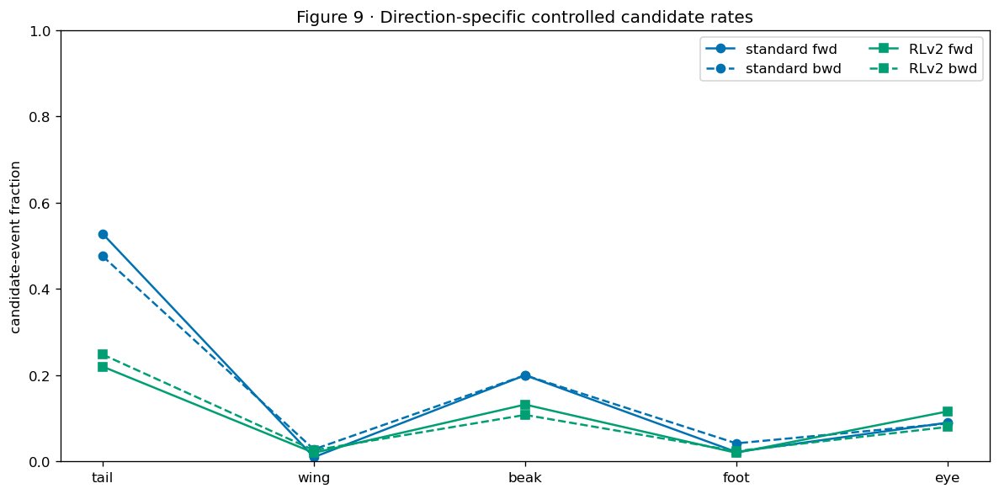


|  | part | direction | n | standard | RLv2 |
| --- | --- | --- | --- | --- | --- |
| 0 | beak | bwd | 500 | 0.200 | 0.108 |
| 1 | beak | fwd | 500 | 0.200 | 0.132 |
| 2 | eye | bwd | 500 | 0.088 | 0.080 |
| 3 | eye | fwd | 500 | 0.090 | 0.116 |
| 4 | foot | bwd | 500 | 0.042 | 0.024 |
| 5 | foot | fwd | 500 | 0.022 | 0.020 |
| 6 | tail | bwd | 500 | 0.476 | 0.248 |
| 7 | tail | fwd | 500 | 0.528 | 0.220 |
| 8 | wing | bwd | 500 | 0.028 | 0.026 |
| 9 | wing | fwd | 500 | 0.010 | 0.020 |


**Exact executed Koh Standard/RLv2 comparison — Notebook 02rl `02rl-f10-`**


|  | part | visibility_bin | n | standard | RLv2 |
| --- | --- | --- | --- | --- | --- |
| 0 | beak | 0–19 | 123 | 0.423 | 0.374 |
| 1 | beak | 20–49 | 164 | 0.256 | 0.159 |
| 2 | beak | 50–99 | 192 | 0.198 | 0.078 |
| 3 | beak | 100–199 | 237 | 0.169 | 0.063 |
| 4 | beak | 200–499 | 227 | 0.097 | 0.062 |
| 5 | beak | 500+ | 57 | 0.105 | 0.070 |
| 6 | eye | 0–19 | 17 | 0.588 | 0.588 |
| 7 | eye | 20–49 | 136 | 0.228 | 0.213 |
| 8 | eye | 50–99 | 307 | 0.072 | 0.078 |
| 9 | eye | 100–199 | 285 | 0.046 | 0.056 |
| 10 | eye | 200–499 | 237 | 0.034 | 0.068 |
| 11 | eye | 500+ | 18 | 0.278 | 0.167 |
| 12 | foot | 0–19 | 4 | 0.750 | 0.500 |
| 13 | foot | 20–49 | 12 | 0.167 | 0.250 |
| 14 | foot | 50–99 | 92 | 0.076 | 0.054 |
| 15 | foot | 100–199 | 228 | 0.022 | 0.031 |
| 16 | foot | 200–499 | 489 | 0.027 | 0.010 |
| 17 | foot | 500+ | 175 | 0.011 | 0.000 |
| 18 | tail | 0–19 | 386 | 0.573 | 0.363 |
| 19 | tail | 20–49 | 130 | 0.623 | 0.262 |
| 20 | tail | 50–99 | 94 | 0.585 | 0.234 |
| 21 | tail | 100–199 | 187 | 0.294 | 0.053 |
| 22 | tail | 200–499 | 180 | 0.428 | 0.144 |
| 23 | tail | 500+ | 23 | 0.565 | 0.087 |
| 24 | wing | 20–49 | 1 | 1.000 | 0.000 |
| 25 | wing | 50–99 | 9 | 0.111 | 0.000 |
| 26 | wing | 100–199 | 65 | 0.108 | 0.138 |
| 27 | wing | 200–499 | 224 | 0.027 | 0.027 |
| 28 | wing | 500+ | 701 | 0.006 | 0.011 |


**Exact executed Koh Standard/RLv2 comparison — Notebook 02rl `02rl-f13a-`**


```text
STANDARD — same calculation
```


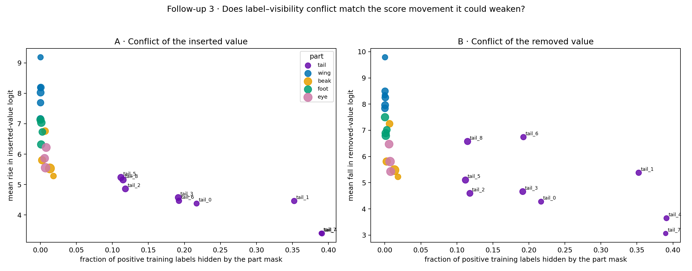


|  | concept_index | concept | part | value | positive_images | hidden_positive_images | conflict_rate | species_support | mean_donor_gain | mean_visible_pixels | donor_rows | mean_source_decrease | source_rows |
| --- | --- | --- | --- | --- | --- | --- | --- | --- | --- | --- | --- | --- | --- |
| 0 | 0 | beak_0 | beak | 0 | 15819 | 210 | 0.0133 | 21 | 5.5298 | 99.5449 | 345 | 5.4785 | 345 |
| 1 | 1 | beak_1 | beak | 1 | 7476 | 49 | 0.0066 | 10 | 6.7573 | 316.1306 | 245 | 7.2481 | 245 |
| 2 | 2 | beak_2 | beak | 2 | 4555 | 83 | 0.0182 | 6 | 5.2791 | 22.0526 | 190 | 5.2235 | 190 |
| 3 | 3 | beak_3 | beak | 3 | 9767 | 25 | 0.0026 | 13 | 5.7998 | 207.3773 | 220 | 5.8082 | 220 |
| 4 | 4 | eye_0 | eye | 0 | 11384 | 67 | 0.0059 | 15 | 5.8616 | 67.2067 | 300 | 6.4712 | 300 |
| 5 | 5 | eye_1 | eye | 1 | 11994 | 97 | 0.0081 | 16 | 6.2189 | 79.2928 | 345 | 5.4257 | 345 |
| 6 | 6 | eye_2 | eye | 2 | 14348 | 104 | 0.0072 | 19 | 5.5520 | 70.2620 | 355 | 5.8059 | 355 |
| 7 | 7 | foot_0 | foot | 0 | 9829 | 2 | 0.0002 | 13 | 7.1338 | 192.7364 | 220 | 7.4994 | 220 |
| 8 | 8 | foot_1 | foot | 1 | 7584 | 21 | 0.0028 | 10 | 6.7294 | 97.8042 | 240 | 7.0198 | 240 |
| 9 | 9 | foot_2 | foot | 2 | 10552 | 14 | 0.0013 | 14 | 7.0352 | 169.1552 | 290 | 6.7916 | 290 |
| 10 | 10 | foot_3 | foot | 3 | 9758 | 11 | 0.0011 | 13 | 6.3180 | 174.5440 | 250 | 6.8919 | 250 |
| 11 | 11 | tail_0 | tail | 0 | 3033 | 658 | 0.2169 | 4 | 4.3734 | 183.6800 | 75 | 4.2760 | 75 |
| 12 | 12 | tail_1 | tail | 1 | 3745 | 1320 | 0.3525 | 5 | 4.4579 | 115.2333 | 90 | 5.3794 | 90 |
| 13 | 13 | tail_2 | tail | 2 | 5224 | 617 | 0.1181 | 7 | 4.8566 | 83.2250 | 120 | 4.5933 | 120 |
| 14 | 14 | tail_3 | tail | 3 | 5285 | 1012 | 0.1915 | 7 | 4.5718 | 156.8545 | 110 | 4.6608 | 110 |
| 15 | 15 | tail_4 | tail | 4 | 3043 | 1190 | 0.3911 | 4 | 3.3887 | 99.7636 | 110 | 3.6440 | 110 |
| 16 | 16 | tail_5 | tail | 5 | 6030 | 675 | 0.1119 | 8 | 5.2328 | 69.1733 | 150 | 5.1008 | 150 |
| 17 | 17 | tail_6 | tail | 6 | 3752 | 722 | 0.1924 | 5 | 4.4626 | 152.8462 | 130 | 6.7392 | 130 |
| 18 | 18 | tail_7 | tail | 7 | 1536 | 599 | 0.3900 | 2 | 3.3962 | 106.6000 | 35 | 3.0609 | 35 |
| 19 | 19 | tail_8 | tail | 8 | 6059 | 696 | 0.1149 | 8 | 5.1535 | 76.7667 | 180 | 6.5735 | 180 |
| 20 | 20 | wing_0 | wing | 0 | 3774 | 1 | 0.0003 | 5 | 9.1871 | 388.9000 | 130 | 9.7883 | 130 |
| 21 | 21 | wing_1 | wing | 1 | 6815 | 2 | 0.0003 | 9 | 7.6914 | 357.4667 | 150 | 8.4944 | 150 |
| 22 | 22 | wing_2 | wing | 2 | 8190 | 3 | 0.0004 | 11 | 8.0250 | 483.9182 | 220 | 7.9594 | 220 |
| 23 | 23 | wing_3 | wing | 3 | 3794 | 0 | 0.0000 | 5 | 8.1916 | 363.8000 | 115 | 8.3381 | 115 |
| 24 | 24 | wing_4 | wing | 4 | 7611 | 1 | 0.0001 | 10 | 7.1593 | 403.3371 | 175 | 7.8375 | 175 |
| 25 | 25 | wing_5 | wing | 5 | 7504 | 5 | 0.0007 | 10 | 8.1918 | 354.1286 | 210 | 8.2514 | 210 |


```text
RLV2 — same calculation
```


|  | concept_index | concept | part | value | positive_images | hidden_positive_images | conflict_rate | species_support | mean_donor_gain | mean_visible_pixels | donor_rows | mean_source_decrease | source_rows |
| --- | --- | --- | --- | --- | --- | --- | --- | --- | --- | --- | --- | --- | --- |
| 0 | 0 | beak_0 | beak | 0 | 15819 | 210 | 0.0133 | 21 | 6.0504 | 99.5449 | 345 | 6.0819 | 345 |
| 1 | 1 | beak_1 | beak | 1 | 7476 | 49 | 0.0066 | 10 | 7.1006 | 316.1306 | 245 | 7.1848 | 245 |
| 2 | 2 | beak_2 | beak | 2 | 4555 | 83 | 0.0182 | 6 | 5.7832 | 22.0526 | 190 | 5.8530 | 190 |
| 3 | 3 | beak_3 | beak | 3 | 9767 | 25 | 0.0026 | 13 | 6.3298 | 207.3773 | 220 | 6.3509 | 220 |
| 4 | 4 | eye_0 | eye | 0 | 11384 | 67 | 0.0059 | 15 | 6.6102 | 67.2067 | 300 | 7.1691 | 300 |
| 5 | 5 | eye_1 | eye | 1 | 11994 | 97 | 0.0081 | 16 | 7.2513 | 79.2928 | 345 | 6.1787 | 345 |
| 6 | 6 | eye_2 | eye | 2 | 14348 | 104 | 0.0072 | 19 | 6.2466 | 70.2620 | 355 | 6.6541 | 355 |
| 7 | 7 | foot_0 | foot | 0 | 9829 | 2 | 0.0002 | 13 | 6.9710 | 192.7364 | 220 | 7.4208 | 220 |
| 8 | 8 | foot_1 | foot | 1 | 7584 | 21 | 0.0028 | 10 | 6.7307 | 97.8042 | 240 | 7.4960 | 240 |
| 9 | 9 | foot_2 | foot | 2 | 10552 | 14 | 0.0013 | 14 | 6.9339 | 169.1552 | 290 | 6.6120 | 290 |
| 10 | 10 | foot_3 | foot | 3 | 9758 | 11 | 0.0011 | 13 | 6.5452 | 174.5440 | 250 | 6.8753 | 250 |
| 11 | 11 | tail_0 | tail | 0 | 3033 | 658 | 0.2169 | 4 | 5.3315 | 183.6800 | 75 | 5.2625 | 75 |
| 12 | 12 | tail_1 | tail | 1 | 3745 | 1320 | 0.3525 | 5 | 4.9590 | 115.2333 | 90 | 5.8202 | 90 |
| 13 | 13 | tail_2 | tail | 2 | 5224 | 617 | 0.1181 | 7 | 5.9914 | 83.2250 | 120 | 5.5037 | 120 |
| 14 | 14 | tail_3 | tail | 3 | 5285 | 1012 | 0.1915 | 7 | 5.5105 | 156.8545 | 110 | 6.0819 | 110 |
| 15 | 15 | tail_4 | tail | 4 | 3043 | 1190 | 0.3911 | 4 | 4.6135 | 99.7636 | 110 | 3.9645 | 110 |
| 16 | 16 | tail_5 | tail | 5 | 6030 | 675 | 0.1119 | 8 | 6.0484 | 69.1733 | 150 | 6.0520 | 150 |
| 17 | 17 | tail_6 | tail | 6 | 3752 | 722 | 0.1924 | 5 | 5.8418 | 152.8462 | 130 | 7.7764 | 130 |
| 18 | 18 | tail_7 | tail | 7 | 1536 | 599 | 0.3900 | 2 | 4.6715 | 106.6000 | 35 | 3.4929 | 35 |
| 19 | 19 | tail_8 | tail | 8 | 6059 | 696 | 0.1149 | 8 | 6.0568 | 76.7667 | 180 | 7.4723 | 180 |
| 20 | 20 | wing_0 | wing | 0 | 3774 | 1 | 0.0003 | 5 | 9.2938 | 388.9000 | 130 | 9.6958 | 130 |
| 21 | 21 | wing_1 | wing | 1 | 6815 | 2 | 0.0003 | 9 | 7.5986 | 357.4667 | 150 | 8.2991 | 150 |
| 22 | 22 | wing_2 | wing | 2 | 8190 | 3 | 0.0004 | 11 | 7.7867 | 483.9182 | 220 | 8.1013 | 220 |
| 23 | 23 | wing_3 | wing | 3 | 3794 | 0 | 0.0000 | 5 | 7.9674 | 363.8000 | 115 | 8.0987 | 115 |
| 24 | 24 | wing_4 | wing | 4 | 7611 | 1 | 0.0001 | 10 | 7.0329 | 403.3371 | 175 | 7.7108 | 175 |
| 25 | 25 | wing_5 | wing | 5 | 7504 | 5 | 0.0007 | 10 | 8.6687 | 354.1286 | 210 | 8.3555 | 210 |


**Exact executed Koh Standard/RLv2 comparison — Notebook 02rl `02rl-f11-`**


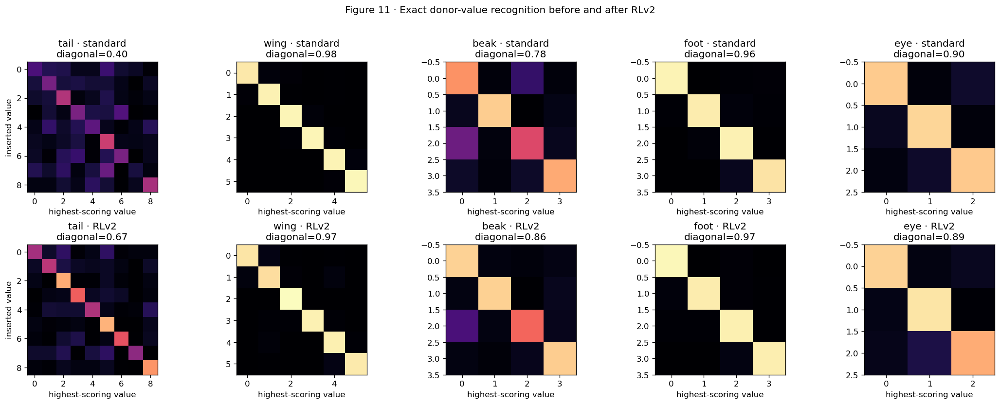


|  | regime | part | donor_value | n | recognition_rate | candidate_rate |
| --- | --- | --- | --- | --- | --- | --- |
| 0 | standard | tail | 0 | 75 | 0.240 | 0.640 |
| 1 | standard | tail | 1 | 90 | 0.344 | 0.533 |
| 2 | standard | tail | 2 | 120 | 0.492 | 0.408 |
| 3 | standard | tail | 3 | 110 | 0.355 | 0.573 |
| 4 | standard | tail | 4 | 110 | 0.282 | 0.518 |
| 5 | standard | tail | 5 | 150 | 0.553 | 0.373 |
| 6 | standard | tail | 6 | 130 | 0.354 | 0.515 |
| 7 | standard | tail | 7 | 35 | 0.114 | 0.800 |
| 8 | standard | tail | 8 | 180 | 0.467 | 0.478 |
| 9 | standard | wing | 0 | 130 | 0.954 | 0.031 |
| 10 | standard | wing | 1 | 150 | 0.973 | 0.027 |
| 11 | standard | wing | 2 | 220 | 0.982 | 0.009 |
| 12 | standard | wing | 3 | 115 | 0.983 | 0.017 |
| 13 | standard | wing | 4 | 175 | 0.977 | 0.023 |
| 14 | standard | wing | 5 | 210 | 0.986 | 0.014 |
| 15 | standard | beak | 0 | 345 | 0.771 | 0.200 |
| 16 | standard | beak | 1 | 245 | 0.898 | 0.098 |
| 17 | standard | beak | 2 | 190 | 0.595 | 0.363 |
| 18 | standard | beak | 3 | 220 | 0.823 | 0.173 |
| 19 | standard | foot | 0 | 220 | 0.977 | 0.009 |
| 20 | standard | foot | 1 | 240 | 0.962 | 0.038 |
| 21 | standard | foot | 2 | 290 | 0.976 | 0.024 |
| 22 | standard | foot | 3 | 250 | 0.944 | 0.056 |
| 23 | standard | eye | 0 | 300 | 0.893 | 0.100 |
| 24 | standard | eye | 1 | 345 | 0.916 | 0.072 |
| 25 | standard | eye | 2 | 355 | 0.890 | 0.096 |
| 26 | RLv2 | tail | 0 | 75 | 0.453 | 0.453 |
| 27 | RLv2 | tail | 1 | 90 | 0.511 | 0.367 |
| 28 | RLv2 | tail | 2 | 120 | 0.825 | 0.117 |
| 29 | RLv2 | tail | 3 | 110 | 0.664 | 0.200 |
| 30 | RLv2 | tail | 4 | 110 | 0.482 | 0.355 |
| 31 | RLv2 | tail | 5 | 150 | 0.840 | 0.107 |
| 32 | RLv2 | tail | 6 | 130 | 0.631 | 0.238 |
| 33 | RLv2 | tail | 7 | 35 | 0.400 | 0.486 |
| 34 | RLv2 | tail | 8 | 180 | 0.778 | 0.156 |
| 35 | RLv2 | wing | 0 | 130 | 0.946 | 0.015 |
| 36 | RLv2 | wing | 1 | 150 | 0.933 | 0.060 |
| 37 | RLv2 | wing | 2 | 220 | 1.000 | 0.000 |
| 38 | RLv2 | wing | 3 | 115 | 0.974 | 0.009 |
| 39 | RLv2 | wing | 4 | 175 | 0.971 | 0.023 |
| 40 | RLv2 | wing | 5 | 210 | 0.957 | 0.033 |
| 41 | RLv2 | beak | 0 | 345 | 0.910 | 0.061 |
| 42 | RLv2 | beak | 1 | 245 | 0.906 | 0.090 |
| 43 | RLv2 | beak | 2 | 190 | 0.679 | 0.289 |
| 44 | RLv2 | beak | 3 | 220 | 0.895 | 0.100 |
| 45 | RLv2 | foot | 0 | 220 | 0.986 | 0.000 |
| 46 | RLv2 | foot | 1 | 240 | 0.962 | 0.033 |
| 47 | RLv2 | foot | 2 | 290 | 0.972 | 0.021 |
| 48 | RLv2 | foot | 3 | 250 | 0.968 | 0.032 |
| 49 | RLv2 | eye | 0 | 300 | 0.907 | 0.083 |
| 50 | RLv2 | eye | 1 | 345 | 0.948 | 0.049 |
| 51 | RLv2 | eye | 2 | 355 | 0.825 | 0.158 |


**Exact executed Koh Standard/RLv2 comparison — Notebook 02rl `02rl-f13b-`**


|  | part | var_donor | n_rows | species_support | donor_wins_rate | donorward_source_wins_rate | no_donorward_source_wins_rate | regime |
| --- | --- | --- | --- | --- | --- | --- | --- | --- |
| 0 | beak | 0 | 345 | 21 | 0.783 | 0.200 | 0.017 | standard |
| 1 | beak | 1 | 245 | 10 | 0.898 | 0.098 | 0.004 | standard |
| 2 | beak | 2 | 190 | 6 | 0.621 | 0.363 | 0.016 | standard |
| 3 | beak | 3 | 220 | 13 | 0.823 | 0.173 | 0.005 | standard |
| 4 | eye | 0 | 300 | 15 | 0.893 | 0.100 | 0.007 | standard |
| 5 | eye | 1 | 345 | 16 | 0.916 | 0.072 | 0.012 | standard |
| 6 | eye | 2 | 355 | 19 | 0.890 | 0.096 | 0.014 | standard |
| 7 | foot | 0 | 220 | 13 | 0.977 | 0.009 | 0.014 | standard |
| 8 | foot | 1 | 240 | 10 | 0.962 | 0.038 | 0.000 | standard |
| 9 | foot | 2 | 290 | 14 | 0.976 | 0.024 | 0.000 | standard |
| 10 | foot | 3 | 250 | 13 | 0.944 | 0.056 | 0.000 | standard |
| 11 | tail | 0 | 75 | 4 | 0.293 | 0.640 | 0.067 | standard |
| 12 | tail | 1 | 90 | 5 | 0.367 | 0.533 | 0.100 | standard |
| 13 | tail | 2 | 120 | 7 | 0.525 | 0.408 | 0.067 | standard |
| 14 | tail | 3 | 110 | 7 | 0.382 | 0.573 | 0.045 | standard |
| 15 | tail | 4 | 110 | 4 | 0.318 | 0.518 | 0.164 | standard |
| 16 | tail | 5 | 150 | 8 | 0.580 | 0.373 | 0.047 | standard |
| 17 | tail | 6 | 130 | 5 | 0.362 | 0.515 | 0.123 | standard |
| 18 | tail | 7 | 35 | 2 | 0.114 | 0.800 | 0.086 | standard |
| 19 | tail | 8 | 180 | 8 | 0.467 | 0.478 | 0.056 | standard |
| 20 | wing | 0 | 130 | 5 | 0.969 | 0.031 | 0.000 | standard |
| 21 | wing | 1 | 150 | 9 | 0.973 | 0.027 | 0.000 | standard |
| 22 | wing | 2 | 220 | 11 | 0.991 | 0.009 | 0.000 | standard |
| 23 | wing | 3 | 115 | 5 | 0.983 | 0.017 | 0.000 | standard |
| 24 | wing | 4 | 175 | 10 | 0.977 | 0.023 | 0.000 | standard |
| 25 | wing | 5 | 210 | 10 | 0.986 | 0.014 | 0.000 | standard |
| 26 | beak | 0 | 345 | 21 | 0.922 | 0.061 | 0.017 | RLv2 |
| 27 | beak | 1 | 245 | 10 | 0.906 | 0.090 | 0.004 | RLv2 |
| 28 | beak | 2 | 190 | 6 | 0.705 | 0.289 | 0.005 | RLv2 |
| 29 | beak | 3 | 220 | 13 | 0.900 | 0.100 | 0.000 | RLv2 |
| 30 | eye | 0 | 300 | 15 | 0.907 | 0.083 | 0.010 | RLv2 |
| 31 | eye | 1 | 345 | 16 | 0.948 | 0.049 | 0.003 | RLv2 |
| 32 | eye | 2 | 355 | 19 | 0.825 | 0.158 | 0.017 | RLv2 |
| 33 | foot | 0 | 220 | 13 | 1.000 | 0.000 | 0.000 | RLv2 |
| 34 | foot | 1 | 240 | 10 | 0.967 | 0.033 | 0.000 | RLv2 |
| 35 | foot | 2 | 290 | 14 | 0.979 | 0.021 | 0.000 | RLv2 |
| 36 | foot | 3 | 250 | 13 | 0.968 | 0.032 | 0.000 | RLv2 |
| 37 | tail | 0 | 75 | 4 | 0.467 | 0.453 | 0.080 | RLv2 |
| 38 | tail | 1 | 90 | 5 | 0.533 | 0.367 | 0.100 | RLv2 |
| 39 | tail | 2 | 120 | 7 | 0.825 | 0.117 | 0.058 | RLv2 |
| 40 | tail | 3 | 110 | 7 | 0.709 | 0.200 | 0.091 | RLv2 |
| 41 | tail | 4 | 110 | 4 | 0.500 | 0.355 | 0.145 | RLv2 |
| 42 | tail | 5 | 150 | 8 | 0.847 | 0.107 | 0.047 | RLv2 |
| 43 | tail | 6 | 130 | 5 | 0.638 | 0.238 | 0.123 | RLv2 |
| 44 | tail | 7 | 35 | 2 | 0.400 | 0.486 | 0.114 | RLv2 |
| 45 | tail | 8 | 180 | 8 | 0.789 | 0.156 | 0.056 | RLv2 |
| 46 | wing | 0 | 130 | 5 | 0.985 | 0.015 | 0.000 | RLv2 |
| 47 | wing | 1 | 150 | 9 | 0.940 | 0.060 | 0.000 | RLv2 |
| 48 | wing | 2 | 220 | 11 | 1.000 | 0.000 | 0.000 | RLv2 |
| 49 | wing | 3 | 115 | 5 | 0.991 | 0.009 | 0.000 | RLv2 |
| 50 | wing | 4 | 175 | 10 | 0.977 | 0.023 | 0.000 | RLv2 |
| 51 | wing | 5 | 210 | 10 | 0.967 | 0.033 | 0.000 | RLv2 |


**Exact executed Koh Standard/RLv2 comparison — Notebook 02rl `02rl-f13c-`**


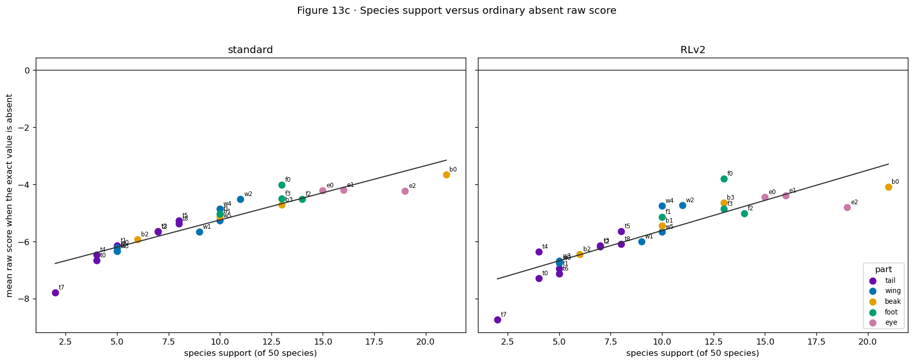


|  | regime | part | concept | value | species_support | N_absent | absent_mean | absent_SD |
| --- | --- | --- | --- | --- | --- | --- | --- | --- |
| 0 | standard | beak | beak_0 | 0 | 21 | 290 | -3.652 | 0.831 |
| 1 | standard | beak | beak_1 | 1 | 10 | 400 | -5.119 | 1.026 |
| 2 | standard | beak | beak_2 | 2 | 6 | 440 | -5.939 | 1.201 |
| 3 | standard | beak | beak_3 | 3 | 13 | 370 | -4.720 | 0.993 |
| 4 | standard | eye | eye_0 | 0 | 15 | 350 | -4.209 | 1.061 |
| 5 | standard | eye | eye_1 | 1 | 16 | 340 | -4.189 | 0.826 |
| 6 | standard | eye | eye_2 | 2 | 19 | 310 | -4.239 | 1.056 |
| 7 | standard | foot | foot_0 | 0 | 13 | 370 | -4.025 | 0.884 |
| 8 | standard | foot | foot_1 | 1 | 10 | 400 | -5.043 | 0.844 |
| 9 | standard | foot | foot_2 | 2 | 14 | 360 | -4.513 | 0.861 |
| 10 | standard | foot | foot_3 | 3 | 13 | 370 | -4.500 | 0.875 |
| 11 | standard | tail | tail_0 | 0 | 4 | 460 | -6.666 | 1.206 |
| 12 | standard | tail | tail_1 | 1 | 5 | 450 | -6.145 | 1.455 |
| 13 | standard | tail | tail_2 | 2 | 7 | 430 | -5.650 | 1.340 |
| 14 | standard | tail | tail_3 | 3 | 7 | 430 | -5.656 | 1.329 |
| 15 | standard | tail | tail_4 | 4 | 4 | 460 | -6.460 | 1.370 |
| 16 | standard | tail | tail_5 | 5 | 8 | 420 | -5.275 | 1.391 |
| 17 | standard | tail | tail_6 | 6 | 5 | 450 | -6.328 | 1.219 |
| 18 | standard | tail | tail_7 | 7 | 2 | 480 | -7.784 | 1.439 |
| 19 | standard | tail | tail_8 | 8 | 8 | 420 | -5.378 | 1.182 |
| 20 | standard | wing | wing_0 | 0 | 5 | 450 | -6.216 | 0.975 |
| 21 | standard | wing | wing_1 | 1 | 9 | 410 | -5.657 | 0.906 |
| 22 | standard | wing | wing_2 | 2 | 11 | 390 | -4.516 | 0.772 |
| 23 | standard | wing | wing_3 | 3 | 5 | 450 | -6.348 | 1.082 |
| 24 | standard | wing | wing_4 | 4 | 10 | 400 | -4.854 | 0.936 |
| 25 | standard | wing | wing_5 | 5 | 10 | 400 | -5.269 | 0.787 |
| 26 | RLv2 | beak | beak_0 | 0 | 21 | 294 | -4.089 | 1.063 |
| 27 | RLv2 | beak | beak_1 | 1 | 10 | 400 | -5.456 | 1.065 |
| 28 | RLv2 | beak | beak_2 | 2 | 6 | 440 | -6.446 | 1.257 |
| 29 | RLv2 | beak | beak_3 | 3 | 13 | 371 | -4.650 | 1.152 |
| 30 | RLv2 | eye | eye_0 | 0 | 15 | 352 | -4.450 | 1.241 |
| 31 | RLv2 | eye | eye_1 | 1 | 16 | 342 | -4.385 | 1.141 |
| 32 | RLv2 | eye | eye_2 | 2 | 19 | 312 | -4.797 | 1.224 |
| 33 | RLv2 | foot | foot_0 | 0 | 13 | 370 | -3.798 | 0.950 |
| 34 | RLv2 | foot | foot_1 | 1 | 10 | 400 | -5.149 | 0.830 |
| 35 | RLv2 | foot | foot_2 | 2 | 14 | 360 | -5.020 | 0.893 |
| 36 | RLv2 | foot | foot_3 | 3 | 13 | 371 | -4.853 | 0.946 |
| 37 | RLv2 | tail | tail_0 | 0 | 4 | 469 | -7.297 | 1.349 |
| 38 | RLv2 | tail | tail_1 | 1 | 5 | 466 | -6.946 | 1.536 |
| 39 | RLv2 | tail | tail_2 | 2 | 7 | 439 | -6.187 | 1.488 |
| 40 | RLv2 | tail | tail_3 | 3 | 7 | 441 | -6.138 | 1.571 |
| 41 | RLv2 | tail | tail_4 | 4 | 4 | 478 | -6.358 | 1.460 |
| 42 | RLv2 | tail | tail_5 | 5 | 8 | 426 | -5.638 | 1.628 |
| 43 | RLv2 | tail | tail_6 | 6 | 5 | 457 | -7.122 | 1.432 |
| 44 | RLv2 | tail | tail_7 | 7 | 2 | 490 | -8.742 | 1.410 |
| 45 | RLv2 | tail | tail_8 | 8 | 8 | 428 | -6.097 | 1.300 |
| 46 | RLv2 | wing | wing_0 | 0 | 5 | 450 | -6.754 | 1.024 |
| 47 | RLv2 | wing | wing_1 | 1 | 9 | 410 | -5.996 | 0.949 |
| 48 | RLv2 | wing | wing_2 | 2 | 11 | 390 | -4.737 | 0.799 |
| 49 | RLv2 | wing | wing_3 | 3 | 5 | 450 | -6.682 | 1.133 |
| 50 | RLv2 | wing | wing_4 | 4 | 10 | 401 | -4.745 | 1.113 |
| 51 | RLv2 | wing | wing_5 | 5 | 10 | 400 | -5.670 | 0.813 |


### MCBM per-value audit


Every row below is one donor value at one gamma. It reports its row count,
original-image count, support, label/mask conflict, corrected visible pixels,
donor gain, source decrease, total response, final margin, and exact outcome.
This is the correct level for questions such as “why did foot improve while
wing worsened?”: a part average cannot reveal whether one value dominates.


The heatmaps summarize the complete exact-value table by part. They provide descriptive comparisons.


### Executed Standard-MCBM result — values


**Table — complete donor-value audit before averaging by part.** One row is one gamma, part, and inserted exact value. Counts state the denominators. Pixel area, label/mask conflict, species support, donor gain, source decrease, final margin, and exact recognition are kept separate so a part mean cannot hide a difficult value.


|  | gamma | part | donor_value | n_rows | n_originals | donor_species_support | donor_positive_training_records | donor_conflict_rate | mean_corrected_visible_pixels | mean_z_original_margin | mean_z_donor_gain | mean_z_source_decrease | mean_z_response | median_z_final_margin | no_donorward_movement_rate | responded_but_source_above_donor_rate | exact_donor_recognition | exact_source_winner_rate | exact_third_winner_rate | h_exact_valid_rate | h_calibrated_exact_donor_recognition |
| --- | --- | --- | --- | --- | --- | --- | --- | --- | --- | --- | --- | --- | --- | --- | --- | --- | --- | --- | --- | --- | --- |
| 0 | 0.0 | beak | 3 | 220 | 135 | 13 | 9767 | 0.0026 | 207.3773 | -25.8294 | 11.9193 | 15.0781 | 26.9975 | -1.1313 | 0.0273 | 0.5409 | 0.4136 | 0.5091 | 0.0773 | 1.0 | 0.7091 |
| 1 | 0.0 | beak | 0 | 345 | 120 | 21 | 15819 | 0.0133 | 99.5449 | -32.6196 | 18.3194 | 14.4421 | 32.7615 | -0.1666 | 0.0000 | 0.5159 | 0.4522 | 0.5072 | 0.0406 | 1.0 | 0.5246 |
| 2 | 0.0 | beak | 2 | 190 | 125 | 6 | 4555 | 0.0182 | 22.0526 | -16.2412 | 9.0811 | 10.4350 | 19.5160 | 2.0059 | 0.0211 | 0.4474 | 0.5105 | 0.4526 | 0.0368 | 1.0 | 0.4526 |
| 3 | 0.0 | beak | 1 | 245 | 145 | 10 | 7476 | 0.0066 | 316.1306 | -25.5281 | 20.3876 | 16.4192 | 36.8067 | 9.7463 | 0.0041 | 0.1347 | 0.8408 | 0.1306 | 0.0286 | 1.0 | 0.5755 |
| 4 | 0.0 | eye | 2 | 355 | 150 | 19 | 14348 | 0.0072 | 137.9887 | -27.8271 | 14.1224 | 12.0004 | 26.1228 | -1.0347 | 0.0141 | 0.5577 | 0.4282 | 0.5718 | 0.0000 | 1.0 | 0.4845 |
| 5 | 0.0 | eye | 0 | 300 | 160 | 15 | 11384 | 0.0059 | 136.0067 | -30.9679 | 12.9614 | 9.8902 | 22.8516 | -8.0416 | 0.0033 | 0.7800 | 0.2033 | 0.7567 | 0.0400 | 1.0 | 0.3367 |
| 6 | 0.0 | eye | 1 | 345 | 155 | 16 | 11994 | 0.0081 | 159.9391 | -24.7329 | 19.2999 | 13.9284 | 33.2282 | 9.0024 | 0.0029 | 0.1768 | 0.8174 | 0.1710 | 0.0116 | 1.0 | 0.6725 |
| 7 | 0.0 | foot | 0 | 220 | 145 | 13 | 9829 | 0.0002 | 389.4409 | -29.0482 | 24.5792 | 21.9282 | 46.5074 | 18.4176 | 0.0000 | 0.0273 | 0.9727 | 0.0182 | 0.0091 | 1.0 | 0.9500 |
| 8 | 0.0 | foot | 2 | 290 | 155 | 14 | 10552 | 0.0013 | 351.6241 | -35.7251 | 23.0633 | 23.9659 | 47.0292 | 14.2060 | 0.0000 | 0.0655 | 0.9345 | 0.0655 | 0.0000 | 1.0 | 0.9621 |
| 9 | 0.0 | foot | 1 | 240 | 160 | 10 | 7584 | 0.0028 | 208.2625 | -20.4365 | 14.8511 | 18.9911 | 33.8422 | 13.1422 | 0.0000 | 0.0708 | 0.9292 | 0.0708 | 0.0000 | 1.0 | 0.9167 |
| 10 | 0.0 | foot | 3 | 250 | 135 | 13 | 9758 | 0.0011 | 367.4920 | -22.5843 | 14.3254 | 19.3622 | 33.6876 | 11.6077 | 0.0040 | 0.1120 | 0.8720 | 0.1160 | 0.0120 | 1.0 | 0.8800 |
| 11 | 0.0 | tail | 6 | 130 | 100 | 5 | 3752 | 0.1924 | 152.8462 | -17.7572 | 2.9880 | 12.0626 | 15.0506 | -3.8822 | 0.1538 | 0.4692 | 0.1846 | 0.4385 | 0.3769 | 1.0 | 0.2154 |
| 12 | 0.0 | tail | 1 | 90 | 85 | 5 | 3745 | 0.3525 | 115.2333 | -19.3902 | 2.9178 | 12.0935 | 15.0113 | -5.7050 | 0.1444 | 0.5778 | 0.1444 | 0.4556 | 0.4000 | 1.0 | 0.1333 |
| 13 | 0.0 | tail | 8 | 180 | 110 | 8 | 6059 | 0.1149 | 76.7667 | -18.9375 | 4.9237 | 12.3142 | 17.2378 | -1.9127 | 0.0889 | 0.4889 | 0.3222 | 0.4833 | 0.1944 | 1.0 | 0.3222 |
| 14 | 0.0 | tail | 4 | 110 | 90 | 4 | 3043 | 0.3911 | 99.7636 | -17.1955 | 2.1795 | 10.3862 | 12.5658 | -6.7797 | 0.2182 | 0.5091 | 0.1273 | 0.5636 | 0.3091 | 1.0 | 0.1909 |
| 15 | 0.0 | tail | 3 | 110 | 85 | 7 | 5285 | 0.1915 | 156.8545 | -31.6653 | 14.1281 | 12.7446 | 26.8727 | -4.9561 | 0.0727 | 0.5273 | 0.3727 | 0.4182 | 0.2091 | 1.0 | 0.2727 |
| 16 | 0.0 | tail | 2 | 120 | 90 | 7 | 5224 | 0.1181 | 83.2250 | -33.4244 | 16.2715 | 12.6172 | 28.8888 | -6.5788 | 0.0667 | 0.6000 | 0.3167 | 0.4750 | 0.2083 | 1.0 | 0.3167 |
| 17 | 0.0 | tail | 5 | 150 | 120 | 8 | 6030 | 0.1119 | 69.1733 | -17.1442 | 7.7149 | 9.6221 | 17.3370 | 0.4463 | 0.1000 | 0.3733 | 0.4467 | 0.3933 | 0.1600 | 1.0 | 0.1200 |
| 18 | 0.0 | tail | 0 | 75 | 70 | 4 | 3033 | 0.2169 | 183.6800 | -18.7195 | 1.5641 | 10.3811 | 11.9451 | -6.9875 | 0.1867 | 0.6667 | 0.0667 | 0.5867 | 0.3467 | 1.0 | 0.0667 |
| 19 | 0.0 | tail | 7 | 35 | 35 | 2 | 1536 | 0.3900 | 106.6000 | -13.3666 | 0.0000 | 14.0498 | 14.0498 | 2.6741 | 0.1143 | 0.3714 | 0.5143 | 0.4857 | 0.0000 | 1.0 | 0.2571 |
| 20 | 0.0 | wing | 5 | 210 | 150 | 10 | 7504 | 0.0007 | 758.6333 | -23.6973 | 12.4290 | 21.1022 | 33.5312 | 12.0724 | 0.0000 | 0.1619 | 0.8048 | 0.1571 | 0.0381 | 1.0 | 0.8095 |
| 21 | 0.0 | wing | 1 | 150 | 100 | 9 | 6815 | 0.0003 | 740.4467 | -24.8854 | 12.1204 | 23.5641 | 35.6845 | 10.7412 | 0.0000 | 0.1200 | 0.8133 | 0.1000 | 0.0867 | 1.0 | 0.8333 |
| 22 | 0.0 | wing | 0 | 130 | 115 | 5 | 3774 | 0.0003 | 764.8923 | -24.0243 | 18.7146 | 22.6199 | 41.3345 | 16.8841 | 0.0000 | 0.0923 | 0.8923 | 0.0692 | 0.0385 | 1.0 | 0.8846 |
| 23 | 0.0 | wing | 3 | 115 | 95 | 5 | 3794 | 0.0000 | 769.7478 | -22.8529 | 12.1026 | 19.8986 | 32.0012 | 10.8740 | 0.0000 | 0.2435 | 0.6783 | 0.1478 | 0.1739 | 1.0 | 0.6522 |
| 24 | 0.0 | wing | 2 | 220 | 140 | 11 | 8190 | 0.0004 | 937.6273 | -32.3737 | 20.3451 | 24.9233 | 45.2683 | 13.7799 | 0.0000 | 0.0818 | 0.8864 | 0.0682 | 0.0455 | 1.0 | 0.9227 |
| 25 | 0.0 | wing | 4 | 175 | 135 | 10 | 7611 | 0.0001 | 833.4629 | -35.0584 | 23.2025 | 20.0829 | 43.2854 | 8.9783 | 0.0000 | 0.1886 | 0.7486 | 0.1543 | 0.0971 | 1.0 | 0.7371 |
| 26 | 0.1 | beak | 3 | 220 | 135 | 13 | 9767 | 0.0026 | 207.3773 | -18.5167 | 10.4875 | 11.3640 | 21.8515 | 3.3135 | 0.0000 | 0.3409 | 0.6545 | 0.3409 | 0.0045 | 1.0 | 0.7091 |
| 27 | 0.1 | beak | 0 | 345 | 120 | 21 | 15819 | 0.0133 | 99.5449 | -18.3429 | 10.0687 | 11.1607 | 21.2294 | 4.0296 | 0.0000 | 0.3594 | 0.6319 | 0.3536 | 0.0145 | 1.0 | 0.6435 |
| 28 | 0.1 | beak | 2 | 190 | 125 | 6 | 4555 | 0.0182 | 22.0526 | -18.1678 | 7.1523 | 8.7015 | 15.8539 | -4.0116 | 0.0053 | 0.6105 | 0.3105 | 0.6158 | 0.0737 | 1.0 | 0.2737 |
| 29 | 0.1 | beak | 1 | 245 | 145 | 10 | 7476 | 0.0066 | 316.1306 | -21.1899 | 12.0197 | 10.2607 | 22.2805 | 0.7869 | 0.0041 | 0.4204 | 0.5755 | 0.4245 | 0.0000 | 1.0 | 0.5837 |
| 30 | 0.1 | eye | 2 | 355 | 150 | 19 | 14348 | 0.0072 | 137.9887 | -18.9389 | 8.8681 | 10.3756 | 19.2437 | -0.3961 | 0.0254 | 0.5070 | 0.4676 | 0.5324 | 0.0000 | 1.0 | 0.5239 |
| 31 | 0.1 | eye | 0 | 300 | 160 | 15 | 11384 | 0.0059 | 136.0067 | -17.1456 | 7.4478 | 10.5573 | 18.0050 | 1.0185 | 0.0100 | 0.4667 | 0.5233 | 0.4767 | 0.0000 | 1.0 | 0.5067 |
| 32 | 0.1 | eye | 1 | 345 | 155 | 16 | 11994 | 0.0081 | 159.9391 | -16.2390 | 9.9695 | 12.0433 | 22.0128 | 6.3492 | 0.0029 | 0.1681 | 0.8290 | 0.1681 | 0.0029 | 1.0 | 0.8232 |
| 33 | 0.1 | foot | 0 | 220 | 145 | 13 | 9829 | 0.0002 | 389.4409 | -25.2225 | 21.3343 | 21.8662 | 43.2005 | 18.4285 | 0.0136 | 0.0091 | 0.9773 | 0.0227 | 0.0000 | 1.0 | 0.9773 |
| 34 | 0.1 | foot | 2 | 290 | 155 | 14 | 10552 | 0.0013 | 351.6241 | -26.9308 | 20.2422 | 22.3618 | 42.6040 | 15.7635 | 0.0000 | 0.0241 | 0.9759 | 0.0207 | 0.0034 | 1.0 | 0.9759 |
| 35 | 0.1 | foot | 1 | 240 | 160 | 10 | 7584 | 0.0028 | 208.2625 | -20.6751 | 17.5842 | 20.7796 | 38.3638 | 19.1215 | 0.0000 | 0.0083 | 0.9917 | 0.0083 | 0.0000 | 1.0 | 0.9917 |
| 36 | 0.1 | foot | 3 | 250 | 135 | 13 | 9758 | 0.0011 | 367.4920 | -26.0045 | 17.7116 | 21.8089 | 39.5205 | 13.6807 | 0.0000 | 0.0320 | 0.9680 | 0.0320 | 0.0000 | 1.0 | 0.9680 |
| 37 | 0.1 | tail | 6 | 130 | 100 | 5 | 3752 | 0.1924 | 152.8462 | -16.7452 | 3.4473 | 5.0935 | 8.5408 | -7.3011 | 0.1385 | 0.7769 | 0.0615 | 0.8846 | 0.0538 | 1.0 | 0.0692 |
| 38 | 0.1 | tail | 1 | 90 | 85 | 5 | 3745 | 0.3525 | 115.2333 | -15.1939 | 2.7387 | 6.5249 | 9.2636 | -6.8957 | 0.1111 | 0.7444 | 0.0889 | 0.7222 | 0.1889 | 1.0 | 0.1111 |
| 39 | 0.1 | tail | 8 | 180 | 110 | 8 | 6059 | 0.1149 | 76.7667 | -15.5133 | 6.3557 | 6.0496 | 12.4054 | -4.1911 | 0.0889 | 0.6222 | 0.2889 | 0.6944 | 0.0167 | 1.0 | 0.2889 |
| 40 | 0.1 | tail | 4 | 110 | 90 | 4 | 3043 | 0.3911 | 99.7636 | -13.6869 | 1.9375 | 6.0321 | 7.9696 | -5.4716 | 0.2000 | 0.6091 | 0.0909 | 0.7364 | 0.1727 | 1.0 | 0.0818 |
| 41 | 0.1 | tail | 3 | 110 | 85 | 7 | 5285 | 0.1915 | 156.8545 | -16.6338 | 5.6761 | 5.8259 | 11.5020 | -5.7311 | 0.0727 | 0.7182 | 0.1909 | 0.6727 | 0.1364 | 1.0 | 0.1909 |
| 42 | 0.1 | tail | 2 | 120 | 90 | 7 | 5224 | 0.1181 | 83.2250 | -13.2795 | 3.7466 | 6.5378 | 10.2844 | -4.6494 | 0.0833 | 0.5583 | 0.3583 | 0.6417 | 0.0000 | 1.0 | 0.3167 |
| 43 | 0.1 | tail | 5 | 150 | 120 | 8 | 6030 | 0.1119 | 69.1733 | -15.7587 | 5.8904 | 6.6774 | 12.5678 | -4.0346 | 0.0733 | 0.5533 | 0.3133 | 0.5867 | 0.1000 | 1.0 | 0.3467 |
| 44 | 0.1 | tail | 0 | 75 | 70 | 4 | 3033 | 0.2169 | 183.6800 | -17.1910 | 3.4878 | 5.3462 | 8.8339 | -8.9460 | 0.0800 | 0.7867 | 0.0533 | 0.8267 | 0.1200 | 1.0 | 0.0533 |
| 45 | 0.1 | tail | 7 | 35 | 35 | 2 | 1536 | 0.3900 | 106.6000 | -16.0355 | 1.6271 | 6.5563 | 8.1834 | -7.4371 | 0.0857 | 0.8571 | 0.0571 | 0.8286 | 0.1143 | 1.0 | 0.0571 |
| 46 | 0.1 | wing | 5 | 210 | 150 | 10 | 7504 | 0.0007 | 758.6333 | -19.6356 | 15.8701 | 18.8529 | 34.7230 | 17.4350 | 0.0048 | 0.0762 | 0.9190 | 0.0714 | 0.0095 | 1.0 | 0.9000 |
| 47 | 0.1 | wing | 1 | 150 | 100 | 9 | 6815 | 0.0003 | 740.4467 | -21.8682 | 12.9474 | 21.6960 | 34.6434 | 14.1190 | 0.0000 | 0.0933 | 0.8600 | 0.0933 | 0.0467 | 1.0 | 0.8467 |
| 48 | 0.1 | wing | 0 | 130 | 115 | 5 | 3774 | 0.0003 | 764.8923 | -21.4146 | 13.3178 | 20.2904 | 33.6081 | 12.7451 | 0.0000 | 0.0846 | 0.8615 | 0.0846 | 0.0538 | 1.0 | 0.8846 |
| 49 | 0.1 | wing | 3 | 115 | 95 | 5 | 3794 | 0.0000 | 769.7478 | -27.3564 | 17.3414 | 19.2514 | 36.5928 | 11.5688 | 0.0000 | 0.1565 | 0.8174 | 0.0957 | 0.0870 | 1.0 | 0.8174 |
| 50 | 0.1 | wing | 2 | 220 | 140 | 11 | 8190 | 0.0004 | 937.6273 | -25.0553 | 18.2404 | 20.5788 | 38.8191 | 14.4127 | 0.0000 | 0.0364 | 0.9500 | 0.0364 | 0.0136 | 1.0 | 0.9500 |
| 51 | 0.1 | wing | 4 | 175 | 135 | 10 | 7611 | 0.0001 | 833.4629 | -26.7125 | 17.0594 | 19.9987 | 37.0581 | 12.2739 | 0.0000 | 0.1429 | 0.8229 | 0.1314 | 0.0457 | 1.0 | 0.8800 |
| 52 | 0.3 | beak | 3 | 220 | 135 | 13 | 9767 | 0.0026 | 207.3773 | -15.9933 | 9.2495 | 10.6685 | 19.9180 | 2.5580 | 0.0000 | 0.3455 | 0.6000 | 0.3409 | 0.0591 | 1.0 | 0.6000 |
| 53 | 0.3 | beak | 0 | 345 | 120 | 21 | 15819 | 0.0133 | 99.5449 | -19.4315 | 11.0200 | 9.9153 | 20.9353 | 0.8184 | 0.0000 | 0.4464 | 0.5333 | 0.4406 | 0.0261 | 1.0 | 0.5246 |
| 54 | 0.3 | beak | 2 | 190 | 125 | 6 | 4555 | 0.0182 | 22.0526 | -15.7245 | 5.8945 | 7.6600 | 13.5545 | -3.3941 | 0.0053 | 0.6579 | 0.3000 | 0.6632 | 0.0368 | 1.0 | 0.3000 |
| 55 | 0.3 | beak | 1 | 245 | 145 | 10 | 7476 | 0.0066 | 316.1306 | -21.4123 | 14.5624 | 10.5283 | 25.0908 | 2.9066 | 0.0041 | 0.2694 | 0.7224 | 0.2653 | 0.0122 | 1.0 | 0.7551 |
| 56 | 0.3 | eye | 2 | 355 | 150 | 19 | 14348 | 0.0072 | 137.9887 | -17.2274 | 8.8491 | 9.5308 | 18.3799 | 0.9409 | 0.0225 | 0.4394 | 0.5380 | 0.4535 | 0.0085 | 1.0 | 0.5324 |
| 57 | 0.3 | eye | 0 | 300 | 160 | 15 | 11384 | 0.0059 | 136.0067 | -16.6506 | 8.6188 | 8.3260 | 16.9448 | -1.6341 | 0.0033 | 0.5667 | 0.4300 | 0.5600 | 0.0100 | 1.0 | 0.4300 |
| 58 | 0.3 | eye | 1 | 345 | 155 | 16 | 11994 | 0.0081 | 159.9391 | -15.6941 | 11.3960 | 10.1899 | 21.5859 | 6.3915 | 0.0145 | 0.1565 | 0.8377 | 0.1594 | 0.0029 | 1.0 | 0.8435 |
| 59 | 0.3 | foot | 0 | 220 | 145 | 13 | 9829 | 0.0002 | 389.4409 | -27.5918 | 20.9848 | 21.5205 | 42.5053 | 16.3559 | 0.0000 | 0.0273 | 0.9727 | 0.0273 | 0.0000 | 1.0 | 0.9727 |
| 60 | 0.3 | foot | 2 | 290 | 155 | 14 | 10552 | 0.0013 | 351.6241 | -21.6136 | 16.9099 | 22.0863 | 38.9962 | 17.3376 | 0.0000 | 0.0207 | 0.9759 | 0.0207 | 0.0034 | 1.0 | 0.9759 |
| 61 | 0.3 | foot | 1 | 240 | 160 | 10 | 7584 | 0.0028 | 208.2625 | -20.7602 | 18.2075 | 21.0593 | 39.2669 | 18.6972 | 0.0000 | 0.0167 | 0.9833 | 0.0167 | 0.0000 | 1.0 | 0.9833 |
| 62 | 0.3 | foot | 3 | 250 | 135 | 13 | 9758 | 0.0011 | 367.4920 | -25.8053 | 15.3409 | 21.4262 | 36.7671 | 13.1048 | 0.0000 | 0.1000 | 0.9000 | 0.1000 | 0.0000 | 1.0 | 0.9000 |
| 63 | 0.3 | tail | 6 | 130 | 100 | 5 | 3752 | 0.1924 | 152.8462 | -13.9082 | 1.7751 | 4.3541 | 6.1291 | -8.2986 | 0.1231 | 0.7846 | 0.0615 | 0.8538 | 0.0846 | 1.0 | 0.0538 |
| 64 | 0.3 | tail | 1 | 90 | 85 | 5 | 3745 | 0.3525 | 115.2333 | -13.5432 | 2.5897 | 6.3589 | 8.9487 | -4.9874 | 0.1000 | 0.6889 | 0.1556 | 0.7444 | 0.1000 | 1.0 | 0.1222 |
| 65 | 0.3 | tail | 8 | 180 | 110 | 8 | 6059 | 0.1149 | 76.7667 | -13.6336 | 4.1537 | 4.6830 | 8.8368 | -6.5875 | 0.0722 | 0.7500 | 0.1778 | 0.7833 | 0.0389 | 1.0 | 0.1611 |
| 66 | 0.3 | tail | 4 | 110 | 90 | 4 | 3043 | 0.3911 | 99.7636 | -14.3906 | 1.6766 | 5.5440 | 7.2207 | -7.8179 | 0.1455 | 0.7182 | 0.0727 | 0.8000 | 0.1273 | 1.0 | 0.0727 |
| 67 | 0.3 | tail | 3 | 110 | 85 | 7 | 5285 | 0.1915 | 156.8545 | -15.5128 | 3.9558 | 5.4207 | 9.3766 | -7.2358 | 0.0455 | 0.7727 | 0.1818 | 0.7091 | 0.1091 | 1.0 | 0.1818 |
| 68 | 0.3 | tail | 2 | 120 | 90 | 7 | 5224 | 0.1181 | 83.2250 | -14.2061 | 2.5481 | 4.9041 | 7.4522 | -7.8835 | 0.0583 | 0.8333 | 0.0750 | 0.8333 | 0.0917 | 1.0 | 0.0833 |
| 69 | 0.3 | tail | 5 | 150 | 120 | 8 | 6030 | 0.1119 | 69.1733 | -13.7812 | 2.3336 | 4.6644 | 6.9980 | -7.6762 | 0.0533 | 0.8333 | 0.0867 | 0.8333 | 0.0800 | 1.0 | 0.0933 |
| 70 | 0.3 | tail | 0 | 75 | 70 | 4 | 3033 | 0.2169 | 183.6800 | -14.3451 | 2.2143 | 4.5466 | 6.7610 | -8.4524 | 0.0800 | 0.8400 | 0.0267 | 0.8533 | 0.1200 | 1.0 | 0.0267 |
| 71 | 0.3 | tail | 7 | 35 | 35 | 2 | 1536 | 0.3900 | 106.6000 | -13.7558 | 1.1711 | 5.6939 | 6.8650 | -8.5554 | 0.0857 | 0.8286 | 0.0857 | 0.8571 | 0.0571 | 1.0 | 0.0857 |
| 72 | 0.3 | wing | 5 | 210 | 150 | 10 | 7504 | 0.0007 | 758.6333 | -26.1881 | 21.4690 | 18.5645 | 40.0335 | 16.6569 | 0.0000 | 0.1000 | 0.8952 | 0.0952 | 0.0095 | 1.0 | 0.8857 |
| 73 | 0.3 | wing | 1 | 150 | 100 | 9 | 6815 | 0.0003 | 740.4467 | -20.0993 | 13.0476 | 17.6386 | 30.6862 | 11.2365 | 0.0000 | 0.1267 | 0.8200 | 0.1200 | 0.0600 | 1.0 | 0.8200 |
| 74 | 0.3 | wing | 0 | 130 | 115 | 5 | 3774 | 0.0003 | 764.8923 | -26.0344 | 18.7416 | 19.4756 | 38.2172 | 12.4489 | 0.0000 | 0.0462 | 0.9538 | 0.0462 | 0.0000 | 1.0 | 0.9538 |
| 75 | 0.3 | wing | 3 | 115 | 95 | 5 | 3794 | 0.0000 | 769.7478 | -18.1757 | 9.9140 | 16.3933 | 26.3073 | 9.0226 | 0.0000 | 0.2174 | 0.7043 | 0.1565 | 0.1391 | 1.0 | 0.6957 |
| 76 | 0.3 | wing | 2 | 220 | 140 | 11 | 8190 | 0.0004 | 937.6273 | -23.6921 | 18.0991 | 18.4792 | 36.5783 | 13.5586 | 0.0000 | 0.0318 | 0.9636 | 0.0318 | 0.0045 | 1.0 | 0.9636 |
| 77 | 0.3 | wing | 4 | 175 | 135 | 10 | 7611 | 0.0001 | 833.4629 | -21.4781 | 14.0473 | 17.5518 | 31.5991 | 12.2792 | 0.0000 | 0.1714 | 0.8114 | 0.1714 | 0.0171 | 1.0 | 0.8114 |
| 78 | 1.0 | beak | 3 | 220 | 135 | 13 | 9767 | 0.0026 | 207.3773 | -16.2734 | 11.2557 | 13.0035 | 24.2593 | 9.6903 | 0.0000 | 0.0909 | 0.9045 | 0.0909 | 0.0045 | 1.0 | 0.9318 |
| 79 | 1.0 | beak | 0 | 345 | 120 | 21 | 15819 | 0.0133 | 99.5449 | -14.8445 | 7.6929 | 9.4190 | 17.1119 | 3.8490 | 0.0261 | 0.3884 | 0.5536 | 0.4116 | 0.0348 | 1.0 | 0.5739 |
| 80 | 1.0 | beak | 2 | 190 | 125 | 6 | 4555 | 0.0182 | 22.0526 | -16.2742 | 8.8246 | 12.6769 | 21.5015 | 5.4377 | 0.0158 | 0.2684 | 0.7000 | 0.2737 | 0.0263 | 1.0 | 0.6842 |
| 81 | 1.0 | beak | 1 | 245 | 145 | 10 | 7476 | 0.0066 | 316.1306 | -18.7769 | 14.1480 | 12.9024 | 27.0505 | 10.5926 | 0.0122 | 0.0612 | 0.9265 | 0.0735 | 0.0000 | 1.0 | 0.9265 |
| 82 | 1.0 | eye | 2 | 355 | 150 | 19 | 14348 | 0.0072 | 137.9887 | -16.0349 | 7.3924 | 9.0296 | 16.4220 | 0.1766 | 0.0310 | 0.4676 | 0.5014 | 0.4986 | 0.0000 | 1.0 | 0.5070 |
| 83 | 1.0 | eye | 0 | 300 | 160 | 15 | 11384 | 0.0059 | 136.0067 | -16.7180 | 6.6307 | 7.9856 | 14.6164 | -2.4307 | 0.0133 | 0.5700 | 0.4033 | 0.5700 | 0.0267 | 1.0 | 0.4033 |
| 84 | 1.0 | eye | 1 | 345 | 155 | 16 | 11994 | 0.0081 | 159.9391 | -14.5827 | 8.9569 | 9.6038 | 18.5607 | 5.5046 | 0.0145 | 0.3246 | 0.6609 | 0.3275 | 0.0116 | 1.0 | 0.6522 |
| 85 | 1.0 | foot | 0 | 220 | 145 | 13 | 9829 | 0.0002 | 389.4409 | -21.3114 | 20.8770 | 19.3606 | 40.2376 | 18.5816 | 0.0000 | 0.0000 | 1.0000 | 0.0000 | 0.0000 | 1.0 | 1.0000 |
| 86 | 1.0 | foot | 2 | 290 | 155 | 14 | 10552 | 0.0013 | 351.6241 | -19.1078 | 14.8561 | 17.0285 | 31.8846 | 16.5498 | 0.0069 | 0.1207 | 0.8414 | 0.1207 | 0.0379 | 1.0 | 0.8517 |
| 87 | 1.0 | foot | 1 | 240 | 160 | 10 | 7584 | 0.0028 | 208.2625 | -24.3963 | 18.7687 | 18.5582 | 37.3269 | 14.7397 | 0.0042 | 0.0417 | 0.9542 | 0.0458 | 0.0000 | 1.0 | 0.9542 |
| 88 | 1.0 | foot | 3 | 250 | 135 | 13 | 9758 | 0.0011 | 367.4920 | -16.9419 | 16.9093 | 18.0944 | 35.0037 | 19.1621 | 0.0040 | 0.0000 | 0.9960 | 0.0040 | 0.0000 | 1.0 | 0.9960 |
| 89 | 1.0 | tail | 6 | 130 | 100 | 5 | 3752 | 0.1924 | 152.8462 | -13.3711 | 3.0350 | 5.7390 | 8.7740 | -5.3898 | 0.1231 | 0.6000 | 0.2692 | 0.6462 | 0.0846 | 1.0 | 0.2692 |
| 90 | 1.0 | tail | 1 | 90 | 85 | 5 | 3745 | 0.3525 | 115.2333 | -11.6549 | 1.8395 | 6.1404 | 7.9799 | -4.8142 | 0.1000 | 0.6556 | 0.1667 | 0.7111 | 0.1222 | 1.0 | 0.1444 |
| 91 | 1.0 | tail | 8 | 180 | 110 | 8 | 6059 | 0.1149 | 76.7667 | -12.6289 | 3.4422 | 5.2681 | 8.7103 | -4.9960 | 0.0556 | 0.7056 | 0.2333 | 0.7500 | 0.0167 | 1.0 | 0.2389 |
| 92 | 1.0 | tail | 4 | 110 | 90 | 4 | 3043 | 0.3911 | 99.7636 | -12.1054 | 1.5401 | 5.4083 | 6.9484 | -5.8061 | 0.1455 | 0.6273 | 0.0909 | 0.7091 | 0.2000 | 1.0 | 0.0818 |
| 93 | 1.0 | tail | 3 | 110 | 85 | 7 | 5285 | 0.1915 | 156.8545 | -12.6161 | 4.5971 | 6.1776 | 10.7747 | -3.5420 | 0.0727 | 0.5636 | 0.3091 | 0.5636 | 0.1273 | 1.0 | 0.3091 |
| 94 | 1.0 | tail | 2 | 120 | 90 | 7 | 5224 | 0.1181 | 83.2250 | -12.4126 | 3.1494 | 5.2909 | 8.4402 | -7.9611 | 0.0667 | 0.6083 | 0.3000 | 0.6583 | 0.0417 | 1.0 | 0.3000 |
| 95 | 1.0 | tail | 5 | 150 | 120 | 8 | 6030 | 0.1119 | 69.1733 | -13.8905 | 2.8507 | 4.9673 | 7.8179 | -7.3517 | 0.0533 | 0.8200 | 0.1267 | 0.7867 | 0.0867 | 1.0 | 0.1400 |
| 96 | 1.0 | tail | 0 | 75 | 70 | 4 | 3033 | 0.2169 | 183.6800 | -12.9651 | 2.0996 | 5.4013 | 7.5009 | -7.2427 | 0.0667 | 0.7733 | 0.1067 | 0.7333 | 0.1600 | 1.0 | 0.1067 |
| 97 | 1.0 | tail | 7 | 35 | 35 | 2 | 1536 | 0.3900 | 106.6000 | -12.3679 | 0.7670 | 5.9983 | 6.7653 | -6.7630 | 0.1143 | 0.7429 | 0.0857 | 0.7714 | 0.1429 | 1.0 | 0.0857 |
| 98 | 1.0 | wing | 5 | 210 | 150 | 10 | 7504 | 0.0007 | 758.6333 | -24.4858 | 15.7954 | 18.1495 | 33.9449 | 14.6936 | 0.0286 | 0.1333 | 0.7714 | 0.1619 | 0.0667 | 1.0 | 0.7714 |
| 99 | 1.0 | wing | 1 | 150 | 100 | 9 | 6815 | 0.0003 | 740.4467 | -22.4496 | 15.3452 | 20.7744 | 36.1197 | 15.7844 | 0.0000 | 0.0667 | 0.8800 | 0.0667 | 0.0533 | 1.0 | 0.8800 |
| 100 | 1.0 | wing | 0 | 130 | 115 | 5 | 3774 | 0.0003 | 764.8923 | -20.1980 | 13.0483 | 20.4203 | 33.4686 | 16.4617 | 0.0000 | 0.1000 | 0.8692 | 0.0692 | 0.0615 | 1.0 | 0.8462 |
| 101 | 1.0 | wing | 3 | 115 | 95 | 5 | 3794 | 0.0000 | 769.7478 | -19.9756 | 10.7070 | 16.9611 | 27.6681 | 11.4077 | 0.0000 | 0.2261 | 0.6261 | 0.1826 | 0.1913 | 1.0 | 0.6261 |
| 102 | 1.0 | wing | 2 | 220 | 140 | 11 | 8190 | 0.0004 | 937.6273 | -25.4044 | 20.7440 | 20.3958 | 41.1397 | 17.4523 | 0.0000 | 0.0409 | 0.9591 | 0.0409 | 0.0000 | 1.0 | 0.9591 |
| 103 | 1.0 | wing | 4 | 175 | 135 | 10 | 7611 | 0.0001 | 833.4629 | -19.9486 | 15.6104 | 19.8053 | 35.4157 | 17.6835 | 0.0000 | 0.0800 | 0.8914 | 0.0800 | 0.0286 | 1.0 | 0.8914 |
| 104 | 3.0 | beak | 3 | 220 | 135 | 13 | 9767 | 0.0026 | 207.3773 | -16.1868 | 9.7285 | 12.9845 | 22.7129 | 7.3834 | 0.0091 | 0.1000 | 0.8727 | 0.1091 | 0.0182 | 1.0 | 0.8864 |
| 105 | 3.0 | beak | 0 | 345 | 120 | 21 | 15819 | 0.0133 | 99.5449 | -16.6545 | 8.4195 | 11.9740 | 20.3935 | 3.0388 | 0.0000 | 0.3768 | 0.6174 | 0.3710 | 0.0116 | 1.0 | 0.6174 |
| 106 | 3.0 | beak | 2 | 190 | 125 | 6 | 4555 | 0.0182 | 22.0526 | -14.1979 | 6.6113 | 9.0404 | 15.6516 | 1.1456 | 0.0421 | 0.3526 | 0.5789 | 0.3842 | 0.0368 | 1.0 | 0.5368 |
| 107 | 3.0 | beak | 1 | 245 | 145 | 10 | 7476 | 0.0066 | 316.1306 | -14.0591 | 12.1419 | 12.4420 | 24.5839 | 10.3141 | 0.0122 | 0.0041 | 0.9837 | 0.0163 | 0.0000 | 1.0 | 0.9837 |
| 108 | 3.0 | eye | 2 | 355 | 150 | 19 | 14348 | 0.0072 | 137.9887 | -16.6371 | 6.1099 | 10.9154 | 17.0253 | 1.6217 | 0.0366 | 0.4169 | 0.5465 | 0.4451 | 0.0085 | 1.0 | 0.5634 |
| 109 | 3.0 | eye | 0 | 300 | 160 | 15 | 11384 | 0.0059 | 136.0067 | -16.7735 | 5.1733 | 9.6353 | 14.8086 | -4.2707 | 0.0233 | 0.6033 | 0.3733 | 0.6267 | 0.0000 | 1.0 | 0.3467 |
| 110 | 3.0 | eye | 1 | 345 | 155 | 16 | 11994 | 0.0081 | 159.9391 | -16.2383 | 9.1161 | 12.4199 | 21.5360 | 5.2026 | 0.0029 | 0.2232 | 0.7710 | 0.2261 | 0.0029 | 1.0 | 0.7971 |
| 111 | 3.0 | foot | 0 | 220 | 145 | 13 | 9829 | 0.0002 | 389.4409 | -22.7337 | 21.4158 | 21.1388 | 42.5546 | 20.7454 | 0.0136 | 0.0000 | 0.9864 | 0.0136 | 0.0000 | 1.0 | 0.9864 |
| 112 | 3.0 | foot | 2 | 290 | 155 | 14 | 10552 | 0.0013 | 351.6241 | -22.9607 | 20.7248 | 21.5170 | 42.2419 | 19.6239 | 0.0000 | 0.0103 | 0.9897 | 0.0069 | 0.0034 | 1.0 | 0.9897 |
| 113 | 3.0 | foot | 1 | 240 | 160 | 10 | 7584 | 0.0028 | 208.2625 | -21.9597 | 20.5345 | 21.1756 | 41.7100 | 20.7746 | 0.0000 | 0.0125 | 0.9875 | 0.0125 | 0.0000 | 1.0 | 0.9875 |
| 114 | 3.0 | foot | 3 | 250 | 135 | 13 | 9758 | 0.0011 | 367.4920 | -19.1233 | 21.5457 | 20.5888 | 42.1345 | 23.3846 | 0.0040 | 0.0000 | 0.9960 | 0.0040 | 0.0000 | 1.0 | 0.9960 |
| 115 | 3.0 | tail | 6 | 130 | 100 | 5 | 3752 | 0.1924 | 152.8462 | -12.1328 | 0.5846 | 4.9981 | 5.5827 | -7.0709 | 0.1923 | 0.7308 | 0.0385 | 0.8923 | 0.0692 | 1.0 | 0.0385 |
| 116 | 3.0 | tail | 1 | 90 | 85 | 5 | 3745 | 0.3525 | 115.2333 | -11.0134 | 1.2322 | 6.3241 | 7.5563 | -4.2934 | 0.1111 | 0.6111 | 0.1778 | 0.6444 | 0.1778 | 1.0 | 0.1333 |
| 117 | 3.0 | tail | 8 | 180 | 110 | 8 | 6059 | 0.1149 | 76.7667 | -11.5165 | 2.1200 | 5.3423 | 7.4622 | -5.4502 | 0.0778 | 0.6944 | 0.2111 | 0.7667 | 0.0222 | 1.0 | 0.2167 |
| 118 | 3.0 | tail | 4 | 110 | 90 | 4 | 3043 | 0.3911 | 99.7636 | -10.9068 | 0.5302 | 4.8025 | 5.3327 | -6.2808 | 0.2091 | 0.6182 | 0.0364 | 0.7636 | 0.2000 | 1.0 | 0.0364 |
| 119 | 3.0 | tail | 3 | 110 | 85 | 7 | 5285 | 0.1915 | 156.8545 | -12.5479 | 3.0623 | 5.7525 | 8.8149 | -4.4794 | 0.1455 | 0.5545 | 0.3000 | 0.6182 | 0.0818 | 1.0 | 0.3000 |
| 120 | 3.0 | tail | 2 | 120 | 90 | 7 | 5224 | 0.1181 | 83.2250 | -12.2739 | 1.4340 | 4.2857 | 5.7197 | -7.5036 | 0.1000 | 0.7500 | 0.1250 | 0.7667 | 0.1083 | 1.0 | 0.1250 |
| 121 | 3.0 | tail | 5 | 150 | 120 | 8 | 6030 | 0.1119 | 69.1733 | -11.8923 | 1.5508 | 6.2169 | 7.7677 | -4.2229 | 0.1000 | 0.6800 | 0.1733 | 0.7333 | 0.0933 | 1.0 | 0.1733 |
| 122 | 3.0 | tail | 0 | 75 | 70 | 4 | 3033 | 0.2169 | 183.6800 | -11.9598 | 0.4720 | 4.8282 | 5.3002 | -7.3781 | 0.1067 | 0.8400 | 0.0267 | 0.8133 | 0.1600 | 1.0 | 0.0267 |
| 123 | 3.0 | tail | 7 | 35 | 35 | 2 | 1536 | 0.3900 | 106.6000 | -11.6249 | 0.5373 | 6.6414 | 7.1787 | -4.7650 | 0.1143 | 0.8000 | 0.0857 | 0.7429 | 0.1714 | 1.0 | 0.0857 |
| 124 | 3.0 | wing | 5 | 210 | 150 | 10 | 7504 | 0.0007 | 758.6333 | -23.4074 | 17.1044 | 18.7598 | 35.8642 | 16.6741 | 0.0048 | 0.0952 | 0.8952 | 0.1000 | 0.0048 | 1.0 | 0.8952 |
| 125 | 3.0 | wing | 1 | 150 | 100 | 9 | 6815 | 0.0003 | 740.4467 | -19.2315 | 15.4368 | 19.6137 | 35.0505 | 18.8078 | 0.0133 | 0.0400 | 0.9200 | 0.0533 | 0.0267 | 1.0 | 0.9200 |
| 126 | 3.0 | wing | 0 | 130 | 115 | 5 | 3774 | 0.0003 | 764.8923 | -19.5145 | 13.9895 | 19.7179 | 33.7074 | 17.7296 | 0.0000 | 0.0615 | 0.8154 | 0.0538 | 0.1308 | 1.0 | 0.8231 |
| 127 | 3.0 | wing | 3 | 115 | 95 | 5 | 3794 | 0.0000 | 769.7478 | -21.8069 | 11.7478 | 17.7831 | 29.5308 | 11.4410 | 0.0000 | 0.2000 | 0.6174 | 0.1565 | 0.2261 | 1.0 | 0.5739 |
| 128 | 3.0 | wing | 2 | 220 | 140 | 11 | 8190 | 0.0004 | 937.6273 | -22.0546 | 18.2280 | 20.1739 | 38.4019 | 18.0374 | 0.0000 | 0.0455 | 0.9500 | 0.0455 | 0.0045 | 1.0 | 0.9545 |
| 129 | 3.0 | wing | 4 | 175 | 135 | 10 | 7611 | 0.0001 | 833.4629 | -22.0893 | 13.2939 | 17.4003 | 30.6942 | 12.1691 | 0.0000 | 0.1943 | 0.6114 | 0.1657 | 0.2229 | 1.0 | 0.6114 |
| 130 | 5.0 | beak | 3 | 220 | 135 | 13 | 9767 | 0.0026 | 207.3773 | -14.7402 | 7.0770 | 12.1539 | 19.2309 | 1.4409 | 0.0091 | 0.3909 | 0.5136 | 0.3636 | 0.1227 | 1.0 | 0.5273 |
| 131 | 5.0 | beak | 0 | 345 | 120 | 21 | 15819 | 0.0133 | 99.5449 | -19.2260 | 9.5358 | 12.4882 | 22.0240 | 3.9757 | 0.0000 | 0.3594 | 0.6319 | 0.3478 | 0.0203 | 1.0 | 0.6493 |
| 132 | 5.0 | beak | 2 | 190 | 125 | 6 | 4555 | 0.0182 | 22.0526 | -14.0735 | 5.0771 | 10.8527 | 15.9298 | 2.2619 | 0.0053 | 0.2684 | 0.6737 | 0.2737 | 0.0526 | 1.0 | 0.6789 |
| 133 | 5.0 | beak | 1 | 245 | 145 | 10 | 7476 | 0.0066 | 316.1306 | -14.5102 | 10.9287 | 13.0052 | 23.9339 | 9.0440 | 0.0041 | 0.0367 | 0.9592 | 0.0408 | 0.0000 | 1.0 | 0.9510 |
| 134 | 5.0 | eye | 2 | 355 | 150 | 19 | 14348 | 0.0072 | 137.9887 | -13.9400 | 7.9821 | 9.5832 | 17.5653 | 4.4411 | 0.0366 | 0.2676 | 0.6958 | 0.3042 | 0.0000 | 1.0 | 0.7155 |
| 135 | 5.0 | eye | 0 | 300 | 160 | 15 | 11384 | 0.0059 | 136.0067 | -16.1777 | 7.8671 | 10.4633 | 18.3304 | 2.8585 | 0.0333 | 0.3067 | 0.6600 | 0.3133 | 0.0267 | 1.0 | 0.6600 |
| 136 | 5.0 | eye | 1 | 345 | 155 | 16 | 11994 | 0.0081 | 159.9391 | -14.2412 | 9.0342 | 11.1141 | 20.1483 | 6.7097 | 0.0029 | 0.1507 | 0.8406 | 0.1536 | 0.0058 | 1.0 | 0.8406 |
| 137 | 5.0 | foot | 0 | 220 | 145 | 13 | 9829 | 0.0002 | 389.4409 | -19.5938 | 21.0914 | 17.1692 | 38.2606 | 18.9326 | 0.0136 | 0.0045 | 0.9818 | 0.0182 | 0.0000 | 1.0 | 0.9818 |
| 138 | 5.0 | foot | 2 | 290 | 155 | 14 | 10552 | 0.0013 | 351.6241 | -19.4953 | 18.0629 | 18.1417 | 36.2046 | 16.7620 | 0.0000 | 0.0069 | 0.9897 | 0.0069 | 0.0034 | 1.0 | 0.9897 |
| 139 | 5.0 | foot | 1 | 240 | 160 | 10 | 7584 | 0.0028 | 208.2625 | -16.4083 | 18.0461 | 17.3916 | 35.4378 | 19.4768 | 0.0000 | 0.0042 | 0.9958 | 0.0042 | 0.0000 | 1.0 | 0.9958 |
| 140 | 5.0 | foot | 3 | 250 | 135 | 13 | 9758 | 0.0011 | 367.4920 | -18.7499 | 12.4387 | 19.0767 | 31.5154 | 14.0735 | 0.0000 | 0.0040 | 0.9960 | 0.0040 | 0.0000 | 1.0 | 0.9960 |
| 141 | 5.0 | tail | 6 | 130 | 100 | 5 | 3752 | 0.1924 | 152.8462 | -11.8610 | 1.0536 | 4.4680 | 5.5216 | -7.1727 | 0.1308 | 0.7462 | 0.1077 | 0.8385 | 0.0538 | 1.0 | 0.1077 |
| 142 | 5.0 | tail | 1 | 90 | 85 | 5 | 3745 | 0.3525 | 115.2333 | -10.9322 | 1.3416 | 5.5824 | 6.9240 | -4.2562 | 0.1000 | 0.7000 | 0.1556 | 0.7778 | 0.0667 | 1.0 | 0.1333 |
| 143 | 5.0 | tail | 8 | 180 | 110 | 8 | 6059 | 0.1149 | 76.7667 | -11.8153 | 2.8705 | 5.0089 | 7.8794 | -5.0482 | 0.1000 | 0.6444 | 0.2444 | 0.7278 | 0.0278 | 1.0 | 0.1833 |
| 144 | 5.0 | tail | 4 | 110 | 90 | 4 | 3043 | 0.3911 | 99.7636 | -11.0462 | 0.8020 | 4.3463 | 5.1483 | -6.2563 | 0.1727 | 0.7182 | 0.0273 | 0.7727 | 0.2000 | 1.0 | 0.0182 |
| 145 | 5.0 | tail | 3 | 110 | 85 | 7 | 5285 | 0.1915 | 156.8545 | -11.8225 | 1.5600 | 5.5492 | 7.1092 | -6.1765 | 0.0455 | 0.7455 | 0.1909 | 0.6818 | 0.1273 | 1.0 | 0.2091 |
| 146 | 5.0 | tail | 2 | 120 | 90 | 7 | 5224 | 0.1181 | 83.2250 | -12.3759 | 1.8778 | 4.5937 | 6.4715 | -7.8652 | 0.1000 | 0.7000 | 0.1750 | 0.7583 | 0.0667 | 1.0 | 0.1750 |
| 147 | 5.0 | tail | 5 | 150 | 120 | 8 | 6030 | 0.1119 | 69.1733 | -11.9291 | 0.8273 | 4.5227 | 5.3500 | -6.9571 | 0.0867 | 0.8400 | 0.0533 | 0.8533 | 0.0933 | 1.0 | 0.0533 |
| 148 | 5.0 | tail | 0 | 75 | 70 | 4 | 3033 | 0.2169 | 183.6800 | -11.9492 | 0.6016 | 4.7363 | 5.3379 | -7.9658 | 0.1067 | 0.7600 | 0.0933 | 0.8133 | 0.0933 | 1.0 | 0.0933 |
| 149 | 5.0 | tail | 7 | 35 | 35 | 2 | 1536 | 0.3900 | 106.6000 | -11.2212 | 0.5942 | 4.6896 | 5.2838 | -5.9449 | 0.1143 | 0.7714 | 0.0857 | 0.8286 | 0.0857 | 1.0 | 0.0857 |
| 150 | 5.0 | wing | 5 | 210 | 150 | 10 | 7504 | 0.0007 | 758.6333 | -17.9490 | 13.0717 | 16.6891 | 29.7608 | 16.6312 | 0.0048 | 0.1905 | 0.7571 | 0.1952 | 0.0476 | 1.0 | 0.7571 |
| 151 | 5.0 | wing | 1 | 150 | 100 | 9 | 6815 | 0.0003 | 740.4467 | -24.7471 | 15.7949 | 19.0458 | 34.8407 | 13.9375 | 0.0000 | 0.1000 | 0.7533 | 0.0733 | 0.1733 | 1.0 | 0.7667 |
| 152 | 5.0 | wing | 0 | 130 | 115 | 5 | 3774 | 0.0003 | 764.8923 | -17.8356 | 17.9833 | 19.7131 | 37.6964 | 20.1307 | 0.0000 | 0.0000 | 0.9923 | 0.0000 | 0.0077 | 1.0 | 0.9923 |
| 153 | 5.0 | wing | 3 | 115 | 95 | 5 | 3794 | 0.0000 | 769.7478 | -18.3668 | 8.3163 | 16.7277 | 25.0440 | 10.8296 | 0.0000 | 0.1739 | 0.6087 | 0.1739 | 0.2174 | 1.0 | 0.6087 |
| 154 | 5.0 | wing | 2 | 220 | 140 | 11 | 8190 | 0.0004 | 937.6273 | -21.1540 | 18.8764 | 19.9607 | 38.8371 | 17.6896 | 0.0000 | 0.0227 | 0.9727 | 0.0227 | 0.0045 | 1.0 | 0.9727 |
| 155 | 5.0 | wing | 4 | 175 | 135 | 10 | 7611 | 0.0001 | 833.4629 | -21.3711 | 15.4941 | 18.0035 | 33.4976 | 15.3486 | 0.0057 | 0.0971 | 0.8400 | 0.1029 | 0.0571 | 1.0 | 0.8400 |


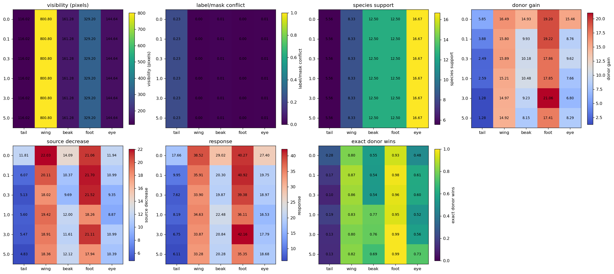


Table — part means plotted in the seven heatmaps. Each exact donor value receives equal weight within a part. Visibility, conflict, and support repeat across gamma because the physical data are unchanged; response columns come from each model.


|  | gamma | part | mean_corrected_visible_pixels | donor_conflict_rate | donor_species_support | mean_z_donor_gain | mean_z_source_decrease | mean_z_response | exact_donor_recognition |
| --- | --- | --- | --- | --- | --- | --- | --- | --- | --- |
| 0 | 0.0 | beak | 161.2764 | 0.0102 | 12.5000 | 14.9268 | 14.0936 | 29.0204 | 0.5543 |
| 1 | 0.0 | eye | 144.6448 | 0.0071 | 16.6667 | 15.4612 | 11.9397 | 27.4009 | 0.4830 |
| 2 | 0.0 | foot | 329.2049 | 0.0014 | 12.5000 | 19.2048 | 21.0618 | 40.2666 | 0.9271 |
| 3 | 0.0 | tail | 116.0159 | 0.2310 | 5.5556 | 5.8542 | 11.8079 | 17.6621 | 0.2773 |
| 4 | 0.0 | wing | 800.8017 | 0.0003 | 8.3333 | 16.4857 | 22.0318 | 38.5175 | 0.8039 |
| 5 | 0.1 | beak | 161.2764 | 0.0102 | 12.5000 | 9.9321 | 10.3717 | 20.3038 | 0.5431 |
| 6 | 0.1 | eye | 144.6448 | 0.0071 | 16.6667 | 8.7618 | 10.9921 | 19.7538 | 0.6066 |
| 7 | 0.1 | foot | 329.2049 | 0.0014 | 12.5000 | 19.2181 | 21.7041 | 40.9222 | 0.9782 |
| 8 | 0.1 | tail | 116.0159 | 0.2310 | 5.5556 | 3.8786 | 6.0715 | 9.9501 | 0.1670 |
| 9 | 0.1 | wing | 800.8017 | 0.0003 | 8.3333 | 15.7961 | 20.1114 | 35.9074 | 0.8718 |
| 10 | 0.3 | beak | 161.2764 | 0.0102 | 12.5000 | 10.1816 | 9.6930 | 19.8746 | 0.5389 |
| 11 | 0.3 | eye | 144.6448 | 0.0071 | 16.6667 | 9.6213 | 9.3489 | 18.9702 | 0.6019 |
| 12 | 0.3 | foot | 329.2049 | 0.0014 | 12.5000 | 17.8608 | 21.5231 | 39.3839 | 0.9580 |
| 13 | 0.3 | tail | 116.0159 | 0.2310 | 5.5556 | 2.4909 | 5.1300 | 7.6209 | 0.1026 |
| 14 | 0.3 | wing | 800.8017 | 0.0003 | 8.3333 | 15.8864 | 18.0172 | 33.9036 | 0.8581 |
| 15 | 1.0 | beak | 161.2764 | 0.0102 | 12.5000 | 10.4803 | 12.0004 | 22.4808 | 0.7712 |
| 16 | 1.0 | eye | 144.6448 | 0.0071 | 16.6667 | 7.6600 | 8.8730 | 16.5330 | 0.5219 |
| 17 | 1.0 | foot | 329.2049 | 0.0014 | 12.5000 | 17.8528 | 18.2604 | 36.1132 | 0.9479 |
| 18 | 1.0 | tail | 116.0159 | 0.2310 | 5.5556 | 2.5912 | 5.5990 | 8.1902 | 0.1876 |
| 19 | 1.0 | wing | 800.8017 | 0.0003 | 8.3333 | 15.2084 | 19.4177 | 34.6261 | 0.8329 |
| 20 | 3.0 | beak | 161.2764 | 0.0102 | 12.5000 | 9.2253 | 11.6102 | 20.8355 | 0.7632 |
| 21 | 3.0 | eye | 144.6448 | 0.0071 | 16.6667 | 6.7998 | 10.9902 | 17.7900 | 0.5636 |
| 22 | 3.0 | foot | 329.2049 | 0.0014 | 12.5000 | 21.0552 | 21.1050 | 42.1603 | 0.9899 |
| 23 | 3.0 | tail | 116.0159 | 0.2310 | 5.5556 | 1.2804 | 5.4657 | 6.7461 | 0.1305 |
| 24 | 3.0 | wing | 800.8017 | 0.0003 | 8.3333 | 14.9667 | 18.9081 | 33.8748 | 0.8016 |
| 25 | 5.0 | beak | 161.2764 | 0.0102 | 12.5000 | 8.1546 | 12.1250 | 20.2796 | 0.6946 |
| 26 | 5.0 | eye | 144.6448 | 0.0071 | 16.6667 | 8.2945 | 10.3869 | 18.6814 | 0.7321 |
| 27 | 5.0 | foot | 329.2049 | 0.0014 | 12.5000 | 17.4098 | 17.9448 | 35.3546 | 0.9908 |
| 28 | 5.0 | tail | 116.0159 | 0.2310 | 5.5556 | 1.2810 | 4.8330 | 6.1140 | 0.1259 |
| 29 | 5.0 | wing | 800.8017 | 0.0003 | 8.3333 | 14.9228 | 18.3566 | 33.2794 | 0.8207 |


**Table — complete donor-value audit before averaging by part.** One row is one gamma, part, and inserted exact value. Counts state the denominators. Pixel area, label/mask conflict, species support, donor gain, source decrease, final margin, and exact recognition are kept separate so a part mean cannot hide a difficult value.


|  | gamma | part | donor_value | n_rows | n_originals | donor_species_support | donor_positive_training_records | donor_conflict_rate | mean_corrected_visible_pixels | mean_z_original_margin | mean_z_donor_gain | mean_z_source_decrease | mean_z_response | median_z_final_margin | no_donorward_movement_rate | responded_but_source_above_donor_rate | exact_donor_recognition | exact_source_winner_rate | exact_third_winner_rate | h_exact_valid_rate | h_calibrated_exact_donor_recognition |
| --- | --- | --- | --- | --- | --- | --- | --- | --- | --- | --- | --- | --- | --- | --- | --- | --- | --- | --- | --- | --- | --- |
| 0 | 0.0 | beak | 3 | 220 | 135 | 13 | 9767 | 0.0026 | 207.3773 | -19.3905 | 8.4246 | 13.4527 | 21.8773 | 0.5835 | 0.0091 | 0.4773 | 0.4682 | 0.4727 | 0.0591 | 1.0 | 0.4091 |
| 1 | 0.0 | beak | 0 | 345 | 120 | 21 | 15819 | 0.0133 | 99.5449 | -28.7482 | 15.8615 | 12.7226 | 28.5841 | -0.2407 | 0.0000 | 0.5275 | 0.4696 | 0.5217 | 0.0087 | 1.0 | 0.5623 |
| 2 | 0.0 | beak | 2 | 190 | 125 | 6 | 4555 | 0.0182 | 22.0526 | -37.8207 | 17.4795 | 13.0616 | 30.5410 | -7.0579 | 0.0158 | 0.6895 | 0.2789 | 0.6684 | 0.0526 | 1.0 | 0.3105 |
| 3 | 0.0 | beak | 1 | 245 | 145 | 10 | 7476 | 0.0066 | 316.1306 | -29.8978 | 20.3074 | 15.0394 | 35.3468 | 5.4137 | 0.0000 | 0.2776 | 0.7224 | 0.2776 | 0.0000 | 1.0 | 0.6735 |
| 4 | 0.0 | eye | 2 | 355 | 150 | 19 | 14348 | 0.0072 | 137.9887 | -25.9977 | 15.3296 | 10.1149 | 25.4445 | -1.3864 | 0.0085 | 0.5268 | 0.4648 | 0.5352 | 0.0000 | 1.0 | 0.4789 |
| 5 | 0.0 | eye | 0 | 300 | 160 | 15 | 11384 | 0.0059 | 136.0067 | -32.7243 | 19.1292 | 12.4217 | 31.5510 | -1.1422 | 0.0000 | 0.5433 | 0.4567 | 0.5367 | 0.0067 | 1.0 | 0.4500 |
| 6 | 0.0 | eye | 1 | 345 | 155 | 16 | 11994 | 0.0081 | 159.9391 | -27.7298 | 19.5407 | 12.1557 | 31.6964 | 2.6593 | 0.0000 | 0.3710 | 0.6203 | 0.3536 | 0.0261 | 1.0 | 0.6000 |
| 7 | 0.0 | foot | 0 | 220 | 145 | 13 | 9829 | 0.0002 | 389.4409 | -25.7061 | 17.7059 | 24.2945 | 42.0004 | 17.5063 | 0.0136 | 0.0455 | 0.9409 | 0.0591 | 0.0000 | 1.0 | 0.9409 |
| 8 | 0.0 | foot | 2 | 290 | 155 | 14 | 10552 | 0.0013 | 351.6241 | -37.8287 | 21.3744 | 26.4563 | 47.8307 | 9.8230 | 0.0000 | 0.1517 | 0.8276 | 0.1448 | 0.0276 | 1.0 | 0.8517 |
| 9 | 0.0 | foot | 1 | 240 | 160 | 10 | 7584 | 0.0028 | 208.2625 | -24.1635 | 21.5024 | 21.7406 | 43.2430 | 20.2143 | 0.0000 | 0.0458 | 0.9542 | 0.0458 | 0.0000 | 1.0 | 0.9125 |
| 10 | 0.0 | foot | 3 | 250 | 135 | 13 | 9758 | 0.0011 | 367.4920 | -27.8634 | 13.8895 | 24.4786 | 38.3681 | 11.4985 | 0.0000 | 0.1320 | 0.8560 | 0.1320 | 0.0120 | 1.0 | 0.8480 |
| 11 | 0.0 | tail | 6 | 130 | 100 | 5 | 3752 | 0.1924 | 152.8462 | -24.1461 | 14.1815 | 12.1685 | 26.3500 | 1.7623 | 0.0846 | 0.3231 | 0.4846 | 0.3231 | 0.1923 | 1.0 | 0.4000 |
| 12 | 0.0 | tail | 1 | 90 | 85 | 5 | 3745 | 0.3525 | 115.2333 | -27.9230 | 11.5783 | 11.9845 | 23.5628 | -6.4357 | 0.0667 | 0.6778 | 0.2111 | 0.6000 | 0.1889 | 1.0 | 0.2333 |
| 13 | 0.0 | tail | 8 | 180 | 110 | 8 | 6059 | 0.1149 | 76.7667 | -22.5073 | 15.0653 | 12.4213 | 27.4865 | 5.0460 | 0.0333 | 0.3333 | 0.5944 | 0.3000 | 0.1056 | 1.0 | 0.6000 |
| 14 | 0.0 | tail | 4 | 110 | 90 | 4 | 3043 | 0.3911 | 99.7636 | -26.1846 | 8.9576 | 10.9490 | 19.9065 | -6.3455 | 0.1000 | 0.6727 | 0.1455 | 0.5818 | 0.2727 | 1.0 | 0.1727 |
| 15 | 0.0 | tail | 3 | 110 | 85 | 7 | 5285 | 0.1915 | 156.8545 | -32.1994 | 20.0908 | 9.0915 | 29.1823 | -2.7641 | 0.0273 | 0.5727 | 0.3909 | 0.4909 | 0.1182 | 1.0 | 0.4364 |
| 16 | 0.0 | tail | 2 | 120 | 90 | 7 | 5224 | 0.1181 | 83.2250 | -26.0950 | 17.0765 | 11.3604 | 28.4370 | -0.3532 | 0.0417 | 0.4917 | 0.4417 | 0.5000 | 0.0583 | 1.0 | 0.4917 |
| 17 | 0.0 | tail | 5 | 150 | 120 | 8 | 6030 | 0.1119 | 69.1733 | -29.8531 | 21.1523 | 11.1524 | 32.3047 | 3.1388 | 0.0333 | 0.3400 | 0.5533 | 0.3200 | 0.1267 | 1.0 | 0.5800 |
| 18 | 0.0 | tail | 0 | 75 | 70 | 4 | 3033 | 0.2169 | 183.6800 | -33.9845 | 21.1145 | 11.5829 | 32.6974 | 0.2027 | 0.0800 | 0.4000 | 0.4667 | 0.3333 | 0.2000 | 1.0 | 0.4000 |
| 19 | 0.0 | tail | 7 | 35 | 35 | 2 | 1536 | 0.3900 | 106.6000 | -40.4283 | 11.6772 | 12.1796 | 23.8568 | -20.2213 | 0.0000 | 0.8286 | 0.1714 | 0.6857 | 0.1429 | 1.0 | 0.1714 |
| 20 | 0.0 | wing | 5 | 210 | 150 | 10 | 7504 | 0.0007 | 758.6333 | -34.1723 | 26.5301 | 21.4064 | 47.9365 | 15.4483 | 0.0000 | 0.1143 | 0.8667 | 0.1000 | 0.0333 | 1.0 | 0.8667 |
| 21 | 0.0 | wing | 1 | 150 | 100 | 9 | 6815 | 0.0003 | 740.4467 | -31.9951 | 25.6811 | 25.0817 | 50.7628 | 20.8622 | 0.0000 | 0.0600 | 0.9133 | 0.0600 | 0.0267 | 1.0 | 0.9133 |
| 22 | 0.0 | wing | 0 | 130 | 115 | 5 | 3774 | 0.0003 | 764.8923 | -24.1833 | 15.4875 | 26.1996 | 41.6871 | 18.9359 | 0.0000 | 0.1231 | 0.8462 | 0.1231 | 0.0308 | 1.0 | 0.8462 |
| 23 | 0.0 | wing | 3 | 115 | 95 | 5 | 3794 | 0.0000 | 769.7478 | -33.7975 | 26.5697 | 22.6223 | 49.1920 | 16.7525 | 0.0000 | 0.1043 | 0.8435 | 0.1043 | 0.0522 | 1.0 | 0.7565 |
| 24 | 0.0 | wing | 2 | 220 | 140 | 11 | 8190 | 0.0004 | 937.6273 | -35.1592 | 23.0774 | 23.2923 | 46.3698 | 12.6089 | 0.0000 | 0.0818 | 0.9045 | 0.0636 | 0.0318 | 1.0 | 0.9409 |
| 25 | 0.0 | wing | 4 | 175 | 135 | 10 | 7611 | 0.0001 | 833.4629 | -41.4477 | 27.5859 | 23.1627 | 50.7486 | 12.8987 | 0.0000 | 0.1771 | 0.7314 | 0.1543 | 0.1143 | 1.0 | 0.7771 |
| 26 | 0.1 | beak | 3 | 220 | 135 | 13 | 9767 | 0.0026 | 207.3773 | -18.8140 | 8.8654 | 12.0847 | 20.9502 | 0.2439 | 0.0000 | 0.4864 | 0.5136 | 0.4000 | 0.0864 | 1.0 | 0.5773 |
| 27 | 0.1 | beak | 0 | 345 | 120 | 21 | 15819 | 0.0133 | 99.5449 | -17.3793 | 10.2080 | 12.4683 | 22.6763 | 5.8405 | 0.0000 | 0.2870 | 0.7130 | 0.2812 | 0.0058 | 1.0 | 0.6899 |
| 28 | 0.1 | beak | 2 | 190 | 125 | 6 | 4555 | 0.0182 | 22.0526 | -19.8898 | 7.6336 | 9.1902 | 16.8238 | -4.2880 | 0.0053 | 0.6316 | 0.3158 | 0.6211 | 0.0632 | 1.0 | 0.3368 |
| 29 | 0.1 | beak | 1 | 245 | 145 | 10 | 7476 | 0.0066 | 316.1306 | -19.0091 | 14.8569 | 13.3402 | 28.1971 | 9.8579 | 0.0000 | 0.1020 | 0.8980 | 0.1020 | 0.0000 | 1.0 | 0.8816 |
| 30 | 0.1 | eye | 2 | 355 | 150 | 19 | 14348 | 0.0072 | 137.9887 | -15.6671 | 8.3110 | 9.4362 | 17.7472 | 2.0692 | 0.0225 | 0.3746 | 0.6028 | 0.3915 | 0.0056 | 1.0 | 0.5775 |
| 31 | 0.1 | eye | 0 | 300 | 160 | 15 | 11384 | 0.0059 | 136.0067 | -16.4500 | 7.2054 | 8.7554 | 15.9608 | -0.4975 | 0.0000 | 0.5400 | 0.4333 | 0.5167 | 0.0500 | 1.0 | 0.4333 |
| 32 | 0.1 | eye | 1 | 345 | 155 | 16 | 11994 | 0.0081 | 159.9391 | -16.9627 | 10.8455 | 9.8193 | 20.6648 | 3.6727 | 0.0029 | 0.2406 | 0.7449 | 0.2435 | 0.0116 | 1.0 | 0.7768 |
| 33 | 0.1 | foot | 0 | 220 | 145 | 13 | 9829 | 0.0002 | 389.4409 | -20.4749 | 20.5768 | 18.8715 | 39.4483 | 20.0814 | 0.0136 | 0.0000 | 0.9864 | 0.0136 | 0.0000 | 1.0 | 0.9864 |
| 34 | 0.1 | foot | 2 | 290 | 155 | 14 | 10552 | 0.0013 | 351.6241 | -19.9917 | 18.1052 | 18.3135 | 36.4187 | 16.6740 | 0.0000 | 0.0241 | 0.9759 | 0.0241 | 0.0000 | 1.0 | 0.9759 |
| 35 | 0.1 | foot | 1 | 240 | 160 | 10 | 7584 | 0.0028 | 208.2625 | -24.1105 | 19.0913 | 18.0162 | 37.1075 | 14.7494 | 0.0000 | 0.0167 | 0.9833 | 0.0167 | 0.0000 | 1.0 | 0.9833 |
| 36 | 0.1 | foot | 3 | 250 | 135 | 13 | 9758 | 0.0011 | 367.4920 | -26.2326 | 20.1670 | 17.7074 | 37.8744 | 12.9794 | 0.0000 | 0.0640 | 0.9240 | 0.0640 | 0.0120 | 1.0 | 0.9240 |
| 37 | 0.1 | tail | 6 | 130 | 100 | 5 | 3752 | 0.1924 | 152.8462 | -11.3094 | 3.7426 | 7.3378 | 11.0804 | -0.1264 | 0.1154 | 0.4308 | 0.4462 | 0.4692 | 0.0846 | 1.0 | 0.3077 |
| 38 | 0.1 | tail | 1 | 90 | 85 | 5 | 3745 | 0.3525 | 115.2333 | -14.8793 | 4.0422 | 8.4153 | 12.4575 | -2.6737 | 0.0444 | 0.6667 | 0.2000 | 0.5778 | 0.2222 | 1.0 | 0.1444 |
| 39 | 0.1 | tail | 8 | 180 | 110 | 8 | 6059 | 0.1149 | 76.7667 | -11.8093 | 6.9720 | 7.9469 | 14.9189 | 2.9496 | 0.0500 | 0.3333 | 0.5944 | 0.3000 | 0.1056 | 1.0 | 0.6000 |
| 40 | 0.1 | tail | 4 | 110 | 90 | 4 | 3043 | 0.3911 | 99.7636 | -15.1855 | 3.7430 | 8.2938 | 12.0369 | -3.0132 | 0.1000 | 0.6909 | 0.1545 | 0.5364 | 0.3091 | 1.0 | 0.1909 |
| 41 | 0.1 | tail | 3 | 110 | 85 | 7 | 5285 | 0.1915 | 156.8545 | -14.7388 | 5.8231 | 6.2200 | 12.0431 | -2.8435 | 0.1091 | 0.6455 | 0.2364 | 0.5909 | 0.1727 | 1.0 | 0.3000 |
| 42 | 0.1 | tail | 2 | 120 | 90 | 7 | 5224 | 0.1181 | 83.2250 | -13.5943 | 5.8958 | 7.2353 | 13.1311 | -1.1452 | 0.0750 | 0.5417 | 0.3083 | 0.5417 | 0.1500 | 1.0 | 0.3083 |
| 43 | 0.1 | tail | 5 | 150 | 120 | 8 | 6030 | 0.1119 | 69.1733 | -13.3837 | 6.6571 | 7.9184 | 14.5755 | 0.9446 | 0.0667 | 0.3667 | 0.5200 | 0.3133 | 0.1667 | 1.0 | 0.5133 |
| 44 | 0.1 | tail | 0 | 75 | 70 | 4 | 3033 | 0.2169 | 183.6800 | -16.5275 | 5.5143 | 6.7711 | 12.2854 | -4.4294 | 0.0933 | 0.6667 | 0.1600 | 0.5733 | 0.2667 | 1.0 | 0.2133 |
| 45 | 0.1 | tail | 7 | 35 | 35 | 2 | 1536 | 0.3900 | 106.6000 | -15.3643 | 2.2685 | 7.3134 | 9.5819 | -7.4704 | 0.1143 | 0.8000 | 0.0857 | 0.8000 | 0.1143 | 1.0 | 0.0857 |
| 46 | 0.1 | wing | 5 | 210 | 150 | 10 | 7504 | 0.0007 | 758.6333 | -26.9654 | 20.1540 | 17.6881 | 37.8421 | 14.7587 | 0.0000 | 0.1048 | 0.8905 | 0.1048 | 0.0048 | 1.0 | 0.8905 |
| 47 | 0.1 | wing | 1 | 150 | 100 | 9 | 6815 | 0.0003 | 740.4467 | -17.6382 | 13.8787 | 18.3448 | 32.2235 | 15.2902 | 0.0000 | 0.0133 | 0.9600 | 0.0133 | 0.0267 | 1.0 | 0.9600 |
| 48 | 0.1 | wing | 0 | 130 | 115 | 5 | 3774 | 0.0003 | 764.8923 | -19.3888 | 11.9874 | 18.7127 | 30.7001 | 11.5581 | 0.0000 | 0.0769 | 0.8385 | 0.0769 | 0.0846 | 1.0 | 0.8615 |
| 49 | 0.1 | wing | 3 | 115 | 95 | 5 | 3794 | 0.0000 | 769.7478 | -18.1943 | 10.7097 | 15.0073 | 25.7170 | 8.9127 | 0.0000 | 0.2870 | 0.6783 | 0.2174 | 0.1043 | 1.0 | 0.6696 |
| 50 | 0.1 | wing | 2 | 220 | 140 | 11 | 8190 | 0.0004 | 937.6273 | -20.6121 | 15.2799 | 17.8851 | 33.1650 | 13.3503 | 0.0000 | 0.0318 | 0.9545 | 0.0318 | 0.0136 | 1.0 | 0.9545 |
| 51 | 0.1 | wing | 4 | 175 | 135 | 10 | 7611 | 0.0001 | 833.4629 | -21.8503 | 14.2462 | 15.4749 | 29.7211 | 10.7001 | 0.0000 | 0.2057 | 0.7200 | 0.1943 | 0.0857 | 1.0 | 0.7371 |
| 52 | 0.3 | beak | 3 | 220 | 135 | 13 | 9767 | 0.0026 | 207.3773 | -17.1111 | 8.7726 | 11.8441 | 20.6167 | 3.6142 | 0.0091 | 0.3136 | 0.6273 | 0.3227 | 0.0500 | 1.0 | 0.6273 |
| 53 | 0.3 | beak | 0 | 345 | 120 | 21 | 15819 | 0.0133 | 99.5449 | -15.5580 | 8.0081 | 10.7884 | 18.7966 | 3.3561 | 0.0174 | 0.3797 | 0.5826 | 0.3971 | 0.0203 | 1.0 | 0.6232 |
| 54 | 0.3 | beak | 2 | 190 | 125 | 6 | 4555 | 0.0182 | 22.0526 | -18.1363 | 7.5842 | 10.5869 | 18.1711 | -0.5298 | 0.0158 | 0.5158 | 0.4368 | 0.5316 | 0.0316 | 1.0 | 0.3947 |
| 55 | 0.3 | beak | 1 | 245 | 145 | 10 | 7476 | 0.0066 | 316.1306 | -18.8504 | 11.6271 | 11.8779 | 23.5050 | 5.0568 | 0.0122 | 0.2898 | 0.6980 | 0.2939 | 0.0082 | 1.0 | 0.7469 |
| 56 | 0.3 | eye | 2 | 355 | 150 | 19 | 14348 | 0.0072 | 137.9887 | -14.5404 | 8.5881 | 8.4687 | 17.0569 | 1.7435 | 0.0056 | 0.4197 | 0.5746 | 0.4254 | 0.0000 | 1.0 | 0.5803 |
| 57 | 0.3 | eye | 0 | 300 | 160 | 15 | 11384 | 0.0059 | 136.0067 | -16.9180 | 7.8066 | 7.7113 | 15.5179 | -2.8950 | 0.0200 | 0.6100 | 0.3700 | 0.6167 | 0.0133 | 1.0 | 0.3800 |
| 58 | 0.3 | eye | 1 | 345 | 155 | 16 | 11994 | 0.0081 | 159.9391 | -17.6698 | 11.8574 | 10.7081 | 22.5655 | 5.6057 | 0.0000 | 0.1971 | 0.8000 | 0.1913 | 0.0087 | 1.0 | 0.7826 |
| 59 | 0.3 | foot | 0 | 220 | 145 | 13 | 9829 | 0.0002 | 389.4409 | -23.7577 | 22.5045 | 20.3224 | 42.8269 | 19.1842 | 0.0000 | 0.0000 | 1.0000 | 0.0000 | 0.0000 | 1.0 | 1.0000 |
| 60 | 0.3 | foot | 2 | 290 | 155 | 14 | 10552 | 0.0013 | 351.6241 | -22.3361 | 16.9631 | 21.0118 | 37.9749 | 15.6542 | 0.0000 | 0.0138 | 0.9862 | 0.0138 | 0.0000 | 1.0 | 0.9862 |
| 61 | 0.3 | foot | 1 | 240 | 160 | 10 | 7584 | 0.0028 | 208.2625 | -18.1608 | 17.7865 | 18.2223 | 36.0089 | 17.9886 | 0.0000 | 0.0042 | 0.9958 | 0.0042 | 0.0000 | 1.0 | 0.9958 |
| 62 | 0.3 | foot | 3 | 250 | 135 | 13 | 9758 | 0.0011 | 367.4920 | -24.2015 | 17.3632 | 19.5343 | 36.8975 | 14.5202 | 0.0000 | 0.0640 | 0.9160 | 0.0640 | 0.0200 | 1.0 | 0.9280 |
| 63 | 0.3 | tail | 6 | 130 | 100 | 5 | 3752 | 0.1924 | 152.8462 | -13.3538 | 5.6673 | 7.7338 | 13.4012 | -0.9044 | 0.1385 | 0.4692 | 0.3923 | 0.4846 | 0.1231 | 1.0 | 0.4231 |
| 64 | 0.3 | tail | 1 | 90 | 85 | 5 | 3745 | 0.3525 | 115.2333 | -12.5922 | 2.9291 | 9.0551 | 11.9843 | -0.0560 | 0.0778 | 0.4556 | 0.4333 | 0.4778 | 0.0889 | 1.0 | 0.2889 |
| 65 | 0.3 | tail | 8 | 180 | 110 | 8 | 6059 | 0.1149 | 76.7667 | -10.9951 | 5.4383 | 7.2976 | 12.7359 | 1.5538 | 0.1222 | 0.3278 | 0.5444 | 0.3833 | 0.0722 | 1.0 | 0.4778 |
| 66 | 0.3 | tail | 4 | 110 | 90 | 4 | 3043 | 0.3911 | 99.7636 | -14.6752 | 4.9493 | 7.8155 | 12.7649 | -2.2478 | 0.1273 | 0.4909 | 0.2818 | 0.4636 | 0.2545 | 1.0 | 0.2273 |
| 67 | 0.3 | tail | 3 | 110 | 85 | 7 | 5285 | 0.1915 | 156.8545 | -14.6414 | 6.1725 | 7.1295 | 13.3020 | -2.6329 | 0.0818 | 0.5273 | 0.3364 | 0.4727 | 0.1909 | 1.0 | 0.3727 |
| 68 | 0.3 | tail | 2 | 120 | 90 | 7 | 5224 | 0.1181 | 83.2250 | -12.0360 | 4.0006 | 7.4214 | 11.4220 | 0.2688 | 0.0750 | 0.4167 | 0.4583 | 0.4667 | 0.0750 | 1.0 | 0.5000 |
| 69 | 0.3 | tail | 5 | 150 | 120 | 8 | 6030 | 0.1119 | 69.1733 | -11.6649 | 3.5211 | 7.1782 | 10.6992 | -0.8986 | 0.0733 | 0.5400 | 0.3400 | 0.5533 | 0.1067 | 1.0 | 0.3800 |
| 70 | 0.3 | tail | 0 | 75 | 70 | 4 | 3033 | 0.2169 | 183.6800 | -12.6032 | 2.9944 | 7.5845 | 10.5789 | -1.8115 | 0.1067 | 0.5467 | 0.2000 | 0.5867 | 0.2133 | 1.0 | 0.2933 |
| 71 | 0.3 | tail | 7 | 35 | 35 | 2 | 1536 | 0.3900 | 106.6000 | -19.6466 | 2.7064 | 7.0115 | 9.7180 | -11.7547 | 0.0857 | 0.8286 | 0.0857 | 0.7714 | 0.1429 | 1.0 | 0.0857 |
| 72 | 0.3 | wing | 5 | 210 | 150 | 10 | 7504 | 0.0007 | 758.6333 | -23.0722 | 16.9513 | 17.5108 | 34.4622 | 14.8789 | 0.0048 | 0.1190 | 0.8667 | 0.1238 | 0.0095 | 1.0 | 0.8667 |
| 73 | 0.3 | wing | 1 | 150 | 100 | 9 | 6815 | 0.0003 | 740.4467 | -21.7082 | 14.1172 | 18.0476 | 32.1647 | 12.8133 | 0.0000 | 0.1000 | 0.8533 | 0.1000 | 0.0467 | 1.0 | 0.8600 |
| 74 | 0.3 | wing | 0 | 130 | 115 | 5 | 3774 | 0.0003 | 764.8923 | -18.7423 | 12.8630 | 17.1117 | 29.9747 | 13.4556 | 0.0000 | 0.1462 | 0.8000 | 0.1462 | 0.0538 | 1.0 | 0.8000 |
| 75 | 0.3 | wing | 3 | 115 | 95 | 5 | 3794 | 0.0000 | 769.7478 | -24.0463 | 15.5282 | 16.3605 | 31.8887 | 9.0251 | 0.0000 | 0.2435 | 0.7130 | 0.1565 | 0.1304 | 1.0 | 0.7217 |
| 76 | 0.3 | wing | 2 | 220 | 140 | 11 | 8190 | 0.0004 | 937.6273 | -22.0699 | 15.7688 | 18.2706 | 34.0393 | 14.0970 | 0.0000 | 0.0955 | 0.8682 | 0.0955 | 0.0364 | 1.0 | 0.8682 |
| 77 | 0.3 | wing | 4 | 175 | 135 | 10 | 7611 | 0.0001 | 833.4629 | -22.3234 | 12.7090 | 15.7255 | 28.4346 | 9.5477 | 0.0000 | 0.3086 | 0.6229 | 0.2743 | 0.1029 | 1.0 | 0.6229 |
| 78 | 1.0 | beak | 3 | 220 | 135 | 13 | 9767 | 0.0026 | 207.3773 | -15.7574 | 10.3547 | 13.1035 | 23.4582 | 8.5520 | 0.0000 | 0.1045 | 0.8591 | 0.1045 | 0.0364 | 1.0 | 0.8273 |
| 79 | 1.0 | beak | 0 | 345 | 120 | 21 | 15819 | 0.0133 | 99.5449 | -15.7162 | 11.3412 | 12.4064 | 23.7477 | 9.9552 | 0.0174 | 0.1768 | 0.8000 | 0.1797 | 0.0203 | 1.0 | 0.8029 |
| 80 | 1.0 | beak | 2 | 190 | 125 | 6 | 4555 | 0.0182 | 22.0526 | -18.0731 | 7.9178 | 12.4708 | 20.3887 | 2.6129 | 0.0000 | 0.3842 | 0.5947 | 0.3579 | 0.0474 | 1.0 | 0.6684 |
| 81 | 1.0 | beak | 1 | 245 | 145 | 10 | 7476 | 0.0066 | 316.1306 | -18.1829 | 12.4382 | 13.1088 | 25.5470 | 8.9881 | 0.0082 | 0.1633 | 0.8286 | 0.1633 | 0.0082 | 1.0 | 0.8286 |
| 82 | 1.0 | eye | 2 | 355 | 150 | 19 | 14348 | 0.0072 | 137.9887 | -15.8257 | 5.0166 | 7.1006 | 12.1172 | -5.9055 | 0.0000 | 0.7155 | 0.2845 | 0.7099 | 0.0056 | 1.0 | 0.2845 |
| 83 | 1.0 | eye | 0 | 300 | 160 | 15 | 11384 | 0.0059 | 136.0067 | -15.3278 | 8.0871 | 10.5998 | 18.6869 | 6.2461 | 0.0133 | 0.2900 | 0.6967 | 0.3033 | 0.0000 | 1.0 | 0.6967 |
| 84 | 1.0 | eye | 1 | 345 | 155 | 16 | 11994 | 0.0081 | 159.9391 | -16.3757 | 10.6995 | 11.3088 | 22.0084 | 8.4966 | 0.0000 | 0.2348 | 0.7565 | 0.2348 | 0.0087 | 1.0 | 0.7623 |
| 85 | 1.0 | foot | 0 | 220 | 145 | 13 | 9829 | 0.0002 | 389.4409 | -22.2279 | 20.9951 | 20.5606 | 41.5557 | 19.8135 | 0.0000 | 0.0136 | 0.9864 | 0.0000 | 0.0136 | 1.0 | 0.9864 |
| 86 | 1.0 | foot | 2 | 290 | 155 | 14 | 10552 | 0.0013 | 351.6241 | -20.9852 | 17.3453 | 19.8375 | 37.1828 | 18.0830 | 0.0000 | 0.0310 | 0.9448 | 0.0310 | 0.0241 | 1.0 | 0.9379 |
| 87 | 1.0 | foot | 1 | 240 | 160 | 10 | 7584 | 0.0028 | 208.2625 | -21.6380 | 20.0228 | 20.2193 | 40.2421 | 19.3112 | 0.0000 | 0.0042 | 0.9958 | 0.0042 | 0.0000 | 1.0 | 0.9958 |
| 88 | 1.0 | foot | 3 | 250 | 135 | 13 | 9758 | 0.0011 | 367.4920 | -21.5898 | 19.3285 | 19.8080 | 39.1365 | 19.5489 | 0.0000 | 0.0520 | 0.9480 | 0.0520 | 0.0000 | 1.0 | 0.9480 |
| 89 | 1.0 | tail | 6 | 130 | 100 | 5 | 3752 | 0.1924 | 152.8462 | -11.2362 | 3.1379 | 8.2724 | 11.4103 | 0.4423 | 0.1538 | 0.3692 | 0.4077 | 0.3615 | 0.2308 | 1.0 | 0.3846 |
| 90 | 1.0 | tail | 1 | 90 | 85 | 5 | 3745 | 0.3525 | 115.2333 | -12.8479 | 2.5013 | 8.5463 | 11.0475 | -1.4749 | 0.0667 | 0.6667 | 0.1444 | 0.4667 | 0.3889 | 1.0 | 0.1556 |
| 91 | 1.0 | tail | 8 | 180 | 110 | 8 | 6059 | 0.1149 | 76.7667 | -11.3425 | 4.6710 | 8.0857 | 12.7567 | 1.3831 | 0.0667 | 0.3611 | 0.5222 | 0.3444 | 0.1333 | 1.0 | 0.5278 |
| 92 | 1.0 | tail | 4 | 110 | 90 | 4 | 3043 | 0.3911 | 99.7636 | -11.6977 | 3.7731 | 8.2616 | 12.0347 | -0.6625 | 0.1364 | 0.5000 | 0.2545 | 0.3455 | 0.4000 | 1.0 | 0.2636 |
| 93 | 1.0 | tail | 3 | 110 | 85 | 7 | 5285 | 0.1915 | 156.8545 | -13.3049 | 6.1840 | 7.4905 | 13.6745 | 0.4908 | 0.0818 | 0.4091 | 0.4818 | 0.2909 | 0.2273 | 1.0 | 0.5091 |
| 94 | 1.0 | tail | 2 | 120 | 90 | 7 | 5224 | 0.1181 | 83.2250 | -11.9023 | 5.5299 | 8.1231 | 13.6530 | 1.6087 | 0.0333 | 0.3333 | 0.5917 | 0.2833 | 0.1250 | 1.0 | 0.5833 |
| 95 | 1.0 | tail | 5 | 150 | 120 | 8 | 6030 | 0.1119 | 69.1733 | -10.5461 | 5.3206 | 8.1974 | 13.5180 | 2.4727 | 0.0533 | 0.2133 | 0.7200 | 0.2200 | 0.0600 | 1.0 | 0.5933 |
| 96 | 1.0 | tail | 0 | 75 | 70 | 4 | 3033 | 0.2169 | 183.6800 | -13.1636 | 5.9862 | 7.9624 | 13.9486 | 2.4000 | 0.1200 | 0.3200 | 0.5333 | 0.3467 | 0.1200 | 1.0 | 0.5333 |
| 97 | 1.0 | tail | 7 | 35 | 35 | 2 | 1536 | 0.3900 | 106.6000 | -13.4900 | 1.5340 | 8.8710 | 10.4051 | -3.0314 | 0.1143 | 0.7714 | 0.1143 | 0.7143 | 0.1714 | 1.0 | 0.1429 |
| 98 | 1.0 | wing | 5 | 210 | 150 | 10 | 7504 | 0.0007 | 758.6333 | -10.4016 | 0.0000 | 17.5225 | 17.5225 | 8.8333 | 0.0190 | 0.1095 | 0.8476 | 0.1286 | 0.0238 | 1.0 | 0.8286 |
| 99 | 1.0 | wing | 1 | 150 | 100 | 9 | 6815 | 0.0003 | 740.4467 | -19.2188 | 14.2959 | 13.0959 | 27.3918 | 10.8064 | 0.0000 | 0.2400 | 0.6867 | 0.1467 | 0.1667 | 1.0 | 0.7933 |
| 100 | 1.0 | wing | 0 | 130 | 115 | 5 | 3774 | 0.0003 | 764.8923 | -16.8452 | 15.2573 | 12.6820 | 27.9393 | 11.5411 | 0.0000 | 0.1615 | 0.8000 | 0.1077 | 0.0923 | 1.0 | 0.9077 |
| 101 | 1.0 | wing | 3 | 115 | 95 | 5 | 3794 | 0.0000 | 769.7478 | -14.8368 | 6.5795 | 10.8166 | 17.3962 | 2.4160 | 0.2087 | 0.1826 | 0.4522 | 0.2087 | 0.3391 | 1.0 | 0.5304 |
| 102 | 1.0 | wing | 2 | 220 | 140 | 11 | 8190 | 0.0004 | 937.6273 | -24.0785 | 21.6203 | 13.8240 | 35.4443 | 14.8313 | 0.0000 | 0.0636 | 0.9318 | 0.0636 | 0.0045 | 1.0 | 0.9273 |
| 103 | 1.0 | wing | 4 | 175 | 135 | 10 | 7611 | 0.0001 | 833.4629 | -13.8913 | 10.6803 | 14.5727 | 25.2530 | 10.0200 | 0.1486 | 0.0571 | 0.5829 | 0.2000 | 0.2171 | 1.0 | 0.5943 |
| 104 | 3.0 | beak | 3 | 220 | 135 | 13 | 9767 | 0.0026 | 207.3773 | -15.1769 | 8.7257 | 12.8881 | 21.6138 | 8.7340 | 0.0136 | 0.2864 | 0.6682 | 0.2000 | 0.1318 | 1.0 | 0.6682 |
| 105 | 3.0 | beak | 0 | 345 | 120 | 21 | 15819 | 0.0133 | 99.5449 | -15.3429 | 10.1433 | 14.1352 | 24.2786 | 11.0922 | 0.0000 | 0.1101 | 0.8899 | 0.0899 | 0.0203 | 1.0 | 0.8899 |
| 106 | 3.0 | beak | 2 | 190 | 125 | 6 | 4555 | 0.0182 | 22.0526 | -15.6425 | 8.8910 | 13.3884 | 22.2794 | 7.0315 | 0.0000 | 0.1684 | 0.8053 | 0.1526 | 0.0421 | 1.0 | 0.7842 |
| 107 | 3.0 | beak | 1 | 245 | 145 | 10 | 7476 | 0.0066 | 316.1306 | -16.3927 | 14.7775 | 14.6507 | 29.4282 | 13.3985 | 0.0082 | 0.0041 | 0.9878 | 0.0122 | 0.0000 | 1.0 | 0.9878 |
| 108 | 3.0 | eye | 2 | 355 | 150 | 19 | 14348 | 0.0072 | 137.9887 | -14.1793 | 8.1584 | 11.0200 | 19.1784 | 6.7311 | 0.0056 | 0.2310 | 0.7380 | 0.2254 | 0.0366 | 1.0 | 0.7324 |
| 109 | 3.0 | eye | 0 | 300 | 160 | 15 | 11384 | 0.0059 | 136.0067 | -15.2111 | 7.7296 | 10.5195 | 18.2491 | 4.9761 | 0.0133 | 0.3200 | 0.6633 | 0.3167 | 0.0200 | 1.0 | 0.6633 |
| 110 | 3.0 | eye | 1 | 345 | 155 | 16 | 11994 | 0.0081 | 159.9391 | -13.1142 | 9.9168 | 10.9799 | 20.8967 | 10.0383 | 0.0029 | 0.2000 | 0.7971 | 0.1855 | 0.0174 | 1.0 | 0.7971 |
| 111 | 3.0 | foot | 0 | 220 | 145 | 13 | 9829 | 0.0002 | 389.4409 | -19.8312 | 19.2879 | 18.1763 | 37.4642 | 18.1146 | 0.0000 | 0.0136 | 0.9864 | 0.0136 | 0.0000 | 1.0 | 0.9864 |
| 112 | 3.0 | foot | 2 | 290 | 155 | 14 | 10552 | 0.0013 | 351.6241 | -18.8851 | 15.8266 | 18.3315 | 34.1581 | 16.4286 | 0.0000 | 0.0276 | 0.9690 | 0.0276 | 0.0034 | 1.0 | 0.9690 |
| 113 | 3.0 | foot | 1 | 240 | 160 | 10 | 7584 | 0.0028 | 208.2625 | -19.1181 | 19.3071 | 18.3948 | 37.7019 | 18.4693 | 0.0000 | 0.0042 | 0.9958 | 0.0042 | 0.0000 | 1.0 | 0.9958 |
| 114 | 3.0 | foot | 3 | 250 | 135 | 13 | 9758 | 0.0011 | 367.4920 | -18.3317 | 15.5297 | 18.0437 | 33.5734 | 16.7956 | 0.0000 | 0.0040 | 0.9960 | 0.0040 | 0.0000 | 1.0 | 0.9960 |
| 115 | 3.0 | tail | 6 | 130 | 100 | 5 | 3752 | 0.1924 | 152.8462 | -11.9265 | 2.2610 | 8.2776 | 10.5387 | -1.4495 | 0.1692 | 0.5154 | 0.2615 | 0.5385 | 0.2000 | 1.0 | 0.3000 |
| 116 | 3.0 | tail | 1 | 90 | 85 | 5 | 3745 | 0.3525 | 115.2333 | -11.1717 | 1.6654 | 9.1250 | 10.7904 | 0.2049 | 0.1111 | 0.4222 | 0.2333 | 0.4444 | 0.3222 | 1.0 | 0.2000 |
| 117 | 3.0 | tail | 8 | 180 | 110 | 8 | 6059 | 0.1149 | 76.7667 | -10.4667 | 3.6875 | 8.1166 | 11.8040 | 0.7965 | 0.0778 | 0.3278 | 0.4944 | 0.3500 | 0.1556 | 1.0 | 0.4889 |
| 118 | 3.0 | tail | 4 | 110 | 90 | 4 | 3043 | 0.3911 | 99.7636 | -11.4306 | 1.6666 | 7.8867 | 9.5534 | -1.4544 | 0.1545 | 0.5909 | 0.2091 | 0.4636 | 0.3273 | 1.0 | 0.2000 |
| 119 | 3.0 | tail | 3 | 110 | 85 | 7 | 5285 | 0.1915 | 156.8545 | -11.3142 | 3.0865 | 7.3871 | 10.4736 | -0.6117 | 0.1636 | 0.4545 | 0.3091 | 0.4455 | 0.2455 | 1.0 | 0.3091 |
| 120 | 3.0 | tail | 2 | 120 | 90 | 7 | 5224 | 0.1181 | 83.2250 | -10.7140 | 1.9504 | 8.0506 | 10.0011 | -0.9864 | 0.0667 | 0.5417 | 0.3000 | 0.4333 | 0.2667 | 1.0 | 0.2167 |
| 121 | 3.0 | tail | 5 | 150 | 120 | 8 | 6030 | 0.1119 | 69.1733 | -10.8307 | 3.2700 | 8.4825 | 11.7525 | 0.6305 | 0.1133 | 0.3133 | 0.5000 | 0.2933 | 0.2067 | 1.0 | 0.4867 |
| 122 | 3.0 | tail | 0 | 75 | 70 | 4 | 3033 | 0.2169 | 183.6800 | -12.2600 | 1.2891 | 7.1292 | 8.4183 | -3.3303 | 0.1067 | 0.7333 | 0.1333 | 0.5733 | 0.2933 | 1.0 | 0.1333 |
| 123 | 3.0 | tail | 7 | 35 | 35 | 2 | 1536 | 0.3900 | 106.6000 | -12.3766 | 0.1459 | 6.9593 | 7.1052 | -3.7010 | 0.0857 | 0.9143 | 0.0000 | 0.8000 | 0.2000 | 1.0 | 0.0000 |
| 124 | 3.0 | wing | 5 | 210 | 150 | 10 | 7504 | 0.0007 | 758.6333 | -16.9059 | 12.3940 | 15.9319 | 28.3260 | 13.3848 | 0.0143 | 0.1095 | 0.8619 | 0.1238 | 0.0143 | 1.0 | 0.8524 |
| 125 | 3.0 | wing | 1 | 150 | 100 | 9 | 6815 | 0.0003 | 740.4467 | -19.2815 | 11.9849 | 16.8169 | 28.8018 | 9.2682 | 0.0000 | 0.0733 | 0.8467 | 0.0733 | 0.0800 | 1.0 | 0.8667 |
| 126 | 3.0 | wing | 0 | 130 | 115 | 5 | 3774 | 0.0003 | 764.8923 | -22.1147 | 14.2279 | 16.7532 | 30.9811 | 12.7093 | 0.0000 | 0.1308 | 0.8308 | 0.1000 | 0.0692 | 1.0 | 0.8231 |
| 127 | 3.0 | wing | 3 | 115 | 95 | 5 | 3794 | 0.0000 | 769.7478 | -17.1540 | 10.2917 | 15.9806 | 26.2723 | 11.4927 | 0.0000 | 0.1913 | 0.6696 | 0.1217 | 0.2087 | 1.0 | 0.6609 |
| 128 | 3.0 | wing | 2 | 220 | 140 | 11 | 8190 | 0.0004 | 937.6273 | -16.7473 | 13.1368 | 16.1688 | 29.3056 | 15.8274 | 0.0000 | 0.1091 | 0.8227 | 0.0955 | 0.0818 | 1.0 | 0.8273 |
| 129 | 3.0 | wing | 4 | 175 | 135 | 10 | 7611 | 0.0001 | 833.4629 | -19.8858 | 9.2829 | 14.1435 | 23.4264 | 5.8174 | 0.0514 | 0.2514 | 0.5714 | 0.2571 | 0.1714 | 1.0 | 0.5771 |
| 130 | 5.0 | beak | 3 | 220 | 135 | 13 | 9767 | 0.0026 | 207.3773 | -14.1993 | 6.9234 | 11.3871 | 18.3104 | 4.5429 | 0.0273 | 0.2500 | 0.5182 | 0.2773 | 0.2045 | 1.0 | 0.5182 |
| 131 | 5.0 | beak | 0 | 345 | 120 | 21 | 15819 | 0.0133 | 99.5449 | -15.7616 | 12.1868 | 14.1946 | 26.3814 | 13.4554 | 0.0000 | 0.0986 | 0.8841 | 0.0696 | 0.0464 | 1.0 | 0.9014 |
| 132 | 5.0 | beak | 2 | 190 | 125 | 6 | 4555 | 0.0182 | 22.0526 | -14.5951 | 9.1596 | 14.0869 | 23.2465 | 10.0865 | 0.0000 | 0.0895 | 0.9000 | 0.0579 | 0.0421 | 1.0 | 0.9211 |
| 133 | 5.0 | beak | 1 | 245 | 145 | 10 | 7476 | 0.0066 | 316.1306 | -14.7927 | 13.3286 | 14.9003 | 28.2289 | 14.0296 | 0.0000 | 0.0000 | 0.9878 | 0.0000 | 0.0122 | 1.0 | 0.9878 |
| 134 | 5.0 | eye | 2 | 355 | 150 | 19 | 14348 | 0.0072 | 137.9887 | -13.8104 | 8.2535 | 11.6043 | 19.8578 | 7.9112 | 0.0282 | 0.1465 | 0.8028 | 0.1662 | 0.0310 | 1.0 | 0.7887 |
| 135 | 5.0 | eye | 0 | 300 | 160 | 15 | 11384 | 0.0059 | 136.0067 | -14.6077 | 5.9879 | 9.3935 | 15.3814 | 0.3085 | 0.0433 | 0.4233 | 0.5333 | 0.4467 | 0.0200 | 1.0 | 0.5467 |
| 136 | 5.0 | eye | 1 | 345 | 155 | 16 | 11994 | 0.0081 | 159.9391 | -14.0047 | 9.9705 | 12.1684 | 22.1389 | 9.5143 | 0.0058 | 0.1304 | 0.8638 | 0.1246 | 0.0116 | 1.0 | 0.8580 |
| 137 | 5.0 | foot | 0 | 220 | 145 | 13 | 9829 | 0.0002 | 389.4409 | -16.2828 | 22.6103 | 14.0713 | 36.6815 | 22.2208 | 0.0136 | 0.0000 | 0.9864 | 0.0000 | 0.0136 | 1.0 | 0.9864 |
| 138 | 5.0 | foot | 2 | 290 | 155 | 14 | 10552 | 0.0013 | 351.6241 | -15.6599 | 16.3561 | 13.4639 | 29.8200 | 13.5988 | 0.0138 | 0.0000 | 0.9759 | 0.0069 | 0.0172 | 1.0 | 0.9828 |
| 139 | 5.0 | foot | 1 | 240 | 160 | 10 | 7584 | 0.0028 | 208.2625 | -13.3460 | 0.0000 | 20.0493 | 20.0493 | 6.5777 | 0.0042 | 0.0000 | 1.0000 | 0.0000 | 0.0000 | 1.0 | 0.9958 |
| 140 | 5.0 | foot | 3 | 250 | 135 | 13 | 9758 | 0.0011 | 367.4920 | -15.9953 | 19.3590 | 13.9871 | 33.3461 | 19.3562 | 0.0040 | 0.0000 | 0.9960 | 0.0040 | 0.0000 | 1.0 | 0.9960 |
| 141 | 5.0 | tail | 6 | 130 | 100 | 5 | 3752 | 0.1924 | 152.8462 | -11.2819 | 2.1041 | 8.9101 | 11.0141 | 0.1462 | 0.1308 | 0.3769 | 0.3385 | 0.4000 | 0.2615 | 1.0 | 0.4538 |
| 142 | 5.0 | tail | 1 | 90 | 85 | 5 | 3745 | 0.3525 | 115.2333 | -11.5067 | 2.0090 | 9.8800 | 11.8890 | 0.3456 | 0.1000 | 0.3222 | 0.5889 | 0.3444 | 0.0667 | 1.0 | 0.2556 |
| 143 | 5.0 | tail | 8 | 180 | 110 | 8 | 6059 | 0.1149 | 76.7667 | -9.3626 | 4.0761 | 8.9503 | 13.0265 | 1.7567 | 0.1278 | 0.1778 | 0.5444 | 0.2000 | 0.2556 | 1.0 | 0.5167 |
| 144 | 5.0 | tail | 4 | 110 | 90 | 4 | 3043 | 0.3911 | 99.7636 | -12.4799 | 2.3859 | 9.0581 | 11.4440 | -1.4244 | 0.1636 | 0.5545 | 0.2545 | 0.4182 | 0.3273 | 1.0 | 0.3182 |
| 145 | 5.0 | tail | 3 | 110 | 85 | 7 | 5285 | 0.1915 | 156.8545 | -11.0084 | 3.7312 | 8.4917 | 12.2229 | 0.3789 | 0.1091 | 0.4273 | 0.4273 | 0.3273 | 0.2455 | 1.0 | 0.4455 |
| 146 | 5.0 | tail | 2 | 120 | 90 | 7 | 5224 | 0.1181 | 83.2250 | -10.6674 | 3.3962 | 9.8144 | 13.2106 | 1.2792 | 0.0917 | 0.3167 | 0.4833 | 0.3417 | 0.1750 | 1.0 | 0.5000 |
| 147 | 5.0 | tail | 5 | 150 | 120 | 8 | 6030 | 0.1119 | 69.1733 | -10.9345 | 3.3250 | 9.9567 | 13.2816 | 1.4144 | 0.1200 | 0.2200 | 0.5533 | 0.2267 | 0.2200 | 1.0 | 0.6467 |
| 148 | 5.0 | tail | 0 | 75 | 70 | 4 | 3033 | 0.2169 | 183.6800 | -12.4046 | 0.9655 | 9.0186 | 9.9841 | -1.9383 | 0.1333 | 0.5867 | 0.1867 | 0.5200 | 0.2933 | 1.0 | 0.2533 |
| 149 | 5.0 | tail | 7 | 35 | 35 | 2 | 1536 | 0.3900 | 106.6000 | -13.0326 | 0.9373 | 8.5995 | 9.5368 | -3.3217 | 0.1143 | 0.8000 | 0.0857 | 0.5429 | 0.3714 | 1.0 | 0.0857 |
| 150 | 5.0 | wing | 5 | 210 | 150 | 10 | 7504 | 0.0007 | 758.6333 | -18.3513 | 15.2725 | 16.9428 | 32.2153 | 17.7393 | 0.0286 | 0.0571 | 0.8952 | 0.0810 | 0.0238 | 1.0 | 0.8857 |
| 151 | 5.0 | wing | 1 | 150 | 100 | 9 | 6815 | 0.0003 | 740.4467 | -17.9308 | 13.7996 | 17.6517 | 31.4513 | 16.0288 | 0.0000 | 0.0733 | 0.9067 | 0.0733 | 0.0200 | 1.0 | 0.9067 |
| 152 | 5.0 | wing | 0 | 130 | 115 | 5 | 3774 | 0.0003 | 764.8923 | -18.4247 | 10.1233 | 17.9814 | 28.1047 | 12.9273 | 0.0154 | 0.0462 | 0.7308 | 0.0615 | 0.2077 | 1.0 | 0.7308 |
| 153 | 5.0 | wing | 3 | 115 | 95 | 5 | 3794 | 0.0000 | 769.7478 | -18.5167 | 9.6918 | 16.2454 | 25.9371 | 7.2348 | 0.0000 | 0.3391 | 0.5565 | 0.1217 | 0.3217 | 1.0 | 0.5565 |
| 154 | 5.0 | wing | 2 | 220 | 140 | 11 | 8190 | 0.0004 | 937.6273 | -18.2563 | 18.5124 | 18.1225 | 36.6349 | 19.7578 | 0.0000 | 0.0273 | 0.9682 | 0.0273 | 0.0045 | 1.0 | 0.9682 |
| 155 | 5.0 | wing | 4 | 175 | 135 | 10 | 7611 | 0.0001 | 833.4629 | -21.3263 | 8.3564 | 14.9806 | 23.3370 | 2.0868 | 0.0171 | 0.4571 | 0.4571 | 0.2229 | 0.3200 | 1.0 | 0.4571 |


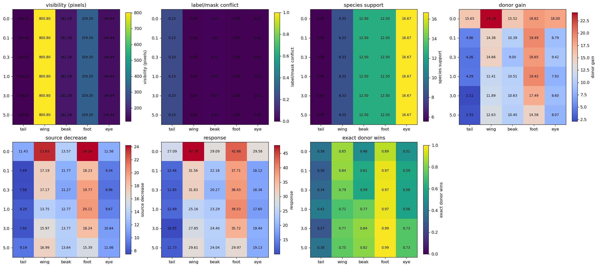


Table — part means plotted in the seven heatmaps. Each exact donor value receives equal weight within a part. Visibility, conflict, and support repeat across gamma because the physical data are unchanged; response columns come from each model.


|  | gamma | part | mean_corrected_visible_pixels | donor_conflict_rate | donor_species_support | mean_z_donor_gain | mean_z_source_decrease | mean_z_response | exact_donor_recognition |
| --- | --- | --- | --- | --- | --- | --- | --- | --- | --- |
| 0 | 0.0 | beak | 161.2764 | 0.0102 | 12.5000 | 15.5183 | 13.5691 | 29.0873 | 0.4848 |
| 1 | 0.0 | eye | 144.6448 | 0.0071 | 16.6667 | 17.9998 | 11.5641 | 29.5639 | 0.5139 |
| 2 | 0.0 | foot | 329.2049 | 0.0014 | 12.5000 | 18.6180 | 24.2425 | 42.8605 | 0.8947 |
| 3 | 0.0 | tail | 116.0159 | 0.2310 | 5.5556 | 15.6549 | 11.4322 | 27.0871 | 0.3844 |
| 4 | 0.0 | wing | 800.8017 | 0.0003 | 8.3333 | 24.1553 | 23.6275 | 47.7828 | 0.8509 |
| 5 | 0.1 | beak | 161.2764 | 0.0102 | 12.5000 | 10.3910 | 11.7708 | 22.1618 | 0.6101 |
| 6 | 0.1 | eye | 144.6448 | 0.0071 | 16.6667 | 8.7873 | 9.3370 | 18.1243 | 0.5937 |
| 7 | 0.1 | foot | 329.2049 | 0.0014 | 12.5000 | 19.4851 | 18.2272 | 37.7122 | 0.9674 |
| 8 | 0.1 | tail | 116.0159 | 0.2310 | 5.5556 | 4.9621 | 7.4947 | 12.4567 | 0.3006 |
| 9 | 0.1 | wing | 800.8017 | 0.0003 | 8.3333 | 14.3760 | 17.1855 | 31.5615 | 0.8403 |
| 10 | 0.3 | beak | 161.2764 | 0.0102 | 12.5000 | 8.9980 | 11.2743 | 20.2723 | 0.5862 |
| 11 | 0.3 | eye | 144.6448 | 0.0071 | 16.6667 | 9.4174 | 8.9627 | 18.3801 | 0.5815 |
| 12 | 0.3 | foot | 329.2049 | 0.0014 | 12.5000 | 18.6543 | 19.7727 | 38.4270 | 0.9745 |
| 13 | 0.3 | tail | 116.0159 | 0.2310 | 5.5556 | 4.2643 | 7.5808 | 11.8451 | 0.3414 |
| 14 | 0.3 | wing | 800.8017 | 0.0003 | 8.3333 | 14.6563 | 17.1711 | 31.8274 | 0.7873 |
| 15 | 1.0 | beak | 161.2764 | 0.0102 | 12.5000 | 10.5130 | 12.7724 | 23.2854 | 0.7706 |
| 16 | 1.0 | eye | 144.6448 | 0.0071 | 16.6667 | 7.9344 | 9.6697 | 17.6041 | 0.5792 |
| 17 | 1.0 | foot | 329.2049 | 0.0014 | 12.5000 | 19.4229 | 20.1063 | 39.5293 | 0.9688 |
| 18 | 1.0 | tail | 116.0159 | 0.2310 | 5.5556 | 4.2931 | 8.2012 | 12.4943 | 0.4189 |
| 19 | 1.0 | wing | 800.8017 | 0.0003 | 8.3333 | 11.4056 | 13.7523 | 25.1578 | 0.7169 |
| 20 | 3.0 | beak | 161.2764 | 0.0102 | 12.5000 | 10.6344 | 13.7656 | 24.4000 | 0.8378 |
| 21 | 3.0 | eye | 144.6448 | 0.0071 | 16.6667 | 8.6016 | 10.8398 | 19.4414 | 0.7328 |
| 22 | 3.0 | foot | 329.2049 | 0.0014 | 12.5000 | 17.4878 | 18.2366 | 35.7244 | 0.9868 |
| 23 | 3.0 | tail | 116.0159 | 0.2310 | 5.5556 | 2.1136 | 7.9350 | 10.0486 | 0.2712 |
| 24 | 3.0 | wing | 800.8017 | 0.0003 | 8.3333 | 11.8864 | 15.9658 | 27.8522 | 0.7672 |
| 25 | 5.0 | beak | 161.2764 | 0.0102 | 12.5000 | 10.3996 | 13.6422 | 24.0418 | 0.8225 |
| 26 | 5.0 | eye | 144.6448 | 0.0071 | 16.6667 | 8.0706 | 11.0554 | 19.1260 | 0.7333 |
| 27 | 5.0 | foot | 329.2049 | 0.0014 | 12.5000 | 14.5814 | 15.3929 | 29.9742 | 0.9896 |
| 28 | 5.0 | tail | 116.0159 | 0.2310 | 5.5556 | 2.5478 | 9.1866 | 11.7344 | 0.3847 |
| 29 | 5.0 | wing | 800.8017 | 0.0003 | 8.3333 | 12.6260 | 16.9874 | 29.6134 | 0.7524 |


**How to read the executed RLv2 result.** The figure and fully
captioned source table immediately above are the result; no expected
observation was written into the notebook before execution.


Comparison requirements. Interpretation of Standard–RLv2 differences requires matching γ, formulas, physical image pairs, and denominators. The seed-1 comparison is specific to the evaluated runs; between-initialization variability requires replication.


Subsequent analysis. Continue to the next identical analysis stage, then use the final matched-difference table to decide which part and pathway actually changed.


## 5. Species information and dependence of the fitted classifier


**Question.** Does MCBM reduce species information in concept magnitudes, and
does its saved species head actually depend on that information?


**Three separate tests.** (1) A new held-out logistic diagnostic measures how
much species prediction improves from raw magnitudes after the 0/1 labels are
known. (2) The unchanged saved species head is rerun after within-label
magnitudes are replaced by training-fold label means. (3) On swaps, off-target
same-part `h` coordinates are restored to their exact original-image values,
while the source and donor coordinates remain fixed; the unchanged saved
species head is rerun. Test 3 is the direct intervention.


The Standard decoding and head-intervention results provide the reference. The corresponding MCBM analyses use its own nonlinear species head.


**Exact executed Koh Standard/RLv2 comparison — Notebook 02rl `02rl-f13d-`**


```text
STANDARD — identical four-panel calculation
```


|  | part | coordinates | conditional_logloss_gain | gain_per_coordinate_descriptive |
| --- | --- | --- | --- | --- |
| 0 | beak | 4 | 0.9981 | 0.2495 |
| 1 | eye | 3 | 0.5145 | 0.1715 |
| 2 | foot | 4 | 0.7134 | 0.1784 |
| 3 | tail | 9 | 1.4977 | 0.1664 |
| 4 | wing | 6 | 1.2424 | 0.2071 |


|  | part | three_coordinate_subsets | mean_conditional_gain | min_conditional_gain | max_conditional_gain |
| --- | --- | --- | --- | --- | --- |
| 0 | beak | 4 | 0.7751 | 0.7129 | 0.8426 |
| 1 | eye | 1 | 0.5145 | 0.5145 | 0.5145 |
| 2 | foot | 4 | 0.5448 | 0.5064 | 0.5973 |
| 3 | tail | 40 | 1.0279 | 0.8812 | 1.1840 |
| 4 | wing | 20 | 0.7710 | 0.5812 | 0.9544 |


|  | replaced_block | coordinates_replaced | raw_accuracy | accuracy_after_replacement | top1_change_rate | mean_probability_mass_moved |
| --- | --- | --- | --- | --- | --- | --- |
| 0 | all 26 | 26 | 0.992 | 1.000 | 0.008 | 0.0117 |
| 1 | beak | 4 | 0.992 | 0.992 | 0.000 | 0.0020 |
| 2 | eye | 3 | 0.992 | 0.992 | 0.000 | 0.0019 |
| 3 | foot | 4 | 0.992 | 0.994 | 0.002 | 0.0030 |
| 4 | tail | 9 | 0.992 | 0.998 | 0.006 | 0.0090 |
| 5 | wing | 6 | 0.992 | 0.992 | 0.000 | 0.0009 |


```text
RLV2 — identical four-panel calculation
```


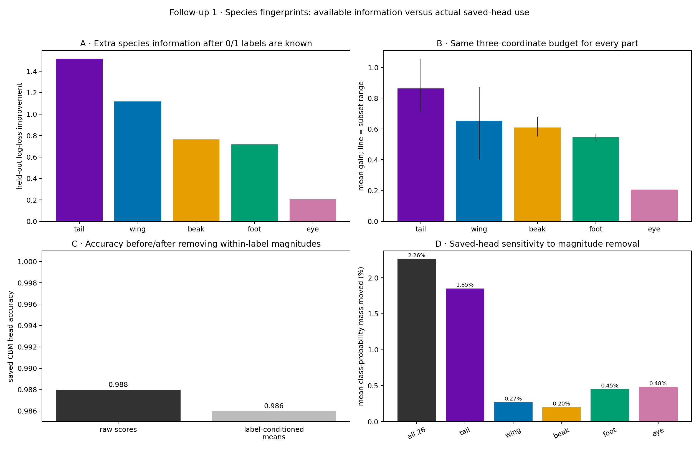


|  | part | coordinates | conditional_logloss_gain | gain_per_coordinate_descriptive |
| --- | --- | --- | --- | --- |
| 0 | beak | 4 | 0.7652 | 0.1913 |
| 1 | eye | 3 | 0.2069 | 0.0690 |
| 2 | foot | 4 | 0.7187 | 0.1797 |
| 3 | tail | 9 | 1.5174 | 0.1686 |
| 4 | wing | 6 | 1.1184 | 0.1864 |


|  | part | three_coordinate_subsets | mean_conditional_gain | min_conditional_gain | max_conditional_gain |
| --- | --- | --- | --- | --- | --- |
| 0 | beak | 4 | 0.6096 | 0.5514 | 0.6805 |
| 1 | eye | 1 | 0.2069 | 0.2069 | 0.2069 |
| 2 | foot | 4 | 0.5461 | 0.5248 | 0.5670 |
| 3 | tail | 40 | 0.8641 | 0.7142 | 1.0564 |
| 4 | wing | 20 | 0.6524 | 0.4034 | 0.8721 |


|  | replaced_block | coordinates_replaced | raw_accuracy | accuracy_after_replacement | top1_change_rate | mean_probability_mass_moved |
| --- | --- | --- | --- | --- | --- | --- |
| 0 | all 26 | 26 | 0.988 | 0.986 | 0.024 | 0.0226 |
| 1 | beak | 4 | 0.988 | 0.986 | 0.004 | 0.0020 |
| 2 | eye | 3 | 0.988 | 0.990 | 0.004 | 0.0048 |
| 3 | foot | 4 | 0.988 | 0.990 | 0.002 | 0.0045 |
| 4 | tail | 9 | 0.988 | 0.982 | 0.020 | 0.0185 |
| 5 | wing | 6 | 0.988 | 0.990 | 0.002 | 0.0027 |


**Exact executed Koh Standard/RLv2 comparison — Notebook 02rl `02rl-f13e-`**


```text
STANDARD — identical off-target erasure
```


|  | part | n_swaps | n_original_images | off_target_coordinates | mean_e | median_e | fraction_e_positive | median_absolute_e | median_absolute_source_minus_donor_gap | mean_pairwise_source_share_reduction | top1_change_rate | source_to_donor_pair_flip_rate |
| --- | --- | --- | --- | --- | --- | --- | --- | --- | --- | --- | --- | --- |
| 0 | tail | 1000 | 250 | 7 | 0.2261 | 0.2042 | 0.699 | 0.3180 | 15.3748 | 0.0003 | 0.099 | 0.002 |
| 1 | wing | 1000 | 250 | 4 | 0.0212 | 0.0187 | 0.534 | 0.1428 | 7.3557 | 0.0002 | 0.034 | 0.004 |
| 2 | beak | 1000 | 250 | 2 | -0.0325 | -0.0143 | 0.438 | 0.0854 | 14.5976 | -0.0007 | 0.027 | 0.000 |
| 3 | foot | 1000 | 250 | 2 | -0.0406 | -0.0259 | 0.369 | 0.0566 | 12.4407 | -0.0002 | 0.021 | 0.001 |
| 4 | eye | 1000 | 250 | 1 | -0.0198 | -0.0067 | 0.411 | 0.0306 | 14.2733 | -0.0002 | 0.007 | 0.000 |


```text
RLV2 — identical off-target erasure
```


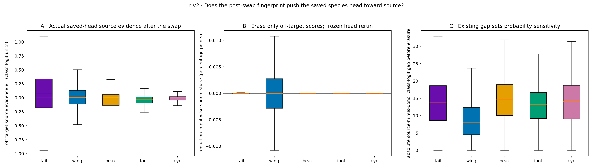


|  | part | n_swaps | n_original_images | off_target_coordinates | mean_e | median_e | fraction_e_positive | median_absolute_e | median_absolute_source_minus_donor_gap | mean_pairwise_source_share_reduction | top1_change_rate | source_to_donor_pair_flip_rate |
| --- | --- | --- | --- | --- | --- | --- | --- | --- | --- | --- | --- | --- |
| 0 | tail | 1000 | 250 | 7 | 0.0982 | 0.0692 | 0.570 | 0.2531 | 13.8831 | 0.0005 | 0.065 | 0.004 |
| 1 | wing | 1000 | 250 | 4 | 0.0111 | 0.0050 | 0.513 | 0.1239 | 8.0957 | 0.0005 | 0.032 | 0.001 |
| 2 | beak | 1000 | 250 | 2 | -0.0343 | -0.0188 | 0.429 | 0.0889 | 14.7241 | -0.0003 | 0.025 | 0.000 |
| 3 | foot | 1000 | 250 | 2 | -0.0383 | -0.0241 | 0.375 | 0.0578 | 13.2839 | -0.0002 | 0.021 | 0.000 |
| 4 | eye | 1000 | 250 | 1 | -0.0151 | -0.0049 | 0.434 | 0.0311 | 14.1149 | -0.0001 | 0.004 | 0.000 |


### Executed Standard-MCBM result — mcbm-info


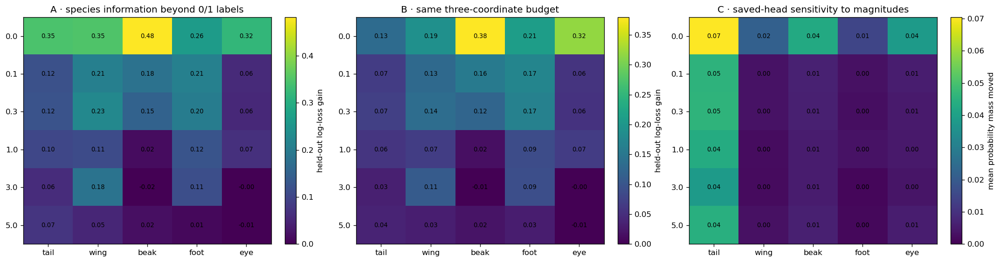


Table — species information after the yes/no labels are already known. conditional_logloss_gain is the held-out species log-loss improvement when raw magnitudes are added to the matching 0/1 labels. Larger is more extra species information; a small negative value indicates worse held-out performance for the augmented diagnostic.


|  | part | coordinates | conditional_logloss_gain | gain_per_coordinate_descriptive | gamma |
| --- | --- | --- | --- | --- | --- |
| 0 | beak | 4 | 0.4817 | 0.1204 | 0.0 |
| 1 | eye | 3 | 0.3182 | 0.1061 | 0.0 |
| 2 | foot | 4 | 0.2644 | 0.0661 | 0.0 |
| 3 | tail | 9 | 0.3455 | 0.0384 | 0.0 |
| 4 | wing | 6 | 0.3491 | 0.0582 | 0.0 |
| 5 | beak | 4 | 0.1810 | 0.0453 | 0.1 |
| 6 | eye | 3 | 0.0565 | 0.0188 | 0.1 |
| 7 | foot | 4 | 0.2106 | 0.0527 | 0.1 |
| 8 | tail | 9 | 0.1194 | 0.0133 | 0.1 |
| 9 | wing | 6 | 0.2083 | 0.0347 | 0.1 |
| 10 | beak | 4 | 0.1505 | 0.0376 | 0.3 |
| 11 | eye | 3 | 0.0552 | 0.0184 | 0.3 |
| 12 | foot | 4 | 0.2015 | 0.0504 | 0.3 |
| 13 | tail | 9 | 0.1230 | 0.0137 | 0.3 |
| 14 | wing | 6 | 0.2258 | 0.0376 | 0.3 |
| 15 | beak | 4 | 0.0165 | 0.0041 | 1.0 |
| 16 | eye | 3 | 0.0673 | 0.0224 | 1.0 |
| 17 | foot | 4 | 0.1247 | 0.0312 | 1.0 |
| 18 | tail | 9 | 0.1030 | 0.0114 | 1.0 |
| 19 | wing | 6 | 0.1097 | 0.0183 | 1.0 |
| 20 | beak | 4 | -0.0220 | -0.0055 | 3.0 |
| 21 | eye | 3 | -0.0024 | -0.0008 | 3.0 |
| 22 | foot | 4 | 0.1149 | 0.0287 | 3.0 |
| 23 | tail | 9 | 0.0609 | 0.0068 | 3.0 |
| 24 | wing | 6 | 0.1835 | 0.0306 | 3.0 |
| 25 | beak | 4 | 0.0199 | 0.0050 | 5.0 |
| 26 | eye | 3 | -0.0057 | -0.0019 | 5.0 |
| 27 | foot | 4 | 0.0113 | 0.0028 | 5.0 |
| 28 | tail | 9 | 0.0736 | 0.0082 | 5.0 |
| 29 | wing | 6 | 0.0524 | 0.0087 | 5.0 |


Table — same three-coordinate information budget for every part. Each subset contains exactly three coordinates. mean_conditional_gain averages all such subsets; min/max describe variation across coordinate subsets.


|  | part | three_coordinate_subsets | mean_conditional_gain | min_conditional_gain | max_conditional_gain | gamma |
| --- | --- | --- | --- | --- | --- | --- |
| 0 | beak | 4 | 0.3796 | 0.2579 | 0.4995 | 0.0 |
| 1 | eye | 1 | 0.3182 | 0.3182 | 0.3182 | 0.0 |
| 2 | foot | 4 | 0.2108 | 0.1373 | 0.2699 | 0.0 |
| 3 | tail | 40 | 0.1331 | 0.0446 | 0.3621 | 0.0 |
| 4 | wing | 20 | 0.1909 | 0.0237 | 0.3737 | 0.0 |
| 5 | beak | 4 | 0.1552 | 0.1248 | 0.1776 | 0.1 |
| 6 | eye | 1 | 0.0565 | 0.0565 | 0.0565 | 0.1 |
| 7 | foot | 4 | 0.1724 | 0.1448 | 0.1962 | 0.1 |
| 8 | tail | 40 | 0.0674 | 0.0484 | 0.0953 | 0.1 |
| 9 | wing | 20 | 0.1301 | 0.0762 | 0.1875 | 0.1 |
| 10 | beak | 4 | 0.1238 | 0.1126 | 0.1528 | 0.3 |
| 11 | eye | 1 | 0.0552 | 0.0552 | 0.0552 | 0.3 |
| 12 | foot | 4 | 0.1667 | 0.1232 | 0.2110 | 0.3 |
| 13 | tail | 40 | 0.0713 | 0.0389 | 0.0965 | 0.3 |
| 14 | wing | 20 | 0.1362 | 0.0986 | 0.1744 | 0.3 |
| 15 | beak | 4 | 0.0153 | 0.0095 | 0.0237 | 1.0 |
| 16 | eye | 1 | 0.0673 | 0.0673 | 0.0673 | 1.0 |
| 17 | foot | 4 | 0.0887 | 0.0772 | 0.0965 | 1.0 |
| 18 | tail | 40 | 0.0584 | 0.0181 | 0.0964 | 1.0 |
| 19 | wing | 20 | 0.0685 | 0.0021 | 0.1136 | 1.0 |
| 20 | beak | 4 | -0.0112 | -0.0271 | 0.0056 | 3.0 |
| 21 | eye | 1 | -0.0024 | -0.0024 | -0.0024 | 3.0 |
| 22 | foot | 4 | 0.0908 | 0.0661 | 0.1148 | 3.0 |
| 23 | tail | 40 | 0.0328 | 0.0121 | 0.0472 | 3.0 |
| 24 | wing | 20 | 0.1090 | 0.0529 | 0.1658 | 3.0 |
| 25 | beak | 4 | 0.0203 | -0.0004 | 0.0300 | 5.0 |
| 26 | eye | 1 | -0.0057 | -0.0057 | -0.0057 | 5.0 |
| 27 | foot | 4 | 0.0310 | 0.0158 | 0.0492 | 5.0 |
| 28 | tail | 40 | 0.0384 | 0.0164 | 0.0584 | 5.0 |
| 29 | wing | 20 | 0.0313 | -0.0012 | 0.0605 | 5.0 |


**Table — actual sensitivity of the unchanged saved MCBM species head.** Within each held-out fold, selected `h` magnitudes are replaced by the training-fold mean for the same 0/1 label. `mean_probability_mass_moved` is half the total absolute change across all 50 species probabilities; `top1_change_rate` is the fraction whose most likely species changes.


|  | replaced_block | coordinates_replaced | raw_accuracy | accuracy_after_replacement | top1_change_rate | mean_probability_mass_moved | gamma |
| --- | --- | --- | --- | --- | --- | --- | --- |
| 0 | all 26 | 26 | 0.7342 | 0.7670 | 0.1564 | 0.1080 | 0.0 |
| 1 | beak | 4 | 0.7342 | 0.7358 | 0.0844 | 0.0429 | 0.0 |
| 2 | eye | 3 | 0.7342 | 0.7500 | 0.0614 | 0.0383 | 0.0 |
| 3 | foot | 4 | 0.7342 | 0.7354 | 0.0336 | 0.0147 | 0.0 |
| 4 | tail | 9 | 0.7342 | 0.7552 | 0.0916 | 0.0704 | 0.0 |
| 5 | wing | 6 | 0.7342 | 0.7324 | 0.0450 | 0.0215 | 0.0 |
| 6 | all 26 | 26 | 0.7544 | 0.7790 | 0.0938 | 0.0515 | 0.1 |
| 7 | beak | 4 | 0.7544 | 0.7544 | 0.0172 | 0.0065 | 0.1 |
| 8 | eye | 3 | 0.7544 | 0.7554 | 0.0142 | 0.0057 | 0.1 |
| 9 | foot | 4 | 0.7544 | 0.7542 | 0.0082 | 0.0032 | 0.1 |
| 10 | tail | 9 | 0.7544 | 0.7774 | 0.0884 | 0.0456 | 0.1 |
| 11 | wing | 6 | 0.7544 | 0.7550 | 0.0112 | 0.0036 | 0.1 |
| 12 | all 26 | 26 | 0.7520 | 0.7768 | 0.0844 | 0.0517 | 0.3 |
| 13 | beak | 4 | 0.7520 | 0.7536 | 0.0112 | 0.0061 | 0.3 |
| 14 | eye | 3 | 0.7520 | 0.7546 | 0.0092 | 0.0052 | 0.3 |
| 15 | foot | 4 | 0.7520 | 0.7524 | 0.0050 | 0.0026 | 0.3 |
| 16 | tail | 9 | 0.7520 | 0.7732 | 0.0774 | 0.0459 | 0.3 |
| 17 | wing | 6 | 0.7520 | 0.7532 | 0.0056 | 0.0034 | 0.3 |
| 18 | all 26 | 26 | 0.7442 | 0.7770 | 0.0760 | 0.0510 | 1.0 |
| 19 | beak | 4 | 0.7442 | 0.7474 | 0.0082 | 0.0052 | 1.0 |
| 20 | eye | 3 | 0.7442 | 0.7474 | 0.0088 | 0.0049 | 1.0 |
| 21 | foot | 4 | 0.7442 | 0.7460 | 0.0048 | 0.0033 | 1.0 |
| 22 | tail | 9 | 0.7442 | 0.7726 | 0.0632 | 0.0433 | 1.0 |
| 23 | wing | 6 | 0.7442 | 0.7450 | 0.0044 | 0.0023 | 1.0 |
| 24 | all 26 | 26 | 0.7490 | 0.7768 | 0.0574 | 0.0446 | 3.0 |
| 25 | beak | 4 | 0.7490 | 0.7518 | 0.0062 | 0.0055 | 3.0 |
| 26 | eye | 3 | 0.7490 | 0.7496 | 0.0050 | 0.0039 | 3.0 |
| 27 | foot | 4 | 0.7490 | 0.7492 | 0.0020 | 0.0012 | 3.0 |
| 28 | tail | 9 | 0.7490 | 0.7740 | 0.0500 | 0.0384 | 3.0 |
| 29 | wing | 6 | 0.7490 | 0.7494 | 0.0022 | 0.0022 | 3.0 |
| 30 | all 26 | 26 | 0.7478 | 0.7780 | 0.0614 | 0.0519 | 5.0 |
| 31 | beak | 4 | 0.7478 | 0.7506 | 0.0074 | 0.0061 | 5.0 |
| 32 | eye | 3 | 0.7478 | 0.7508 | 0.0068 | 0.0057 | 5.0 |
| 33 | foot | 4 | 0.7478 | 0.7482 | 0.0026 | 0.0015 | 5.0 |
| 34 | tail | 9 | 0.7478 | 0.7754 | 0.0548 | 0.0443 | 5.0 |
| 35 | wing | 6 | 0.7478 | 0.7494 | 0.0036 | 0.0031 | 5.0 |


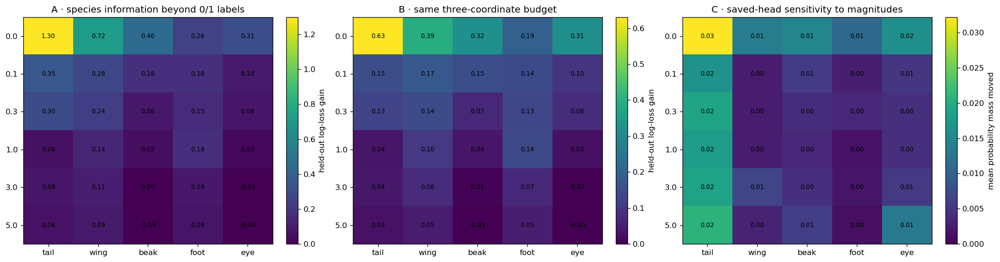


Table — species information after the yes/no labels are already known. conditional_logloss_gain is the held-out species log-loss improvement when raw magnitudes are added to the matching 0/1 labels. Larger is more extra species information; a small negative value indicates worse held-out performance for the augmented diagnostic.


|  | part | coordinates | conditional_logloss_gain | gain_per_coordinate_descriptive | gamma |
| --- | --- | --- | --- | --- | --- |
| 0 | beak | 4 | 0.4550 | 0.1138 | 0.0 |
| 1 | eye | 3 | 0.3137 | 0.1046 | 0.0 |
| 2 | foot | 4 | 0.2565 | 0.0641 | 0.0 |
| 3 | tail | 9 | 1.2975 | 0.1442 | 0.0 |
| 4 | wing | 6 | 0.7182 | 0.1197 | 0.0 |
| 5 | beak | 4 | 0.1767 | 0.0442 | 0.1 |
| 6 | eye | 3 | 0.0963 | 0.0321 | 0.1 |
| 7 | foot | 4 | 0.1764 | 0.0441 | 0.1 |
| 8 | tail | 9 | 0.3512 | 0.0390 | 0.1 |
| 9 | wing | 6 | 0.2822 | 0.0470 | 0.1 |
| 10 | beak | 4 | 0.0819 | 0.0205 | 0.3 |
| 11 | eye | 3 | 0.0801 | 0.0267 | 0.3 |
| 12 | foot | 4 | 0.1528 | 0.0382 | 0.3 |
| 13 | tail | 9 | 0.2961 | 0.0329 | 0.3 |
| 14 | wing | 6 | 0.2409 | 0.0401 | 0.3 |
| 15 | beak | 4 | 0.0469 | 0.0117 | 1.0 |
| 16 | eye | 3 | 0.0278 | 0.0093 | 1.0 |
| 17 | foot | 4 | 0.1817 | 0.0454 | 1.0 |
| 18 | tail | 9 | 0.0606 | 0.0067 | 1.0 |
| 19 | wing | 6 | 0.1392 | 0.0232 | 1.0 |
| 20 | beak | 4 | 0.0049 | 0.0012 | 3.0 |
| 21 | eye | 3 | -0.0110 | -0.0037 | 3.0 |
| 22 | foot | 4 | 0.0910 | 0.0228 | 3.0 |
| 23 | tail | 9 | 0.0788 | 0.0088 | 3.0 |
| 24 | wing | 6 | 0.1075 | 0.0179 | 3.0 |
| 25 | beak | 4 | -0.0385 | -0.0096 | 5.0 |
| 26 | eye | 3 | -0.0009 | -0.0003 | 5.0 |
| 27 | foot | 4 | 0.0759 | 0.0190 | 5.0 |
| 28 | tail | 9 | 0.0619 | 0.0069 | 5.0 |
| 29 | wing | 6 | 0.0920 | 0.0153 | 5.0 |


Table — same three-coordinate information budget for every part. Each subset contains exactly three coordinates. mean_conditional_gain averages all such subsets; min/max describe variation across coordinate subsets.


|  | part | three_coordinate_subsets | mean_conditional_gain | min_conditional_gain | max_conditional_gain | gamma |
| --- | --- | --- | --- | --- | --- | --- |
| 0 | beak | 4 | 0.3162 | 0.2543 | 0.4431 | 0.0 |
| 1 | eye | 1 | 0.3137 | 0.3137 | 0.3137 | 0.0 |
| 2 | foot | 4 | 0.1927 | 0.0724 | 0.2403 | 0.0 |
| 3 | tail | 40 | 0.6304 | 0.5437 | 0.7103 | 0.0 |
| 4 | wing | 20 | 0.3917 | 0.2540 | 0.5621 | 0.0 |
| 5 | beak | 4 | 0.1507 | 0.1372 | 0.1601 | 0.1 |
| 6 | eye | 1 | 0.0963 | 0.0963 | 0.0963 | 0.1 |
| 7 | foot | 4 | 0.1422 | 0.1380 | 0.1469 | 0.1 |
| 8 | tail | 40 | 0.1499 | 0.0816 | 0.2125 | 0.1 |
| 9 | wing | 20 | 0.1743 | 0.0886 | 0.2600 | 0.1 |
| 10 | beak | 4 | 0.0691 | 0.0425 | 0.0882 | 0.3 |
| 11 | eye | 1 | 0.0801 | 0.0801 | 0.0801 | 0.3 |
| 12 | foot | 4 | 0.1334 | 0.1086 | 0.1804 | 0.3 |
| 13 | tail | 40 | 0.1260 | 0.0561 | 0.1903 | 0.3 |
| 14 | wing | 20 | 0.1433 | 0.0921 | 0.2010 | 0.3 |
| 15 | beak | 4 | 0.0379 | 0.0180 | 0.0610 | 1.0 |
| 16 | eye | 1 | 0.0278 | 0.0278 | 0.0278 | 1.0 |
| 17 | foot | 4 | 0.1399 | 0.1086 | 0.1653 | 1.0 |
| 18 | tail | 40 | 0.0376 | 0.0007 | 0.0803 | 1.0 |
| 19 | wing | 20 | 0.1047 | 0.0240 | 0.1852 | 1.0 |
| 20 | beak | 4 | 0.0063 | -0.0049 | 0.0115 | 3.0 |
| 21 | eye | 1 | -0.0110 | -0.0110 | -0.0110 | 3.0 |
| 22 | foot | 4 | 0.0721 | 0.0598 | 0.0830 | 3.0 |
| 23 | tail | 40 | 0.0398 | 0.0162 | 0.0618 | 3.0 |
| 24 | wing | 20 | 0.0806 | 0.0168 | 0.1193 | 3.0 |
| 25 | beak | 4 | -0.0264 | -0.0324 | -0.0217 | 5.0 |
| 26 | eye | 1 | -0.0009 | -0.0009 | -0.0009 | 5.0 |
| 27 | foot | 4 | 0.0522 | 0.0339 | 0.0758 | 5.0 |
| 28 | tail | 40 | 0.0302 | 0.0067 | 0.0526 | 5.0 |
| 29 | wing | 20 | 0.0487 | 0.0151 | 0.0938 | 5.0 |


**Table — actual sensitivity of the unchanged saved MCBM species head.** Within each held-out fold, selected `h` magnitudes are replaced by the training-fold mean for the same 0/1 label. `mean_probability_mass_moved` is half the total absolute change across all 50 species probabilities; `top1_change_rate` is the fraction whose most likely species changes.


|  | replaced_block | coordinates_replaced | raw_accuracy | accuracy_after_replacement | top1_change_rate | mean_probability_mass_moved | gamma |
| --- | --- | --- | --- | --- | --- | --- | --- |
| 0 | all 26 | 26 | 0.7496 | 0.7500 | 0.0716 | 0.0416 | 0.0 |
| 1 | beak | 4 | 0.7496 | 0.7484 | 0.0312 | 0.0147 | 0.0 |
| 2 | eye | 3 | 0.7496 | 0.7496 | 0.0340 | 0.0161 | 0.0 |
| 3 | foot | 4 | 0.7496 | 0.7494 | 0.0238 | 0.0108 | 0.0 |
| 4 | tail | 9 | 0.7496 | 0.7446 | 0.0600 | 0.0322 | 0.0 |
| 5 | wing | 6 | 0.7496 | 0.7472 | 0.0246 | 0.0136 | 0.0 |
| 6 | all 26 | 26 | 0.7474 | 0.7538 | 0.0422 | 0.0250 | 0.1 |
| 7 | beak | 4 | 0.7474 | 0.7480 | 0.0082 | 0.0054 | 0.1 |
| 8 | eye | 3 | 0.7474 | 0.7478 | 0.0124 | 0.0051 | 0.1 |
| 9 | foot | 4 | 0.7474 | 0.7472 | 0.0070 | 0.0027 | 0.1 |
| 10 | tail | 9 | 0.7474 | 0.7500 | 0.0278 | 0.0166 | 0.1 |
| 11 | wing | 6 | 0.7474 | 0.7486 | 0.0078 | 0.0025 | 0.1 |
| 12 | all 26 | 26 | 0.7496 | 0.7566 | 0.0352 | 0.0271 | 0.3 |
| 13 | beak | 4 | 0.7496 | 0.7508 | 0.0074 | 0.0042 | 0.3 |
| 14 | eye | 3 | 0.7496 | 0.7508 | 0.0074 | 0.0044 | 0.3 |
| 15 | foot | 4 | 0.7496 | 0.7506 | 0.0048 | 0.0036 | 0.3 |
| 16 | tail | 9 | 0.7496 | 0.7518 | 0.0268 | 0.0187 | 0.3 |
| 17 | wing | 6 | 0.7496 | 0.7510 | 0.0048 | 0.0026 | 0.3 |
| 18 | all 26 | 26 | 0.7496 | 0.7558 | 0.0364 | 0.0258 | 1.0 |
| 19 | beak | 4 | 0.7496 | 0.7496 | 0.0060 | 0.0038 | 1.0 |
| 20 | eye | 3 | 0.7496 | 0.7514 | 0.0058 | 0.0043 | 1.0 |
| 21 | foot | 4 | 0.7496 | 0.7502 | 0.0024 | 0.0015 | 1.0 |
| 22 | tail | 9 | 0.7496 | 0.7520 | 0.0266 | 0.0177 | 1.0 |
| 23 | wing | 6 | 0.7496 | 0.7508 | 0.0034 | 0.0026 | 1.0 |
| 24 | all 26 | 26 | 0.7368 | 0.7496 | 0.0378 | 0.0309 | 3.0 |
| 25 | beak | 4 | 0.7368 | 0.7382 | 0.0074 | 0.0044 | 3.0 |
| 26 | eye | 3 | 0.7368 | 0.7378 | 0.0068 | 0.0053 | 3.0 |
| 27 | foot | 4 | 0.7368 | 0.7372 | 0.0032 | 0.0018 | 3.0 |
| 28 | tail | 9 | 0.7368 | 0.7422 | 0.0242 | 0.0186 | 3.0 |
| 29 | wing | 6 | 0.7368 | 0.7408 | 0.0096 | 0.0067 | 3.0 |
| 30 | all 26 | 26 | 0.7344 | 0.7508 | 0.0476 | 0.0381 | 5.0 |
| 31 | beak | 4 | 0.7344 | 0.7370 | 0.0068 | 0.0059 | 5.0 |
| 32 | eye | 3 | 0.7344 | 0.7404 | 0.0168 | 0.0130 | 5.0 |
| 33 | foot | 4 | 0.7344 | 0.7352 | 0.0018 | 0.0013 | 5.0 |
| 34 | tail | 9 | 0.7344 | 0.7414 | 0.0272 | 0.0208 | 5.0 |
| 35 | wing | 6 | 0.7344 | 0.7364 | 0.0026 | 0.0032 | 5.0 |


**How to read the executed RLv2 result.** The figure and fully
captioned source table immediately above are the result; no expected
observation was written into the notebook before execution.


Comparison requirements. Interpretation of Standard–RLv2 differences requires matching γ, formulas, physical image pairs, and denominators. The seed-1 comparison is specific to the evaluated runs; between-initialization variability requires replication.


Subsequent analysis. Continue to the next identical analysis stage, then use the final matched-difference table to decide which part and pathway actually changed.


### Direct frozen-head intervention on swapped images


Example for `tail_2 → tail_7`: MCBM always has nine tail coordinates. Keep
the counterfactual `tail_2` and `tail_7` values exactly unchanged. Replace
the other seven tail coordinates with their values from the matching
original image. Rerun the same saved species head.


`source evidence = (source logit - donor logit)_before - (source logit - donor logit)_after`.


Positive means the swap-induced off-target changes had been helping the old source species; negative means they had been helping the donor. Panel C's pairwise flip rate asks the narrow decision-relevant question. Panel D measures redistribution across all species, including classes outside the source–donor pair.


### Executed Standard-MCBM result — hybrid


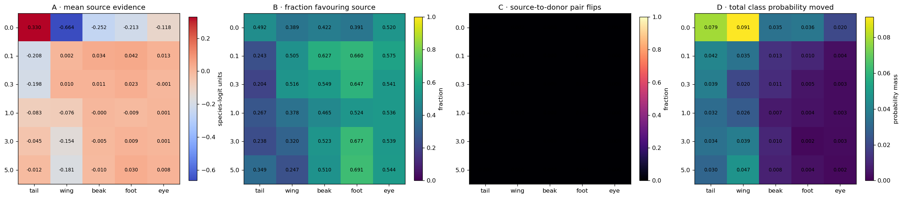


**Table — direct off-target intervention behind Panels A–D.** For each swap, old and donor coordinates stay fixed while every other coordinate of that part is restored to the matching original image. Positive source evidence means those swap-induced off-target changes had favored the source species. The pair-flip rate and all-species probability movement are different outcomes.


|  | gamma | part | n_rows | n_originals | mean_swap_induced_offtarget_source_evidence | median_swap_induced_offtarget_source_evidence | fraction_source_evidence_positive | pairwise_source_to_donor_flip_rate | top1_change_rate | mean_probability_mass_moved |
| --- | --- | --- | --- | --- | --- | --- | --- | --- | --- | --- |
| 0 | 0.0 | beak | 1000 | 250 | -0.25242 | -0.13346 | 0.422 | 0.000 | 0.033 | 0.03459 |
| 1 | 0.0 | eye | 1000 | 250 | -0.11838 | 0.00913 | 0.520 | 0.003 | 0.020 | 0.02012 |
| 2 | 0.0 | foot | 1000 | 250 | -0.21270 | -0.10614 | 0.391 | 0.002 | 0.042 | 0.03614 |
| 3 | 0.0 | tail | 1000 | 250 | 0.32987 | 0.00000 | 0.492 | 0.003 | 0.082 | 0.07865 |
| 4 | 0.0 | wing | 1000 | 250 | -0.66357 | -0.35713 | 0.389 | 0.002 | 0.103 | 0.09141 |
| 5 | 0.1 | beak | 1000 | 250 | 0.03360 | 0.02398 | 0.627 | 0.000 | 0.026 | 0.01317 |
| 6 | 0.1 | eye | 1000 | 250 | 0.01268 | 0.00494 | 0.575 | 0.000 | 0.011 | 0.00375 |
| 7 | 0.1 | foot | 1000 | 250 | 0.04242 | 0.02367 | 0.660 | 0.001 | 0.007 | 0.00992 |
| 8 | 0.1 | tail | 1000 | 250 | -0.20777 | -0.12334 | 0.243 | 0.001 | 0.086 | 0.04159 |
| 9 | 0.1 | wing | 1000 | 250 | 0.00156 | 0.00666 | 0.505 | 0.003 | 0.046 | 0.03472 |
| 10 | 0.3 | beak | 1000 | 250 | 0.01052 | 0.00546 | 0.549 | 0.000 | 0.009 | 0.01146 |
| 11 | 0.3 | eye | 1000 | 250 | -0.00126 | 0.00118 | 0.541 | 0.000 | 0.000 | 0.00300 |
| 12 | 0.3 | foot | 1000 | 250 | 0.02350 | 0.01274 | 0.647 | 0.000 | 0.006 | 0.00512 |
| 13 | 0.3 | tail | 1000 | 250 | -0.19843 | -0.14620 | 0.204 | 0.000 | 0.067 | 0.03912 |
| 14 | 0.3 | wing | 1000 | 250 | 0.01021 | 0.00443 | 0.516 | 0.000 | 0.031 | 0.01973 |
| 15 | 1.0 | beak | 1000 | 250 | -0.00042 | -0.00287 | 0.465 | 0.000 | 0.010 | 0.00654 |
| 16 | 1.0 | eye | 1000 | 250 | 0.00138 | 0.00103 | 0.536 | 0.000 | 0.000 | 0.00310 |
| 17 | 1.0 | foot | 1000 | 250 | -0.00946 | 0.00263 | 0.524 | 0.000 | 0.003 | 0.00434 |
| 18 | 1.0 | tail | 1000 | 250 | -0.08306 | -0.04931 | 0.267 | 0.000 | 0.035 | 0.03247 |
| 19 | 1.0 | wing | 1000 | 250 | -0.07579 | -0.02161 | 0.378 | 0.002 | 0.025 | 0.02625 |
| 20 | 3.0 | beak | 1000 | 250 | -0.00543 | 0.00195 | 0.523 | 0.000 | 0.029 | 0.00974 |
| 21 | 3.0 | eye | 1000 | 250 | 0.00144 | 0.00069 | 0.539 | 0.000 | 0.002 | 0.00262 |
| 22 | 3.0 | foot | 1000 | 250 | 0.00857 | 0.00831 | 0.677 | 0.000 | 0.002 | 0.00195 |
| 23 | 3.0 | tail | 1000 | 250 | -0.04461 | -0.04015 | 0.238 | 0.000 | 0.044 | 0.03424 |
| 24 | 3.0 | wing | 1000 | 250 | -0.15421 | -0.02700 | 0.320 | 0.000 | 0.052 | 0.03889 |
| 25 | 5.0 | beak | 1000 | 250 | -0.00987 | 0.00065 | 0.510 | 0.000 | 0.023 | 0.00831 |
| 26 | 5.0 | eye | 1000 | 250 | 0.00806 | 0.00167 | 0.544 | 0.000 | 0.005 | 0.00231 |
| 27 | 5.0 | foot | 1000 | 250 | 0.03046 | 0.00935 | 0.691 | 0.001 | 0.002 | 0.00403 |
| 28 | 5.0 | tail | 1000 | 250 | -0.01248 | -0.01252 | 0.349 | 0.000 | 0.057 | 0.02993 |
| 29 | 5.0 | wing | 1000 | 250 | -0.18146 | -0.04438 | 0.247 | 0.000 | 0.062 | 0.04684 |


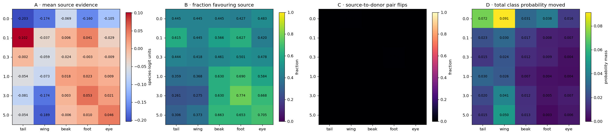


**Table — direct off-target intervention behind Panels A–D.** For each swap, old and donor coordinates stay fixed while every other coordinate of that part is restored to the matching original image. Positive source evidence means those swap-induced off-target changes had favored the source species. The pair-flip rate and all-species probability movement are different outcomes.


|  | gamma | part | n_rows | n_originals | mean_swap_induced_offtarget_source_evidence | median_swap_induced_offtarget_source_evidence | fraction_source_evidence_positive | pairwise_source_to_donor_flip_rate | top1_change_rate | mean_probability_mass_moved |
| --- | --- | --- | --- | --- | --- | --- | --- | --- | --- | --- |
| 0 | 0.0 | beak | 1000 | 250 | -0.06897 | -0.07892 | 0.445 | 0.002 | 0.040 | 0.03082 |
| 1 | 0.0 | eye | 1000 | 250 | -0.10482 | -0.00459 | 0.483 | 0.000 | 0.006 | 0.01615 |
| 2 | 0.0 | foot | 1000 | 250 | -0.15959 | -0.08264 | 0.427 | 0.000 | 0.054 | 0.03759 |
| 3 | 0.0 | tail | 1000 | 250 | -0.20332 | -0.03520 | 0.445 | 0.001 | 0.083 | 0.07228 |
| 4 | 0.0 | wing | 1000 | 250 | -0.17358 | -0.15610 | 0.445 | 0.007 | 0.110 | 0.09148 |
| 5 | 0.1 | beak | 1000 | 250 | 0.00622 | 0.01416 | 0.566 | 0.000 | 0.033 | 0.01651 |
| 6 | 0.1 | eye | 1000 | 250 | -0.02919 | -0.00574 | 0.420 | 0.000 | 0.007 | 0.00722 |
| 7 | 0.1 | foot | 1000 | 250 | 0.04112 | 0.02653 | 0.627 | 0.001 | 0.016 | 0.00823 |
| 8 | 0.1 | tail | 1000 | 250 | 0.10179 | 0.04118 | 0.615 | 0.000 | 0.032 | 0.02284 |
| 9 | 0.1 | wing | 1000 | 250 | -0.03679 | -0.01900 | 0.445 | 0.000 | 0.039 | 0.03045 |
| 10 | 0.3 | beak | 1000 | 250 | -0.02404 | -0.00653 | 0.461 | 0.000 | 0.022 | 0.01164 |
| 11 | 0.3 | eye | 1000 | 250 | -0.00881 | -0.00143 | 0.478 | 0.000 | 0.003 | 0.00403 |
| 12 | 0.3 | foot | 1000 | 250 | -0.00295 | 0.00001 | 0.501 | 0.004 | 0.010 | 0.00923 |
| 13 | 0.3 | tail | 1000 | 250 | -0.00188 | -0.00245 | 0.444 | 0.000 | 0.014 | 0.01490 |
| 14 | 0.3 | wing | 1000 | 250 | -0.05901 | -0.01589 | 0.418 | 0.000 | 0.033 | 0.02450 |
| 15 | 1.0 | beak | 1000 | 250 | 0.01848 | 0.01152 | 0.630 | 0.000 | 0.007 | 0.00714 |
| 16 | 1.0 | eye | 1000 | 250 | 0.00850 | 0.00634 | 0.584 | 0.000 | 0.005 | 0.00390 |
| 17 | 1.0 | foot | 1000 | 250 | 0.02328 | 0.01446 | 0.690 | 0.000 | 0.002 | 0.00437 |
| 18 | 1.0 | tail | 1000 | 250 | -0.05400 | -0.01705 | 0.359 | 0.000 | 0.029 | 0.02988 |
| 19 | 1.0 | wing | 1000 | 250 | -0.07279 | -0.01380 | 0.368 | 0.000 | 0.024 | 0.02566 |
| 20 | 3.0 | beak | 1000 | 250 | 0.00251 | 0.01243 | 0.630 | 0.000 | 0.021 | 0.01218 |
| 21 | 3.0 | eye | 1000 | 250 | 0.02147 | 0.01280 | 0.668 | 0.000 | 0.009 | 0.00738 |
| 22 | 3.0 | foot | 1000 | 250 | 0.05273 | 0.02357 | 0.774 | 0.001 | 0.014 | 0.00494 |
| 23 | 3.0 | tail | 1000 | 250 | -0.08149 | -0.03334 | 0.261 | 0.000 | 0.034 | 0.02021 |
| 24 | 3.0 | wing | 1000 | 250 | -0.17420 | -0.04894 | 0.275 | 0.000 | 0.065 | 0.04131 |
| 25 | 5.0 | beak | 1000 | 250 | -0.00610 | 0.01172 | 0.663 | 0.000 | 0.014 | 0.01315 |
| 26 | 5.0 | eye | 1000 | 250 | 0.04603 | 0.02611 | 0.705 | 0.000 | 0.015 | 0.00600 |
| 27 | 5.0 | foot | 1000 | 250 | 0.01013 | 0.00578 | 0.653 | 0.000 | 0.005 | 0.00264 |
| 28 | 5.0 | tail | 1000 | 250 | -0.05355 | -0.03078 | 0.306 | 0.000 | 0.014 | 0.01519 |
| 29 | 5.0 | wing | 1000 | 250 | -0.18948 | -0.00991 | 0.373 | 0.000 | 0.061 | 0.04988 |


**How to read the executed RLv2 result.** The figure and fully
captioned source table immediately above are the result; no expected
observation was written into the notebook before execution.


Comparison requirements. Interpretation of Standard–RLv2 differences requires matching γ, formulas, physical image pairs, and denominators. The seed-1 comparison is specific to the evaluated runs; between-initialization variability requires replication.


Subsequent analysis. Continue to the next identical analysis stage, then use the final matched-difference table to decide which part and pathway actually changed.


## 6. Residual associations and predictive performance


The exact Standard source-species residual and grouped predictive audit are shown first. The residual subtracts the training-fold mean for the identical (part, old value, donor value) transition; centering is performed within exact transitions. Therefore transition residuals average to zero overall, while one source species can remain systematically positive or negative.


Numerical illustration. Transition margins [−5,−3,1,3] have mean −1 and centered residuals [−4,−2,2,4]. The overall mean residual is zero, while species subsets can have different means.


A predictive model may show that measured pre-outcome variables are useful;
it cannot divide backwash into additive causal percentages.


**Exact executed Koh Standard/RLv2 comparison — Notebook 02rl `02rl-f12-`**


| regime | RLv2 | standard |
| --- | --- | --- |
| part |  |  |
| tail | 0.777 | 0.894 |
| wing | 1.071 | 1.054 |
| beak | 1.306 | 1.394 |
| foot | 0.919 | 1.037 |
| eye | 1.338 | 1.181 |


**Exact executed Koh Standard/RLv2 comparison — Notebook 02rl `02rl-f14-`**


```text
STANDARD — identical grouped omission audit
```


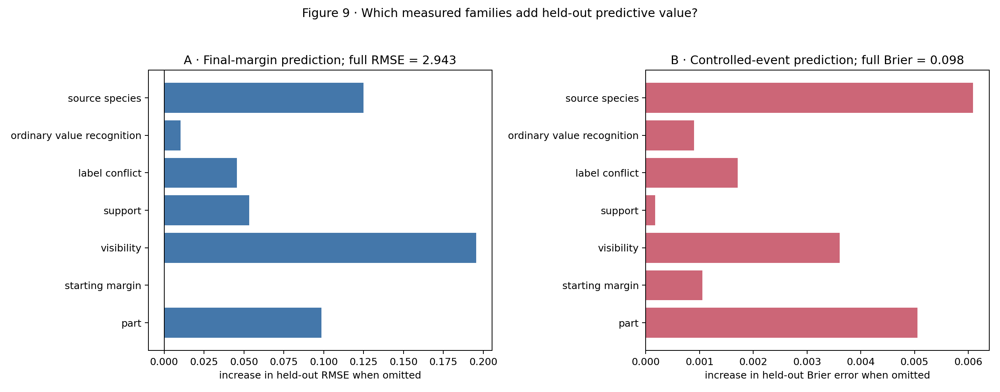


|  | model | numeric_features | categorical_features | margin_RMSE | margin_MAE | event_Brier |
| --- | --- | --- | --- | --- | --- | --- |
| 0 | overall mean only | none | none | 4.1629 | 3.2014 | 0.1402 |
| 1 | part only | none | part | 3.3273 | 2.5514 | 0.1087 |
| 2 | full measured set | m_orig, log_visible_pixels, donor_support, sou... | part, sid_src | 2.9432 | 2.2861 | 0.0979 |
| 3 | full minus part | m_orig, log_visible_pixels, donor_support, sou... | sid_src | 3.0417 | 2.3698 | 0.1030 |
| 4 | full minus starting margin | log_visible_pixels, donor_support, source_supp... | part, sid_src | 2.9432 | 2.2863 | 0.0990 |
| 5 | full minus visibility | m_orig, donor_support, source_support, donor_c... | part, sid_src | 3.1389 | 2.4166 | 0.1015 |
| 6 | full minus support | m_orig, log_visible_pixels, donor_conflict, so... | part, sid_src | 2.9966 | 2.3177 | 0.0981 |
| 7 | full minus label conflict | m_orig, log_visible_pixels, donor_support, sou... | part, sid_src | 2.9888 | 2.3140 | 0.0996 |
| 8 | full minus ordinary value recognition | m_orig, log_visible_pixels, donor_support, sou... | part, sid_src | 2.9535 | 2.2884 | 0.0988 |
| 9 | full minus source species | m_orig, log_visible_pixels, donor_support, sou... | part | 3.0682 | 2.3888 | 0.1040 |


```text
Exact-value holdout stress test
```


|  | held_out_part | held_out_donor_value | n_rows | n_originals | RMSE | MAE |
| --- | --- | --- | --- | --- | --- | --- |
| 0 | beak | 0 | 345 | 120 | 3.2856 | 2.7133 |
| 1 | beak | 1 | 245 | 145 | 2.9799 | 2.3228 |
| 2 | beak | 2 | 190 | 125 | 3.0489 | 2.2933 |
| 3 | beak | 3 | 220 | 135 | 2.5517 | 1.9469 |
| 4 | eye | 0 | 300 | 160 | 3.0136 | 2.3578 |
| 5 | eye | 1 | 345 | 155 | 2.6665 | 2.0149 |
| 6 | eye | 2 | 355 | 150 | 3.0236 | 2.4922 |
| 7 | foot | 0 | 220 | 145 | 2.6750 | 2.1305 |
| 8 | foot | 1 | 240 | 160 | 2.2861 | 1.7187 |
| 9 | foot | 2 | 290 | 155 | 2.6261 | 2.0692 |
| 10 | foot | 3 | 250 | 135 | 3.4243 | 2.7140 |
| 11 | tail | 0 | 75 | 70 | 3.4805 | 2.8088 |
| 12 | tail | 1 | 90 | 85 | 4.2162 | 3.4707 |
| 13 | tail | 2 | 120 | 90 | 3.4120 | 2.7907 |
| 14 | tail | 3 | 110 | 85 | 4.2666 | 3.2244 |
| 15 | tail | 4 | 110 | 90 | 3.6683 | 3.0669 |
| 16 | tail | 5 | 150 | 120 | 2.9664 | 2.4260 |
| 17 | tail | 6 | 130 | 100 | 3.9303 | 3.2651 |
| 18 | tail | 7 | 35 | 35 | 3.1794 | 2.5076 |
| 19 | tail | 8 | 180 | 110 | 4.5284 | 3.4755 |
| 20 | wing | 0 | 130 | 115 | 3.8511 | 3.0246 |
| 21 | wing | 1 | 150 | 100 | 3.1577 | 2.6893 |
| 22 | wing | 2 | 220 | 140 | 3.1433 | 2.3272 |
| 23 | wing | 3 | 115 | 95 | 2.5785 | 2.0936 |
| 24 | wing | 4 | 175 | 135 | 3.0514 | 2.4120 |
| 25 | wing | 5 | 210 | 150 | 3.1182 | 2.5066 |


```text
RLV2 — identical grouped omission audit
```


|  | model | numeric_features | categorical_features | margin_RMSE | margin_MAE | event_Brier |
| --- | --- | --- | --- | --- | --- | --- |
| 0 | overall mean only | none | none | 3.6395 | 2.7886 | 0.0896 |
| 1 | part only | none | part | 3.3002 | 2.5426 | 0.0838 |
| 2 | full measured set | m_orig, log_visible_pixels, donor_support, sou... | part, sid_src | 2.9375 | 2.2575 | 0.0752 |
| 3 | full minus part | m_orig, log_visible_pixels, donor_support, sou... | sid_src | 2.9643 | 2.2845 | 0.0758 |
| 4 | full minus starting margin | log_visible_pixels, donor_support, source_supp... | part, sid_src | 2.9348 | 2.2546 | 0.0769 |
| 5 | full minus visibility | m_orig, donor_support, source_support, donor_c... | part, sid_src | 3.1333 | 2.3976 | 0.0817 |
| 6 | full minus support | m_orig, log_visible_pixels, donor_conflict, so... | part, sid_src | 2.9859 | 2.2939 | 0.0756 |
| 7 | full minus label conflict | m_orig, log_visible_pixels, donor_support, sou... | part, sid_src | 2.9603 | 2.2815 | 0.0759 |
| 8 | full minus ordinary value recognition | m_orig, log_visible_pixels, donor_support, sou... | part, sid_src | 2.9462 | 2.2644 | 0.0753 |
| 9 | full minus source species | m_orig, log_visible_pixels, donor_support, sou... | part | 3.0478 | 2.3509 | 0.0747 |


```text
Exact-value holdout stress test
```


|  | held_out_part | held_out_donor_value | n_rows | n_originals | RMSE | MAE |
| --- | --- | --- | --- | --- | --- | --- |
| 0 | beak | 0 | 345 | 120 | 3.0940 | 2.4690 |
| 1 | beak | 1 | 245 | 145 | 2.9771 | 2.2186 |
| 2 | beak | 2 | 190 | 125 | 3.3818 | 2.5886 |
| 3 | beak | 3 | 220 | 135 | 2.5957 | 1.8833 |
| 4 | eye | 0 | 300 | 160 | 2.7532 | 2.0904 |
| 5 | eye | 1 | 345 | 155 | 3.2022 | 2.5067 |
| 6 | eye | 2 | 355 | 150 | 3.4651 | 2.7811 |
| 7 | foot | 0 | 220 | 145 | 3.2202 | 2.6919 |
| 8 | foot | 1 | 240 | 160 | 2.3666 | 1.8452 |
| 9 | foot | 2 | 290 | 155 | 2.8195 | 2.2408 |
| 10 | foot | 3 | 250 | 135 | 2.7784 | 2.0961 |
| 11 | tail | 0 | 75 | 70 | 3.7736 | 3.2456 |
| 12 | tail | 1 | 90 | 85 | 3.4176 | 2.8386 |
| 13 | tail | 2 | 120 | 90 | 2.9165 | 2.4183 |
| 14 | tail | 3 | 110 | 85 | 3.6808 | 2.8285 |
| 15 | tail | 4 | 110 | 90 | 4.2705 | 3.2210 |
| 16 | tail | 5 | 150 | 120 | 2.9888 | 2.5404 |
| 17 | tail | 6 | 130 | 100 | 3.4701 | 2.7791 |
| 18 | tail | 7 | 35 | 35 | 3.8841 | 2.9975 |
| 19 | tail | 8 | 180 | 110 | 3.8111 | 2.8094 |
| 20 | wing | 0 | 130 | 115 | 3.9323 | 3.0554 |
| 21 | wing | 1 | 150 | 100 | 3.8156 | 3.0531 |
| 22 | wing | 2 | 220 | 140 | 2.9237 | 2.2614 |
| 23 | wing | 3 | 115 | 95 | 2.5071 | 2.0593 |
| 24 | wing | 4 | 175 | 135 | 3.3192 | 2.4890 |
| 25 | wing | 5 | 210 | 150 | 3.2448 | 2.5485 |


### Executed Standard-MCBM result — mcbm-residual


**Table — source-species residual spread behind Panels A–B.** First subtract the mean final margin for the same part, old value, and donor value. Then average the remaining residual by source species. SD and range are in raw donor-minus-source concept-logit units.


|  | gamma | part | n_rows | n_species | species_residual_SD | species_residual_range |
| --- | --- | --- | --- | --- | --- | --- |
| 0 | 0.0 | beak | 1000 | 50 | 7.3472 | 31.7267 |
| 1 | 0.0 | eye | 1000 | 50 | 4.9793 | 19.2857 |
| 2 | 0.0 | foot | 1000 | 50 | 3.8839 | 20.3724 |
| 3 | 0.0 | tail | 1000 | 50 | 4.2974 | 26.3278 |
| 4 | 0.0 | wing | 1000 | 50 | 3.8349 | 18.3698 |
| 5 | 0.1 | beak | 1000 | 50 | 4.4564 | 21.8042 |
| 6 | 0.1 | eye | 1000 | 50 | 4.3171 | 15.7831 |
| 7 | 0.1 | foot | 1000 | 50 | 3.4167 | 15.4855 |
| 8 | 0.1 | tail | 1000 | 50 | 3.0542 | 17.1472 |
| 9 | 0.1 | wing | 1000 | 50 | 3.4681 | 15.8363 |
| 10 | 0.3 | beak | 1000 | 50 | 4.3108 | 22.0858 |
| 11 | 0.3 | eye | 1000 | 50 | 5.3735 | 19.7864 |
| 12 | 0.3 | foot | 1000 | 50 | 3.3549 | 13.8950 |
| 13 | 0.3 | tail | 1000 | 50 | 2.9384 | 17.0275 |
| 14 | 0.3 | wing | 1000 | 50 | 3.6061 | 15.5758 |
| 15 | 1.0 | beak | 1000 | 50 | 4.6121 | 26.6952 |
| 16 | 1.0 | eye | 1000 | 50 | 5.8430 | 22.3647 |
| 17 | 1.0 | foot | 1000 | 50 | 2.6917 | 13.6259 |
| 18 | 1.0 | tail | 1000 | 50 | 2.8105 | 17.1267 |
| 19 | 1.0 | wing | 1000 | 50 | 3.5014 | 15.1603 |
| 20 | 3.0 | beak | 1000 | 50 | 4.2944 | 22.4741 |
| 21 | 3.0 | eye | 1000 | 50 | 4.8078 | 19.4389 |
| 22 | 3.0 | foot | 1000 | 50 | 1.3113 | 7.1754 |
| 23 | 3.0 | tail | 1000 | 50 | 2.6632 | 15.6097 |
| 24 | 3.0 | wing | 1000 | 50 | 3.7911 | 19.6597 |
| 25 | 5.0 | beak | 1000 | 50 | 4.3258 | 17.1113 |
| 26 | 5.0 | eye | 1000 | 50 | 3.9949 | 18.1441 |
| 27 | 5.0 | foot | 1000 | 50 | 1.5472 | 7.0833 |
| 28 | 5.0 | tail | 1000 | 50 | 2.6455 | 15.5797 |
| 29 | 5.0 | wing | 1000 | 50 | 2.5836 | 14.6538 |


**Grouped held-out measured-contributor models**


**Table — grouped held-out measured-contributor models.** RMSE and MAE are prediction errors for the final raw concept margin; lower is better. Event Brier is squared probability error for the controlled backwash predicate; lower is better. Original images remain together across folds.


|  | model | numeric_features | categorical_features | margin_RMSE | margin_MAE | event_Brier | gamma |
| --- | --- | --- | --- | --- | --- | --- | --- |
| 0 | overall mean only | none | none | 12.5775 | 10.4255 | 0.2196 | 0.0 |
| 1 | part only | none | part | 10.9135 | 8.6328 | 0.1868 | 0.0 |
| 2 | full measured set | m_orig, log_visible_pixels, donor_support, sou... | part, sid_src | 9.6602 | 7.6140 | 0.1643 | 0.0 |
| 3 | full minus part | m_orig, log_visible_pixels, donor_support, sou... | sid_src | 9.8949 | 7.8676 | 0.1729 | 0.0 |
| 4 | full minus starting margin | log_visible_pixels, donor_support, source_supp... | part, sid_src | 9.8029 | 7.6655 | 0.1665 | 0.0 |
| 5 | full minus visibility | m_orig, donor_support, source_support, donor_c... | part, sid_src | 10.1720 | 8.0267 | 0.1664 | 0.0 |
| 6 | full minus support | m_orig, log_visible_pixels, donor_conflict, so... | part, sid_src | 9.6970 | 7.6264 | 0.1654 | 0.0 |
| 7 | full minus label conflict | m_orig, log_visible_pixels, donor_support, sou... | part, sid_src | 9.7051 | 7.6483 | 0.1649 | 0.0 |
| 8 | full minus ordinary value recognition | m_orig, log_visible_pixels, donor_support, sou... | part, sid_src | 9.8263 | 7.7495 | 0.1704 | 0.0 |
| 9 | full minus source species | m_orig, log_visible_pixels, donor_support, sou... | part | 10.0076 | 7.9221 | 0.1740 | 0.0 |
| 10 | overall mean only | none | none | 10.7553 | 9.1598 | 0.2157 | 0.1 |
| 11 | part only | none | part | 7.4675 | 5.8316 | 0.1612 | 0.1 |
| 12 | full measured set | m_orig, log_visible_pixels, donor_support, sou... | part, sid_src | 6.8229 | 5.2899 | 0.1483 | 0.1 |
| 13 | full minus part | m_orig, log_visible_pixels, donor_support, sou... | sid_src | 7.7815 | 6.0989 | 0.1610 | 0.1 |
| 14 | full minus starting margin | log_visible_pixels, donor_support, source_supp... | part, sid_src | 6.8690 | 5.3259 | 0.1493 | 0.1 |
| 15 | full minus visibility | m_orig, donor_support, source_support, donor_c... | part, sid_src | 7.1148 | 5.4878 | 0.1489 | 0.1 |
| 16 | full minus support | m_orig, log_visible_pixels, donor_conflict, so... | part, sid_src | 6.8815 | 5.3384 | 0.1506 | 0.1 |
| 17 | full minus label conflict | m_orig, log_visible_pixels, donor_support, sou... | part, sid_src | 6.8901 | 5.3580 | 0.1504 | 0.1 |
| 18 | full minus ordinary value recognition | m_orig, log_visible_pixels, donor_support, sou... | part, sid_src | 6.8552 | 5.3082 | 0.1484 | 0.1 |
| 19 | full minus source species | m_orig, log_visible_pixels, donor_support, sou... | part | 7.0617 | 5.4864 | 0.1567 | 0.1 |
| 20 | overall mean only | none | none | 10.7992 | 9.3260 | 0.2264 | 0.3 |
| 21 | part only | none | part | 7.5373 | 5.8873 | 0.1577 | 0.3 |
| 22 | full measured set | m_orig, log_visible_pixels, donor_support, sou... | part, sid_src | 6.9507 | 5.4042 | 0.1421 | 0.3 |
| 23 | full minus part | m_orig, log_visible_pixels, donor_support, sou... | sid_src | 7.7938 | 6.1898 | 0.1539 | 0.3 |
| 24 | full minus starting margin | log_visible_pixels, donor_support, source_supp... | part, sid_src | 6.9654 | 5.4094 | 0.1423 | 0.3 |
| 25 | full minus visibility | m_orig, donor_support, source_support, donor_c... | part, sid_src | 7.1700 | 5.5900 | 0.1435 | 0.3 |
| 26 | full minus support | m_orig, log_visible_pixels, donor_conflict, so... | part, sid_src | 7.0115 | 5.4634 | 0.1451 | 0.3 |
| 27 | full minus label conflict | m_orig, log_visible_pixels, donor_support, sou... | part, sid_src | 7.0186 | 5.4722 | 0.1450 | 0.3 |
| 28 | full minus ordinary value recognition | m_orig, log_visible_pixels, donor_support, sou... | part, sid_src | 6.9763 | 5.4274 | 0.1438 | 0.3 |
| 29 | full minus source species | m_orig, log_visible_pixels, donor_support, sou... | part | 7.3131 | 5.6934 | 0.1551 | 0.3 |
| 30 | overall mean only | none | none | 11.2056 | 9.7369 | 0.2094 | 1.0 |
| 31 | part only | none | part | 8.4597 | 6.5551 | 0.1550 | 1.0 |
| 32 | full measured set | m_orig, log_visible_pixels, donor_support, sou... | part, sid_src | 7.7672 | 5.9511 | 0.1427 | 1.0 |
| 33 | full minus part | m_orig, log_visible_pixels, donor_support, sou... | sid_src | 8.4594 | 6.6091 | 0.1509 | 1.0 |
| 34 | full minus starting margin | log_visible_pixels, donor_support, source_supp... | part, sid_src | 7.8126 | 6.0052 | 0.1430 | 1.0 |
| 35 | full minus visibility | m_orig, donor_support, source_support, donor_c... | part, sid_src | 8.0359 | 6.2146 | 0.1427 | 1.0 |
| 36 | full minus support | m_orig, log_visible_pixels, donor_conflict, so... | part, sid_src | 7.7889 | 5.9584 | 0.1438 | 1.0 |
| 37 | full minus label conflict | m_orig, log_visible_pixels, donor_support, sou... | part, sid_src | 7.8127 | 6.0022 | 0.1436 | 1.0 |
| 38 | full minus ordinary value recognition | m_orig, log_visible_pixels, donor_support, sou... | part, sid_src | 7.7680 | 5.9449 | 0.1425 | 1.0 |
| 39 | full minus source species | m_orig, log_visible_pixels, donor_support, sou... | part | 8.1151 | 6.2538 | 0.1516 | 1.0 |
| 40 | overall mean only | none | none | 11.5446 | 10.1076 | 0.2030 | 3.0 |
| 41 | part only | none | part | 7.4236 | 5.4728 | 0.1458 | 3.0 |
| 42 | full measured set | m_orig, log_visible_pixels, donor_support, sou... | part, sid_src | 6.8111 | 4.9879 | 0.1343 | 3.0 |
| 43 | full minus part | m_orig, log_visible_pixels, donor_support, sou... | sid_src | 8.1397 | 6.2402 | 0.1439 | 3.0 |
| 44 | full minus starting margin | log_visible_pixels, donor_support, source_supp... | part, sid_src | 6.8062 | 5.0026 | 0.1352 | 3.0 |
| 45 | full minus visibility | m_orig, donor_support, source_support, donor_c... | part, sid_src | 7.1431 | 5.2412 | 0.1339 | 3.0 |
| 46 | full minus support | m_orig, log_visible_pixels, donor_conflict, so... | part, sid_src | 6.8315 | 4.9958 | 0.1368 | 3.0 |
| 47 | full minus label conflict | m_orig, log_visible_pixels, donor_support, sou... | part, sid_src | 6.8812 | 5.0609 | 0.1348 | 3.0 |
| 48 | full minus ordinary value recognition | m_orig, log_visible_pixels, donor_support, sou... | part, sid_src | 6.8307 | 4.9986 | 0.1341 | 3.0 |
| 49 | full minus source species | m_orig, log_visible_pixels, donor_support, sou... | part | 7.0662 | 5.1397 | 0.1451 | 3.0 |
| 50 | overall mean only | none | none | 10.5006 | 9.1064 | 0.1965 | 5.0 |
| 51 | part only | none | part | 7.0363 | 5.2843 | 0.1338 | 5.0 |
| 52 | full measured set | m_orig, log_visible_pixels, donor_support, sou... | part, sid_src | 6.4679 | 4.7997 | 0.1209 | 5.0 |
| 53 | full minus part | m_orig, log_visible_pixels, donor_support, sou... | sid_src | 7.1915 | 5.6059 | 0.1278 | 5.0 |
| 54 | full minus starting margin | log_visible_pixels, donor_support, source_supp... | part, sid_src | 6.4738 | 4.7961 | 0.1210 | 5.0 |
| 55 | full minus visibility | m_orig, donor_support, source_support, donor_c... | part, sid_src | 6.6798 | 4.9641 | 0.1204 | 5.0 |
| 56 | full minus support | m_orig, log_visible_pixels, donor_conflict, so... | part, sid_src | 6.4873 | 4.8054 | 0.1227 | 5.0 |
| 57 | full minus label conflict | m_orig, log_visible_pixels, donor_support, sou... | part, sid_src | 6.5416 | 4.8986 | 0.1221 | 5.0 |
| 58 | full minus ordinary value recognition | m_orig, log_visible_pixels, donor_support, sou... | part, sid_src | 6.4759 | 4.8052 | 0.1207 | 5.0 |
| 59 | full minus source species | m_orig, log_visible_pixels, donor_support, sou... | part | 6.7846 | 5.0936 | 0.1333 | 5.0 |


**Leave-one-donor-value-out stress test**


Table — leave-one-inserted-value-out stress test. The model is fitted without one donor value and tested only on that unseen value. RMSE and MAE are final-margin errors in raw-logit units. This evaluates transfer to a held-out donor value.


|  | held_out_part | held_out_donor_value | n_rows | n_originals | RMSE | MAE | gamma |
| --- | --- | --- | --- | --- | --- | --- | --- |
| 0 | beak | 0 | 345 | 120 | 11.5352 | 9.0825 | 0.0 |
| 1 | beak | 1 | 245 | 145 | 12.0474 | 9.4549 | 0.0 |
| 2 | beak | 2 | 190 | 125 | 12.2067 | 10.3593 | 0.0 |
| 3 | beak | 3 | 220 | 135 | 11.9332 | 10.4869 | 0.0 |
| 4 | eye | 0 | 300 | 160 | 13.7928 | 11.4516 | 0.0 |
| 5 | eye | 1 | 345 | 155 | 12.9808 | 10.7033 | 0.0 |
| 6 | eye | 2 | 355 | 150 | 11.4845 | 9.4389 | 0.0 |
| 7 | foot | 0 | 220 | 145 | 9.2700 | 7.9003 | 0.0 |
| 8 | foot | 1 | 240 | 160 | 9.1197 | 7.4490 | 0.0 |
| 9 | foot | 2 | 290 | 155 | 5.9908 | 4.7399 | 0.0 |
| 10 | foot | 3 | 250 | 135 | 10.8016 | 8.4663 | 0.0 |
| 11 | tail | 0 | 75 | 70 | 10.7366 | 9.2260 | 0.0 |
| 12 | tail | 1 | 90 | 85 | 9.3999 | 6.7116 | 0.0 |
| 13 | tail | 2 | 120 | 90 | 10.4927 | 8.8950 | 0.0 |
| 14 | tail | 3 | 110 | 85 | 10.2110 | 8.4160 | 0.0 |
| 15 | tail | 4 | 110 | 90 | 8.1584 | 6.7340 | 0.0 |
| 16 | tail | 5 | 150 | 120 | 8.8641 | 7.1378 | 0.0 |
| 17 | tail | 6 | 130 | 100 | 7.8177 | 6.3370 | 0.0 |
| 18 | tail | 7 | 35 | 35 | 8.5548 | 6.9654 | 0.0 |
| 19 | tail | 8 | 180 | 110 | 12.6106 | 9.5822 | 0.0 |
| 20 | wing | 0 | 130 | 115 | 12.5995 | 9.9628 | 0.0 |
| 21 | wing | 1 | 150 | 100 | 8.7712 | 6.8115 | 0.0 |
| 22 | wing | 2 | 220 | 140 | 8.5026 | 7.0003 | 0.0 |
| 23 | wing | 3 | 115 | 95 | 12.8529 | 10.0815 | 0.0 |
| 24 | wing | 4 | 175 | 135 | 10.1486 | 7.9903 | 0.0 |
| 25 | wing | 5 | 210 | 150 | 10.9428 | 8.0937 | 0.0 |
| 26 | beak | 0 | 345 | 120 | 7.3980 | 5.9909 | 0.1 |
| 27 | beak | 1 | 245 | 145 | 7.2545 | 5.8765 | 0.1 |
| 28 | beak | 2 | 190 | 125 | 7.9276 | 6.8728 | 0.1 |
| 29 | beak | 3 | 220 | 135 | 7.0511 | 5.6751 | 0.1 |
| 30 | eye | 0 | 300 | 160 | 7.6965 | 6.2760 | 0.1 |
| 31 | eye | 1 | 345 | 155 | 7.4070 | 6.1641 | 0.1 |
| 32 | eye | 2 | 355 | 150 | 7.7804 | 6.3106 | 0.1 |
| 33 | foot | 0 | 220 | 145 | 6.1995 | 4.2186 | 0.1 |
| 34 | foot | 1 | 240 | 160 | 6.6828 | 5.6591 | 0.1 |
| 35 | foot | 2 | 290 | 155 | 6.4094 | 4.7898 | 0.1 |
| 36 | foot | 3 | 250 | 135 | 6.6714 | 4.5382 | 0.1 |
| 37 | tail | 0 | 75 | 70 | 6.2778 | 5.6565 | 0.1 |
| 38 | tail | 1 | 90 | 85 | 6.6140 | 4.2757 | 0.1 |
| 39 | tail | 2 | 120 | 90 | 5.4171 | 4.5418 | 0.1 |
| 40 | tail | 3 | 110 | 85 | 6.9645 | 5.6589 | 0.1 |
| 41 | tail | 4 | 110 | 90 | 6.1953 | 4.7151 | 0.1 |
| 42 | tail | 5 | 150 | 120 | 6.3815 | 5.2018 | 0.1 |
| 43 | tail | 6 | 130 | 100 | 5.8215 | 5.1019 | 0.1 |
| 44 | tail | 7 | 35 | 35 | 5.4331 | 4.3625 | 0.1 |
| 45 | tail | 8 | 180 | 110 | 8.1800 | 5.9826 | 0.1 |
| 46 | wing | 0 | 130 | 115 | 8.4250 | 6.6139 | 0.1 |
| 47 | wing | 1 | 150 | 100 | 8.8278 | 6.0400 | 0.1 |
| 48 | wing | 2 | 220 | 140 | 5.5777 | 4.1646 | 0.1 |
| 49 | wing | 3 | 115 | 95 | 8.3187 | 6.8517 | 0.1 |
| 50 | wing | 4 | 175 | 135 | 9.2196 | 7.3470 | 0.1 |
| 51 | wing | 5 | 210 | 150 | 9.0736 | 7.3111 | 0.1 |
| 52 | beak | 0 | 345 | 120 | 8.4697 | 7.1183 | 0.3 |
| 53 | beak | 1 | 245 | 145 | 7.6347 | 5.9646 | 0.3 |
| 54 | beak | 2 | 190 | 125 | 7.6155 | 6.4580 | 0.3 |
| 55 | beak | 3 | 220 | 135 | 8.1239 | 6.8729 | 0.3 |
| 56 | eye | 0 | 300 | 160 | 8.4163 | 7.3669 | 0.3 |
| 57 | eye | 1 | 345 | 155 | 7.0579 | 5.9982 | 0.3 |
| 58 | eye | 2 | 355 | 150 | 8.0742 | 6.7908 | 0.3 |
| 59 | foot | 0 | 220 | 145 | 5.1680 | 3.7604 | 0.3 |
| 60 | foot | 1 | 240 | 160 | 7.3074 | 5.6793 | 0.3 |
| 61 | foot | 2 | 290 | 155 | 7.1306 | 5.4525 | 0.3 |
| 62 | foot | 3 | 250 | 135 | 9.5522 | 6.3412 | 0.3 |
| 63 | tail | 0 | 75 | 70 | 4.3837 | 3.5560 | 0.3 |
| 64 | tail | 1 | 90 | 85 | 5.8805 | 4.2769 | 0.3 |
| 65 | tail | 2 | 120 | 90 | 4.2717 | 3.3446 | 0.3 |
| 66 | tail | 3 | 110 | 85 | 7.6473 | 6.2684 | 0.3 |
| 67 | tail | 4 | 110 | 90 | 4.8687 | 3.8780 | 0.3 |
| 68 | tail | 5 | 150 | 120 | 4.8294 | 3.9705 | 0.3 |
| 69 | tail | 6 | 130 | 100 | 4.8759 | 4.0248 | 0.3 |
| 70 | tail | 7 | 35 | 35 | 5.1275 | 3.7818 | 0.3 |
| 71 | tail | 8 | 180 | 110 | 7.5738 | 5.1953 | 0.3 |
| 72 | wing | 0 | 130 | 115 | 6.1095 | 4.8879 | 0.3 |
| 73 | wing | 1 | 150 | 100 | 9.3483 | 6.7155 | 0.3 |
| 74 | wing | 2 | 220 | 140 | 6.3708 | 5.2485 | 0.3 |
| 75 | wing | 3 | 115 | 95 | 10.7799 | 8.7266 | 0.3 |
| 76 | wing | 4 | 175 | 135 | 10.4232 | 8.4713 | 0.3 |
| 77 | wing | 5 | 210 | 150 | 9.2772 | 8.3769 | 0.3 |
| 78 | beak | 0 | 345 | 120 | 13.6367 | 10.6684 | 1.0 |
| 79 | beak | 1 | 245 | 145 | 5.9828 | 5.1504 | 1.0 |
| 80 | beak | 2 | 190 | 125 | 7.2879 | 6.1570 | 1.0 |
| 81 | beak | 3 | 220 | 135 | 6.0051 | 4.9492 | 1.0 |
| 82 | eye | 0 | 300 | 160 | 9.9302 | 8.4787 | 1.0 |
| 83 | eye | 1 | 345 | 155 | 8.4788 | 7.3641 | 1.0 |
| 84 | eye | 2 | 355 | 150 | 8.4142 | 7.3649 | 1.0 |
| 85 | foot | 0 | 220 | 145 | 5.0270 | 4.6772 | 1.0 |
| 86 | foot | 1 | 240 | 160 | 6.3009 | 3.5573 | 1.0 |
| 87 | foot | 2 | 290 | 155 | 9.4449 | 6.0429 | 1.0 |
| 88 | foot | 3 | 250 | 135 | 5.1882 | 3.9442 | 1.0 |
| 89 | tail | 0 | 75 | 70 | 5.9244 | 5.0843 | 1.0 |
| 90 | tail | 1 | 90 | 85 | 6.8541 | 4.9617 | 1.0 |
| 91 | tail | 2 | 120 | 90 | 6.7646 | 6.0224 | 1.0 |
| 92 | tail | 3 | 110 | 85 | 7.1672 | 5.5766 | 1.0 |
| 93 | tail | 4 | 110 | 90 | 5.3895 | 4.5165 | 1.0 |
| 94 | tail | 5 | 150 | 120 | 6.5141 | 5.4381 | 1.0 |
| 95 | tail | 6 | 130 | 100 | 5.5387 | 4.6613 | 1.0 |
| 96 | tail | 7 | 35 | 35 | 5.8902 | 5.1322 | 1.0 |
| 97 | tail | 8 | 180 | 110 | 7.6576 | 5.5969 | 1.0 |
| 98 | wing | 0 | 130 | 115 | 9.6051 | 7.0950 | 1.0 |
| 99 | wing | 1 | 150 | 100 | 8.7300 | 6.7747 | 1.0 |
| 100 | wing | 2 | 220 | 140 | 8.9688 | 8.1533 | 1.0 |
| 101 | wing | 3 | 115 | 95 | 15.2712 | 11.4078 | 1.0 |
| 102 | wing | 4 | 175 | 135 | 10.4251 | 8.2713 | 1.0 |
| 103 | wing | 5 | 210 | 150 | 12.6133 | 8.8410 | 1.0 |
| 104 | beak | 0 | 345 | 120 | 9.5490 | 7.8847 | 3.0 |
| 105 | beak | 1 | 245 | 145 | 6.5145 | 5.4537 | 3.0 |
| 106 | beak | 2 | 190 | 125 | 8.5091 | 6.9759 | 3.0 |
| 107 | beak | 3 | 220 | 135 | 5.9706 | 4.5741 | 3.0 |
| 108 | eye | 0 | 300 | 160 | 9.8539 | 8.5048 | 3.0 |
| 109 | eye | 1 | 345 | 155 | 8.3836 | 6.8431 | 3.0 |
| 110 | eye | 2 | 355 | 150 | 7.5049 | 5.9557 | 3.0 |
| 111 | foot | 0 | 220 | 145 | 4.8308 | 1.5795 | 3.0 |
| 112 | foot | 1 | 240 | 160 | 3.9829 | 2.0278 | 3.0 |
| 113 | foot | 2 | 290 | 155 | 3.0349 | 1.7360 | 3.0 |
| 114 | foot | 3 | 250 | 135 | 4.5714 | 3.4686 | 3.0 |
| 115 | tail | 0 | 75 | 70 | 5.1366 | 4.2473 | 3.0 |
| 116 | tail | 1 | 90 | 85 | 6.2605 | 4.6965 | 3.0 |
| 117 | tail | 2 | 120 | 90 | 4.3746 | 3.6493 | 3.0 |
| 118 | tail | 3 | 110 | 85 | 5.7357 | 4.6473 | 3.0 |
| 119 | tail | 4 | 110 | 90 | 5.2152 | 4.3748 | 3.0 |
| 120 | tail | 5 | 150 | 120 | 5.1472 | 3.8958 | 3.0 |
| 121 | tail | 6 | 130 | 100 | 4.8108 | 4.0079 | 3.0 |
| 122 | tail | 7 | 35 | 35 | 5.1932 | 4.4000 | 3.0 |
| 123 | tail | 8 | 180 | 110 | 7.0821 | 4.9666 | 3.0 |
| 124 | wing | 0 | 130 | 115 | 9.6221 | 7.8737 | 3.0 |
| 125 | wing | 1 | 150 | 100 | 9.8677 | 8.1754 | 3.0 |
| 126 | wing | 2 | 220 | 140 | 7.5733 | 6.6745 | 3.0 |
| 127 | wing | 3 | 115 | 95 | 11.8506 | 8.7889 | 3.0 |
| 128 | wing | 4 | 175 | 135 | 12.4008 | 9.4768 | 3.0 |
| 129 | wing | 5 | 210 | 150 | 9.9860 | 6.9855 | 3.0 |
| 130 | beak | 0 | 345 | 120 | 8.3252 | 6.8467 | 5.0 |
| 131 | beak | 1 | 245 | 145 | 7.0227 | 5.7749 | 5.0 |
| 132 | beak | 2 | 190 | 125 | 6.5362 | 5.0578 | 5.0 |
| 133 | beak | 3 | 220 | 135 | 8.4725 | 7.7467 | 5.0 |
| 134 | eye | 0 | 300 | 160 | 7.5377 | 5.9185 | 5.0 |
| 135 | eye | 1 | 345 | 155 | 6.1411 | 5.1493 | 5.0 |
| 136 | eye | 2 | 355 | 150 | 7.1739 | 5.7936 | 5.0 |
| 137 | foot | 0 | 220 | 145 | 5.3728 | 3.7843 | 5.0 |
| 138 | foot | 1 | 240 | 160 | 4.9020 | 4.1427 | 5.0 |
| 139 | foot | 2 | 290 | 155 | 3.3244 | 2.4772 | 5.0 |
| 140 | foot | 3 | 250 | 135 | 7.0756 | 5.4090 | 5.0 |
| 141 | tail | 0 | 75 | 70 | 4.8576 | 4.0944 | 5.0 |
| 142 | tail | 1 | 90 | 85 | 5.7587 | 3.8681 | 5.0 |
| 143 | tail | 2 | 120 | 90 | 4.8176 | 4.0726 | 5.0 |
| 144 | tail | 3 | 110 | 85 | 5.1459 | 3.9726 | 5.0 |
| 145 | tail | 4 | 110 | 90 | 4.5146 | 3.3964 | 5.0 |
| 146 | tail | 5 | 150 | 120 | 3.8676 | 3.1746 | 5.0 |
| 147 | tail | 6 | 130 | 100 | 4.5898 | 3.9001 | 5.0 |
| 148 | tail | 7 | 35 | 35 | 5.1973 | 4.5868 | 5.0 |
| 149 | tail | 8 | 180 | 110 | 7.0369 | 4.8548 | 5.0 |
| 150 | wing | 0 | 130 | 115 | 7.8595 | 7.4550 | 5.0 |
| 151 | wing | 1 | 150 | 100 | 8.4401 | 5.2642 | 5.0 |
| 152 | wing | 2 | 220 | 140 | 7.2669 | 6.7959 | 5.0 |
| 153 | wing | 3 | 115 | 95 | 13.5568 | 9.6406 | 5.0 |
| 154 | wing | 4 | 175 | 135 | 9.7921 | 7.0641 | 5.0 |
| 155 | wing | 5 | 210 | 150 | 11.0293 | 8.2877 | 5.0 |


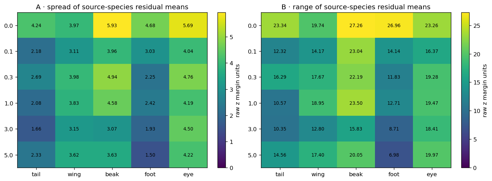


**Table — source-species residual spread behind Panels A–B.** First subtract the mean final margin for the same part, old value, and donor value. Then average the remaining residual by source species. SD and range are in raw donor-minus-source concept-logit units.


|  | gamma | part | n_rows | n_species | species_residual_SD | species_residual_range |
| --- | --- | --- | --- | --- | --- | --- |
| 0 | 0.0 | beak | 1000 | 50 | 5.9332 | 27.2627 |
| 1 | 0.0 | eye | 1000 | 50 | 5.6921 | 23.2591 |
| 2 | 0.0 | foot | 1000 | 50 | 4.6848 | 26.9646 |
| 3 | 0.0 | tail | 1000 | 50 | 4.2427 | 23.3394 |
| 4 | 0.0 | wing | 1000 | 50 | 3.9743 | 19.7373 |
| 5 | 0.1 | beak | 1000 | 50 | 3.9604 | 23.0356 |
| 6 | 0.1 | eye | 1000 | 50 | 4.0412 | 16.3744 |
| 7 | 0.1 | foot | 1000 | 50 | 3.0301 | 14.1418 |
| 8 | 0.1 | tail | 1000 | 50 | 2.1753 | 12.3206 |
| 9 | 0.1 | wing | 1000 | 50 | 3.1141 | 14.1737 |
| 10 | 0.3 | beak | 1000 | 50 | 4.9377 | 22.1901 |
| 11 | 0.3 | eye | 1000 | 50 | 4.7554 | 19.2792 |
| 12 | 0.3 | foot | 1000 | 50 | 2.2530 | 11.8250 |
| 13 | 0.3 | tail | 1000 | 50 | 2.6902 | 16.2860 |
| 14 | 0.3 | wing | 1000 | 50 | 3.9781 | 17.6727 |
| 15 | 1.0 | beak | 1000 | 50 | 4.5764 | 23.5034 |
| 16 | 1.0 | eye | 1000 | 50 | 4.1939 | 19.4653 |
| 17 | 1.0 | foot | 1000 | 50 | 2.4228 | 12.7068 |
| 18 | 1.0 | tail | 1000 | 50 | 2.0763 | 10.5718 |
| 19 | 1.0 | wing | 1000 | 50 | 3.8265 | 18.9546 |
| 20 | 3.0 | beak | 1000 | 50 | 3.0697 | 15.8300 |
| 21 | 3.0 | eye | 1000 | 50 | 4.4974 | 18.4111 |
| 22 | 3.0 | foot | 1000 | 50 | 1.9302 | 8.7086 |
| 23 | 3.0 | tail | 1000 | 50 | 1.6634 | 10.3470 |
| 24 | 3.0 | wing | 1000 | 50 | 3.1521 | 12.7989 |
| 25 | 5.0 | beak | 1000 | 50 | 3.6257 | 20.0524 |
| 26 | 5.0 | eye | 1000 | 50 | 4.2176 | 19.9738 |
| 27 | 5.0 | foot | 1000 | 50 | 1.5048 | 6.9825 |
| 28 | 5.0 | tail | 1000 | 50 | 2.3258 | 14.5608 |
| 29 | 5.0 | wing | 1000 | 50 | 3.6189 | 17.3986 |


**Grouped held-out measured-contributor models**


**Table — grouped held-out measured-contributor models.** RMSE and MAE are prediction errors for the final raw concept margin; lower is better. Event Brier is squared probability error for the controlled backwash predicate; lower is better. Original images remain together across folds.


|  | model | numeric_features | categorical_features | margin_RMSE | margin_MAE | event_Brier | gamma |
| --- | --- | --- | --- | --- | --- | --- | --- |
| 0 | overall mean only | none | none | 12.8561 | 10.5348 | 0.2173 | 0.0 |
| 1 | part only | none | part | 11.0499 | 8.6877 | 0.1870 | 0.0 |
| 2 | full measured set | m_orig, log_visible_pixels, donor_support, sou... | part, sid_src | 9.9900 | 7.8180 | 0.1705 | 0.0 |
| 3 | full minus part | m_orig, log_visible_pixels, donor_support, sou... | sid_src | 10.5350 | 8.3329 | 0.1831 | 0.0 |
| 4 | full minus starting margin | log_visible_pixels, donor_support, source_supp... | part, sid_src | 10.2767 | 8.0268 | 0.1783 | 0.0 |
| 5 | full minus visibility | m_orig, donor_support, source_support, donor_c... | part, sid_src | 10.4457 | 8.2204 | 0.1771 | 0.0 |
| 6 | full minus support | m_orig, log_visible_pixels, donor_conflict, so... | part, sid_src | 10.0183 | 7.8404 | 0.1705 | 0.0 |
| 7 | full minus label conflict | m_orig, log_visible_pixels, donor_support, sou... | part, sid_src | 10.0854 | 7.8994 | 0.1715 | 0.0 |
| 8 | full minus ordinary value recognition | m_orig, log_visible_pixels, donor_support, sou... | part, sid_src | 9.9868 | 7.8087 | 0.1704 | 0.0 |
| 9 | full minus source species | m_orig, log_visible_pixels, donor_support, sou... | part | 10.2432 | 8.0523 | 0.1735 | 0.0 |
| 10 | overall mean only | none | none | 9.3946 | 7.9204 | 0.1991 | 0.1 |
| 11 | part only | none | part | 7.3582 | 5.7350 | 0.1680 | 0.1 |
| 12 | full measured set | m_orig, log_visible_pixels, donor_support, sou... | part, sid_src | 6.7999 | 5.2967 | 0.1511 | 0.1 |
| 13 | full minus part | m_orig, log_visible_pixels, donor_support, sou... | sid_src | 7.5200 | 5.9341 | 0.1595 | 0.1 |
| 14 | full minus starting margin | log_visible_pixels, donor_support, source_supp... | part, sid_src | 6.8137 | 5.3002 | 0.1539 | 0.1 |
| 15 | full minus visibility | m_orig, donor_support, source_support, donor_c... | part, sid_src | 6.9512 | 5.4173 | 0.1554 | 0.1 |
| 16 | full minus support | m_orig, log_visible_pixels, donor_conflict, so... | part, sid_src | 6.8772 | 5.3625 | 0.1528 | 0.1 |
| 17 | full minus label conflict | m_orig, log_visible_pixels, donor_support, sou... | part, sid_src | 6.8386 | 5.3185 | 0.1519 | 0.1 |
| 18 | full minus ordinary value recognition | m_orig, log_visible_pixels, donor_support, sou... | part, sid_src | 6.8537 | 5.3339 | 0.1526 | 0.1 |
| 19 | full minus source species | m_orig, log_visible_pixels, donor_support, sou... | part | 7.0405 | 5.5040 | 0.1560 | 0.1 |
| 20 | overall mean only | none | none | 10.0433 | 8.5829 | 0.2030 | 0.3 |
| 21 | part only | none | part | 7.9374 | 6.2266 | 0.1759 | 0.3 |
| 22 | full measured set | m_orig, log_visible_pixels, donor_support, sou... | part, sid_src | 7.3968 | 5.7581 | 0.1535 | 0.3 |
| 23 | full minus part | m_orig, log_visible_pixels, donor_support, sou... | sid_src | 8.4425 | 6.7708 | 0.1740 | 0.3 |
| 24 | full minus starting margin | log_visible_pixels, donor_support, source_supp... | part, sid_src | 7.4140 | 5.7759 | 0.1600 | 0.3 |
| 25 | full minus visibility | m_orig, donor_support, source_support, donor_c... | part, sid_src | 7.5519 | 5.8945 | 0.1576 | 0.3 |
| 26 | full minus support | m_orig, log_visible_pixels, donor_conflict, so... | part, sid_src | 7.4164 | 5.7696 | 0.1541 | 0.3 |
| 27 | full minus label conflict | m_orig, log_visible_pixels, donor_support, sou... | part, sid_src | 7.4231 | 5.7660 | 0.1540 | 0.3 |
| 28 | full minus ordinary value recognition | m_orig, log_visible_pixels, donor_support, sou... | part, sid_src | 7.4169 | 5.7718 | 0.1534 | 0.3 |
| 29 | full minus source species | m_orig, log_visible_pixels, donor_support, sou... | part | 7.7730 | 6.0399 | 0.1676 | 0.3 |
| 30 | overall mean only | none | none | 10.1989 | 8.5084 | 0.1762 | 1.0 |
| 31 | part only | none | part | 8.1627 | 6.2611 | 0.1545 | 1.0 |
| 32 | full measured set | m_orig, log_visible_pixels, donor_support, sou... | part, sid_src | 7.7985 | 6.0150 | 0.1403 | 1.0 |
| 33 | full minus part | m_orig, log_visible_pixels, donor_support, sou... | sid_src | 8.6114 | 6.8456 | 0.1511 | 1.0 |
| 34 | full minus starting margin | log_visible_pixels, donor_support, source_supp... | part, sid_src | 7.7976 | 6.0270 | 0.1460 | 1.0 |
| 35 | full minus visibility | m_orig, donor_support, source_support, donor_c... | part, sid_src | 7.8680 | 6.0330 | 0.1427 | 1.0 |
| 36 | full minus support | m_orig, log_visible_pixels, donor_conflict, so... | part, sid_src | 7.8344 | 6.0527 | 0.1403 | 1.0 |
| 37 | full minus label conflict | m_orig, log_visible_pixels, donor_support, sou... | part, sid_src | 7.8134 | 6.0160 | 0.1410 | 1.0 |
| 38 | full minus ordinary value recognition | m_orig, log_visible_pixels, donor_support, sou... | part, sid_src | 7.8524 | 6.0777 | 0.1420 | 1.0 |
| 39 | full minus source species | m_orig, log_visible_pixels, donor_support, sou... | part | 8.0180 | 6.1466 | 0.1456 | 1.0 |
| 40 | overall mean only | none | none | 9.0449 | 7.7065 | 0.1597 | 3.0 |
| 41 | part only | none | part | 7.0783 | 5.3276 | 0.1371 | 3.0 |
| 42 | full measured set | m_orig, log_visible_pixels, donor_support, sou... | part, sid_src | 6.6812 | 5.0553 | 0.1254 | 3.0 |
| 43 | full minus part | m_orig, log_visible_pixels, donor_support, sou... | sid_src | 7.2860 | 5.6953 | 0.1342 | 3.0 |
| 44 | full minus starting margin | log_visible_pixels, donor_support, source_supp... | part, sid_src | 6.6759 | 5.0514 | 0.1312 | 3.0 |
| 45 | full minus visibility | m_orig, donor_support, source_support, donor_c... | part, sid_src | 6.7750 | 5.1331 | 0.1273 | 3.0 |
| 46 | full minus support | m_orig, log_visible_pixels, donor_conflict, so... | part, sid_src | 6.7150 | 5.0850 | 0.1254 | 3.0 |
| 47 | full minus label conflict | m_orig, log_visible_pixels, donor_support, sou... | part, sid_src | 6.7171 | 5.0817 | 0.1254 | 3.0 |
| 48 | full minus ordinary value recognition | m_orig, log_visible_pixels, donor_support, sou... | part, sid_src | 6.6931 | 5.0430 | 0.1256 | 3.0 |
| 49 | full minus source species | m_orig, log_visible_pixels, donor_support, sou... | part | 6.9729 | 5.2880 | 0.1310 | 3.0 |
| 50 | overall mean only | none | none | 9.1847 | 7.5944 | 0.1372 | 5.0 |
| 51 | part only | none | part | 7.8648 | 6.1728 | 0.1246 | 5.0 |
| 52 | full measured set | m_orig, log_visible_pixels, donor_support, sou... | part, sid_src | 7.2863 | 5.5125 | 0.1066 | 5.0 |
| 53 | full minus part | m_orig, log_visible_pixels, donor_support, sou... | sid_src | 7.4250 | 5.5868 | 0.1094 | 5.0 |
| 54 | full minus starting margin | log_visible_pixels, donor_support, source_supp... | part, sid_src | 7.3345 | 5.5837 | 0.1124 | 5.0 |
| 55 | full minus visibility | m_orig, donor_support, source_support, donor_c... | part, sid_src | 7.3813 | 5.5920 | 0.1096 | 5.0 |
| 56 | full minus support | m_orig, log_visible_pixels, donor_conflict, so... | part, sid_src | 7.3660 | 5.6118 | 0.1077 | 5.0 |
| 57 | full minus label conflict | m_orig, log_visible_pixels, donor_support, sou... | part, sid_src | 7.3210 | 5.5377 | 0.1094 | 5.0 |
| 58 | full minus ordinary value recognition | m_orig, log_visible_pixels, donor_support, sou... | part, sid_src | 7.3696 | 5.5731 | 0.1115 | 5.0 |
| 59 | full minus source species | m_orig, log_visible_pixels, donor_support, sou... | part | 7.5115 | 5.7295 | 0.1123 | 5.0 |


**Leave-one-donor-value-out stress test**


Table — leave-one-inserted-value-out stress test. The model is fitted without one donor value and tested only on that unseen value. RMSE and MAE are final-margin errors in raw-logit units. This evaluates transfer to a held-out donor value.


|  | held_out_part | held_out_donor_value | n_rows | n_originals | RMSE | MAE | gamma |
| --- | --- | --- | --- | --- | --- | --- | --- |
| 0 | beak | 0 | 345 | 120 | 11.5311 | 9.4184 | 0.0 |
| 1 | beak | 1 | 245 | 145 | 11.2248 | 8.9998 | 0.0 |
| 2 | beak | 2 | 190 | 125 | 13.3123 | 10.8362 | 0.0 |
| 3 | beak | 3 | 220 | 135 | 10.3701 | 8.8917 | 0.0 |
| 4 | eye | 0 | 300 | 160 | 9.1649 | 7.2660 | 0.0 |
| 5 | eye | 1 | 345 | 155 | 9.7705 | 7.7802 | 0.0 |
| 6 | eye | 2 | 355 | 150 | 10.2114 | 8.3193 | 0.0 |
| 7 | foot | 0 | 220 | 145 | 8.3290 | 6.4753 | 0.0 |
| 8 | foot | 1 | 240 | 160 | 12.7293 | 10.1745 | 0.0 |
| 9 | foot | 2 | 290 | 155 | 8.9378 | 7.3122 | 0.0 |
| 10 | foot | 3 | 250 | 135 | 10.6522 | 7.7335 | 0.0 |
| 11 | tail | 0 | 75 | 70 | 12.3194 | 10.0693 | 0.0 |
| 12 | tail | 1 | 90 | 85 | 9.9369 | 6.9990 | 0.0 |
| 13 | tail | 2 | 120 | 90 | 9.9626 | 8.0227 | 0.0 |
| 14 | tail | 3 | 110 | 85 | 11.2677 | 9.3771 | 0.0 |
| 15 | tail | 4 | 110 | 90 | 7.3154 | 5.8048 | 0.0 |
| 16 | tail | 5 | 150 | 120 | 10.1841 | 7.7976 | 0.0 |
| 17 | tail | 6 | 130 | 100 | 8.8060 | 6.9759 | 0.0 |
| 18 | tail | 7 | 35 | 35 | 11.9942 | 10.7279 | 0.0 |
| 19 | tail | 8 | 180 | 110 | 11.6373 | 9.0425 | 0.0 |
| 20 | wing | 0 | 130 | 115 | 13.2839 | 9.8542 | 0.0 |
| 21 | wing | 1 | 150 | 100 | 11.7748 | 9.5953 | 0.0 |
| 22 | wing | 2 | 220 | 140 | 9.3328 | 7.2774 | 0.0 |
| 23 | wing | 3 | 115 | 95 | 10.0103 | 8.0867 | 0.0 |
| 24 | wing | 4 | 175 | 135 | 12.4097 | 9.2566 | 0.0 |
| 25 | wing | 5 | 210 | 150 | 11.6570 | 8.7009 | 0.0 |
| 26 | beak | 0 | 345 | 120 | 7.9672 | 6.5349 | 0.1 |
| 27 | beak | 1 | 245 | 145 | 10.4070 | 9.1806 | 0.1 |
| 28 | beak | 2 | 190 | 125 | 10.3938 | 8.7678 | 0.1 |
| 29 | beak | 3 | 220 | 135 | 7.5583 | 6.5560 | 0.1 |
| 30 | eye | 0 | 300 | 160 | 6.5829 | 5.2922 | 0.1 |
| 31 | eye | 1 | 345 | 155 | 6.4684 | 5.0915 | 0.1 |
| 32 | eye | 2 | 355 | 150 | 6.9436 | 5.7138 | 0.1 |
| 33 | foot | 0 | 220 | 145 | 7.4113 | 5.7595 | 0.1 |
| 34 | foot | 1 | 240 | 160 | 5.1638 | 4.0216 | 0.1 |
| 35 | foot | 2 | 290 | 155 | 6.4089 | 5.0920 | 0.1 |
| 36 | foot | 3 | 250 | 135 | 7.6696 | 5.1651 | 0.1 |
| 37 | tail | 0 | 75 | 70 | 8.1798 | 6.7022 | 0.1 |
| 38 | tail | 1 | 90 | 85 | 6.6551 | 5.3697 | 0.1 |
| 39 | tail | 2 | 120 | 90 | 5.5627 | 4.4444 | 0.1 |
| 40 | tail | 3 | 110 | 85 | 7.6426 | 6.5254 | 0.1 |
| 41 | tail | 4 | 110 | 90 | 5.6673 | 4.5650 | 0.1 |
| 42 | tail | 5 | 150 | 120 | 6.1238 | 5.0082 | 0.1 |
| 43 | tail | 6 | 130 | 100 | 5.0706 | 3.8900 | 0.1 |
| 44 | tail | 7 | 35 | 35 | 5.8868 | 4.9187 | 0.1 |
| 45 | tail | 8 | 180 | 110 | 7.4290 | 5.4954 | 0.1 |
| 46 | wing | 0 | 130 | 115 | 6.9261 | 5.0901 | 0.1 |
| 47 | wing | 1 | 150 | 100 | 7.3055 | 6.0807 | 0.1 |
| 48 | wing | 2 | 220 | 140 | 6.9164 | 5.3989 | 0.1 |
| 49 | wing | 3 | 115 | 95 | 11.1261 | 9.1531 | 0.1 |
| 50 | wing | 4 | 175 | 135 | 11.4942 | 9.0234 | 0.1 |
| 51 | wing | 5 | 210 | 150 | 7.9562 | 5.7877 | 0.1 |
| 52 | beak | 0 | 345 | 120 | 9.1242 | 7.8418 | 0.3 |
| 53 | beak | 1 | 245 | 145 | 7.8716 | 6.4246 | 0.3 |
| 54 | beak | 2 | 190 | 125 | 8.3723 | 7.1863 | 0.3 |
| 55 | beak | 3 | 220 | 135 | 7.6237 | 6.3686 | 0.3 |
| 56 | eye | 0 | 300 | 160 | 9.8580 | 8.6232 | 0.3 |
| 57 | eye | 1 | 345 | 155 | 8.2903 | 7.0775 | 0.3 |
| 58 | eye | 2 | 355 | 150 | 7.8102 | 6.4992 | 0.3 |
| 59 | foot | 0 | 220 | 145 | 4.4055 | 3.7613 | 0.3 |
| 60 | foot | 1 | 240 | 160 | 5.6708 | 4.6489 | 0.3 |
| 61 | foot | 2 | 290 | 155 | 4.3464 | 3.1525 | 0.3 |
| 62 | foot | 3 | 250 | 135 | 8.8362 | 5.2118 | 0.3 |
| 63 | tail | 0 | 75 | 70 | 6.5296 | 4.7688 | 0.3 |
| 64 | tail | 1 | 90 | 85 | 6.3663 | 4.9958 | 0.3 |
| 65 | tail | 2 | 120 | 90 | 5.5140 | 4.3513 | 0.3 |
| 66 | tail | 3 | 110 | 85 | 7.8036 | 6.1186 | 0.3 |
| 67 | tail | 4 | 110 | 90 | 6.1799 | 4.9275 | 0.3 |
| 68 | tail | 5 | 150 | 120 | 5.4072 | 4.4395 | 0.3 |
| 69 | tail | 6 | 130 | 100 | 5.7970 | 4.8932 | 0.3 |
| 70 | tail | 7 | 35 | 35 | 10.0979 | 8.6599 | 0.3 |
| 71 | tail | 8 | 180 | 110 | 6.6757 | 5.4123 | 0.3 |
| 72 | wing | 0 | 130 | 115 | 11.1847 | 8.9942 | 0.3 |
| 73 | wing | 1 | 150 | 100 | 8.2235 | 6.6129 | 0.3 |
| 74 | wing | 2 | 220 | 140 | 8.7599 | 6.9740 | 0.3 |
| 75 | wing | 3 | 115 | 95 | 8.8034 | 7.5074 | 0.3 |
| 76 | wing | 4 | 175 | 135 | 13.7585 | 10.7141 | 0.3 |
| 77 | wing | 5 | 210 | 150 | 9.2991 | 7.2577 | 0.3 |
| 78 | beak | 0 | 345 | 120 | 8.7624 | 7.6665 | 1.0 |
| 79 | beak | 1 | 245 | 145 | 7.1543 | 5.9162 | 1.0 |
| 80 | beak | 2 | 190 | 125 | 9.6467 | 7.7756 | 1.0 |
| 81 | beak | 3 | 220 | 135 | 6.9256 | 5.5064 | 1.0 |
| 82 | eye | 0 | 300 | 160 | 9.3982 | 8.3957 | 1.0 |
| 83 | eye | 1 | 345 | 155 | 9.4649 | 8.4255 | 1.0 |
| 84 | eye | 2 | 355 | 150 | 12.3132 | 10.8056 | 1.0 |
| 85 | foot | 0 | 220 | 145 | 2.7524 | 2.0504 | 1.0 |
| 86 | foot | 1 | 240 | 160 | 3.3083 | 2.7118 | 1.0 |
| 87 | foot | 2 | 290 | 155 | 6.5770 | 4.1321 | 1.0 |
| 88 | foot | 3 | 250 | 135 | 6.4157 | 3.8173 | 1.0 |
| 89 | tail | 0 | 75 | 70 | 7.0584 | 5.2747 | 1.0 |
| 90 | tail | 1 | 90 | 85 | 6.6577 | 5.5209 | 1.0 |
| 91 | tail | 2 | 120 | 90 | 8.6870 | 7.4109 | 1.0 |
| 92 | tail | 3 | 110 | 85 | 9.2331 | 7.2240 | 1.0 |
| 93 | tail | 4 | 110 | 90 | 6.9453 | 5.7961 | 1.0 |
| 94 | tail | 5 | 150 | 120 | 6.5709 | 5.2455 | 1.0 |
| 95 | tail | 6 | 130 | 100 | 5.0582 | 3.9400 | 1.0 |
| 96 | tail | 7 | 35 | 35 | 7.4882 | 5.8323 | 1.0 |
| 97 | tail | 8 | 180 | 110 | 7.4188 | 6.1373 | 1.0 |
| 98 | wing | 0 | 130 | 115 | 10.0942 | 8.4639 | 1.0 |
| 99 | wing | 1 | 150 | 100 | 11.7622 | 8.9317 | 1.0 |
| 100 | wing | 2 | 220 | 140 | 7.5812 | 5.6752 | 1.0 |
| 101 | wing | 3 | 115 | 95 | 12.9595 | 10.7915 | 1.0 |
| 102 | wing | 4 | 175 | 135 | 13.7415 | 12.1349 | 1.0 |
| 103 | wing | 5 | 210 | 150 | 7.1057 | 4.5670 | 1.0 |
| 104 | beak | 0 | 345 | 120 | 6.0979 | 4.7271 | 3.0 |
| 105 | beak | 1 | 245 | 145 | 6.6189 | 6.3837 | 3.0 |
| 106 | beak | 2 | 190 | 125 | 6.8717 | 5.5426 | 3.0 |
| 107 | beak | 3 | 220 | 135 | 8.9814 | 7.1823 | 3.0 |
| 108 | eye | 0 | 300 | 160 | 8.3184 | 6.5226 | 3.0 |
| 109 | eye | 1 | 345 | 155 | 8.5779 | 7.5622 | 3.0 |
| 110 | eye | 2 | 355 | 150 | 6.5161 | 5.3461 | 3.0 |
| 111 | foot | 0 | 220 | 145 | 2.7932 | 1.8286 | 3.0 |
| 112 | foot | 1 | 240 | 160 | 3.5262 | 3.2891 | 3.0 |
| 113 | foot | 2 | 290 | 155 | 5.0141 | 3.0086 | 3.0 |
| 114 | foot | 3 | 250 | 135 | 5.0711 | 3.0851 | 3.0 |
| 115 | tail | 0 | 75 | 70 | 6.8978 | 5.6802 | 3.0 |
| 116 | tail | 1 | 90 | 85 | 4.8628 | 3.8168 | 3.0 |
| 117 | tail | 2 | 120 | 90 | 5.8009 | 4.6431 | 3.0 |
| 118 | tail | 3 | 110 | 85 | 7.1725 | 5.4096 | 3.0 |
| 119 | tail | 4 | 110 | 90 | 6.3638 | 5.4577 | 3.0 |
| 120 | tail | 5 | 150 | 120 | 6.5041 | 5.3331 | 3.0 |
| 121 | tail | 6 | 130 | 100 | 5.2380 | 4.2226 | 3.0 |
| 122 | tail | 7 | 35 | 35 | 5.6671 | 4.4373 | 3.0 |
| 123 | tail | 8 | 180 | 110 | 6.9480 | 5.5378 | 3.0 |
| 124 | wing | 0 | 130 | 115 | 7.5092 | 5.5937 | 3.0 |
| 125 | wing | 1 | 150 | 100 | 8.0877 | 6.5362 | 3.0 |
| 126 | wing | 2 | 220 | 140 | 10.1854 | 8.8440 | 3.0 |
| 127 | wing | 3 | 115 | 95 | 9.0533 | 7.8654 | 3.0 |
| 128 | wing | 4 | 175 | 135 | 15.0476 | 11.0968 | 3.0 |
| 129 | wing | 5 | 210 | 150 | 9.5810 | 7.8332 | 3.0 |
| 130 | beak | 0 | 345 | 120 | 6.9114 | 3.8313 | 5.0 |
| 131 | beak | 1 | 245 | 145 | 7.6324 | 7.2722 | 5.0 |
| 132 | beak | 2 | 190 | 125 | 6.8420 | 5.7537 | 5.0 |
| 133 | beak | 3 | 220 | 135 | 13.2517 | 9.7563 | 5.0 |
| 134 | eye | 0 | 300 | 160 | 9.2471 | 7.7811 | 5.0 |
| 135 | eye | 1 | 345 | 155 | 7.0888 | 6.0916 | 5.0 |
| 136 | eye | 2 | 355 | 150 | 6.3571 | 4.6399 | 5.0 |
| 137 | foot | 0 | 220 | 145 | 7.2478 | 6.9144 | 5.0 |
| 138 | foot | 1 | 240 | 160 | 8.9142 | 8.8718 | 5.0 |
| 139 | foot | 2 | 290 | 155 | 4.5994 | 3.5812 | 5.0 |
| 140 | foot | 3 | 250 | 135 | 4.7426 | 3.8998 | 5.0 |
| 141 | tail | 0 | 75 | 70 | 6.4928 | 5.4241 | 5.0 |
| 142 | tail | 1 | 90 | 85 | 5.6625 | 4.4531 | 5.0 |
| 143 | tail | 2 | 120 | 90 | 4.7780 | 3.8454 | 5.0 |
| 144 | tail | 3 | 110 | 85 | 6.5987 | 5.5649 | 5.0 |
| 145 | tail | 4 | 110 | 90 | 5.2201 | 4.2805 | 5.0 |
| 146 | tail | 5 | 150 | 120 | 7.5556 | 6.6577 | 5.0 |
| 147 | tail | 6 | 130 | 100 | 6.0134 | 4.4051 | 5.0 |
| 148 | tail | 7 | 35 | 35 | 5.6069 | 4.7838 | 5.0 |
| 149 | tail | 8 | 180 | 110 | 5.1425 | 4.0327 | 5.0 |
| 150 | wing | 0 | 130 | 115 | 8.7729 | 7.5075 | 5.0 |
| 151 | wing | 1 | 150 | 100 | 7.4615 | 5.6644 | 5.0 |
| 152 | wing | 2 | 220 | 140 | 10.5897 | 9.9317 | 5.0 |
| 153 | wing | 3 | 115 | 95 | 12.8712 | 10.7989 | 5.0 |
| 154 | wing | 4 | 175 | 135 | 18.0429 | 13.4162 | 5.0 |
| 155 | wing | 5 | 210 | 150 | 9.1142 | 7.1819 | 5.0 |


**How to read the executed RLv2 result.** The figure and fully
captioned source table immediately above are the result; no expected
observation was written into the notebook before execution.


Comparison requirements. Interpretation of Standard–RLv2 differences requires matching γ, formulas, physical image pairs, and denominators. The seed-1 comparison is specific to the evaluated runs; between-initialization variability requires replication.


Subsequent analysis. Continue to the next identical analysis stage, then use the final matched-difference table to decide which part and pathway actually changed.


## 7. Downstream species consequence


**Question.** When the inserted concept value becomes more favored, does the
frozen classifier assign more probability to the donor species?


**Quantity.** Swaps are divided into ten approximately equal-count bins by
final raw concept margin `m_cf`. For each bin, x is mean `m_cf`; y is mean
saved donor-species probability. This reuses each model's original saved
classifier. No new classifier is trained.


The Standard Figure 10 appears first. MCBM is then plotted with the same
construction. This is an association downstream of concept scores; it cannot
establish that the species head caused backwash.


**Exact executed Koh Standard/RLv2 comparison — Notebook 02rl `02rl-f15-`**


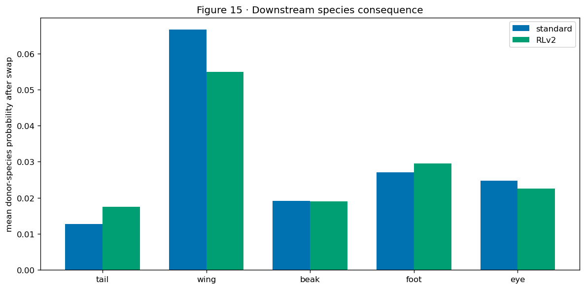


|  | standard | RLv2 | paired_change |
| --- | --- | --- | --- |
| part |  |  |  |
| tail | 0.0127 | 0.0175 | 0.0047 |
| wing | 0.0666 | 0.0550 | -0.0116 |
| beak | 0.0192 | 0.0190 | -0.0002 |
| foot | 0.0270 | 0.0295 | 0.0025 |
| eye | 0.0247 | 0.0225 | -0.0022 |


### Executed Standard-MCBM result — mcbm-downstream


**Table — ten-bin downstream values behind the six panels.** Rows are approximately equal-count final-margin bins. `mean_margin` is the mean inserted-minus-old concept logit; `mean_donor_probability` is the unchanged saved species head’s probability for the exact donor species.


|  | n | mean_margin | mean_donor_probability | gamma |
| --- | --- | --- | --- | --- |
| 0 | 500 | -17.15323 | 0.00000 | 0.0 |
| 1 | 500 | -9.30134 | 0.00000 | 0.0 |
| 2 | 503 | -4.43607 | 0.00032 | 0.0 |
| 3 | 498 | -0.09306 | 0.00323 | 0.0 |
| 4 | 499 | 3.86243 | 0.01951 | 0.0 |
| 5 | 500 | 7.85834 | 0.02853 | 0.0 |
| 6 | 501 | 11.31595 | 0.03950 | 0.0 |
| 7 | 500 | 14.51981 | 0.03793 | 0.0 |
| 8 | 499 | 17.85564 | 0.07505 | 0.0 |
| 9 | 500 | 25.35996 | 0.08214 | 0.0 |
| 10 | 502 | -12.72663 | 0.00000 | 0.1 |
| 11 | 500 | -6.74966 | 0.00002 | 0.1 |
| 12 | 498 | -3.12071 | 0.00076 | 0.1 |
| 13 | 500 | 0.39628 | 0.00362 | 0.1 |
| 14 | 500 | 3.96845 | 0.02127 | 0.1 |
| 15 | 500 | 7.50933 | 0.02179 | 0.1 |
| 16 | 501 | 11.40226 | 0.03712 | 0.1 |
| 17 | 500 | 14.54878 | 0.04828 | 0.1 |
| 18 | 499 | 17.52990 | 0.05921 | 0.1 |
| 19 | 500 | 22.32759 | 0.09426 | 0.1 |
| 20 | 500 | -12.38933 | 0.00000 | 0.3 |
| 21 | 500 | -7.61830 | 0.00001 | 0.3 |
| 22 | 500 | -4.29013 | 0.00014 | 0.3 |
| 23 | 500 | -0.61902 | 0.00105 | 0.3 |
| 24 | 500 | 3.47237 | 0.00818 | 0.3 |
| 25 | 500 | 7.41592 | 0.02080 | 0.3 |
| 26 | 500 | 10.98698 | 0.03601 | 0.3 |
| 27 | 500 | 14.25459 | 0.06773 | 0.3 |
| 28 | 500 | 17.10610 | 0.05309 | 0.3 |
| 29 | 500 | 21.95304 | 0.07969 | 0.3 |
| 30 | 500 | -13.17681 | 0.00002 | 1.0 |
| 31 | 501 | -8.12317 | 0.00006 | 1.0 |
| 32 | 500 | -3.56394 | 0.00013 | 1.0 |
| 33 | 499 | 1.15359 | 0.00117 | 1.0 |
| 34 | 500 | 5.88262 | 0.01426 | 1.0 |
| 35 | 500 | 9.91275 | 0.02444 | 1.0 |
| 36 | 500 | 13.10496 | 0.04716 | 1.0 |
| 37 | 501 | 15.71684 | 0.05686 | 1.0 |
| 38 | 499 | 18.14348 | 0.04729 | 1.0 |
| 39 | 500 | 21.66261 | 0.10577 | 1.0 |
| 40 | 500 | -12.27165 | 0.00001 | 3.0 |
| 41 | 500 | -6.97315 | 0.00007 | 3.0 |
| 42 | 500 | -2.62461 | 0.00014 | 3.0 |
| 43 | 500 | 1.28720 | 0.00255 | 3.0 |
| 44 | 502 | 5.37416 | 0.01811 | 3.0 |
| 45 | 500 | 9.93042 | 0.02443 | 3.0 |
| 46 | 499 | 14.32392 | 0.07602 | 3.0 |
| 47 | 499 | 18.25305 | 0.07429 | 3.0 |
| 48 | 500 | 20.35672 | 0.03085 | 3.0 |
| 49 | 500 | 22.88690 | 0.09097 | 3.0 |
| 50 | 500 | -11.42243 | 0.00000 | 5.0 |
| 51 | 501 | -6.60309 | 0.00002 | 5.0 |
| 52 | 499 | -1.87150 | 0.00024 | 5.0 |
| 53 | 500 | 1.88462 | 0.00187 | 5.0 |
| 54 | 500 | 5.86621 | 0.01537 | 5.0 |
| 55 | 500 | 9.78771 | 0.03459 | 5.0 |
| 56 | 500 | 13.18149 | 0.06124 | 5.0 |
| 57 | 502 | 16.07673 | 0.06716 | 5.0 |
| 58 | 498 | 18.34611 | 0.06359 | 5.0 |
| 59 | 500 | 21.15872 | 0.08783 | 5.0 |


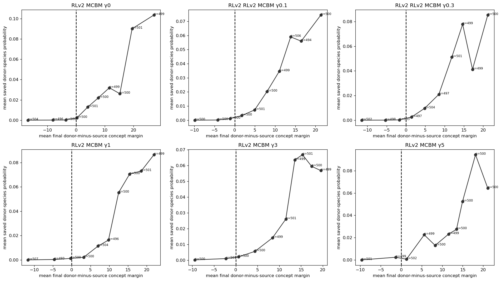


**Table — ten-bin downstream values behind the six panels.** Rows are approximately equal-count final-margin bins. `mean_margin` is the mean inserted-minus-old concept logit; `mean_donor_probability` is the unchanged saved species head’s probability for the exact donor species.


|  | n | mean_margin | mean_donor_probability | gamma |
| --- | --- | --- | --- | --- |
| 0 | 504 | -16.71339 | 0.00000 | 0.0 |
| 1 | 496 | -8.08435 | 0.00010 | 0.0 |
| 2 | 500 | -3.59135 | 0.00017 | 0.0 |
| 3 | 500 | 0.28963 | 0.00223 | 0.0 |
| 4 | 501 | 4.04470 | 0.01280 | 0.0 |
| 5 | 500 | 7.74565 | 0.02199 | 0.0 |
| 6 | 499 | 11.60032 | 0.03192 | 0.0 |
| 7 | 500 | 15.25929 | 0.02605 | 0.0 |
| 8 | 501 | 19.51198 | 0.09004 | 0.0 |
| 9 | 499 | 27.11749 | 0.10361 | 0.0 |
| 10 | 500 | -9.85216 | 0.00001 | 0.1 |
| 11 | 500 | -4.23036 | 0.00013 | 0.1 |
| 12 | 500 | -1.15275 | 0.00112 | 0.1 |
| 13 | 500 | 1.73352 | 0.00322 | 0.1 |
| 14 | 501 | 4.94324 | 0.00730 | 0.1 |
| 15 | 500 | 7.97815 | 0.02025 | 0.1 |
| 16 | 499 | 11.04000 | 0.03465 | 0.1 |
| 17 | 506 | 13.85342 | 0.05897 | 0.1 |
| 18 | 494 | 16.46151 | 0.05595 | 0.1 |
| 19 | 500 | 21.31907 | 0.07447 | 0.1 |
| 20 | 502 | -11.42682 | 0.00000 | 0.3 |
| 21 | 498 | -5.33416 | 0.00003 | 0.3 |
| 22 | 503 | -1.71807 | 0.00023 | 0.3 |
| 23 | 497 | 1.40364 | 0.00245 | 0.3 |
| 24 | 504 | 4.85174 | 0.00964 | 0.3 |
| 25 | 497 | 8.51443 | 0.02089 | 0.3 |
| 26 | 501 | 11.89377 | 0.05123 | 0.3 |
| 27 | 499 | 14.68578 | 0.07783 | 0.3 |
| 28 | 499 | 17.23998 | 0.04120 | 0.3 |
| 29 | 500 | 21.19215 | 0.08531 | 0.3 |
| 30 | 507 | -11.63699 | 0.00001 | 1.0 |
| 31 | 493 | -4.61951 | 0.00032 | 1.0 |
| 32 | 500 | -0.27553 | 0.00120 | 1.0 |
| 33 | 500 | 3.21336 | 0.00217 | 1.0 |
| 34 | 504 | 7.02513 | 0.01132 | 1.0 |
| 35 | 496 | 9.80135 | 0.01628 | 1.0 |
| 36 | 500 | 12.51736 | 0.05532 | 1.0 |
| 37 | 500 | 15.43621 | 0.07046 | 1.0 |
| 38 | 501 | 18.53331 | 0.07296 | 1.0 |
| 39 | 499 | 21.91835 | 0.08638 | 1.0 |
| 40 | 500 | -9.40095 | 0.00029 | 3.0 |
| 41 | 501 | -2.25137 | 0.00110 | 3.0 |
| 42 | 500 | 0.62684 | 0.00216 | 3.0 |
| 43 | 500 | 4.41145 | 0.00568 | 3.0 |
| 44 | 499 | 8.43972 | 0.01422 | 3.0 |
| 45 | 501 | 11.50519 | 0.02609 | 3.0 |
| 46 | 499 | 13.58874 | 0.06363 | 3.0 |
| 47 | 501 | 15.33865 | 0.06689 | 3.0 |
| 48 | 500 | 17.45826 | 0.05950 | 3.0 |
| 49 | 499 | 19.57005 | 0.05683 | 3.0 |
| 50 | 501 | -9.60667 | 0.00002 | 5.0 |
| 51 | 499 | -1.35081 | 0.00236 | 5.0 |
| 52 | 502 | 1.28298 | 0.00062 | 5.0 |
| 53 | 499 | 5.61423 | 0.02249 | 5.0 |
| 54 | 500 | 8.27939 | 0.01298 | 5.0 |
| 55 | 499 | 11.53747 | 0.02307 | 5.0 |
| 56 | 500 | 13.48933 | 0.02744 | 5.0 |
| 57 | 500 | 14.95990 | 0.05244 | 5.0 |
| 58 | 500 | 18.13147 | 0.09435 | 5.0 |
| 59 | 500 | 21.11754 | 0.06431 | 5.0 |


**How to read the executed RLv2 result.** The figure and fully
captioned source table immediately above are the result; no expected
observation was written into the notebook before execution.


Comparison requirements. Interpretation of Standard–RLv2 differences requires matching γ, formulas, physical image pairs, and denominators. The seed-1 comparison is specific to the evaluated runs; between-initialization variability requires replication.


Subsequent analysis. Continue to the next identical analysis stage, then use the final matched-difference table to decide which part and pathway actually changed.


## 8. Summary of part-specific results and proposed follow-up objectives


For each model and part, the table reports starting margin, donor gain, source release, total response, final margin, exact donor/source/third-variant outcome rates, non-positive-response rate, and the strict backwash rate. MCBM rows additionally report calibrated-h response, reader break/repair rates, ordinary performance, and the off-target intervention.


Read it in this order for each part:


- Did Koh→gamma 0 change the behavior before any minimality pressure?


- Is gamma's dose trend smooth, non-monotonic, or flat?


- Is the changed outcome explained by starting deficit, donor rise, source
fall, or a third exact value?


- Is the loss already present in calibrated `h`, or introduced by `q`?


- Do visibility/conflict/support track the matching component?


- Does the saved-head intervention causally move the source/donor species
decision enough to explain it?


### Executed Standard-MCBM result — final-table


**Table — Complete result rows — tail.** `m_orig` is the starting donor-minus-old margin; donor gain plus source decrease equals response; adding response to `m_orig` gives `m_cf`. Rates use all 1,000 matched swaps per model/part. The later columns localize movement in calibrated `h`, reader break/repair, health, and the frozen-head off-target intervention.


|  | model | part | n | m_orig | donor_gain | source_decrease | response | m_cf | exact_donor | exact_source | exact_third | no_move | backwash | gamma | mean_calibrated_h_response | q_breaks_h_success_rate | q_repairs_h_failure_rate | balanced_accuracy | h_target_RMSE | mean_swap_induced_offtarget_source_evidence | pairwise_source_to_donor_flip_rate |
| --- | --- | --- | --- | --- | --- | --- | --- | --- | --- | --- | --- | --- | --- | --- | --- | --- | --- | --- | --- | --- | --- |
| 3 | Koh Standard | tail | 1000 | -10.7561 | 4.5992 | 5.2012 | 9.8004 | -0.9557 | 0.395 | 0.538 | 0.067 | 0.075 | 0.508 | NaN | NaN | NaN | NaN | NaN | NaN | NaN | NaN |
| 8 | MCBM γ0 | tail | 1000 | -21.2911 | 6.5584 | 11.6452 | 18.2036 | -3.0875 | 0.278 | 0.470 | 0.252 | 0.106 | 0.522 | 0.0 | 0.7978 | 0.054 | 0.113 | 0.9592 | 24.3984 | 0.3299 | 0.003 |
| 13 | MCBM γ0.1 | tail | 1000 | -15.4800 | 4.3278 | 6.0593 | 10.3871 | -5.0928 | 0.195 | 0.716 | 0.089 | 0.097 | 0.672 | 0.1 | 0.7175 | 0.011 | 0.009 | 0.9813 | 1.4667 | -0.2078 | 0.001 |
| 18 | MCBM γ0.3 | tail | 1000 | -14.0996 | 2.6939 | 5.0158 | 7.7097 | -6.3899 | 0.109 | 0.804 | 0.087 | 0.073 | 0.790 | 0.3 | 0.6026 | 0.003 | 0.008 | 0.9804 | 0.7191 | -0.1984 | 0.000 |
| 23 | MCBM γ1 | tail | 1000 | -12.7580 | 2.8447 | 5.5165 | 8.3612 | -4.3968 | 0.202 | 0.702 | 0.096 | 0.077 | 0.682 | 1.0 | 0.7297 | 0.003 | 0.003 | 0.9771 | 0.5964 | -0.0831 | 0.000 |
| 28 | MCBM γ3 | tail | 1000 | -11.7821 | 1.4226 | 5.3830 | 6.8056 | -4.9765 | 0.142 | 0.753 | 0.105 | 0.125 | 0.689 | 3.0 | 0.6282 | 0.001 | 0.004 | 0.9793 | 0.5215 | -0.0446 | 0.000 |
| 33 | MCBM γ5 | tail | 1000 | -11.7315 | 1.4495 | 4.8222 | 6.2717 | -5.4599 | 0.135 | 0.779 | 0.086 | 0.097 | 0.739 | 5.0 | 0.6005 | 0.003 | 0.015 | 0.9763 | 0.5400 | -0.0125 | 0.000 |


**Table — Complete result rows — wing.** `m_orig` is the starting donor-minus-old margin; donor gain plus source decrease equals response; adding response to `m_orig` gives `m_cf`. Rates use all 1,000 matched swaps per model/part. The later columns localize movement in calibrated `h`, reader break/repair, health, and the frozen-head off-target intervention.


|  | model | part | n | m_orig | donor_gain | source_decrease | response | m_cf | exact_donor | exact_source | exact_third | no_move | backwash | gamma | mean_calibrated_h_response | q_breaks_h_success_rate | q_repairs_h_failure_rate | balanced_accuracy | h_target_RMSE | mean_swap_induced_offtarget_source_evidence | pairwise_source_to_donor_flip_rate |
| --- | --- | --- | --- | --- | --- | --- | --- | --- | --- | --- | --- | --- | --- | --- | --- | --- | --- | --- | --- | --- | --- |
| 4 | Koh Standard | wing | 1000 | -9.9140 | 8.0287 | 8.3609 | 16.3897 | 6.4757 | 0.977 | 0.016 | 0.007 | 0.000 | 0.019 | NaN | NaN | NaN | NaN | NaN | NaN | NaN | NaN |
| 9 | MCBM γ0 | wing | 1000 | -27.7178 | 16.7892 | 22.1925 | 38.9817 | 11.2639 | 0.811 | 0.116 | 0.073 | 0.000 | 0.143 | 0.0 | 1.4721 | 0.013 | 0.007 | 0.9991 | 14.9701 | -0.6636 | 0.002 |
| 14 | MCBM γ0.1 | wing | 1000 | -23.5205 | 15.9988 | 20.0924 | 36.0912 | 12.5707 | 0.881 | 0.082 | 0.037 | 0.001 | 0.092 | 0.1 | 1.4894 | 0.013 | 0.006 | 0.9993 | 2.0694 | 0.0016 | 0.003 |
| 19 | MCBM γ0.3 | wing | 1000 | -22.9600 | 16.4823 | 18.0984 | 34.5807 | 11.6207 | 0.870 | 0.099 | 0.031 | 0.000 | 0.108 | 0.3 | 1.4508 | 0.000 | 0.003 | 0.9988 | 0.3377 | 0.0102 | 0.000 |
| 24 | MCBM γ1 | wing | 1000 | -22.5123 | 15.8419 | 19.4856 | 35.3274 | 12.8152 | 0.846 | 0.097 | 0.057 | 0.006 | 0.100 | 1.0 | 1.5519 | 0.000 | 0.003 | 0.9994 | 0.2644 | -0.0758 | 0.002 |
| 29 | MCBM γ3 | wing | 1000 | -21.5626 | 15.4134 | 18.9733 | 34.3867 | 12.8241 | 0.819 | 0.093 | 0.088 | 0.003 | 0.101 | 3.0 | 1.5785 | 0.002 | 0.005 | 0.9992 | 0.1809 | -0.1542 | 0.000 |
| 34 | MCBM γ5 | wing | 1000 | -20.3061 | 15.2728 | 18.3901 | 33.6629 | 13.3567 | 0.832 | 0.095 | 0.073 | 0.002 | 0.097 | 5.0 | 1.6384 | 0.002 | 0.000 | 0.9982 | 0.1915 | -0.1815 | 0.000 |


**Table — Complete result rows — beak.** `m_orig` is the starting donor-minus-old margin; donor gain plus source decrease equals response; adding response to `m_orig` gives `m_cf`. Rates use all 1,000 matched swaps per model/part. The later columns localize movement in calibrated `h`, reader break/repair, health, and the frozen-head off-target intervention.


|  | model | part | n | m_orig | donor_gain | source_decrease | response | m_cf | exact_donor | exact_source | exact_third | no_move | backwash | gamma | mean_calibrated_h_response | q_breaks_h_success_rate | q_repairs_h_failure_rate | balanced_accuracy | h_target_RMSE | mean_swap_induced_offtarget_source_evidence | pairwise_source_to_donor_flip_rate |
| --- | --- | --- | --- | --- | --- | --- | --- | --- | --- | --- | --- | --- | --- | --- | --- | --- | --- | --- | --- | --- | --- |
| 0 | Koh Standard | beak | 1000 | -9.1671 | 5.8423 | 5.9361 | 11.7784 | 2.6114 | 0.780 | 0.203 | 0.017 | 0.011 | 0.200 | NaN | NaN | NaN | NaN | NaN | NaN | NaN | NaN |
| 5 | MCBM γ0 | beak | 1000 | -26.2761 | 15.6625 | 14.3049 | 29.9675 | 3.6913 | 0.550 | 0.405 | 0.045 | 0.010 | 0.416 | 0.0 | 1.6694 | 0.157 | 0.143 | 0.9946 | 19.4420 | -0.2524 | 0.0 |
| 10 | MCBM γ0.1 | beak | 1000 | -19.0454 | 10.0847 | 10.5177 | 20.6024 | 1.5570 | 0.562 | 0.418 | 0.020 | 0.002 | 0.418 | 0.1 | 1.0731 | 0.018 | 0.007 | 0.9960 | 0.6150 | 0.0336 | 0.0 |
| 15 | MCBM γ0.3 | beak | 1000 | -18.4562 | 10.5246 | 9.8027 | 20.3273 | 1.8712 | 0.550 | 0.418 | 0.032 | 0.002 | 0.421 | 0.3 | 1.0988 | 0.014 | 0.009 | 0.9961 | 0.4089 | 0.0105 | 0.0 |
| 20 | MCBM γ1 | beak | 1000 | -16.3939 | 10.2733 | 11.6800 | 21.9533 | 5.5594 | 0.750 | 0.232 | 0.018 | 0.015 | 0.220 | 1.0 | 1.2956 | 0.014 | 0.004 | 0.9966 | 0.3485 | -0.0004 | 0.0 |
| 25 | MCBM γ3 | beak | 1000 | -15.4492 | 9.2762 | 11.7540 | 21.0301 | 5.5809 | 0.756 | 0.229 | 0.015 | 0.005 | 0.228 | 3.0 | 1.2951 | 0.003 | 0.008 | 0.9958 | 0.3207 | -0.0054 | 0.0 |
| 30 | MCBM γ5 | beak | 1000 | -16.1050 | 8.4892 | 12.2307 | 20.7199 | 4.6148 | 0.694 | 0.262 | 0.044 | 0.004 | 0.270 | 5.0 | 1.2615 | 0.012 | 0.004 | 0.9955 | 0.3294 | -0.0099 | 0.0 |


**Table — Complete result rows — foot.** `m_orig` is the starting donor-minus-old margin; donor gain plus source decrease equals response; adding response to `m_orig` gives `m_cf`. Rates use all 1,000 matched swaps per model/part. The later columns localize movement in calibrated `h`, reader break/repair, health, and the frozen-head off-target intervention.


|  | model | part | n | m_orig | donor_gain | source_decrease | response | m_cf | exact_donor | exact_source | exact_third | no_move | backwash | gamma | mean_calibrated_h_response | q_breaks_h_success_rate | q_repairs_h_failure_rate | balanced_accuracy | h_target_RMSE | mean_swap_induced_offtarget_source_evidence | pairwise_source_to_donor_flip_rate |
| --- | --- | --- | --- | --- | --- | --- | --- | --- | --- | --- | --- | --- | --- | --- | --- | --- | --- | --- | --- | --- | --- |
| 2 | Koh Standard | foot | 1000 | -8.8470 | 6.8042 | 7.0272 | 13.8314 | 4.9843 | 0.965 | 0.033 | 0.002 | 0.003 | 0.032 | NaN | NaN | NaN | NaN | NaN | NaN | NaN | NaN |
| 7 | MCBM γ0 | foot | 1000 | -27.3011 | 19.2409 | 21.1721 | 40.4130 | 13.1119 | 0.926 | 0.069 | 0.005 | 0.001 | 0.070 | 0.0 | 1.5296 | 0.010 | 0.008 | 0.9985 | 12.3800 | -0.2127 | 0.002 |
| 12 | MCBM γ0.1 | foot | 1000 | -24.8221 | 19.2119 | 21.7348 | 40.9467 | 16.1246 | 0.978 | 0.021 | 0.001 | 0.003 | 0.019 | 0.1 | 1.5739 | 0.000 | 0.000 | 0.9991 | 0.5399 | 0.0424 | 0.001 |
| 17 | MCBM γ0.3 | foot | 1000 | -23.7720 | 17.7256 | 21.5504 | 39.2760 | 15.5040 | 0.958 | 0.041 | 0.001 | 0.000 | 0.041 | 0.3 | 1.5795 | 0.000 | 0.000 | 0.9990 | 0.3524 | 0.0235 | 0.000 |
| 22 | MCBM γ1 | foot | 1000 | -20.3204 | 17.6330 | 18.1752 | 35.8082 | 15.4878 | 0.942 | 0.047 | 0.011 | 0.004 | 0.045 | 1.0 | 1.7087 | 0.003 | 0.000 | 0.9979 | 0.2597 | -0.0095 | 0.000 |
| 27 | MCBM γ3 | foot | 1000 | -21.7110 | 21.0363 | 21.1197 | 42.1560 | 20.4450 | 0.990 | 0.009 | 0.001 | 0.004 | 0.006 | 3.0 | 1.9263 | 0.000 | 0.000 | 0.9994 | 0.1522 | 0.0086 | 0.000 |
| 32 | MCBM γ5 | foot | 1000 | -18.5898 | 17.3191 | 17.9815 | 35.3006 | 16.7108 | 0.991 | 0.008 | 0.001 | 0.003 | 0.005 | 5.0 | 1.8446 | 0.000 | 0.000 | 0.9987 | 0.1935 | 0.0305 | 0.001 |


**Table — Complete result rows — eye.** `m_orig` is the starting donor-minus-old margin; donor gain plus source decrease equals response; adding response to `m_orig` gives `m_cf`. Rates use all 1,000 matched swaps per model/part. The later columns localize movement in calibrated `h`, reader break/repair, health, and the frozen-head off-target intervention.


|  | model | part | n | m_orig | donor_gain | source_decrease | response | m_cf | exact_donor | exact_source | exact_third | no_move | backwash | gamma | mean_calibrated_h_response | q_breaks_h_success_rate | q_repairs_h_failure_rate | balanced_accuracy | h_target_RMSE | mean_swap_induced_offtarget_source_evidence | pairwise_source_to_donor_flip_rate |
| --- | --- | --- | --- | --- | --- | --- | --- | --- | --- | --- | --- | --- | --- | --- | --- | --- | --- | --- | --- | --- | --- |
| 1 | Koh Standard | eye | 1000 | -8.4811 | 5.8750 | 5.8743 | 11.7493 | 3.2682 | 0.900 | 0.090 | 0.010 | 0.014 | 0.089 | NaN | NaN | NaN | NaN | NaN | NaN | NaN | NaN |
| 6 | MCBM γ0 | eye | 1000 | -27.7016 | 15.5602 | 12.0324 | 27.5927 | -0.1089 | 0.495 | 0.489 | 0.016 | 0.006 | 0.494 | 0.0 | 1.1258 | 0.072 | 0.062 | 0.9757 | 20.0627 | -0.1184 | 0.003 |
| 11 | MCBM γ0.1 | eye | 1000 | -17.4695 | 8.8220 | 11.0055 | 19.8275 | 2.3580 | 0.609 | 0.390 | 0.001 | 0.013 | 0.378 | 0.1 | 1.1049 | 0.020 | 0.007 | 0.9964 | 0.6970 | 0.0127 | 0.000 |
| 16 | MCBM γ0.3 | eye | 1000 | -16.5254 | 9.6587 | 9.3969 | 19.0556 | 2.5301 | 0.609 | 0.384 | 0.007 | 0.014 | 0.380 | 0.3 | 1.1203 | 0.005 | 0.005 | 0.9969 | 0.4468 | -0.0013 | 0.000 |
| 21 | MCBM γ1 | eye | 1000 | -15.7388 | 7.7036 | 8.9144 | 16.6180 | 0.8792 | 0.527 | 0.461 | 0.012 | 0.020 | 0.449 | 1.0 | 1.0526 | 0.002 | 0.003 | 0.9963 | 0.3852 | 0.0014 | 0.000 |
| 26 | MCBM γ3 | eye | 1000 | -16.5404 | 6.8662 | 11.0504 | 17.9166 | 1.3762 | 0.572 | 0.424 | 0.004 | 0.019 | 0.408 | 3.0 | 1.0660 | 0.015 | 0.008 | 0.9968 | 0.3536 | 0.0014 | 0.000 |
| 31 | MCBM γ5 | eye | 1000 | -14.7152 | 8.3105 | 10.3751 | 18.6857 | 3.9705 | 0.735 | 0.255 | 0.010 | 0.024 | 0.239 | 5.0 | 1.2352 | 0.007 | 0.000 | 0.9943 | 0.3924 | 0.0081 | 0.000 |


**Table — Complete result rows — tail.** `m_orig` is the starting donor-minus-old margin; donor gain plus source decrease equals response; adding response to `m_orig` gives `m_cf`. Rates use all 1,000 matched swaps per model/part. The later columns localize movement in calibrated `h`, reader break/repair, health, and the frozen-head off-target intervention.


|  | model | part | n | m_orig | donor_gain | source_decrease | response | m_cf | exact_donor | exact_source | exact_third | no_move | backwash | gamma | mean_calibrated_h_response | q_breaks_h_success_rate | q_repairs_h_failure_rate | balanced_accuracy | h_target_RMSE | mean_swap_induced_offtarget_source_evidence | pairwise_source_to_donor_flip_rate |
| --- | --- | --- | --- | --- | --- | --- | --- | --- | --- | --- | --- | --- | --- | --- | --- | --- | --- | --- | --- | --- | --- |
| 3 | Koh RLv2 | tail | 1000 | -9.7658 | 5.5992 | 6.0701 | 11.6693 | 1.9035 | 0.667 | 0.258 | 0.075 | 0.079 | 0.241 | NaN | NaN | NaN | NaN | NaN | NaN | NaN | NaN |
| 8 | RLv2 MCBM γ0 | tail | 1000 | -27.6986 | 16.0065 | 11.4314 | 27.4379 | -0.2607 | 0.425 | 0.425 | 0.150 | 0.078 | 0.448 | 0.0 | 0.9555 | 0.0240 | 0.0190 | 0.9921 | 20.7115 | -0.2033 | 0.001 |
| 13 | RLv2 RLv2 MCBM γ0.1 | tail | 1000 | -13.6431 | 5.3566 | 7.5590 | 12.9156 | -0.7275 | 0.356 | 0.474 | 0.170 | 0.084 | 0.521 | 0.1 | 0.8474 | 0.0290 | 0.0370 | 0.9916 | 0.7004 | 0.1018 | 0.000 |
| 18 | RLv2 RLv2 MCBM γ0.3 | tail | 1000 | -12.9002 | 4.5306 | 7.5602 | 12.0907 | -0.8095 | 0.380 | 0.488 | 0.132 | 0.104 | 0.475 | 0.3 | 0.8151 | 0.0270 | 0.0320 | 0.9926 | 0.6042 | -0.0019 | 0.000 |
| 23 | RLv2 MCBM γ1 | tail | 1000 | -11.8786 | 4.5334 | 8.1450 | 12.6785 | 0.7999 | 0.463 | 0.340 | 0.197 | 0.096 | 0.396 | 1.0 | 0.9100 | 0.0130 | 0.0290 | 0.9902 | 0.4836 | -0.0540 | 0.000 |
| 28 | RLv2 MCBM γ3 | tail | 1000 | -11.2049 | 2.4562 | 8.0561 | 10.5123 | -0.6926 | 0.323 | 0.439 | 0.238 | 0.122 | 0.480 | 3.0 | 0.8456 | 0.0131 | 0.0251 | 0.9863 | 0.4528 | -0.0815 | 0.000 |
| 33 | RLv2 MCBM γ5 | tail | 1000 | -11.0782 | 2.8728 | 9.2376 | 12.1104 | 1.0323 | 0.428 | 0.334 | 0.238 | 0.130 | 0.347 | 5.0 | 0.9460 | 0.0471 | 0.0371 | 0.9822 | 0.4485 | -0.0535 | 0.000 |


**Table — Complete result rows — wing.** `m_orig` is the starting donor-minus-old margin; donor gain plus source decrease equals response; adding response to `m_orig` gives `m_cf`. Rates use all 1,000 matched swaps per model/part. The later columns localize movement in calibrated `h`, reader break/repair, health, and the frozen-head off-target intervention.


|  | model | part | n | m_orig | donor_gain | source_decrease | response | m_cf | exact_donor | exact_source | exact_third | no_move | backwash | gamma | mean_calibrated_h_response | q_breaks_h_success_rate | q_repairs_h_failure_rate | balanced_accuracy | h_target_RMSE | mean_swap_induced_offtarget_source_evidence | pairwise_source_to_donor_flip_rate |
| --- | --- | --- | --- | --- | --- | --- | --- | --- | --- | --- | --- | --- | --- | --- | --- | --- | --- | --- | --- | --- | --- |
| 4 | Koh RLv2 | wing | 1000 | -9.9093 | 8.0285 | 8.3230 | 16.3515 | 6.4421 | 0.966 | 0.021 | 0.013 | 0.000 | 0.023 | NaN | NaN | NaN | NaN | NaN | NaN | NaN | NaN |
| 9 | RLv2 MCBM γ0 | wing | 1000 | -33.9943 | 24.3964 | 23.4423 | 47.8387 | 13.8443 | 0.853 | 0.099 | 0.048 | 0.000 | 0.110 | 0.0 | 1.4468 | 0.016 | 0.010 | 0.9993 | 16.4860 | -0.1736 | 0.007 |
| 14 | RLv2 RLv2 MCBM γ0.1 | wing | 1000 | -21.2801 | 14.9585 | 17.2676 | 32.2261 | 10.9460 | 0.854 | 0.100 | 0.046 | 0.000 | 0.110 | 0.1 | 1.4845 | 0.007 | 0.002 | 0.9994 | 2.0304 | -0.0368 | 0.000 |
| 19 | RLv2 RLv2 MCBM γ0.3 | wing | 1000 | -22.0652 | 14.8276 | 17.2616 | 32.0892 | 10.0240 | 0.796 | 0.147 | 0.057 | 0.001 | 0.162 | 0.3 | 1.4066 | 0.002 | 0.000 | 0.9992 | 0.3291 | -0.0590 | 0.000 |
| 24 | RLv2 MCBM γ1 | wing | 1000 | -16.6916 | 11.5099 | 14.1283 | 25.6383 | 8.9467 | 0.744 | 0.136 | 0.120 | 0.054 | 0.125 | 1.0 | 1.4996 | 0.043 | 0.007 | 0.9183 | 0.2115 | -0.0728 | 0.000 |
| 29 | RLv2 MCBM γ3 | wing | 1000 | -18.4546 | 11.9486 | 15.9165 | 27.8652 | 9.4106 | 0.774 | 0.130 | 0.096 | 0.012 | 0.141 | 3.0 | 1.5021 | 0.006 | 0.005 | 0.9957 | 0.2994 | -0.1742 | 0.000 |
| 34 | RLv2 MCBM γ5 | wing | 1000 | -18.8165 | 13.2414 | 17.0198 | 30.2612 | 11.4447 | 0.776 | 0.095 | 0.129 | 0.011 | 0.154 | 5.0 | 1.5979 | 0.000 | 0.002 | 0.9971 | 0.2372 | -0.1895 | 0.000 |


**Table — Complete result rows — beak.** `m_orig` is the starting donor-minus-old margin; donor gain plus source decrease equals response; adding response to `m_orig` gives `m_cf`. Rates use all 1,000 matched swaps per model/part. The later columns localize movement in calibrated `h`, reader break/repair, health, and the frozen-head off-target intervention.


|  | model | part | n | m_orig | donor_gain | source_decrease | response | m_cf | exact_donor | exact_source | exact_third | no_move | backwash | gamma | mean_calibrated_h_response | q_breaks_h_success_rate | q_repairs_h_failure_rate | balanced_accuracy | h_target_RMSE | mean_swap_induced_offtarget_source_evidence | pairwise_source_to_donor_flip_rate |
| --- | --- | --- | --- | --- | --- | --- | --- | --- | --- | --- | --- | --- | --- | --- | --- | --- | --- | --- | --- | --- | --- |
| 0 | Koh RLv2 | beak | 1000 | -9.3551 | 6.3184 | 6.3678 | 12.6862 | 3.3311 | 0.862 | 0.121 | 0.017 | 0.008 | 0.120 | NaN | NaN | NaN | NaN | NaN | NaN | NaN | NaN |
| 5 | RLv2 MCBM γ0 | beak | 1000 | -28.6946 | 15.6223 | 13.5156 | 29.1379 | 0.4433 | 0.495 | 0.479 | 0.026 | 0.006 | 0.485 | 0.0 | 1.0651 | 0.0390 | 0.0260 | 0.9971 | 19.2867 | -0.0690 | 0.002 |
| 10 | RLv2 RLv2 MCBM γ0.1 | beak | 1000 | -18.5713 | 10.5631 | 11.9751 | 22.5382 | 3.9670 | 0.639 | 0.328 | 0.033 | 0.001 | 0.351 | 0.1 | 1.1839 | 0.0180 | 0.0120 | 0.9966 | 0.5168 | 0.0062 | 0.000 |
| 15 | RLv2 RLv2 MCBM γ0.3 | beak | 1000 | -17.1963 | 8.9834 | 11.2500 | 20.2335 | 3.0371 | 0.593 | 0.381 | 0.026 | 0.013 | 0.370 | 0.3 | 1.1460 | 0.0261 | 0.0080 | 0.9974 | 0.3944 | -0.0240 | 0.000 |
| 20 | RLv2 MCBM γ1 | beak | 1000 | -16.7775 | 10.7426 | 12.7443 | 23.4868 | 6.7093 | 0.781 | 0.193 | 0.026 | 0.010 | 0.195 | 1.0 | 1.3351 | 0.0150 | 0.0070 | 0.9976 | 0.2983 | 0.0185 | 0.000 |
| 25 | RLv2 MCBM γ3 | beak | 1000 | -15.6205 | 10.7301 | 13.8460 | 24.5760 | 8.9556 | 0.849 | 0.107 | 0.044 | 0.007 | 0.132 | 3.0 | 1.5227 | 0.0000 | 0.0041 | 0.9956 | 0.3092 | 0.0025 | 0.000 |
| 30 | RLv2 MCBM γ5 | beak | 1000 | -14.9584 | 10.7336 | 13.7288 | 24.4624 | 9.5040 | 0.832 | 0.096 | 0.072 | 0.008 | 0.106 | 5.0 | 1.6129 | 0.0041 | 0.0000 | 0.9943 | 0.3417 | -0.0061 | 0.000 |


**Table — Complete result rows — foot.** `m_orig` is the starting donor-minus-old margin; donor gain plus source decrease equals response; adding response to `m_orig` gives `m_cf`. Rates use all 1,000 matched swaps per model/part. The later columns localize movement in calibrated `h`, reader break/repair, health, and the frozen-head off-target intervention.


|  | model | part | n | m_orig | donor_gain | source_decrease | response | m_cf | exact_donor | exact_source | exact_third | no_move | backwash | gamma | mean_calibrated_h_response | q_breaks_h_success_rate | q_repairs_h_failure_rate | balanced_accuracy | h_target_RMSE | mean_swap_induced_offtarget_source_evidence | pairwise_source_to_donor_flip_rate |
| --- | --- | --- | --- | --- | --- | --- | --- | --- | --- | --- | --- | --- | --- | --- | --- | --- | --- | --- | --- | --- | --- |
| 2 | Koh RLv2 | foot | 1000 | -8.7217 | 6.7961 | 7.0679 | 13.8641 | 5.1423 | 0.972 | 0.020 | 0.008 | 0.000 | 0.022 | NaN | NaN | NaN | NaN | NaN | NaN | NaN | NaN |
| 7 | RLv2 MCBM γ0 | foot | 1000 | -29.3906 | 18.7279 | 24.3549 | 43.0828 | 13.6922 | 0.890 | 0.099 | 0.011 | 0.003 | 0.098 | 0.0 | 1.4740 | 0.011 | 0.016 | 0.9995 | 11.4628 | -0.1596 | 0.000 |
| 12 | RLv2 RLv2 MCBM γ0.1 | foot | 1000 | -22.6469 | 19.4017 | 18.2139 | 37.6156 | 14.9687 | 0.967 | 0.030 | 0.003 | 0.003 | 0.027 | 0.1 | 1.5611 | 0.000 | 0.000 | 0.9992 | 0.4329 | 0.0411 | 0.001 |
| 17 | RLv2 RLv2 MCBM γ0.3 | foot | 1000 | -22.1131 | 18.4804 | 19.8216 | 38.3020 | 16.1889 | 0.977 | 0.021 | 0.002 | 0.000 | 0.021 | 0.3 | 1.6501 | 0.003 | 0.000 | 0.9982 | 0.3391 | -0.0029 | 0.004 |
| 22 | RLv2 MCBM γ1 | foot | 1000 | -21.5664 | 19.2872 | 20.0812 | 39.3684 | 17.8020 | 0.967 | 0.023 | 0.010 | 0.000 | 0.026 | 1.0 | 1.7781 | 0.000 | 0.002 | 0.9993 | 0.2022 | 0.0233 | 0.000 |
| 27 | RLv2 MCBM γ3 | foot | 1000 | -19.0109 | 17.3500 | 18.2411 | 35.5911 | 16.5801 | 0.986 | 0.013 | 0.001 | 0.000 | 0.013 | 3.0 | 1.8427 | 0.000 | 0.000 | 0.9978 | 0.2085 | 0.0527 | 0.001 |
| 32 | RLv2 MCBM γ5 | foot | 1000 | -15.3254 | 14.5561 | 15.3088 | 29.8649 | 14.5395 | 0.989 | 0.003 | 0.008 | 0.007 | 0.002 | 5.0 | 1.9302 | 0.002 | 0.001 | 0.8685 | 0.1941 | 0.0101 | 0.000 |


**Table — Complete result rows — eye.** `m_orig` is the starting donor-minus-old margin; donor gain plus source decrease equals response; adding response to `m_orig` gives `m_cf`. Rates use all 1,000 matched swaps per model/part. The later columns localize movement in calibrated `h`, reader break/repair, health, and the frozen-head off-target intervention.


|  | model | part | n | m_orig | donor_gain | source_decrease | response | m_cf | exact_donor | exact_source | exact_third | no_move | backwash | gamma | mean_calibrated_h_response | q_breaks_h_success_rate | q_repairs_h_failure_rate | balanced_accuracy | h_target_RMSE | mean_swap_induced_offtarget_source_evidence | pairwise_source_to_donor_flip_rate |
| --- | --- | --- | --- | --- | --- | --- | --- | --- | --- | --- | --- | --- | --- | --- | --- | --- | --- | --- | --- | --- | --- |
| 1 | Koh RLv2 | eye | 1000 | -9.0796 | 6.7023 | 6.6446 | 13.3469 | 4.2672 | 0.892 | 0.097 | 0.011 | 0.008 | 0.100 | NaN | NaN | NaN | NaN | NaN | NaN | NaN | NaN |
| 6 | RLv2 MCBM γ0 | eye | 1000 | -28.6132 | 17.9228 | 11.5116 | 29.4344 | 0.8212 | 0.516 | 0.473 | 0.011 | 0.010 | 0.471 | 0.0 | 1.0497 | 0.0070 | 0.0110 | 0.9968 | 19.1899 | -0.1048 | 0.0 |
| 11 | RLv2 RLv2 MCBM γ0.1 | eye | 1000 | -16.3490 | 8.8548 | 9.3651 | 18.2199 | 1.8709 | 0.601 | 0.378 | 0.021 | 0.013 | 0.374 | 0.1 | 1.0817 | 0.0151 | 0.0131 | 0.9973 | 0.6000 | -0.0292 | 0.0 |
| 16 | RLv2 RLv2 MCBM γ0.3 | eye | 1000 | -16.3333 | 9.4821 | 9.0141 | 18.4962 | 2.1629 | 0.587 | 0.406 | 0.007 | 0.015 | 0.397 | 0.3 | 1.0960 | 0.0060 | 0.0070 | 0.9972 | 0.4199 | -0.0088 | 0.0 |
| 21 | RLv2 MCBM γ1 | eye | 1000 | -15.8661 | 7.8985 | 9.6026 | 17.5011 | 1.6350 | 0.571 | 0.424 | 0.005 | 0.010 | 0.416 | 1.0 | 1.0820 | 0.0020 | 0.0000 | 0.9967 | 0.3483 | 0.0085 | 0.0 |
| 26 | RLv2 MCBM γ3 | eye | 1000 | -14.1215 | 8.6375 | 10.8566 | 19.4941 | 5.3726 | 0.736 | 0.239 | 0.025 | 0.011 | 0.243 | 3.0 | 1.3151 | 0.0000 | 0.0020 | 0.9955 | 0.3749 | 0.0215 | 0.0 |
| 31 | RLv2 MCBM γ5 | eye | 1000 | -14.1164 | 8.1656 | 11.1348 | 19.3004 | 5.1840 | 0.743 | 0.236 | 0.021 | 0.028 | 0.221 | 5.0 | 1.3425 | 0.0040 | 0.0071 | 0.9867 | 0.6078 | 0.0460 | 0.0 |


Table: Standard–RLv2 matched differences. For each γ and part, _standard and _rlv2 report the condition-specific values; _change_rlv2_minus_standard reports RLv2 minus Standard. Positive changes indicate higher response, margin, or recognition when applied to those measures. For backwash and non-positive-response rates, negative changes indicate lower event frequency.


|  | gamma | part | m_orig_standard | donor_gain_standard | source_decrease_standard | response_standard | m_cf_standard | exact_donor_standard | exact_source_standard | exact_third_standard | no_move_standard | backwash_standard | mean_calibrated_h_response_standard | q_breaks_h_success_rate_standard | q_repairs_h_failure_rate_standard | balanced_accuracy_standard | h_target_RMSE_standard | mean_swap_induced_offtarget_source_evidence_standard | pairwise_source_to_donor_flip_rate_standard | m_orig_rlv2 | donor_gain_rlv2 | source_decrease_rlv2 | response_rlv2 | m_cf_rlv2 | exact_donor_rlv2 | ... | backwash_rlv2 | mean_calibrated_h_response_rlv2 | q_breaks_h_success_rate_rlv2 | q_repairs_h_failure_rate_rlv2 | balanced_accuracy_rlv2 | h_target_RMSE_rlv2 | mean_swap_induced_offtarget_source_evidence_rlv2 | pairwise_source_to_donor_flip_rate_rlv2 | m_orig_change_rlv2_minus_standard | donor_gain_change_rlv2_minus_standard | source_decrease_change_rlv2_minus_standard | response_change_rlv2_minus_standard | m_cf_change_rlv2_minus_standard | exact_donor_change_rlv2_minus_standard | exact_source_change_rlv2_minus_standard | exact_third_change_rlv2_minus_standard | no_move_change_rlv2_minus_standard | backwash_change_rlv2_minus_standard | mean_calibrated_h_response_change_rlv2_minus_standard | q_breaks_h_success_rate_change_rlv2_minus_standard | q_repairs_h_failure_rate_change_rlv2_minus_standard | balanced_accuracy_change_rlv2_minus_standard | h_target_RMSE_change_rlv2_minus_standard | mean_swap_induced_offtarget_source_evidence_change_rlv2_minus_standard | pairwise_source_to_donor_flip_rate_change_rlv2_minus_standard |
| --- | --- | --- | --- | --- | --- | --- | --- | --- | --- | --- | --- | --- | --- | --- | --- | --- | --- | --- | --- | --- | --- | --- | --- | --- | --- | --- | --- | --- | --- | --- | --- | --- | --- | --- | --- | --- | --- | --- | --- | --- | --- | --- | --- | --- | --- | --- | --- | --- | --- | --- | --- |
| 0 | 0.0 | beak | -26.2761 | 15.6625 | 14.3049 | 29.9675 | 3.6913 | 0.550 | 0.405 | 0.045 | 0.010 | 0.416 | 1.6694 | 0.157 | 0.143 | 0.9946 | 19.4420 | -0.2524 | 0.000 | -28.6946 | 15.6223 | 13.5156 | 29.1379 | 0.4433 | 0.495 | ... | 0.485 | 1.0651 | 0.0390 | 0.0260 | 0.9971 | 19.2867 | -0.0690 | 0.002 | -2.4185 | -0.0403 | -0.7893 | -0.8296 | -3.2481 | -0.055 | 0.074 | -0.019 | -0.004 | 0.069 | -0.6043 | -0.1180 | -0.1170 | 0.0025 | -0.1553 | 0.1834 | 0.002 |
| 1 | 0.0 | eye | -27.7016 | 15.5602 | 12.0324 | 27.5927 | -0.1089 | 0.495 | 0.489 | 0.016 | 0.006 | 0.494 | 1.1258 | 0.072 | 0.062 | 0.9757 | 20.0627 | -0.1184 | 0.003 | -28.6132 | 17.9228 | 11.5116 | 29.4344 | 0.8212 | 0.516 | ... | 0.471 | 1.0497 | 0.0070 | 0.0110 | 0.9968 | 19.1899 | -0.1048 | 0.000 | -0.9116 | 2.3626 | -0.5208 | 1.8417 | 0.9301 | 0.021 | -0.016 | -0.005 | 0.004 | -0.023 | -0.0761 | -0.0650 | -0.0510 | 0.0210 | -0.8728 | 0.0136 | -0.003 |
| 2 | 0.0 | foot | -27.3011 | 19.2409 | 21.1721 | 40.4130 | 13.1119 | 0.926 | 0.069 | 0.005 | 0.001 | 0.070 | 1.5296 | 0.010 | 0.008 | 0.9985 | 12.3800 | -0.2127 | 0.002 | -29.3906 | 18.7279 | 24.3549 | 43.0828 | 13.6922 | 0.890 | ... | 0.098 | 1.4740 | 0.0110 | 0.0160 | 0.9995 | 11.4628 | -0.1596 | 0.000 | -2.0894 | -0.5130 | 3.1827 | 2.6698 | 0.5803 | -0.036 | 0.030 | 0.006 | 0.002 | 0.028 | -0.0555 | 0.0010 | 0.0080 | 0.0010 | -0.9172 | 0.0531 | -0.002 |
| 3 | 0.0 | tail | -21.2911 | 6.5584 | 11.6452 | 18.2036 | -3.0875 | 0.278 | 0.470 | 0.252 | 0.106 | 0.522 | 0.7978 | 0.054 | 0.113 | 0.9592 | 24.3984 | 0.3299 | 0.003 | -27.6986 | 16.0065 | 11.4314 | 27.4379 | -0.2607 | 0.425 | ... | 0.448 | 0.9555 | 0.0240 | 0.0190 | 0.9921 | 20.7115 | -0.2033 | 0.001 | -6.4075 | 9.4481 | -0.2138 | 9.2343 | 2.8268 | 0.147 | -0.045 | -0.102 | -0.028 | -0.074 | 0.1576 | -0.0300 | -0.0940 | 0.0329 | -3.6869 | -0.5332 | -0.002 |
| 4 | 0.0 | wing | -27.7178 | 16.7892 | 22.1925 | 38.9817 | 11.2639 | 0.811 | 0.116 | 0.073 | 0.000 | 0.143 | 1.4721 | 0.013 | 0.007 | 0.9991 | 14.9701 | -0.6636 | 0.002 | -33.9943 | 24.3964 | 23.4423 | 47.8387 | 13.8443 | 0.853 | ... | 0.110 | 1.4468 | 0.0160 | 0.0100 | 0.9993 | 16.4860 | -0.1736 | 0.007 | -6.2766 | 7.6072 | 1.2498 | 8.8570 | 2.5804 | 0.042 | -0.017 | -0.025 | 0.000 | -0.033 | -0.0253 | 0.0030 | 0.0030 | 0.0002 | 1.5159 | 0.4900 | 0.005 |
| 5 | 0.1 | beak | -19.0454 | 10.0847 | 10.5177 | 20.6024 | 1.5570 | 0.562 | 0.418 | 0.020 | 0.002 | 0.418 | 1.0731 | 0.018 | 0.007 | 0.9960 | 0.6150 | 0.0336 | 0.000 | -18.5713 | 10.5631 | 11.9751 | 22.5382 | 3.9670 | 0.639 | ... | 0.351 | 1.1839 | 0.0180 | 0.0120 | 0.9966 | 0.5168 | 0.0062 | 0.000 | 0.4742 | 0.4784 | 1.4574 | 1.9358 | 2.4099 | 0.077 | -0.090 | 0.013 | -0.001 | -0.067 | 0.1107 | 0.0000 | 0.0050 | 0.0007 | -0.0982 | -0.0274 | 0.000 |
| 6 | 0.1 | eye | -17.4695 | 8.8220 | 11.0055 | 19.8275 | 2.3580 | 0.609 | 0.390 | 0.001 | 0.013 | 0.378 | 1.1049 | 0.020 | 0.007 | 0.9964 | 0.6970 | 0.0127 | 0.000 | -16.3490 | 8.8548 | 9.3651 | 18.2199 | 1.8709 | 0.601 | ... | 0.374 | 1.0817 | 0.0151 | 0.0131 | 0.9973 | 0.6000 | -0.0292 | 0.000 | 1.1205 | 0.0328 | -1.6404 | -1.6076 | -0.4871 | -0.008 | -0.012 | 0.020 | 0.000 | -0.004 | -0.0232 | -0.0049 | 0.0061 | 0.0010 | -0.0970 | -0.0419 | 0.000 |
| 7 | 0.1 | foot | -24.8221 | 19.2119 | 21.7348 | 40.9467 | 16.1246 | 0.978 | 0.021 | 0.001 | 0.003 | 0.019 | 1.5739 | 0.000 | 0.000 | 0.9991 | 0.5399 | 0.0424 | 0.001 | -22.6469 | 19.4017 | 18.2139 | 37.6156 | 14.9687 | 0.967 | ... | 0.027 | 1.5611 | 0.0000 | 0.0000 | 0.9992 | 0.4329 | 0.0411 | 0.001 | 2.1752 | 0.1898 | -3.5209 | -3.3311 | -1.1559 | -0.011 | 0.009 | 0.002 | 0.000 | 0.008 | -0.0129 | 0.0000 | 0.0000 | 0.0001 | -0.1071 | -0.0013 | 0.000 |
| 8 | 0.1 | tail | -15.4800 | 4.3278 | 6.0593 | 10.3871 | -5.0928 | 0.195 | 0.716 | 0.089 | 0.097 | 0.672 | 0.7175 | 0.011 | 0.009 | 0.9813 | 1.4667 | -0.2078 | 0.001 | -13.6431 | 5.3566 | 7.5590 | 12.9156 | -0.7275 | 0.356 | ... | 0.521 | 0.8474 | 0.0290 | 0.0370 | 0.9916 | 0.7004 | 0.1018 | 0.000 | 1.8369 | 1.0288 | 1.4997 | 2.5285 | 4.3654 | 0.161 | -0.242 | 0.081 | -0.013 | -0.151 | 0.1299 | 0.0180 | 0.0280 | 0.0103 | -0.7663 | 0.3096 | -0.001 |
| 9 | 0.1 | wing | -23.5205 | 15.9988 | 20.0924 | 36.0912 | 12.5707 | 0.881 | 0.082 | 0.037 | 0.001 | 0.092 | 1.4894 | 0.013 | 0.006 | 0.9993 | 2.0694 | 0.0016 | 0.003 | -21.2801 | 14.9585 | 17.2676 | 32.2261 | 10.9460 | 0.854 | ... | 0.110 | 1.4845 | 0.0070 | 0.0020 | 0.9994 | 2.0304 | -0.0368 | 0.000 | 2.2404 | -1.0403 | -2.8248 | -3.8651 | -1.6246 | -0.027 | 0.018 | 0.009 | -0.001 | 0.018 | -0.0049 | -0.0060 | -0.0040 | 0.0000 | -0.0391 | -0.0383 | -0.003 |
| 10 | 0.3 | beak | -18.4562 | 10.5246 | 9.8027 | 20.3273 | 1.8712 | 0.550 | 0.418 | 0.032 | 0.002 | 0.421 | 1.0988 | 0.014 | 0.009 | 0.9961 | 0.4089 | 0.0105 | 0.000 | -17.1963 | 8.9834 | 11.2500 | 20.2335 | 3.0371 | 0.593 | ... | 0.370 | 1.1460 | 0.0261 | 0.0080 | 0.9974 | 0.3944 | -0.0240 | 0.000 | 1.2598 | -1.5412 | 1.4473 | -0.0939 | 1.1660 | 0.043 | -0.037 | -0.006 | 0.011 | -0.051 | 0.0473 | 0.0121 | -0.0010 | 0.0013 | -0.0145 | -0.0346 | 0.000 |
| 11 | 0.3 | eye | -16.5254 | 9.6587 | 9.3969 | 19.0556 | 2.5301 | 0.609 | 0.384 | 0.007 | 0.014 | 0.380 | 1.1203 | 0.005 | 0.005 | 0.9969 | 0.4468 | -0.0013 | 0.000 | -16.3333 | 9.4821 | 9.0141 | 18.4962 | 2.1629 | 0.587 | ... | 0.397 | 1.0960 | 0.0060 | 0.0070 | 0.9972 | 0.4199 | -0.0088 | 0.000 | 0.1922 | -0.1766 | -0.3828 | -0.5594 | -0.3672 | -0.022 | 0.022 | 0.000 | 0.001 | 0.017 | -0.0243 | 0.0010 | 0.0020 | 0.0003 | -0.0269 | -0.0075 | 0.000 |
| 12 | 0.3 | foot | -23.7720 | 17.7256 | 21.5504 | 39.2760 | 15.5040 | 0.958 | 0.041 | 0.001 | 0.000 | 0.041 | 1.5795 | 0.000 | 0.000 | 0.9990 | 0.3524 | 0.0235 | 0.000 | -22.1131 | 18.4804 | 19.8216 | 38.3020 | 16.1889 | 0.977 | ... | 0.021 | 1.6501 | 0.0030 | 0.0000 | 0.9982 | 0.3391 | -0.0029 | 0.004 | 1.6589 | 0.7548 | -1.7288 | -0.9739 | 0.6849 | 0.019 | -0.020 | 0.001 | 0.000 | -0.020 | 0.0706 | 0.0030 | 0.0000 | -0.0007 | -0.0134 | -0.0264 | 0.004 |
| 13 | 0.3 | tail | -14.0996 | 2.6939 | 5.0158 | 7.7097 | -6.3899 | 0.109 | 0.804 | 0.087 | 0.073 | 0.790 | 0.6026 | 0.003 | 0.008 | 0.9804 | 0.7191 | -0.1984 | 0.000 | -12.9002 | 4.5306 | 7.5602 | 12.0907 | -0.8095 | 0.380 | ... | 0.475 | 0.8151 | 0.0270 | 0.0320 | 0.9926 | 0.6042 | -0.0019 | 0.000 | 1.1994 | 1.8367 | 2.5443 | 4.3810 | 5.5804 | 0.271 | -0.316 | 0.045 | 0.031 | -0.315 | 0.2125 | 0.0240 | 0.0240 | 0.0122 | -0.1149 | 0.1965 | 0.000 |
| 14 | 0.3 | wing | -22.9600 | 16.4823 | 18.0984 | 34.5807 | 11.6207 | 0.870 | 0.099 | 0.031 | 0.000 | 0.108 | 1.4508 | 0.000 | 0.003 | 0.9988 | 0.3377 | 0.0102 | 0.000 | -22.0652 | 14.8276 | 17.2616 | 32.0892 | 10.0240 | 0.796 | ... | 0.162 | 1.4066 | 0.0020 | 0.0000 | 0.9992 | 0.3291 | -0.0590 | 0.000 | 0.8948 | -1.6546 | -0.8368 | -2.4915 | -1.5967 | -0.074 | 0.048 | 0.026 | 0.001 | 0.054 | -0.0442 | 0.0020 | -0.0030 | 0.0004 | -0.0085 | -0.0692 | 0.000 |
| 15 | 1.0 | beak | -16.3939 | 10.2733 | 11.6800 | 21.9533 | 5.5594 | 0.750 | 0.232 | 0.018 | 0.015 | 0.220 | 1.2956 | 0.014 | 0.004 | 0.9966 | 0.3485 | -0.0004 | 0.000 | -16.7775 | 10.7426 | 12.7443 | 23.4868 | 6.7093 | 0.781 | ... | 0.195 | 1.3351 | 0.0150 | 0.0070 | 0.9976 | 0.2983 | 0.0185 | 0.000 | -0.3836 | 0.4693 | 1.0643 | 1.5336 | 1.1500 | 0.031 | -0.039 | 0.008 | -0.005 | -0.025 | 0.0395 | 0.0010 | 0.0030 | 0.0010 | -0.0502 | 0.0189 | 0.000 |
| 16 | 1.0 | eye | -15.7388 | 7.7036 | 8.9144 | 16.6180 | 0.8792 | 0.527 | 0.461 | 0.012 | 0.020 | 0.449 | 1.0526 | 0.002 | 0.003 | 0.9963 | 0.3852 | 0.0014 | 0.000 | -15.8661 | 7.8985 | 9.6026 | 17.5011 | 1.6350 | 0.571 | ... | 0.416 | 1.0820 | 0.0020 | 0.0000 | 0.9967 | 0.3483 | 0.0085 | 0.000 | -0.1273 | 0.1949 | 0.6882 | 0.8831 | 0.7558 | 0.044 | -0.037 | -0.007 | -0.010 | -0.033 | 0.0294 | 0.0000 | -0.0030 | 0.0003 | -0.0370 | 0.0071 | 0.000 |
| 17 | 1.0 | foot | -20.3204 | 17.6330 | 18.1752 | 35.8082 | 15.4878 | 0.942 | 0.047 | 0.011 | 0.004 | 0.045 | 1.7087 | 0.003 | 0.000 | 0.9979 | 0.2597 | -0.0095 | 0.000 | -21.5664 | 19.2872 | 20.0812 | 39.3684 | 17.8020 | 0.967 | ... | 0.026 | 1.7781 | 0.0000 | 0.0020 | 0.9993 | 0.2022 | 0.0233 | 0.000 | -1.2460 | 1.6542 | 1.9060 | 3.5602 | 2.3142 | 0.025 | -0.024 | -0.001 | -0.004 | -0.019 | 0.0694 | -0.0030 | 0.0020 | 0.0013 | -0.0575 | 0.0327 | 0.000 |
| 18 | 1.0 | tail | -12.7580 | 2.8447 | 5.5165 | 8.3612 | -4.3968 | 0.202 | 0.702 | 0.096 | 0.077 | 0.682 | 0.7297 | 0.003 | 0.003 | 0.9771 | 0.5964 | -0.0831 | 0.000 | -11.8786 | 4.5334 | 8.1450 | 12.6785 | 0.7999 | 0.463 | ... | 0.396 | 0.9100 | 0.0130 | 0.0290 | 0.9902 | 0.4836 | -0.0540 | 0.000 | 0.8794 | 1.6887 | 2.6285 | 4.3172 | 5.1966 | 0.261 | -0.362 | 0.101 | 0.019 | -0.286 | 0.1803 | 0.0100 | 0.0260 | 0.0131 | -0.1128 | 0.0291 | 0.000 |
| 19 | 1.0 | wing | -22.5123 | 15.8419 | 19.4856 | 35.3274 | 12.8152 | 0.846 | 0.097 | 0.057 | 0.006 | 0.100 | 1.5519 | 0.000 | 0.003 | 0.9994 | 0.2644 | -0.0758 | 0.002 | -16.6916 | 11.5099 | 14.1283 | 25.6383 | 8.9467 | 0.744 | ... | 0.125 | 1.4996 | 0.0430 | 0.0070 | 0.9183 | 0.2115 | -0.0728 | 0.000 | 5.8207 | -4.3319 | -5.3573 | -9.6892 | -3.8685 | -0.102 | 0.039 | 0.063 | 0.048 | 0.025 | -0.0522 | 0.0430 | 0.0040 | -0.0812 | -0.0529 | 0.0030 | -0.002 |
| 20 | 3.0 | beak | -15.4492 | 9.2762 | 11.7540 | 21.0301 | 5.5809 | 0.756 | 0.229 | 0.015 | 0.005 | 0.228 | 1.2951 | 0.003 | 0.008 | 0.9958 | 0.3207 | -0.0054 | 0.000 | -15.6205 | 10.7301 | 13.8460 | 24.5760 | 8.9556 | 0.849 | ... | 0.132 | 1.5227 | 0.0000 | 0.0041 | 0.9956 | 0.3092 | 0.0025 | 0.000 | -0.1713 | 1.4539 | 2.0920 | 3.5459 | 3.3746 | 0.093 | -0.122 | 0.029 | 0.002 | -0.096 | 0.2276 | -0.0030 | -0.0040 | -0.0002 | -0.0115 | 0.0079 | 0.000 |
| 21 | 3.0 | eye | -16.5404 | 6.8662 | 11.0504 | 17.9166 | 1.3762 | 0.572 | 0.424 | 0.004 | 0.019 | 0.408 | 1.0660 | 0.015 | 0.008 | 0.9968 | 0.3536 | 0.0014 | 0.000 | -14.1215 | 8.6375 | 10.8566 | 19.4941 | 5.3726 | 0.736 | ... | 0.243 | 1.3151 | 0.0000 | 0.0020 | 0.9955 | 0.3749 | 0.0215 | 0.000 | 2.4189 | 1.7713 | -0.1938 | 1.5775 | 3.9964 | 0.164 | -0.185 | 0.021 | -0.008 | -0.165 | 0.2491 | -0.0150 | -0.0060 | -0.0013 | 0.0213 | 0.0200 | 0.000 |
| 22 | 3.0 | foot | -21.7110 | 21.0363 | 21.1197 | 42.1560 | 20.4450 | 0.990 | 0.009 | 0.001 | 0.004 | 0.006 | 1.9263 | 0.000 | 0.000 | 0.9994 | 0.1522 | 0.0086 | 0.000 | -19.0109 | 17.3500 | 18.2411 | 35.5911 | 16.5801 | 0.986 | ... | 0.013 | 1.8427 | 0.0000 | 0.0000 | 0.9978 | 0.2085 | 0.0527 | 0.001 | 2.7001 | -3.6863 | -2.8786 | -6.5649 | -3.8648 | -0.004 | 0.004 | 0.000 | -0.004 | 0.007 | -0.0836 | 0.0000 | 0.0000 | -0.0016 | 0.0563 | 0.0442 | 0.001 |
| 23 | 3.0 | tail | -11.7821 | 1.4226 | 5.3830 | 6.8056 | -4.9765 | 0.142 | 0.753 | 0.105 | 0.125 | 0.689 | 0.6282 | 0.001 | 0.004 | 0.9793 | 0.5215 | -0.0446 | 0.000 | -11.2049 | 2.4562 | 8.0561 | 10.5123 | -0.6926 | 0.323 | ... | 0.480 | 0.8456 | 0.0131 | 0.0251 | 0.9863 | 0.4528 | -0.0815 | 0.000 | 0.5772 | 1.0336 | 2.6731 | 3.7067 | 4.2839 | 0.181 | -0.314 | 0.133 | -0.003 | -0.209 | 0.2174 | 0.0121 | 0.0211 | 0.0070 | -0.0687 | -0.0369 | 0.000 |
| 24 | 3.0 | wing | -21.5626 | 15.4134 | 18.9733 | 34.3867 | 12.8241 | 0.819 | 0.093 | 0.088 | 0.003 | 0.101 | 1.5785 | 0.002 | 0.005 | 0.9992 | 0.1809 | -0.1542 | 0.000 | -18.4546 | 11.9486 | 15.9165 | 27.8652 | 9.4106 | 0.774 | ... | 0.141 | 1.5021 | 0.0060 | 0.0050 | 0.9957 | 0.2994 | -0.1742 | 0.000 | 3.1080 | -3.4648 | -3.0568 | -6.5215 | -3.4135 | -0.045 | 0.037 | 0.008 | 0.009 | 0.040 | -0.0764 | 0.0040 | 0.0000 | -0.0035 | 0.1186 | -0.0200 | 0.000 |
| 25 | 5.0 | beak | -16.1050 | 8.4892 | 12.2307 | 20.7199 | 4.6148 | 0.694 | 0.262 | 0.044 | 0.004 | 0.270 | 1.2615 | 0.012 | 0.004 | 0.9955 | 0.3294 | -0.0099 | 0.000 | -14.9584 | 10.7336 | 13.7288 | 24.4624 | 9.5040 | 0.832 | ... | 0.106 | 1.6129 | 0.0041 | 0.0000 | 0.9943 | 0.3417 | -0.0061 | 0.000 | 1.1466 | 2.2445 | 1.4981 | 3.7426 | 4.8892 | 0.138 | -0.166 | 0.028 | 0.004 | -0.164 | 0.3514 | -0.0079 | -0.0040 | -0.0012 | 0.0123 | 0.0038 | 0.000 |
| 26 | 5.0 | eye | -14.7152 | 8.3105 | 10.3751 | 18.6857 | 3.9705 | 0.735 | 0.255 | 0.010 | 0.024 | 0.239 | 1.2352 | 0.007 | 0.000 | 0.9943 | 0.3924 | 0.0081 | 0.000 | -14.1164 | 8.1656 | 11.1348 | 19.3004 | 5.1840 | 0.743 | ... | 0.221 | 1.3425 | 0.0040 | 0.0071 | 0.9867 | 0.6078 | 0.0460 | 0.000 | 0.5988 | -0.1449 | 0.7597 | 0.6148 | 1.2136 | 0.008 | -0.019 | 0.011 | 0.004 | -0.018 | 0.1073 | -0.0030 | 0.0071 | -0.0076 | 0.2154 | 0.0380 | 0.000 |
| 27 | 5.0 | foot | -18.5898 | 17.3191 | 17.9815 | 35.3006 | 16.7108 | 0.991 | 0.008 | 0.001 | 0.003 | 0.005 | 1.8446 | 0.000 | 0.000 | 0.9987 | 0.1935 | 0.0305 | 0.001 | -15.3254 | 14.5561 | 15.3088 | 29.8649 | 14.5395 | 0.989 | ... | 0.002 | 1.9302 | 0.0020 | 0.0010 | 0.8685 | 0.1941 | 0.0101 | 0.000 | 3.2644 | -2.7630 | -2.6727 | -5.4357 | -2.1713 | -0.002 | -0.005 | 0.007 | 0.004 | -0.003 | 0.0855 | 0.0020 | 0.0010 | -0.1302 | 0.0006 | -0.0203 | -0.001 |
| 28 | 5.0 | tail | -11.7315 | 1.4495 | 4.8222 | 6.2717 | -5.4599 | 0.135 | 0.779 | 0.086 | 0.097 | 0.739 | 0.6005 | 0.003 | 0.015 | 0.9763 | 0.5400 | -0.0125 | 0.000 | -11.0782 | 2.8728 | 9.2376 | 12.1104 | 1.0323 | 0.428 | ... | 0.347 | 0.9460 | 0.0471 | 0.0371 | 0.9822 | 0.4485 | -0.0535 | 0.000 | 0.6533 | 1.4233 | 4.4154 | 5.8388 | 6.4921 | 0.293 | -0.445 | 0.152 | 0.033 | -0.392 | 0.3455 | 0.0441 | 0.0221 | 0.0059 | -0.0915 | -0.0411 | 0.000 |
| 29 | 5.0 | wing | -20.3061 | 15.2728 | 18.3901 | 33.6629 | 13.3567 | 0.832 | 0.095 | 0.073 | 0.002 | 0.097 | 1.6384 | 0.002 | 0.000 | 0.9982 | 0.1915 | -0.1815 | 0.000 | -18.8165 | 13.2414 | 17.0198 | 30.2612 | 11.4447 | 0.776 | ... | 0.154 | 1.5979 | 0.0000 | 0.0020 | 0.9971 | 0.2372 | -0.1895 | 0.000 | 1.4897 | -2.0314 | -1.3702 | -3.4017 | -1.9120 | -0.056 | 0.000 | 0.056 | 0.009 | 0.057 | -0.0405 | -0.0020 | 0.0020 | -0.0011 | 0.0457 | -0.0080 | 0.000 |


30 rows × 53 columns


**tail:** at gamma 0, RLv2 changes exact donor recognition by `+0.147` and backwash by `-0.074`; at gamma 5 the changes are `+0.293` and `-0.392`. The pathway columns state whether that change first appears in calibrated h or only after q(h).


**wing:** at gamma 0, RLv2 changes exact donor recognition by `+0.042` and backwash by `-0.033`; at gamma 5 the changes are `-0.056` and `+0.057`. The pathway columns state whether that change first appears in calibrated h or only after q(h).


**beak:** at gamma 0, RLv2 changes exact donor recognition by `-0.055` and backwash by `+0.069`; at gamma 5 the changes are `+0.138` and `-0.164`. The pathway columns state whether that change first appears in calibrated h or only after q(h).


**foot:** at gamma 0, RLv2 changes exact donor recognition by `-0.036` and backwash by `+0.028`; at gamma 5 the changes are `-0.002` and `-0.003`. The pathway columns state whether that change first appears in calibrated h or only after q(h).


**eye:** at gamma 0, RLv2 changes exact donor recognition by `+0.021` and backwash by `-0.023`; at gamma 5 the changes are `+0.008` and `-0.018`. The pathway columns state whether that change first appears in calibrated h or only after q(h).


**How to read the executed RLv2 result.** The figure and fully
captioned source table immediately above are the result; no expected
observation was written into the notebook before execution.


Comparison requirements. Interpretation of Standard–RLv2 differences requires matching γ, formulas, physical image pairs, and denominators. The seed-1 comparison is specific to the evaluated runs; between-initialization variability requires replication.


Subsequent analysis. Continue to the next identical analysis stage, then use the final matched-difference table to decide which part and pathway actually changed.


## Appendix — secondary Standard evidence and completion ledger


The supplementary correlation analysis asks whether off-target source evidence covaries with concept margins within a part. Its estimand differs from the mean level of evidence or the classifier’s response to erasure.


**Table — Notebook 02 parity ledger.** Every authoritative Standard figure
tag appears exactly once with its treatment in this chapter. `shared exact`
means the physical input is identical and is therefore shown once; no model
result is silently dropped.


|  | standard_tag | treatment |
| --- | --- | --- |
| 0 | f1 | exact Standard + MCBM health |
| 1 | f2a | shared exact |
| 2 | f2b | shared exact |
| 3 | f3 | exact Standard + all-gamma response |
| 4 | f3b | exact Standard + all-gamma decomposition |
| 5 | f4 | exact Standard + all-gamma event |
| 6 | f4b | exact Standard + exact winners |
| 7 | f5 | exact Standard + per-value MCBM |
| 8 | f6 | exact Standard + corrected visibility |
| 9 | f6b | shared exact |
| 10 | f6c | exact Standard + per-value conflict |
| 11 | f7 | exact Standard + per-value MCBM |
| 12 | f7a | shared exact |
| 13 | f7b | exact Standard + per-value support |
| 14 | f7c | exact Standard + per-value support |
| 15 | f8 | exact Standard + MCBM residual spread |
| 16 | f8b | exact Standard + MCBM information |
| 17 | r8b-compare | exact Standard comparison |
| 18 | f8c-source | exact Standard + MCBM saved-head use |
| 19 | f8d-source | exact Standard + MCBM direct intervention |
| 20 | f9-new | exact Standard + stored MCBM predictive tables |
| 21 | f9b | retired; replaced by complete all-fronts table |
| 22 | f10 | exact Standard + same MCBM binned association |
| 23 | app-evidence-correlation-code | appendix exact Standard |


```text
NOTEBOOK 03 COMPLETION PASS: every Standard tag accounted; no training; no Slurm.
```
