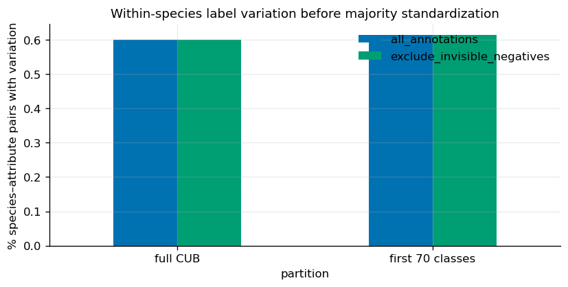
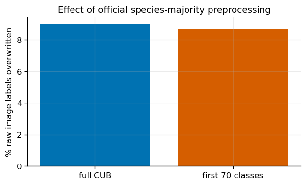
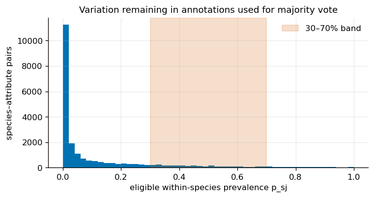

Editorial revision · 2 October 2026. Explanatory prose has been revised for a research audience. Figures and numerical output tables retain their source versions. This revision involved no model execution.


# CUB data: observational identifiability


Report provenance. Figures and numerical output tables were recovered from the named source HTML. The surrounding prose has been revised for a research audience. Artifact identifiers specify the source version and its execution status.


Contribution to the analysis: Attribute uncertainty and incomplete or coarse masks constrain the comparisons available for natural photographs. This report documents those constraints.


Source: /Users/macloaner/.codex/worktrees/notebook05-reconstruction/CBM-Concept-Backwash/curated/notebooks/04_cub_analysis.html
Source SHA256: 5e8c2ac73f158b91317da989c38d71b511bb7f078efd5274f39dc66efd159ca4


# 04 · CUB attribute preprocessing


This notebook reads raw CUB image-level attribute annotations before looking at a model.


For image `i` and attribute `j`:


- `a_ij∈{0,1}` is the raw presence annotation;


- `certainty_ij=1` means “not visible” in the official CUB convention;


- `y_i` is species.


The CBM preprocessing replaces image-level a_ij with a species-level majority value for the selected 112 attributes. We measure variation before that replacement, repeat after excluding not-visible negative annotations, and reproduce the official majority rule. This quantifies a potential discrepancy between supervision and visibility. Model responses are examined separately.


## Relation to the FunnyBird data analysis


Notebook 01 showed that FunnyBird concept targets are largely determined by species,
then asked whether image-level visibility contradicts those targets. This notebook asks
the same *data* question on CUB before any CUB model is interpreted.


| FunnyBird evidence step | Closest CUB test here | What a match would mean |
| --- | --- | --- |
| concept labels are species-associated | measure within-species CUB attribute variation | Image-level concept annotations can vary within a species |
| preprocessing hides image variation | count raw labels overwritten by species-majority targets | training supervision can erase real within-species differences |
| visibility can contradict a positive target | compare CUB70 labels with held-out part masks | the named part can be absent while the processed target remains positive |


**Pre-result prediction.** If the same supervision problem exists in CUB, raw labels
should vary within species, majority preprocessing should overwrite a nontrivial number
of image labels, and mask disagreement should remain after obvious invisible-negative
annotations are excluded.


Scope. The data analysis characterizes species–attribute associations and visibility-related label changes. Notebook 05 evaluates the corresponding trained model.


```text
11788 images · 200 species · 112 selected attributes
```


## 1 · Within-species attribute variation


For each species `s` and attribute `j`, calculate `std(a_ij | y_i=s)`. A nonzero value means raw image annotations disagree within that species.


Because some negative annotations mean “part not visible,” we report two versions:


- all raw annotations;


- only observations not marked as invisible negatives (`not(a_ij=0 and certainty_ij=1)`).


The second is a stricter test of whether disagreement remains after the clearest visibility artifact is removed.


|  | all_annotations | exclude_invisible_negatives |
| --- | --- | --- |
| partition |  |  |
| full CUB | 59.9 | 59.9 |
| first 70 classes | 61.4 | 61.3 |





## 2 · Reproduce the official species-majority standardization


For each species and attribute, the preprocessing counts positive and negative annotations, excluding negative annotations with `certainty=1` (“not visible”), then assigns the majority label to every image of that species.


Let `a^MV_sj` be that species-level majority. Count


`flip_ij = 1[a_ij != a^MV_{y_i,j}]`.


The count measures disagreement between processed targets and original image annotations. Distinguishing annotation correction from loss of valid image variation requires additional image-level review.


|  | cells | flipped | flip_rate |
| --- | --- | --- | --- |
| partition |  |  |  |
| full CUB | 1320256 | 118372 | 0.0897 |
| first 70 classes | 456512 | 39534 | 0.0866 |





## 3 · Species–attribute cells with mixed annotations


For each species and attribute, calculate prevalence among annotations eligible for the official vote:


`p_sj = mean(a_ij | y_i=s, eligible_ij)`.


Values between 0.3 and 0.7 mean neither label dominates strongly. These cases are harder to dismiss as a single annotation mistake, although viewpoint and visibility can still contribute.


```text
eligible species–attribute pairs in 30–70% band: 12.0%
```





## Summary of data findings


The raw data determine three quantities: within-species disagreement, disagreement remaining after the clearest invisible-negative cases are excluded, and the fraction of image labels overwritten by the official species-majority target.


The data findings motivate comparison of concept predictions with available part masks. Notebook 05 evaluates these observational relationships for the accepted Standard CBM; model dependence on context remains an empirical question.
