Editorial revision · 2 October 2026. Explanatory prose has been revised for a research audience. Figures and numerical output tables retain their source versions. This revision involved no model execution.


# CUB Standard CBM: observational evidence


Report provenance. Figures and numerical output tables were recovered from the named source HTML. The surrounding prose has been revised for a research audience. Artifact identifiers specify the source version and its execution status.


**Contribution to the theory:** Read coverage before label/mask conflict; then health, natural visibility and context gaps, matched recall, species residuals and spatial diagnostics. These are observational tests. This recovered HTML predates the new September 24 swap extension; no new pilot outcome is inserted here.


Source: /Users/macloaner/.codex/worktrees/notebook05-reconstruction/CBM-Concept-Backwash/curated/notebooks/05_cub_cbm.html
Source SHA256: a3bdf10964609a11fd339ed970d74b4c44c123b494560560669914239eb493a7


# 05 · CUB70: Observational analysis of concept prediction


**Main question.** On real bird photographs, does a named concept score
follow its mapped body region, or can bird identity and surrounding
context predict the answer when that region is not available?


Available comparisons. FunnyBird provides same-scene part replacements. CUB70 provides natural photographs, attribute labels, and released masks. The present analysis examines mask availability, conditional logit separation, species-matched differences, and held-out predictive associations. Each estimand is defined for this observational setting.


Model and population. The analysis uses the accepted seed-1 Standard CUB70 Koh Joint CBM with a ResNet-50 encoder. It evaluates label–mask discrepancies and model behavior to assess the rationale for a subsequent visibility-aware relabeling experiment.


Recall analysis. Matched recall quantifies species-dependent prediction performance. A separate FunnyBird calibration evaluates whether it also tracks controlled replacement outcomes.


## Research question and scope of inference


The analysis examines associations between concept logits, mapped-region visibility, and species-related variables. Natural CUB images differ in multiple visual properties, so the estimands and their interpretation are specified separately from the controlled FunnyBird replacement.


The observational analysis proceeds through the following comparisons:


- the available photograph, species, concept, and mask populations are known;


- species/concept structure makes contextual shortcuts available;


- positive labels and mapped-mask visibility sometimes disagree;


- each exact concept output is healthy enough to interpret;


- natural visibility of the mapped region changes raw concept `z`;


- positive and negative labels remain separable in `z` when the mapped region
is absent (`context_gap > 0`);


- species still organizes `z` after exact concept and mask state are held fixed;


- The measured predictors are evaluated for their held-out predictive contribution, with residual error reported at each stage.


### Calibration of recall as a proposed proxy


The old recall analysis compares the accepted CBM's own positive recall between
two species after requiring both species to contain enough positive **and**
negative images for the same exact concept. Notebook 05 now tests that idea in
two stages:


- **FunnyBird calibration in the methods appendix.** For each exact concept,
compare its ordinary-image matched recall gap with its known controlled-swap
event rate. The event rate is available only because FunnyBird can replace a
part in the same scene.


- **CUB70 application.** If the association is positive overall, positive
after subtracting each part's average, and positive in at least four of five
leave-one-part-out checks, call recall a **provisional ordinal warning
proxy**. Otherwise call it `METHOD NOT CALIBRATED AS A BACKWASH PROXY` and
retain it only as a species-dependence/model-health diagnostic.


Successful calibration would support a provisional relationship between recall differences and the controlled FunnyBird ordering. Applying that relationship to CUB would still require a transfer assumption; CUB event frequencies require a validated CUB intervention.


### Candidate contributors and their CUB measurements


- Visibility is measured using released-mask presence, area, and bilateral coverage across natural photographs.


- **label–visibility conflict** is the positive-label/mapped-mask-absent rate
for every exact concept, retaining coverage counts; and


- **exact-value difficulty** uses raw-logit health, recall, exact-value support,
number of alternatives, and species support.


Species/body context is then tested as the remaining observational organizer.
The recall analysis restores the original standard-CBM CUB question while
borrowing only the matching and bootstrap refinements from `mcbm_recallv4`;
no MCBM numerical result is imported here.


| FunnyBird scientific question | CUB operation | Figure(s) | Claim boundary |
| --- | --- | --- | --- |
| Are the data/model outputs usable? | inventory, masks, conflict, raw- z health | 1–4 | same health question |
| Is species context available? | label structure and held-out species decoding | 2, 4b | Recoverable species information |
| Do named-region pixels matter? | compare naturally visible and hidden positive-labelled photographs | 5, 7 | weaker than a same-image swap |
| Does context retain concept information? | hidden-positive minus hidden-negative raw z | 6 | Label-conditioned logit separation among mask-absent images |
| Are scores species-dependent? | matched recall/raw- z gaps and within-concept species residuals | 8, 10 | observational species association |
| What proposed contributors organize the result? | concept- and row-level held-out accounting | 9, 11 | Incremental predictive performance |
| Could masks be misleading? | rule-selected photographs with all masks | 12 | separates true occlusion from annotation limits |
| Does the pattern survive a larger species population? | deferred until the official full-CUB Koh result exists | later chapter | unavailable here |


### CUB capabilities and drawbacks used in the design


CUB provides 112 exact labelled concepts, species labels, real photographs, and
11 released anatomical masks. It permits raw-score health, natural visibility,
area, bilateral-mask, recall, species, and support analyses. Its masks are
coarser than many named attributes and can be absent even when a human can see
the region. It has no accepted clean deletion or donor swap. Consequently:


- `visibility_effect` asks whether visible positive-labelled photographs score
differently from hidden positive-labelled photographs;


- `context_gap` asks whether context distinguishes positive from negative labels
when the mapped region is absent;


- neither quantity is the FunnyBird final margin;


- photographs and mask examples must be inspected before interpreting extremes;


- Consistent CUB associations would support a context-related hypothesis subject to observational confounding. FunnyBird separately provides the controlled replacement criterion.


### Rationale for a subsequent relabeling experiment


Visibility-aware relabeling would change positive targets for examples with an absent named region. Its interpretation requires validated training-image mask coverage and identity. The present analysis uses the available masks to characterize evaluation images and establish the relevant supervision hypothesis.


### Predictions


- Healthy outputs should have nonzero raw-`z` spread, positive label separation,
and above-chance balanced accuracy/recall.


- If local visibility helps, `visibility_effect` should usually be positive and
larger visible areas should usually accompany higher `z`.


- If context predicts the concept without the mapped region, `context_gap`
should remain positive and species should explain held-out variation within
exact concept and mask state.


- Adding conflict, support, and alternative-count predictors tests whether they improve held-out prediction of the concept-level summaries. Remaining prediction error is reported explicitly.


- Mixed or negative visibility effects must be investigated as pose, mask
quality, collapse, or composition before being called evidence for backwash.


## Model architecture, training objective, and notation


- Model: Seed-1 Koh Joint CBM with a ResNet-50 encoder, trained on CUB70.


- Architecture: The image encoder produces 112 raw concept logits, which a linear layer maps to 70 species scores.


- **Training loss:** `L_task + 0.01 * L_concept`, normalized in the same Koh
Joint form used by the accepted training job.


- **Dimensions:** 70 bird species and the canonical 112 CUB concepts.


```text
image x_i
   |
   v
ResNet-50 image encoder
   |
   v
112 raw concept logits z_i
   |                    |
   |                    +--> sigmoid only for thresholded concept metrics
   |
   +--> one linear 112-to-70 species head --> species logits
```


| Symbol | Plain meaning | Used for |
| --- | --- | --- |
| c_ij | processed 0/1 label for image i , exact concept j | supervision and label matching |
| z_ij | raw score emitted for exact concept j | primary model quantity |
| p_ij=sigmoid(z_ij) | bounded concept probability | thresholded performance only |
| c_hat_ij=1[z_ij>0] | the model's yes/no concept answer | recall and balanced accuracy |
| v_ig | whether the released mask for anatomical group g is present above the declared area threshold | observational visibility |
| a_ig | released-mask area divided by image area | observational size |


The Koh concept head produces z directly, and the species head reads z. Ordinary accuracy evaluates label agreement. The subsequent mask and visibility analyses assess associations with spatial information.


```text
[MANIFEST VERIFIED] /scratch/network/cr7998/cv_emergence_project/curated_data/koh_joint_resnet_v1/cub70/standard/seed1/SUCCESS.json
```


```text
[MANIFEST VERIFIED] /scratch/network/cr7998/cv_emergence_project/curated_data/koh_joint_resnet_accelerated_converged_v1/funnybirds/standard/seed1/SUCCESS.json
[MANIFEST VERIFIED] /scratch/network/cr7998/cv_emergence_project/curated_data/swap_koh_joint_resnet_accelerated_converged_v1_seed1/SUCCESS.json
```


|  | minimum_positive_and_negative_rows_per_species | eligible_exact_concepts | eligible_species | candidate_species_pairs |
| --- | --- | --- | --- | --- |
| 0 | 1 | 0 | 0 | 0 |
| 1 | 2 | 0 | 0 | 0 |
| 2 | 3 | 0 | 0 | 0 |


```text
FunnyBird recall calibration label population: accepted Standard final-test processed labels
FunnyBird recall calibration selected rule: all-positive species matching
FunnyBird mixed species/concept label cells: 0
FunnyBird eligible calibration concepts: 26 pairs: 832 maximum species/concept prevalence: 1.0
FunnyBird recall-proxy verdict: METHOD NOT CALIBRATED AS A BACKWASH PROXY
[EXPORTED RAW-LOGIT PASS] max |prob-sigmoid(z)|=8.85e-08
framework: Koh Joint; backbone: ResNet-50; minimal_cbm: rejected
official CUB70 manifest: /scratch/network/cr7998/cv_emergence_project/curated_data/koh_joint_resnet_v1/cub70/standard/seed1/SUCCESS.json
official CUB70 evaluation: /scratch/network/cr7998/cv_emergence_project/curated_data/koh_joint_resnet_v1/cub70/standard/seed1/final_test.parquet
CUB70 rows: 221312 images: 1976 species: 70 concepts: 112
mask-matched images: 1888 fine masks: ['beak', 'body', 'head', 'left_eye', 'left_leg', 'left_wing', 'neck', 'right_eye', 'right_leg', 'right_wing', 'tail']
```


## 1 · Evaluation population and mask coverage


**Question.** What population and mask evidence are available?


**Variables and prediction.** Count prediction images, mask-matched images, species, exact concepts, 11 released masks, and eight coarse groups. Coverage losses must be explicit before any visible-versus-hidden comparison.


**Method.** Report fine-mask visibility and bilateral left/right support without inventing left/right concepts. A mask is visible when area/image area is at least 0.001; use all successfully joined photographs and print that denominator from the current official-Koh export.


**Inputs and model.** Accepted official Koh Joint ResNet-50 CUB70 Standard seed-1 final-test export, plus released CUB masks or original image-level labels when the figure names them. No diagnostic is trained and no model score is interpreted; this is an input/mask inventory.


Numerical record. The accompanying table reports the quantities summarized in the figure, including denominators and exclusions for each part and exact value.


### Figure 1 · Evaluation population and mask coverage


How to read the figure. Panel A shows, for each of the 11 released CUB masks, the fraction of all successfully joined photographs where mask area is at least 0.001 of image area, the declared visibility threshold. The current joined-image denominator is printed immediately above the plot for this report version. Panel B shows the median visible mask area divided by image area. The anatomical label leg follows the CUB mask convention. Low coverage can mean true occlusion, pose, or missing/coarse annotation, which later photographs must distinguish. Visibility 0.25 means the released mask passes the threshold in 25% of the joined photographs.


|  | population | images | species | concepts |
| --- | --- | --- | --- | --- |
| 0 | CUB70 prediction export | 1976 | 70 | 112 |
| 1 | mask-matched CUB70 | 1888 | 67 | 107 |


|  | images | visible_rate | median_area |
| --- | --- | --- | --- |
| part |  |  |  |
| head | 1888 | 0.9931 | 0.0141 |
| right_eye | 1888 | 0.2251 | 0.0000 |
| left_eye | 1888 | 0.2346 | 0.0001 |
| beak | 1888 | 0.9296 | 0.0031 |
| neck | 1888 | 0.2230 | 0.0000 |
| body | 1888 | 0.9783 | 0.0351 |
| right_wing | 1888 | 0.5975 | 0.0090 |
| left_wing | 1888 | 0.5980 | 0.0093 |
| right_leg | 1888 | 0.6478 | 0.0024 |
| left_leg | 1888 | 0.6462 | 0.0024 |
| tail | 1888 | 0.8114 | 0.0099 |


|  | analysis_group | released_mask_sources | mapped_attribute_families |
| --- | --- | --- | --- |
| 0 | head | head | has_crown_color, has_forehead_color, has_head_... |
| 1 | eye | right_eye, left_eye | has_eye_color |
| 2 | beak | beak | has_bill_color, has_bill_length, has_bill_shape |
| 3 | neck | neck | has_throat_color |
| 4 | body | body | has_back_color, has_back_pattern, has_belly_co... |
| 5 | wing | right_wing, left_wing | has_primary_color, has_wing_color, has_wing_pa... |
| 6 | leg | right_leg, left_leg | has_leg_color |
| 7 | tail | tail | has_tail_pattern, has_tail_shape, has_under_ta... |


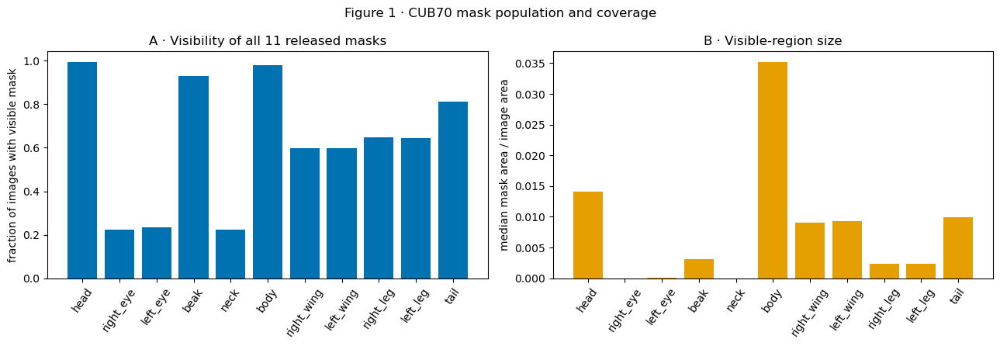


### Interpretation of Figure 1


- Observation: The export contains 1,976 images, 70 species, and 112 concepts; the mask join retains 1,888 images, 67 species, and 107 concepts. Head/body/beak masks are present in over 92% of joined images, tail in 81%, bilateral wing/leg masks in about 60-65%, and eye/neck masks in only about 22-23%.


- Alternative explanation: An unavailable or coarse released annotation can produce apparent mask absence even when the anatomical region is visible.


- Proposed follow-up: Inspect bilateral counts, areas, and real images with all masks overlaid.


- **Verdict:** **KEEP**.


- **Limited conclusion:** `ACCEPTED FOR the stated CUB70 mask-analysis population and coverage limits; 88 images, three species, and five concepts are outside the mask-matched population.`


- Subsequent analysis: Is a species/concept shortcut available before looking at model behavior?


## 2 · Species–concept label structure


**Question.** Is species–concept structure available before model behavior?


Variables and prediction. For each exact selected concept, count supporting species, positive images, and the number of alternatives in its attribute type. Uneven support and species association define candidate associations for subsequent model testing.


Method. Summarize the processed concept labels by species, positive-image count, and attribute family.


Inputs. Processed labels from the accepted CUB70 Standard seed-1 evaluation export. Released masks and original image-level annotations are included where specified. This figure summarizes the label population.


Numerical record. The accompanying table reports the quantities summarized in the figure, including denominators and exclusions for each part and exact value.


### Figure 2 · Species–concept label structure


How to read the figure. Each horizontal row is one exact concept. The x-axis is the number of the 70 species carrying that exact value. Dot color is the number of positive photographs (yellow means more; purple means fewer), and dot area is the number of alternative values in the same attribute type (larger means more alternatives). A gray outline means no released-mask mapping. Example: x=20 means 20 species carry that value. This figure describes the label population.


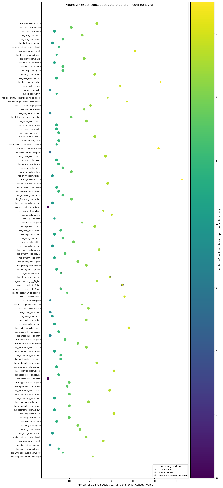


|  | attribute_type | concept_name | species_support | species_total | positive_images | total_images | alternatives_in_type | mask_group |
| --- | --- | --- | --- | --- | --- | --- | --- | --- |
| 0 | has_back_color | has_back_color::black | 23 | 70 | 620 | 1976 | 6 | body |
| 1 | has_back_color | has_back_color::brown | 11 | 70 | 323 | 1976 | 6 | body |
| 2 | has_back_color | has_back_color::buff | 3 | 70 | 90 | 1976 | 6 | body |
| 3 | has_back_color | has_back_color::grey | 16 | 70 | 458 | 1976 | 6 | body |
| 4 | has_back_color | has_back_color::white | 7 | 70 | 210 | 1976 | 6 | body |
| 5 | has_back_color | has_back_color::yellow | 2 | 70 | 60 | 1976 | 6 | body |
| 6 | has_back_pattern | has_back_pattern::multi-colored | 5 | 70 | 148 | 1976 | 3 | body |
| 7 | has_back_pattern | has_back_pattern::solid | 41 | 70 | 1164 | 1976 | 3 | body |
| 8 | has_back_pattern | has_back_pattern::striped | 4 | 70 | 119 | 1976 | 3 | body |
| 9 | has_belly_color | has_belly_color::black | 17 | 70 | 459 | 1976 | 6 | body |
| 10 | has_belly_color | has_belly_color::brown | 3 | 70 | 85 | 1976 | 6 | body |
| 11 | has_belly_color | has_belly_color::buff | 7 | 70 | 202 | 1976 | 6 | body |
| 12 | has_belly_color | has_belly_color::grey | 7 | 70 | 209 | 1976 | 6 | body |
| 13 | has_belly_color | has_belly_color::white | 22 | 70 | 617 | 1976 | 6 | body |
| 14 | has_belly_color | has_belly_color::yellow | 4 | 70 | 119 | 1976 | 6 | body |
| 15 | has_belly_pattern | has_belly_pattern::solid | 53 | 70 | 1515 | 1976 | 1 | body |
| 16 | has_bill_color | has_bill_color::black | 34 | 70 | 982 | 1976 | 3 | beak |
| 17 | has_bill_color | has_bill_color::buff | 1 | 70 | 30 | 1976 | 3 | beak |
| 18 | has_bill_color | has_bill_color::grey | 4 | 70 | 116 | 1976 | 3 | beak |
| 19 | has_bill_length | has_bill_length::about_the_same_as_head | 28 | 70 | 814 | 1976 | 2 | beak |
| 20 | has_bill_length | has_bill_length::shorter_than_head | 37 | 70 | 1012 | 1976 | 2 | beak |
| 21 | has_bill_shape | has_bill_shape::all-purpose | 20 | 70 | 586 | 1976 | 4 | beak |
| 22 | has_bill_shape | has_bill_shape::cone | 17 | 70 | 461 | 1976 | 4 | beak |
| 23 | has_bill_shape | has_bill_shape::dagger | 1 | 70 | 30 | 1976 | 4 | beak |
| 24 | has_bill_shape | has_bill_shape::hooked_seabird | 11 | 70 | 308 | 1976 | 4 | beak |
| 25 | has_breast_color | has_breast_color::black | 18 | 70 | 497 | 1976 | 6 | body |
| 26 | has_breast_color | has_breast_color::brown | 4 | 70 | 115 | 1976 | 6 | body |
| 27 | has_breast_color | has_breast_color::buff | 4 | 70 | 111 | 1976 | 6 | body |
| 28 | has_breast_color | has_breast_color::grey | 5 | 70 | 149 | 1976 | 6 | body |
| 29 | has_breast_color | has_breast_color::white | 22 | 70 | 619 | 1976 | 6 | body |
| 30 | has_breast_color | has_breast_color::yellow | 5 | 70 | 145 | 1976 | 6 | body |
| 31 | has_breast_pattern | has_breast_pattern::multi-colored | 4 | 70 | 120 | 1976 | 3 | body |
| 32 | has_breast_pattern | has_breast_pattern::solid | 52 | 70 | 1482 | 1976 | 3 | body |
| 33 | has_breast_pattern | has_breast_pattern::striped | 1 | 70 | 11 | 1976 | 3 | body |
| 34 | has_crown_color | has_crown_color::black | 27 | 70 | 741 | 1976 | 6 | head |
| 35 | has_crown_color | has_crown_color::blue | 4 | 70 | 116 | 1976 | 6 | head |
| 36 | has_crown_color | has_crown_color::brown | 5 | 70 | 145 | 1976 | 6 | head |
| 37 | has_crown_color | has_crown_color::grey | 7 | 70 | 200 | 1976 | 6 | head |
| 38 | has_crown_color | has_crown_color::white | 11 | 70 | 319 | 1976 | 6 | head |
| 39 | has_crown_color | has_crown_color::yellow | 2 | 70 | 56 | 1976 | 6 | head |
| 40 | has_eye_color | has_eye_color::black | 63 | 70 | 1808 | 1976 | 1 | eye |
| 41 | has_forehead_color | has_forehead_color::black | 28 | 70 | 767 | 1976 | 6 | head |
| 42 | has_forehead_color | has_forehead_color::blue | 4 | 70 | 116 | 1976 | 6 | head |
| 43 | has_forehead_color | has_forehead_color::brown | 5 | 70 | 145 | 1976 | 6 | head |
| 44 | has_forehead_color | has_forehead_color::grey | 7 | 70 | 181 | 1976 | 6 | head |
| 45 | has_forehead_color | has_forehead_color::white | 11 | 70 | 319 | 1976 | 6 | head |
| 46 | has_forehead_color | has_forehead_color::yellow | 2 | 70 | 56 | 1976 | 6 | head |
| 47 | has_head_pattern | has_head_pattern::eyebrow | 0 | 70 | 0 | 1976 | 2 | head |
| 48 | has_head_pattern | has_head_pattern::plain | 26 | 70 | 765 | 1976 | 2 | head |
| 49 | has_leg_color | has_leg_color::black | 30 | 70 | 878 | 1976 | 3 | leg |
| 50 | has_leg_color | has_leg_color::buff | 3 | 70 | 78 | 1976 | 3 | leg |
| 51 | has_leg_color | has_leg_color::grey | 16 | 70 | 417 | 1976 | 3 | leg |
| 52 | has_nape_color | has_nape_color::black | 22 | 70 | 594 | 1976 | 6 | head |
| 53 | has_nape_color | has_nape_color::brown | 6 | 70 | 174 | 1976 | 6 | head |
| 54 | has_nape_color | has_nape_color::buff | 3 | 70 | 90 | 1976 | 6 | head |
| 55 | has_nape_color | has_nape_color::grey | 7 | 70 | 201 | 1976 | 6 | head |
| 56 | has_nape_color | has_nape_color::white | 12 | 70 | 349 | 1976 | 6 | head |
| 57 | has_nape_color | has_nape_color::yellow | 2 | 70 | 56 | 1976 | 6 | head |
| 58 | has_primary_color | has_primary_color::black | 24 | 70 | 650 | 1976 | 6 | wing |
| 59 | has_primary_color | has_primary_color::brown | 8 | 70 | 234 | 1976 | 6 | wing |
| 60 | has_primary_color | has_primary_color::buff | 3 | 70 | 90 | 1976 | 6 | wing |
| 61 | has_primary_color | has_primary_color::grey | 14 | 70 | 400 | 1976 | 6 | wing |
| 62 | has_primary_color | has_primary_color::white | 18 | 70 | 501 | 1976 | 6 | wing |
| 63 | has_primary_color | has_primary_color::yellow | 4 | 70 | 119 | 1976 | 6 | wing |
| 64 | has_shape | has_shape::duck-like | 6 | 70 | 178 | 1976 | 2 | None |
| 65 | has_shape | has_shape::perching-like | 29 | 70 | 841 | 1976 | 2 | None |
| 66 | has_size | has_size::medium_(9_-_16_in) | 23 | 70 | 639 | 1976 | 3 | None |
| 67 | has_size | has_size::small_(5_-_9_in) | 35 | 70 | 1008 | 1976 | 3 | None |
| 68 | has_size | has_size::very_small_(3_-_5_in) | 6 | 70 | 178 | 1976 | 3 | None |
| 69 | has_tail_pattern | has_tail_pattern::multi-colored | 9 | 70 | 255 | 1976 | 3 | tail |
| 70 | has_tail_pattern | has_tail_pattern::solid | 36 | 70 | 1023 | 1976 | 3 | tail |
| 71 | has_tail_pattern | has_tail_pattern::striped | 1 | 70 | 30 | 1976 | 3 | tail |
| 72 | has_tail_shape | has_tail_shape::notched_tail | 16 | 70 | 457 | 1976 | 1 | tail |
| 73 | has_throat_color | has_throat_color::black | 19 | 70 | 518 | 1976 | 5 | neck |
| 74 | has_throat_color | has_throat_color::buff | 1 | 70 | 30 | 1976 | 5 | neck |
| 75 | has_throat_color | has_throat_color::grey | 2 | 70 | 59 | 1976 | 5 | neck |
| 76 | has_throat_color | has_throat_color::white | 18 | 70 | 506 | 1976 | 5 | neck |
| 77 | has_throat_color | has_throat_color::yellow | 3 | 70 | 85 | 1976 | 5 | neck |
| 78 | has_under_tail_color | has_under_tail_color::black | 38 | 70 | 1069 | 1976 | 5 | tail |
| 79 | has_under_tail_color | has_under_tail_color::brown | 5 | 70 | 145 | 1976 | 5 | tail |
| 80 | has_under_tail_color | has_under_tail_color::buff | 1 | 70 | 30 | 1976 | 5 | tail |
| 81 | has_under_tail_color | has_under_tail_color::grey | 8 | 70 | 234 | 1976 | 5 | tail |
| 82 | has_under_tail_color | has_under_tail_color::white | 14 | 70 | 389 | 1976 | 5 | tail |
| 83 | has_underparts_color | has_underparts_color::black | 18 | 70 | 489 | 1976 | 6 | body |
| 84 | has_underparts_color | has_underparts_color::brown | 3 | 70 | 85 | 1976 | 6 | body |
| 85 | has_underparts_color | has_underparts_color::buff | 6 | 70 | 170 | 1976 | 6 | body |
| 86 | has_underparts_color | has_underparts_color::grey | 6 | 70 | 160 | 1976 | 6 | body |
| 87 | has_underparts_color | has_underparts_color::white | 23 | 70 | 649 | 1976 | 6 | body |
| 88 | has_underparts_color | has_underparts_color::yellow | 4 | 70 | 119 | 1976 | 6 | body |
| 89 | has_upper_tail_color | has_upper_tail_color::black | 31 | 70 | 850 | 1976 | 5 | tail |
| 90 | has_upper_tail_color | has_upper_tail_color::brown | 5 | 70 | 145 | 1976 | 5 | tail |
| 91 | has_upper_tail_color | has_upper_tail_color::buff | 0 | 70 | 0 | 1976 | 5 | tail |
| 92 | has_upper_tail_color | has_upper_tail_color::grey | 10 | 70 | 287 | 1976 | 5 | tail |
| 93 | has_upper_tail_color | has_upper_tail_color::white | 9 | 70 | 260 | 1976 | 5 | tail |
| 94 | has_upperparts_color | has_upperparts_color::black | 29 | 70 | 790 | 1976 | 6 | body |
| 95 | has_upperparts_color | has_upperparts_color::brown | 10 | 70 | 291 | 1976 | 6 | body |
| 96 | has_upperparts_color | has_upperparts_color::buff | 3 | 70 | 89 | 1976 | 6 | body |
| 97 | has_upperparts_color | has_upperparts_color::grey | 19 | 70 | 546 | 1976 | 6 | body |
| 98 | has_upperparts_color | has_upperparts_color::white | 10 | 70 | 297 | 1976 | 6 | body |
| 99 | has_upperparts_color | has_upperparts_color::yellow | 3 | 70 | 90 | 1976 | 6 | body |
| 100 | has_wing_color | has_wing_color::black | 31 | 70 | 859 | 1976 | 6 | wing |
| 101 | has_wing_color | has_wing_color::brown | 10 | 70 | 293 | 1976 | 6 | wing |
| 102 | has_wing_color | has_wing_color::buff | 4 | 70 | 119 | 1976 | 6 | wing |
| 103 | has_wing_color | has_wing_color::grey | 14 | 70 | 400 | 1976 | 6 | wing |
| 104 | has_wing_color | has_wing_color::white | 15 | 70 | 417 | 1976 | 6 | wing |
| 105 | has_wing_color | has_wing_color::yellow | 2 | 70 | 60 | 1976 | 6 | wing |
| 106 | has_wing_pattern | has_wing_pattern::multi-colored | 18 | 70 | 521 | 1976 | 4 | wing |
| 107 | has_wing_pattern | has_wing_pattern::solid | 26 | 70 | 720 | 1976 | 4 | wing |
| 108 | has_wing_pattern | has_wing_pattern::spotted | 1 | 70 | 26 | 1976 | 4 | wing |
| 109 | has_wing_pattern | has_wing_pattern::striped | 5 | 70 | 130 | 1976 | 4 | wing |
| 110 | has_wing_shape | has_wing_shape::pointed-wings | 7 | 70 | 193 | 1976 | 2 | wing |
| 111 | has_wing_shape | has_wing_shape::rounded-wings | 21 | 70 | 610 | 1976 | 2 | wing |


### Interpretation of Figure 2


- Observation: Exact values vary widely in supporting species and positive images, and attribute types contain one to six selected alternatives. Several size/shape concepts have no released-mask mapping.


- Scope. Label structure characterizes available predictive associations. The model’s use of those associations requires a separate response analysis.


- Proposed follow-up: Decode held-out species from the raw concept vector and individual part blocks.


- **Verdict:** **KEEP**.


- **Limited conclusion:** `ACCEPTED FOR uneven species/concept structure and an available contextual shortcut.`


- Subsequent analysis: Does the learned representation actually store species information?


## 3 · Positive labels with unavailable mapped-region evidence


**Question.** How often is a positive label paired with no visible mapped region?


Variables and prediction. For concept j , conflict is P(v_ig=0 | c_ij=1) . High values indicate frequent positive labels in the released-mask-absent population, subject to mask quality and coverage.


**Method.** Plot every exact mask-testable concept at a named y-position with its denominator.


**Inputs and model.** Accepted official Koh Joint ResNet-50 CUB70 Standard seed-1 final-test export, plus released CUB masks or original image-level labels when the figure names them. No diagnostic is trained and no model score is used; this is a label/released-mask data audit.


Numerical record. The accompanying table reports the quantities summarized in the figure, including denominators and exclusions for each part and exact value.


### Figure 3 · Positive labels with unavailable mapped-region evidence


How to read the figure. Each named row is one exact concept. The x-value is a data fraction: among images labelled positive for that concept, what fraction has no visible mapped mask? Its denominator is the positive-labelled population. A value of 0.8 means 80 of every 100 positive-labelled examples lack a visible released mask.


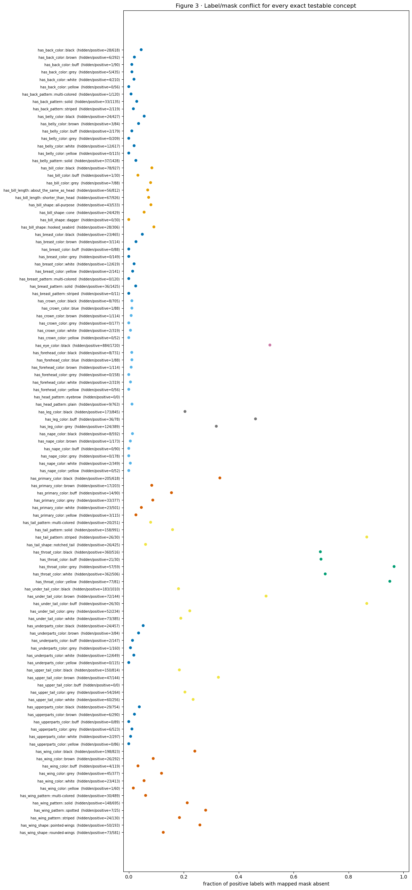


|  | concept_name | mask_group | n_positive | n_hidden | label_mask_conflict |
| --- | --- | --- | --- | --- | --- |
| 0 | has_back_color::black | body | 618 | 28 | 0.045 |
| 1 | has_back_color::brown | body | 292 | 6 | 0.021 |
| 2 | has_back_color::buff | body | 90 | 1 | 0.011 |
| 3 | has_back_color::grey | body | 435 | 5 | 0.011 |
| 4 | has_back_color::white | body | 210 | 4 | 0.019 |
| 5 | has_back_color::yellow | body | 56 | 0 | 0.000 |
| 6 | has_back_pattern::multi-colored | body | 120 | 1 | 0.008 |
| 7 | has_back_pattern::solid | body | 1135 | 33 | 0.029 |
| 8 | has_back_pattern::striped | body | 119 | 2 | 0.017 |
| 9 | has_belly_color::black | body | 427 | 24 | 0.056 |
| 10 | has_belly_color::brown | body | 84 | 3 | 0.036 |
| 11 | has_belly_color::buff | body | 179 | 2 | 0.011 |
| 12 | has_belly_color::grey | body | 209 | 0 | 0.000 |
| 13 | has_belly_color::white | body | 617 | 12 | 0.019 |
| 14 | has_belly_color::yellow | body | 115 | 0 | 0.000 |
| 15 | has_belly_pattern::solid | body | 1428 | 37 | 0.026 |
| 16 | has_bill_color::black | beak | 927 | 78 | 0.084 |
| 17 | has_bill_color::buff | beak | 30 | 1 | 0.033 |
| 18 | has_bill_color::grey | beak | 88 | 7 | 0.080 |
| 19 | has_bill_length::about_the_same_as_head | beak | 812 | 56 | 0.069 |
| 20 | has_bill_length::shorter_than_head | beak | 926 | 67 | 0.072 |
| 21 | has_bill_shape::all-purpose | beak | 533 | 43 | 0.081 |
| 22 | has_bill_shape::cone | beak | 429 | 24 | 0.056 |
| 23 | has_bill_shape::dagger | beak | 30 | 0 | 0.000 |
| 24 | has_bill_shape::hooked_seabird | beak | 306 | 28 | 0.092 |
| 25 | has_breast_color::black | body | 465 | 23 | 0.049 |
| 26 | has_breast_color::brown | body | 114 | 3 | 0.026 |
| 27 | has_breast_color::buff | body | 88 | 0 | 0.000 |
| 28 | has_breast_color::grey | body | 149 | 0 | 0.000 |
| 29 | has_breast_color::white | body | 619 | 12 | 0.019 |
| 30 | has_breast_color::yellow | body | 141 | 2 | 0.014 |
| 31 | has_breast_pattern::multi-colored | body | 120 | 0 | 0.000 |
| 32 | has_breast_pattern::solid | body | 1425 | 36 | 0.025 |
| 33 | has_breast_pattern::striped | body | 11 | 0 | 0.000 |
| 34 | has_crown_color::black | head | 705 | 8 | 0.011 |
| 35 | has_crown_color::blue | head | 88 | 1 | 0.011 |
| 36 | has_crown_color::brown | head | 114 | 1 | 0.009 |
| 37 | has_crown_color::grey | head | 177 | 0 | 0.000 |
| 38 | has_crown_color::white | head | 319 | 2 | 0.006 |
| 39 | has_crown_color::yellow | head | 52 | 0 | 0.000 |
| 40 | has_eye_color::black | eye | 1720 | 884 | 0.514 |
| 41 | has_forehead_color::black | head | 731 | 8 | 0.011 |
| 42 | has_forehead_color::blue | head | 88 | 1 | 0.011 |
| 43 | has_forehead_color::brown | head | 114 | 1 | 0.009 |
| 44 | has_forehead_color::grey | head | 158 | 0 | 0.000 |
| 45 | has_forehead_color::white | head | 319 | 2 | 0.006 |
| 46 | has_forehead_color::yellow | head | 56 | 0 | 0.000 |
| 47 | has_head_pattern::eyebrow | head | 0 | 0 | NaN |
| 48 | has_head_pattern::plain | head | 763 | 9 | 0.012 |
| 49 | has_leg_color::black | leg | 845 | 173 | 0.205 |
| 50 | has_leg_color::buff | leg | 78 | 36 | 0.462 |
| 51 | has_leg_color::grey | leg | 389 | 124 | 0.319 |
| 52 | has_nape_color::black | head | 592 | 8 | 0.014 |
| 53 | has_nape_color::brown | head | 173 | 1 | 0.006 |
| 54 | has_nape_color::buff | head | 90 | 0 | 0.000 |
| 55 | has_nape_color::grey | head | 178 | 0 | 0.000 |
| 56 | has_nape_color::white | head | 349 | 2 | 0.006 |
| 57 | has_nape_color::yellow | head | 52 | 0 | 0.000 |
| 58 | has_primary_color::black | wing | 618 | 205 | 0.332 |
| 59 | has_primary_color::brown | wing | 203 | 17 | 0.084 |
| 60 | has_primary_color::buff | wing | 90 | 14 | 0.156 |
| 61 | has_primary_color::grey | wing | 377 | 33 | 0.088 |
| 62 | has_primary_color::white | wing | 501 | 23 | 0.046 |
| 63 | has_primary_color::yellow | wing | 115 | 3 | 0.026 |
| 64 | has_tail_pattern::multi-colored | tail | 251 | 20 | 0.080 |
| 65 | has_tail_pattern::solid | tail | 991 | 158 | 0.159 |
| 66 | has_tail_pattern::striped | tail | 30 | 26 | 0.867 |
| 67 | has_tail_shape::notched_tail | tail | 425 | 26 | 0.061 |
| 68 | has_throat_color::black | neck | 516 | 360 | 0.698 |
| 69 | has_throat_color::buff | neck | 30 | 21 | 0.700 |
| 70 | has_throat_color::grey | neck | 59 | 57 | 0.966 |
| 71 | has_throat_color::white | neck | 506 | 362 | 0.715 |
| 72 | has_throat_color::yellow | neck | 81 | 77 | 0.951 |
| 73 | has_under_tail_color::black | tail | 1010 | 183 | 0.181 |
| 74 | has_under_tail_color::brown | tail | 144 | 72 | 0.500 |
| 75 | has_under_tail_color::buff | tail | 30 | 26 | 0.867 |
| 76 | has_under_tail_color::grey | tail | 234 | 52 | 0.222 |
| 77 | has_under_tail_color::white | tail | 385 | 73 | 0.190 |
| 78 | has_underparts_color::black | body | 457 | 24 | 0.053 |
| 79 | has_underparts_color::brown | body | 84 | 3 | 0.036 |
| 80 | has_underparts_color::buff | body | 147 | 2 | 0.014 |
| 81 | has_underparts_color::grey | body | 160 | 1 | 0.006 |
| 82 | has_underparts_color::white | body | 649 | 12 | 0.018 |
| 83 | has_underparts_color::yellow | body | 115 | 0 | 0.000 |
| 84 | has_upper_tail_color::black | tail | 814 | 150 | 0.184 |
| 85 | has_upper_tail_color::brown | tail | 144 | 47 | 0.326 |
| 86 | has_upper_tail_color::buff | tail | 0 | 0 | NaN |
| 87 | has_upper_tail_color::grey | tail | 264 | 54 | 0.205 |
| 88 | has_upper_tail_color::white | tail | 256 | 60 | 0.234 |
| 89 | has_upperparts_color::black | body | 754 | 29 | 0.038 |
| 90 | has_upperparts_color::brown | body | 290 | 6 | 0.021 |
| 91 | has_upperparts_color::buff | body | 89 | 0 | 0.000 |
| 92 | has_upperparts_color::grey | body | 523 | 6 | 0.011 |
| 93 | has_upperparts_color::white | body | 297 | 2 | 0.007 |
| 94 | has_upperparts_color::yellow | body | 86 | 0 | 0.000 |
| 95 | has_wing_color::black | wing | 823 | 198 | 0.241 |
| 96 | has_wing_color::brown | wing | 292 | 26 | 0.089 |
| 97 | has_wing_color::buff | wing | 119 | 4 | 0.034 |
| 98 | has_wing_color::grey | wing | 377 | 45 | 0.119 |
| 99 | has_wing_color::white | wing | 413 | 23 | 0.056 |
| 100 | has_wing_color::yellow | wing | 60 | 1 | 0.017 |
| 101 | has_wing_pattern::multi-colored | wing | 489 | 30 | 0.061 |
| 102 | has_wing_pattern::solid | wing | 695 | 148 | 0.213 |
| 103 | has_wing_pattern::spotted | wing | 25 | 7 | 0.280 |
| 104 | has_wing_pattern::striped | wing | 130 | 24 | 0.185 |
| 105 | has_wing_shape::pointed-wings | wing | 193 | 50 | 0.259 |
| 106 | has_wing_shape::rounded-wings | wing | 581 | 73 | 0.126 |


### Interpretation of Figure 3


- Observation: The positive-label/mask-absence fraction ranges from near zero to above 0.9. Body concepts are usually low, wing concepts are commonly about 0.13-0.28, and several throat/tail concepts are much higher.


- Alternative explanation: Figure 12 shows that mask absence sometimes occurs even when the anatomical region is visibly present, especially for neck and beak mappings.


- Follow-up assessment: Inspect photographs alongside the released masks to distinguish annotation absence, small-region coverage, and plausible physical occlusion.


- **Verdict:** **KEEP**.


- Scope: ACCEPTED FOR quantifying positive-label/released-mask discrepancies. Physical occlusion requires additional image-level assessment.


- Subsequent analysis: Are the learned raw concept outputs healthy enough to interpret?


## 4 · Exact-concept prediction performance and output variation


**Question.** Did the standard CUB70 CBM produce usable exact-concept outputs?


Variables and prediction. For every concept, compute raw-score spread, label separation, balanced accuracy, and positive recall. Exact collapse means Q95(z)-Q05(z) <= 1e-8 ; the criterion is evaluated on raw logits.


**Method.** Evaluate all 112 outputs and mark mask-testable concepts separately.


**Inputs and model.** Accepted official Koh Joint ResNet-50 CUB70 Standard seed-1 final-test export, plus released CUB masks or original image-level labels when the figure names them. No new diagnostic is trained. The accepted CBM's raw z and its own z>0 concept decision are reused.


Numerical record. The accompanying table reports the quantities summarized in the figure, including denominators and exclusions for each part and exact value.


### Figure 4 · Exact-concept prediction performance and output variation


**How to read the figure.** Each row is one of 112 exact concepts and the four aligned panels have the
same definitions as FunnyBird Figure 1: `spread=Q95(z)-Q05(z)`; `label separation=median(z|c=1)-median(z|c=0)`; balanced accuracy averages positive
and negative recall; positive recall is `P(z>0|c=1)`. Zero spread within
`1e-8` is the declared collapse rule. Moving right is healthier for the last
three panels; spread only asks whether the output varies at all. For example,
label separation +2 means the positive-label median is two logit units above
the negative-label median.


|  | images | species | task_accuracy | concept_accuracy |
| --- | --- | --- | --- | --- |
| 0 | 1976 | 70 | 0.7723 | 0.9695 |


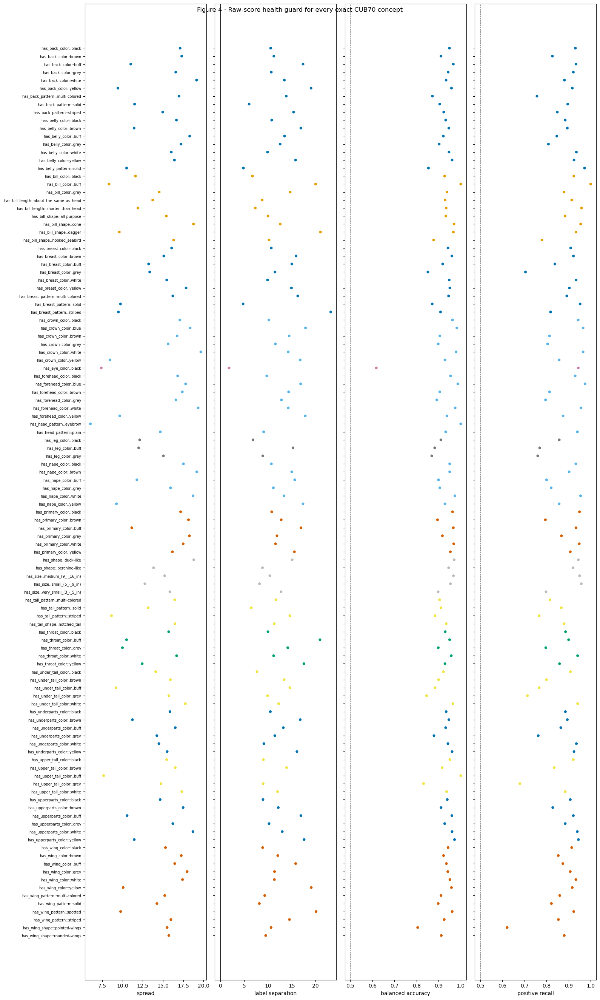


|  | attribute_type | concept_name | mask_group | spread | collapsed | label_separation | balanced_accuracy | positive_recall | n_positive | n_negative |
| --- | --- | --- | --- | --- | --- | --- | --- | --- | --- | --- |


```text
exact collapsed slots: 0 tolerance: 1e-08
```


### Interpretation of Figure 4


- Observation: Task accuracy is 0.7723 and mean concept accuracy is 0.9695. All 112 raw outputs vary: zero meet the exact-collapse rule Q95(z)-Q05(z) <= 1e-8. has_head_pattern::eyebrow and has_upper_tail_color::buff have zero positive examples in this split, and their raw outputs retain measurable variation.


- Alternative explanation: Annotation noise and differences in training support can affect concept performance. Spatial dependence requires additional analysis.


- Eligibility rule: Concepts with zero positive examples are excluded from positive-recall and positive-conditioned summaries. Their raw-logit variation is reported separately.


- **Verdict:** **KEEP**.


- **Limited conclusion:** `ACCEPTED FOR numerically varying raw outputs; ordinary health is uneven and zero-positive exact concepts remain explicit support limitations.`


- Subsequent analysis: How much species identity is recoverable from the learned concept vector?


## 4b · Species decoding from CUB70 concept labels and logits


**Question.** How much species identity is recoverable from the learned CUB70 concept vector?


Variables and prediction. On the same held-out split, decode species from each raw-logit block and from the corresponding processed 0/1 label block; also show the saved CBM's own task accuracy. A bar height is the fraction of held-out photographs whose species a separate diagnostic classifier guesses correctly. This measures species information recoverable by the separately fitted diagnostic.


**Method.** Build one image-by-concept matrix and use a fixed stratified 70/30 split.


**Inputs and model.** Accepted official Koh Joint ResNet-50 CUB70 Standard seed-1 final-test export, plus released CUB masks or original image-level labels when the figure names them. Two new multinomial logistic-regression diagnostics are fitted after training: one receives known binary labels and one receives frozen raw z. The saved CBM species head is shown only as a separate reference line.


Numerical record. The accompanying table reports the quantities summarized in the figure, including denominators and exclusions for each part and exact value.


### Figure 4b · Species decoding from CUB70 concept labels and logits


How to read the figure. The y-axis is held-out species accuracy. Paired bars use learned raw logits versus processed 0/1 concept labels on the same train/test split. The dashed line is 1/70 blind chance; the dotted line is the saved CUB70 CBM's own task accuracy. Unlike FunnyBird, the empirical label-based control is required because CUB region blocks contain multiple simultaneous attribute types and labels vary within species. The label-only probe is therefore the valid structural control. Higher raw-z accuracy indicates additional species information recoverable by this diagnostic.


### Inputs and controls for the species-decoding analysis


Each photograph has 112 processed binary labels `c`. A small portion of one
row might read `black bill=1`, `grey bill=0`, `striped tail=1`. This complete
row is the photograph's **attribute pattern**: its collection of known yes/no
concept answers after preprocessing.


We train two separate diagnostic classifiers after the CBM is finished:


- **grey bar:** the classifier receives known 0/1 labels `c`;


- **colored bar:** the classifier receives learned raw scores `z`;


- **bar height:** the fraction of held-out photographs whose species it guesses.


Interpretation of the label control. A full-label diagnostic accuracy of 1.0 means that the fitted diagnostic correctly classified every held-out example from the 112 processed labels. The dotted reference line separately reports the saved CBM’s task accuracy.


Species decodability quantifies information recoverable from the supplied representation. Its spatial origin and contribution to the saved classifier are evaluated through separate tests.


Interpretation. The FunnyBird wing result demonstrates that high species decodability can coexist with a strong part-replacement response. The CUB decoding comparison therefore motivates further investigation of spatial dependence.


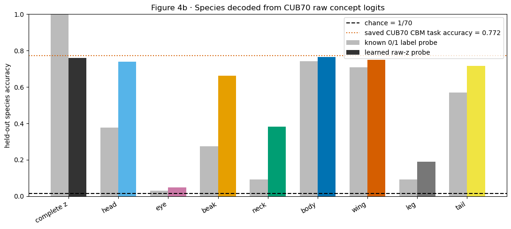


|  | block | raw_z_accuracy | processed_label_accuracy | dimensions |
| --- | --- | --- | --- | --- |
| 0 | complete z | 0.761 | 1.000 | 112 |
| 1 | head | 0.739 | 0.378 | 20 |
| 2 | eye | 0.047 | 0.030 | 1 |
| 3 | beak | 0.661 | 0.273 | 9 |
| 4 | neck | 0.383 | 0.091 | 5 |
| 5 | body | 0.766 | 0.742 | 37 |
| 6 | wing | 0.750 | 0.708 | 18 |
| 7 | leg | 0.191 | 0.091 | 3 |
| 8 | tail | 0.715 | 0.570 | 14 |


### Interpretation of Figure 4b


- Observation: The complete 112-value raw-z vector decodes species at 0.761 accuracy versus 1.000 from the known binary labels. Within groups, raw z exceeds labels most for beak (0.661 versus 0.273), head (0.739 versus 0.378), and neck (0.383 versus 0.091). Wing is nearly unchanged (0.750 versus 0.708), while eye is weak in both representations (0.047 versus 0.030).


- Scope. Diagnostic accuracy quantifies recoverable species information. Dependence on named-region pixels remains unresolved by this test.


- Proposed follow-up: Compare this availability diagnostic with visibility_effect, context_gap, and the held-out row-level species contribution; CUB has no controlled grounding outcome.


- **Verdict:** **KEEP**.


- Scope: ACCEPTED FOR paired comparison of species decodability from labels and raw logits.


- Subsequent analysis: Does the unchanged saved species head actually use these within-label magnitudes?


## 4c · Sensitivity of the CUB70 species head to within-label magnitudes


Question. How sensitive is the saved species classifier to within-label variation in each concept block? Figure 4b measures recoverable information; the present intervention evaluates the fitted classifier on modified input vectors.


**Prediction.** If the saved head relies on image-specific head-score
magnitudes, replacing those magnitudes while keeping every 0/1 concept
answer fixed should move its 70-species probabilities. If it mostly
ignores them, the movement should be small even though Figure 4b's new
diagnostic classifier can decode species from them.


**Exact intervention.** In each training fold, calculate two ordinary
reference values for every concept `j`:


`mu_j0 = mean training-fold z_j among images with label c_j=0`, and


`mu_j1 = mean training-fold z_j among images with label c_j=1`.


On a held-out image, replace only the tested block by


`z_tilde_j = mu_j,c_j`.


For illustration, a positive-labelled coordinate with z=8 may be replaced by its label-conditioned mean of 5. The selected block is replaced while other coordinates are retained. The resulting 112-dimensional vector is passed through the frozen head Wz+b. In general, replacing a coordinate by a label-conditioned mean can change its thresholded sign; the conditioning label remains fixed while the thresholded model prediction may change.


**What is measured.** For each held-out image, let `p` and `p_tilde` be
the 70 saved-head probabilities before and after replacement. Probability
mass moved is


`D_i = 0.5 * sum over 70 species of |p_ik-p_tilde_ik|`.


Example: [0.70,0.20,0.10] becoming [0.65,0.25,0.10] gives D_i=0.05 , or 5%. We report its mean, the fraction of winning-species predictions that change, and held-out species accuracy before/after. Larger movement means greater use of that block's magnitudes by this frozen head. Its interpretation concerns dependence of the frozen species head on the selected concept block.


Comparison of estimands. The diagnostic accuracy difference and the saved-head probability redistribution are reported side by side in their respective units. The ratio to replacement of all 112 coordinates is a descriptive reference. Individual block responses can interact through the class logits and softmax transformation.


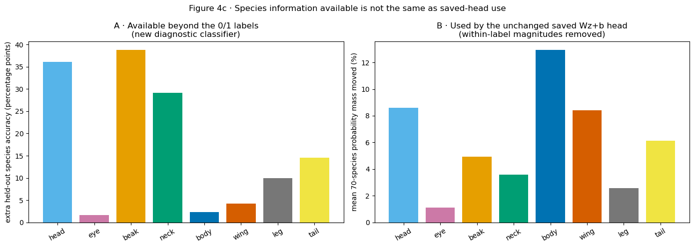


|  | replaced_block | raw_z_accuracy | processed_label_accuracy | dimensions | extra_decoding_accuracy | coordinates_replaced | held_out_images | raw_saved_head_accuracy | accuracy_after_replacement | top1_change_rate | mean_probability_mass_moved | raw_true_species_log_loss | log_loss_after_replacement | movement_relative_to_all112 |
| --- | --- | --- | --- | --- | --- | --- | --- | --- | --- | --- | --- | --- | --- | --- |
| 0 | all 112 | 0.7605 | 1.0000 | 112 | -0.2395 | 112 | 593 | 0.7656 | 0.9073 | 0.2766 | 0.3211 | 1.1059 | 0.3419 | 1.0000 |
| 1 | head | 0.7386 | 0.3777 | 20 | 0.3609 | 20 | 593 | 0.7656 | 0.7858 | 0.0793 | 0.0861 | 1.1059 | 0.8504 | 0.2683 |
| 2 | eye | 0.0472 | 0.0304 | 1 | 0.0169 | 1 | 593 | 0.7656 | 0.7656 | 0.0169 | 0.0110 | 1.1059 | 1.1097 | 0.0342 |
| 3 | beak | 0.6610 | 0.2732 | 9 | 0.3879 | 9 | 593 | 0.7656 | 0.7791 | 0.0573 | 0.0494 | 1.1059 | 0.9628 | 0.1540 |
| 4 | neck | 0.3828 | 0.0911 | 5 | 0.2917 | 5 | 593 | 0.7656 | 0.7656 | 0.0337 | 0.0357 | 1.1059 | 1.0695 | 0.1112 |
| 5 | body | 0.7656 | 0.7420 | 37 | 0.0236 | 37 | 593 | 0.7656 | 0.8297 | 0.1265 | 0.1294 | 1.1059 | 0.6553 | 0.4030 |
| 6 | wing | 0.7504 | 0.7083 | 18 | 0.0422 | 18 | 593 | 0.7656 | 0.8078 | 0.0826 | 0.0842 | 1.1059 | 0.8002 | 0.2624 |
| 7 | leg | 0.1906 | 0.0911 | 3 | 0.0995 | 3 | 593 | 0.7656 | 0.7690 | 0.0219 | 0.0257 | 1.1059 | 1.0668 | 0.0799 |
| 8 | tail | 0.7150 | 0.5700 | 14 | 0.1450 | 14 | 593 | 0.7656 | 0.7943 | 0.0691 | 0.0614 | 1.1059 | 0.8942 | 0.1912 |


### Executed reading of Figure 4c


Result. Head's new diagnostic gains 36.1 species-accuracy points beyond its 0/1 labels. Removing only head's within-label magnitudes from held-out images moves 8.614% of the saved head's 70-species probability mass on average and changes its winning species on 7.93% of images. Wing's corresponding values are 4.2 points available, 8.424% probability mass moved, and 8.26% top-one changes. Their probability-movement values differ by only +0.190 percentage points. Thus head and wing are used by almost the same aggregate amount even though head contains much more species information beyond its labels. Head has 20 coordinates and wing 18, so the comparison is therefore reported at the block level. The full part ordering by probability movement is ['body', 'head', 'wing', 'tail', 'beak', 'neck', 'leg', 'eye'] ; the complete table above reports every denominator, accuracy, and log loss.


Interpretation. The additional diagnostic accuracy is substantially larger for head than wing, whereas probability redistribution under the saved-head intervention is similar. The two estimands therefore produce different block comparisons in this population.


**Plausible alternative.** Replacing scores by ordinary within-label means
creates a synthetic bottleneck vector. Small average movement could hide
larger changes in a minority of photographs, and none of this identifies
whether the named pixels or body context produced the magnitude.


**What would distinguish it.** Inspect the per-image movement distribution,
then stratify by natural mask visibility without changing the frozen head.
A clean donor-part swap is still unavailable on CUB70.


Scope. Figure 4c quantifies the numerical response of the fitted species head to the specified bottleneck intervention. Spatial dependence of the concept logits requires separate assessment.


Subsequent analysis. Where are these raw concept scores spatially sensitive: inside their named masks or elsewhere in the photograph?


## 4d · Spatial sensitivity of raw concept logits


Question and prediction. Figure 4c separates species information that is available from information used by the saved class head. The spatial origin of a concept score remains to be examined. If a named concept uses its mapped region, locations supporting a larger raw z_j should often concentrate inside the released mask.


**Exact calculation.** At the final ResNet feature map `A`, compute


`alpha_k = mean over (u,v) of d z_j / d A_k(u,v)`,


`G_j(u,v) = max(0, sum_k alpha_k A_k(u,v))`.


`G_j` is positive concept-specific Grad-CAM: locations whose local feature
pattern supports increasing `z_j`. The purple absolute map also retains
locations with a negative local direction.


**Inputs/model/training.** Frozen official Koh Joint ResNet-50 seed 1;
positive-labelled ordinary CUB70 photographs whose named mask covers at
least 0.1% of the model's actual view. Koh applies
`CenterCrop(299)` at test time; the identical crop is applied to the mask.
Native mask files, pixel counts, photograph dimensions, and all selected
cropped masks are checked before checkpoint inference. No model or
diagnostic classifier is trained. Selection is deterministic, limited to
four photographs per exact concept and at most 48 pairs per coarse group.


Panels. Each row shows photograph, released coarse mask (blue), positive Grad-CAM (red), and absolute Grad-CAM (purple). For every group the sheet shows the smallest and largest area-adjusted positive localization score. The selection targets the extremes of the computed localization statistic.


Methodological scope. The analysis adopts a localization question motivated by [SEG-MIL-CBM](https://arxiv.org/abs/2510.04180v2). Here it is evaluated using post-hoc Grad-CAM on the Koh model. Interpretation is restricted to the sensitivity map produced by that method.


### Figure 4d · Least- and most-localized concept examples by CUB group


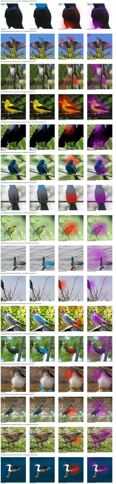


### Reviewed reading of Figure 4d


- Observation: localization varies among the selected examples. Some high-localization rows place visible red support on the named region; several low-localization rows place the strongest red or purple response on the body, background, or another part. The eye, leg, and tail examples are especially difficult to judge from a single picture because their masks are small and the final ResNet feature map is coarse.


- **What it supports:** the sheet supplies concrete examples of both local and
outside-mask sensitivity. It prevents a group average from hiding what the
masks and heatmaps actually look like.


- Alternative explanation. A peak outside the released mask may reflect the coarse feature grid, incomplete annotation, or sensitivity to another image region.


- Proposed follow-up: use the full selected population in Figure 4e, then compare against a segment-routed model whose prediction is an exact sum of named-region contributions.


- **Verdict:** **KEEP as qualitative localization evidence.**


- Scope. The examples describe post-hoc spatial sensitivity and motivate further image-level interventions.


- Subsequent analysis: across the declared sample, how often is positive sensitivity enriched inside the named mask?


## 4e · Overlap between positive sensitivity and released masks


**Question and prediction.** A locally grounded output should put more
positive Grad-CAM mass inside its named mask than a uniform spatial map.


**Exact quantities.** Normalize nonnegative `G_j` to sum to one.


- `mass inside = sum(G_j * mask)`;


- `mask area = mean(mask)` on the same 299×299 center crop seen by Koh;


- `enrichment = mass inside / mask area` (1 is a uniform-map baseline);


- `pointing = 1` when the maximum of `G_j` lies inside the mask;


- `equal-area IoU` compares the mask with the same number of hottest map pixels.


Example: a mask covering 5% of the image and receiving 25% of positive mass has enrichment 0.25/0.05=5 . An all-zero positive map has no maximum; it is counted in spatial-signal coverage and excluded from pointing-rate numerators under the stated exclusion rule.


Axes/denominators. Bars are medians or rates by CUB coarse group. The table prints selected pair, image, concept, and nonzero-map counts. The counts describe within-model image sampling; between-model uncertainty requires replication.


### Figure 4e · Concept-specific Grad-CAM overlap with released masks


|  | mask_group | n_pairs | n_images | n_concepts | median_mask_area | median_positive_mass_inside | median_positive_enrichment | positive_pointing_rate | positive_spatial_signal_rate | median_positive_equal_area_iou | median_absolute_mass_inside | median_absolute_enrichment |
| --- | --- | --- | --- | --- | --- | --- | --- | --- | --- | --- | --- | --- |
| 0 | beak | 36 | 36 | 9 | 0.0060 | 0.0114 | 2.5842 | 0.0000 | 1.0 | 0.0000 | 0.0103 | 2.3187 |
| 1 | body | 48 | 46 | 21 | 0.0624 | 0.1318 | 2.0277 | 0.2708 | 1.0 | 0.1053 | 0.1299 | 1.9345 |
| 2 | eye | 4 | 4 | 1 | 0.0028 | 0.0033 | 1.4695 | 0.0000 | 1.0 | 0.0000 | 0.0071 | 2.7363 |
| 3 | head | 48 | 47 | 17 | 0.0270 | 0.0585 | 2.2028 | 0.1667 | 1.0 | 0.0087 | 0.0499 | 2.0763 |
| 4 | leg | 12 | 12 | 3 | 0.0186 | 0.0105 | 0.7771 | 0.0000 | 1.0 | 0.0000 | 0.0170 | 0.9728 |
| 5 | neck | 18 | 18 | 5 | 0.0162 | 0.0354 | 2.2521 | 0.1111 | 1.0 | 0.0210 | 0.0333 | 2.1526 |
| 6 | tail | 48 | 46 | 13 | 0.0205 | 0.0196 | 1.3669 | 0.0625 | 1.0 | 0.0000 | 0.0256 | 1.3434 |
| 7 | wing | 48 | 48 | 14 | 0.0709 | 0.1281 | 1.9130 | 0.2292 | 1.0 | 0.0898 | 0.1268 | 1.7996 |


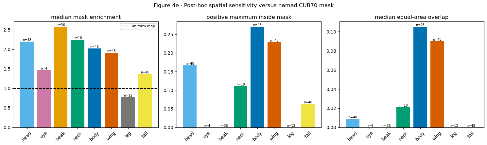


### Executed reading of Figure 4e


Result. The largest median positive-mask enrichment is beak=2.584 over 36 selected pairs. The smallest is leg=0.777 over 12 pairs. The table reports pointing, equal-area overlap, mask size, concept coverage, and nonzero-map coverage for every group; each is reported separately.


Interpretation. Enrichment above 1 indicates a greater concentration of positive sensitivity inside the mask than under a uniform spatial distribution. Testing the necessity of other pixels requires a separate intervention.


**Alternative.** Coarse masks and low-resolution feature maps can lower
overlap even for meaningful local evidence; high overlap can coexist with
contextual evidence elsewhere.


Proposed follow-up. Train a separately declared segment-routed or inside-versus-outside regularized CBM, preserve task/concept health, and validate exact segment contributions with deletion/insertion. Replicate at the seed level.


Scope. ACCEPTED FOR post-hoc localization under the stated method. Information availability, classifier sensitivity, and spatial localization are reported as distinct measurements.


Subsequent analysis. Does natural visibility change raw z on the complete eligible population?


## 5 · Association between mask visibility and positive-concept logits


**Question.** Does natural visibility change the raw score of a positive-labelled concept?


Variables and prediction. visibility_effect_j = mean(z|c=1,v=1)-mean(z|c=1,v=0) . Positive values mean visible examples score higher; negative values indicate lower mean scores in the mask-visible group, subject to the observational comparison.


**Method.** Require at least ten visible and ten hidden positive examples and show every eligible exact concept.


**Inputs and model.** Accepted official Koh Joint ResNet-50 CUB70 Standard seed-1 final-test export, plus released CUB masks or original image-level labels when the figure names them. No diagnostic is trained. Frozen raw z from the accepted CBM is grouped by natural released-mask state.


Numerical record. The accompanying table reports the quantities summarized in the figure, including denominators and exclusions for each part and exact value.


### Figure 5 · Association between mask visibility and positive-concept logits


**How to read the figure.** Each named point is one exact concept. The x-axis is
`mean positive-labelled z when visible - mean positive-labelled z when hidden`.
Right of zero means visibility accompanies a higher raw score; left means the
visible group scores lower. Unlike a FunnyBird swap, these are different
photographs, so pose, species composition, and mask quality can also differ.


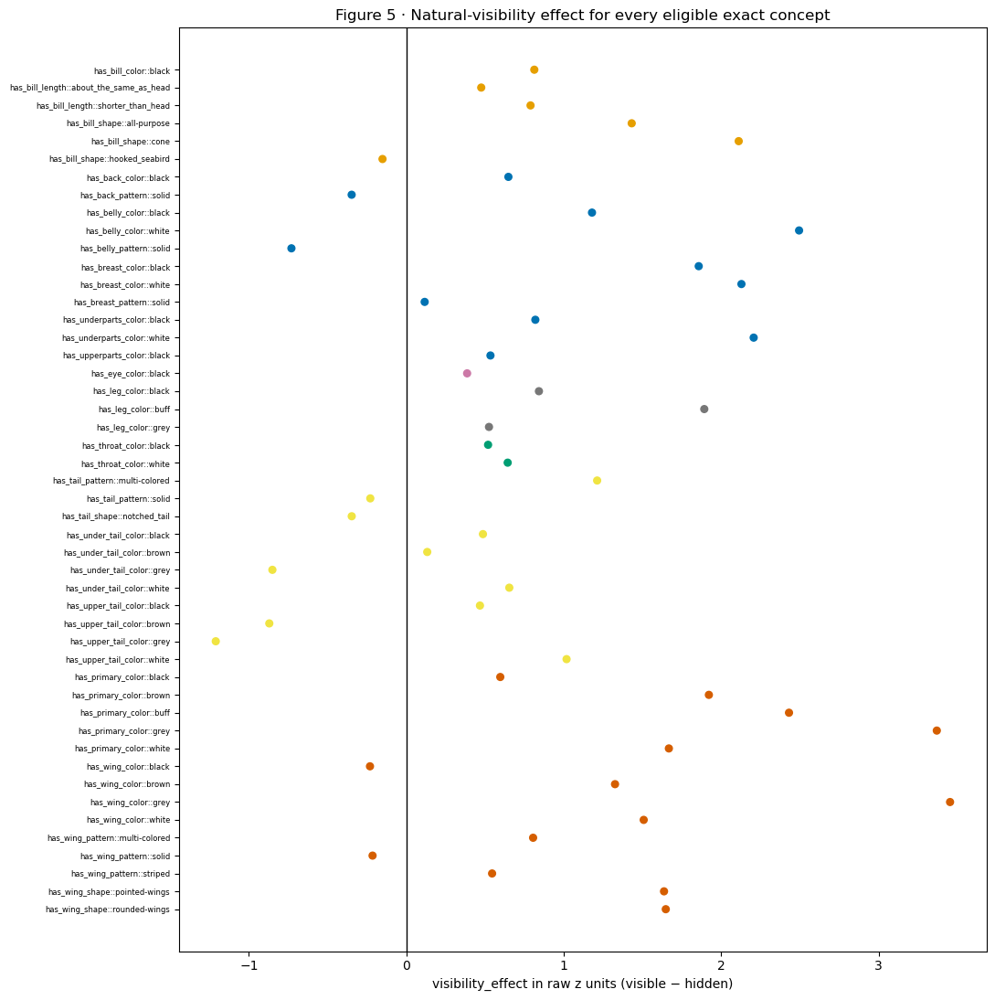


|  | concept_name | mask_group | n_visible | n_hidden | z_hidden | z_visible | visibility_effect |
| --- | --- | --- | --- | --- | --- | --- | --- |
| 0 | has_bill_color::black | beak | 849 | 78 | 2.659 | 3.472 | 0.813 |
| 1 | has_bill_length::about_the_same_as_head | beak | 756 | 56 | 3.244 | 3.719 | 0.476 |
| 2 | has_bill_length::shorter_than_head | beak | 859 | 67 | 3.203 | 3.992 | 0.789 |
| 3 | has_bill_shape::all-purpose | beak | 490 | 43 | 2.253 | 3.685 | 1.432 |
| 4 | has_bill_shape::cone | beak | 405 | 24 | 3.677 | 5.788 | 2.111 |
| 5 | has_bill_shape::hooked_seabird | beak | 278 | 28 | 2.962 | 2.811 | -0.151 |
| 6 | has_back_color::black | body | 590 | 28 | 4.027 | 4.675 | 0.648 |
| 7 | has_back_pattern::solid | body | 1102 | 33 | 3.076 | 2.729 | -0.347 |
| 8 | has_belly_color::black | body | 403 | 24 | 3.070 | 4.249 | 1.179 |
| 9 | has_belly_color::white | body | 605 | 12 | 2.083 | 4.578 | 2.495 |
| 10 | has_belly_pattern::solid | body | 1391 | 37 | 4.750 | 4.020 | -0.730 |
| 11 | has_breast_color::black | body | 442 | 23 | 2.592 | 4.449 | 1.857 |
| 12 | has_breast_color::white | body | 607 | 12 | 2.045 | 4.173 | 2.129 |
| 13 | has_breast_pattern::solid | body | 1389 | 36 | 3.417 | 3.534 | 0.116 |
| 14 | has_underparts_color::black | body | 433 | 24 | 3.360 | 4.179 | 0.819 |
| 15 | has_underparts_color::white | body | 637 | 12 | 1.990 | 4.196 | 2.206 |
| 16 | has_upperparts_color::black | body | 725 | 29 | 3.430 | 3.965 | 0.534 |
| 17 | has_eye_color::black | eye | 836 | 884 | 3.040 | 3.427 | 0.386 |
| 18 | has_leg_color::black | leg | 672 | 173 | 2.228 | 3.070 | 0.842 |
| 19 | has_leg_color::buff | leg | 42 | 36 | 3.858 | 5.751 | 1.893 |
| 20 | has_leg_color::grey | leg | 265 | 124 | 2.165 | 2.690 | 0.525 |
| 21 | has_throat_color::black | neck | 156 | 360 | 3.813 | 4.332 | 0.519 |
| 22 | has_throat_color::white | neck | 144 | 362 | 4.408 | 5.051 | 0.644 |
| 23 | has_tail_pattern::multi-colored | tail | 231 | 20 | 2.487 | 3.699 | 1.212 |
| 24 | has_tail_pattern::solid | tail | 833 | 158 | 3.263 | 3.034 | -0.229 |
| 25 | has_tail_shape::notched_tail | tail | 399 | 26 | 4.510 | 4.163 | -0.347 |
| 26 | has_under_tail_color::black | tail | 827 | 183 | 3.632 | 4.118 | 0.487 |
| 27 | has_under_tail_color::brown | tail | 72 | 72 | 3.875 | 4.007 | 0.133 |
| 28 | has_under_tail_color::grey | tail | 182 | 52 | 3.125 | 2.274 | -0.851 |
| 29 | has_under_tail_color::white | tail | 312 | 73 | 4.535 | 5.189 | 0.654 |
| 30 | has_upper_tail_color::black | tail | 664 | 150 | 4.135 | 4.603 | 0.468 |
| 31 | has_upper_tail_color::brown | tail | 97 | 47 | 5.067 | 4.196 | -0.871 |
| 32 | has_upper_tail_color::grey | tail | 210 | 54 | 3.089 | 1.879 | -1.211 |
| 33 | has_upper_tail_color::white | tail | 196 | 60 | 3.606 | 4.623 | 1.018 |
| 34 | has_primary_color::black | wing | 413 | 205 | 4.473 | 5.070 | 0.597 |
| 35 | has_primary_color::brown | wing | 186 | 17 | 2.696 | 4.618 | 1.922 |
| 36 | has_primary_color::buff | wing | 76 | 14 | 3.844 | 6.275 | 2.431 |
| 37 | has_primary_color::grey | wing | 344 | 33 | 2.316 | 5.686 | 3.370 |
| 38 | has_primary_color::white | wing | 478 | 23 | 3.409 | 5.076 | 1.668 |
| 39 | has_wing_color::black | wing | 625 | 198 | 4.389 | 4.158 | -0.231 |
| 40 | has_wing_color::brown | wing | 266 | 26 | 2.706 | 4.032 | 1.326 |
| 41 | has_wing_color::grey | wing | 332 | 45 | 2.000 | 5.454 | 3.454 |
| 42 | has_wing_color::white | wing | 390 | 23 | 3.028 | 4.536 | 1.508 |
| 43 | has_wing_pattern::multi-colored | wing | 459 | 30 | 2.627 | 3.433 | 0.805 |
| 44 | has_wing_pattern::solid | wing | 547 | 148 | 2.723 | 2.509 | -0.215 |
| 45 | has_wing_pattern::striped | wing | 106 | 24 | 4.309 | 4.854 | 0.545 |
| 46 | has_wing_shape::pointed-wings | wing | 143 | 50 | 0.572 | 2.209 | 1.637 |
| 47 | has_wing_shape::rounded-wings | wing | 508 | 73 | 2.164 | 3.812 | 1.648 |


### Interpretation of Figure 5


- Observation: Across 48 eligible exact concepts, visibility_effect ranges from -1.211 to +3.454 raw-z units. The group median is largest for wing (+1.572) and smallest for tail (+0.133); several exact tail values have negative effects.


- Alternative explanation. The mask-visible and mask-absent groups differ in species, pose, background, and annotation quality. These differences can contribute to either sign of the observed association.


- Proposed follow-up: Test bilateral/area dose response, species matching, same-image model robustness, and real-image mask quality.


- **Verdict:** **KEEP**.


- Interpretation. Some concepts have higher mean logits in mask-visible photographs. The direction and magnitude vary across concepts in this observational comparison.


- Subsequent analysis: When the mapped mask is absent, does contextual label separation remain?


## 6 · Label-conditioned logit separation among mask-absent images


**Question.** Does contextual concept information remain when the named region is hidden?


Definition. context_gap_j=mean(z|c=1,v=0)−mean(z|c=0,v=0). Positive values indicate higher logits for positive-labelled images within the released-mask-absent population. Possible explanations include contextual prediction, residual visibility outside the annotation, and population differences.


**Method.** Require at least ten hidden positives and ten hidden negatives.


**Inputs and model.** Accepted official Koh Joint ResNet-50 CUB70 Standard seed-1 final-test export, plus released CUB masks or original image-level labels when the figure names them. No diagnostic is trained. Frozen raw z from the accepted CBM is grouped by label and natural released-mask state.


Numerical record. The accompanying table reports the quantities summarized in the figure, including denominators and exclusions for each part and exact value.


### Figure 6 · Label-conditioned logit separation among mask-absent images


Figure interpretation. Each point represents an exact concept. The horizontal axis is the mean logit in mask-absent positive-labelled images minus the mean in mask-absent negative-labelled images. A value of 4 indicates a four-logit-unit difference. The available annotations and natural-image comparison leave the responsible visual cues unresolved.


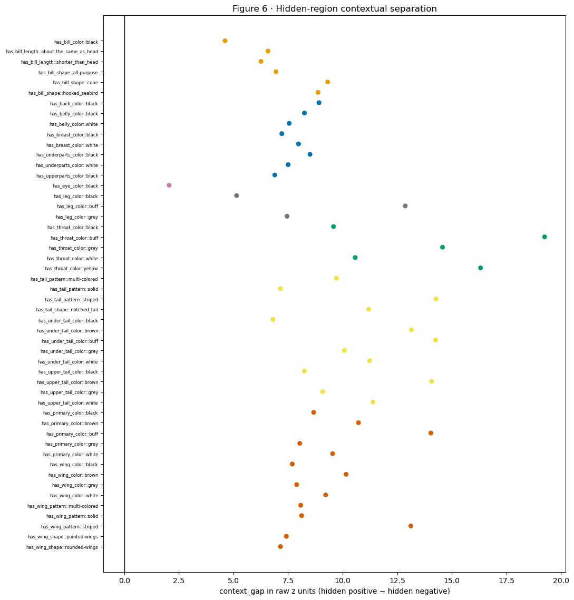


|  | concept_name | mask_group | n_hidden | n_hidden_negative | context_gap |
| --- | --- | --- | --- | --- | --- |
| 0 | has_bill_color::black | beak | 78 | 55 | 4.611 |
| 1 | has_bill_length::about_the_same_as_head | beak | 56 | 77 | 6.577 |
| 2 | has_bill_length::shorter_than_head | beak | 67 | 66 | 6.259 |
| 3 | has_bill_shape::all-purpose | beak | 43 | 90 | 6.949 |
| 4 | has_bill_shape::cone | beak | 24 | 109 | 9.315 |
| 5 | has_bill_shape::hooked_seabird | beak | 28 | 105 | 8.877 |
| 6 | has_back_color::black | body | 28 | 13 | 8.917 |
| 7 | has_belly_color::black | body | 24 | 17 | 8.250 |
| 8 | has_belly_color::white | body | 12 | 29 | 7.549 |
| 9 | has_breast_color::black | body | 23 | 18 | 7.215 |
| 10 | has_breast_color::white | body | 12 | 29 | 7.981 |
| 11 | has_underparts_color::black | body | 24 | 17 | 8.505 |
| 12 | has_underparts_color::white | body | 12 | 29 | 7.504 |
| 13 | has_upperparts_color::black | body | 29 | 12 | 6.891 |
| 14 | has_eye_color::black | eye | 884 | 123 | 2.050 |
| 15 | has_leg_color::black | leg | 173 | 288 | 5.142 |
| 16 | has_leg_color::buff | leg | 36 | 425 | 12.867 |
| 17 | has_leg_color::grey | leg | 124 | 337 | 7.453 |
| 18 | has_throat_color::black | neck | 360 | 1107 | 9.583 |
| 19 | has_throat_color::buff | neck | 21 | 1446 | 19.250 |
| 20 | has_throat_color::grey | neck | 57 | 1410 | 14.574 |
| 21 | has_throat_color::white | neck | 362 | 1105 | 10.573 |
| 22 | has_throat_color::yellow | neck | 77 | 1390 | 16.317 |
| 23 | has_tail_pattern::multi-colored | tail | 20 | 336 | 9.714 |
| 24 | has_tail_pattern::solid | tail | 158 | 198 | 7.153 |
| 25 | has_tail_pattern::striped | tail | 26 | 330 | 14.282 |
| 26 | has_tail_shape::notched_tail | tail | 26 | 330 | 11.195 |
| 27 | has_under_tail_color::black | tail | 183 | 173 | 6.810 |
| 28 | has_under_tail_color::brown | tail | 72 | 284 | 13.151 |
| 29 | has_under_tail_color::buff | tail | 26 | 330 | 14.253 |
| 30 | has_under_tail_color::grey | tail | 52 | 304 | 10.079 |
| 31 | has_under_tail_color::white | tail | 73 | 283 | 11.235 |
| 32 | has_upper_tail_color::black | tail | 150 | 206 | 8.244 |
| 33 | has_upper_tail_color::brown | tail | 47 | 309 | 14.076 |
| 34 | has_upper_tail_color::grey | tail | 54 | 302 | 9.083 |
| 35 | has_upper_tail_color::white | tail | 60 | 296 | 11.394 |
| 36 | has_primary_color::black | wing | 205 | 88 | 8.674 |
| 37 | has_primary_color::brown | wing | 17 | 276 | 10.726 |
| 38 | has_primary_color::buff | wing | 14 | 279 | 14.040 |
| 39 | has_primary_color::grey | wing | 33 | 260 | 8.037 |
| 40 | has_primary_color::white | wing | 23 | 270 | 9.541 |
| 41 | has_wing_color::black | wing | 198 | 95 | 7.692 |
| 42 | has_wing_color::brown | wing | 26 | 267 | 10.157 |
| 43 | has_wing_color::grey | wing | 45 | 248 | 7.897 |
| 44 | has_wing_color::white | wing | 23 | 270 | 9.222 |
| 45 | has_wing_pattern::multi-colored | wing | 30 | 263 | 8.078 |
| 46 | has_wing_pattern::solid | wing | 148 | 145 | 8.122 |
| 47 | has_wing_pattern::striped | wing | 24 | 269 | 13.126 |
| 48 | has_wing_shape::pointed-wings | wing | 50 | 243 | 7.421 |
| 49 | has_wing_shape::rounded-wings | wing | 73 | 220 | 7.152 |


### Interpretation of Figure 6


- Observation: All 50 eligible exact concepts have positive context_gap in the current official model. Values range from +2.050 for black eye to +19.250 for buff throat; the neck median is +14.574 and the tail median is +11.195.


- Alternative explanation: Released-mask absence is a noisy proxy: species, pose, background, annotation quality, and visible regions omitted from the annotation can all create separation.


- Proposed follow-up: Match species support, center within exact concept/mask state, and inspect the selected photographs and masks.


- **Verdict:** **KEEP**.


- Scope: ACCEPTED FOR observational label-conditioned logit separation within the released-mask-absent population.


- Subsequent analysis: Can bilateral visibility or region area explain the score patterns more simply?


## 7 · Associations with bilateral visibility and mapped area


**Question.** Do bilateral visibility and visible area offer simpler explanations?


**Variables and prediction.** For eye, wing, and leg, retain left/right masks and compare zero, one, or two visible sides. Separately estimate within-concept area dose response. A monotone increase supports local visual evidence; non-monotone patterns motivate pose or species controls.


**Method.** Use only positive-labelled rows and raw `z`.


**Inputs and model.** Accepted official Koh Joint ResNet-50 CUB70 Standard seed-1 final-test export, plus released CUB masks or original image-level labels when the figure names them. No diagnostic is trained. Frozen raw z is summarized by bilateral mask count and within-concept area quartile.


Numerical record. The accompanying table reports the quantities summarized in the figure, including denominators and exclusions for each part and exact value.


### Figure 7 · Associations with bilateral visibility and mapped area


**How to read the figure.** The bilateral panel compares mean raw `z` when zero, one, or two eye/wing/leg
masks are visible. The area panel asks, within the same exact concept, whether
larger visible masks accompany higher `z`. A steady upward pattern would fit
local pixel reliance; mixed directions leave pose, species, and annotation as
alternatives. The area outcome is
`area_effect_j = mean(z | largest visible-area quartile, c=1) - mean(z | smallest visible-area quartile, c=1)`; +1 means the largest-area
positive images score one raw-logit unit higher. Colors identify CUB groups.


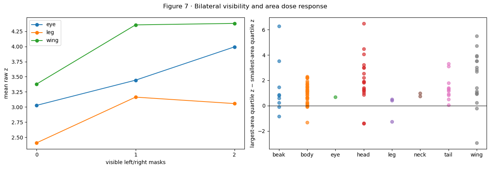


|  | mask_group | visible_sides | n | mean_z |
| --- | --- | --- | --- | --- |
| 0 | eye | 0 | 906 | 3.027 |
| 1 | eye | 1 | 800 | 3.443 |
| 2 | eye | 2 | 14 | 3.993 |
| 3 | leg | 0 | 348 | 2.407 |
| 4 | leg | 1 | 249 | 3.163 |
| 5 | leg | 2 | 715 | 3.056 |
| 6 | wing | 0 | 924 | 3.378 |
| 7 | wing | 1 | 2986 | 4.357 |
| 8 | wing | 2 | 2191 | 4.381 |


|  | attribute_type | concept_name | mask_group | area_effect | n |
| --- | --- | --- | --- | --- | --- |
| 0 | has_back_color | has_back_color::black | body | 0.942 | 590 |
| 1 | has_back_color | has_back_color::brown | body | 1.168 | 286 |
| 2 | has_back_color | has_back_color::buff | body | 2.245 | 89 |
| 3 | has_back_color | has_back_color::grey | body | 0.626 | 430 |
| 4 | has_back_color | has_back_color::white | body | 2.311 | 206 |
| 5 | has_back_color | has_back_color::yellow | body | -1.328 | 56 |
| 6 | has_back_pattern | has_back_pattern::multi-colored | body | 1.716 | 119 |
| 7 | has_back_pattern | has_back_pattern::solid | body | 0.003 | 1102 |
| 8 | has_back_pattern | has_back_pattern::striped | body | 0.613 | 117 |
| 9 | has_belly_color | has_belly_color::black | body | 0.656 | 403 |
| 10 | has_belly_color | has_belly_color::brown | body | 1.440 | 81 |
| 11 | has_belly_color | has_belly_color::buff | body | 1.709 | 177 |
| 12 | has_belly_color | has_belly_color::grey | body | 0.506 | 209 |
| 13 | has_belly_color | has_belly_color::white | body | 1.144 | 605 |
| 14 | has_belly_color | has_belly_color::yellow | body | 1.014 | 115 |
| 15 | has_belly_pattern | has_belly_pattern::solid | body | 0.151 | 1391 |
| 16 | has_bill_color | has_bill_color::black | beak | 0.598 | 919 |
| 17 | has_bill_color | has_bill_color::buff | beak | 6.285 | 30 |
| 18 | has_bill_color | has_bill_color::grey | beak | -0.829 | 88 |
| 19 | has_bill_length | has_bill_length::about_the_same_as_head | beak | 0.250 | 807 |
| 20 | has_bill_length | has_bill_length::shorter_than_head | beak | 0.818 | 917 |
| 21 | has_bill_shape | has_bill_shape::all-purpose | beak | 0.874 | 528 |
| 22 | has_bill_shape | has_bill_shape::cone | beak | 1.457 | 427 |
| 23 | has_bill_shape | has_bill_shape::dagger | beak | 3.529 | 30 |
| 24 | has_bill_shape | has_bill_shape::hooked_seabird | beak | -0.094 | 303 |
| 25 | has_breast_color | has_breast_color::black | body | 0.207 | 442 |
| 26 | has_breast_color | has_breast_color::brown | body | 1.476 | 111 |
| 27 | has_breast_color | has_breast_color::buff | body | 1.937 | 88 |
| 28 | has_breast_color | has_breast_color::grey | body | 0.099 | 149 |
| 29 | has_breast_color | has_breast_color::white | body | 1.254 | 607 |
| 30 | has_breast_color | has_breast_color::yellow | body | 1.072 | 139 |
| 31 | has_breast_pattern | has_breast_pattern::multi-colored | body | 0.804 | 120 |
| 32 | has_breast_pattern | has_breast_pattern::solid | body | -0.068 | 1389 |
| 33 | has_crown_color | has_crown_color::black | head | 1.230 | 703 |
| 34 | has_crown_color | has_crown_color::blue | head | 2.221 | 87 |
| 35 | has_crown_color | has_crown_color::brown | head | 4.472 | 113 |
| 36 | has_crown_color | has_crown_color::grey | head | 1.813 | 177 |
| 37 | has_crown_color | has_crown_color::white | head | 1.895 | 318 |
| 38 | has_crown_color | has_crown_color::yellow | head | -1.397 | 52 |
| 39 | has_eye_color | has_eye_color::black | eye | 0.672 | 1630 |
| 40 | has_forehead_color | has_forehead_color::black | head | 1.005 | 729 |
| 41 | has_forehead_color | has_forehead_color::blue | head | 1.878 | 87 |
| 42 | has_forehead_color | has_forehead_color::brown | head | 4.058 | 113 |
| 43 | has_forehead_color | has_forehead_color::grey | head | 2.980 | 158 |
| 44 | has_forehead_color | has_forehead_color::white | head | 1.398 | 318 |
| 45 | has_forehead_color | has_forehead_color::yellow | head | 3.004 | 56 |
| 46 | has_head_pattern | has_head_pattern::plain | head | 0.858 | 760 |
| 47 | has_leg_color | has_leg_color::black | leg | 0.495 | 682 |
| 48 | has_leg_color | has_leg_color::buff | leg | 0.424 | 42 |
| 49 | has_leg_color | has_leg_color::grey | leg | -1.253 | 271 |
| 50 | has_nape_color | has_nape_color::black | head | 1.319 | 590 |
| 51 | has_nape_color | has_nape_color::brown | head | 3.239 | 172 |
| 52 | has_nape_color | has_nape_color::buff | head | 6.489 | 90 |
| 53 | has_nape_color | has_nape_color::grey | head | 2.528 | 178 |
| 54 | has_nape_color | has_nape_color::white | head | 1.158 | 348 |
| 55 | has_nape_color | has_nape_color::yellow | head | -1.369 | 52 |
| 56 | has_primary_color | has_primary_color::black | wing | 0.912 | 413 |
| 57 | has_primary_color | has_primary_color::brown | wing | 3.932 | 186 |
| 58 | has_primary_color | has_primary_color::buff | wing | 3.015 | 76 |
| 59 | has_primary_color | has_primary_color::grey | wing | 4.714 | 344 |
| 60 | has_primary_color | has_primary_color::white | wing | 2.675 | 478 |
| 61 | has_primary_color | has_primary_color::yellow | wing | -0.207 | 112 |
| 62 | has_tail_pattern | has_tail_pattern::multi-colored | tail | 0.910 | 231 |
| 63 | has_tail_pattern | has_tail_pattern::solid | tail | 0.056 | 836 |
| 64 | has_tail_shape | has_tail_shape::notched_tail | tail | 1.239 | 400 |
| 65 | has_throat_color | has_throat_color::black | neck | 0.972 | 156 |
| 66 | has_throat_color | has_throat_color::white | neck | 0.758 | 144 |
| 67 | has_under_tail_color | has_under_tail_color::black | tail | 1.171 | 828 |
| 68 | has_under_tail_color | has_under_tail_color::brown | tail | 3.110 | 72 |
| 69 | has_under_tail_color | has_under_tail_color::grey | tail | 1.797 | 183 |
| 70 | has_under_tail_color | has_under_tail_color::white | tail | 0.519 | 314 |
| 71 | has_underparts_color | has_underparts_color::black | body | 0.284 | 433 |
| 72 | has_underparts_color | has_underparts_color::brown | body | 1.258 | 81 |
| 73 | has_underparts_color | has_underparts_color::buff | body | 1.835 | 145 |
| 74 | has_underparts_color | has_underparts_color::grey | body | 1.530 | 159 |
| 75 | has_underparts_color | has_underparts_color::white | body | 0.860 | 637 |
| 76 | has_underparts_color | has_underparts_color::yellow | body | 1.172 | 115 |
| 77 | has_upper_tail_color | has_upper_tail_color::black | tail | 1.391 | 665 |
| 78 | has_upper_tail_color | has_upper_tail_color::brown | tail | 3.321 | 97 |
| 79 | has_upper_tail_color | has_upper_tail_color::grey | tail | 0.826 | 212 |
| 80 | has_upper_tail_color | has_upper_tail_color::white | tail | 1.328 | 197 |
| 81 | has_upperparts_color | has_upperparts_color::black | body | 0.590 | 725 |
| 82 | has_upperparts_color | has_upperparts_color::brown | body | 1.568 | 284 |
| 83 | has_upperparts_color | has_upperparts_color::buff | body | 2.223 | 89 |
| 84 | has_upperparts_color | has_upperparts_color::grey | body | -0.095 | 517 |
| 85 | has_upperparts_color | has_upperparts_color::white | body | 2.194 | 295 |
| 86 | has_upperparts_color | has_upperparts_color::yellow | body | 1.343 | 86 |
| 87 | has_wing_color | has_wing_color::black | wing | 1.144 | 625 |
| 88 | has_wing_color | has_wing_color::brown | wing | 2.846 | 266 |
| 89 | has_wing_color | has_wing_color::buff | wing | 3.510 | 115 |
| 90 | has_wing_color | has_wing_color::grey | wing | 3.536 | 332 |
| 91 | has_wing_color | has_wing_color::white | wing | 1.387 | 390 |
| 92 | has_wing_color | has_wing_color::yellow | wing | 5.510 | 59 |
| 93 | has_wing_pattern | has_wing_pattern::multi-colored | wing | 0.961 | 459 |
| 94 | has_wing_pattern | has_wing_pattern::solid | wing | 0.241 | 547 |
| 95 | has_wing_pattern | has_wing_pattern::striped | wing | 3.892 | 106 |
| 96 | has_wing_shape | has_wing_shape::pointed-wings | wing | -2.930 | 143 |
| 97 | has_wing_shape | has_wing_shape::rounded-wings | wing | 1.010 | 508 |


### Interpretation of Figure 7


- Observation: Mean raw z rises across zero/one/two visible masks for eye (3.027, 3.443, 3.993), although only 14 rows have two visible eye masks. Wing rises from zero to one side and then plateaus (3.378, 4.357, 4.381); leg has a nonmonotonic pattern (2.407, 3.163, 3.056). Within-concept area effects span positive and negative values.


- Alternative explanation: Species, pose, and annotation coverage differ across area and bilateral-mask groups and may contribute to their logit differences.


- Proposed follow-up: Hold exact concept and species fixed and evaluate held-out row-level prediction.


- **Verdict:** **KEEP**.


- **Limited conclusion:** `VALID TEST, NO SUPPORT for bilateral count or area as a sufficient universal explanation; local visual evidence may still matter for individual concepts.`


- Subsequent analysis: Does performance differ by species after raw-label support is matched?


## 8 · Species differences under matched label support


**Question.** Does concept performance differ between species after support is matched?


**Variables and prediction.** Join the original CUB per-image attribute labels to the official Koh raw `z` predictions. For each exact concept, compare species that each contain at least three positive and three negative images. Match both counts, then measure positive-recall, balanced-accuracy, and raw-score gaps. Persistent gaps support species-dependent behavior. They become a backwash warning only if the separate FunnyBird calibration in Appendix A passes its predeclared checks.


**Method.** Use the same positive-recall-gap formula for FunnyBird calibration and CUB70, deterministic vectorized bootstrap, at most 50 species pairs per exact concept, and explicit alignment/eligibility counts. The actual FunnyBird labels are constant within species, so its authoritative all-positive branch compares two species that both carry the value; CUB70 uses its image-varying labels and requires three rows of each label. No classifier is trained; `z>0` is the saved CBM's own concept decision.


**Inputs and model.** Accepted official Koh Joint ResNet-50 CUB70 Standard seed-1 final-test export, plus released CUB masks or original image-level labels when the figure names them. No diagnostic is trained. Recall and balanced accuracy reuse the accepted CBM's own z>0 rule; bootstrapping only resamples matched images.


Numerical record. The accompanying table reports the quantities summarized in the figure, including denominators and exclusions for each part and exact value.


### Figure 8 · Species differences under matched label support


**How to read the figure.** A matched pair contains two species with enough raw positive and negative
examples for the same exact concept. Positive and negative counts are both
equalized and resampled with replacement. Panel A shows
`|positive_recall_A-positive_recall_B|`. Panel B shows the absolute gap in
balanced accuracy, where balanced accuracy is the average of positive and
negative recall. Panel C averages two raw-score gaps: the positive-image
mean difference and the negative-image mean difference. Zero means the two
matched species behave alike. A recall gap of 0.30 is a 30-percentage-point
difference; a raw-z gap of 2 is a two-logit-unit difference. No new
classifier is trained: every thresholded answer is the accepted CBM's own
`z>0` decision. These remain species-dependence/model-health diagnostics
unless Appendix A's FunnyBird calibration earns the weaker warning-proxy
label.


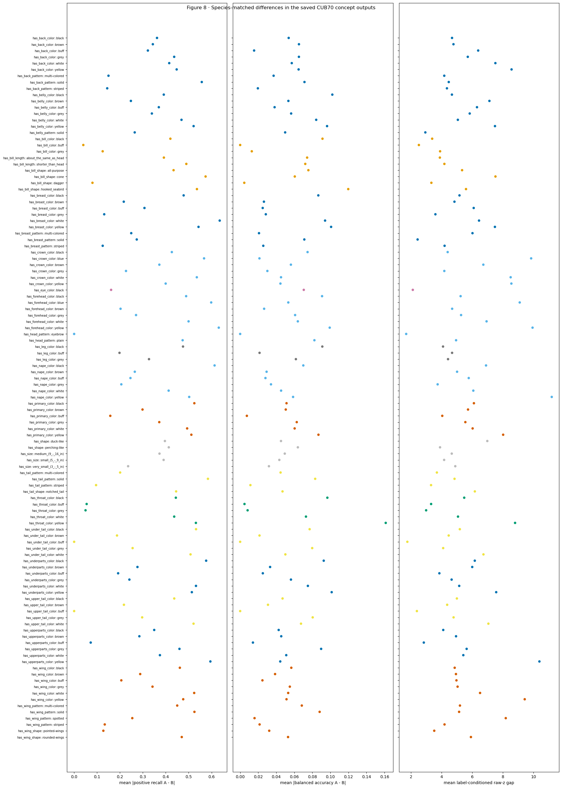


|  | raw_alignment_rate | raw_rows | eligible_concepts | matched_pairs | matching_rule | new_diagnostic_trained | funnybird_proxy_verdict |
| --- | --- | --- | --- | --- | --- | --- | --- |
| 0 | 1.0 | 221312 | 112 | 5190 | both species >=3 positive and >=3 negative | False | METHOD NOT CALIBRATED AS A BACKWASH PROXY |


|  | concept_name | n_species_pairs | mean_recall_gap | mean_balanced_accuracy_gap | mean_positive_raw_z_gap | mean_label_conditioned_raw_z_gap | min_matched_positive_n | min_matched_negative_n | attribute_type | mask_group |
| --- | --- | --- | --- | --- | --- | --- | --- | --- | --- | --- |
| 0 | has_back_color::black | 50 | 0.362 | 0.054 | 4.927 | 4.682 | 3 | 5 | has_back_color | body |
| 1 | has_back_color::brown | 50 | 0.344 | 0.065 | 5.055 | 4.775 | 3 | 9 | has_back_color | body |
| 2 | has_back_color::buff | 50 | 0.322 | 0.015 | 6.616 | 6.390 | 3 | 8 | has_back_color | body |
| 3 | has_back_color::grey | 50 | 0.437 | 0.065 | 5.985 | 5.710 | 3 | 6 | has_back_color | body |
| 4 | has_back_color::white | 50 | 0.415 | 0.057 | 7.851 | 7.514 | 3 | 5 | has_back_color | body |
| 5 | has_back_color::yellow | 28 | 0.448 | 0.065 | 9.325 | 8.571 | 3 | 6 | has_back_color | body |
| 6 | has_back_pattern::multi-colored | 50 | 0.150 | 0.037 | 4.598 | 4.173 | 3 | 11 | has_back_pattern | body |
| 7 | has_back_pattern::solid | 50 | 0.557 | 0.071 | 4.609 | 4.467 | 3 | 4 | has_back_pattern | body |
| 8 | has_back_pattern::striped | 50 | 0.144 | 0.020 | 4.625 | 4.349 | 3 | 15 | has_back_pattern | body |
| 9 | has_belly_color::black | 50 | 0.391 | 0.102 | 4.683 | 4.674 | 3 | 4 | has_belly_color | body |
| 10 | has_belly_color::brown | 50 | 0.248 | 0.053 | 7.190 | 7.124 | 3 | 15 | has_belly_color | body |
| 11 | has_belly_color::buff | 50 | 0.370 | 0.038 | 6.719 | 6.312 | 3 | 9 | has_belly_color | body |
| 12 | has_belly_color::grey | 50 | 0.339 | 0.056 | 6.316 | 5.836 | 3 | 5 | has_belly_color | body |
| 13 | has_belly_color::white | 50 | 0.469 | 0.084 | 5.211 | 5.061 | 3 | 3 | has_belly_color | body |
| 14 | has_belly_color::yellow | 36 | 0.522 | 0.096 | 8.001 | 7.488 | 3 | 6 | has_belly_color | body |
| 15 | has_belly_pattern::solid | 50 | 0.264 | 0.050 | 2.861 | 2.937 | 3 | 3 | has_belly_pattern | body |
| 16 | has_bill_color::black | 50 | 0.420 | 0.091 | 3.419 | 3.384 | 3 | 3 | has_bill_color | beak |
| 17 | has_bill_color::buff | 50 | 0.040 | 0.000 | 2.823 | 2.515 | 3 | 8 | has_bill_color | beak |
| 18 | has_bill_color::grey | 50 | 0.125 | 0.013 | 4.126 | 3.902 | 3 | 7 | has_bill_color | beak |
| 19 | has_bill_length::about_the_same_as_head | 50 | 0.392 | 0.074 | 3.946 | 3.886 | 3 | 3 | has_bill_length | beak |
| 20 | has_bill_length::shorter_than_head | 50 | 0.490 | 0.072 | 4.295 | 4.181 | 3 | 4 | has_bill_length | beak |
| 21 | has_bill_shape::all-purpose | 50 | 0.434 | 0.076 | 5.348 | 5.338 | 3 | 6 | has_bill_shape | beak |
| 22 | has_bill_shape::cone | 50 | 0.574 | 0.061 | 7.478 | 7.519 | 3 | 3 | has_bill_shape | beak |
| 23 | has_bill_shape::dagger | 50 | 0.080 | 0.005 | 3.867 | 3.331 | 3 | 15 | has_bill_shape | beak |
| 24 | has_bill_shape::hooked_seabird | 50 | 0.536 | 0.120 | 5.596 | 5.595 | 3 | 5 | has_bill_shape | beak |
| 25 | has_breast_color::black | 50 | 0.478 | 0.087 | 5.405 | 5.168 | 3 | 5 | has_breast_color | body |
| 26 | has_breast_color::brown | 50 | 0.217 | 0.026 | 5.140 | 4.839 | 3 | 12 | has_breast_color | body |
| 27 | has_breast_color::buff | 50 | 0.307 | 0.025 | 6.571 | 6.097 | 3 | 8 | has_breast_color | body |
| 28 | has_breast_color::grey | 50 | 0.131 | 0.028 | 4.105 | 3.595 | 3 | 6 | has_breast_color | body |
| 29 | has_breast_color::white | 50 | 0.635 | 0.094 | 6.343 | 6.445 | 3 | 3 | has_breast_color | body |
| 30 | has_breast_color::yellow | 21 | 0.543 | 0.101 | 6.549 | 7.483 | 3 | 3 | has_breast_color | body |
| 31 | has_breast_pattern::multi-colored | 50 | 0.249 | 0.021 | 6.097 | 6.018 | 3 | 9 | has_breast_pattern | body |
| 32 | has_breast_pattern::solid | 50 | 0.273 | 0.071 | 2.421 | 2.431 | 5 | 3 | has_breast_pattern | body |
| 33 | has_breast_pattern::striped | 50 | 0.125 | 0.026 | 4.949 | 4.195 | 3 | 7 | has_breast_pattern | body |
| 34 | has_crown_color::black | 50 | 0.427 | 0.075 | 4.565 | 4.396 | 3 | 3 | has_crown_color | head |
| 35 | has_crown_color::blue | 21 | 0.567 | 0.021 | 10.153 | 9.851 | 3 | 5 | has_crown_color | head |
| 36 | has_crown_color::brown | 50 | 0.372 | 0.056 | 7.037 | 6.726 | 3 | 9 | has_crown_color | head |
| 37 | has_crown_color::grey | 50 | 0.226 | 0.030 | 4.509 | 4.177 | 3 | 8 | has_crown_color | head |
| 38 | has_crown_color::white | 50 | 0.536 | 0.045 | 8.706 | 8.512 | 3 | 3 | has_crown_color | head |
| 39 | has_crown_color::yellow | 21 | 0.400 | 0.045 | 9.066 | 8.559 | 3 | 4 | has_crown_color | head |
| 40 | has_eye_color::black | 50 | 0.161 | 0.070 | 2.178 | 2.118 | 4 | 3 | has_eye_color | eye |
| 41 | has_forehead_color::black | 50 | 0.489 | 0.091 | 5.334 | 5.242 | 3 | 4 | has_forehead_color | head |
| 42 | has_forehead_color::blue | 15 | 0.598 | 0.053 | 8.994 | 9.104 | 3 | 4 | has_forehead_color | head |
| 43 | has_forehead_color::brown | 50 | 0.203 | 0.027 | 4.908 | 4.689 | 3 | 10 | has_forehead_color | head |
| 44 | has_forehead_color::grey | 50 | 0.270 | 0.061 | 5.418 | 5.272 | 3 | 8 | has_forehead_color | head |
| 45 | has_forehead_color::white | 50 | 0.500 | 0.064 | 7.066 | 6.938 | 3 | 3 | has_forehead_color | head |
| 46 | has_forehead_color::yellow | 6 | 0.631 | 0.099 | 10.112 | 9.943 | 4 | 4 | has_forehead_color | head |
| 47 | has_head_pattern::eyebrow | 50 | 0.000 | 0.000 | 1.839 | 1.686 | 3 | 11 | has_head_pattern | head |
| 48 | has_head_pattern::plain | 50 | 0.474 | 0.082 | 5.068 | 4.946 | 3 | 4 | has_head_pattern | head |
| 49 | has_leg_color::black | 50 | 0.475 | 0.091 | 4.101 | 4.093 | 3 | 4 | has_leg_color | leg |
| 50 | has_leg_color::buff | 50 | 0.198 | 0.021 | 4.835 | 4.685 | 3 | 13 | has_leg_color | leg |
| 51 | has_leg_color::grey | 50 | 0.327 | 0.062 | 4.725 | 4.420 | 3 | 5 | has_leg_color | leg |
| 52 | has_nape_color::black | 50 | 0.613 | 0.070 | 7.238 | 6.903 | 3 | 5 | has_nape_color | head |
| 53 | has_nape_color::brown | 50 | 0.265 | 0.029 | 5.226 | 5.011 | 3 | 10 | has_nape_color | head |
| 54 | has_nape_color::buff | 50 | 0.246 | 0.028 | 6.029 | 5.773 | 3 | 11 | has_nape_color | head |
| 55 | has_nape_color::grey | 50 | 0.206 | 0.034 | 3.909 | 3.741 | 3 | 7 | has_nape_color | head |
| 56 | has_nape_color::white | 50 | 0.413 | 0.045 | 6.234 | 6.072 | 3 | 3 | has_nape_color | head |
| 57 | has_nape_color::yellow | 10 | 0.502 | 0.059 | 10.087 | 11.197 | 5 | 4 | has_nape_color | head |
| 58 | has_primary_color::black | 50 | 0.525 | 0.051 | 6.328 | 6.111 | 3 | 3 | has_primary_color | wing |
| 59 | has_primary_color::brown | 50 | 0.299 | 0.051 | 6.047 | 5.726 | 3 | 7 | has_primary_color | wing |
| 60 | has_primary_color::buff | 50 | 0.158 | 0.007 | 4.449 | 4.043 | 3 | 12 | has_primary_color | wing |
| 61 | has_primary_color::grey | 50 | 0.372 | 0.063 | 5.816 | 5.551 | 3 | 4 | has_primary_color | wing |
| 62 | has_primary_color::white | 50 | 0.493 | 0.060 | 6.123 | 6.027 | 3 | 3 | has_primary_color | wing |
| 63 | has_primary_color::yellow | 36 | 0.512 | 0.087 | 8.870 | 8.022 | 3 | 6 | has_primary_color | wing |
| 64 | has_shape::duck-like | 50 | 0.396 | 0.045 | 7.397 | 6.986 | 3 | 6 | has_shape | None |
| 65 | has_shape::perching-like | 50 | 0.413 | 0.064 | 3.861 | 3.898 | 3 | 3 | has_shape | None |
| 66 | has_size::medium_(9_-_16_in) | 50 | 0.373 | 0.049 | 4.465 | 4.663 | 3 | 3 | has_size | None |
| 67 | has_size::small_(5_-_9_in) | 50 | 0.391 | 0.043 | 4.218 | 4.165 | 3 | 5 | has_size | None |
| 68 | has_size::very_small_(3_-_5_in) | 50 | 0.236 | 0.032 | 5.031 | 4.893 | 3 | 7 | has_size | None |
| 69 | has_tail_pattern::multi-colored | 50 | 0.201 | 0.045 | 3.710 | 3.691 | 3 | 11 | has_tail_pattern | tail |
| 70 | has_tail_pattern::solid | 50 | 0.584 | 0.083 | 4.900 | 4.845 | 3 | 4 | has_tail_pattern | tail |
| 71 | has_tail_pattern::striped | 50 | 0.096 | 0.011 | 3.416 | 3.310 | 3 | 16 | has_tail_pattern | tail |
| 72 | has_tail_shape::notched_tail | 50 | 0.445 | 0.047 | 6.359 | 6.172 | 3 | 10 | has_tail_shape | tail |
| 73 | has_throat_color::black | 50 | 0.444 | 0.097 | 5.671 | 5.477 | 3 | 4 | has_throat_color | neck |
| 74 | has_throat_color::buff | 50 | 0.055 | 0.005 | 3.249 | 3.314 | 3 | 10 | has_throat_color | neck |
| 75 | has_throat_color::grey | 50 | 0.050 | 0.008 | 3.533 | 2.989 | 3 | 6 | has_throat_color | neck |
| 76 | has_throat_color::white | 50 | 0.437 | 0.073 | 5.194 | 5.072 | 3 | 3 | has_throat_color | neck |
| 77 | has_throat_color::yellow | 3 | 0.532 | 0.161 | 8.108 | 8.800 | 3 | 3 | has_throat_color | neck |
| 78 | has_under_tail_color::black | 50 | 0.532 | 0.077 | 5.509 | 5.190 | 3 | 3 | has_under_tail_color | tail |
| 79 | has_under_tail_color::brown | 50 | 0.187 | 0.021 | 4.848 | 4.463 | 3 | 16 | has_under_tail_color | tail |
| 80 | has_under_tail_color::buff | 50 | 0.000 | 0.000 | 1.920 | 1.762 | 3 | 18 | has_under_tail_color | tail |
| 81 | has_under_tail_color::grey | 50 | 0.255 | 0.080 | 4.327 | 4.102 | 3 | 13 | has_under_tail_color | tail |
| 82 | has_under_tail_color::white | 50 | 0.508 | 0.050 | 6.757 | 6.734 | 3 | 3 | has_under_tail_color | tail |
| 83 | has_underparts_color::black | 50 | 0.576 | 0.093 | 6.491 | 6.168 | 3 | 5 | has_underparts_color | body |
| 84 | has_underparts_color::brown | 50 | 0.276 | 0.033 | 6.240 | 6.001 | 3 | 14 | has_underparts_color | body |
| 85 | has_underparts_color::buff | 50 | 0.192 | 0.025 | 4.096 | 3.854 | 3 | 8 | has_underparts_color | body |
| 86 | has_underparts_color::grey | 50 | 0.241 | 0.056 | 5.048 | 4.654 | 3 | 4 | has_underparts_color | body |
| 87 | has_underparts_color::white | 50 | 0.532 | 0.075 | 4.980 | 5.150 | 3 | 3 | has_underparts_color | body |
| 88 | has_underparts_color::yellow | 36 | 0.514 | 0.101 | 7.867 | 7.567 | 3 | 3 | has_underparts_color | body |
| 89 | has_upper_tail_color::black | 50 | 0.437 | 0.047 | 5.287 | 4.998 | 3 | 4 | has_upper_tail_color | tail |
| 90 | has_upper_tail_color::brown | 50 | 0.217 | 0.031 | 4.638 | 4.363 | 3 | 16 | has_upper_tail_color | tail |
| 91 | has_upper_tail_color::buff | 50 | 0.000 | 0.000 | 2.768 | 2.385 | 3 | 16 | has_upper_tail_color | tail |
| 92 | has_upper_tail_color::grey | 50 | 0.297 | 0.080 | 5.092 | 4.782 | 3 | 13 | has_upper_tail_color | tail |
| 93 | has_upper_tail_color::white | 50 | 0.521 | 0.067 | 7.053 | 7.057 | 3 | 4 | has_upper_tail_color | tail |
| 94 | has_upperparts_color::black | 50 | 0.350 | 0.043 | 4.156 | 4.107 | 3 | 3 | has_upperparts_color | body |
| 95 | has_upperparts_color::brown | 50 | 0.285 | 0.046 | 5.056 | 4.943 | 3 | 9 | has_upperparts_color | body |
| 96 | has_upperparts_color::buff | 50 | 0.072 | 0.014 | 3.195 | 2.837 | 3 | 11 | has_upperparts_color | body |
| 97 | has_upperparts_color::grey | 50 | 0.460 | 0.090 | 5.513 | 5.636 | 3 | 3 | has_upperparts_color | body |
| 98 | has_upperparts_color::white | 50 | 0.375 | 0.051 | 5.827 | 5.418 | 3 | 4 | has_upperparts_color | body |
| 99 | has_upperparts_color::yellow | 15 | 0.595 | 0.044 | 10.804 | 10.391 | 4 | 5 | has_upperparts_color | body |
| 100 | has_wing_color::black | 50 | 0.462 | 0.057 | 5.141 | 4.855 | 3 | 3 | has_wing_color | wing |
| 101 | has_wing_color::brown | 50 | 0.288 | 0.039 | 4.919 | 4.937 | 3 | 8 | has_wing_color | wing |
| 102 | has_wing_color::buff | 50 | 0.206 | 0.025 | 5.204 | 4.970 | 3 | 13 | has_wing_color | wing |
| 103 | has_wing_color::grey | 50 | 0.342 | 0.055 | 5.181 | 5.045 | 3 | 4 | has_wing_color | wing |
| 104 | has_wing_color::white | 50 | 0.524 | 0.053 | 6.717 | 6.513 | 3 | 5 | has_wing_color | wing |
| 105 | has_wing_color::yellow | 21 | 0.476 | 0.051 | 10.008 | 9.431 | 3 | 10 | has_wing_color | wing |
| 106 | has_wing_pattern::multi-colored | 50 | 0.450 | 0.068 | 5.554 | 5.199 | 3 | 6 | has_wing_pattern | wing |
| 107 | has_wing_pattern::solid | 50 | 0.525 | 0.088 | 5.136 | 5.143 | 3 | 6 | has_wing_pattern | wing |
| 108 | has_wing_pattern::spotted | 21 | 0.254 | 0.016 | 8.380 | 8.192 | 3 | 9 | has_wing_pattern | wing |
| 109 | has_wing_pattern::striped | 50 | 0.134 | 0.022 | 4.336 | 4.191 | 3 | 14 | has_wing_pattern | wing |
| 110 | has_wing_shape::pointed-wings | 50 | 0.128 | 0.032 | 3.672 | 3.519 | 3 | 8 | has_wing_shape | wing |
| 111 | has_wing_shape::rounded-wings | 50 | 0.470 | 0.053 | 6.005 | 5.916 | 3 | 6 | has_wing_shape | wing |


|  | concept_name | species_a | species_b | matched_positive_n | matched_negative_n | recall_gap | balanced_accuracy_gap | positive_raw_z_gap | label_conditioned_raw_z_gap |
| --- | --- | --- | --- | --- | --- | --- | --- | --- | --- |
| 5028 | has_wing_pattern::spotted | 21 | 62 | 3 | 9 | 0.887 | 0.057 | 25.524 | 25.071 |
| 1589 | has_breast_pattern::striped | 5 | 69 | 4 | 7 | 1.000 | 0.149 | 24.558 | 22.756 |
| 1145 | has_bill_shape::dagger | 27 | 35 | 3 | 17 | 1.000 | 0.058 | 24.692 | 22.593 |
| 846 | has_bill_color::buff | 34 | 47 | 7 | 17 | 1.000 | 0.000 | 22.070 | 21.243 |
| 496 | has_belly_color::brown | 21 | 68 | 6 | 18 | 0.750 | 0.125 | 21.109 | 21.052 |
| 5027 | has_wing_pattern::spotted | 21 | 37 | 3 | 9 | 0.883 | 0.058 | 21.483 | 20.951 |
| 5029 | has_wing_pattern::spotted | 21 | 68 | 5 | 9 | 0.879 | 0.060 | 20.629 | 20.597 |
| 1588 | has_breast_pattern::striped | 5 | 49 | 3 | 7 | 1.000 | 0.145 | 21.693 | 20.411 |
| 1586 | has_breast_pattern::striped | 5 | 17 | 4 | 7 | 1.000 | 0.136 | 21.935 | 20.381 |
| 1585 | has_breast_pattern::striped | 5 | 15 | 3 | 7 | 1.000 | 0.132 | 21.537 | 20.324 |
| 4902 | has_wing_color::yellow | 9 | 47 | 8 | 10 | 1.000 | 0.000 | 20.901 | 20.291 |
| 842 | has_bill_color::buff | 33 | 47 | 8 | 17 | 1.000 | 0.000 | 20.711 | 20.257 |
| 5025 | has_wing_pattern::spotted | 21 | 27 | 14 | 9 | 0.886 | 0.057 | 20.059 | 20.183 |
| 4791 | has_wing_color::buff | 47 | 62 | 3 | 17 | 1.000 | 0.000 | 20.074 | 19.955 |
| 1587 | has_breast_pattern::striped | 5 | 33 | 4 | 7 | 1.000 | 0.141 | 21.353 | 19.940 |
| 4772 | has_wing_color::buff | 27 | 62 | 3 | 16 | 0.772 | 0.114 | 18.631 | 19.816 |
| 2654 | has_nape_color::yellow | 12 | 46 | 8 | 4 | 0.847 | 0.077 | 17.344 | 19.763 |
| 1159 | has_bill_shape::dagger | 35 | 47 | 3 | 17 | 1.000 | 0.058 | 20.859 | 19.590 |
| 2546 | has_nape_color::buff | 47 | 66 | 4 | 14 | 1.000 | 0.000 | 19.871 | 19.456 |
| 277 | has_back_color::yellow | 54 | 68 | 3 | 16 | 1.000 | 0.094 | 20.573 | 19.424 |
| 4903 | has_wing_color::yellow | 9 | 54 | 8 | 14 | 1.000 | 0.171 | 21.276 | 19.354 |
| 1356 | has_breast_color::buff | 47 | 59 | 3 | 8 | 1.000 | 0.000 | 20.059 | 19.097 |
| 1499 | has_breast_pattern::multi-colored | 11 | 56 | 10 | 9 | 1.000 | 0.000 | 18.691 | 18.972 |
| 261 | has_back_color::yellow | 15 | 54 | 10 | 16 | 1.000 | 0.097 | 20.482 | 18.916 |
| 266 | has_back_color::yellow | 19 | 54 | 3 | 16 | 1.000 | 0.092 | 19.804 | 18.889 |


### Interpretation of Figure 8


- Observation: All 221,312 rows align to original per-image CUB labels; all 112 concepts yield eligible species and 5,190 matched pairs. Concept-level mean absolute recall gaps reach 0.635, individual pair recall gaps reach 1.0, and label-conditioned raw-z gaps exceed 20 logits in rare pairs.


- Alternative explanation: Species still differ in pose, background, annotation certainty, and image quality; some matched supports are as small as three positives.


- Proposed follow-up: Replicate at the seed level and test species after exact concept and mask state with held-out images.


- **Verdict:** **KEEP**.


- Scope: ACCEPTED FOR observational species-dependent concept performance after matching original-image label support.


- Subsequent analysis: Do conflict, support, and alternatives organize the concept-level effects?


## 9 · Prediction of concept-level visibility and label-separation summaries


**Question.** Do conflict, support, and number of alternatives organize the exact-concept effects?


Variables and prediction. At the concept level, relate visibility_effect and context_gap to label/mask conflict, image support, species support, and alternatives in the attribute type. Held-out predictive improvement supports a predictive association under the evaluated design.


**Method.** Use standardized numeric predictors and repeated five-fold ridge regression.


Inputs and model. Accepted official Koh Joint ResNet-50 CUB70 Standard seed-1 final-test export, plus released CUB masks or original image-level labels when the figure names them. A new post-hoc ridge predictor is fitted only to test held-out organization of the two already-computed observational outcomes. The CBM remains frozen.


Numerical record. The accompanying table reports the quantities summarized in the figure, including denominators and exclusions for each part and exact value.


### Figure 9 · Prediction of concept-level visibility and label-separation summaries


Figure interpretation. The vertical axis is held-out RMSE for predicting the concept-level visibility effect or context gap. Predictors are added to an intercept baseline in the specified order. Decreased RMSE indicates improved held-out prediction; increased RMSE indicates poorer prediction. These differences depend on the predictor set and order.


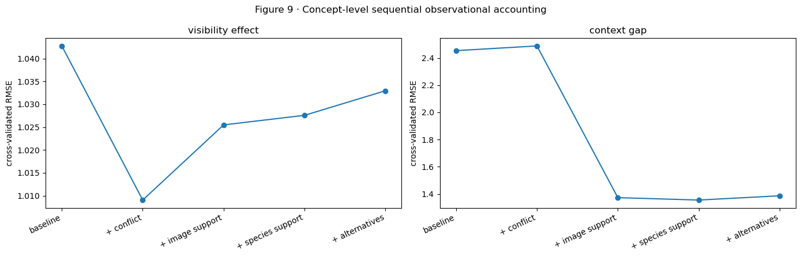


|  | shared_eligible_concepts | excluded_collapsed | minimum_visible_positive | minimum_hidden_positive | minimum_hidden_negative |
| --- | --- | --- | --- | --- | --- |
| 0 | 45 | 0 | 10 | 10 | 10 |


|  | outcome | stage | rmse | n_concepts |
| --- | --- | --- | --- | --- |
| 0 | visibility_effect | label_mask_conflict | 1.009 | 45 |
| 1 | visibility_effect | label_mask_conflict + n_positive | 1.025 | 45 |
| 2 | visibility_effect | label_mask_conflict + n_positive + species_sup... | 1.028 | 45 |
| 3 | visibility_effect | label_mask_conflict + n_positive + species_sup... | 1.033 | 45 |
| 4 | visibility_effect | intercept only | 1.043 | 45 |
| 5 | context_gap | label_mask_conflict | 2.488 | 45 |
| 6 | context_gap | label_mask_conflict + n_positive | 1.373 | 45 |
| 7 | context_gap | label_mask_conflict + n_positive + species_sup... | 1.355 | 45 |
| 8 | context_gap | label_mask_conflict + n_positive + species_sup... | 1.387 | 45 |
| 9 | context_gap | intercept only | 2.454 | 45 |


### Interpretation of Figure 9


- Observation: On the shared 45-concept population, conflict lowers visibility-effect RMSE from 1.043 to 1.009, while later additions worsen it to 1.033. For context_gap, conflict alone worsens 2.454 to 2.488; image support lowers it to 1.373, species support to 1.355, and alternatives worsen it to 1.387.


- Limitations. The comparison includes 45 eligible concepts. Correlated predictors and sequential inclusion make individual prediction increments dependent on model specification.


- Proposed follow-up: Replicate the predeclared model on independent seeds or datasets before treating the predictor ordering as stable.


- **Verdict:** **KEEP**.


- **Limited conclusion:** `ACCEPTED FOR held-out concept-level organization; conflict weakly predicts the visibility effect and support organizes context_gap, without causal percentages.`


- Subsequent analysis: Does species-dependent raw-z variation remain within concept and mask state?


## 10 · Species-associated logit variation within concept and mask state


**Question.** Does species explain raw-score variation within the same exact concept and visibility state?


**Variables and prediction.** First center `z` within each exact concept and visibility state, then summarize residual means by species. Persistent spread shows species-dependent contextual prediction beyond the current mask state.


**Method.** Require at least three rows for every displayed concept/state/species estimate.


**Inputs and model.** Accepted official Koh Joint ResNet-50 CUB70 Standard seed-1 final-test export, plus released CUB masks or original image-level labels when the figure names them. No diagnostic is trained. Means are subtracted within exact concept and mask state, then residuals are summarized by species.


Numerical record. The accompanying table reports the quantities summarized in the figure, including denominators and exclusions for each part and exact value.


### Figure 10 · Species-associated logit variation within concept and mask state


How to read the figure. First subtract the mean raw z for the same exact concept and visible/hidden state. Each point then summarizes one species. Zero means the species matches that controlled average; remaining spread means species still organizes the score. Because the analysis compares distinct natural photographs, the residual is interpreted as an observational association. A residual of +3 means that species lies three raw-logit units above the same concept-and-mask-state mean.


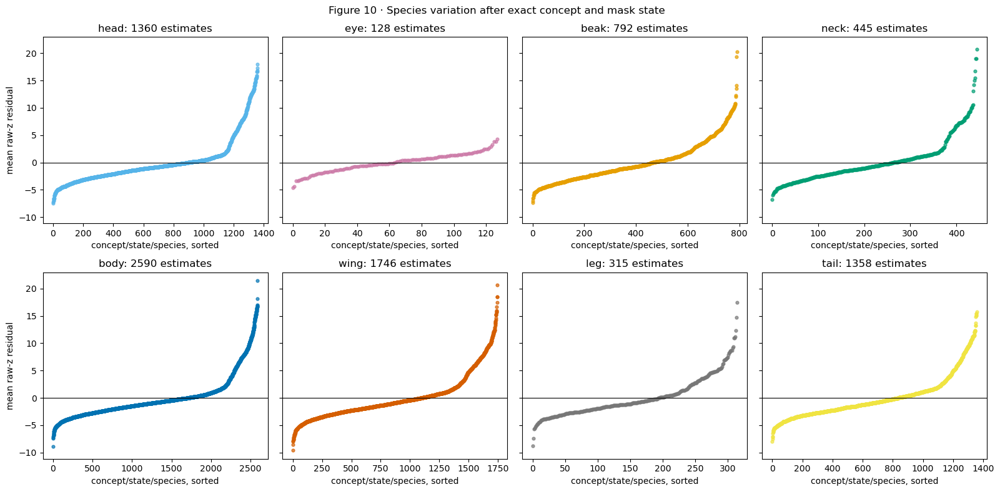


|  | min | median | max | std | count |
| --- | --- | --- | --- | --- | --- |
| mask_group |  |  |  |  |  |
| beak | -7.353 | -0.791 | 20.322 | 3.821 | 792 |
| body | -8.939 | -0.875 | 21.431 | 3.995 | 2590 |
| eye | -4.653 | 0.003 | 4.306 | 1.721 | 128 |
| head | -7.465 | -0.883 | 18.004 | 4.161 | 1360 |
| leg | -8.820 | -0.944 | 17.527 | 3.676 | 315 |
| neck | -6.844 | -0.705 | 20.725 | 4.119 | 445 |
| tail | -8.006 | -0.904 | 15.727 | 3.856 | 1358 |
| wing | -9.608 | -0.912 | 20.631 | 4.154 | 1746 |


### Interpretation of Figure 10


- Observation: After centering within exact concept and mask state, species-residual standard deviations are head 4.161, wing 4.154, neck 4.119, body 3.995, tail 3.856, beak 3.821, leg 3.676, and eye 1.721. Tail ranges from -8.006 to +15.727.


- Alternative explanation: Small or uneven concept/state/species cells and correlated pose/background can produce extreme descriptive residuals.


- Proposed follow-up: Require held-out image prediction and shrunken estimates before giving species generalizing explanatory credit.


- **Verdict:** **KEEP**.


- **Limited conclusion:** `ACCEPTED FOR a descriptive species association after exact concept and mask state.`


- Subsequent analysis: Does species reduce held-out row-level prediction error?


## 11 · Sequential prediction of logits from concept, mask, and species variables


**Question.** What remains after row-level visibility and species are added sequentially?


Variables and prediction. Predict raw z on stable held-out image folds: exact concept baseline, then mask visibility/area, then species. A reduction in held-out error shows organization by that block; remaining error quantifies the unexplained predictive variation under this model.


**Method.** Use training-fold shrunken group means and identical rows at every stage.


Inputs and model. Accepted official Koh Joint ResNet-50 CUB70 Standard seed-1 final-test export, plus released CUB masks or original image-level labels when the figure names them. New fold-specific group-mean prediction rules are estimated after the CBM is frozen. They predict raw z on held-out images with the CBM held fixed.


Numerical record. The accompanying table reports the quantities summarized in the figure, including denominators and exclusions for each part and exact value.


### Figure 11 · Sequential prediction of logits from concept, mask, and species variables


How to read the figure. The y-axis is held-out raw- z prediction error; lower is better. The same image rows are used throughout. Start with exact concept identity, add mask visibility and area, then add species. Each decrease measures extra predictive organization on unseen images. Remaining error may reflect unmeasured covariates, model limitations, and stochastic variation. RMSE 3.3 to 3.1 means the added block improves unseen-image prediction by 0.2 logit units.


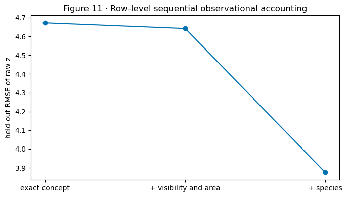


|  | stage | rmse | mae |
| --- | --- | --- | --- |
| 0 | exact concept | 4.672 | 3.405 |
| 1 | + visibility and area | 4.642 | 3.376 |
| 2 | + species | 3.875 | 2.960 |


### Interpretation of Figure 11


- Observation: Held-out raw-z RMSE changes from 4.672 with exact concept alone to 4.642 after visibility/area and 3.875 after species; MAE changes from 3.405 to 3.376 to 2.960.


- Alternative explanation. Species identifiers can encode differences in pose, habitat, background, and image collection. Additional controls are required to distinguish these contributions.


- Proposed follow-up: A matched relabel/retrain or valid same-image intervention would be needed for a causal claim; neither is accepted for CUB yet.


- **Verdict:** **KEEP**.


- **Limited conclusion:** `ACCEPTED FOR generalizing contextual organization by species beyond exact concept and released-mask state; the causal source remains unresolved.`


- Subsequent analysis: Which exact concepts carry the measured conflict, error, visibility, context, and species patterns?


## Definitions and interpretation of the comparative measurements


The aligned figures deliberately put anatomical groups in the same row order, and each panel retains its own estimand. FunnyBird has controlled part replacement; CUB has natural photographs and released masks. We therefore match the scientific question while naming the weaker CUB approximation.


| Scientific question | FunnyBird measurement | CUB measurement | Same operation? |
| --- | --- | --- | --- |
| Are labels present without visible part evidence? | renderer-derived label/visibility conflict | positive label with mapped mask absent | related; CUB masks are noisier |
| Is the concept output usable? | raw- z spread, balanced accuracy, positive recall | the same health checks | yes |
| Do named pixels affect the score? | controlled response_delta after donor insertion | visible-minus-hidden raw- z difference | no; CUB compares different photographs |
| Does context remain after local evidence is limited? | donorward response occurs but old source still wins | hidden positive-minus-negative raw- z gap | no; only FunnyBird has a donor/source margin |
| Does species still organize the score? | source-species residual after exact source/donor values | species residual after exact concept and mask state | related and observational |
| Is the exact inserted value recognized? | controlled post-swap value confusion | no clean equivalent | unavailable in CUB |


### Concept prediction performance


For exact concept `j`, the model predicts positive when `z_ij>0`. Balanced
accuracy gives positive and negative examples equal weight:


`balanced_accuracy = (positive recall + negative recall) / 2`.


If 70% of positive examples and 80% of negative examples are correct, balanced accuracy is (0.70+0.80)/2 = 0.75 ; the aligned summary plots ordinary concept error 1-0.75 = 0.25 . A larger error indicates poorer label agreement. Contextual prediction, limited local evidence, and annotation noise remain possible explanations.


The operational variation criterion is Q95(z)−Q05(z)<=1e−8. For illustration, an output equal to 2.1 on every image has positive recall 1, negative recall 0, and balanced accuracy 0.5. Such an output supplies no variation over the evaluated images and is excluded from positive grounding interpretations.


Eligibility and reporting. Output variation is evaluated for the checkpoint represented in this report. Any output meeting the stated collapse criterion is listed with its spread, recalls, and balanced accuracy and excluded from positive grounding summaries.


### Direction of each CUB panel


| Panel type | A larger value means | Interpretation |
| --- | --- | --- |
| Data check: positive label / mask absent | more positive labels lack a usable mapped mask | possible label/visibility conflict, but also possible missing annotation |
| Health check: ordinary concept error | worse positive/negative prediction | weak or difficult output; not automatically backwash |
| Local evidence: visible - hidden raw z | positive examples score higher when the region is visible | evidence that local pixels help; usually a good grounding sign |
| Context evidence: hidden positive - negative raw z | labels remain separated when the mapped mask is absent | context or unmeasured pixels remain informative |
| Species context: residual spread | species shift z after exact concept and mask state are centered | species-associated organization remains |


These quantities have distinct units and conditioning populations. They are reported separately. Consistent patterns across groups can motivate observational hypotheses for subsequent controlled testing.


## 11a · Exact-concept comparison across observational measurements


**Question.** Which exact CUB concepts carry each measured problem?


**Variables and prediction.** Align the same exact-concept rows across mask absence, ordinary concept error, visible-minus-hidden raw-z difference, hidden context gap, and within-concept species residual spread. If one anatomical family repeatedly contains the largest values, its coarse ranking reflects consistent exact concepts. Mixed rows show that coarse aggregation hides value-specific behavior.


**Method.** Retain all mask-testable exact concepts; leave unsupported measurements blank and show the exact denominators in the table.


**Inputs and model.** Accepted official Koh Joint ResNet-50 CUB70 Standard seed-1 final-test export, plus released CUB masks or original image-level labels when the figure names them. No new model is fitted; this aligns measurements already computed in earlier figures.


Numerical record. The accompanying table reports the quantities summarized in the figure, including denominators and exclusions for each part and exact value.


### Figure 11a · Exact-concept comparison across observational measurements


How to read the figure. Every row is one exact mask-testable CUB concept, such as has_tail_pattern::striped , and the row order is identical across all five panels. Color identifies the coarse mask group. Panel A is the fraction of positive labels with the mapped mask absent. Panel B is ordinary classification error 1-balanced_accuracy . Panel C is visible-minus-hidden raw z among positive labels. Panel D is hidden-positive minus hidden-negative raw z . Panel E is the standard deviation of species residuals after exact concept and mask state are centered. Blank positions mean that exact concept lacked the required visible/hidden/species support; those measurements are unavailable.


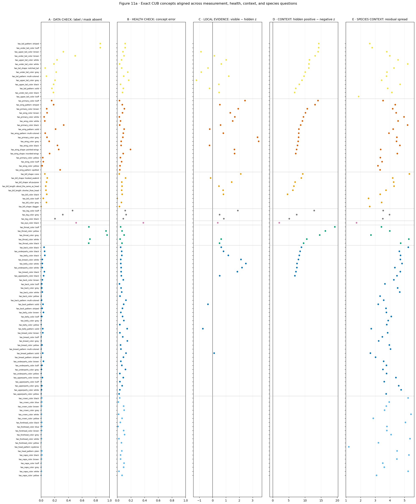


|  | mask_group | attribute_type | concept_name | n_positive | n_hidden | label_mask_conflict | health_n_positive | health_n_negative | classification_error | n_visible | visibility_effect | n_hidden_negative | context_gap | n_species_cells | species_residual_sd |
| --- | --- | --- | --- | --- | --- | --- | --- | --- | --- | --- | --- | --- | --- | --- | --- |
| 0 | tail | has_tail_pattern | has_tail_pattern::striped | 30 | 26 | 0.867 | 30 | 1946 | 0.117 | 4 | NaN | 330 | 14.282 | 97 | 2.625 |
| 1 | tail | has_under_tail_color | has_under_tail_color::buff | 30 | 26 | 0.867 | 30 | 1946 | 0.117 | 4 | NaN | 330 | 14.253 | 97 | 2.787 |
| 2 | tail | has_upper_tail_color | has_upper_tail_color::brown | 144 | 47 | 0.326 | 145 | 1831 | 0.084 | 97 | -0.871 | 309 | 14.076 | 97 | 3.786 |
| 3 | tail | has_under_tail_color | has_under_tail_color::brown | 144 | 72 | 0.500 | 145 | 1831 | 0.100 | 72 | 0.133 | 284 | 13.151 | 97 | 3.993 |
| 4 | tail | has_upper_tail_color | has_upper_tail_color::white | 256 | 60 | 0.234 | 260 | 1716 | 0.064 | 196 | 1.018 | 296 | 11.394 | 97 | 4.557 |
| 5 | tail | has_under_tail_color | has_under_tail_color::white | 385 | 73 | 0.190 | 389 | 1587 | 0.036 | 312 | 0.654 | 283 | 11.235 | 97 | 5.219 |
| 6 | tail | has_tail_shape | has_tail_shape::notched_tail | 425 | 26 | 0.061 | 457 | 1519 | 0.066 | 399 | -0.347 | 330 | 11.195 | 97 | 4.280 |
| 7 | tail | has_under_tail_color | has_under_tail_color::grey | 234 | 52 | 0.222 | 234 | 1742 | 0.155 | 182 | -0.851 | 304 | 10.079 | 97 | 3.798 |
| 8 | tail | has_tail_pattern | has_tail_pattern::multi-colored | 251 | 20 | 0.080 | 255 | 1721 | 0.096 | 231 | 1.212 | 336 | 9.714 | 97 | 3.770 |
| 9 | tail | has_upper_tail_color | has_upper_tail_color::grey | 264 | 54 | 0.205 | 287 | 1689 | 0.168 | 210 | -1.211 | 302 | 9.083 | 97 | 3.435 |
| 10 | tail | has_upper_tail_color | has_upper_tail_color::black | 814 | 150 | 0.184 | 850 | 1126 | 0.049 | 664 | 0.468 | 206 | 8.244 | 97 | 4.699 |
| 11 | tail | has_tail_pattern | has_tail_pattern::solid | 991 | 158 | 0.159 | 1023 | 953 | 0.090 | 833 | -0.229 | 198 | 7.153 | 97 | 3.849 |
| 12 | tail | has_under_tail_color | has_under_tail_color::black | 1010 | 183 | 0.181 | 1069 | 907 | 0.078 | 827 | 0.487 | 173 | 6.810 | 97 | 4.137 |
| 13 | tail | has_upper_tail_color | has_upper_tail_color::buff | 0 | 0 | NaN | 0 | 1976 | NaN | 0 | NaN | 356 | NaN | 97 | 1.863 |
| 14 | wing | has_primary_color | has_primary_color::buff | 90 | 14 | 0.156 | 90 | 1886 | 0.034 | 76 | 2.431 | 279 | 14.040 | 97 | 3.533 |
| 15 | wing | has_wing_pattern | has_wing_pattern::striped | 130 | 24 | 0.185 | 130 | 1846 | 0.075 | 106 | 0.545 | 269 | 13.126 | 97 | 4.366 |
| 16 | wing | has_primary_color | has_primary_color::brown | 203 | 17 | 0.084 | 234 | 1742 | 0.105 | 186 | 1.922 | 276 | 10.726 | 97 | 4.193 |
| 17 | wing | has_wing_color | has_wing_color::brown | 292 | 26 | 0.089 | 293 | 1683 | 0.078 | 266 | 1.326 | 267 | 10.157 | 97 | 4.429 |
| 18 | wing | has_primary_color | has_primary_color::white | 501 | 23 | 0.046 | 501 | 1475 | 0.032 | 478 | 1.668 | 270 | 9.541 | 97 | 4.968 |
| 19 | wing | has_wing_color | has_wing_color::white | 413 | 23 | 0.056 | 417 | 1559 | 0.049 | 390 | 1.508 | 270 | 9.222 | 97 | 4.560 |
| 20 | wing | has_primary_color | has_primary_color::black | 618 | 205 | 0.332 | 650 | 1326 | 0.037 | 413 | 0.597 | 88 | 8.674 | 97 | 5.210 |
| 21 | wing | has_wing_pattern | has_wing_pattern::solid | 695 | 148 | 0.213 | 720 | 1256 | 0.102 | 547 | -0.215 | 145 | 8.122 | 97 | 4.224 |
| 22 | wing | has_wing_pattern | has_wing_pattern::multi-colored | 489 | 30 | 0.061 | 521 | 1455 | 0.089 | 459 | 0.805 | 263 | 8.078 | 97 | 3.935 |
| 23 | wing | has_primary_color | has_primary_color::grey | 377 | 33 | 0.088 | 400 | 1576 | 0.083 | 344 | 3.370 | 260 | 8.037 | 97 | 4.477 |
| 24 | wing | has_wing_color | has_wing_color::grey | 377 | 45 | 0.119 | 400 | 1576 | 0.059 | 332 | 3.454 | 248 | 7.897 | 97 | 4.454 |
| 25 | wing | has_wing_color | has_wing_color::black | 823 | 198 | 0.241 | 859 | 1117 | 0.057 | 625 | -0.231 | 95 | 7.692 | 97 | 4.683 |
| 26 | wing | has_wing_shape | has_wing_shape::pointed-wings | 193 | 50 | 0.259 | 193 | 1783 | 0.195 | 143 | 1.637 | 243 | 7.421 | 97 | 3.371 |
| 27 | wing | has_wing_shape | has_wing_shape::rounded-wings | 581 | 73 | 0.126 | 610 | 1366 | 0.088 | 508 | 1.648 | 220 | 7.152 | 97 | 4.508 |
| 28 | wing | has_primary_color | has_primary_color::yellow | 115 | 3 | 0.026 | 119 | 1857 | 0.047 | 112 | NaN | 290 | NaN | 97 | 3.348 |
| 29 | wing | has_wing_color | has_wing_color::buff | 119 | 4 | 0.034 | 119 | 1857 | 0.065 | 115 | NaN | 289 | NaN | 97 | 3.465 |
| 30 | wing | has_wing_color | has_wing_color::yellow | 60 | 1 | 0.017 | 60 | 1916 | 0.042 | 59 | NaN | 292 | NaN | 97 | 3.184 |
| 31 | wing | has_wing_pattern | has_wing_pattern::spotted | 25 | 7 | 0.280 | 26 | 1950 | 0.039 | 18 | NaN | 286 | NaN | 97 | 3.330 |
| 32 | beak | has_bill_shape | has_bill_shape::cone | 429 | 24 | 0.056 | 461 | 1515 | 0.030 | 405 | 2.111 | 109 | 9.315 | 88 | 5.332 |
| 33 | beak | has_bill_shape | has_bill_shape::hooked_seabird | 306 | 28 | 0.092 | 308 | 1668 | 0.123 | 278 | -0.151 | 105 | 8.877 | 88 | 4.194 |
| 34 | beak | has_bill_shape | has_bill_shape::all-purpose | 533 | 43 | 0.081 | 586 | 1390 | 0.067 | 490 | 1.432 | 90 | 6.949 | 88 | 4.259 |
| 35 | beak | has_bill_length | has_bill_length::about_the_same_as_head | 812 | 56 | 0.069 | 814 | 1162 | 0.071 | 756 | 0.476 | 77 | 6.577 | 88 | 4.284 |
| 36 | beak | has_bill_length | has_bill_length::shorter_than_head | 926 | 67 | 0.072 | 1012 | 964 | 0.066 | 859 | 0.789 | 66 | 6.259 | 88 | 3.735 |
| 37 | beak | has_bill_color | has_bill_color::black | 927 | 78 | 0.084 | 982 | 994 | 0.073 | 849 | 0.813 | 55 | 4.611 | 88 | 3.336 |
| 38 | beak | has_bill_color | has_bill_color::buff | 30 | 1 | 0.033 | 30 | 1946 | 0.000 | 29 | NaN | 132 | NaN | 88 | 2.541 |
| 39 | beak | has_bill_color | has_bill_color::grey | 88 | 7 | 0.080 | 116 | 1860 | 0.062 | 81 | NaN | 126 | NaN | 88 | 3.436 |
| 40 | beak | has_bill_shape | has_bill_shape::dagger | 30 | 0 | 0.000 | 30 | 1946 | 0.033 | 30 | NaN | 133 | NaN | 88 | 2.621 |
| 41 | leg | has_leg_color | has_leg_color::buff | 78 | 36 | 0.462 | 78 | 1898 | 0.118 | 42 | 1.893 | 425 | 12.867 | 105 | 3.543 |
| 42 | leg | has_leg_color | has_leg_color::grey | 389 | 124 | 0.319 | 417 | 1559 | 0.131 | 265 | 0.525 | 337 | 7.453 | 105 | 3.977 |
| 43 | leg | has_leg_color | has_leg_color::black | 845 | 173 | 0.205 | 878 | 1098 | 0.090 | 672 | 0.842 | 288 | 5.142 | 105 | 3.518 |
| 44 | eye | has_eye_color | has_eye_color::black | 1720 | 884 | 0.514 | 1808 | 168 | 0.382 | 836 | 0.386 | 123 | 2.050 | 128 | 1.721 |
| 45 | neck | has_throat_color | has_throat_color::buff | 30 | 21 | 0.700 | 30 | 1946 | 0.050 | 9 | NaN | 1446 | 19.250 | 89 | 3.422 |
| 46 | neck | has_throat_color | has_throat_color::yellow | 81 | 77 | 0.951 | 85 | 1891 | 0.071 | 4 | NaN | 1390 | 16.317 | 89 | 3.994 |
| 47 | neck | has_throat_color | has_throat_color::grey | 59 | 57 | 0.966 | 59 | 1917 | 0.102 | 2 | NaN | 1410 | 14.574 | 89 | 2.708 |
| 48 | neck | has_throat_color | has_throat_color::white | 506 | 362 | 0.715 | 506 | 1470 | 0.043 | 144 | 0.644 | 1105 | 10.573 | 89 | 5.294 |
| 49 | neck | has_throat_color | has_throat_color::black | 516 | 360 | 0.698 | 518 | 1458 | 0.070 | 156 | 0.519 | 1107 | 9.583 | 89 | 4.738 |
| 50 | body | has_back_color | has_back_color::black | 618 | 28 | 0.045 | 620 | 1356 | 0.051 | 590 | 0.648 | 13 | 8.917 | 70 | 5.258 |
| 51 | body | has_underparts_color | has_underparts_color::black | 457 | 24 | 0.053 | 489 | 1487 | 0.066 | 433 | 0.819 | 17 | 8.505 | 70 | 4.646 |
| 52 | body | has_belly_color | has_belly_color::black | 427 | 24 | 0.056 | 459 | 1517 | 0.068 | 403 | 1.179 | 17 | 8.250 | 70 | 4.727 |
| 53 | body | has_breast_color | has_breast_color::white | 619 | 12 | 0.019 | 619 | 1357 | 0.052 | 607 | 2.129 | 29 | 7.981 | 70 | 4.717 |
| 54 | body | has_belly_color | has_belly_color::white | 617 | 12 | 0.019 | 617 | 1359 | 0.053 | 605 | 2.495 | 29 | 7.549 | 70 | 4.831 |
| 55 | body | has_underparts_color | has_underparts_color::white | 649 | 12 | 0.018 | 649 | 1327 | 0.058 | 637 | 2.206 | 29 | 7.504 | 70 | 4.341 |
| 56 | body | has_breast_color | has_breast_color::black | 465 | 23 | 0.049 | 497 | 1479 | 0.058 | 442 | 1.857 | 18 | 7.215 | 70 | 4.713 |
| 57 | body | has_upperparts_color | has_upperparts_color::black | 754 | 29 | 0.038 | 790 | 1186 | 0.061 | 725 | 0.534 | 12 | 6.891 | 70 | 4.485 |
| 58 | body | has_back_color | has_back_color::brown | 292 | 6 | 0.021 | 323 | 1653 | 0.089 | 286 | NaN | 35 | NaN | 70 | 4.271 |
| 59 | body | has_back_color | has_back_color::buff | 90 | 1 | 0.011 | 90 | 1886 | 0.034 | 89 | NaN | 40 | NaN | 70 | 3.662 |
| 60 | body | has_back_color | has_back_color::grey | 435 | 5 | 0.011 | 458 | 1518 | 0.057 | 430 | NaN | 36 | NaN | 70 | 4.531 |
| 61 | body | has_back_color | has_back_color::white | 210 | 4 | 0.019 | 210 | 1766 | 0.066 | 206 | NaN | 37 | NaN | 70 | 4.675 |
| 62 | body | has_back_color | has_back_color::yellow | 56 | 0 | 0.000 | 60 | 1916 | 0.042 | 56 | NaN | 41 | NaN | 70 | 3.331 |
| 63 | body | has_back_pattern | has_back_pattern::multi-colored | 120 | 1 | 0.008 | 148 | 1828 | 0.128 | 119 | NaN | 40 | NaN | 70 | 3.578 |
| 64 | body | has_back_pattern | has_back_pattern::solid | 1135 | 33 | 0.029 | 1164 | 812 | 0.095 | 1102 | -0.347 | 8 | NaN | 70 | 3.203 |
| 65 | body | has_back_pattern | has_back_pattern::striped | 119 | 2 | 0.017 | 119 | 1857 | 0.077 | 117 | NaN | 39 | NaN | 70 | 3.735 |
| 66 | body | has_belly_color | has_belly_color::brown | 84 | 3 | 0.036 | 85 | 1891 | 0.054 | 81 | NaN | 38 | NaN | 70 | 3.761 |
| 67 | body | has_belly_color | has_belly_color::buff | 179 | 2 | 0.011 | 202 | 1774 | 0.079 | 177 | NaN | 39 | NaN | 70 | 4.095 |
| 68 | body | has_belly_color | has_belly_color::grey | 209 | 0 | 0.000 | 209 | 1767 | 0.098 | 209 | NaN | 41 | NaN | 70 | 3.885 |
| 69 | body | has_belly_color | has_belly_color::yellow | 115 | 0 | 0.000 | 119 | 1857 | 0.039 | 115 | NaN | 41 | NaN | 70 | 3.787 |
| 70 | body | has_belly_pattern | has_belly_pattern::solid | 1428 | 37 | 0.026 | 1515 | 461 | 0.146 | 1391 | -0.730 | 4 | NaN | 70 | 2.726 |
| 71 | body | has_breast_color | has_breast_color::brown | 114 | 3 | 0.026 | 115 | 1861 | 0.040 | 111 | NaN | 38 | NaN | 70 | 3.847 |
| 72 | body | has_breast_color | has_breast_color::buff | 88 | 0 | 0.000 | 111 | 1865 | 0.082 | 88 | NaN | 41 | NaN | 70 | 3.484 |
| 73 | body | has_breast_color | has_breast_color::grey | 149 | 0 | 0.000 | 149 | 1827 | 0.149 | 149 | NaN | 41 | NaN | 70 | 3.234 |
| 74 | body | has_breast_color | has_breast_color::yellow | 141 | 2 | 0.014 | 145 | 1831 | 0.049 | 139 | NaN | 39 | NaN | 70 | 3.964 |
| 75 | body | has_breast_pattern | has_breast_pattern::multi-colored | 120 | 0 | 0.000 | 120 | 1856 | 0.055 | 120 | NaN | 41 | NaN | 70 | 4.044 |
| 76 | body | has_breast_pattern | has_breast_pattern::solid | 1425 | 36 | 0.025 | 1482 | 494 | 0.129 | 1389 | 0.116 | 5 | NaN | 70 | 2.668 |
| 77 | body | has_breast_pattern | has_breast_pattern::striped | 11 | 0 | 0.000 | 11 | 1965 | 0.091 | 11 | NaN | 41 | NaN | 70 | 3.020 |
| 78 | body | has_underparts_color | has_underparts_color::brown | 84 | 3 | 0.036 | 85 | 1891 | 0.054 | 81 | NaN | 38 | NaN | 70 | 3.574 |
| 79 | body | has_underparts_color | has_underparts_color::buff | 147 | 2 | 0.014 | 170 | 1806 | 0.068 | 145 | NaN | 39 | NaN | 70 | 3.764 |
| 80 | body | has_underparts_color | has_underparts_color::grey | 160 | 1 | 0.006 | 160 | 1816 | 0.121 | 159 | NaN | 40 | NaN | 70 | 3.525 |
| 81 | body | has_underparts_color | has_underparts_color::yellow | 115 | 0 | 0.000 | 119 | 1857 | 0.039 | 115 | NaN | 41 | NaN | 70 | 3.774 |
| 82 | body | has_upperparts_color | has_upperparts_color::brown | 290 | 6 | 0.021 | 291 | 1685 | 0.089 | 284 | NaN | 35 | NaN | 70 | 4.413 |
| 83 | body | has_upperparts_color | has_upperparts_color::buff | 89 | 0 | 0.000 | 89 | 1887 | 0.040 | 89 | NaN | 41 | NaN | 70 | 3.613 |
| 84 | body | has_upperparts_color | has_upperparts_color::grey | 523 | 6 | 0.011 | 546 | 1430 | 0.073 | 517 | NaN | 35 | NaN | 70 | 4.604 |
| 85 | body | has_upperparts_color | has_upperparts_color::white | 297 | 2 | 0.007 | 297 | 1679 | 0.039 | 295 | NaN | 39 | NaN | 70 | 4.769 |
| 86 | body | has_upperparts_color | has_upperparts_color::yellow | 86 | 0 | 0.000 | 90 | 1886 | 0.028 | 86 | NaN | 41 | NaN | 70 | 3.746 |
| 87 | head | has_crown_color | has_crown_color::black | 705 | 8 | 0.011 | 741 | 1235 | 0.037 | 697 | NaN | 5 | NaN | 68 | 5.246 |
| 88 | head | has_crown_color | has_crown_color::blue | 88 | 1 | 0.011 | 116 | 1860 | 0.018 | 87 | NaN | 12 | NaN | 68 | 3.954 |
| 89 | head | has_crown_color | has_crown_color::brown | 114 | 1 | 0.009 | 145 | 1831 | 0.094 | 113 | NaN | 12 | NaN | 68 | 3.755 |
| 90 | head | has_crown_color | has_crown_color::grey | 177 | 0 | 0.000 | 200 | 1776 | 0.102 | 177 | NaN | 13 | NaN | 68 | 3.637 |
| 91 | head | has_crown_color | has_crown_color::white | 319 | 2 | 0.006 | 319 | 1657 | 0.021 | 317 | NaN | 11 | NaN | 68 | 5.444 |
| 92 | head | has_crown_color | has_crown_color::yellow | 52 | 0 | 0.000 | 56 | 1920 | 0.071 | 52 | NaN | 13 | NaN | 68 | 2.864 |
| 93 | head | has_forehead_color | has_forehead_color::black | 731 | 8 | 0.011 | 767 | 1209 | 0.046 | 723 | NaN | 5 | NaN | 68 | 5.063 |
| 94 | head | has_forehead_color | has_forehead_color::blue | 88 | 1 | 0.011 | 116 | 1860 | 0.013 | 87 | NaN | 12 | NaN | 68 | 3.798 |
| 95 | head | has_forehead_color | has_forehead_color::brown | 114 | 1 | 0.009 | 145 | 1831 | 0.095 | 113 | NaN | 12 | NaN | 68 | 3.792 |
| 96 | head | has_forehead_color | has_forehead_color::grey | 158 | 0 | 0.000 | 181 | 1795 | 0.108 | 158 | NaN | 13 | NaN | 68 | 4.083 |
| 97 | head | has_forehead_color | has_forehead_color::white | 319 | 2 | 0.006 | 319 | 1657 | 0.025 | 317 | NaN | 11 | NaN | 68 | 5.376 |
| 98 | head | has_forehead_color | has_forehead_color::yellow | 56 | 0 | 0.000 | 56 | 1920 | 0.062 | 56 | NaN | 13 | NaN | 68 | 3.218 |
| 99 | head | has_head_pattern | has_head_pattern::eyebrow | 0 | 0 | NaN | 0 | 1976 | NaN | 0 | NaN | 13 | NaN | 68 | 1.192 |
| 100 | head | has_head_pattern | has_head_pattern::plain | 763 | 9 | 0.012 | 765 | 1211 | 0.068 | 754 | NaN | 4 | NaN | 68 | 4.492 |
| 101 | head | has_nape_color | has_nape_color::black | 592 | 8 | 0.014 | 594 | 1382 | 0.050 | 584 | NaN | 5 | NaN | 68 | 5.301 |
| 102 | head | has_nape_color | has_nape_color::brown | 173 | 1 | 0.006 | 174 | 1802 | 0.050 | 172 | NaN | 12 | NaN | 68 | 4.479 |
| 103 | head | has_nape_color | has_nape_color::buff | 90 | 0 | 0.000 | 90 | 1886 | 0.101 | 90 | NaN | 13 | NaN | 68 | 3.514 |
| 104 | head | has_nape_color | has_nape_color::grey | 178 | 0 | 0.000 | 201 | 1775 | 0.095 | 178 | NaN | 13 | NaN | 68 | 3.617 |
| 105 | head | has_nape_color | has_nape_color::white | 349 | 2 | 0.006 | 349 | 1627 | 0.026 | 347 | NaN | 11 | NaN | 68 | 5.247 |
| 106 | head | has_nape_color | has_nape_color::yellow | 52 | 0 | 0.000 | 56 | 1920 | 0.071 | 52 | NaN | 13 | NaN | 68 | 3.087 |


### Interpretation of Figure 11a


- Observation: The aligned exact-concept rows are heterogeneous. Tail mask absence ranges from 0.061 to 0.867 and tail visibility effects from -1.211 to +1.212; eye has the largest ordinary error while neck carries the largest context gaps.


- Interpretation. Alignment identifies concepts with coincident measurements. Establishing causal relations between those measurements requires additional interventions.


- Follow-up comparison. Use all eligible exact concepts, their denominators, and the held-out predictive tests.


- **Verdict:** **KEEP**.


- Scope: ACCEPTED FOR describing heterogeneity among exact concepts within coarse anatomical groups.


- Subsequent analysis: Do the same measurements form a stable anatomical-group pattern?


## 11b · Group-level summaries of the observational measurements


**Question.** How are the available CUB contributors distributed across coarse anatomical groups?


**Variables and prediction.** Use the same anatomical order wherever possible and report five distinct quantities: positive-label/mask-absence rate, median exact-concept classification difficulty, median natural visibility effect, median hidden context gap, and species-residual spread. If CUB behaves like a simple diluted copy of FunnyBird, the same groups should repeatedly rank as difficult. If rankings differ, the contributors are distributed across concepts and cannot be reduced to one tail-to-wing grounding order.


Method. Report each panel with its own definition, units, and eligibility count.


**Inputs and model.** Accepted official Koh Joint ResNet-50 CUB70 Standard seed-1 final-test export, plus released CUB masks or original image-level labels when the figure names them. No new model is fitted; this aggregates earlier exact-concept measurements into coarse anatomical groups.


Numerical record. The accompanying table reports the quantities summarized in the figure, including denominators and exclusions for each part and exact value.


### Figure 11b · Group-level summaries of the observational measurements


How to read the figure. Every panel uses the same coarse-group order: tail, wing, beak, leg, eye, neck, body, head. Panel A is the positive-label/mapped-mask-absence fraction. Panel B is 1 - median balanced accuracy across non-collapsed exact concepts. Panel C is the median visible-minus-hidden raw-z association. Panel D is the median hidden-positive-minus-hidden-negative context gap. Panel E is the standard deviation of species residuals after exact concept and mask state are centered. Higher means more of the named quantity, and each panel retains its own units and observational estimand.


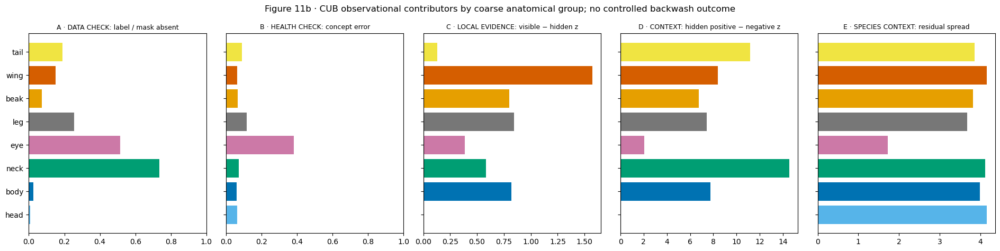


|  | n_hidden | n_positive | label_mask_absence_rate | median_balanced_accuracy | n_health_concepts | median_classification_error | median_visibility_effect | n_visibility_concepts | median_context_gap | n_context_concepts | species_residual_sd | n_species_cells |
| --- | --- | --- | --- | --- | --- | --- | --- | --- | --- | --- | --- | --- |
| mask_group |  |  |  |  |  |  |  |  |  |  |  |  |
| tail | 947 | 4978 | 0.190 | 0.910 | 13 | 0.090 | 0.133 | 11.0 | 11.195 | 13.0 | 3.856 | 1358 |
| wing | 924 | 6101 | 0.151 | 0.938 | 18 | 0.062 | 1.572 | 14.0 | 8.398 | 14.0 | 4.154 | 1746 |
| beak | 304 | 4081 | 0.074 | 0.934 | 9 | 0.066 | 0.801 | 6.0 | 6.763 | 6.0 | 3.821 | 792 |
| leg | 333 | 1312 | 0.254 | 0.882 | 3 | 0.118 | 0.842 | 3.0 | 7.453 | 3.0 | 3.676 | 315 |
| eye | 884 | 1720 | 0.514 | 0.618 | 1 | 0.382 | 0.386 | 1.0 | 2.050 | 1.0 | 1.721 | 128 |
| neck | 877 | 1192 | 0.736 | 0.930 | 5 | 0.070 | 0.582 | 2.0 | 14.574 | 5.0 | 4.119 | 445 |
| body | 319 | 12917 | 0.025 | 0.939 | 37 | 0.061 | 0.819 | 11.0 | 7.765 | 8.0 | 3.995 | 2590 |
| head | 44 | 5118 | 0.009 | 0.938 | 19 | 0.062 | NaN | NaN | NaN | NaN | 4.161 | 1360 |


**How to read this comparison.** Each panel answers a different question and uses different units. Larger values mean more mask disagreement in A, worse ordinary concept classification in B, a larger visible-minus-hidden association in C, more separation without the mapped mask in D, and more species-to-species variation after concept/visibility centering in E. None is a CUB swap failure rate.


**Observed rank orders after coarse grouping.** Mask absence: neck > eye > leg > tail > wing > beak > body > head. Concept error: eye > leg > tail > neck > beak > head > wing > body. Hidden context gap: neck > tail > wing > body > leg > beak > eye. Species residual spread: head > wing > neck > body > tail > beak > leg > eye.


Scope. Similar group rankings would indicate repeated associations across measurements. Different rankings indicate heterogeneity in the observed patterns. The analysis remains observational.


### Interpretation of Figure 11b


- Observation: The group rankings cross: neck has the largest mask-absence rate and context gap; eye has the largest ordinary error; wing the largest visibility effect; head the largest species-residual spread. Tail has the smallest positive visibility median and the second-largest context gap, with different rankings on the remaining measures.


- Alternative explanation: Coarse-group medians can hide opposite exact-concept effects and the five panels use different units and denominators.


- Proposed follow-up: Return to Figure 11a whenever a group-level bar suggests a common explanation.


- **Verdict:** **KEEP**.


- Scope: ACCEPTED FOR describing group-specific observational patterns in CUB70.


- Subsequent analysis: Do selected photographs show physical occlusion or released-mask limitations?


## 12 · Image-level assessment of selected numerical extremes


**Question.** Do the numerical extremes correspond to pose, coarse masks, collapse, or contextual prediction?


**Variables and prediction.** Select cases by declared numerical rules: high conflict/high context gap, high conflict/low gap, strong positive visibility effect, and negative visibility effect. The photograph and all 11 masks must be inspected before assigning an explanation.


**Method.** Display original image, complete mask overlay, exact variables, species, and sample counts.


**Inputs and model.** Accepted official Koh Joint ResNet-50 CUB70 Standard seed-1 final-test export, plus released CUB masks or original image-level labels when the figure names them. No diagnostic is trained. Examples are selected by declared numerical rules from earlier figures, never by visual preference.


Numerical record. The accompanying table reports the quantities summarized in the figure, including denominators and exclusions for each part and exact value.


### Figure 12 · Image-level assessment of selected numerical extremes


How to read the figure. Each case occupies two rows: a mapped-mask-absent positive image followed by a mapped-mask-visible positive image for the same exact concept. Columns are the photograph, the mapped-region overlay, and every available released-mask overlay. Titles give species, exact concept, c , c_hat , raw z , and mapped area; tables give the selection rule and denominators. The images permit assessment of plausible occlusion, annotation limitations, and other visual differences. Collapsed concepts are excluded.


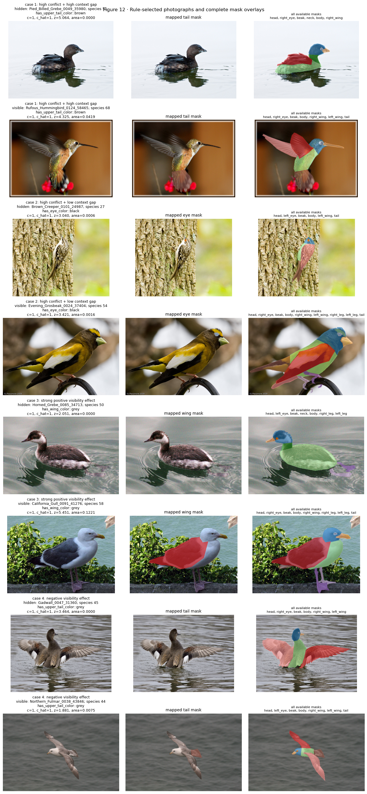


|  | selection_rule | conflict_q75_threshold | concept_name | mask_group | label_mask_conflict | visibility_effect | context_gap | n_visible | n_hidden | n_hidden_negative |
| --- | --- | --- | --- | --- | --- | --- | --- | --- | --- | --- |
| 0 | high conflict + high context gap | 0.222 | has_upper_tail_color::brown | tail | 0.326 | -0.871 | 14.076 | 97 | 47 | 309 |
| 1 | high conflict + low context gap | 0.222 | has_eye_color::black | eye | 0.514 | 0.386 | 2.050 | 836 | 884 | 123 |
| 2 | strong positive visibility effect | 0.222 | has_wing_color::grey | wing | 0.119 | 3.454 | 7.897 | 332 | 45 | 248 |
| 3 | negative visibility effect | 0.222 | has_upper_tail_color::grey | tail | 0.205 | -1.211 | 9.083 | 210 | 54 | 302 |


|  | case | rule | state | image | species | concept_name | mask_group | c | c_hat | z | area_frac | label_mask_conflict | visibility_effect | context_gap | n_visible | n_hidden | n_hidden_negative |
| --- | --- | --- | --- | --- | --- | --- | --- | --- | --- | --- | --- | --- | --- | --- | --- | --- | --- |
| 0 | 1 | high conflict + high context gap | hidden | Pied_Billed_Grebe_0049_35980 | 51 | has_upper_tail_color::brown | tail | 1 | 1 | 5.064 | 0.000 | 0.326 | -0.871 | 14.076 | 97 | 47 | 309 |
| 1 | 1 | high conflict + high context gap | visible | Rufous_Hummingbird_0124_58465 | 68 | has_upper_tail_color::brown | tail | 1 | 1 | 4.325 | 0.042 | 0.326 | -0.871 | 14.076 | 97 | 47 | 309 |
| 2 | 2 | high conflict + low context gap | hidden | Brown_Creeper_0101_24987 | 27 | has_eye_color::black | eye | 1 | 1 | 3.040 | 0.001 | 0.514 | 0.386 | 2.050 | 836 | 884 | 123 |
| 3 | 2 | high conflict + low context gap | visible | Evening_Grosbeak_0024_37404 | 54 | has_eye_color::black | eye | 1 | 1 | 3.421 | 0.002 | 0.514 | 0.386 | 2.050 | 836 | 884 | 123 |
| 4 | 3 | strong positive visibility effect | hidden | Horned_Grebe_0085_34713 | 50 | has_wing_color::grey | wing | 1 | 1 | 2.051 | 0.000 | 0.119 | 3.454 | 7.897 | 332 | 45 | 248 |
| 5 | 3 | strong positive visibility effect | visible | California_Gull_0091_41276 | 58 | has_wing_color::grey | wing | 1 | 1 | 5.451 | 0.122 | 0.119 | 3.454 | 7.897 | 332 | 45 | 248 |
| 6 | 4 | negative visibility effect | hidden | Gadwall_0047_31360 | 45 | has_upper_tail_color::grey | tail | 1 | 1 | 3.464 | 0.000 | 0.205 | -1.211 | 9.083 | 210 | 54 | 302 |
| 7 | 4 | negative visibility effect | visible | Northern_Fulmar_0038_43846 | 44 | has_upper_tail_color::grey | tail | 1 | 1 | 1.881 | 0.008 | 0.205 | -1.211 | 9.083 | 210 | 54 | 302 |


### Interpretation of Figure 12


- Observation: The eight rule-selected photographs show both plausible physical occlusion and released-mask limitations. Wing grey supplies a locally plausible positive case; upper-tail grey shows that cross-species natural comparisons can reverse direction.


- Alternative explanation. A released mask may omit a region that remains visible in the photograph, particularly when the attribute is more specific than the anatomical annotation.


- Proposed follow-up: Inspect all eight photographs and their overlays before interpreting the selected numerical extremes.


- **Verdict:** **KEEP**.


- Scope: ACCEPTED FOR documenting discrepancies between released-mask availability and visually assessed region visibility in the selected cases.


- Subsequent analysis: What can be concluded directly across FunnyBird and CUB70?


## 13 · Direct question-matched FunnyBird/CUB evidence table


| Scientific question | FunnyBird operation | CUB operation | Same operation? | Allowed conclusion |
| --- | --- | --- | --- | --- |
| Are outputs usable? | raw- z health on 26 outputs | same health test on 112 outputs | yes | interpret only non-collapsed outputs |
| Do named pixels matter? | controlled response_delta after same-scene insertion | natural visible-minus-hidden z | no | causal FunnyBird response; observational CUB association |
| Does context remain? | donorward response but old source still wins | hidden-positive minus hidden-negative z | no | exact FunnyBird event; observational CUB separation |
| Is matched recall a useful warning? | calibrate recall gaps against controlled exact-value event rates | apply the identical matched-support calculation | same diagnostic, different validation strength | at most a provisional ordinal warning, never a CUB event rate |
| Does visibility contribute? | same-render target area | natural mask state, area, and bilateral count | weaker in CUB | CUB remains pose/species/mask-quality confounded |
| Does exact value matter? | controlled post-swap value confusion | natural exact-concept health and matched species gaps | no | Comparison of exact-value difficulty under dataset-specific operations |
| Does species organize scores? | exact-pair residual and controlled swap diagnostics | exact-concept/mask-state residual plus held-out prediction | observational in CUB | association can generalize without identifying the causal visual cue |
| Should CUB70 use RLv2? | matched label intervention already tested on FunnyBird | no accepted CUB70 relabel/retrain | unavailable | recommend only as a future causal test if mask conflict is credible and behavior aligns |
| Does the pattern survive 200 species? | not applicable | official full-CUB Koh result is incomplete | unavailable | defer; do not substitute the legacy full-CUB export |


### Scope of causal interpretation in CUB


The CUB70 analysis identifies observational patterns consistent with several forms of context-associated prediction. A controlled replacement result remains INCOMPLETE because a validated donor intervention is unavailable in the accepted outputs.


### Summary of findings


- **Established.** CUB70 concept scores are strongly organized by species
even after exact concept and released-mask state are known. Adding species
lowers held-out raw-score RMSE from `4.642` to `3.875`. The unchanged
class head also reacts when within-label magnitudes are removed.


- Tail has a small median visibility association (+0.133), a large mask-absent label-separation gap (+11.195), and post-hoc localization values of 1.367 enrichment and 6.25% pointing. Neck has larger mask absence and conditional label separation. Eye has the largest ordinary concept error and one mapped exact concept. These differing rankings indicate heterogeneity across the measured outcomes.


- Recommended assessment. Report label–mask disagreement, output variation, visibility-conditioned logits, label separation under mask absence, classifier sensitivity, and localization with their individual definitions and limitations.


- Further evidence required. Candidate experiments include visibility-qualified relabeling or a spatially constrained model, with ordinary task and concept performance retained as controls. A CUB replacement rate requires a validated same-image intervention. Independent training replications and a completed Full-CUB evaluation remain separate requirements.


## 14 · Summary of evidence from the CUB70 Standard CBM


This ledger records the completed seed-1 official-Koh render and the
limits preserved by the figure-by-figure review.


| Predicate or explanation | Direct measurement | Reviewed status |
| --- | --- | --- |
| population and mask coverage understood | Figure 1 | ACCEPTED FOR the stated 1,888-image mask-analysis population and its coverage limits |
| species/concept shortcut available | Figure 2 | ACCEPTED FOR uneven species/concept structure; model use tested separately |
| label/released-mask conflict measured | Figure 3 | ACCEPTED FOR disagreement between labels and released masks |
| exact outputs usable | Figure 4 | ACCEPTED: 112/112 outputs vary; health is uneven and two concepts have no positive test rows |
| species information recoverable from labels/raw scores | Figure 4b | ACCEPTED FOR held-out species decodability |
| saved class-head use of within-label magnitude | Figure 4c | ACCEPTED FOR sensitivity of the fitted species head to the specified intervention |
| post-hoc named-mask localization | Figures 4d–4e | ACCEPTED FOR localization warning only; eye/leg coverage is small |
| natural visibility association | Figure 5 | VALID OBSERVATIONAL TEST WITH MIXED SUPPORT |
| hidden context separation | Figure 6 | ACCEPTED FOR observational contextual separation under mask absence |
| bilateral/area alternatives | Figure 7 | VALID TEST, NO SUPPORT as a sufficient universal explanation |
| matched recall and raw-z species gaps | Figure 8 plus Appendix A | recall calculation valid; METHOD NOT CALIBRATED AS A BACKWASH PROXY |
| concept-level accounting | Figure 9 | ACCEPTED FOR held-out predictive associations |
| species residual | Figure 10 | ACCEPTED FOR descriptive species association |
| row-level accounting | Figure 11 | ACCEPTED FOR held-out species organization beyond mask state |
| exact and grouped synthesis | Figures 11a–11b | ACCEPTED: effects are heterogeneous and do not reproduce one FunnyBird part ordering |
| visual explanations inspected | Figure 12 | ACCEPTED FOR showing physical-visibility and released-mask ambiguity |
| full-CUB robustness | later chapter | INCOMPLETE: OFFICIAL FULL-CUB MODEL MISSING |


**Next report question.** Does the separately trained CUB70 MCBM change
these accepted observational quantities, and do any changes survive the
recorded recipe and initialization limitations?


# Methods appendix A · Calibration of matched recall against FunnyBird replacement outcomes


**Question and prediction.** Before treating a CUB70 recall gap as a
warning, test whether the same metric is larger for FunnyBird exact
concepts with more known controlled swap failures. A useful ordinal
warning should rise with the controlled event rate.


**Exact quantities.** For concept `j` and matched species `A,B`:


`recall_gap_jAB = |P(z_j>0 | c_j=1,A) - P(z_j>0 | c_j=1,B)|`.


The concept-level value is the mean across at most 50 eligible species
pairs. We first try species that each contain at least three positive
and three negative images. The actual accepted Standard labels contain
no within-species variation for an exact value, so that rule has no
estimand. After verifying that *every* species/concept cell is constant,
we use the authoritative FunnyBird fallback: compare two species that
both carry the value and have at least three positive images. Their
positive counts are matched and bootstrapped. Balanced accuracy and a
negative-class raw-score gap are undefined in this branch and remain
blank. The controlled target is


`mean(1[response_delta>0 and m_cf<0])`


over swaps that inserted that exact concept.


Numerical example. Suppose species A and B both truly carry tail_2 in ten ordinary images. If the saved tail_2 output is positive on eight images from A and five from B, the positive-recall gap is |8/10-5/10|=0.30 . If eight of 20 swaps inserting that value move donorward and still finish source-negative, its controlled event rate is 8/20=0.40 .


**Inputs and model.** Accepted seed-1 Standard FunnyBird Koh Joint
ordinary-image export and its accepted 5,000 fixed swaps. No new
classifier is trained. The model's own `z>0` threshold is reused.


**Axes and decision rule.** Each point below is one exact FunnyBird
concept and color is part. x is its matched species gap. y is its known
controlled event rate. The left panel uses recall; the right panel uses
the label-conditioned raw-score companion. The method earns only
`PROVISIONAL ORDINAL WARNING PROXY` when the recall association is
positive overall, positive after subtracting part means, and positive in
at least four of five leave-one-part-out checks. No image-row error bars
are used as model uncertainty; only more trained seeds can provide that.


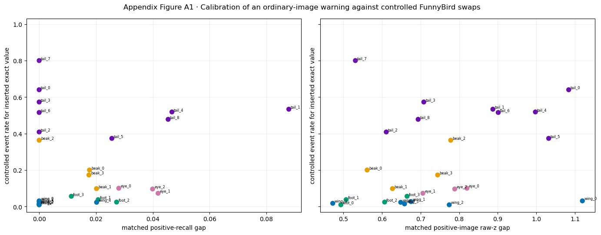


|  | part | concept_name | n_species_pairs | mean_recall_gap | mean_balanced_accuracy_gap | mean_positive_raw_z_gap | mean_label_conditioned_raw_z_gap | swap_rows | controlled_event_rate | donor_win_rate | median_response_delta | median_final_margin |
| --- | --- | --- | --- | --- | --- | --- | --- | --- | --- | --- | --- | --- |
| 0 | beak | beak_0 | 50 | 0.018 | NaN | 0.562 | NaN | 345 | 0.200 | 0.783 | 11.579 | 3.144 |
| 1 | beak | beak_1 | 45 | 0.020 | NaN | 0.627 | NaN | 245 | 0.098 | 0.898 | 13.377 | 3.960 |
| 2 | beak | beak_2 | 15 | 0.000 | NaN | 0.778 | NaN | 190 | 0.363 | 0.621 | 10.839 | 0.614 |
| 3 | beak | beak_3 | 50 | 0.018 | NaN | 0.744 | NaN | 220 | 0.173 | 0.823 | 12.253 | 2.426 |
| 4 | eye | eye_0 | 50 | 0.028 | NaN | 0.820 | NaN | 300 | 0.100 | 0.893 | 12.179 | 3.715 |
| 5 | eye | eye_1 | 50 | 0.042 | NaN | 0.706 | NaN | 345 | 0.072 | 0.916 | 13.138 | 4.247 |
| 6 | eye | eye_2 | 50 | 0.040 | NaN | 0.788 | NaN | 355 | 0.096 | 0.890 | 11.943 | 2.946 |
| 7 | foot | foot_0 | 50 | 0.000 | NaN | 0.493 | NaN | 220 | 0.009 | 0.977 | 14.747 | 6.397 |
| 8 | foot | foot_1 | 45 | 0.021 | NaN | 0.507 | NaN | 240 | 0.038 | 0.962 | 13.983 | 4.330 |
| 9 | foot | foot_2 | 50 | 0.027 | NaN | 0.607 | NaN | 290 | 0.024 | 0.976 | 14.646 | 5.813 |
| 10 | foot | foot_3 | 50 | 0.011 | NaN | 0.665 | NaN | 250 | 0.056 | 0.944 | 12.944 | 3.879 |
| 11 | tail | tail_0 | 6 | 0.000 | NaN | 1.084 | NaN | 75 | 0.640 | 0.293 | 10.260 | -2.150 |
| 12 | tail | tail_1 | 10 | 0.088 | NaN | 0.887 | NaN | 90 | 0.533 | 0.367 | 10.336 | -0.932 |
| 13 | tail | tail_2 | 21 | 0.000 | NaN | 0.611 | NaN | 120 | 0.408 | 0.525 | 11.379 | 0.163 |
| 14 | tail | tail_3 | 21 | 0.000 | NaN | 0.708 | NaN | 110 | 0.573 | 0.382 | 9.627 | -1.360 |
| 15 | tail | tail_4 | 6 | 0.047 | NaN | 0.997 | NaN | 110 | 0.518 | 0.318 | 9.047 | -3.283 |
| 16 | tail | tail_5 | 28 | 0.026 | NaN | 1.032 | NaN | 150 | 0.373 | 0.580 | 11.424 | 1.166 |
| 17 | tail | tail_6 | 10 | 0.000 | NaN | 0.901 | NaN | 130 | 0.515 | 0.362 | 9.978 | -1.289 |
| 18 | tail | tail_7 | 1 | 0.000 | NaN | 0.531 | NaN | 35 | 0.800 | 0.114 | 8.539 | -4.796 |
| 19 | tail | tail_8 | 28 | 0.045 | NaN | 0.694 | NaN | 180 | 0.478 | 0.467 | 10.417 | -0.378 |
| 20 | wing | wing_0 | 10 | 0.000 | NaN | 1.119 | NaN | 130 | 0.031 | 0.969 | 17.458 | 6.996 |
| 21 | wing | wing_1 | 36 | 0.000 | NaN | 0.675 | NaN | 150 | 0.027 | 0.973 | 15.283 | 5.101 |
| 22 | wing | wing_2 | 50 | 0.000 | NaN | 0.774 | NaN | 220 | 0.009 | 0.991 | 16.430 | 7.276 |
| 23 | wing | wing_3 | 10 | 0.000 | NaN | 0.472 | NaN | 115 | 0.017 | 0.983 | 16.580 | 5.350 |
| 24 | wing | wing_4 | 45 | 0.020 | NaN | 0.649 | NaN | 175 | 0.023 | 0.977 | 15.575 | 6.122 |
| 25 | wing | wing_5 | 45 | 0.000 | NaN | 0.658 | NaN | 210 | 0.014 | 0.986 | 16.880 | 6.607 |


|  | check | omitted_part | n_concepts | spearman_recall_vs_controlled_event |
| --- | --- | --- | --- | --- |
| 0 | all exact concepts | none | 26 | 0.157 |
| 1 | within-part centred | none | 26 | -0.369 |
| 2 | leave one part out | tail | 17 | 0.404 |
| 3 | leave one part out | wing | 20 | -0.169 |
| 4 | leave one part out | beak | 22 | 0.229 |
| 5 | leave one part out | foot | 22 | 0.122 |
| 6 | leave one part out | eye | 23 | 0.157 |


|  | recall_proxy_verdict | raw_z_gap_vs_controlled_event_spearman | eligible_exact_concepts | species_pairs | training |
| --- | --- | --- | --- | --- | --- |
| 0 | METHOD NOT CALIBRATED AS A BACKWASH PROXY | 0.404 | 26 | 832 | False |


### Appendix Figure A1 result


- **Matching rule selected from the actual labels:** `all-positive species matching`.


- **Literal result:** recall-gap versus controlled-event Spearman is
`0.157` overall and `-0.369` after subtracting each
part's mean. `4` of 5 leave-one-part-out correlations are
positive. The applicable raw-score companion correlation is
`0.404`.


- **What it supports:** `METHOD NOT CALIBRATED AS A BACKWASH PROXY`.


- Alternative explanation. Part identity, small within-species samples, and run-specific effects may contribute to an aggregate association.


- **What distinguishes it:** the within-part and omitted-part checks above,
followed by independent trained seeds.


- Scope. Successful calibration would support a provisional ordering under the evaluated FunnyBird conditions. Transfer to CUB and estimation of CUB event frequencies require additional evidence.


- Subsequent analysis: apply the same positive-recall-gap formula to CUB70 Figure 8. CUB70 has image-varying labels, so it additionally matches three positive and three negative images and reports balanced accuracy.


## Appendix example A2 · Interpretation of the calibration result


The calibration comprises separate computations and an empirical relationship test:


- **The controlled swap succeeded.** The renderer replaced one named
part while preserving the body, pose, camera, and background. The
accepted Standard CBM produced all 5,000 required swap rows. That is
where the controlled event rate on the vertical axis comes from.


- **The recall calculation succeeded.** On ordinary, unswapped images,
the saved concept output itself supplies the decision
`c_hat_j=1[z_j>0]`. No diagnostic classifier is fitted. For two
species that both carry exact concept `j`, the calculation is
`|positive_recall_A-positive_recall_B|`.


- Calibration result. The overall rank association is weakly positive and becomes negative after removing part means. The specified within-part condition is therefore unmet. This limits use of the recall gap to predict the ordering of controlled replacement outcomes.


Role of the controlled reference. FunnyBird replacement outcomes provide the empirical criterion against which the proposed recall proxy is evaluated. The calibration result concerns the relation between these two measurements.


Interpretation. The table ranks exact concepts by disagreement between recall-gap and replacement-outcome rankings. Equal recall among species can coexist with frequent retained-source outcomes after replacement. Recall remains informative about label agreement and species-dependent performance.


MCBM calibration status: INCOMPLETE. The historical recall notebook fitted diagnostics on intermediate visual features. The required comparison would use each accepted MCBM checkpoint’s final concept predictions and its corresponding 5,000 fixed-render rows. MCBM γ=0 retains the MCBM architecture and must be identified accordingly.


Scope. METHOD NOT CALIBRATED AS A BACKWASH PROXY for the evaluated Standard FunnyBird result. Recall remains a species-performance diagnostic. The corresponding MCBM calibration is a separate unresolved analysis.


|  | part | concept_name | mean_recall_gap | controlled_event_rate | swap_rows | recall_rank_high_to_low | event_rank_high_to_low | absolute_rank_disagreement |
| --- | --- | --- | --- | --- | --- | --- | --- | --- |
| 18 | tail | tail_7 | 0.000 | 0.800 | 35 | 15 | 1 | 14 |
| 9 | foot | foot_2 | 0.027 | 0.024 | 290 | 7 | 21 | 14 |
| 11 | tail | tail_0 | 0.000 | 0.640 | 75 | 15 | 2 | 13 |
| 14 | tail | tail_3 | 0.000 | 0.573 | 110 | 15 | 3 | 12 |
| 5 | eye | eye_1 | 0.042 | 0.072 | 345 | 4 | 16 | 12 |
| 24 | wing | wing_4 | 0.020 | 0.023 | 175 | 10 | 22 | 12 |
| 6 | eye | eye_2 | 0.040 | 0.096 | 355 | 5 | 15 | 10 |
| 7 | foot | foot_0 | 0.000 | 0.009 | 220 | 15 | 25 | 10 |
| 22 | wing | wing_2 | 0.000 | 0.009 | 220 | 15 | 25 | 10 |
| 17 | tail | tail_6 | 0.000 | 0.515 | 130 | 15 | 6 | 9 |


```text
Interpretation: a large rank disagreement means ordinary-image recall and controlled-swap backwash order the same exact value very differently. This is why the recall proxy was not calibrated.
```


# Methods appendix B · Calibration of supplementary image edits


These completed attempts are preserved because they delimit what CUB's
available masks can support:


- **Reciprocal whole-part deletion:** `METHOD NOT CALIBRATED FOR CROSS-DATASET CAUSAL COMPARISON`. The shared edit did not reproduce the
clean FunnyBird deletion and sometimes damaged meaningful control regions.


- Randomized patch masking V1/V2: selected examples supported local pixel response, with insufficient all-part calibration and wing coverage for population-level transfer.


- **Beak/tail paste pilot:** `VALID TEST, NO SUPPORT FOR POSITIVE DONOR RESPONSE`. Therefore its negative final margins cannot be interpreted as
retained-source backwash.


Scope. The supplementary edits remain uncalibrated for their intended causal use. The observational CUB analyses and controlled FunnyBird results retain their separately stated evidence status.


Code and recorded artifacts are preserved in the repository and CURATED_DATA.


# Provenance appendix


The table below records the live Git commit, prediction and mask inputs,
SHA-256 hashes, population counts, collapse tolerance, and exclusions.


|  | role | path | sha256 |
| --- | --- | --- | --- |
| 0 | official Koh CUB70 manifest | /scratch/network/cr7998/cv_emergence_project/c... | b7c8791f651c5b8cf95b7b90a6654b9b7bdd23ffe2d8a7... |
| 1 | official Koh CUB70 prediction export | /scratch/network/cr7998/cv_emergence_project/c... | ca093c219a9be6c7fdfac33271e2891e838c64228e0183... |
| 2 | visibility parquet | /scratch/network/cr7998/cv_emergence_project/c... | 5ea4acbdfdeddddb24e28abf68d4f35d47de3041efae30... |
| 3 | FunnyBird calibration manifest | /scratch/network/cr7998/cv_emergence_project/c... | 7ea2ee1f3e280360b02a3f6ac5d8a4519999ee8b4ea033... |
| 4 | FunnyBird controlled-swap manifest | /scratch/network/cr7998/cv_emergence_project/c... | 7ec59c531d56a19a3c3356dddce4aca742a0212e36d9e2... |


|  | git_commit | seed | training_protocol | target_epochs | prediction_images | mask_matched_images | species | exact_concepts | collapsed_concepts | collapse_tolerance | visibility_threshold_area_fraction |
| --- | --- | --- | --- | --- | --- | --- | --- | --- | --- | --- | --- |
| 0 | 71fb251c0a0bf0b7234397e078fd81c4b6e9a824 | 1 | koh_original | None | 1976 | 1888 | 70 | 112 | 0 | 1.000000e-08 | 0.001 |
